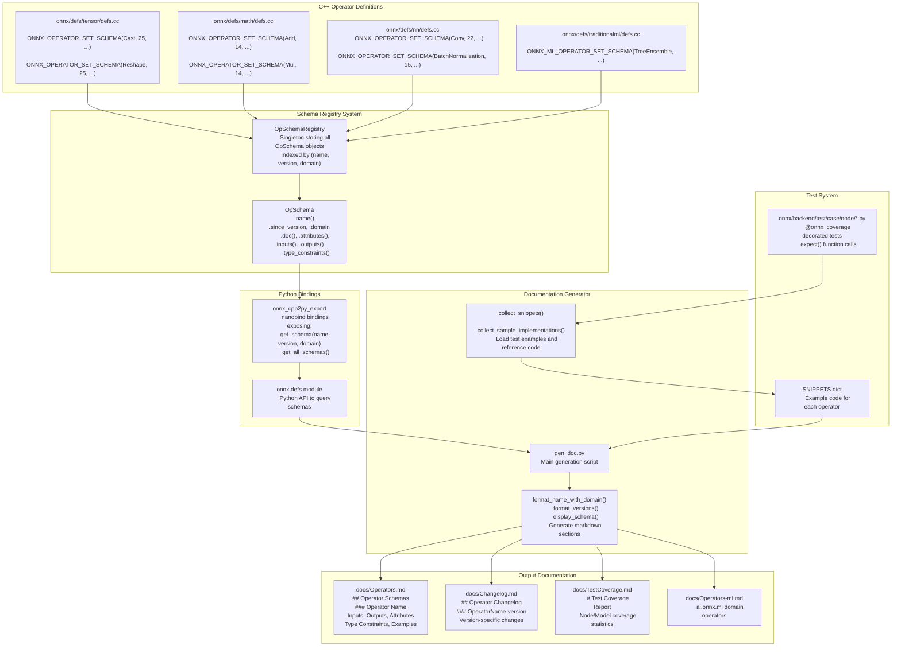
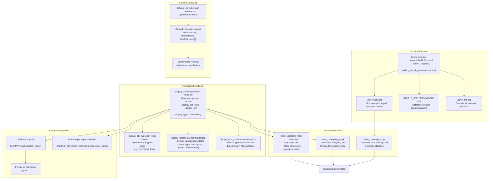

<!-- source: DeepWiki mcp.deepwiki.com · repo onnx/onnx · page 8.2 Operator Documentation Generation · fetched 2026-10-21 -->

# Operator Documentation Generation

<details>
<summary>Relevant source files</summary>

The following files were used as context for generating this wiki page:

- [docs/Changelog-ml.md](docs/Changelog-ml.md)
- [docs/Changelog.md](docs/Changelog.md)
- [docs/Operators-ml.md](docs/Operators-ml.md)
- [docs/Operators.md](docs/Operators.md)
- [docs/TestCoverage.md](docs/TestCoverage.md)
- [onnx/backend/test/case/node/cast.py](onnx/backend/test/case/node/cast.py)
- [onnx/backend/test/case/node/castlike.py](onnx/backend/test/case/node/castlike.py)
- [onnx/defs/__init__.py](onnx/defs/__init__.py)
- [onnx/defs/controlflow/defs.cc](onnx/defs/controlflow/defs.cc)
- [onnx/defs/controlflow/old.cc](onnx/defs/controlflow/old.cc)
- [onnx/defs/gen_doc.py](onnx/defs/gen_doc.py)
- [onnx/defs/math/defs.cc](onnx/defs/math/defs.cc)
- [onnx/defs/math/old.cc](onnx/defs/math/old.cc)
- [onnx/defs/nn/defs.cc](onnx/defs/nn/defs.cc)
- [onnx/defs/nn/old.cc](onnx/defs/nn/old.cc)
- [onnx/defs/operator_sets.h](onnx/defs/operator_sets.h)
- [onnx/defs/reduction/defs.cc](onnx/defs/reduction/defs.cc)
- [onnx/defs/rnn/defs.cc](onnx/defs/rnn/defs.cc)
- [onnx/defs/rnn/old.cc](onnx/defs/rnn/old.cc)
- [onnx/defs/tensor/defs.cc](onnx/defs/tensor/defs.cc)
- [onnx/defs/tensor/old.cc](onnx/defs/tensor/old.cc)
- [onnx/defs/traditionalml/defs.cc](onnx/defs/traditionalml/defs.cc)
- [onnx/defs/traditionalml/old.cc](onnx/defs/traditionalml/old.cc)
- [onnx/onnx_cpp2py_export/defs.pyi](onnx/onnx_cpp2py_export/defs.pyi)
- [onnx/onnx_cpp2py_export/shape_inference.pyi](onnx/onnx_cpp2py_export/shape_inference.pyi)
- [onnx/shape_inference.py](onnx/shape_inference.py)
- [onnx/test/inference_function_test.py](onnx/test/inference_function_test.py)
- [onnx/test/schema_test.py](onnx/test/schema_test.py)
- [onnx/test/shape_inference_test.py](onnx/test/shape_inference_test.py)

</details>


This page explains how ONNX operator documentation is automatically generated from C++ operator schema definitions. The system reads operator schemas from the `OpSchemaRegistry`, extracts metadata (descriptions, attributes, inputs, outputs, type constraints), and generates comprehensive markdown documentation files. For information about defining new operators and their schemas, see [Adding New Operators](#8.1).

## Overview

The operator documentation generation system automatically produces three primary documentation files from the C++ operator schemas:

| Output File | Purpose | Generation Source |
|------------|---------|-------------------|
| `docs/Operators.md` | Complete operator reference for `ai.onnx` domain | All registered operator schemas |
| `docs/Changelog.md` | Version history showing changes across opsets | Historical operator versions |
| `docs/Operators-ml.md` | ML operator reference for `ai.onnx.ml` domain | ONNX-ML specific operators |
| `docs/TestCoverage.md` | Test coverage report for operators | Backend test cases |

The generation process is triggered manually by running [onnx/defs/gen_doc.py:1-600]() and is part of the release process to keep documentation synchronized with code changes.

Sources: [docs/Operators.md:1-5](), [docs/Changelog.md:1-5](), [onnx/defs/gen_doc.py:1-50]()

## Documentation Generation Pipeline



**Documentation Generation Pipeline**: Shows the complete flow from C++ operator definitions to generated markdown documentation. Operator schemas defined in C++ are registered in `OpSchemaRegistry`, exposed to Python via nanobind, and queried by `gen_doc.py` to produce documentation files.

Sources: [onnx/defs/gen_doc.py:1-600](), [onnx/defs/schema.h:147-700](), [onnx/cpp2py_export.cc:1-100](), [onnx/defs/tensor/defs.cc:102-156]()

## The gen_doc.py Script

The [onnx/defs/gen_doc.py]() script is the main documentation generator. It queries the operator registry, extracts schema information, and formats it into markdown.

### Key Components



**gen_doc.py Script Structure**: Shows the organization and flow within the documentation generator. The script queries all schemas, groups them by domain and name, formats each schema section with examples, and writes multiple output files.

Sources: [onnx/defs/gen_doc.py:1-600]()

### Core Functions

The generator uses several key functions to process and format schema information:

| Function | Purpose | Return Type |
|----------|---------|-------------|
| `display_schema(schema, versions)` | Generate complete markdown section for operator | `str` |
| `display_attr_type(attr_type)` | Convert `OpSchema.AttrType` enum to readable string | `str` |
| `display_io(formal_params)` | Format inputs/outputs as markdown table | `str` |
| `display_type_constraints(constraints)` | Format type constraint mapping as table | `str` |
| `format_name_with_domain(domain, name)` | Create fully-qualified operator name | `str` |
| `format_versions(versions, changelog)` | Generate version links to changelog | `str` |
| `should_render_domain(domain, output)` | Determine if operator should be included | `bool` |

Sources: [onnx/defs/gen_doc.py:27-200]()

### Schema Data Extraction

For each `OpSchema` object retrieved from the registry, the generator extracts:

**Metadata**:
- `schema.name` - Operator name (e.g., "Cast", "Conv")
- `schema.domain` - Domain identifier (empty string for `ai.onnx`, `"ai.onnx.ml"` for ML)
- `schema.since_version` - Opset version when operator was introduced
- `schema.doc` - Human-readable documentation string

**Signature Information**:
- `schema.attributes` - List of `OpSchema.Attribute` objects with name, type, description, default value
- `schema.inputs` - List of `OpSchema.FormalParameter` for inputs
- `schema.outputs` - List of `OpSchema.FormalParameter` for outputs
- `schema.type_constraints` - Dict mapping type variable (e.g., "T") to allowed data types

**Functional Properties**:
- Differentiability category for each input/output
- Parameter options (Single, Optional, Variadic)
- Min arity for variadic parameters
- Homogeneity requirements for type constraints

Sources: [onnx/defs/schema.h:184-280](), [onnx/defs/gen_doc.py:100-300]()

## Output File Structure

### Operators.md Format

The [docs/Operators.md]() file follows a consistent structure:

```markdown
## Operator Schemas
*This file is automatically generated...*

### ai.onnx (default)
|**Operator**|**Since version**||
|Abs|13, 6, 1|
|Add|14, 13, 7, 6, 1|

## ai.onnx (default)
### Abs
  [Description text from schema.doc]

#### Version
  This version of the operator has been available since version 13...
  Other versions: 1, 6

#### Inputs
  X (differentiable) : T
    Input tensor

#### Outputs
  Y (differentiable) : T
    Output tensor

#### Type Constraints
  T : tensor(uint8), tensor(uint16), ...
    Constrain input and output types to all numeric tensors.

#### Examples
  [Code snippet from test cases]

#### Sample Implementation
  [Reference Python implementation]
```

Each operator section includes:
1. **Version header** with links to changelog for each version
2. **Inputs table** showing name, type variable, description, option (Single/Optional/Variadic), differentiability
3. **Outputs table** in same format as inputs
4. **Attributes table** (if any) with name, type, description, default value, required status
5. **Type Constraints table** mapping type variables to allowed data types
6. **Examples section** with test case code if available
7. **Sample Implementation section** with reference code if available

Sources: [docs/Operators.md:1-300](), [onnx/defs/gen_doc.py:150-400]()

### Changelog.md Format

The [docs/Changelog.md]() file organizes operators by version:

```markdown
## Operator Changelog

# ai.onnx (default)
## Version 25 of the default ONNX operator set
### Cast-25
  [Full operator documentation for version 25]
  
### Reshape-25
  [Full operator documentation for version 25]

## Version 24 of the default ONNX operator set
### Cast-24
  [Full operator documentation for version 24]
  
### TopK-24
  [Full operator documentation for version 24]
```

This format allows users to:
- See all operators introduced or changed in a specific opset version
- Compare operator definitions across versions
- Understand backward compatibility requirements

Sources: [docs/Changelog.md:1-100](), [onnx/defs/gen_doc.py:400-550]()

### TestCoverage.md Format

The [docs/TestCoverage.md]() file tracks test coverage:

```markdown
# Test Coverage Report (ONNX Core Operators)
## Summary
Node tests have covered 185/197 (93.91%) common operators.

## Covered Common Operators
### Abs
There are 1 test cases, listed as following:
<details>
<summary>abs</summary>
[Test code snippet]
</details>

## No Cover Common Operators
### UncoveredOperator
This operator has no test coverage.
```

The coverage report uses the `@onnx_coverage` pytest marker to track which operators have test cases and displays the actual test code for documentation purposes.

Sources: [docs/TestCoverage.md:1-100]()

## Schema Access from Python

The documentation generator accesses operator schemas through the Python API exposed by C++ bindings:

```python
from onnx import defs

# Get all schemas
all_schemas = defs.get_all_schemas()  # Returns list of OpSchema objects

# Get specific schema
schema = defs.get_schema("Conv", 22, "")  # name, version, domain

# Access schema properties
name = schema.name
domain = schema.domain
since_version = schema.since_version
doc = schema.doc
attributes = schema.attributes
inputs = schema.inputs
outputs = schema.outputs
type_constraints = schema.type_constraints
```

The bindings are implemented in [onnx/cpp2py_export.cc:1-1500]() using nanobind:

```cpp
nb::class_<OpSchema>(m, "OpSchema")
    .def_prop_ro("name", &OpSchema::Name)
    .def_prop_ro("domain", &OpSchema::domain)
    .def_prop_ro("since_version", &OpSchema::SinceVersion)
    .def_prop_ro("doc", &OpSchema::doc)
    .def_prop_ro("attributes", ...)
    .def_prop_ro("inputs", ...)
    .def_prop_ro("outputs", ...)
    .def_prop_ro("type_constraints", ...);

m.def("get_schema", [](const std::string& name, int version, 
                       const std::string& domain) {
    return OpSchemaRegistry::Schema(name, version, domain);
});

m.def("get_all_schemas", []() {
    return OpSchemaRegistry::get_all_schemas_with_history();
});
```

Sources: [onnx/cpp2py_export.cc:100-500](), [onnx/defs/__init__.py:1-50]()

## Regenerating Documentation

### Manual Regeneration

To regenerate all documentation files:

```bash
# From repository root
python onnx/defs/gen_doc.py

# This generates:
# - docs/Operators.md
# - docs/Changelog.md
# - docs/Operators-ml.md (if ONNX_ML=1)
# - docs/Changelog-ml.md (if ONNX_ML=1)
```

The script reads the `ONNX_ML` environment variable to determine whether to generate ML operator documentation:

```python
ONNX_ML = not bool(os.getenv("ONNX_ML") == "0")
```

Sources: [onnx/defs/gen_doc.py:24]()

### Automatic Regeneration in CI

Documentation regeneration is typically performed:

1. **Before releases** - Ensures documentation matches code
2. **After operator changes** - When new operators are added or schemas are modified
3. **During PR review** - Contributors may be asked to regenerate docs

The generated files should be committed to the repository so they remain synchronized with the schema definitions.

### Validation

After regeneration, verify:

1. **All operators appear** - Check table of contents includes expected operators
2. **Version links work** - Changelog references should be valid
3. **Examples render correctly** - Code snippets should be valid Python
4. **Type constraints are complete** - All type variables should have definitions
5. **ML operators separate** - `ai.onnx.ml` operators should only appear in `-ml.md` files

## Integration with Test System

### Test Case Collection

The generator integrates with the backend test system to include examples in documentation:

```python
from onnx.backend.test.case import collect_snippets
from onnx.backend.sample.ops import collect_sample_implementations

SNIPPETS = collect_snippets()  # Dict[str, str] - operator name to test code
SAMPLE_IMPLEMENTATIONS = collect_sample_implementations()  # Dict[str, str]
```

Test cases decorated with `@onnx_coverage` markers are automatically collected:

```python
# In onnx/backend/test/case/node/abs.py
@staticmethod
@onnx_coverage("Abs")
def export_abs() -> None:
    node = onnx.helper.make_node("Abs", inputs=["x"], outputs=["y"])
    x = np.random.randn(3, 4, 5).astype(np.float32)
    y = np.abs(x)
    expect(node, inputs=[x], outputs=[y], name="test_abs")
```

The `expect()` function generates serialized test data and also contributes to the code snippet collection for documentation.

Sources: [onnx/defs/gen_doc.py:22-23](), [docs/TestCoverage.md:19-36]()

### Coverage Statistics

The [docs/TestCoverage.md]() file is generated by analyzing:

1. **All registered schemas** - Total operator count
2. **Test cases with `@onnx_coverage` marker** - Covered operator count
3. **Coverage percentage** - Ratio of covered to total operators
4. **Missing operators** - List of operators without tests

The coverage report helps identify gaps in test coverage and ensures critical operators have examples for documentation.

Sources: [docs/TestCoverage.md:8-16]()

## Domain-Specific Documentation

### Standard Domain (ai.onnx)

The default ONNX domain (`""` or `"ai.onnx"`) contains core operators like:
- Tensor operations (Cast, Reshape, Transpose)
- Math operations (Add, Mul, MatMul)
- Neural network layers (Conv, BatchNormalization, LSTM)
- Activation functions (Relu, Sigmoid, Tanh)

These are documented in [docs/Operators.md]() and [docs/Changelog.md]().

### ML Domain (ai.onnx.ml)

The ONNX-ML domain (`"ai.onnx.ml"`) contains traditional ML operators:
- `TreeEnsembleClassifier` / `TreeEnsembleRegressor`
- `SVMClassifier` / `SVMRegressor`  
- `LinearClassifier` / `LinearRegressor`
- `Normalizer`, `Imputer`, `OneHotEncoder`
- `LabelEncoder`, `Binarizer`, `ArrayFeatureExtractor`

These are documented separately in [docs/Operators-ml.md]() and [docs/Changelog-ml.md]() and are only generated when `ONNX_ML=1` environment variable is set (which is the default unless explicitly disabled).

The `should_render_domain()` function controls which operators appear in which files:

```python
def should_render_domain(domain: str, output: str) -> bool:
    is_ml = "-ml" in output
    if domain == ONNX_ML_DOMAIN:
        return is_ml
    return not is_ml
```

Sources: [onnx/defs/gen_doc.py:33-37](), [docs/Operators-ml.md:1-20](), [onnx/defs/traditionalml/defs.cc:1-100]()

## Relationship to Operator Definitions

The documentation is directly generated from operator schema definitions in C++. When a developer adds a new operator using `ONNX_OPERATOR_SET_SCHEMA`:

```cpp
// In onnx/defs/tensor/defs.cc
ONNX_OPERATOR_SET_SCHEMA(
    Cast,
    25,
    OpSchema()
        .SetDoc(Cast_ver25_doc)  // Documentation string
        .Attr("to", "The data type to which...", AttributeProto::INT)
        .Input(0, "input", "Input tensor to be cast.", "T1", 
               OpSchema::Single, true, 1, OpSchema::Differentiable)
        .Output(0, "output", "Output tensor with...", "T2",
                OpSchema::Single, true, 1, OpSchema::Differentiable)
        .TypeConstraint("T1", OpSchema::all_non_complex_tensor_types_ir13(),
                        "Constrain input types...")
        .TypeConstraint("T2", OpSchema::all_non_complex_tensor_types_ir13(),
                        "Constrain output types...")
        .TypeAndShapeInferenceFunction([](InferenceContext& ctx) {
            // Shape inference logic
        }));
```

Every component of this schema definition maps directly to sections in the generated documentation:
- `.SetDoc()` → Operator description
- `.Attr()` → Attributes table
- `.Input()` → Inputs table with differentiability status
- `.Output()` → Outputs table
- `.TypeConstraint()` → Type Constraints table

This ensures documentation cannot drift from the actual operator implementation.

Sources: [onnx/defs/tensor/defs.cc:102-156](), [onnx/defs/schema.h:147-500]()

---

