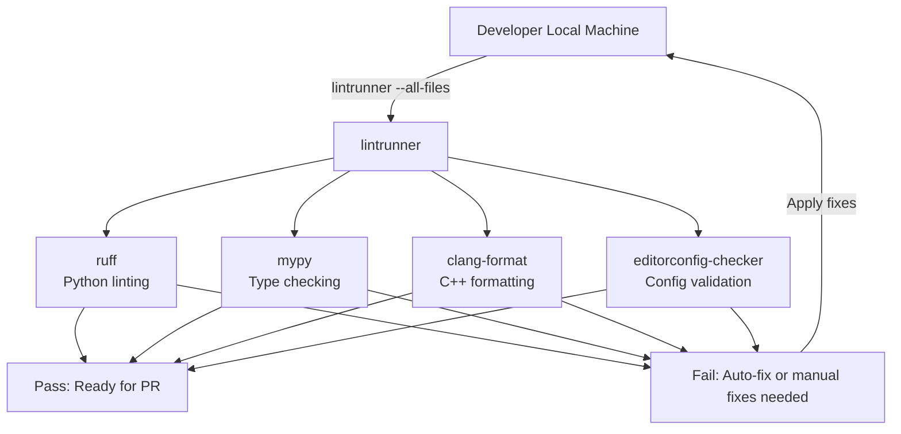
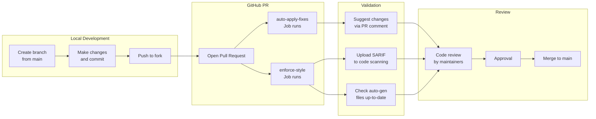
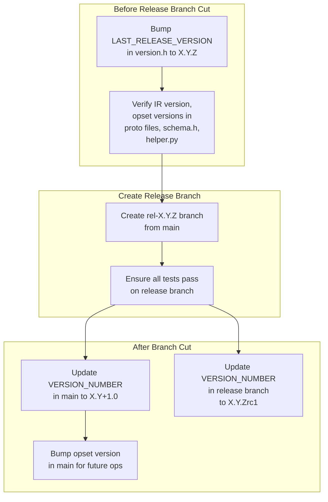
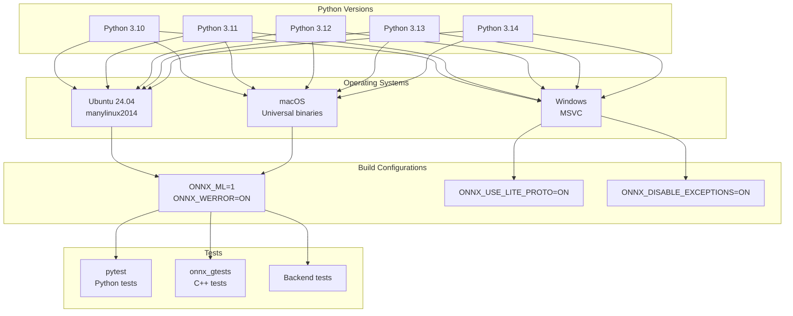

<!-- source: DeepWiki mcp.deepwiki.com · repo onnx/onnx · page 8.3 Contributing Guidelines and Development Workflow · fetched 2026-10-21 -->

# Contributing Guidelines and Development Workflow

<details>
<summary>Relevant source files</summary>

The following files were used as context for generating this wiki page:

- [.github/dependabot.yml](.github/dependabot.yml)
- [.github/workflows/check_urls.yml](.github/workflows/check_urls.yml)
- [.github/workflows/clang_tidy_review.yml](.github/workflows/clang_tidy_review.yml)
- [.github/workflows/clang_tidy_review_post.yml](.github/workflows/clang_tidy_review_post.yml)
- [.github/workflows/pr_checks_post.yml](.github/workflows/pr_checks_post.yml)
- [.github/workflows/reuse.yml](.github/workflows/reuse.yml)
- [.lintrunner.toml](.lintrunner.toml)
- [MANIFEST.in](MANIFEST.in)
- [pyproject.toml](pyproject.toml)
- [requirements-dev.txt](requirements-dev.txt)
- [requirements-lintrunner.txt](requirements-lintrunner.txt)
- [requirements.txt](requirements.txt)
- [tools/gen_coverage_report.py](tools/gen_coverage_report.py)

</details>


This document describes the development workflow, code quality standards, pull request process, and testing requirements for ONNX contributors. It covers the practical steps from setting up a development environment to getting changes merged into the repository.

For information about adding new operators, see [Adding New Operators](#8.1). For release orchestration and publishing, see [Release Orchestration and Publishing](#7.2). For continuous integration workflows, see [Continuous Integration Workflows](#7.1).

## Development Environment Setup

Contributors must set up their local environment with the required linting and testing tools before submitting code changes.

### Required Tools

The project uses several code quality tools that must be installed:

- **lintrunner** (>=0.10.7): Orchestrates multiple linters
- **ruff** (0.14.3): Python linting and formatting
- **mypy** (1.18.2): Static type checking
- **clang-format** (21.1.2): C++ code formatting
- **editorconfig-checker** (3.4.1): Editor configuration validation

Sources: [requirements-lintrunner.txt:1-12]()

### Installation Steps

```bash
# Install Python dependencies
python -m pip install lintrunner>=0.10.7
python -m pip install -r requirements-lintrunner.txt

# Initialize lintrunner
lintrunner init
```

Sources: [.github/workflows/lint.yml:82-87]()

## Code Quality Standards

### Linting Configuration

All code quality tools are configured through centralized configuration files that define the project's style standards.

#### Python Linting (Ruff)

Ruff is configured with 24 rule categories enabled in [pyproject.toml:118-149](). Key rules include:

| Category | Description |
|----------|-------------|
| `F` | Pyflakes - basic code errors |
| `E`, `W` | pycodestyle - PEP 8 style |
| `I` | isort - import sorting |
| `N` | pep8-naming - naming conventions |
| `D` | pydocstyle - docstring conventions |
| `UP` | pyupgrade - modern Python idioms |
| `PL` | pylint - comprehensive checking |
| `RUF` | Ruff-specific rules |

The configuration targets Python 3.10+ with `unsafe-fixes = true` enabled for automatic corrections.

Sources: [pyproject.toml:114-175]()

#### Type Checking (Mypy)

Mypy enforces strict type checking with these key settings:

- `strict_optional = true`: Require explicit Optional types
- `warn_return_any = true`: Warn on untyped return values
- `check_untyped_defs = true`: Type-check untyped function bodies
- `no_implicit_optional = true`: Disallow implicit None defaults

Generated protobuf files are excluded from type checking.

Sources: [pyproject.toml:61-99]()

#### C++ Formatting (clang-format)

C++ code is formatted using clang-format version 21.1.2 with a line length limit of 120 characters.

Sources: [.github/workflows/lint.yml:46-53](), [requirements-lintrunner.txt:8-9]()

### Lintrunner Workflow



Diagram: Lintrunner Orchestration Flow

Lintrunner coordinates all linting tools and produces a unified output. Running `lintrunner --all-files` executes all configured linters and reports issues in a consistent format.

Sources: [.github/workflows/lint.yml:88-96]()

## Pull Request Workflow

### Creating a Pull Request

When you create a pull request, several automated checks run to validate your changes.



Diagram: Pull Request Workflow from Local to Merge

Sources: [.github/workflows/pr_checks.yml:1-46](), [.github/workflows/lint.yml:55-128]()

### Automated PR Checks

#### Auto-Fix Suggestions

The `auto-apply-fixes` job runs lintrunner on all changed files and automatically suggests fixes via PR comments. This allows contributors to commit suggested changes directly from the GitHub UI.

Key workflow steps:
1. Checkout PR branch
2. Install lintrunner and dependencies
3. Run `lintrunner f --all-files -v`
4. Post suggested changes as PR comments

Sources: [.github/workflows/pr_checks.yml:20-46]()

#### Enforce Style

The `enforce-style` job validates that all code meets quality standards and that auto-generated files are up-to-date.

Validation steps:
1. **Install ONNX**: Builds ONNX with specific settings (ONNX_ML=1, ONNX_WERROR=ON, custom namespace)
2. **Run lintrunner**: Executes all linters on all files
3. **Produce SARIF**: Converts lint results to SARIF format
4. **Upload to code scanning**: Makes lint results visible in GitHub's code scanning dashboard
5. **Check auto-generated files**: Verifies documentation and protobuf files are current

Sources: [.github/workflows/lint.yml:55-128]()

### Auto-Generated Files Validation

The following files must be kept up-to-date when making changes that affect them:

| File | Generated By | Purpose |
|------|--------------|---------|
| `docs/Operators.md` | `onnx/defs/gen_doc.py` | Operator documentation |
| `docs/Changelog.md` | `onnx/defs/gen_doc.py` | Version changelog |
| `onnx/*.proto` | `onnx/gen_proto.py` | Protobuf definitions |
| `docs/TestCoverage.md` | `onnx/backend/test/stat_coverage.py` | Test coverage report |

The CI checks that running these generation scripts produces no git diff:

```bash
ONNX_ML=1 python onnx/defs/gen_doc.py
python onnx/gen_proto.py -l
python onnx/gen_proto.py -l --ml
python onnx/backend/test/stat_coverage.py
git diff --exit-code
```

Sources: [.github/workflows/lint.yml:112-127]()

## Testing Requirements

### Test Execution

All pull requests must pass the full test suite across multiple configurations. Tests are organized into:

- **Python tests**: Located in `onnx/test/`, run via pytest
- **C++ gtests**: Compiled as `onnx_gtests.exe` / `onnx_gtests`
- **Backend tests**: Validate operator implementations

Tests run across a matrix of:
- Python versions: 3.10, 3.11, 3.12, 3.13, 3.14
- Operating systems: Linux (Ubuntu), Windows, macOS
- Architectures: x86_64, arm64

Sources: [.github/workflows/release_mac.yml:28-29](), [.github/workflows/win_no_exception_ci.yml:25-26]()

### Backend Test Coverage

Operators must have corresponding backend tests defined using the `expect()` function. Test coverage is tracked and reported in `TestCoverage.md`.

Contributors adding or modifying operators should also add/update backend tests in `onnx/backend/test/case/node/`.

Sources: [.github/workflows/lint.yml:119]()

## Version Management

### Version Files

Three key files track version information:

| File | Content | Updated When |
|------|---------|--------------|
| `VERSION_NUMBER` | Next release version (e.g., "1.21.0") | After release branch cut |
| `onnx/common/version.h` | `LAST_RELEASE_VERSION` | With each release |
| `onnx/helper.py` | `VERSION_TABLE` | With each release |

Sources: [VERSION_NUMBER:1](), [onnx/common/version.h:12](), [onnx/helper.py:46-78]()

### Version Update Workflow



Diagram: Version Management During Release Branch Creation

Sources: [docs/OnnxReleases.md:29-44]()

### VERSION_TABLE Maintenance

The `VERSION_TABLE` in `onnx/helper.py` maps release versions to IR versions and opset versions. This table must be updated with each release:

```python
VERSION_TABLE: VersionTableType = [
    # (release-version, IR version, ai.onnx, ai.onnx.ml, ai.onnx.training)
    ("1.20.0", 13, 25, 5, 1),
    # Add new release here
]
```

The `find_min_ir_version_for()` function uses this table to determine the minimum IR version required for a given set of opset imports.

Sources: [onnx/helper.py:46-131](), [docs/OnnxReleases.md:33]()

## Documentation Requirements

### Code Documentation

All contributions should include appropriate documentation:

- **Python functions**: Google-style docstrings (enforced by ruff's `D` rules)
- **C++ classes/functions**: Doxygen-style comments
- **Operator changes**: Auto-generated via `gen_doc.py`

Sources: [pyproject.toml:184-185]()

### Auto-Documentation Workflow

When operator schemas change, documentation is automatically updated:

1. Operator definitions in `onnx/defs/*/defs.cc` include descriptions
2. `gen_doc.py` reads the schema registry
3. Generates `docs/Operators.md` and `docs/Changelog.md`
4. CI validates these files are current

For details on documentation generation, see [Operator Documentation Generation](#8.2).

Sources: [.github/workflows/lint.yml:116]()

## Common Development Tasks

### Running Linters Locally

```bash
# Run all linters on all files
lintrunner --all-files

# Run specific linter
lintrunner --filter RUFF --all-files

# Auto-fix issues where possible
lintrunner --all-files --take RUFF
```

### Testing Changes

```bash
# Install ONNX from source
pip install -e .

# Run Python tests
pytest onnx/test

# Run specific test file
pytest onnx/test/helper_test.py

# Run with coverage tracking
pytest --cov=onnx
```

### Updating Auto-Generated Files

```bash
# Generate operator documentation
ONNX_ML=1 python onnx/defs/gen_doc.py

# Generate protobuf files
python onnx/gen_proto.py -l
python onnx/gen_proto.py -l --ml

# Update test coverage report
python onnx/backend/test/stat_coverage.py
```

Sources: [.github/workflows/lint.yml:116-119]()

## Code Review Standards

### Review Criteria

Maintainers review pull requests for:

1. **Correctness**: Changes work as intended and don't break existing functionality
2. **Code quality**: Adheres to linting standards and type annotations
3. **Testing**: Adequate test coverage for new/modified code
4. **Documentation**: Code is documented, auto-generated files updated
5. **Breaking changes**: Follows versioning policy for operator changes

### Operator Changes

Changes to operator schemas are scrutinized carefully due to their impact on compatibility. See [Operator Versioning](docs/Versioning.md#operator-versioning) for the policy on breaking vs. non-breaking changes.

Breaking changes require:
- Incrementing the operator set version
- Creating a new operator version
- Registering in `operator_sets` header
- Adding version adapters in `convert.h`

Sources: [docs/Versioning.md:68-104]()

## Release Process Overview

The release process follows a structured workflow:

1. **Preparation**: Determine version, create release wiki page
2. **Branch Creation**: Cut release branch, update version numbers
3. **Testing**: Release candidates (rc1, rc2, ...) uploaded to PyPI
4. **Validation**: Partner validation, bug fixes cherry-picked
5. **Release**: Final version published to PyPI, GitHub release created
6. **Announcement**: Slack, email lists, ONNX news updated

For detailed release procedures, see [Release Orchestration and Publishing](#7.2) and [docs/OnnxReleases.md]().

### Release Branch Naming

Release branches follow the pattern `rel-X.Y.Z`, which automatically applies branch protection rules.

Sources: [docs/OnnxReleases.md:11-22]()

### Weekly Development Builds

The project publishes weekly builds to `onnx-weekly` on PyPI, allowing users to test unreleased features without affecting stable installations. This is managed through the `create_release.yml` workflow with `build_mode: preview`.

Sources: [RELEASE-MANAGEMENT.md:100-114]()

## Git Workflow

### Branching Strategy

- **main**: Development branch for the next release
- **rel-X.Y.Z**: Release branches for stabilization
- Feature branches: Created from `main`, merged via PR

### Commit Standards

While not strictly enforced, commits should:
- Have descriptive messages explaining "why" not just "what"
- Reference issue numbers when applicable
- Be signed off if required by the project

### Cherry-Picking to Release Branches

Bug fixes often need to be applied to both `main` and the current release branch:

1. Fix the bug in `main` first
2. Cherry-pick the commit to the release branch
3. Ensure tests pass on both branches

Sources: [docs/OnnxReleases.md:96-98]()

## Continuous Integration Matrix

The project maintains a comprehensive CI matrix to ensure compatibility:



Diagram: CI Build Matrix Across Platforms and Configurations

Sources: [.github/workflows/win_no_exception_ci.yml:24-26](), [.github/workflows/release_mac.yml:28-29]()

## Special Labels

Pull requests can use labels to trigger specific workflows:

| Label | Effect |
|-------|--------|
| `run release CIs` | Triggers release workflow builds on PRs |
| `auto update doc` | Triggers automatic documentation update workflow |

Sources: [.github/workflows/release_mac.yml:25](), [.github/workflows/auto_update_doc.yml:19]()