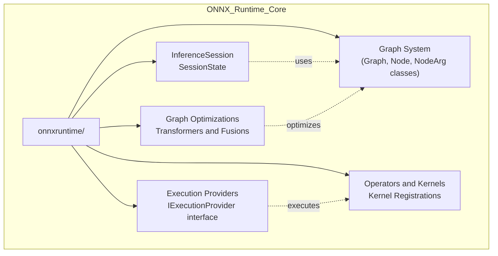
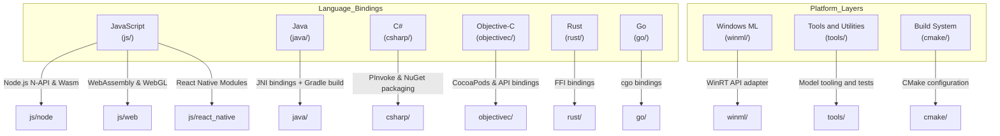

<!-- source: DeepWiki mcp.deepwiki.com · repo microsoft/onnxruntime · page 1.1 Repository Layout · fetched 2026-10-21 -->

# Repository Layout

<details>
<summary>Relevant source files</summary>

The following files were used as context for generating this wiki page:

- [README.md](README.md)
- [docs/Roadmap.md](docs/Roadmap.md)
- [java/README.md](java/README.md)
- [java/gradle/wrapper/gradle-wrapper.jar](java/gradle/wrapper/gradle-wrapper.jar)
- [java/gradlew](java/gradlew)
- [java/src/test/java/sample/ScoreMNIST.java](java/src/test/java/sample/ScoreMNIST.java)
- [java/testdata/cnn_mnist_pytorch.onnx](java/testdata/cnn_mnist_pytorch.onnx)
- [java/testdata/lr_mnist_scikit.onnx](java/testdata/lr_mnist_scikit.onnx)
- [js/README.md](js/README.md)
- [js/common/README.md](js/common/README.md)
- [js/node/.gitignore](js/node/.gitignore)
- [js/node/.npmignore](js/node/.npmignore)
- [js/node/README.md](js/node/README.md)
- [js/node/script/install.js](js/node/script/install.js)
- [js/node/script/prepack.ts](js/node/script/prepack.ts)
- [js/react_native/README.md](js/react_native/README.md)
- [js/react_native/app.plugin.js](js/react_native/app.plugin.js)
- [js/react_native/react-native.config.js](js/react_native/react-native.config.js)
- [js/react_native/scripts/bootstrap.js](js/react_native/scripts/bootstrap.js)
- [js/react_native/scripts/prepack.ts](js/react_native/scripts/prepack.ts)
- [js/react_native/unimodule.json](js/react_native/unimodule.json)
- [js/scripts/prepare-onnx-node-tests.ts](js/scripts/prepare-onnx-node-tests.ts)
- [js/scripts/utils.ts](js/scripts/utils.ts)
- [js/web/.gitignore](js/web/.gitignore)
- [js/web/.npmignore](js/web/.npmignore)
- [js/web/README.md](js/web/README.md)
- [js/web/script/prepack.ts](js/web/script/prepack.ts)
- [js/web/script/pull-prebuilt-wasm-artifacts.ts](js/web/script/pull-prebuilt-wasm-artifacts.ts)
- [js/web/types.d.ts](js/web/types.d.ts)
- [requirements-materialize-onnx-node-tests.txt](requirements-materialize-onnx-node-tests.txt)
- [tools/ci_build/github/azure-pipelines/templates/nodejs-artifacts-package-and-publish-steps-posix.yml](tools/ci_build/github/azure-pipelines/templates/nodejs-artifacts-package-and-publish-steps-posix.yml)
- [tools/ci_build/github/azure-pipelines/templates/nodejs-artifacts-package-and-publish-steps-windows.yml](tools/ci_build/github/azure-pipelines/templates/nodejs-artifacts-package-and-publish-steps-windows.yml)

</details>


This page provides a detailed breakdown of the top-level directory structure in the ONNX Runtime repository. Each directory corresponds to a major subsystem or language binding component of ONNX Runtime, and this document describes their roles, key responsibilities, and pointers to relevant code artifacts. This serves as a technical map for developers navigating the codebase.

---

## High-Level Repository Layout Overview

The ONNX Runtime repository is organized into several top-level directories, each embodying a subsystem responsible for a key area of the codebase:

| Directory        | Subsystem / Purpose                                                                                         | Related Wiki Pages            |
|------------------|------------------------------------------------------------------------------------------------------------|------------------------------|
| `onnxruntime/`   | Core ONNX Runtime engine including inference, graph representation, optimizations, kernels, and execution. | Core Architecture, Operators, Execution Providers, etc. |
| `orttraining/`   | ONNX Runtime training subsystem including ORTModule, gradients, training APIs, and graph construction.      | Training System               |
| `js/`            | JavaScript language bindings, including packages for common JS, Node.js, Web, and React Native environments. | Web and JavaScript Runtime, Language Bindings |
| `java/`          | Java language binding for ONNX Runtime via JNI. Includes Java API, Gradle-based build system, JNI glue.    | Language Bindings - Java      |
| `csharp/`        | .NET / C# bindings for ONNX Runtime, including P/Invoke interop and NuGet packaging.                        | Language Bindings - C#        |
| `objectivec/`    | Objective-C / Swift bindings for ONNX Runtime, focusing on iOS/macOS integration and CocoaPods packaging.  | Language Bindings - Objective-C |
| `rust/`          | Rust language bindings allowing safe Rust API access to ONNX Runtime.                                     | Language Bindings - Rust      |
| `go/`            | Go language bindings providing idiomatic Go API for ONNX Runtime.                                          | Language Bindings - Go        |
| `winml/`         | Windows ML (WinML) integration layer providing a WinRT API adapter to ONNX Runtime core.                   | Windows Platform Integration |
| `tools/`         | Various auxiliary tools for building, testing, benchmarking, quantization, and model optimization.         | Python Model Tooling, Testing Infrastructure |
| `cmake/`         | CMake build system files and modules, configuration macros, and common utilities used throughout the build. | Build System, CMake Configuration |

---

## Directory Details

### onnxruntime/

This is the heart of ONNX Runtime containing the C++ core runtime engine, graph system, execution framework, and operator implementations.

- **Contents:**
  - Core runtime code including classes for graph representation (`Graph`, `Node`, `NodeArg`).
  - Session management involving `InferenceSession` and `SessionState`.
  - Execution provider interface implementations for CPU, CUDA, and others.
  - Operator registrations and kernel implementations.
  - Graph transformation and optimization passes.

- **Key code entities:**
  - `InferenceSession` manages model loading, initialization, and execution.
  - Execution Provider interface (`IExecutionProvider`) defines plug-in extensibility.
  - Operator kernel registrations reside under `onnxruntime/core/providers/`.
  
- **Data Flow and Execution:**
  - Model is loaded and parsed into a graph.
  - Graph pass transformations and optimizations are applied.
  - Execution providers compile kernels and execute nodes.
  - Memory allocators and thread pools manage resources efficiently.

---

### orttraining/

Contains components for ONNX Runtime training support.

- **Contents:**
  - Implements `ORTModule` which wraps PyTorch `nn.Module` for ONNX Runtime acceleration.
  - Gradient graph builder and autograd integration.
  - Custom training kernels and operator gradient definitions.
  - Training session management and optimization passes for memory and compute.

- **Key code entities:**
  - `ORTModule` encapsulating PyTorch integration.
  - Gradient graph builder constructs backward graphs.
  - Training session APIs for checkpointing and optimizers.

- **Data Flow:**
  - Forward computation graph exported from PyTorch.
  - Gradient graph automatically generated and compiled.
  - Training loop runs forward and backward passes using ONNX Runtime execution kernels.

---

### js/

JavaScript bindings supporting multiple runtime environments:

- **Subfolders:**
  - `common/` - Contains shared pure TypeScript code usable across Node.js and browsers (e.g., `InferenceSession` interfaces, tensor types).
  - `node/` - Node.js binding that links native ONNX Runtime binaries via N-API.
  - `web/` - WebAssembly and WebGL backends compiled for browsers.
  - `react_native/` - React Native bindings with native modules for mobile.

- **Implementation Highlights:**
  - JavaScript API surface uses TypeScript.
  - `onnxruntime-node` downloads pre-built native binaries and provides idiomatic API for Node.js apps ([js/node/README.md]).
  - `onnxruntime-web` implements WebAssembly compilation of native ONNX Runtime code and exposes it to browsers ([js/web/README.md]).
  - A JavaScript-based installation system downloads platform-specific binaries and WebAssembly artifacts ([js/node/script/install.js], [js/web/script/pull-prebuilt-wasm-artifacts.ts]).

- **Call flow example:**
  ```mermaid
  graph TB
    JS_App[JavaScript App]
    ORM_Pkg[onnxruntime-node Package]
    Native_Bin[ONNXRuntime Native DLL/.so]
    Runtime_API[OrtApi C API]
    
    JS_App -->|Calls| ORM_Pkg
    ORM_Pkg -->|Interop| Native_Bin
    Native_Bin -->|Executes| Runtime_API
  ```

---

### java/

Java API binding for ONNX Runtime managed via JNI:

- **Components:**
  - JNI glue library enabling Java to call ONNX Runtime efficiently.
  - Gradle build scripts manage Java compilation and packaging.
  - Native libraries and JNI are built by main build system and consumed by Gradle tasks.
  - Supports Android usage and telemetry permissions integration.

- **Build system:**
  - CMake builds core `onnxruntime` and `onnxruntime4j_jni`.
  - Gradle builds Java classes and packages them with native libraries.
  - Java API classes reside under `java/src/main/java/ai/onnxruntime/`.

---

### csharp/

.NET bindings providing INFERENCE session abstraction for C#/.NET platforms.

- PInvoke wrappers for `OrtApi`.
- NuGet packaging for distribution.
- Managed lifecycle and exception handling interface for ONNX Runtime.
- Includes documentation, tests, and build scripts.

---

### objectivec/

Objective-C / Swift language binding targeted primarily for Apple platforms:

- Provides CocoaPods packaging.
- Interoperability with native Apple APIs.
- Used for iOS/macOS application integration with ONNX Runtime.

---

### rust/

Rust language binding providing safe idiomatic Rust API on top of ONNX Runtime.

- FFI to native ONNX Runtime.
- Error handling and lifecycle wrappers.
- Minimal overhead with Rust async/await support planned.

---

### go/

Go language binding enabling ONNX Runtime usage from Go applications.

- Uses cgo to bridge native API.
- Provides Go idiomatic API for model inference.

---

### winml/

Windows Machine Learning (WinML) integration layer:

- Provides a WinRT API surface with bindings into ONNX Runtime core.
- Includes adapter layers, image preprocessing helpers.
- Enables Windows-specific features such as telemetry and event tracing (ETW).
- Wraps DirectML operators with shape inference and fusion optimizations.

---

### tools/

A collection of supporting utilities and scripts:

- Python-based model tooling: quantization, transformer model optimizers.
- Test infrastructure for compliance, unit tests, benchmarks.
- CI and CD pipeline scripts.
- Code generation and validation tools.

---

### cmake/

Centralized CMake configuration and modules used by all build targets:

- Defines common build variables and options.
- Provides utility macros for target creation, dependency linking.
- Configures paths for external dependencies.
- Includes platform specific build adjustments.
- Orchestrates the build of core runtime, EPs, language bindings, and tests.

---

## Bridging Natural Language to Code Entities

The following Mermaid diagrams illustrate mappings between subsystem concepts and key code artifacts, assisting developers in navigating from conceptual understanding to actual code locations.

### Diagram 1: ONNX Runtime Core Subsystems to Key Code Artifacts



### Code Locations:
- Graph system classes: `onnxruntime/core/graph/graph.h` and related files.
- `InferenceSession` class: `onnxruntime/core/session/inference_session.cc/h`
- Execution Providers: `onnxruntime/core/providers/` subdirectories.
- Operator kernel registration: `onnxruntime/core/providers/cpu/` and other provider folders.
- Graph optimizers: `onnxruntime/core/optimizer/`

---

### Diagram 2: Language Bindings and Platform Interfaces to Code Layout



---

## Summary Table of Top-Level Directories and Their Roles

| Directory     | Role & Description                                                                                                     | Wiki Section                   |
|---------------|-----------------------------------------------------------------------------------------------------------------------|-------------------------------|
| `onnxruntime` | Core C++ runtime engine, graph handling, inference logic, execution providers, operators, and optimizations.           | 3. Core Architecture, 6. EPs, 7. Operators |
| `orttraining` | Training subsystem supporting PyTorch integration, autograd, custom kernels, gradient graph construction.             | 8. Training System             |
| `js`          | JavaScript/TypeScript language bindings including Node.js, WebAssembly, WebGL, React Native support for ONNX Runtime. | 10. Web and JavaScript Runtime |
| `java`        | Java binding with JNI glue, Gradle build integration, Android support, native library loading.                         | 5.5 Java and Android Bindings  |
| `csharp`      | .NET binding providing C# API with PInvoke layers, NuGet packaging, and memory management wrappers.                    | 5.3 C# Bindings                |
| `objectivec`  | Objective-C/Swift language binding for Apple platforms, CocoaPods packaging, and iOS/macOS compatibility.               | 5.6 Mobile and other bindings  |
| `rust`        | Rust native binding enabling safe ONNX Runtime calls from Rust applications.                                           | 5.6 Mobile and other bindings  |
| `go`          | Go language binding implemented via cgo for calling native ONNX Runtime APIs.                                         | 5.6 Mobile and other bindings  |
| `winml`       | Windows ML integration providing WinRT-based API surface and DML operator layer.                                      | 12. Windows Platform Integration |
| `tools`       | Collection of Python and other scripts for testing, quantization, benchmarking, and model optimization tooling.        | 11. Python Model Tooling, 9. Testing Infrastructure |
| `cmake`       | CMake build system files, macros, and utilities controlling build configuration and dependency management.             | 2.2 CMake Configuration        |

---

## Concluding Notes

This structured directory layout supports extensibility, multi-language language binding support, and cross-platform compatibility, aligned with ONNX Runtime’s goals of performance and broad hardware coverage. Each directory encapsulates discrete functionality and bridges the rich ONNX Runtime core with varied language ecosystems and target platforms.

---

# References

- `README.md` lines 1-53: Project overview and key concepts.
- `js/README.md` lines 1-201: JavaScript bindings overview and package breakdown.
- `js/web/README.md` lines 1-75: Details on ONNX Runtime Web directory.
- `js/node/README.md` lines 1-58: Node.js binding explanation and installation details.
- `java/README.md` lines 1-74: Java bindings and build system notes.
- `js/node/script/install.js` lines 1-135: Node.js binding installation logic for native binaries.
- `js/web/script/pull-prebuilt-wasm-artifacts.ts` lines 1-195: WASM artifact retrieval script.
- General knowledge from directory naming conventions and standard runtime binding patterns.

Sources:  
`README.md:1-53`  
`js/README.md:1-201`  
`js/web/README.md:1-75`  
`js/node/README.md:1-58`  
`java/README.md:1-74`  
`js/node/script/install.js:1-135`  
`js/web/script/pull-prebuilt-wasm-artifacts.ts:1-195`

---

