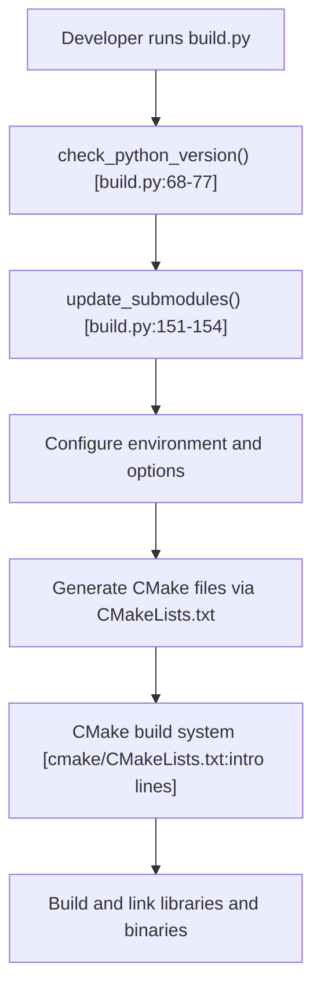
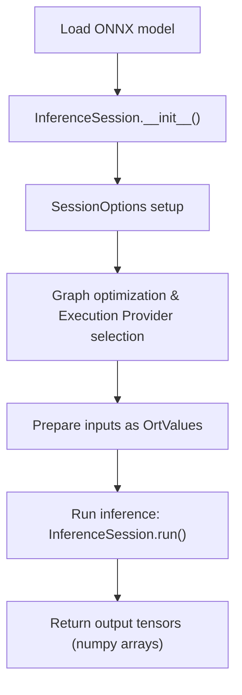

<!-- source: DeepWiki mcp.deepwiki.com · repo microsoft/onnxruntime · page 1.2 Getting Started · fetched 2026-10-21 -->

# Getting Started

<details>
<summary>Relevant source files</summary>

The following files were used as context for generating this wiki page:

- [.github/dependabot.yml](.github/dependabot.yml)
- [.lintrunner.toml](.lintrunner.toml)
- [.vscode/settings.json](.vscode/settings.json)
- [ThirdPartyNotices.txt](ThirdPartyNotices.txt)
- [cgmanifests/cgmanifest.json](cgmanifests/cgmanifest.json)
- [cmake/CMakeLists.txt](cmake/CMakeLists.txt)
- [cmake/deps.txt](cmake/deps.txt)
- [cmake/external/onnxruntime_external_deps.cmake](cmake/external/onnxruntime_external_deps.cmake)
- [cmake/node_helper.cmake](cmake/node_helper.cmake)
- [cmake/onnxruntime.cmake](cmake/onnxruntime.cmake)
- [cmake/onnxruntime_common.cmake](cmake/onnxruntime_common.cmake)
- [cmake/onnxruntime_framework.cmake](cmake/onnxruntime_framework.cmake)
- [cmake/onnxruntime_graph.cmake](cmake/onnxruntime_graph.cmake)
- [cmake/onnxruntime_optimizer.cmake](cmake/onnxruntime_optimizer.cmake)
- [cmake/onnxruntime_providers.cmake](cmake/onnxruntime_providers.cmake)
- [cmake/onnxruntime_providers_cpu.cmake](cmake/onnxruntime_providers_cpu.cmake)
- [cmake/onnxruntime_providers_webgpu.cmake](cmake/onnxruntime_providers_webgpu.cmake)
- [cmake/onnxruntime_python.cmake](cmake/onnxruntime_python.cmake)
- [cmake/onnxruntime_session.cmake](cmake/onnxruntime_session.cmake)
- [cmake/onnxruntime_training.cmake](cmake/onnxruntime_training.cmake)
- [cmake/onnxruntime_unittests.cmake](cmake/onnxruntime_unittests.cmake)
- [dockerfiles/Dockerfile.cuda](dockerfiles/Dockerfile.cuda)
- [dockerfiles/Dockerfile.migraphx](dockerfiles/Dockerfile.migraphx)
- [dockerfiles/Dockerfile.openvino](dockerfiles/Dockerfile.openvino)
- [dockerfiles/Dockerfile.source](dockerfiles/Dockerfile.source)
- [dockerfiles/Dockerfile.tensorrt](dockerfiles/Dockerfile.tensorrt)
- [dockerfiles/Dockerfile.vitisai](dockerfiles/Dockerfile.vitisai)
- [dockerfiles/README.md](dockerfiles/README.md)
- [dockerfiles/scripts/install_common_deps.sh](dockerfiles/scripts/install_common_deps.sh)
- [docs/BuildWithDawnAgilitySDK.md](docs/BuildWithDawnAgilitySDK.md)
- [docs/Coding_Conventions_and_Standards.md](docs/Coding_Conventions_and_Standards.md)
- [docs/How_To_Update_ONNX_Dev_Notes.md](docs/How_To_Update_ONNX_Dev_Notes.md)
- [docs/cmake_guideline.md](docs/cmake_guideline.md)
- [onnxruntime/python/backend/backend.py](onnxruntime/python/backend/backend.py)
- [onnxruntime/python/backend/backend_rep.py](onnxruntime/python/backend/backend_rep.py)
- [onnxruntime/test/python/onnxruntime_test_python_backend.py](onnxruntime/test/python/onnxruntime_test_python_backend.py)
- [onnxruntime/test/python/onnxruntime_test_python_backend_mlops.py](onnxruntime/test/python/onnxruntime_test_python_backend_mlops.py)
- [onnxruntime/test/python/onnxruntime_test_python_cudagraph.py](onnxruntime/test/python/onnxruntime_test_python_cudagraph.py)
- [onnxruntime/test/python/onnxruntime_test_python_keras.py](onnxruntime/test/python/onnxruntime_test_python_keras.py)
- [onnxruntime/test/python/onnxruntime_test_python_mlops.py](onnxruntime/test/python/onnxruntime_test_python_mlops.py)
- [onnxruntime/test/python/onnxruntime_test_python_sparse_matmul.py](onnxruntime/test/python/onnxruntime_test_python_sparse_matmul.py)
- [pyproject.toml](pyproject.toml)
- [requirements-dev.txt](requirements-dev.txt)
- [requirements-lintrunner.txt](requirements-lintrunner.txt)
- [requirements-training.txt](requirements-training.txt)
- [requirements.txt](requirements.txt)
- [setup.py](setup.py)
- [tools/ci_build/build.py](tools/ci_build/build.py)
- [tools/ci_build/build_args.py](tools/ci_build/build_args.py)
- [tools/ci_build/gen_def.py](tools/ci_build/gen_def.py)
- [tools/ci_build/github/linux/docker/Dockerfile.ubuntu_openvino](tools/ci_build/github/linux/docker/Dockerfile.ubuntu_openvino)
- [tools/ci_build/github/linux/docker/Dockerfile.ubuntu_tensorrt_bin](tools/ci_build/github/linux/docker/Dockerfile.ubuntu_tensorrt_bin)
- [tools/ci_build/github/linux/docker/scripts/install_os_deps.sh](tools/ci_build/github/linux/docker/scripts/install_os_deps.sh)
- [tools/ci_build/github/linux/docker/scripts/install_ubuntu.sh](tools/ci_build/github/linux/docker/scripts/install_ubuntu.sh)
- [tools/ci_build/github/linux/docker/scripts/manylinux/install_shared_deps.sh](tools/ci_build/github/linux/docker/scripts/manylinux/install_shared_deps.sh)
- [tools/python/find_optimizer_opset_version_updates_required.py](tools/python/find_optimizer_opset_version_updates_required.py)

</details>


This page provides a detailed technical guide on how to build, install, and run a first inference using the ONNX Runtime codebase. It covers the build orchestration, pointing to relevant Dockerfiles for containerized environments, and highlights sample usage for running inference. This guide is intended for developers seeking to integrate or contribute to ONNX Runtime and want to quickly set up a working environment for inference tasks.

---

## 1. Building ONNX Runtime

### 1.1 Build System Overview

ONNX Runtime uses a CMake-based build system orchestrated primarily by the Python script `build.py` located in `tools/ci_build/build.py`. This script:

- Checks the Python environment version (requires Python ≥ 3.8).
- Handles platform-specific environment variable settings.
- Runs submodule updates.
- Orchestrates calls to CMake and the underlying compiler toolchain(s).
- Provides many build-time options such as enabling CUDA or other execution providers, static analysis, unit tests, and training support.

The main project CMakeLists is located at `cmake/CMakeLists.txt` and sets compilation standards, compiler flags, and options for execution providers and other features like Python bindings.

### 1.2 Using `build.py` to Build

Invoke the build script from the root repository directory:

```bash
python3 tools/ci_build/build.py --build_dir build --config Release --build_shared_lib --parallel --enable_cpu
```

This is a typical command to build the shared CPU-only ONNX Runtime library.

- `--build_dir` specifies the output directory for intermediate and final build artifacts.
- `--config` specifies build configuration, e.g., Debug or Release.
- `--build_shared_lib` builds a shared library instead of a static one.
- `--parallel` builds using multiple cores.
- `--enable_cpu` enables building the CPU execution provider.

The build script dynamically assembles the CMake command line based on flags provided, supports handling dependencies, and prepares the build environment per platform.

### 1.3 Key Build Options

- `--use_cuda`: Enable building with CUDA execution provider.
- `--enable_training`: Include training components.
- `--enable_python`: Build and install Python bindings.
- `--enable_openvino`, `--enable_tensorrt`, `--enable_coreml`, etc.: Enable respective hardware accelerators.
- `--build_tests`: Build unit and integration tests.

---

## 2. Dockerfiles for Environment Setup

ONNX Runtime provides official Dockerfiles for quick environment setup with prebuilt dependencies and environment configurations tailored to different execution providers.

### 2.1 Available Docker Images

Refer to `dockerfiles/README.md` for a summary of supported Docker images:

| Execution Provider              | Dockerfile               | Notes/Platform                       |
|-------------------------------|-------------------------|------------------------------------|
| CPU (x86_64 and ARM64)         | `Dockerfile.source`      | Supports Python bindings            |
| CUDA                          | `Dockerfile.cuda`        | CUDA 12.x, CuDNN 9.x on Ubuntu 24.04 |
| TensorRT                      | `Dockerfile.tensorrt`    | CUDA 11.8, TensorRT 8.5.1 on Ubuntu 20.04 |
| OpenVINO                      | `Dockerfile.openvino`    | Supports Python and C# bindings    |
| MIGraphX                      | `Dockerfile.migraphx`    |                                   |
| VitisAI                      | `Dockerfile.vitisai`     |                                   |
| NVIDIA Jetson (TX1/TX2/Xavier/Nano) | `Dockerfile.jetson`   | For embedded ARM devices           |

### 2.2 Sample Docker Usage

Build a CPU-based Docker image from the root directory:

```bash
docker build -t onnxruntime-source -f dockerfiles/Dockerfile.source ..
```

Run the built image interactively:

```bash
docker run -it onnxruntime-source
```

For CUDA:

```bash
docker build -t onnxruntime-cuda -f dockerfiles/Dockerfile.cuda --build-arg CUDA_VERSION=12.x --build-arg CUDNN_VERSION=9.x ..
docker run --rm --gpus all -it onnxruntime-cuda
```

This offers a fully contained environment for development, testing, and inference execution.

---

## 3. Installing and Running a First Inference

### 3.1 Python Installation

The Python bindings are built optionally with the `--enable_python` flag. The Python package is managed by `setup.py` in the root directory.

To build and install the Python wheel locally after building with Python enabled:

```bash
pip install .
```

Alternatively, install from PyPI for a prebuilt package:

```bash
pip install onnxruntime
```

### 3.2 Sample Code to Run an Inference

Below is an example using the Python API with `InferenceSession`:

```python
import onnxruntime as ort
import numpy as np

# Load ONNX model
session = ort.InferenceSession("model.onnx")

# Prepare input data (assume single input named 'input')
inputs = {"input": np.random.rand(1, 3, 224, 224).astype(np.float32)}

# Run inference
outputs = session.run(None, inputs)

print("Output:", outputs)
```

### 3.3 C++ Usage

The main API class for inference is `onnxruntime::InferenceSession`. The typical lifecycle is:

1. Construct the environment `onnxruntime::Env`.
2. Create a `InferenceSession` with `SessionOptions`.
3. Initialize the session with `Load` or `Initialize`.
4. Run inference with `Run`.

Detailed documentation for C++ API and examples can be found in the `onnxruntime/` folder and samples.

---

## 4. Implementation and Data Flow Highlights

### 4.1 Build Orchestration (`tools/ci_build/build.py`)

- Starts by checking Python version and resolving pre-requisite executables.
- Pulls git submodules recursively.
- Prepares symlinks or shortcuts for model and test data.
- Resolves and applies environment variables for different platforms.
- Delegates to CMake to generate build system files for the selected generator (e.g., Ninja, MSBuild).
- Invokes the CMake build with requested configurations and parallelism.

### 4.2 CMake Build System (`cmake/CMakeLists.txt`)

- Defines global project settings.
- Sets compiler standards and flags, including platform-specific options.
- Enables/disables build features via options.
- Loads sub-CMake files for providers, tests, and dependencies.
- Generates build targets: static/shared libraries, Python extensions, sample executables, and tests.
- Handles linking and symbol exporting for shared libraries.

### 4.3 Key Classes for Running Inference

- **`onnxruntime::InferenceSession`**: Central class managing model loading, session initialization, and inference execution.
- **`SessionOptions`**: Configures session properties like optimization level, threading, providers.
- **`Env`**: Global runtime environment.
- **`OrtApi` / `OrtSession` (C API)**: Stable API for external language bindings.
  
These classes interact to load an ONNX model protobuf file, optimize the computation graph, select execution providers, allocate input/output tensors, and execute the graph for inference results.

---

## 5. Diagrams

### 5.1 High-Level Build Flow



### 5.2 Inference Execution Flow (Python API)



### 5.3 Mapping of Natural Language Concepts to Code Entities for Building ONNX Runtime

```mermaid
graph LR
    "Build Script" -->|"runs"| "tools/ci_build/build.py[build.py:1-197]"
    "CMake Configuration" -->|"defined in"| "cmake/CMakeLists.txt[cmake/CMakeLists.txt:1-118]"
    "Build Options" -->|"parsed by"| "tools/ci_build/build.py[build.py:20-180]"
    "Build Artifacts" -->|"produced by"| "CMake build targets"
    "Execution Providers" -->|"managed by"| "cmake/onnxruntime_providers.cmake"
```

### 5.4 Mapping of Running Inference with Python to Code Entities

```mermaid
graph LR
    "Python API" -->|"uses"| "onnxruntime_pybind11_state (C++ Python bindings) [cmake/onnxruntime_python.cmake:1-152]"
    "InferenceSession" -->|"C++ Class"| "onnxruntime::InferenceSession"
    "SessionOptions" -->|"C++ Class"| "onnxruntime::SessionOptions"
    "Run()" -->|"calls"| "SessionState->Execute()"
    "Input Tensors" -->|"converted to"| "OrtValue"
```

---

## 6. Summary and References

- Building ONNX Runtime is centralized through `tools/ci_build/build.py`, which manages environment, configuration, and orchestration of the CMake build system.
- The core CMakeLists controls the compilation mechanics and inclusion of optional features.
- Dockerfiles in `dockerfiles/` provide pre-configured container environments supporting CPU, CUDA, TensorRT, OpenVINO, and other providers.
- The Python package built by `setup.py` uses pybind11-based bindings that call into the core C++ runtime to load models and run inference.
- Sample inference code is simple using the Python bindings (`InferenceSession`), while C++ allows deeper customization.
- This page serves as the technical onboarding for developers who want to build and execute models with ONNX Runtime.

---

**Sources:**  
- `tools/ci_build/build.py:1-197`  
- `cmake/CMakeLists.txt:1-118`  
- `dockerfiles/README.md:1-153`  
- `setup.py:1-181`  
- `cmake/onnxruntime_python.cmake:1-152`  
- `cmake/onnxruntime_providers.cmake`  
- `cmake/onnxruntime.cmake:1-154`

---

