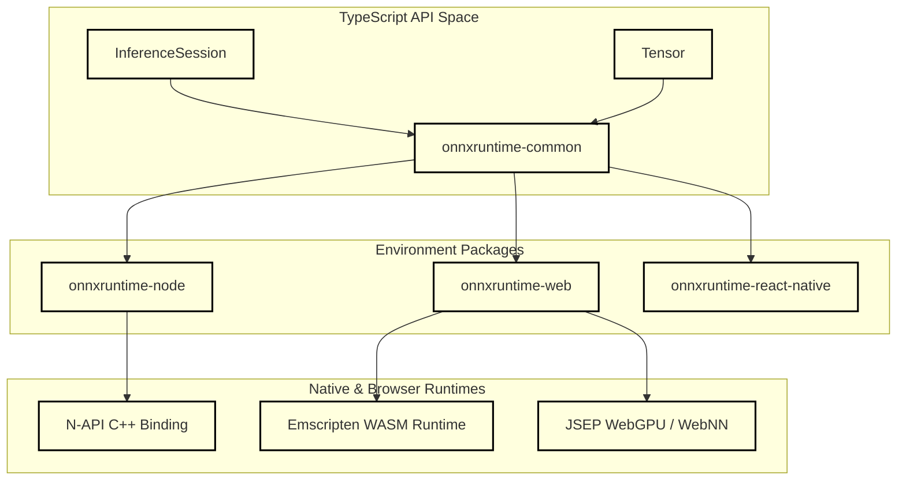

<!-- source: DeepWiki mcp.deepwiki.com · repo microsoft/onnxruntime · page 10 Web and JavaScript Runtime · fetched 2026-10-21 -->

# Web and JavaScript Runtime

Relevant source files

The following files were used as context for generating this wiki page:

- [js/.vscode/settings.json](js/.vscode/settings.json)
- [js/README.md](js/README.md)
- [js/common/README.md](js/common/README.md)
- [js/common/tsconfig.json](js/common/tsconfig.json)
- [js/node/.gitignore](js/node/.gitignore)
- [js/node/.npmignore](js/node/.npmignore)
- [js/node/README.md](js/node/README.md)
- [js/node/script/install.js](js/node/script/install.js)
- [js/node/script/prepack.ts](js/node/script/prepack.ts)
- [js/node/tsconfig.json](js/node/tsconfig.json)
- [js/package-lock.json](js/package-lock.json)
- [js/package.json](js/package.json)
- [js/react_native/README.md](js/react_native/README.md)
- [js/react_native/app.plugin.js](js/react_native/app.plugin.js)
- [js/react_native/react-native.config.js](js/react_native/react-native.config.js)
- [js/react_native/scripts/bootstrap.js](js/react_native/scripts/bootstrap.js)
- [js/react_native/scripts/prepack.ts](js/react_native/scripts/prepack.ts)
- [js/react_native/unimodule.json](js/react_native/unimodule.json)
- [js/scripts/prepare-onnx-node-tests.ts](js/scripts/prepare-onnx-node-tests.ts)
- [js/scripts/utils.ts](js/scripts/utils.ts)
- [js/tsconfig.json](js/tsconfig.json)
- [js/tsconfig.tools.json](js/tsconfig.tools.json)
- [js/web/.gitignore](js/web/.gitignore)
- [js/web/.npmignore](js/web/.npmignore)
- [js/web/README.md](js/web/README.md)
- [js/web/script/prepack.ts](js/web/script/prepack.ts)
- [js/web/script/pull-prebuilt-wasm-artifacts.ts](js/web/script/pull-prebuilt-wasm-artifacts.ts)
- [js/web/script/tsconfig.json](js/web/script/tsconfig.json)
- [js/web/test/data/ops/_example.jsonc](js/web/test/data/ops/_example.jsonc)
- [js/web/test/data/ops/gelu.jsonc](js/web/test/data/ops/gelu.jsonc)
- [js/web/test/data/ops/pad-big.jsonc](js/web/test/data/ops/pad-big.jsonc)
- [js/web/test/data/ops/pad.jsonc](js/web/test/data/ops/pad.jsonc)
- [js/web/test/data/ops/pow-big-number.jsonc](js/web/test/data/ops/pow-big-number.jsonc)
- [js/web/test/data/ops/resize-pack.jsonc](js/web/test/data/ops/resize-pack.jsonc)
- [js/web/test/data/ops/split.jsonc](js/web/test/data/ops/split.jsonc)
- [js/web/test/op-test-schema.json](js/web/test/op-test-schema.json)
- [js/web/tsconfig.json](js/web/tsconfig.json)
- [js/web/types.d.ts](js/web/types.d.ts)
- [onnxruntime/core/providers/webgpu/tensor/split.cc](onnxruntime/core/providers/webgpu/tensor/split.cc)
- [onnxruntime/core/providers/webgpu/tensor/split.h](onnxruntime/core/providers/webgpu/tensor/split.h)
- [requirements-materialize-onnx-node-tests.txt](requirements-materialize-onnx-node-tests.txt)
- [tools/ci_build/github/azure-pipelines/templates/nodejs-artifacts-package-and-publish-steps-posix.yml](tools/ci_build/github/azure-pipelines/templates/nodejs-artifacts-package-and-publish-steps-posix.yml)
- [tools/ci_build/github/azure-pipelines/templates/nodejs-artifacts-package-and-publish-steps-windows.yml](tools/ci_build/github/azure-pipelines/templates/nodejs-artifacts-package-and-publish-steps-windows.yml)

## Purpose and Scope

The Web and JavaScript Runtime subsystem of ONNX Runtime enables high-performance machine learning inference across web browsers, Node.js environments [js/web/README.md:1-3](), and mobile cross-platform frameworks like React Native [js/README.md:1-9](). By bridging standard TypeScript APIs [js/README.md:61-94]() with underlying WebAssembly (WASM) execution [js/web/README.md:15-16](), WebGL/WebGPU acceleration [js/web/README.md:15-16](), and native Node bindings [js/node/README.md:1-4](), developers can run complex ONNX models entirely client-side without installation overhead or server dependencies [js/web/README.md:7-14]().

This page serves as a high-level parent overview of the JavaScript ecosystem, WASM compilation architecture, and hardware-accelerated backends. For granular implementation specifics, refer to the dedicated child sections:
- For package structures and TypeScript interfaces, see [JavaScript Packages and API](#10.1).
- For Emscripten configurations and WASM execution plumbing, see [WebAssembly Build and Runtime](#10.2).
- For WebGPU kernel implementations and shader helpers, see [JSEP WebGPU Kernels](#10.3).

Sources: [js/README.md:1-9](), [js/web/README.md:1-16](), [js/node/README.md:1-4]()

---

## Architectural Overview

The JavaScript runtime is structured around modular npm packages sharing a unified high-level `InferenceSession` and `Tensor` contract defined in `onnxruntime-common`. Depending on the target environment, execution is dispatched to either native binaries (`onnxruntime-node`), Emscripten-compiled WebAssembly engines (`onnxruntime-web`), or hardware acceleration pipelines via JSEP (JavaScript Execution Provider) utilizing WebGPU and WebNN.

### System Architecture Diagram

*Figure 1: Architectural relationship between TypeScript interfaces, packaging targets, and underlying execution runtimes.*

Sources: [js/README.md:1-110](), [js/web/README.md:1-16]()

---

## 10.1 JavaScript Packages and API

The ONNX Runtime JavaScript ecosystem is divided into separate npm packages located under the `js/` directory [js/README.md:1-9](). These packages decouple shared session definitions from environment-specific execution bindings [js/README.md:61-146]().

- **`onnxruntime-common`**: Houses pure TypeScript code, defining portable abstractions like `InferenceSession`, `Tensor`, `OnnxValue`, and backend registration helpers [js/README.md:61-94]().
- **`onnxruntime-node`**: Provides Node.js bindings using native N-API wrappers and dynamically loaded shared libraries (`.so`, `.dll`, `.dylib`) [js/node/README.md:1-11]().
- **`onnxruntime-web`**: Delivers browser-based inference leveraging WebAssembly, WebGL, and WebGPU/WebNN [js/web/README.md:1-16]().
- **`onnxruntime-react-native`**: Integrates ONNX Runtime into React Native mobile applications [js/README.md:1-9]().

For detailed package layout, build instructions, and API references, see [JavaScript Packages and API](#10.1).

Sources: [js/README.md:1-110](), [js/node/README.md:1-11](), [js/web/README.md:1-16]()

---

## 10.2 WebAssembly Build and Runtime

To support near-native CPU execution inside web browsers and Node.js environments, the core C++ ONNX Runtime engine is compiled to WebAssembly via Emscripten [js/web/README.md:15-16](). 

The build infrastructure manages toolchain flags, threading (via Web Workers and `pthread`), SIMD optimizations, and asynchronous loading configurations (`asyncify`, `jspi`) [js/web/script/pull-prebuilt-wasm-artifacts.ts:141-174](). The WASM runtime interacts with JavaScript through specialized glue layers (`wasm/api.cc` and `wasm-core-impl`), handling memory allocation, tensor marshaling, and session options configuration.

For deeper coverage of CMake build rules (`onnxruntime_webassembly.cmake`), API bridging, and memory management, see [WebAssembly Build and Runtime](#10.2).

Sources: [js/web/README.md:1-16](), [js/web/script/pull-prebuilt-wasm-artifacts.ts:141-174]()

---

## 10.3 JSEP WebGPU Kernels

The JavaScript Execution Provider (JSEP) architecture allows hardware-accelerated kernels to be implemented directly in TypeScript and executed via WebGPU or WebNN APIs. 

JSEP handles operator resolution, shader generation, uniform variable packing, and buffer dispatch [onnxruntime/core/providers/webgpu/tensor/split.cc:11-140](). Kernels dynamically generate WGSL (WebGPU Shading Language) code, leveraging helper classes such as `ShaderHelper` to manage input/output mappings, bounds checking, and vec4 vectorization optimizations [onnxruntime/core/providers/webgpu/tensor/split.cc:11-46]().

For detailed information on JSEP op resolution rules, shader helper APIs, and the comprehensive web operator test suite (`js/web/test/data/ops/`), see [JSEP WebGPU Kernels](#10.3).

Sources: [onnxruntime/core/providers/webgpu/tensor/split.cc:11-140](), [js/web/README.md:64-70]()

---

