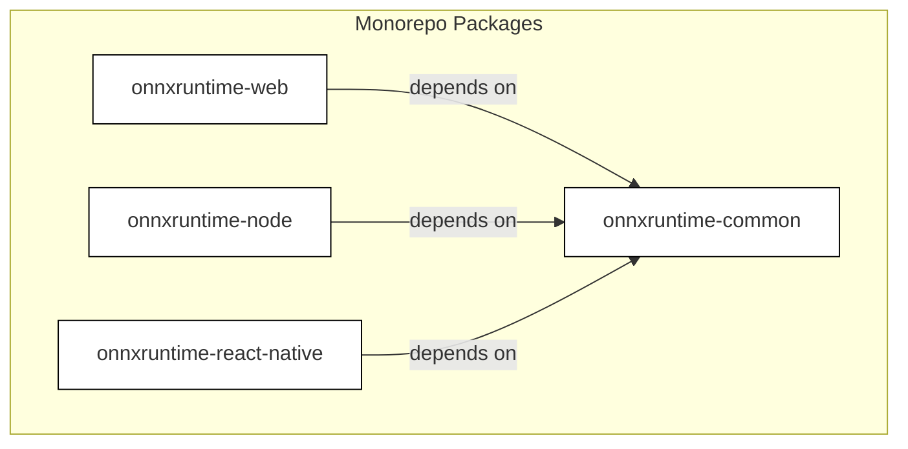
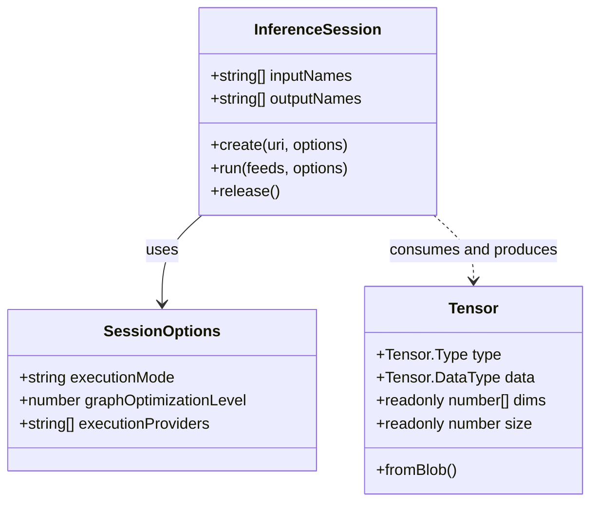
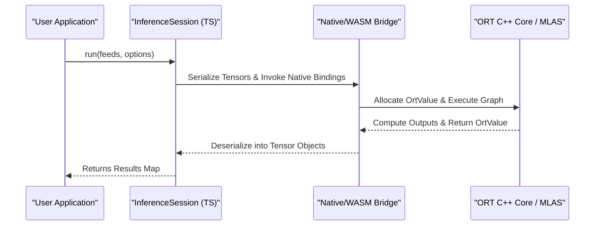
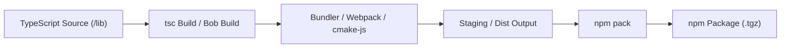

<!-- source: DeepWiki mcp.deepwiki.com · repo microsoft/onnxruntime · page 10.1 JavaScript Packages and API · fetched 2026-10-21 -->

# JavaScript Packages and APIs

<details>
<summary>Relevant source files</summary>

The following files were used as context for generating this wiki page:

- [.gitmodules](.gitmodules)
- [VERSION_NUMBER](VERSION_NUMBER)
- [docs/python/README.rst](docs/python/README.rst)
- [java/gradle/wrapper/gradle-wrapper.properties](java/gradle/wrapper/gradle-wrapper.properties)
- [java/gradlew.bat](java/gradlew.bat)
- [java/src/test/android/app/build.gradle](java/src/test/android/app/build.gradle)
- [js/README.md](js/README.md)
- [js/common/README.md](js/common/README.md)
- [js/common/package-lock.json](js/common/package-lock.json)
- [js/common/package.json](js/common/package.json)
- [js/node/.gitignore](js/node/.gitignore)
- [js/node/.npmignore](js/node/.npmignore)
- [js/node/README.md](js/node/README.md)
- [js/node/lib/index.ts](js/node/lib/index.ts)
- [js/node/package-lock.json](js/node/package-lock.json)
- [js/node/package.json](js/node/package.json)
- [js/node/script/install.js](js/node/script/install.js)
- [js/node/script/prepack.ts](js/node/script/prepack.ts)
- [js/react_native/README.md](js/react_native/README.md)
- [js/react_native/android/build.gradle](js/react_native/android/build.gradle)
- [js/react_native/android/gradle.properties](js/react_native/android/gradle.properties)
- [js/react_native/android/gradle/wrapper/gradle-wrapper.jar](js/react_native/android/gradle/wrapper/gradle-wrapper.jar)
- [js/react_native/android/gradle/wrapper/gradle-wrapper.properties](js/react_native/android/gradle/wrapper/gradle-wrapper.properties)
- [js/react_native/android/gradlew](js/react_native/android/gradlew)
- [js/react_native/android/gradlew.bat](js/react_native/android/gradlew.bat)
- [js/react_native/android/src/main/java/ai/onnxruntime/reactnative/OnnxruntimeModule.java](js/react_native/android/src/main/java/ai/onnxruntime/reactnative/OnnxruntimeModule.java)
- [js/react_native/app.plugin.js](js/react_native/app.plugin.js)
- [js/react_native/e2e/.detoxrc.js](js/react_native/e2e/.detoxrc.js)
- [js/react_native/e2e/android/build.gradle](js/react_native/e2e/android/build.gradle)
- [js/react_native/e2e/android/gradle.properties](js/react_native/e2e/android/gradle.properties)
- [js/react_native/e2e/android/gradle/wrapper/gradle-wrapper.properties](js/react_native/e2e/android/gradle/wrapper/gradle-wrapper.properties)
- [js/react_native/e2e/android/settings.gradle](js/react_native/e2e/android/settings.gradle)
- [js/react_native/e2e/ios/OnnxruntimeModuleExample.xcodeproj/project.pbxproj](js/react_native/e2e/ios/OnnxruntimeModuleExample.xcodeproj/project.pbxproj)
- [js/react_native/e2e/ios/Podfile](js/react_native/e2e/ios/Podfile)
- [js/react_native/e2e/ios/PrivacyInfo.xcprivacy](js/react_native/e2e/ios/PrivacyInfo.xcprivacy)
- [js/react_native/e2e/package-lock.json](js/react_native/e2e/package-lock.json)
- [js/react_native/e2e/package.json](js/react_native/e2e/package.json)
- [js/react_native/e2e/src/App.tsx](js/react_native/e2e/src/App.tsx)
- [js/react_native/ios/OnnxruntimeModule.h](js/react_native/ios/OnnxruntimeModule.h)
- [js/react_native/ios/OnnxruntimeModule.mm](js/react_native/ios/OnnxruntimeModule.mm)
- [js/react_native/ios/OnnxruntimeModule.xcodeproj/project.pbxproj](js/react_native/ios/OnnxruntimeModule.xcodeproj/project.pbxproj)
- [js/react_native/ios/PrivacyInfo.xcprivacy](js/react_native/ios/PrivacyInfo.xcprivacy)
- [js/react_native/lib/backend.ts](js/react_native/lib/backend.ts)
- [js/react_native/lib/binding.ts](js/react_native/lib/binding.ts)
- [js/react_native/lib/index.ts](js/react_native/lib/index.ts)
- [js/react_native/onnxruntime-react-native.podspec](js/react_native/onnxruntime-react-native.podspec)
- [js/react_native/package.json](js/react_native/package.json)
- [js/react_native/react-native.config.js](js/react_native/react-native.config.js)
- [js/react_native/scripts/bootstrap.js](js/react_native/scripts/bootstrap.js)
- [js/react_native/scripts/prepack.ts](js/react_native/scripts/prepack.ts)
- [js/react_native/unimodule.json](js/react_native/unimodule.json)
- [js/scripts/prepare-onnx-node-tests.ts](js/scripts/prepare-onnx-node-tests.ts)
- [js/scripts/utils.ts](js/scripts/utils.ts)
- [js/web/.gitignore](js/web/.gitignore)
- [js/web/.npmignore](js/web/.npmignore)
- [js/web/README.md](js/web/README.md)
- [js/web/package-lock.json](js/web/package-lock.json)
- [js/web/package.json](js/web/package.json)
- [js/web/script/prepack.ts](js/web/script/prepack.ts)
- [js/web/script/pull-prebuilt-wasm-artifacts.ts](js/web/script/pull-prebuilt-wasm-artifacts.ts)
- [js/web/types.d.ts](js/web/types.d.ts)
- [onnxruntime/__init__.py](onnxruntime/__init__.py)
- [onnxruntime/test/wasm/package-lock.json](onnxruntime/test/wasm/package-lock.json)
- [requirements-materialize-onnx-node-tests.txt](requirements-materialize-onnx-node-tests.txt)
- [tools/ci_build/github/azure-pipelines/npm-packaging-pipeline.yml](tools/ci_build/github/azure-pipelines/npm-packaging-pipeline.yml)
- [tools/ci_build/github/azure-pipelines/py-package-test-pipeline.yml](tools/ci_build/github/azure-pipelines/py-package-test-pipeline.yml)
- [tools/ci_build/github/azure-pipelines/stages/jobs/react-natvie-andriod-e2e-test-job.yml](tools/ci_build/github/azure-pipelines/stages/jobs/react-natvie-andriod-e2e-test-job.yml)
- [tools/ci_build/github/azure-pipelines/stages/jobs/steps/react-native-bootstrap-steps.yml](tools/ci_build/github/azure-pipelines/stages/jobs/steps/react-native-bootstrap-steps.yml)
- [tools/ci_build/github/azure-pipelines/templates/android-dump-logs-from-steps.yml](tools/ci_build/github/azure-pipelines/templates/android-dump-logs-from-steps.yml)
- [tools/ci_build/github/azure-pipelines/templates/linux-cpu-packaging-pipeline.yml](tools/ci_build/github/azure-pipelines/templates/linux-cpu-packaging-pipeline.yml)
- [tools/ci_build/github/azure-pipelines/templates/linux-wasm-ci.yml](tools/ci_build/github/azure-pipelines/templates/linux-wasm-ci.yml)
- [tools/ci_build/github/azure-pipelines/templates/nodejs-artifacts-package-and-publish-steps-posix.yml](tools/ci_build/github/azure-pipelines/templates/nodejs-artifacts-package-and-publish-steps-posix.yml)
- [tools/ci_build/github/azure-pipelines/templates/nodejs-artifacts-package-and-publish-steps-windows.yml](tools/ci_build/github/azure-pipelines/templates/nodejs-artifacts-package-and-publish-steps-windows.yml)
- [tools/ci_build/github/azure-pipelines/templates/py-package-smoking-test.yml](tools/ci_build/github/azure-pipelines/templates/py-package-smoking-test.yml)
- [tools/ci_build/github/azure-pipelines/templates/react-native-ci.yml](tools/ci_build/github/azure-pipelines/templates/react-native-ci.yml)
- [tools/ci_build/github/azure-pipelines/templates/set-python-manylinux-variables-step.yml](tools/ci_build/github/azure-pipelines/templates/set-python-manylinux-variables-step.yml)
- [tools/ci_build/github/azure-pipelines/templates/web-browserstack-ci.yml](tools/ci_build/github/azure-pipelines/templates/web-browserstack-ci.yml)
- [tools/ci_build/github/azure-pipelines/templates/web-ci.yml](tools/ci_build/github/azure-pipelines/templates/web-ci.yml)
- [tools/ci_build/github/azure-pipelines/templates/win-wasm-ci.yml](tools/ci_build/github/azure-pipelines/templates/win-wasm-ci.yml)
- [tools/ci_build/github/azure-pipelines/templates/win-web-ci.yml](tools/ci_build/github/azure-pipelines/templates/win-web-ci.yml)
- [tools/ci_build/github/azure-pipelines/templates/win-web-multi-browsers.yml](tools/ci_build/github/azure-pipelines/templates/win-web-multi-browsers.yml)
- [tools/ci_build/github/js/react_native_e2e_full_ios_framework_build_settings.json](tools/ci_build/github/js/react_native_e2e_full_ios_framework_build_settings.json)
- [tools/ci_build/github/linux/docker/scripts/install_python_deps.sh](tools/ci_build/github/linux/docker/scripts/install_python_deps.sh)
- [tools/ci_build/github/linux/docker/scripts/manylinux/install_deps.sh](tools/ci_build/github/linux/docker/scripts/manylinux/install_deps.sh)
- [tools/python/run_adb.py](tools/python/run_adb.py)

</details>


## Purpose and Scope

This document details the architecture, package layouts, TypeScript APIs (`InferenceSession` and `Tensor`), runtime execution flows, and npm packaging pipelines for ONNX Runtime JavaScript components. The JavaScript ecosystem spans four main monorepo packages located under the `js/` directory: `js/common`, `js/web`, `js/node`, and `js/react_native`.

---

## Package Structure and Monorepo Layout

The ONNX Runtime JavaScript codebase is organized as a lightweight monorepo where package dependencies are managed locally. `onnxruntime-common` serves as the foundational package defining shared core interfaces, while the platform-specific execution packages (`onnxruntime-web`, `onnxruntime-node`, and `onnxruntime-react-native`) depend on it to supply a unified developer experience.

```
js/
├── common/             # Shared TypeScript types, Tensor, and InferenceSession interfaces
├── web/                # Browser and web worker runtime (WASM, WebGL, WebGPU, JSEP)
├── node/               # Node.js N-API native addon package
└── react_native/       # React Native bridge for iOS and Android
```

### 1. `onnxruntime-common`
Contains core type definitions, abstract interfaces, and utility classes that are platform-agnostic. It defines the public-facing TypeScript signatures for `Tensor`, `InferenceSession`, session options, and run options.
* Sources: [js/common/package.json]()

### 2. `onnxruntime-web`
Targeted at web browsers and web workers, `onnxruntime-web` loads execution providers via WebAssembly (WASM), WebGL, or WebGPU (via JavaScript Execution Provider - JSEP). It bundles or fetches prebuilt WASM binaries and ES modules.
* Sources: [js/web/package.json](), [js/web/package-lock.json]()

### 3. `onnxruntime-node`
Provides native Node.js bindings using `node-addon-api`. It compiles a C++ Node addon via `cmake-js` that links directly against the core ONNX Runtime C++ shared libraries.
* Sources: [js/node/package.json](), [js/node/package-lock.json]()

### 4. `onnxruntime-react-native`
Bridges ONNX Runtime capabilities into React Native applications for iOS and Android. It packages native Android AAR archives and iOS CocoaPods alongside TypeScript bridge wrappers.
* Sources: [js/react_native/package.json]()


**Figure 1:** Monorepo Package Dependency Architecture.
* Sources: [js/common/package.json](), [js/web/package.json](), [js/node/package.json](), [js/react_native/package.json]()

---

## Core TypeScript API (`InferenceSession` and `Tensor`)

The TypeScript API provides a consistent interface across all target environments. Developers interact primarily with the `Tensor` class for data encapsulation and the `InferenceSession` class for model loading and execution.

### `Tensor` API
The `Tensor` class manages multi-dimensional arrays (tensors) with specific data types (`float32`, `int32`, `uint8`, `float16`, etc.) and target locations (`cpu` or GPU device memory).

Key constructor signatures and properties:
* `constructor(type: Tensor.Type, data: Tensor.DataType, dims?: readonly number[])`
* `type`: Specifies the element data type (e.g., `'float32'`).
* `data`: Typed array buffer containing the underlying data.
* `dims`: Array representing the tensor dimensions (shape).

### `InferenceSession` API
`InferenceSession` loads an ONNX model buffer or file path, initializes the runtime execution graph, and executes inference passes via the `run()` method.

Key methods:
* `InferenceSession.create(uri: string | Uint8Array, options?: InferenceSession.SessionOptions)`: Asynchronously loads and creates a session.
* `session.run(feeds: InferenceSession.FeedsType, options?: InferenceSession.RunOptions)`: Executes inference given a map of input tensor names to `Tensor` instances, returning an object map of output tensor names.


**Figure 2:** Core TypeScript API Classes and Interfaces.
* Sources: [js/common/package.json]()

---

## Runtime Execution Flow & Data Bridge

When `session.run()` is invoked, control flows from the JavaScript layer down to the native runtime or WebAssembly boundary depending on the package implementation.


**Figure 3:** Inference Execution Data Flow.
* Sources: [js/web/package.json](), [js/node/package.json](), [js/react_native/package.json]()

---

## npm Publishing and Packaging Infrastructure

All JavaScript packages are built, linted, tested, and packed into standalone npm tarballs via automated CI pipelines and local package scripts.

### Build and Pack Scripts
* **`onnxruntime-web`**: Bundles WebAssembly artifacts (`.wasm`) and Emscripten JavaScript helper glue (`.mjs`). Build tasks validate TypeScript types and compile bundles.
  * Sources: [js/web/package.json](), [tools/ci_build/github/azure-pipelines/templates/win-web-ci.yml]()
* **`onnxruntime-node`**: Uses `cmake-js` during `postinstall` or build phases to compile C++ Node add-on binaries against native system libraries or prebuilt binaries.
  * Sources: [js/node/package.json]()
* **`onnxruntime-react-native`**: Combines `react-native-builder-bob` for package compilation and embeds iOS/Android framework artifacts.
  * Sources: [js/react_native/package.json](), [tools/ci_build/github/azure-pipelines/templates/react-native-ci.yml]()


**Figure 4:** npm Package Build and Packaging Pipeline.
* Sources: [js/web/package.json](), [js/node/package.json](), [js/react_native/package.json]()

---

