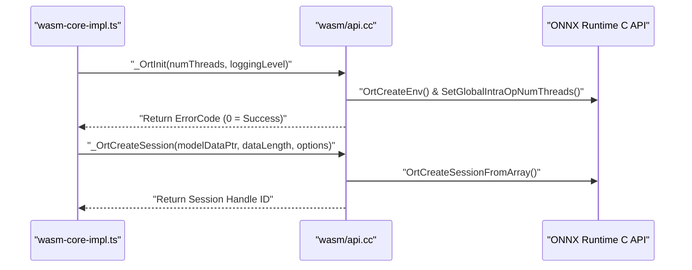
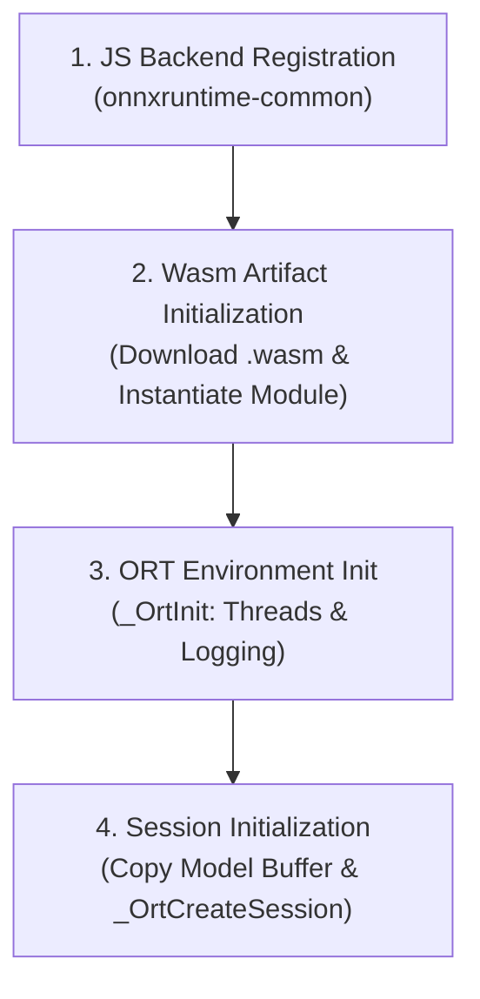

<!-- source: DeepWiki mcp.deepwiki.com · repo microsoft/onnxruntime · page 10.2 WebAssembly Build and Runtime · fetched 2026-10-21 -->

# WebAssembly Build and Runtime

Relevant source files

The following files were used as context for generating this wiki page:

- [cmake/adjust_global_compile_flags.cmake](cmake/adjust_global_compile_flags.cmake)
- [cmake/onnxruntime_webassembly.cmake](cmake/onnxruntime_webassembly.cmake)
- [js/common/lib/env.ts](js/common/lib/env.ts)
- [js/common/lib/inference-session.ts](js/common/lib/inference-session.ts)
- [js/web/karma.conf.js](js/web/karma.conf.js)
- [js/web/lib/backend-wasm.ts](js/web/lib/backend-wasm.ts)
- [js/web/lib/build-def.d.ts](js/web/lib/build-def.d.ts)
- [js/web/lib/index.ts](js/web/lib/index.ts)
- [js/web/lib/wasm/jsep/backend-webgpu.ts](js/web/lib/wasm/jsep/backend-webgpu.ts)
- [js/web/lib/wasm/jsep/backend-webnn.ts](js/web/lib/wasm/jsep/backend-webnn.ts)
- [js/web/lib/wasm/jsep/init.ts](js/web/lib/wasm/jsep/init.ts)
- [js/web/lib/wasm/jsep/webgpu/gpu-data-manager.ts](js/web/lib/wasm/jsep/webgpu/gpu-data-manager.ts)
- [js/web/lib/wasm/jsep/webgpu/ops/matmulnbits.ts](js/web/lib/wasm/jsep/webgpu/ops/matmulnbits.ts)
- [js/web/lib/wasm/jsep/webgpu/program-manager.ts](js/web/lib/wasm/jsep/webgpu/program-manager.ts)
- [js/web/lib/wasm/jsep/webgpu/types.ts](js/web/lib/wasm/jsep/webgpu/types.ts)
- [js/web/lib/wasm/jsep/webnn/tensor-manager.ts](js/web/lib/wasm/jsep/webnn/tensor-manager.ts)
- [js/web/lib/wasm/jsep/webnn/webnn.d.ts](js/web/lib/wasm/jsep/webnn/webnn.d.ts)
- [js/web/lib/wasm/proxy-messages.ts](js/web/lib/wasm/proxy-messages.ts)
- [js/web/lib/wasm/proxy-worker/main.ts](js/web/lib/wasm/proxy-worker/main.ts)
- [js/web/lib/wasm/proxy-wrapper.ts](js/web/lib/wasm/proxy-wrapper.ts)
- [js/web/lib/wasm/session-handler-inference.ts](js/web/lib/wasm/session-handler-inference.ts)
- [js/web/lib/wasm/session-options.ts](js/web/lib/wasm/session-options.ts)
- [js/web/lib/wasm/wasm-core-impl.ts](js/web/lib/wasm/wasm-core-impl.ts)
- [js/web/lib/wasm/wasm-factory.ts](js/web/lib/wasm/wasm-factory.ts)
- [js/web/lib/wasm/wasm-types.ts](js/web/lib/wasm/wasm-types.ts)
- [js/web/lib/wasm/wasm-utils-import.ts](js/web/lib/wasm/wasm-utils-import.ts)
- [js/web/script/build.ts](js/web/script/build.ts)
- [js/web/script/test-runner-cli-args.ts](js/web/script/test-runner-cli-args.ts)
- [js/web/script/test-runner-cli.ts](js/web/script/test-runner-cli.ts)
- [js/web/test/data/ops/matmulnbits.jsonc](js/web/test/data/ops/matmulnbits.jsonc)
- [js/web/test/test-main.ts](js/web/test/test-main.ts)
- [js/web/test/test-runner.ts](js/web/test/test-runner.ts)
- [js/web/test/test-types.ts](js/web/test/test-types.ts)
- [onnxruntime/contrib_ops/js/quantization/matmul_nbits.h](onnxruntime/contrib_ops/js/quantization/matmul_nbits.h)
- [onnxruntime/core/providers/webnn/allocator.cc](onnxruntime/core/providers/webnn/allocator.cc)
- [onnxruntime/core/providers/webnn/builders/impl/cast_op_builder.cc](onnxruntime/core/providers/webnn/builders/impl/cast_op_builder.cc)
- [onnxruntime/core/providers/webnn/builders/model.cc](onnxruntime/core/providers/webnn/builders/model.cc)
- [onnxruntime/core/providers/webnn/data_transfer.cc](onnxruntime/core/providers/webnn/data_transfer.cc)
- [onnxruntime/core/session/provider_registration.cc](onnxruntime/core/session/provider_registration.cc)
- [onnxruntime/wasm/api.cc](onnxruntime/wasm/api.cc)
- [onnxruntime/wasm/api.h](onnxruntime/wasm/api.h)
- [onnxruntime/wasm/post-webnn.js](onnxruntime/wasm/post-webnn.js)
- [onnxruntime/wasm/pre-jsep.js](onnxruntime/wasm/pre-jsep.js)

This page details the WebAssembly (WASM) build system, native API bridging, JavaScript runtime orchestration (`wasm-core-impl`), and session option plumbing for ONNX Runtime Web. It explains how ONNX Runtime compiles to WebAssembly using Emscripten, how the JavaScript layer initializes and interacts with the WASM heap, and how configuration options are passed across the boundary.

---

## 1. Emscripten Build Configuration

The WebAssembly build is orchestrated through CMake via `cmake/onnxruntime_webassembly.cmake` and compiler definitions in `cmake/adjust_global_compile_flags.cmake`. Depending on the target configuration, CMake compiles individual subsystem libraries (`onnxruntime_common`, `onnxruntime_graph`, `onnxruntime_framework`, `onnxruntime_session`, `onnxruntime_mlas`, etc.) and packages them either as a single static library archive or an executable WASM module using Emscripten's linker.

When `onnxruntime_BUILD_WEBASSEMBLY_STATIC_LIB` is enabled, the build system uses a helper function `bundle_static_library` to aggregate all static dependencies (protobuf, onnx, mlm, execution providers) into a single unified archive `onnxruntime_webassembly` (`[cmake/onnxruntime_webassembly.cmake:4-85]()`).

Global compile flags set for Emscripten include SIMD (`-msimd128`), multi-threading (`-pthread`), exception handling (`-fwasm-exceptions`), and link optimization (`-flto`) (`[cmake/adjust_global_compile_flags.cmake:18-63]()`).

```mermaid
graph TD
    subgraph "Build System"
        CMake["cmake/onnxruntime_webassembly.cmake"]
        Flags["cmake/adjust_global_compile_flags.cmake"]
    end
    subgraph "Core Libraries"
        Proto["PROTOBUF_LIB / onnx"]
        Common["onnxruntime_common"]
        Framework["onnxruntime_framework"]
        Graph["onnxruntime_graph"]
        Session["onnxruntime_session"]
        MLAS["onnxruntime_mlas"]
    end
    subgraph "Execution Providers"
        EPJS["PROVIDERS_JS"]
        EPXNN["PROVIDERS_XNNPACK"]
        EPWEBNN["PROVIDERS_WEBNN"]
        EPWEBGPU["PROVIDERS_WEBGPU"]
    end
    CMake -->|bundle_static_library| Target["onnxruntime_webassembly"]
    Proto --> Target
    Common --> Target
    Framework --> Target
    Graph --> Target
    Session --> Target
    MLAS --> Target
    EPJS --> Target
    EPXNN --> Target
    EPWEBNN --> Target
    EPWEBGPU --> Target
    Flags -->|"-msimd128 -pthread -flto"| Target
```

*Diagram 1: WebAssembly Static Library Bundling Architecture*

**Sources:**
- `cmake/onnxruntime_webassembly.cmake:4-127` []
- `cmake/adjust_global_compile_flags.cmake:18-63` []

---

## 2. Native API Layer (`wasm/api.cc`)

The native entry point for the WebAssembly module resides in `onnxruntime/wasm/api.cc`. This file exposes C-style exported functions (using Emscripten's `EMSCRIPTEN_KEEPALIVE` or exported runtime methods) that bridge the JavaScript layer directly to the standard ONNX Runtime C API.

Key responsibilities of `wasm/api.cc`:
- **Environment Initialization**: Implements `_OrtInit(int num_threads, int logging_level)` which sets up the global thread pool and logging environment (`[js/web/lib/wasm/wasm-core-impl.ts:82-87]()`).
- **Session Management**: Provides routines to create, initialize, and execute inference sessions (`_OrtCreateSession`, `_OrtRun`).
- **Memory & Tensor Handling**: Manages data transfer between the JS memory buffer (`HEAP8`, `HEAPU8`) and native memory allocators.
- **JSEP Integration**: Exposes helper functions like `_JsepOutput` for WebGPU execution provider integration.

*Diagram 2: Initialization Sequence from JavaScript to Native WASM API*

**Sources:**
- `cmake/onnxruntime_webassembly.cmake:160-162` []
- `js/web/lib/wasm/wasm-core-impl.ts:82-87` []

---

## 3. JavaScript Runtime & Core Implementation (`wasm-core-impl.ts`)

The JavaScript runtime orchestration layer (`js/web/lib/wasm/wasm-core-impl.ts`) governs the four distinct initialization steps required to bring up ONNX Runtime in a browser or Node.js environment (`[js/web/lib/wasm/wasm-core-impl.ts:33-74]()`).

### Initialization Steps
1. **JavaScript Initialization**: Registers backend metadata via `onnxruntime-common`.
2. **WebAssembly Artifact Initialization**: Downloads the `.wasm` file, performs feature detection, and instantiates the Emscripten module (`[js/web/lib/wasm/wasm-core-impl.ts:44-53]()`).
3. **ORT Environment Initialization**: Calls `_OrtInit()` to configure threading and global logging (`[js/web/lib/wasm/wasm-core-impl.ts:54-59,82-87]()`).
4. **Session Initialization**: Copies model buffers into the WASM heap and invokes `_OrtCreateSession()` (`[js/web/lib/wasm/wasm-core-impl.ts:60-72]()`).

*Diagram 3: Four-Step Initialization Lifecycle in `wasm-core-impl.ts`*

**Sources:**
- `js/web/lib/wasm/wasm-core-impl.ts:33-96` []

---

## 4. Session Option Plumbing

Session configuration options set in TypeScript (`InferenceSession.SessionOptions`) are translated into native C API configuration structures and extra config keys before calling `_OrtCreateSession` (`[js/common/lib/inference-session.ts:49-186]()`).

The options layer processes parameters such as:
- Graph optimization levels (`disabled`, `basic`, `extended`, `layout`, `all`).
- Execution provider options (`cpu`, `wasm`, `webgpu`, `webnn`).
- Intra-op and inter-op thread counts.
- Memory arena and memory pattern flags.
- Extra key-value configuration maps (e.g., session config keys defined in `onnxruntime_session_options_config_keys.h`).

*Diagram 4: Data Flow for Session Options Plumbing*

**Sources:**
- `js/common/lib/inference-session.ts:49-186` []
- `js/web/lib/wasm/session-options.ts` []

---

