<!-- source: DeepWiki mcp.deepwiki.com · repo microsoft/onnxruntime · page 11 Python Model Tooling · fetched 2026-10-21 -->

# Python Model Tooling

Relevant source files

The following files were used as context for generating this wiki page:

- [onnxruntime/python/tools/quantization/base_quantizer.py](onnxruntime/python/tools/quantization/base_quantizer.py)
- [onnxruntime/python/tools/quantization/calibrate.py](onnxruntime/python/tools/quantization/calibrate.py)
- [onnxruntime/python/tools/quantization/onnx_model.py](onnxruntime/python/tools/quantization/onnx_model.py)
- [onnxruntime/python/tools/quantization/onnx_quantizer.py](onnxruntime/python/tools/quantization/onnx_quantizer.py)
- [onnxruntime/python/tools/quantization/operators/activation.py](onnxruntime/python/tools/quantization/operators/activation.py)
- [onnxruntime/python/tools/quantization/operators/attention.py](onnxruntime/python/tools/quantization/operators/attention.py)
- [onnxruntime/python/tools/quantization/operators/binary_op.py](onnxruntime/python/tools/quantization/operators/binary_op.py)
- [onnxruntime/python/tools/quantization/operators/concat.py](onnxruntime/python/tools/quantization/operators/concat.py)
- [onnxruntime/python/tools/quantization/operators/conv.py](onnxruntime/python/tools/quantization/operators/conv.py)
- [onnxruntime/python/tools/quantization/operators/direct_q8.py](onnxruntime/python/tools/quantization/operators/direct_q8.py)
- [onnxruntime/python/tools/quantization/operators/embed_layernorm.py](onnxruntime/python/tools/quantization/operators/embed_layernorm.py)
- [onnxruntime/python/tools/quantization/operators/gather.py](onnxruntime/python/tools/quantization/operators/gather.py)
- [onnxruntime/python/tools/quantization/operators/gavgpool.py](onnxruntime/python/tools/quantization/operators/gavgpool.py)
- [onnxruntime/python/tools/quantization/operators/gemm.py](onnxruntime/python/tools/quantization/operators/gemm.py)
- [onnxruntime/python/tools/quantization/operators/matmul.py](onnxruntime/python/tools/quantization/operators/matmul.py)
- [onnxruntime/python/tools/quantization/operators/pooling.py](onnxruntime/python/tools/quantization/operators/pooling.py)
- [onnxruntime/python/tools/quantization/operators/qdq_base_operator.py](onnxruntime/python/tools/quantization/operators/qdq_base_operator.py)
- [onnxruntime/python/tools/quantization/operators/softmax.py](onnxruntime/python/tools/quantization/operators/softmax.py)
- [onnxruntime/python/tools/quantization/operators/split.py](onnxruntime/python/tools/quantization/operators/split.py)
- [onnxruntime/python/tools/quantization/qdq_loss_debug.py](onnxruntime/python/tools/quantization/qdq_loss_debug.py)
- [onnxruntime/python/tools/quantization/qdq_quantizer.py](onnxruntime/python/tools/quantization/qdq_quantizer.py)
- [onnxruntime/python/tools/quantization/quant_utils.py](onnxruntime/python/tools/quantization/quant_utils.py)
- [onnxruntime/python/tools/quantization/quantize.py](onnxruntime/python/tools/quantization/quantize.py)
- [onnxruntime/python/tools/quantization/registry.py](onnxruntime/python/tools/quantization/registry.py)
- [onnxruntime/test/python/quantization/op_test_utils.py](onnxruntime/test/python/quantization/op_test_utils.py)
- [onnxruntime/test/python/quantization/test_calibration.py](onnxruntime/test/python/quantization/test_calibration.py)
- [onnxruntime/test/python/quantization/test_onnx_model.py](onnxruntime/test/python/quantization/test_onnx_model.py)
- [onnxruntime/test/python/quantization/test_op_concat.py](onnxruntime/test/python/quantization/test_op_concat.py)
- [onnxruntime/test/python/quantization/test_op_slice.py](onnxruntime/test/python/quantization/test_op_slice.py)
- [onnxruntime/test/python/quantization/test_op_softmax.py](onnxruntime/test/python/quantization/test_op_softmax.py)
- [onnxruntime/test/python/quantization/test_op_split.py](onnxruntime/test/python/quantization/test_op_split.py)
- [onnxruntime/test/python/quantization/test_op_where.py](onnxruntime/test/python/quantization/test_op_where.py)
- [onnxruntime/test/python/quantization/test_qdq.py](onnxruntime/test/python/quantization/test_qdq.py)
- [onnxruntime/test/python/quantization/test_qdq_loss_debug.py](onnxruntime/test/python/quantization/test_qdq_loss_debug.py)
- [onnxruntime/test/python/quantization/test_quant_util.py](onnxruntime/test/python/quantization/test_quant_util.py)

## Purpose and Scope

The `onnxruntime/python/tools` ecosystem provides a robust suite of utilities designed to optimize, quantize, and convert ONNX models for high-performance inference across various hardware targets. This parent page outlines the high-level architecture of the Python tooling subsystem, covering the Quantization Toolkit, Transformer Model Optimizer, and Model Conversion Pipelines. 

For deep technical details, implementation specifics, and test suites, refer to the child pages:
- [Quantization Toolkit](#11.1)
- [Transformer Model Optimizer](#11.2)
- [Model Conversion Pipelines](#11.3)

```mermaid
graph TD
    subgraph "Natural Language Space"
        A["Static Quantization"] --> B["QDQ Quantizer"]
        C["Transformer Optimization"] --> D["Fusion Passes"]
        E["Model Conversion"] --> F["LLM Export"]
    end
    subgraph "Code Entity Space"
        G["onnxruntime/python/tools/quantization/quantize.py:StaticQuantConfig"] --> H["onnxruntime/python/tools/quantization/qdq_quantizer.py:QDQQuantizer"]
        I["onnxruntime/python/tools/quantization/registry.py:QDQRegistry"] --> J["onnxruntime/python/tools/quantization/onnx_quantizer.py:ONNXQuantizer"]
        K["onnxruntime/python/tools/quantization/calibrate.py:CalibrationDataReader"] --> L["onnxruntime/test/python/quantization/test_qdq.py:TestQDQFormat"]
    end
    A -.-> G
    B -.-> H
    style A fill:#fff,stroke:#000,stroke-width:2px
    style B fill:#fff,stroke:#000,stroke-width:2px
    style C fill:#fff,stroke:#000,stroke-width:2px
    style D fill:#fff,stroke:#000,stroke-width:2px
    style E fill:#fff,stroke:#000,stroke-width:2px
    style F fill:#fff,stroke:#000,stroke-width:2px
    style G fill:#fff,stroke:#000,stroke-width:2px
    style H fill:#fff,stroke:#000,stroke-width:2px
    style I fill:#fff,stroke:#000,stroke-width:2px
    style J fill:#fff,stroke:#000,stroke-width:2px
    style K fill:#fff,stroke:#000,stroke-width:2px
    style L fill:#fff,stroke:#000,stroke-width:2px
```

*Diagram 1: Mapping Python Tooling Concepts to Code Entities*

Sources:
- `onnxruntime/python/tools/quantization/quantize.py:43-114`
- `onnxruntime/python/tools/quantization/calibrate.py:191-193`
- `onnxruntime/python/tools/quantization/qdq_quantizer.py:145-171`

---

## 11.1 Quantization Toolkit

The Quantization Toolkit supplies comprehensive routines to reduce model footprint and accelerate inference using static and dynamic quantization. It supports multiple quantization formats such as `QOperator` and `QDQ` (Quantize-DeQuantize), alongside calibration strategies (`MinMax`, `Entropy`, `Percentile`) implemented via `CalibrationDataReader` [onnxruntime/python/tools/quantization/quantize.py:98-132, onnxruntime/python/tools/quantization/calibrate.py:191-193]().

Operator-specific quantization behavior is defined through extensible registries (`IntegerOpsRegistry`, `QLinearOpsRegistry`, and `QDQRegistry`) that map ONNX operators to specialized quantization classes [onnxruntime/python/tools/quantization/registry.py:26-93](). Core orchestration is managed by `ONNXQuantizer` and `QDQQuantizer` [onnxruntime/python/tools/quantization/onnx_quantizer.py:39-68, onnxruntime/python/tools/quantization/qdq_quantizer.py:145-171]().

For detailed documentation on quantization workflows, calibration readers, and operator registries, see [Quantization Toolkit](#11.1).

Sources:
- `onnxruntime/python/tools/quantization/quantize.py:43-114`
- `onnxruntime/python/tools/quantization/calibrate.py:191-193`
- `onnxruntime/python/tools/quantization/onnx_quantizer.py:39-68`
- `onnxruntime/python/tools/quantization/qdq_quantizer.py:145-171`
- `onnxruntime/python/tools/quantization/registry.py:26-93`

---

## 11.2 Transformer Model Optimizer

The Transformer Model Optimizer focuses on high-level graph transformations tailored for transformer-based architectures (e.g., BERT, GPT, RoBERTa). It provides automated fusion passes that combine multiple primitive ONNX nodes into optimized composite operators like `MultiHeadAttention`, `EmbedLayerNormalization`, and optimized layer-norm layers.

Additionally, the tooling offers utilities for converting models to `float16` precision and benchmarking execution performance across hardware execution providers. 

For further details on fusion passes, precision conversion scripts, and optimization levels, see [Transformer Model Optimizer](#11.2).

Sources:
- `onnxruntime/python/tools/quantization/registry.py:26-30`

---

## 11.3 Model Conversion Pipelines

Model Conversion Pipelines streamline the export, graph clean-up, and conversion of complex generative models (such as Llama, Whisper, Phi, and Stable Diffusion) into ONNX Runtime-compatible formats. Scripts like `convert_generation.py` orchestrate KV-cache wiring, beam search subgraph creation, and custom operator mapping.

These pipelines bridge standard framework checkpoints (PyTorch, Hugging Face) and optimized ORT inference sessions, ensuring correct tensor shapes and execution provider compatibility.

For end-to-end export steps, model-specific conversion pipelines, and benchmarking scripts, see [Model Conversion Pipelines](#11.3).

Sources:
- `onnxruntime/python/tools/quantization/quantize.py:1-42`

---

