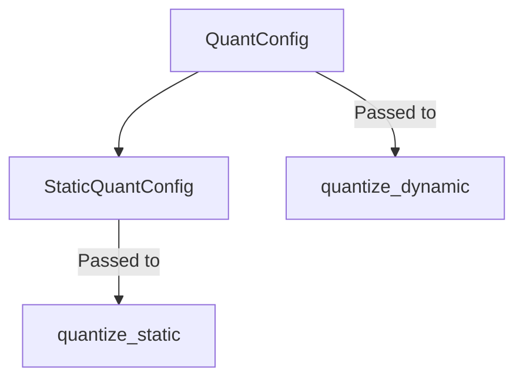
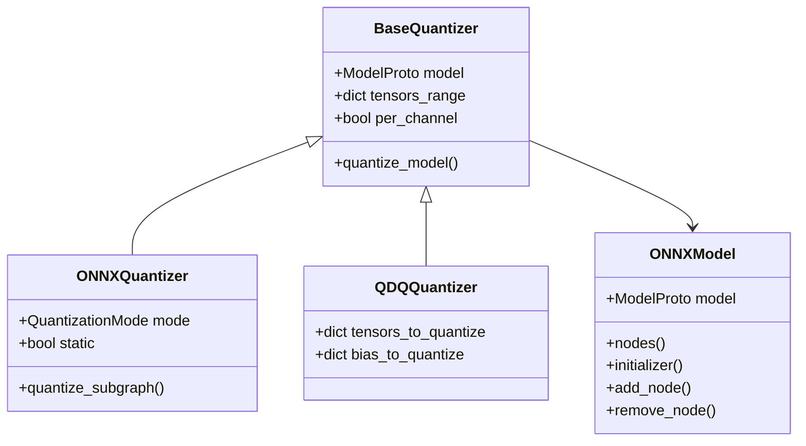

<!-- source: DeepWiki mcp.deepwiki.com · repo microsoft/onnxruntime · page 11.1 Quantization Toolkit · fetched 2026-10-21 -->

# Quantization Toolkit

Relevant source files

The following files were used as context for generating this wiki page:

- [onnxruntime/python/tools/quantization/base_quantizer.py](onnxruntime/python/tools/quantization/base_quantizer.py)
- [onnxruntime/python/tools/quantization/calibrate.py](onnxruntime/python/tools/quantization/calibrate.py)
- [onnxruntime/python/tools/quantization/onnx_model.py](onnxruntime/python/tools/quantization/onnx_model.py)
- [onnxruntime/python/tools/quantization/onnx_quantizer.py](onnxruntime/python/tools/quantization/onnx_quantizer.py)
- [onnxruntime/python/tools/quantization/operators/activation.py](onnxruntime/python/tools/quantization/operators/activation.py)
- [onnxruntime/python/tools/quantization/operators/attention.py](onnxruntime/python/tools/quantization/operators/attention.py)
- [onnxruntime/python/tools/quantization/operators/binary_op.py](onnxruntime/python/tools/quantization/operators/binary_op.py)
- [onnxruntime/python/tools/quantization/operators/concat.py](onnxruntime/python/tools/quantization/operators/concat.py)
- [onnxruntime/python/tools/quantization/operators/conv.py](onnxruntime/python/tools/quantization/operators/conv.py)
- [onnxruntime/python/tools/quantization/operators/direct_q8.py](onnxruntime/python/tools/quantization/operators/direct_q8.py)
- [onnxruntime/python/tools/quantization/operators/embed_layernorm.py](onnxruntime/python/tools/quantization/operators/embed_layernorm.py)
- [onnxruntime/python/tools/quantization/operators/gather.py](onnxruntime/python/tools/quantization/operators/gather.py)
- [onnxruntime/python/tools/quantization/operators/gavgpool.py](onnxruntime/python/tools/quantization/operators/gavgpool.py)
- [onnxruntime/python/tools/quantization/operators/gemm.py](onnxruntime/python/tools/quantization/operators/gemm.py)
- [onnxruntime/python/tools/quantization/operators/matmul.py](onnxruntime/python/tools/quantization/operators/matmul.py)
- [onnxruntime/python/tools/quantization/operators/pooling.py](onnxruntime/python/tools/quantization/operators/pooling.py)
- [onnxruntime/python/tools/quantization/operators/qdq_base_operator.py](onnxruntime/python/tools/quantization/operators/qdq_base_operator.py)
- [onnxruntime/python/tools/quantization/operators/softmax.py](onnxruntime/python/tools/quantization/operators/softmax.py)
- [onnxruntime/python/tools/quantization/operators/split.py](onnxruntime/python/tools/quantization/operators/split.py)
- [onnxruntime/python/tools/quantization/qdq_loss_debug.py](onnxruntime/python/tools/quantization/qdq_loss_debug.py)
- [onnxruntime/python/tools/quantization/qdq_quantizer.py](onnxruntime/python/tools/quantization/qdq_quantizer.py)
- [onnxruntime/python/tools/quantization/quant_utils.py](onnxruntime/python/tools/quantization/quant_utils.py)
- [onnxruntime/python/tools/quantization/quantize.py](onnxruntime/python/tools/quantization/quantize.py)
- [onnxruntime/python/tools/quantization/registry.py](onnxruntime/python/tools/quantization/registry.py)
- [onnxruntime/test/python/quantization/op_test_utils.py](onnxruntime/test/python/quantization/op_test_utils.py)
- [onnxruntime/test/python/quantization/test_calibration.py](onnxruntime/test/python/quantization/test_calibration.py)
- [onnxruntime/test/python/quantization/test_onnx_model.py](onnxruntime/test/python/quantization/test_onnx_model.py)
- [onnxruntime/test/python/quantization/test_op_concat.py](onnxruntime/test/python/quantization/test_op_concat.py)
- [onnxruntime/test/python/quantization/test_op_slice.py](onnxruntime/test/python/quantization/test_op_slice.py)
- [onnxruntime/test/python/quantization/test_op_softmax.py](onnxruntime/test/python/quantization/test_op_softmax.py)
- [onnxruntime/test/python/quantization/test_op_split.py](onnxruntime/test/python/quantization/test_op_split.py)
- [onnxruntime/test/python/quantization/test_op_where.py](onnxruntime/test/python/quantization/test_op_where.py)
- [onnxruntime/test/python/quantization/test_qdq.py](onnxruntime/test/python/quantization/test_qdq.py)
- [onnxruntime/test/python/quantization/test_qdq_loss_debug.py](onnxruntime/test/python/quantization/test_qdq_loss_debug.py)
- [onnxruntime/test/python/quantization/test_quant_util.py](onnxruntime/test/python/quantization/test_quant_util.py)

## Purpose and Scope

The ONNX Runtime Quantization Toolkit, located in `onnxruntime/python/tools/quantization/` [onnxruntime/python/tools/quantization/quantize.py:1-42](), provides comprehensive utilities to convert floating-point ONNX models into quantized representations (such as 8-bit integer, 4-bit integer, and floating-point 8-bit formats). This toolkit supports both static calibration-based quantization and dynamic quantization, and generates either Quantize-DeQuantize (`QDQ`) or fully quantized operator (`QOperator`) models.

Sources:
- `onnxruntime/python/tools/quantization/quantize.py:1-42`

---

## Configuration and High-Level APIs

The quantization toolkit exposes high-level configuration classes and entry points to customize quantization behavior. The base configuration class `QuantConfig` [onnxruntime/python/tools/quantization/quantize.py:43-96]() defines parameters such as `activation_type`, `weight_type`, `op_types_to_quantize`, `nodes_to_quantize`, `nodes_to_exclude`, `per_channel`, `reduce_range`, and `use_external_data_format`.

Derived from `QuantConfig`, `StaticQuantConfig` [onnxruntime/python/tools/quantization/quantize.py:98-149]() adds static quantization-specific fields including `calibration_data_reader`, `calibrate_method`, `quant_format` (e.g., `QuantFormat.QDQ` or `QuantFormat.QOperator`), `calibration_providers`, and an `extra_options` dictionary for advanced controls like `ActivationSymmetric`, `WeightSymmetric`, `MatMulConstBOnly`, and `AddQDQPairToWeight`.

*Diagram 1: Configuration Class Hierarchy and Flow to Quantization Entrypoints*

Sources:
- `onnxruntime/python/tools/quantization/quantize.py:43-149`

---

## Calibration Pipeline

Static quantization requires estimating the dynamic range of activations using a calibration dataset. The `calibrate.py` module implements this infrastructure.

- **`CalibrationDataReader`** [onnxruntime/python/tools/quantization/calibrate.py:191-193](): An abstract base class implemented by users to yield batches of input data for calibration sessions.
- **`CalibrationMethod`** [onnxruntime/python/tools/quantization/calibrate.py:184-189](): An enumeration supporting `MinMax`, `Entropy`, `Percentile`, and `Distribution` methods.
- **`TensorData`** [onnxruntime/python/tools/quantization/calibrate.py:70-118]() and **`TensorsData`** [onnxruntime/python/tools/quantization/calibrate.py:120-182](): Data containers that record statistical metrics (such as histograms, bins, avg, std, lowest, and highest values) for intermediate tensor outputs during calibration runs.

Sources:
- `onnxruntime/python/tools/quantization/calibrate.py:70-193`

---

## Quantizer Architecture and Base Classes

The core logic for modifying ONNX graph structures is distributed across several key classes:

- **`BaseQuantizer`** [onnxruntime/python/tools/quantization/base_quantizer.py:69-156](): The abstract base class that inspects model metadata, ensures shape inference metadata is present [onnxruntime/python/tools/quantization/base_quantizer.py:83-84](), and manages tensor-level quantization overrides via `TensorQuantOverridesHelper` [onnxruntime/python/tools/quantization/base_quantizer.py:134]().
- **`ONNXQuantizer`** [onnxruntime/python/tools/quantization/onnx_quantizer.py:39-142](): Handles graph transformation for `QOperator` mode and manages subgraph quantization [onnxruntime/python/tools/quantization/onnx_quantizer.py:113-142]().
- **`QDQQuantizer`** [onnxruntime/python/tools/quantization/qdq_quantizer.py:145-183](): Manages the insertion of `QuantizeLinear` and `DequantizeLinear` node pairs around supported operators.
- **`ONNXModel`** [onnxruntime/python/tools/quantization/onnx_model.py:89-110](): A helper wrapper around ONNX `ModelProto` providing convenient methods to manipulate nodes, initializers, and graph inputs/outputs.

*Diagram 2: Quantizer Class Hierarchy and Entity Relations*

Sources:
- `onnxruntime/python/tools/quantization/base_quantizer.py:39-156`
- `onnxruntime/python/tools/quantization/onnx_quantizer.py:39-142`
- `onnxruntime/python/tools/quantization/qdq_quantizer.py:145-183`
- `onnxruntime/python/tools/quantization/onnx_model.py:89-110`

---

## Operator Registries and Factory Functions

Operator-specific quantization behaviors are mapped through centralized registries located in `registry.py` [onnxruntime/python/tools/quantization/registry.py:26-94]():

- **`IntegerOpsRegistry`** [onnxruntime/python/tools/quantization/registry.py:32-38](): Maps operator types (such as `Conv`, `MatMul`, `Attention`, `LSTM`) to integer computation classes (`ConvInteger`, `MatMulInteger`) [onnxruntime/python/tools/quantization/registry.py:32-37]().
- **`QLinearOpsRegistry`** [onnxruntime/python/tools/quantization/registry.py:40-65](): Maps operator types to QLinear variants (`QLinearConv`, `QLinearMatMul`, `QLinearBinaryOp`) [onnxruntime/python/tools/quantization/registry.py:40-64]().
- **`QDQRegistry`** [onnxruntime/python/tools/quantization/registry.py:67-93](): Maps operator types to QDQ-specific classes (`QDQConv`, `QDQMatMul`, `QDQRemovableActivation`) [onnxruntime/python/tools/quantization/registry.py:67-93]().
- **Factory Functions**: `CreateOpQuantizer` and `CreateQDQQuantizer` instantiate the appropriate operator quantizer based on the active quantization mode and registry lookup [onnxruntime/python/tools/quantization/registry.py:100-112]().

Sources:
- `onnxruntime/python/tools/quantization/registry.py:26-113`

---

## Operator-Specific Quantization Implementations

Operators define precise quantization steps. For example, `ConvInteger` and `QLinearConv` are implemented in `onnxruntime/python/tools/quantization/operators/conv.py` [onnxruntime/python/tools/quantization/operators/conv.py:17-180](). 

- **`ConvInteger`** [onnxruntime/python/tools/quantization/operators/conv.py:17-135]() quantizes activations and weights, inserts a `ConvInteger` node, casts the output back to floating-point, applies scale multiplication nodes via `get_mul_node()`, and manages bias reshaping and addition [onnxruntime/python/tools/quantization/operators/conv.py:21-135]().
- **`MatMulInteger` & `QLinearMatMul`** [onnxruntime/python/tools/quantization/operators/matmul.py:46-191]() handle integer matrix multiplication and QLinear MatMul integration, respecting constraints such as `MatMulConstBOnly` [onnxruntime/python/tools/quantization/operators/matmul.py:34-37]().

Sources:
- `onnxruntime/python/tools/quantization/operators/conv.py:17-180`
- `onnxruntime/python/tools/quantization/operators/matmul.py:46-191`

---

## Quantization Testing Infrastructure

Testing frameworks validate quantization correctness across modes and extra options. 

- **`TestQDQFormat` & `TestQDQExtraOptions`** [onnxruntime/test/python/quantization/test_qdq.py:54-184]() construct synthetic ONNX graphs with `Add`, `ReduceMean`, and `MatMul` nodes, apply `QDQQuantizer` with specific extra options (such as `ActivationSymmetric`, `AddQDQPairToWeight`, and `OpTypesToExcludeOutputQuantization`), and assert correct placement of `QuantizeLinear` and `DequantizeLinear` nodes [onnxruntime/test/python/quantization/test_qdq.py:79-172]().
- **`op_test_utils.py`** [onnxruntime/test/python/quantization/op_test_utils.py:1-181]() provides reference operator implementations (`QGemm`, `QLinearMatMul`) [onnxruntime/test/python/quantization/op_test_utils.py:51-181]() using `ReferenceEvaluator` [onnxruntime/test/python/quantization/op_test_utils.py:16]() to verify numerical correctness against ONNX Runtime execution results.

Sources:
- `onnxruntime/test/python/quantization/test_qdq.py:54-184`
- `onnxruntime/test/python/quantization/op_test_utils.py:1-181`

---

