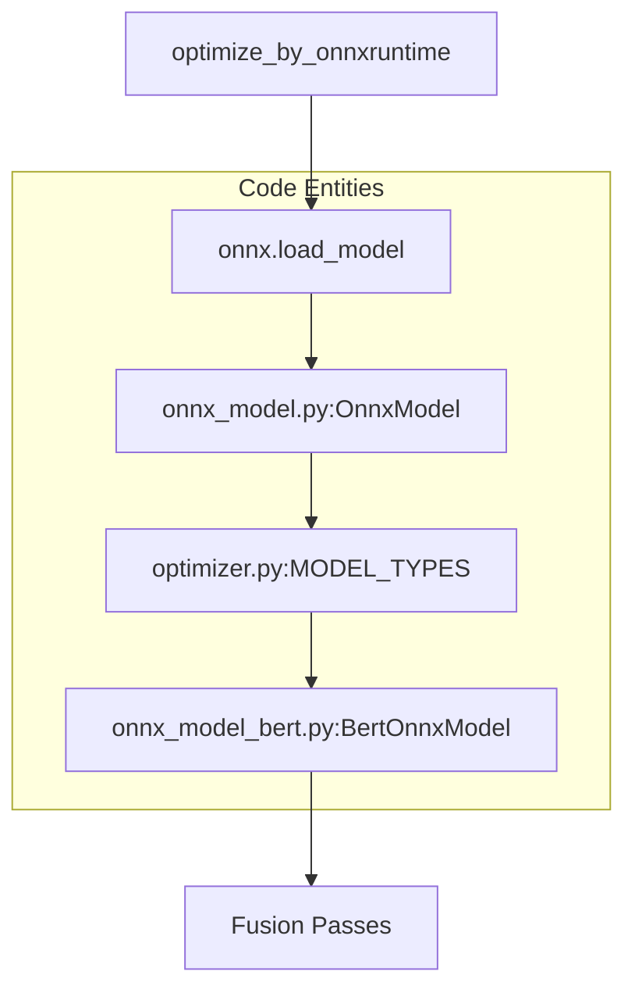
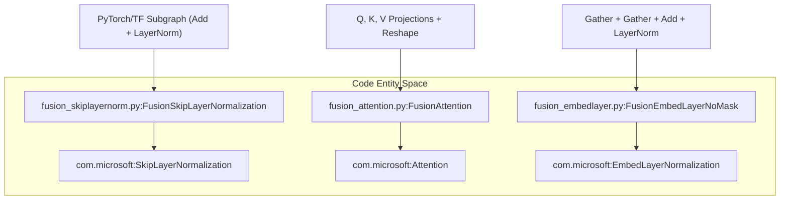

<!-- source: DeepWiki mcp.deepwiki.com · repo microsoft/onnxruntime · page 11.2 Transformer Model Optimizer · fetched 2026-10-21 -->

# Transformer Model Optimizer

Relevant source files

The following files were used as context for generating this wiki page:

- [onnxruntime/python/tools/transformers/benchmark.py](onnxruntime/python/tools/transformers/benchmark.py)
- [onnxruntime/python/tools/transformers/benchmark_helper.py](onnxruntime/python/tools/transformers/benchmark_helper.py)
- [onnxruntime/python/tools/transformers/dev_benchmark.cmd](onnxruntime/python/tools/transformers/dev_benchmark.cmd)
- [onnxruntime/python/tools/transformers/float16.py](onnxruntime/python/tools/transformers/float16.py)
- [onnxruntime/python/tools/transformers/fusion_attention.py](onnxruntime/python/tools/transformers/fusion_attention.py)
- [onnxruntime/python/tools/transformers/fusion_bart_attention.py](onnxruntime/python/tools/transformers/fusion_bart_attention.py)
- [onnxruntime/python/tools/transformers/fusion_base.py](onnxruntime/python/tools/transformers/fusion_base.py)
- [onnxruntime/python/tools/transformers/fusion_biasgelu.py](onnxruntime/python/tools/transformers/fusion_biasgelu.py)
- [onnxruntime/python/tools/transformers/fusion_embedlayer.py](onnxruntime/python/tools/transformers/fusion_embedlayer.py)
- [onnxruntime/python/tools/transformers/fusion_fastgelu.py](onnxruntime/python/tools/transformers/fusion_fastgelu.py)
- [onnxruntime/python/tools/transformers/fusion_gelu_approximation.py](onnxruntime/python/tools/transformers/fusion_gelu_approximation.py)
- [onnxruntime/python/tools/transformers/fusion_gpt_attention.py](onnxruntime/python/tools/transformers/fusion_gpt_attention.py)
- [onnxruntime/python/tools/transformers/fusion_gpt_attention_megatron.py](onnxruntime/python/tools/transformers/fusion_gpt_attention_megatron.py)
- [onnxruntime/python/tools/transformers/fusion_gpt_attention_no_past.py](onnxruntime/python/tools/transformers/fusion_gpt_attention_no_past.py)
- [onnxruntime/python/tools/transformers/fusion_layernorm.py](onnxruntime/python/tools/transformers/fusion_layernorm.py)
- [onnxruntime/python/tools/transformers/fusion_reshape.py](onnxruntime/python/tools/transformers/fusion_reshape.py)
- [onnxruntime/python/tools/transformers/fusion_skiplayernorm.py](onnxruntime/python/tools/transformers/fusion_skiplayernorm.py)
- [onnxruntime/python/tools/transformers/fusion_utils.py](onnxruntime/python/tools/transformers/fusion_utils.py)
- [onnxruntime/python/tools/transformers/huggingface_models.py](onnxruntime/python/tools/transformers/huggingface_models.py)
- [onnxruntime/python/tools/transformers/machine_info.py](onnxruntime/python/tools/transformers/machine_info.py)
- [onnxruntime/python/tools/transformers/onnx_exporter.py](onnxruntime/python/tools/transformers/onnx_exporter.py)
- [onnxruntime/python/tools/transformers/onnx_model.py](onnxruntime/python/tools/transformers/onnx_model.py)
- [onnxruntime/python/tools/transformers/onnx_model_bart.py](onnxruntime/python/tools/transformers/onnx_model_bart.py)
- [onnxruntime/python/tools/transformers/onnx_model_bert.py](onnxruntime/python/tools/transformers/onnx_model_bert.py)
- [onnxruntime/python/tools/transformers/optimizer.py](onnxruntime/python/tools/transformers/optimizer.py)
- [onnxruntime/python/tools/transformers/run_benchmark.sh](onnxruntime/python/tools/transformers/run_benchmark.sh)
- [onnxruntime/test/python/transformers/bart_model_generator.py](onnxruntime/test/python/transformers/bart_model_generator.py)
- [onnxruntime/test/python/transformers/model_loader.py](onnxruntime/test/python/transformers/model_loader.py)
- [onnxruntime/test/python/transformers/parity_utilities.py](onnxruntime/test/python/transformers/parity_utilities.py)
- [onnxruntime/test/python/transformers/test_attention_fusion.py](onnxruntime/test/python/transformers/test_attention_fusion.py)
- [onnxruntime/test/python/transformers/test_float16.py](onnxruntime/test/python/transformers/test_float16.py)
- [onnxruntime/test/python/transformers/test_optimizer.py](onnxruntime/test/python/transformers/test_optimizer.py)
- [onnxruntime/test/python/transformers/test_parity_gelu.py](onnxruntime/test/python/transformers/test_parity_gelu.py)
- [onnxruntime/test/python/transformers/test_parity_huggingface_gpt_attention.py](onnxruntime/test/python/transformers/test_parity_huggingface_gpt_attention.py)
- [onnxruntime/test/python/transformers/test_parity_layernorm.py](onnxruntime/test/python/transformers/test_parity_layernorm.py)
- [onnxruntime/test/python/transformers/test_whisper.py](onnxruntime/test/python/transformers/test_whisper.py)

## Purpose and Scope
This page documents the Python-based transformer model tooling ecosystem located in `onnxruntime/python/tools/transformers/`. It covers the architectural design of `optimizer.py` and `onnx_model.py`, core graph fusion passes (Attention, LayerNorm, SkipLayerNorm, EmbedLayerNorm), float16 mixed-precision conversion utilities, and the benchmarking and validation pipelines (`benchmark.py`, `onnx_exporter.py`).

---

## 1. Optimizer Orchestration and Model Representation

The optimization pipeline relies on `OnnxModel` [onnxruntime/python/tools/transformers/onnx_model.py:35-51]() as the base graph container abstraction, paired with specialized model subclasses (e.g., `BertOnnxModel`, `Gpt2OnnxModel`) defined in `optimizer.py` [onnxruntime/python/tools/transformers/optimizer.py:28-42]() via the `MODEL_TYPES` registry [onnxruntime/python/tools/transformers/optimizer.py:50-70]().

### Core Classes and Functions
- `OnnxModel`: Encapsulates an ONNX `ModelProto` [onnxruntime/python/tools/transformers/onnx_model.py:40](), offering methods for node manipulation (`add_node` [onnxruntime/python/tools/transformers/onnx_model.py:169](), `remove_node` [onnxruntime/python/tools/transformers/onnx_model.py:158]()), topological traversal (`graphs` [onnxruntime/python/tools/transformers/onnx_model.py:106](), `nodes` [onnxruntime/python/tools/transformers/onnx_model.py:96]()), and symbolic shape inference (`infer_runtime_shape` [onnxruntime/python/tools/transformers/onnx_model.py:55]()).
- `optimize_by_onnxruntime`: Configures an `onnxruntime.InferenceSession` [onnxruntime/python/tools/transformers/optimizer.py:73-142]() with specified graph optimization levels (`ORT_ENABLE_BASIC`, `ORT_ENABLE_EXTENDED`, `ORT_ENABLE_ALL`).

*Diagram 1: Model Optimization Entry Point and Class Mapping from CLI to Code Entities.*

Sources: [onnxruntime/python/tools/transformers/onnx_model.py:35-51](), [onnxruntime/python/tools/transformers/optimizer.py:28-70](), [onnxruntime/python/tools/transformers/optimizer.py:73-142]()

---

## 2. Graph Fusion Passes

Fusion passes replace redundant subgraphs with highly optimized custom operators in the `com.microsoft` domain (such as `Attention`, `SkipLayerNormalization`, and `EmbedLayerNormalization`).

### Attention Fusion (`FusionAttention`)
The `FusionAttention` class [onnxruntime/python/tools/transformers/fusion_attention.py:103-124]() detects QKV (Query, Key, Value) projection subgraphs, Reshape/Transpose patterns, and attention mask formatting. `AttentionMask` [onnxruntime/python/tools/transformers/fusion_attention.py:17-31]() handles 2D mask inputs, int32 casting, and `ReduceSum` reduction generation.

### Skip Layer Normalization (`FusionSkipLayerNormalization`)
`FusionSkipLayerNormalization` [onnxruntime/python/tools/transformers/fusion_skiplayernorm.py:30-44]() targets an `Add` node (residual connection) followed by a `LayerNormalization` (or `SimplifiedLayerNormalization`) node [onnxruntime/python/tools/transformers/fusion_skiplayernorm.py:96-97](). It supports broadcasting skip connections (e.g., shape `(1, S, H)` or `(S, H)` to `(B, S, H)`) [onnxruntime/python/tools/transformers/fusion_skiplayernorm.py:16-27]().

### Embed Layer Normalization (`FusionEmbedLayerNormalization`)
`FusionEmbedLayerNormalization` fuses token embeddings, position embeddings, token type (segment) embeddings, and the initial layer normalization layer into a single `EmbedLayerNormalization` node [onnxruntime/python/tools/transformers/fusion_embedlayer.py:16-28]().

*Diagram 2: Fusion Pass Architecture Mapping Subgraph Patterns to Optimized Custom Operators.*

Sources: [onnxruntime/python/tools/transformers/fusion_attention.py:17-124](), [onnxruntime/python/tools/transformers/fusion_skiplayernorm.py:16-44](), [onnxruntime/python/tools/transformers/fusion_embedlayer.py:16-28]()

---

## 3. Float16 Mixed-Precision Conversion

The float16 conversion module [onnxruntime/python/tools/transformers/float16.py:18]() provides `convert_float_to_float16` to cast weights and intermediate floating-point tensors in the model graph to `FLOAT16`. 
- **Initialization and Weights**: Constant initializers are converted to half precision to leverage Tensor Cores on GPU hardware.
- **Node-Specific Logic**: Certain operations (like Layer Normalization, Softmax, or Reduction operators) maintain or cast back to `FLOAT` internally or require specific handling depending on hardware capabilities to avoid numerical underflow.

Sources: [onnxruntime/python/tools/transformers/onnx_model.py:18](), [onnxruntime/python/tools/transformers/optimizer.py:125-131]()

---

## 4. Benchmarking and Validation Infrastructure

The benchmarking tools (`benchmark.py` [onnxruntime/python/tools/transformers/benchmark.py:16](), `benchmark_helper.py` [onnxruntime/python/tools/transformers/benchmark_helper.py:1](), and `onnx_exporter.py` [onnxruntime/python/tools/transformers/onnx_exporter.py:1]()) manage model export from PyTorch/TensorFlow, graph optimization, session creation, and latency measurement.

### Key Validation & Execution Functions
- `validate_onnx_model`: Loads the exported ONNX file into an `InferenceSession` via `create_onnxruntime_session` [onnxruntime/python/tools/transformers/onnx_exporter.py:116-124]() and compares numeric outputs against PyTorch/TensorFlow reference tensors using `numpy.allclose` [onnxruntime/python/tools/transformers/onnx_exporter.py:147-152]().
- `create_onnxruntime_session`: Configures `SessionOptions` (intra-op threads, optimization levels, profiling) and binds execution providers (`CUDAExecutionProvider`, `TensorrtExecutionProvider`, `CPUExecutionProvider`) [onnxruntime/python/tools/transformers/benchmark_helper.py:79-140]().
- `run_onnxruntime`: Iterates over batch sizes and sequence lengths to gather latency metrics, percentiles, and throughput data [onnxruntime/python/tools/transformers/benchmark.py:88-112]().

Sources: [onnxruntime/python/tools/transformers/benchmark.py:88-112](), [onnxruntime/python/tools/transformers/benchmark_helper.py:79-144](), [onnxruntime/python/tools/transformers/onnx_exporter.py:116-157]()

---

