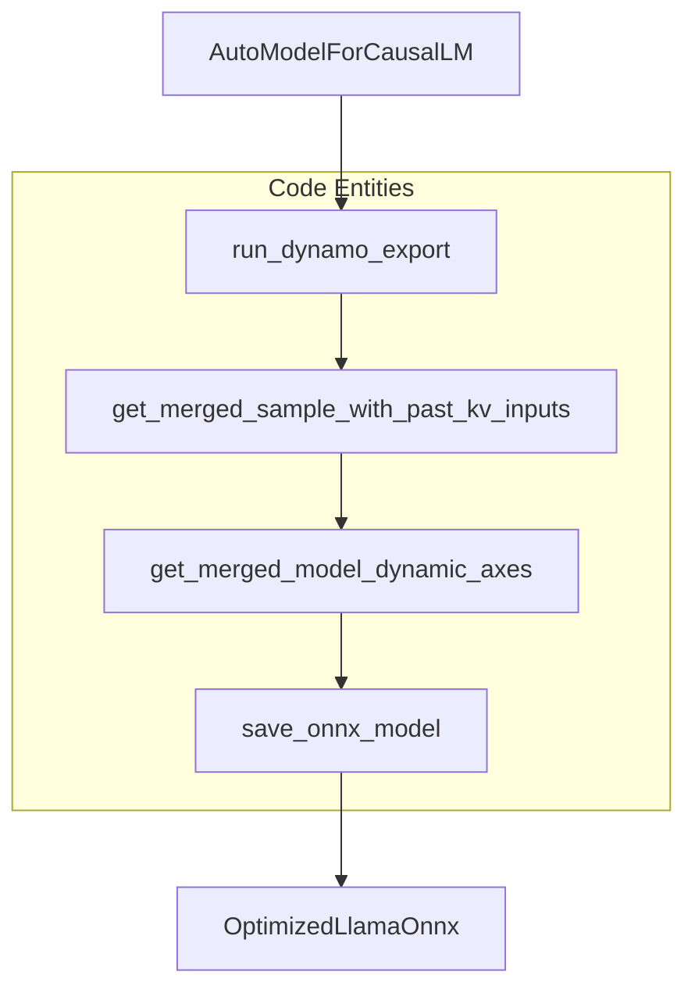
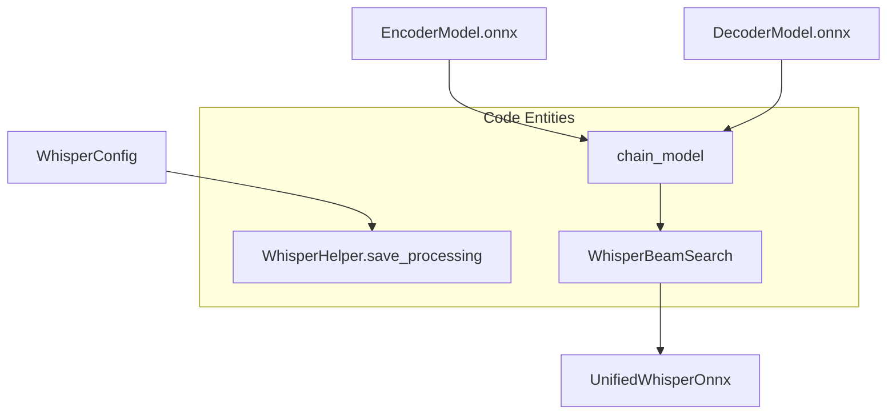

<!-- source: DeepWiki mcp.deepwiki.com · repo microsoft/onnxruntime · page 11.3 Model Conversion Pipelines · fetched 2026-10-21 -->

# Model Conversion Pipelines

Relevant source files

The following files were used as context for generating this wiki page:

- [onnxruntime/contrib_ops/cuda/bert/decoder_masked_multihead_attention.cc](onnxruntime/contrib_ops/cuda/bert/decoder_masked_multihead_attention.cc)
- [onnxruntime/contrib_ops/cuda/bert/decoder_masked_self_attention.cc](onnxruntime/contrib_ops/cuda/bert/decoder_masked_self_attention.cc)
- [onnxruntime/contrib_ops/cuda/bert/fastertransformer_decoder_attention/decoder_masked_multihead_attention_impl.cu](onnxruntime/contrib_ops/cuda/bert/fastertransformer_decoder_attention/decoder_masked_multihead_attention_impl.cu)
- [onnxruntime/contrib_ops/cuda/bert/fastertransformer_decoder_attention/decoder_masked_multihead_attention_impl.h](onnxruntime/contrib_ops/cuda/bert/fastertransformer_decoder_attention/decoder_masked_multihead_attention_impl.h)
- [onnxruntime/contrib_ops/cuda/bert/fastertransformer_decoder_attention/decoder_masked_multihead_attention_impl_utils.h](onnxruntime/contrib_ops/cuda/bert/fastertransformer_decoder_attention/decoder_masked_multihead_attention_impl_utils.h)
- [onnxruntime/python/tools/transformers/convert_generation.py](onnxruntime/python/tools/transformers/convert_generation.py)
- [onnxruntime/python/tools/transformers/fusion_attention_unet.py](onnxruntime/python/tools/transformers/fusion_attention_unet.py)
- [onnxruntime/python/tools/transformers/fusion_attention_vae.py](onnxruntime/python/tools/transformers/fusion_attention_vae.py)
- [onnxruntime/python/tools/transformers/fusion_gemmfastgelu.py](onnxruntime/python/tools/transformers/fusion_gemmfastgelu.py)
- [onnxruntime/python/tools/transformers/fusion_nhwc_conv.py](onnxruntime/python/tools/transformers/fusion_nhwc_conv.py)
- [onnxruntime/python/tools/transformers/fusion_rotary_attention.py](onnxruntime/python/tools/transformers/fusion_rotary_attention.py)
- [onnxruntime/python/tools/transformers/fusion_shape.py](onnxruntime/python/tools/transformers/fusion_shape.py)
- [onnxruntime/python/tools/transformers/fusion_transpose.py](onnxruntime/python/tools/transformers/fusion_transpose.py)
- [onnxruntime/python/tools/transformers/import_utils.py](onnxruntime/python/tools/transformers/import_utils.py)
- [onnxruntime/python/tools/transformers/metrics.py](onnxruntime/python/tools/transformers/metrics.py)
- [onnxruntime/python/tools/transformers/models/llama/README.md](onnxruntime/python/tools/transformers/models/llama/README.md)
- [onnxruntime/python/tools/transformers/models/llama/benchmark.py](onnxruntime/python/tools/transformers/models/llama/benchmark.py)
- [onnxruntime/python/tools/transformers/models/llama/benchmark_all.py](onnxruntime/python/tools/transformers/models/llama/benchmark_all.py)
- [onnxruntime/python/tools/transformers/models/llama/benchmark_e2e.py](onnxruntime/python/tools/transformers/models/llama/benchmark_e2e.py)
- [onnxruntime/python/tools/transformers/models/llama/convert_to_onnx.py](onnxruntime/python/tools/transformers/models/llama/convert_to_onnx.py)
- [onnxruntime/python/tools/transformers/models/llama/dist_settings.py](onnxruntime/python/tools/transformers/models/llama/dist_settings.py)
- [onnxruntime/python/tools/transformers/models/llama/llama_inputs.py](onnxruntime/python/tools/transformers/models/llama/llama_inputs.py)
- [onnxruntime/python/tools/transformers/models/llama/llama_parity.py](onnxruntime/python/tools/transformers/models/llama/llama_parity.py)
- [onnxruntime/python/tools/transformers/models/llama/llama_torch.py](onnxruntime/python/tools/transformers/models/llama/llama_torch.py)
- [onnxruntime/python/tools/transformers/models/llama/prompts.json](onnxruntime/python/tools/transformers/models/llama/prompts.json)
- [onnxruntime/python/tools/transformers/models/llama/quant_kv_dataloader.py](onnxruntime/python/tools/transformers/models/llama/quant_kv_dataloader.py)
- [onnxruntime/python/tools/transformers/models/llama/requirements-cpu.txt](onnxruntime/python/tools/transformers/models/llama/requirements-cpu.txt)
- [onnxruntime/python/tools/transformers/models/llama/requirements-cuda.txt](onnxruntime/python/tools/transformers/models/llama/requirements-cuda.txt)
- [onnxruntime/python/tools/transformers/models/llama/requirements.txt](onnxruntime/python/tools/transformers/models/llama/requirements.txt)
- [onnxruntime/python/tools/transformers/models/phi2/requirements.txt](onnxruntime/python/tools/transformers/models/phi2/requirements.txt)
- [onnxruntime/python/tools/transformers/models/stable_diffusion/README.md](onnxruntime/python/tools/transformers/models/stable_diffusion/README.md)
- [onnxruntime/python/tools/transformers/models/stable_diffusion/benchmark.py](onnxruntime/python/tools/transformers/models/stable_diffusion/benchmark.py)
- [onnxruntime/python/tools/transformers/models/stable_diffusion/demo_txt2img.py](onnxruntime/python/tools/transformers/models/stable_diffusion/demo_txt2img.py)
- [onnxruntime/python/tools/transformers/models/stable_diffusion/demo_txt2img_xl.py](onnxruntime/python/tools/transformers/models/stable_diffusion/demo_txt2img_xl.py)
- [onnxruntime/python/tools/transformers/models/stable_diffusion/demo_utils.py](onnxruntime/python/tools/transformers/models/stable_diffusion/demo_utils.py)
- [onnxruntime/python/tools/transformers/models/stable_diffusion/diffusion_models.py](onnxruntime/python/tools/transformers/models/stable_diffusion/diffusion_models.py)
- [onnxruntime/python/tools/transformers/models/stable_diffusion/engine_builder.py](onnxruntime/python/tools/transformers/models/stable_diffusion/engine_builder.py)
- [onnxruntime/python/tools/transformers/models/stable_diffusion/engine_builder_ort_cuda.py](onnxruntime/python/tools/transformers/models/stable_diffusion/engine_builder_ort_cuda.py)
- [onnxruntime/python/tools/transformers/models/stable_diffusion/engine_builder_ort_trt.py](onnxruntime/python/tools/transformers/models/stable_diffusion/engine_builder_ort_trt.py)
- [onnxruntime/python/tools/transformers/models/stable_diffusion/optimize_pipeline.py](onnxruntime/python/tools/transformers/models/stable_diffusion/optimize_pipeline.py)
- [onnxruntime/python/tools/transformers/models/stable_diffusion/ort_optimizer.py](onnxruntime/python/tools/transformers/models/stable_diffusion/ort_optimizer.py)
- [onnxruntime/python/tools/transformers/models/stable_diffusion/pipeline_stable_diffusion.py](onnxruntime/python/tools/transformers/models/stable_diffusion/pipeline_stable_diffusion.py)
- [onnxruntime/python/tools/transformers/models/whisper/README.md](onnxruntime/python/tools/transformers/models/whisper/README.md)
- [onnxruntime/python/tools/transformers/models/whisper/__init__.py](onnxruntime/python/tools/transformers/models/whisper/__init__.py)
- [onnxruntime/python/tools/transformers/models/whisper/benchmark.py](onnxruntime/python/tools/transformers/models/whisper/benchmark.py)
- [onnxruntime/python/tools/transformers/models/whisper/benchmark_all.py](onnxruntime/python/tools/transformers/models/whisper/benchmark_all.py)
- [onnxruntime/python/tools/transformers/models/whisper/convert_to_onnx.py](onnxruntime/python/tools/transformers/models/whisper/convert_to_onnx.py)
- [onnxruntime/python/tools/transformers/models/whisper/requirements.txt](onnxruntime/python/tools/transformers/models/whisper/requirements.txt)
- [onnxruntime/python/tools/transformers/models/whisper/test/1272-141231-0002.mp3](onnxruntime/python/tools/transformers/models/whisper/test/1272-141231-0002.mp3)
- [onnxruntime/python/tools/transformers/models/whisper/test/whisper_ort_output.txt](onnxruntime/python/tools/transformers/models/whisper/test/whisper_ort_output.txt)
- [onnxruntime/python/tools/transformers/models/whisper/whisper_chain.py](onnxruntime/python/tools/transformers/models/whisper/whisper_chain.py)
- [onnxruntime/python/tools/transformers/models/whisper/whisper_decoder.py](onnxruntime/python/tools/transformers/models/whisper/whisper_decoder.py)
- [onnxruntime/python/tools/transformers/models/whisper/whisper_encoder.py](onnxruntime/python/tools/transformers/models/whisper/whisper_encoder.py)
- [onnxruntime/python/tools/transformers/models/whisper/whisper_encoder_decoder_init.py](onnxruntime/python/tools/transformers/models/whisper/whisper_encoder_decoder_init.py)
- [onnxruntime/python/tools/transformers/models/whisper/whisper_helper.py](onnxruntime/python/tools/transformers/models/whisper/whisper_helper.py)
- [onnxruntime/python/tools/transformers/models/whisper/whisper_inputs.py](onnxruntime/python/tools/transformers/models/whisper/whisper_inputs.py)
- [onnxruntime/python/tools/transformers/models/whisper/whisper_jump_times.py](onnxruntime/python/tools/transformers/models/whisper/whisper_jump_times.py)
- [onnxruntime/python/tools/transformers/onnx_model_gpt2.py](onnxruntime/python/tools/transformers/onnx_model_gpt2.py)
- [onnxruntime/python/tools/transformers/onnx_model_unet.py](onnxruntime/python/tools/transformers/onnx_model_unet.py)
- [onnxruntime/test/python/requirements.txt](onnxruntime/test/python/requirements.txt)
- [onnxruntime/test/python/transformers/qwen3_model_generator.py](onnxruntime/test/python/transformers/qwen3_model_generator.py)
- [onnxruntime/test/python/transformers/test_generation.py](onnxruntime/test/python/transformers/test_generation.py)
- [onnxruntime/test/python/transformers/test_optimizer_stable_diffusion.py](onnxruntime/test/python/transformers/test_optimizer_stable_diffusion.py)

The purpose and scope of this section is to document the conversion, optimization, and export pipelines implemented in `onnxruntime/python/tools/transformers/` for transformer-based generative models (such as LLaMA, Whisper, Phi, and Stable Diffusion). These tooling scripts translate Hugging Face or PyTorch checkpoints into high-performance ONNX models equipped with specialized ORT operators (e.g., `BeamSearch`, `GreedySearch`, `Sampling`, `GroupQueryAttention`, and `WhisperBeamSearch`) and custom fused kernels.

---

## 1. General Generation Conversion Pipeline (`convert_generation.py`)

The script `convert_generation.py` acts as a central orchestrator for converting models like GPT-2, T5, and MT5 into ONNX graphs embedding advanced search operators.

### Key Classes and Functions
* `GenerationType` (Enum): Defines the search strategy options including `BEAMSEARCH`, `GREEDYSEARCH`, and `SAMPLING` [onnxruntime/python/tools/transformers/convert_generation.py:90-94]().
* `parse_arguments()`: Configures command-line options for model checkpoints, model types (`gpt2`, `t5`, `mt5`), precision modes (`fp32`, `fp16`), block lists, and external data storage requirements [onnxruntime/python/tools/transformers/convert_generation.py:99-198]().

Sources: [onnxruntime/python/tools/transformers/convert_generation.py:90-198]()

---

## 2. LLaMA Model Conversion Pipeline

The LLaMA conversion module (`models/llama/convert_to_onnx.py`) handles exporting Causal Language Models into optimized ONNX structures supporting dynamic shapes and key-value (KV) cache reuse.

### Dynamic Axes and Export Mechanics
* `get_model_dynamic_axes()`: Defines dynamic axes mapping for batch size and sequence lengths across model inputs and outputs (`input_ids`, `attention_mask`, `position_ids`, `logits`, and `present.*.key/value`) [onnxruntime/python/tools/transformers/models/llama/convert_to_onnx.py:48-62]().
* `get_merged_model_dynamic_axes()`: Establishes total sequence length mappings for combined prompt and token generation steps [onnxruntime/python/tools/transformers/models/llama/convert_to_onnx.py:88-112]().
* `run_dynamo_export()`: Leverages PyTorch Dynamo and ONNX export mechanisms to trace and serialize the LLaMA decoder subgraphs [onnxruntime/python/tools/transformers/models/llama/convert_to_onnx.py:127-163]().

*Figure 1: LLaMA Model Export Data Flow.*

Sources: [onnxruntime/python/tools/transformers/models/llama/convert_to_onnx.py:48-163]()

---

## 3. Whisper Model Conversion Pipeline

Whisper export and chaining (`models/whisper/`) converts encoder-decoder audio models into a unified runtime representation via custom operators.

### Helper and Chaining Architecture
* `parse_arguments()`: Manages configuration parameters for implementation choices (`hf` vs `openai`), precision levels (`fp32`, `fp16`, `int8`, `int4`), and decoder optimizations [onnxruntime/python/tools/transformers/models/whisper/convert_to_onnx.py:34-113]().
* `WhisperHelper.save_processing()`: Serializes config files, tokenizers, and feature extractors alongside audio preprocessing configurations [onnxruntime/python/tools/transformers/models/whisper/whisper_helper.py:71-93]().
* `chain_model()`: Loads separate encoder and decoder ONNX components, injects casting and graph inputs, and constructs the composite `WhisperBeamSearch` operator node [onnxruntime/python/tools/transformers/models/whisper/whisper_chain.py:46-88]().

*Figure 2: Whisper Model Chaining and Graph Composition.*

Sources: [onnxruntime/python/tools/transformers/models/whisper/convert_to_onnx.py:34-113](), [onnxruntime/python/tools/transformers/models/whisper/whisper_helper.py:71-93](), [onnxruntime/python/tools/transformers/models/whisper/whisper_chain.py:46-88]()

---

## 4. Stable Diffusion Optimization Pipeline

The Stable Diffusion toolkit (`models/stable_diffusion/`) optimizes exported Hugging Face diffusers pipelines for half-precision GPU execution via custom fusion passes and execution providers.

### Classification and Optimization Passes
* `_classify_pipeline_type()`: Inspects the source directory structure to identify whether the pipeline targets Stable Diffusion 1.x/2.x, SDXL, Stable Diffusion 3, or FLUX [onnxruntime/python/tools/transformers/models/stable_diffusion/optimize_pipeline.py:69-82]().
* `_optimize_sd_pipeline()`: Applies model-specific graph transformations, mapping transformer, unet, vae, and clip components to their respective optimization classes (`UnetOnnxModel`, `VaeOnnxModel`, `ClipOnnxModel`, `T5OnnxModel`, `MmditOnnxModel`) and converting types to float16 or bfloat16 [onnxruntime/python/tools/transformers/models/stable_diffusion/optimize_pipeline.py:98-125]().

Sources: [onnxruntime/python/tools/transformers/models/stable_diffusion/optimize_pipeline.py:69-125]()

---

