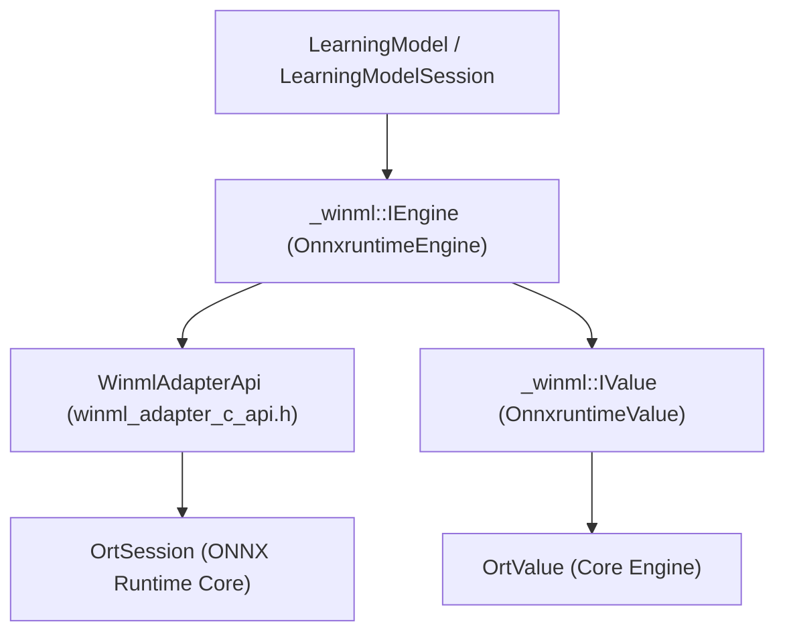
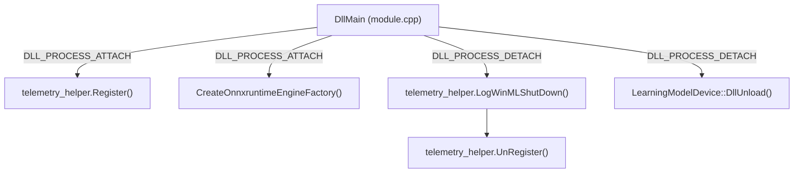

<!-- source: DeepWiki mcp.deepwiki.com · repo microsoft/onnxruntime · page 12 Windows Platform Integration · fetched 2026-10-21 -->

# Windows Platform Integration

Relevant source files

The following files were used as context for generating this wiki page:

- [cmake/winml.cmake](cmake/winml.cmake)
- [cmake/winml_cppwinrt.cmake](cmake/winml_cppwinrt.cmake)
- [cmake/winml_unittests.cmake](cmake/winml_unittests.cmake)
- [winml/adapter/winml_adapter_apis.h](winml/adapter/winml_adapter_apis.h)
- [winml/adapter/winml_adapter_c_api.cpp](winml/adapter/winml_adapter_c_api.cpp)
- [winml/adapter/winml_adapter_c_api.h](winml/adapter/winml_adapter_c_api.h)
- [winml/adapter/winml_adapter_model.cpp](winml/adapter/winml_adapter_model.cpp)
- [winml/adapter/winml_adapter_model.h](winml/adapter/winml_adapter_model.h)
- [winml/adapter/winml_adapter_session.cpp](winml/adapter/winml_adapter_session.cpp)
- [winml/api/Microsoft.AI.MachineLearning.Experimental.idl](winml/api/Microsoft.AI.MachineLearning.Experimental.idl)
- [winml/dll/module.cpp](winml/dll/module.cpp)
- [winml/lib/Api.Experimental/LearningModelExperimental.cpp](winml/lib/Api.Experimental/LearningModelExperimental.cpp)
- [winml/lib/Api.Experimental/LearningModelExperimental.h](winml/lib/Api.Experimental/LearningModelExperimental.h)
- [winml/lib/Api.Experimental/LearningModelSessionExperimental.cpp](winml/lib/Api.Experimental/LearningModelSessionExperimental.cpp)
- [winml/lib/Api.Experimental/LearningModelSessionOptionsExperimental.cpp](winml/lib/Api.Experimental/LearningModelSessionOptionsExperimental.cpp)
- [winml/lib/Api.Experimental/LearningModelSessionOptionsExperimental.h](winml/lib/Api.Experimental/LearningModelSessionOptionsExperimental.h)
- [winml/lib/Api.Ort/OnnxruntimeEngine.cpp](winml/lib/Api.Ort/OnnxruntimeEngine.cpp)
- [winml/lib/Api.Ort/OnnxruntimeEngine.h](winml/lib/Api.Ort/OnnxruntimeEngine.h)
- [winml/lib/Api.Ort/OnnxruntimeModel.cpp](winml/lib/Api.Ort/OnnxruntimeModel.cpp)
- [winml/lib/Api.Ort/OnnxruntimeModel.h](winml/lib/Api.Ort/OnnxruntimeModel.h)
- [winml/lib/Api/LearningModel.cpp](winml/lib/Api/LearningModel.cpp)
- [winml/lib/Api/LearningModel.h](winml/lib/Api/LearningModel.h)
- [winml/lib/Common/inc/StringHelpers.h](winml/lib/Common/inc/StringHelpers.h)
- [winml/lib/Common/inc/iengine.h](winml/lib/Common/inc/iengine.h)
- [winml/test/api/LearningModelSessionAPITest.cpp](winml/test/api/LearningModelSessionAPITest.cpp)
- [winml/test/api/LearningModelSessionAPITest.h](winml/test/api/LearningModelSessionAPITest.h)
- [winml/test/common/winrt_headers.h](winml/test/common/winrt_headers.h)

The Windows Platform Integration subsystem enables ONNX Runtime to deeply interoperate with Windows-specific operating system components, graphics device drivers, and application frameworks. This subsystem comprises Windows ML (WinML) for high-level WinRT and C++/WinRT application consumption, ETW-based telemetry and logging services, platform environment abstractions, and DirectML hardware acceleration integration.

For detailed information on the specific child modules, refer to the following child pages:
- [Windows ML (WinML)](#12.1)
- [Telemetry and Platform Services](#12.2)
- [DirectML Operator Layer](#12.3)

Sources: `cmake/winml.cmake:1-25` [cmake/winml.cmake:1-25](), `winml/adapter/winml_adapter_c_api.cpp:16-99` [winml/adapter/winml_adapter_c_api.cpp:16-99]()

---

## 12.1 Windows ML (WinML)

Windows ML provides a WinRT API surface allowing Universal Windows Platform (UWP) and desktop applications to evaluate ONNX models locally using CPU, GPU, or neural processing unit (NPU) hardware. The WinML layer is implemented in `winml/` and translates high-level WinRT objects (such as `LearningModel`, `LearningModelSession`, and `LearningModelBinding`) into core ONNX Runtime operations via a private adapter layer [winml/lib/Api/LearningModel.cpp:61-107](), [winml/lib/Api.Ort/OnnxruntimeEngine.h:61-148]().

For deep technical details on the WinRT API surface, model reflection, adapter bindings, image preprocessing pipelines, and test suites, see [Windows ML (WinML)](#12.1).

Sources: `winml/lib/Api/LearningModel.cpp:61-107` [winml/lib/Api/LearningModel.cpp:61-107](), `winml/lib/Api.Ort/OnnxruntimeEngine.h:61-148` [winml/lib/Api.Ort/OnnxruntimeEngine.h:61-148]()

---

## 12.2 Telemetry and Platform Services

Platform services within the Windows integration layer handle application lifecycle logging, diagnostic tracing, and resource management. Windows telemetry integrates with Event Tracing for Windows (ETW) via TraceLogging providers initialized during DLL attachment [winml/dll/module.cpp:26-39](). Thread pool configurations, thread affinity, and environment-level abstractions are managed across Windows and POSIX boundaries through adapter structures like `OrtThreadPoolOptions` [winml/adapter/winml_adapter_c_api.h:48-73]().

For details on ETW sink logging, telemetry events, and platform `Env` abstractions, see [Telemetry and Platform Services](#12.2).

Sources: `winml/dll/module.cpp:26-39` [winml/dll/module.cpp:26-39](), `winml/adapter/winml_adapter_c_api.h:48-73` [winml/adapter/winml_adapter_c_api.h:48-73]()

---

## 12.3 DirectML Operator Layer

The DirectML (DML) integration layer binds ONNX Runtime execution graphs to DirectX 12 hardware capabilities. It provides custom operator registrations, helper functions for shape inference, operator fusion passes, and the `MLOperatorAuthor` application binary interface (ABI) supporting custom operator authoring on Windows GPUs [winml/lib/Api.Ort/OnnxruntimeEngine.cpp:175-190](), [winml/adapter/winml_adapter_c_api.cpp:64-73]().

For detailed information on DML operator registration, graph fusion rules, and the `MLOperatorAuthor` ABI, see [DirectML Operator Layer](#12.3).

Sources: `winml/lib/Api.Ort/OnnxruntimeEngine.cpp:175-190` [winml/lib/Api.Ort/OnnxruntimeEngine.cpp:175-190](), `winml/adapter/winml_adapter_c_api.cpp:64-73` [winml/adapter/winml_adapter_c_api.cpp:64-73]()

---

## Architecture & Code Entity Mappings

The following diagrams bridge the natural language subsystem definitions to exact codebase identifiers and classes.

### Diagram 1: WinML to ONNX Runtime Adapter Architecture

Sources: `winml/lib/Api.Ort/OnnxruntimeEngine.h:61-148` [winml/lib/Api.Ort/OnnxruntimeEngine.h:61-148](), `winml/adapter/winml_adapter_c_api.h:75-100` [winml/adapter/winml_adapter_c_api.h:75-100]()

### Diagram 2: DLL Lifecycle and Telemetry Integration Flow

Sources: `winml/dll/module.cpp:26-57` [winml/dll/module.cpp:26-57](), `winml/lib/Api/LearningModel.cpp:61-65` [winml/lib/Api/LearningModel.cpp:61-65]()

---

