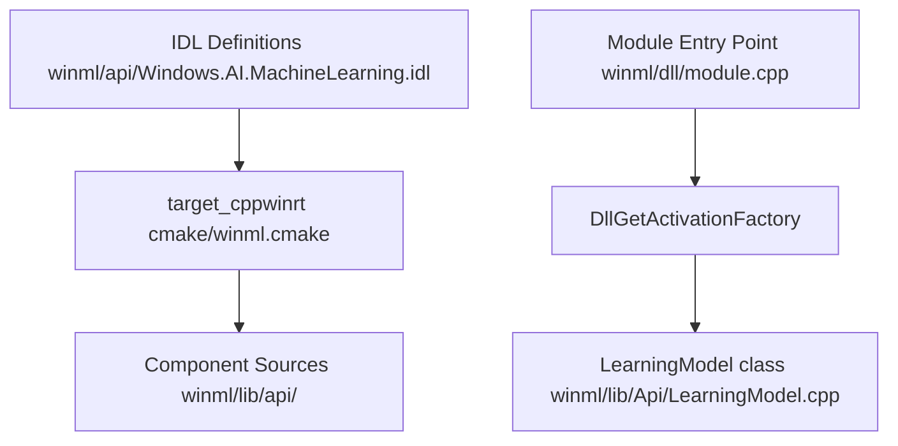
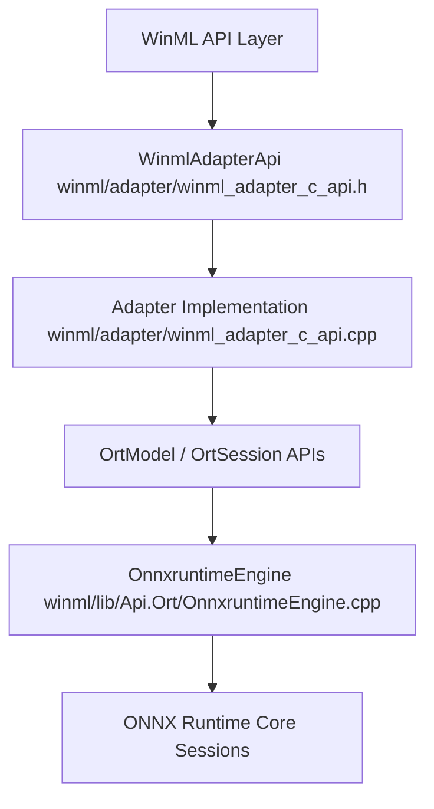

<!-- source: DeepWiki mcp.deepwiki.com · repo microsoft/onnxruntime · page 12.1 Windows ML (WinML) · fetched 2026-10-21 -->

# Windows ML (WinML)

<details>
<summary>Relevant source files</summary>

The following files were used as context for generating this wiki page:

- [cmake/winml.cmake](cmake/winml.cmake)
- [cmake/winml_cppwinrt.cmake](cmake/winml_cppwinrt.cmake)
- [cmake/winml_unittests.cmake](cmake/winml_unittests.cmake)
- [winml/adapter/winml_adapter_apis.h](winml/adapter/winml_adapter_apis.h)
- [winml/adapter/winml_adapter_c_api.cpp](winml/adapter/winml_adapter_c_api.cpp)
- [winml/adapter/winml_adapter_c_api.h](winml/adapter/winml_adapter_c_api.h)
- [winml/adapter/winml_adapter_model.cpp](winml/adapter/winml_adapter_model.cpp)
- [winml/adapter/winml_adapter_model.h](winml/adapter/winml_adapter_model.h)
- [winml/adapter/winml_adapter_session.cpp](winml/adapter/winml_adapter_session.cpp)
- [winml/api/Microsoft.AI.MachineLearning.Experimental.idl](winml/api/Microsoft.AI.MachineLearning.Experimental.idl)
- [winml/dll/module.cpp](winml/dll/module.cpp)
- [winml/lib/Api.Experimental/LearningModelExperimental.cpp](winml/lib/Api.Experimental/LearningModelExperimental.cpp)
- [winml/lib/Api.Experimental/LearningModelExperimental.h](winml/lib/Api.Experimental/LearningModelExperimental.h)
- [winml/lib/Api.Experimental/LearningModelSessionExperimental.cpp](winml/lib/Api.Experimental/LearningModelSessionExperimental.cpp)
- [winml/lib/Api.Experimental/LearningModelSessionOptionsExperimental.cpp](winml/lib/Api.Experimental/LearningModelSessionOptionsExperimental.cpp)
- [winml/lib/Api.Experimental/LearningModelSessionOptionsExperimental.h](winml/lib/Api.Experimental/LearningModelSessionOptionsExperimental.h)
- [winml/lib/Api.Ort/OnnxruntimeEngine.cpp](winml/lib/Api.Ort/OnnxruntimeEngine.cpp)
- [winml/lib/Api.Ort/OnnxruntimeEngine.h](winml/lib/Api.Ort/OnnxruntimeEngine.h)
- [winml/lib/Api.Ort/OnnxruntimeModel.cpp](winml/lib/Api.Ort/OnnxruntimeModel.cpp)
- [winml/lib/Api.Ort/OnnxruntimeModel.h](winml/lib/Api.Ort/OnnxruntimeModel.h)
- [winml/lib/Api/LearningModel.cpp](winml/lib/Api/LearningModel.cpp)
- [winml/lib/Api/LearningModel.h](winml/lib/Api/LearningModel.h)
- [winml/lib/Common/inc/StringHelpers.h](winml/lib/Common/inc/StringHelpers.h)
- [winml/lib/Common/inc/iengine.h](winml/lib/Common/inc/iengine.h)
- [winml/test/api/LearningModelSessionAPITest.cpp](winml/test/api/LearningModelSessionAPITest.cpp)
- [winml/test/api/LearningModelSessionAPITest.h](winml/test/api/LearningModelSessionAPITest.h)
- [winml/test/common/winrt_headers.h](winml/test/common/winrt_headers.h)

</details>


Windows ML (WinML) is a WinRT-based machine learning inference API built on top of ONNX Runtime (ORT) for Windows platforms. It enables native Windows applications to evaluate ONNX models leveraging hardware acceleration via the DirectML Execution Provider or CPU execution.

Sources: `cmake/winml.cmake:1-143`

---

## 1. WinRT API Surface and Component Architecture

The WinML API layer exposes standard WinRT types under the `Windows.AI.MachineLearning` (or overridden inbox namespaces) via CppWinRT-generated components. The IDL definitions specify classes like `LearningModel`, `LearningModelSession`, `LearningModelBinding`, and `LearningModelDevice`.


Sources: `cmake/winml.cmake:84-111`, `winml/dll/module.cpp:26-57`, `winml/dll/module.cpp:158-168`, `winml/lib/Api/LearningModel.cpp:61-108`

The DLL entry point initializes tracing and exposes standard COM activation factories, including experimental extensions [`winml/dll/module.cpp:26-168`]().

Sources: `winml/dll/module.cpp:26-168`

---

## 2. Adapter Layer and ONNX Runtime Integration

WinML isolates direct dependency on internal ONNX Runtime data structures by using a private C-style adapter contract (`WinmlAdapterApi`) defined in `winml/adapter/winml_adapter_c_api.h` and implemented in `winml/adapter/winml_adapter_c_api.cpp`. This contract bridges WinRT model objects, environment configurations, execution providers (such as DirectML), and session creation functions into standard ORT C API calls.


Sources: `winml/adapter/winml_adapter_c_api.h:19-100`, `winml/adapter/winml_adapter_c_api.cpp:16-100`, `winml/lib/Api.Ort/OnnxruntimeEngine.cpp:61-87`

Model loading and protobuf serialization are managed via `OrtModelImpl`, which parses ONNX `ModelProto` buffers from paths, memory streams, or file mappings [`winml/adapter/winml_adapter_model.cpp:119-159`]().

Sources: `winml/adapter/winml_adapter_model.cpp:119-159`, `winml/lib/Api.Ort/OnnxruntimeEngine.cpp:61-148`

---

## 3. Image Preprocessing and Resource Management

Data exchange between WinML and ONNX Runtime uses the `IValue` COM interface (`winml/lib/Common/inc/iengine.h`), which wraps underlying `OrtValue` instances and allocator definitions. 

For GPU execution, WinML supports zero-copy tensor binding directly to Direct3D 12 resources via `CreateTensorValueFromExternalD3DResource` and `OnnxruntimeValue::GetResource` [`winml/lib/Api.Ort/OnnxruntimeEngine.cpp:164-191`]().

```cpp
// Example: Retrieving a D3D12 resource allocation from an OrtValue tensor
HRESULT OnnxruntimeValue::GetResource(_winml::Resource& out) {
  auto ort_api = engine_->GetEngineFactory()->UseOrtApi();
  void* mutable_data = nullptr;
  RETURN_HR_IF_NOT_OK_MSG(ort_api->GetTensorMutableData(value_.get(), &mutable_data), ort_api);
  ...
}
```
Sources: `winml/lib/Common/inc/iengine.h:12-43`, `winml/lib/Api.Ort/OnnxruntimeEngine.cpp:164-191`

Sources: `winml/lib/Common/inc/iengine.h:12-43`, `winml/lib/Api.Ort/OnnxruntimeEngine.cpp:164-191`

---

## 4. Build System and Testing Infrastructure

WinML is built as part of the ONNX Runtime Windows build pipeline, orchestrated via CMake configuration scripts:
- `cmake/winml.cmake`: Manages CppWinRT SDK versions, NuGet fetching [`cmake/winml.cmake:31-44`], midl compilation for native and WinRT IDLs [`cmake/winml.cmake:84-143`], and target definitions.
- `cmake/winml_unittests.cmake`: Defines GoogleTest executables, linking against `winml_lib_common`, `onnxruntime`, and Windows application libraries [`cmake/winml_unittests.cmake:31-71`].

Unit tests cover session creation across various hardware devices (`LearningModelDeviceKind::Cpu`, `Default`, `DirectX`, etc.) and feature evaluations [`winml/test/api/LearningModelSessionAPITest.cpp:43-150`]().

Sources: `cmake/winml.cmake:31-143`, `cmake/winml_unittests.cmake:31-71`, `winml/test/api/LearningModelSessionAPITest.cpp:43-150`

---

