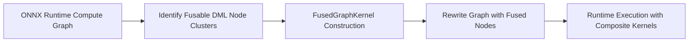
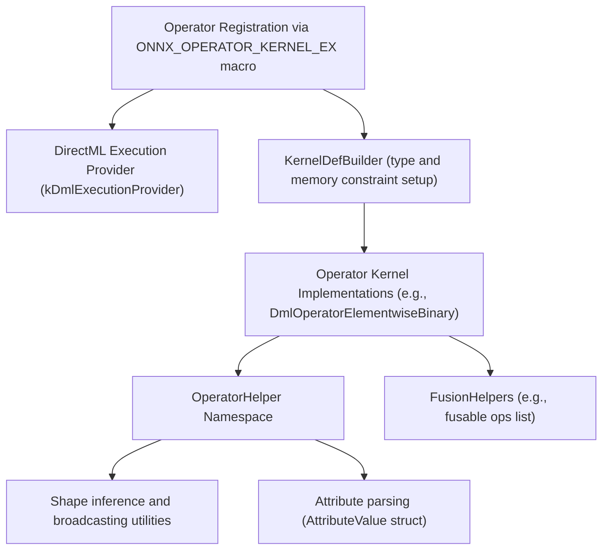
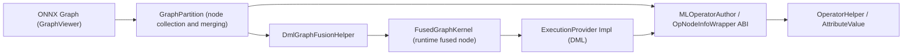

<!-- source: DeepWiki mcp.deepwiki.com · repo microsoft/onnxruntime · page 12.3 DirectML Operator Layer · fetched 2026-10-21 -->

# DirectML Operator Layer

<details>
<summary>Relevant source files</summary>

The following files were used as context for generating this wiki page:

- [onnxruntime/core/providers/dml/DmlExecutionProvider/inc/IWinmlExecutionProvider.h](onnxruntime/core/providers/dml/DmlExecutionProvider/inc/IWinmlExecutionProvider.h)
- [onnxruntime/core/providers/dml/DmlExecutionProvider/src/AbiCustomRegistry.cpp](onnxruntime/core/providers/dml/DmlExecutionProvider/src/AbiCustomRegistry.cpp)
- [onnxruntime/core/providers/dml/DmlExecutionProvider/src/AbiCustomRegistry.h](onnxruntime/core/providers/dml/DmlExecutionProvider/src/AbiCustomRegistry.h)
- [onnxruntime/core/providers/dml/DmlExecutionProvider/src/DmlCommon.cpp](onnxruntime/core/providers/dml/DmlExecutionProvider/src/DmlCommon.cpp)
- [onnxruntime/core/providers/dml/DmlExecutionProvider/src/DmlCommon.h](onnxruntime/core/providers/dml/DmlExecutionProvider/src/DmlCommon.h)
- [onnxruntime/core/providers/dml/DmlExecutionProvider/src/DmlGraphFusionHelper.cpp](onnxruntime/core/providers/dml/DmlExecutionProvider/src/DmlGraphFusionHelper.cpp)
- [onnxruntime/core/providers/dml/DmlExecutionProvider/src/DmlGraphFusionHelper.h](onnxruntime/core/providers/dml/DmlExecutionProvider/src/DmlGraphFusionHelper.h)
- [onnxruntime/core/providers/dml/DmlExecutionProvider/src/DmlReusedCommandListState.h](onnxruntime/core/providers/dml/DmlExecutionProvider/src/DmlReusedCommandListState.h)
- [onnxruntime/core/providers/dml/DmlExecutionProvider/src/DmlRuntimeFusedGraphKernel.cpp](onnxruntime/core/providers/dml/DmlExecutionProvider/src/DmlRuntimeFusedGraphKernel.cpp)
- [onnxruntime/core/providers/dml/DmlExecutionProvider/src/DmlRuntimeFusedGraphKernel.h](onnxruntime/core/providers/dml/DmlExecutionProvider/src/DmlRuntimeFusedGraphKernel.h)
- [onnxruntime/core/providers/dml/DmlExecutionProvider/src/External/DirectMLHelpers/ApiHelpers.h](onnxruntime/core/providers/dml/DmlExecutionProvider/src/External/DirectMLHelpers/ApiHelpers.h)
- [onnxruntime/core/providers/dml/DmlExecutionProvider/src/External/DirectMLHelpers/ApiTraits.h](onnxruntime/core/providers/dml/DmlExecutionProvider/src/External/DirectMLHelpers/ApiTraits.h)
- [onnxruntime/core/providers/dml/DmlExecutionProvider/src/External/DirectMLHelpers/DirectMLSchema.h](onnxruntime/core/providers/dml/DmlExecutionProvider/src/External/DirectMLHelpers/DirectMLSchema.h)
- [onnxruntime/core/providers/dml/DmlExecutionProvider/src/External/DirectMLHelpers/GeneratedSchemaHelpers.h](onnxruntime/core/providers/dml/DmlExecutionProvider/src/External/DirectMLHelpers/GeneratedSchemaHelpers.h)
- [onnxruntime/core/providers/dml/DmlExecutionProvider/src/FusedGraphKernel.cpp](onnxruntime/core/providers/dml/DmlExecutionProvider/src/FusedGraphKernel.cpp)
- [onnxruntime/core/providers/dml/DmlExecutionProvider/src/GraphDescBuilder.cpp](onnxruntime/core/providers/dml/DmlExecutionProvider/src/GraphDescBuilder.cpp)
- [onnxruntime/core/providers/dml/DmlExecutionProvider/src/GraphDescBuilder.h](onnxruntime/core/providers/dml/DmlExecutionProvider/src/GraphDescBuilder.h)
- [onnxruntime/core/providers/dml/DmlExecutionProvider/src/GraphPartitioner.cpp](onnxruntime/core/providers/dml/DmlExecutionProvider/src/GraphPartitioner.cpp)
- [onnxruntime/core/providers/dml/DmlExecutionProvider/src/MLOperatorAuthorImpl.cpp](onnxruntime/core/providers/dml/DmlExecutionProvider/src/MLOperatorAuthorImpl.cpp)
- [onnxruntime/core/providers/dml/DmlExecutionProvider/src/MLOperatorAuthorImpl.h](onnxruntime/core/providers/dml/DmlExecutionProvider/src/MLOperatorAuthorImpl.h)
- [onnxruntime/core/providers/dml/DmlExecutionProvider/src/Operators/DmlOperator.cpp](onnxruntime/core/providers/dml/DmlExecutionProvider/src/Operators/DmlOperator.cpp)
- [onnxruntime/core/providers/dml/DmlExecutionProvider/src/Operators/DmlOperator.h](onnxruntime/core/providers/dml/DmlExecutionProvider/src/Operators/DmlOperator.h)
- [onnxruntime/core/providers/dml/DmlExecutionProvider/src/Operators/DmlOperatorCast.cpp](onnxruntime/core/providers/dml/DmlExecutionProvider/src/Operators/DmlOperatorCast.cpp)
- [onnxruntime/core/providers/dml/DmlExecutionProvider/src/Operators/DmlOperatorElementWise.cpp](onnxruntime/core/providers/dml/DmlExecutionProvider/src/Operators/DmlOperatorElementWise.cpp)
- [onnxruntime/core/providers/dml/DmlExecutionProvider/src/Operators/DmlOperatorGather.cpp](onnxruntime/core/providers/dml/DmlExecutionProvider/src/Operators/DmlOperatorGather.cpp)
- [onnxruntime/core/providers/dml/DmlExecutionProvider/src/Operators/DmlOperatorPadding.cpp](onnxruntime/core/providers/dml/DmlExecutionProvider/src/Operators/DmlOperatorPadding.cpp)
- [onnxruntime/core/providers/dml/DmlExecutionProvider/src/Operators/DmlOperatorResize.cpp](onnxruntime/core/providers/dml/DmlExecutionProvider/src/Operators/DmlOperatorResize.cpp)
- [onnxruntime/core/providers/dml/DmlExecutionProvider/src/Operators/DmlOperatorRoiAlign.cpp](onnxruntime/core/providers/dml/DmlExecutionProvider/src/Operators/DmlOperatorRoiAlign.cpp)
- [onnxruntime/core/providers/dml/DmlExecutionProvider/src/Operators/DmlOperatorScatter.cpp](onnxruntime/core/providers/dml/DmlExecutionProvider/src/Operators/DmlOperatorScatter.cpp)
- [onnxruntime/core/providers/dml/DmlExecutionProvider/src/Operators/DmlOperatorSlice.cpp](onnxruntime/core/providers/dml/DmlExecutionProvider/src/Operators/DmlOperatorSlice.cpp)
- [onnxruntime/core/providers/dml/DmlExecutionProvider/src/Operators/DmlOperatorTopk.cpp](onnxruntime/core/providers/dml/DmlExecutionProvider/src/Operators/DmlOperatorTopk.cpp)
- [onnxruntime/core/providers/dml/DmlExecutionProvider/src/Operators/OperatorRegistration.cpp](onnxruntime/core/providers/dml/DmlExecutionProvider/src/Operators/OperatorRegistration.cpp)
- [onnxruntime/core/providers/dml/DmlExecutionProvider/src/Operators/OperatorUtility.cpp](onnxruntime/core/providers/dml/DmlExecutionProvider/src/Operators/OperatorUtility.cpp)
- [onnxruntime/core/providers/dml/DmlExecutionProvider/src/Operators/OperatorUtility.h](onnxruntime/core/providers/dml/DmlExecutionProvider/src/Operators/OperatorUtility.h)
- [onnxruntime/core/providers/dml/DmlExecutionProvider/src/TensorDesc.cpp](onnxruntime/core/providers/dml/DmlExecutionProvider/src/TensorDesc.cpp)
- [onnxruntime/core/providers/dml/DmlExecutionProvider/src/TensorDesc.h](onnxruntime/core/providers/dml/DmlExecutionProvider/src/TensorDesc.h)
- [onnxruntime/core/providers/dml/DmlExecutionProvider/src/precomp.h](onnxruntime/core/providers/dml/DmlExecutionProvider/src/precomp.h)
- [onnxruntime/core/providers/dml/OperatorAuthorHelper/Attributes.h](onnxruntime/core/providers/dml/OperatorAuthorHelper/Attributes.h)
- [onnxruntime/core/providers/dml/OperatorAuthorHelper/MLOperatorAuthorHelper.h](onnxruntime/core/providers/dml/OperatorAuthorHelper/MLOperatorAuthorHelper.h)
- [onnxruntime/core/providers/dml/OperatorAuthorHelper/MLOperatorAuthorPrivate.h](onnxruntime/core/providers/dml/OperatorAuthorHelper/MLOperatorAuthorPrivate.h)
- [onnxruntime/core/providers/dml/OperatorAuthorHelper/OperatorHelper.cpp](onnxruntime/core/providers/dml/OperatorAuthorHelper/OperatorHelper.cpp)
- [onnxruntime/core/providers/dml/OperatorAuthorHelper/OperatorHelper.h](onnxruntime/core/providers/dml/OperatorAuthorHelper/OperatorHelper.h)
- [onnxruntime/core/providers/dml/OperatorAuthorHelper/OperatorVersions.h](onnxruntime/core/providers/dml/OperatorAuthorHelper/OperatorVersions.h)
- [onnxruntime/core/providers/dml/dml_session_options_config_keys.h](onnxruntime/core/providers/dml/dml_session_options_config_keys.h)
- [winml/adapter/abi_custom_registry_impl.cpp](winml/adapter/abi_custom_registry_impl.cpp)
- [winml/adapter/abi_custom_registry_impl.h](winml/adapter/abi_custom_registry_impl.h)

</details>


This page documents the DirectML (DML) Operator Layer in ONNX Runtime, focusing on implementation details of DirectML operator registration, the `OperatorHelper` shape inference utilities, graph fusion mechanisms, and the `MLOperatorAuthor` ABI used for operator authoring. This layer acts as a bridge integrating DirectML kernels with ONNX Runtime's graph execution and optimization framework.

---

## 1. Purpose and Scope

The DirectML Operator Layer integrates the DirectML execution provider into ONNX Runtime by registering operators, managing metadata such as shape information and attributes through the `OperatorHelper`, fusing compatible operators for runtime efficiency, and supporting the `MLOperatorAuthor` ABI which enables ABI-bound operator authoring and runtime interaction. This layer primarily exists under the `onnxruntime/core/providers/dml` directory.

---

## 2. DML Operator Registration

### 2.1 Overview

DirectML operators are registered as kernel implementations specific to the DML execution provider, enabling the runtime to recognize and invoke DirectML kernels for corresponding ONNX operators.

- Operator registration is performed using the macro `ONNX_OPERATOR_KERNEL_EX` specifying the operator name, domain, version, provider, and kernel properties.
- The operator kernels often extend conventional ONNX operators to enable DirectML support for functions such as sequence operations (`SequenceAt`, `SequenceConstruct`), optional types (`OptionalHasElement`, `OptionalGetElement`), and control flow (`If`).
- Operators specify their memory type constraints, type constraints, and input/output configurations during registration.

### 2.2 Key File & Code

`OperatorRegistration.cpp` includes registrations of a broad set of ONNX operators to the DirectML execution provider with versioning support, for example:

```cpp
ONNX_OPERATOR_KERNEL_EX(
    SequenceAt,
    kOnnxDomain,
    11,
    kDmlExecutionProvider,
    (*KernelDefBuilder::Create())
        .InputMemoryType(OrtMemTypeCPUInput, 1)
        .TypeConstraint("S", DataTypeImpl::AllFixedSizeSequenceTensorTypes())
        .TypeConstraint("T", DataTypeImpl::AllFixedSizeTensorTypes())
        .TypeConstraint("I", std::vector<MLDataType>{
                                 DataTypeImpl::GetTensorType<int32_t>(),
                                 DataTypeImpl::GetTensorType<int64_t>()}),
    SequenceAt);
```

- These registrations enforce input/output data types and memory locations (CPU or GPU).
- This enables integration of complex ONNX concepts like sequences and optional types on DML.

### 2.3 Operator Kernel Implementation

- Kernels such as element-wise unary and binary operators are implemented as C++ template classes.
- Support exists for fused activations during operator creation, where activation operators can be fused for efficiency.
- For example, `DmlOperatorElementwiseBinary` supports kernels like element-wise addition with an optional fused activation.

---

## 3. OperatorHelper: Shape Inference and Utilities

`OperatorHelper` provides shape inference support and utility functions to ease the implementation and management of operator metadata.

### 3.1 Shape and Axis Handling

- Utilities handle broadcasting between tensor shapes for operations requiring shape alignment.
- Negative axes conventions are normalized to absolute indices, consistent with ONNX conventions.
- Helpers exist to handle empty dimensions or axes lists, crucial for shape inference of reduction and slicing ops.

### 3.2 Attribute and Tensor Data Reading

- Functions are available for reading attributes of different types (int, float, arrays) from operator attribute maps.
- There is support for converting tensor attribute data into usable C++ data structures with validation.
- Methods also handle casting attributes from DML tensor formats.

### 3.3 Examples of Helper Functions
```cpp
uint32_t HandleNegativeAxis(int32_t signedOnnxAxis, uint32_t dimCount, bool validateAxis = true);
void HandleNegativeAxes(gsl::span<int32_t> onnxAxes, uint32_t dimCount);
bool ContainsEmptyDimensions(gsl::span<const DimensionType> dimensions);
std::vector<DimensionType> BroadcastTensorShape(gsl::span<const DimensionType> inputShape0, gsl::span<const DimensionType> inputShape1);
```

This infrastructure simplifies operator implementation by centralizing shape and attribute logic.

---

## 4. Graph Fusion in DirectML

The DirectML Operator Layer performs graph fusion to optimize the compute graph before execution.

### 4.1 Fusion Objective

- Fuse nodes where DirectML provides support for fused operations, e.g., Conv + Relu.
- Reduce kernel launch overheads and intermediate tensor allocations.

### 4.2 Fusion Mechanism

- The fusion process identifies clusters of nodes eligible for fusion.
- Creates `FusedGraphKernel` representations which act as a single fused kernel during execution.
- Uses helper functions to manage graph node connectivity and properties.

### 4.3 Implementation Highlights

- The `DmlGraphFusionHelper` namespace provides utilities to create and manage fused graph kernels.
- Removes unconnected nodes after fusion for graph cleanliness.
- Uses `CreateResource` and `CreateCpuResource` to allocate D3D12 buffers backing graph data.



---

## 5. MLOperatorAuthor ABI for Operator Authoring

### 5.1 Purpose

- Provides a COM-based ABI interface (`MLOperatorAuthor`) allowing external components or custom kernels to integrate with DML and ONNX Runtime.
- Supports querying operator attributes, inputs/outputs, tensor shapes, and access to tensors at runtime.

### 5.2 ABI Object Model

- `OpNodeInfoWrapper` is a template class implementing the ABI interfaces and wraps ONNX `OpNodeProtoHelper`, providing required metadata and attribute access.
- `Closable` base class allows safe object lifecycle management with `Close()` methods indicating end of use.

### 5.3 Attribute Handling

- Attribute values are stored in `AttributeValue` structs supporting int, float, string types, arrays, etc.
- ABI methods provide typed attribute access, safe casting, and string attribute handling.

### 5.4 Data Translation

- `TranslateAllocationDataToAbi` translates provider-specific tensor allocations into ABI-compatible `IUnknown` pointers.
- Supports allocation interface recognition to handle memory sharing or copying semantics.

---

## 6. Summary and Data Flow

The DirectML Operator Layer implements a sophisticated integration of DirectML kernels with ONNX Runtime's kernel registration, shape inference, and graph fusion infrastructure, layered with an ABI that allows external authoring and inspection.

The data flow sequence involves:

1. **Operator Registration:** Operators are registered to the DML provider with metadata and kernel definitions.
2. **Shape Inference:** During graph construction, `OperatorHelper` performs shape and attribute inference.
3. **Graph Partitioning & Fusion:** Compatible nodes are partitioned and fused into composite kernels.
4. **MLOperatorAuthor ABI:** Provides runtime binding to operator properties and tensor data via a COM interface for operator authoring and runtime use.
5. **Execution:** Fused kernels and operators execute on DirectML backed devices with resource management.

---

## 7. Natural Language to Code Entity Diagram: Operator Registration and Helpers



---

## 8. Natural Language to Code Entity Diagram: Graph Fusion and ABI Interactions



---

## References to Source Files

- Operator registration, kernel definitions and type constraints: `onnxruntime/core/providers/dml/DmlExecutionProvider/src/Operators/OperatorRegistration.cpp:1-174`()
- OperatorHelper functions for shape inference and attribute management: `onnxruntime/core/providers/dml/OperatorAuthorHelper/OperatorHelper.h:1-189`(), `OperatorHelper.cpp:1-149`()
- MLOperatorAuthor ABI implementation and attribute structures: `onnxruntime/core/providers/dml/DmlExecutionProvider/src/MLOperatorAuthorImpl.cpp:1-192`(), `MLOperatorAuthorImpl.h:1-198`()
- Graph fusion mechanisms and resource management: `onnxruntime/core/providers/dml/DmlExecutionProvider/src/DmlGraphFusionHelper.cpp:1-165`()
- Operator kernel implementations and activation fusion logic: `onnxruntime/core/providers/dml/DmlExecutionProvider/src/Operators/DmlOperatorElementWise.cpp:1-169`()
- Operator utility functions supporting fusion and defaults: `onnxruntime/core/providers/dml/DmlExecutionProvider/src/Operators/OperatorUtility.cpp:1-161`()
- Graph partitioning and fused graph kernel integration: `onnxruntime/core/providers/dml/DmlExecutionProvider/src/GraphPartitioner.cpp:1-190`()

---

This technical documentation provides a comprehensive overview and detailed insight into the inner workings of the DirectML Operator Layer in ONNX Runtime, facilitating further development, debugging, and extension by contributors and integrators.

---

