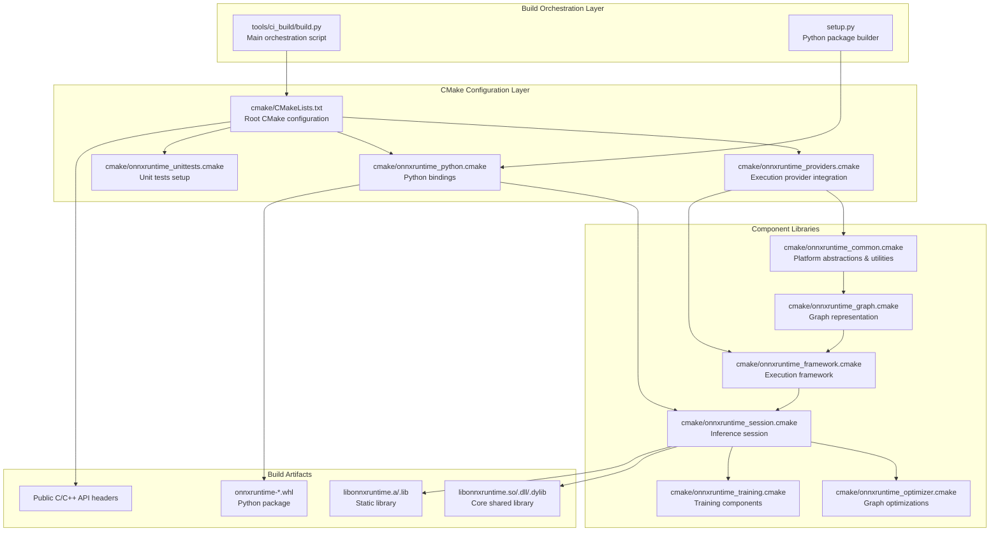
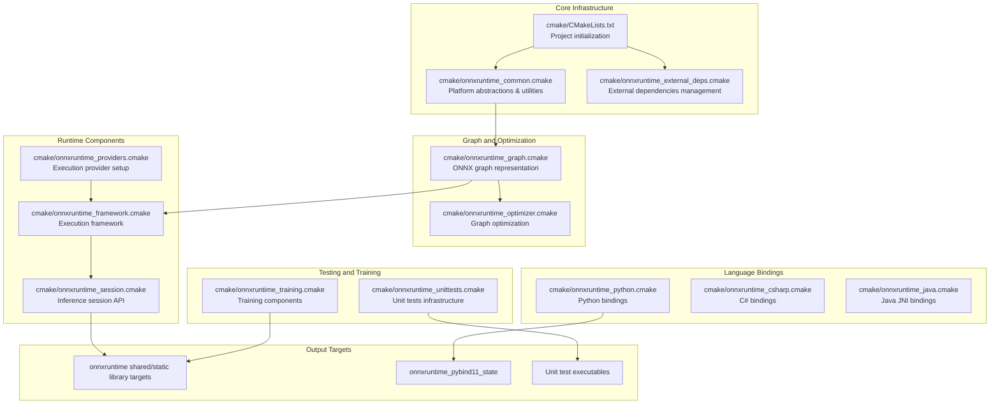
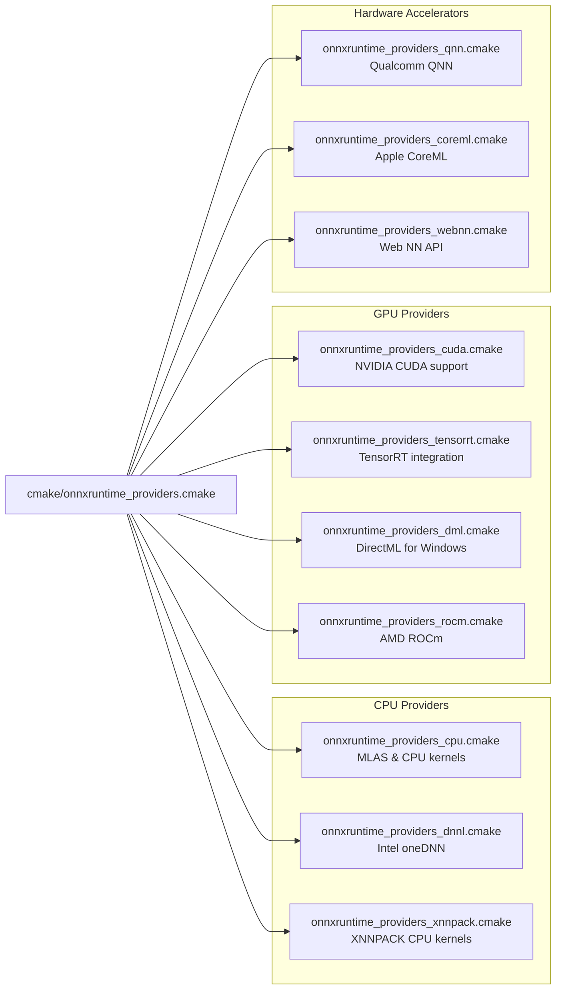
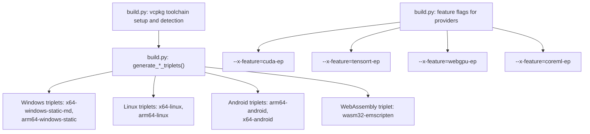
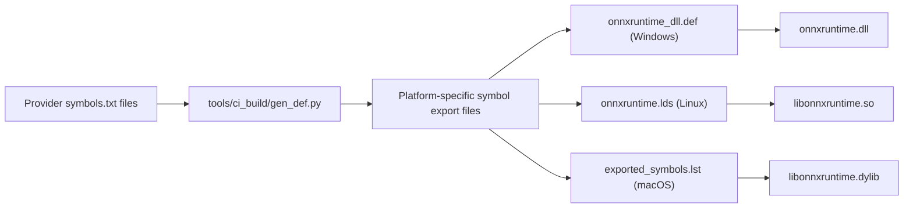

<!-- source: DeepWiki mcp.deepwiki.com · repo microsoft/onnxruntime · page 2 Build System · fetched 2026-10-21 -->

# Build System

Relevant source files

The following files were used as context for generating this wiki page:

- [ThirdPartyNotices.txt](ThirdPartyNotices.txt)
- [cgmanifests/cgmanifest.json](cgmanifests/cgmanifest.json)
- [cmake/CMakeLists.txt](cmake/CMakeLists.txt)
- [cmake/deps.txt](cmake/deps.txt)
- [cmake/external/onnxruntime_external_deps.cmake](cmake/external/onnxruntime_external_deps.cmake)
- [cmake/onnxruntime.cmake](cmake/onnxruntime.cmake)
- [cmake/onnxruntime_common.cmake](cmake/onnxruntime_common.cmake)
- [cmake/onnxruntime_framework.cmake](cmake/onnxruntime_framework.cmake)
- [cmake/onnxruntime_graph.cmake](cmake/onnxruntime_graph.cmake)
- [cmake/onnxruntime_optimizer.cmake](cmake/onnxruntime_optimizer.cmake)
- [cmake/onnxruntime_providers.cmake](cmake/onnxruntime_providers.cmake)
- [cmake/onnxruntime_providers_cpu.cmake](cmake/onnxruntime_providers_cpu.cmake)
- [cmake/onnxruntime_providers_webgpu.cmake](cmake/onnxruntime_providers_webgpu.cmake)
- [cmake/onnxruntime_python.cmake](cmake/onnxruntime_python.cmake)
- [cmake/onnxruntime_session.cmake](cmake/onnxruntime_session.cmake)
- [cmake/onnxruntime_training.cmake](cmake/onnxruntime_training.cmake)
- [cmake/onnxruntime_unittests.cmake](cmake/onnxruntime_unittests.cmake)
- [docs/BuildWithDawnAgilitySDK.md](docs/BuildWithDawnAgilitySDK.md)
- [setup.py](setup.py)
- [tools/ci_build/build.py](tools/ci_build/build.py)
- [tools/ci_build/build_args.py](tools/ci_build/build_args.py)
- [tools/ci_build/gen_def.py](tools/ci_build/gen_def.py)

This document provides a high-level overview of the comprehensive ONNX Runtime build system. It orchestrates the compilation and packaging of the runtime across multiple platforms and configurations, including the core build orchestration with `build.py`, the modular CMake configuration system, external dependency management, and packaging infrastructure for language bindings and platform-specific artifacts.

The build system supports:
- Multiple operating systems (Windows, Linux, macOS, Android, iOS, WebAssembly).
- Diverse execution providers for hardware acceleration (CPU, CUDA, TensorRT, DirectML, CoreML, QNN, WebGPU, etc.).
- Various packaging formats such as Python wheels, NuGet packages, Android AARs, Apple frameworks, and npm bundles.

For detailed information on specific build subsystems, see the following linked child pages:
- [Build Orchestration](#2.1) — Detailed explanation of the `build.py` orchestration script, command line interface, and its role in configuring and launching builds.
- [CMake Configuration](#2.2) — Documentation of the layered CMake build system, core library modules, and integration of execution providers.
- [External Dependencies](#2.3) — Management of third-party libraries and dependencies using `deps.txt`, integration with vcpkg, and key external tools like Protobuf and Flatbuffers.
- [CI/CD Pipelines](#2.4) — Infrastructure for automated builds, linting, tests, and documentation publishing using Azure Pipelines and GitHub Actions.
- [Platform-Specific Packaging](#2.5) — Packaging strategies to generate language-specific and platform-specific artifacts including Python wheels, NuGet packages, Android AARs, Apple pods/xcframeworks, and npm packages.

---

## Build System Architecture

The build system is designed with multiple abstraction layers. At the top level, a Python orchestrator (`build.py`) drives the configuration and execution of the CMake build process. CMake, using modular scripts, sets up compilation for core runtime components, execution providers, language bindings, and tests. The build outputs include shared/static libraries and language-specific packages.

Sources: [tools/ci_build/build.py:1-100](), [cmake/CMakeLists.txt:1-50](), [cmake/onnxruntime_providers.cmake:1-30]()

---

## Core Build Orchestration

The `build.py` script is the primary command-line interface to configure and drive builds for ONNX Runtime. It parses diverse build configurations, applies platform-specific logic, manages external dependencies, invokes CMake with tailored arguments, and initiates compilation.

### Build Configuration Management

`build.py` provides a rich command-line interface exposing options to control platforms, execution providers, build types, and other key settings:

```mermaid
graph TD
    BuildPy["build.py"]

    subgraph "Platform Selection"
        WindowsOpts["--use_winml<br/>--use_dml<br/>--use_gdk"]
        LinuxOpts["--use_cuda<br/>--use_tensorrt<br/>--use_rocm"]
        MobileOpts["--android<br/>--ios<br/>--build_wasm"]
    end
    
    subgraph "Execution Providers"
        GPUProviders["--use_cuda<br/>--use_tensorrt<br/>--use_dml<br/>--use_rocm"]
        HardwareProviders["--use_qnn<br/>--use_coreml<br/>--use_nnapi<br/>--use_webnn"]
        CloudProviders["--use_azure<br/>--use_openvino"]
    end
    
    subgraph "Build Types"
        DebugConfig["--config Debug"]
        Minimal["--minimal_build"]
        Training["--enable_training"]
        SharedLib["--build_shared_lib"]
    end
    
    subgraph "CMake Generation"
        CMakeArgs["generate_build_tree()"]
        VcpkgOpts["generate_vcpkg_install_options()"]
        CrossCompile["Cross-compilation setup"]
    end
    
    BuildPy --> WindowsOpts
    BuildPy --> LinuxOpts
    BuildPy --> MobileOpts
    BuildPy --> GPUProviders
    BuildPy --> HardwareProviders
    BuildPy --> CloudProviders
    BuildPy --> DebugConfig
    BuildPy --> Minimal
    BuildPy --> Training
    BuildPy --> SharedLib
    
    BuildPy --> CMakeArgs
    BuildPy --> VcpkgOpts
    BuildPy --> CrossCompile
```

This orchestration ensures consistent, configurable builds across all targeted environments.

Sources: [tools/ci_build/build.py:30-100](), [tools/ci_build/build.py:344-800]()

### Platform-Specific Build Logic

Within `build.py`, the `generate_build_tree()` function applies platform-specific configurations:

| Platform   | Key Configurations                             | CMake Toolchain               |
|------------|-----------------------------------------------|------------------------------|
| Windows    | MSVC toolchain, DirectML, WinML, CUDA support| Default MSVC toolchain        |
| Linux      | CUDA, TensorRT, ROCm, NCCL, XNNPACK           | GCC/Clang                    |
| macOS/iOS  | CoreML, Metal, Apple framework, VisionOS      | Apple Clang                  |
| Android    | NNAPI, cross-compilation via Android NDK      | Android NDK                  |
| WebAssembly| Emscripten toolchain with SIMD/threading support | Emscripten                   |

The build system integrates `vcpkg` dependency management through `generate_vcpkg_install_options()`, which computes platform-appropriate triplets resolving required third-party dependencies.

Sources: [tools/ci_build/build.py:344-450](), [tools/ci_build/build.py:541-640]()

---

## CMake Component Architecture

The CMake configuration is modular, facilitating maintenance and extensibility. It organizes the build around core runtime libraries, execution providers, language bindings, tests, and training components.

This modularity allows clean separation of concerns from graph management to runtime execution and language bindings.

Sources: [cmake/CMakeLists.txt:1-100](), [cmake/onnxruntime_common.cmake:1-50](), [cmake/onnxruntime_graph.cmake:1-30]()

### Execution Provider Integration

Execution providers that enable hardware acceleration are integrated through `onnxruntime_providers.cmake`. This script conditionally includes provider-specific CMake modules, enabling fine-grained control over which providers get built and linked in.

Each provider module declares its source files, dependencies, include directories, and CMake compile definitions conditionally based on build options.

Sources: [cmake/onnxruntime_providers.cmake:60-120](), [cmake/onnxruntime_providers.cmake:140-198]()

---

## Cross-Platform Build Support

### Platform Detection and Configuration

The build system supports various platforms with specific configurations managed mainly in `onnxruntime_common.cmake`. Architecture detection and specialized handling enable builds tailored to platform needs.

| Platform | Architecture Detection & Config | Special Handling                         |
|----------|--------------------------------|----------------------------------------|
| Windows  | `onnxruntime_target_platform`  | ARM64EC support, MSVC options          |
| Linux    | `CMAKE_SYSTEM_PROCESSOR`       | RISC-V/ARM support, thread settings    |
| macOS    | `CMAKE_OSX_ARCHITECTURES`      | Universal binaries, macOS/iOS frameworks |
| Android  | `CMAKE_ANDROID_ARCH_ABI`       | NDK toolchain, API level control       |
| WebAssembly | Emscripten environment detection | SIMD, thread, exceptions configuration |

Sources: [cmake/onnxruntime_common.cmake:69-85](), [cmake/onnxruntime_common.cmake:180-220]()

### Dependency Management with vcpkg

ONNX Runtime's build system optionally integrates `vcpkg` to manage third-party dependencies cross-platform. The `build.py` script generates vcpkg triplets for each target platform to simplify dependency resolution.

These triplets ensure dependencies are built with the correct settings per CPU architecture and platform.

Sources: [tools/ci_build/build.py:244-290](), [tools/ci_build/build.py:541-580](), [tools/ci_build/build.py:617-640]()

---

## Build Artifacts and Packaging

### Shared Library Generation

The core ONNX Runtime shared library (`onnxruntime.dll`/`libonnxruntime.so`/`libonnxruntime.dylib`) is built via the CMake configuration in `onnxruntime.cmake`. This process involves creating platform-specific symbol export files using the `gen_def.py` Python script to ensure proper linkage and symbol visibility.

The build system supports both shared and static library outputs with appropriate compile and link flags per platform.

Sources: [tools/ci_build/gen_def.py:6-35](), [cmake/onnxruntime.cmake:60-80](), [cmake/onnxruntime.cmake:148-170]()

### Python Package Building

Python packaging is handled primarily through `setup.py`, which builds platform-specific wheels based on active features and platform detection. The packaging process accounts for dynamic library dependencies, ensures correct RPATH settings, bundles CUDA/cuDNN and other relevant binaries, and applies `auditwheel` for manylinux compatibility on Linux.

| Package Variant                | Platforms                   | Special Handling                       |
|-------------------------------|-----------------------------|--------------------------------------|
| `onnxruntime`                  | All supported platforms      | CPU execution provider only           |
| `onnxruntime-gpu`              | Windows, Linux               | CUDA support with cuDNN dependencies |
| `onnxruntime-openvino`         | Windows, Linux               | OpenVINO execution provider           |
| `onnxruntime-qnn`              | Linux, Android              | Qualcomm QNN support                  |

The packaging infrastructure handles optional dependency delay-loading and generates custom Python C extensions as needed.

Sources: [setup.py:23-50](), [setup.py:130-200](), [setup.py:280-300]()

---

# Summary

ONNX Runtime’s build system is a layered orchestration combining:
- The flexible Python orchestration script `build.py` for configuring platform-specific builds.
- A modular, well-structured CMake build configuration that supports core runtime libraries, execution providers, and bindings.
- External dependencies managed via `deps.txt` and optionally through `vcpkg` triplets.
- Packaging for diverse target platforms and language ecosystems including Python wheels, NuGet, Android packages, and Apple frameworks.
- Automation of cross-platform build details including symbol exporting and linking.

For comprehensive technical details, usage instructions, and build examples, please consult the relevant child pages linked at the beginning.

---

Sources:  
- tools/ci_build/build.py:1-100, 244-290, 344-800  
- cmake/CMakeLists.txt:1-118  
- cmake/onnxruntime_providers.cmake:1-200  
- cmake/onnxruntime_common.cmake:1-153  
- cmake/onnxruntime.cmake:1-154  
- tools/ci_build/gen_def.py:1-40  
- setup.py:1-181

---

