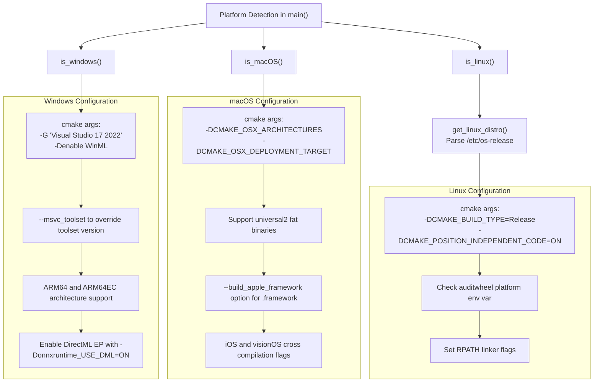
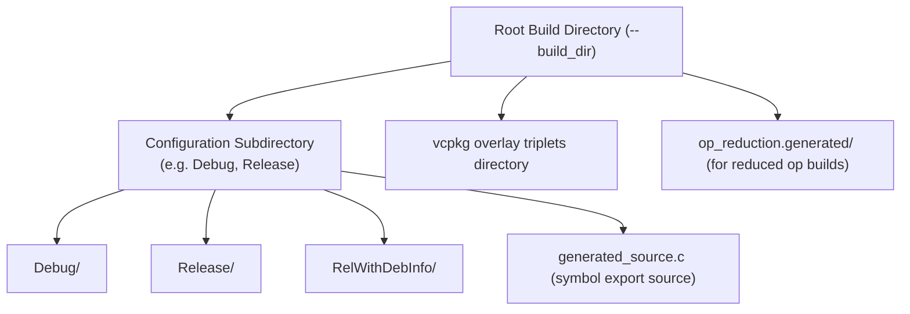
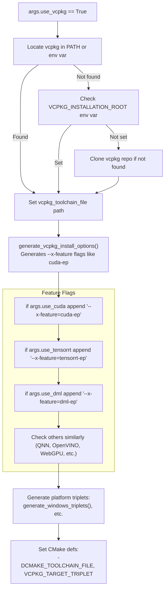
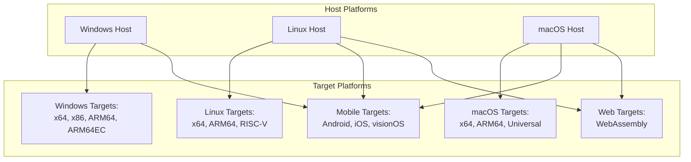
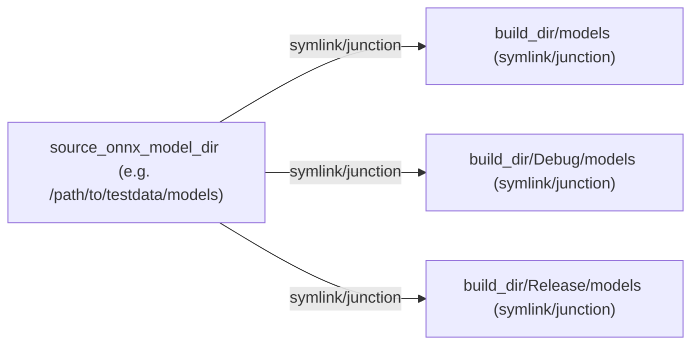

<!-- source: DeepWiki mcp.deepwiki.com · repo microsoft/onnxruntime · page 2.1 Build Orchestration · fetched 2026-10-21 -->

# Build Orchestration

<details>
<summary>Relevant source files</summary>

The following files were used as context for generating this wiki page:

- [ThirdPartyNotices.txt](ThirdPartyNotices.txt)
- [cgmanifests/cgmanifest.json](cgmanifests/cgmanifest.json)
- [cmake/CMakeLists.txt](cmake/CMakeLists.txt)
- [cmake/deps.txt](cmake/deps.txt)
- [cmake/external/onnxruntime_external_deps.cmake](cmake/external/onnxruntime_external_deps.cmake)
- [cmake/onnxruntime.cmake](cmake/onnxruntime.cmake)
- [cmake/onnxruntime_common.cmake](cmake/onnxruntime_common.cmake)
- [cmake/onnxruntime_framework.cmake](cmake/onnxruntime_framework.cmake)
- [cmake/onnxruntime_graph.cmake](cmake/onnxruntime_graph.cmake)
- [cmake/onnxruntime_optimizer.cmake](cmake/onnxruntime_optimizer.cmake)
- [cmake/onnxruntime_providers.cmake](cmake/onnxruntime_providers.cmake)
- [cmake/onnxruntime_providers_cpu.cmake](cmake/onnxruntime_providers_cpu.cmake)
- [cmake/onnxruntime_providers_webgpu.cmake](cmake/onnxruntime_providers_webgpu.cmake)
- [cmake/onnxruntime_python.cmake](cmake/onnxruntime_python.cmake)
- [cmake/onnxruntime_session.cmake](cmake/onnxruntime_session.cmake)
- [cmake/onnxruntime_training.cmake](cmake/onnxruntime_training.cmake)
- [cmake/onnxruntime_unittests.cmake](cmake/onnxruntime_unittests.cmake)
- [docs/BuildWithDawnAgilitySDK.md](docs/BuildWithDawnAgilitySDK.md)
- [setup.py](setup.py)
- [tools/ci_build/build.py](tools/ci_build/build.py)
- [tools/ci_build/build_args.py](tools/ci_build/build_args.py)
- [tools/ci_build/gen_def.py](tools/ci_build/gen_def.py)

</details>


## Overview

Build orchestration in ONNX Runtime is managed by the primary script `build.py` located at `tools/ci_build/build.py`. This Python script acts as the centralized entry point for configuring, generating, and executing builds across all supported platforms including Windows, Linux, macOS, Android, iOS, WebAssembly, and embedded targets.

`build.py` simplifies the build process by wrapping CMake invocations and abstracting away platform-specific intricacies. Its responsibilities include:

- Parsing extensive command-line options for fine-grained build configuration.
- Detecting the host and target platform environment.
- Managing external dependencies and submodules.
- Constructing the appropriate CMake command-line invocation with all relevant build definitions.
- Running the CMake build process, optionally running tests, and preparing post-build artifacts.

This script enables consistent, repeatable builds for both local development and CI pipeline environments.

**Related pages for further build system details:**

- [CMake Configuration](#2.2) - Core CMake build system modules and settings  
- [External Dependencies](#2.3) - Dependency management including deps.txt, vcpkg integration  
- [CI/CD Pipelines](#2.4) - Continuous integration and automation  
- [Platform-Specific Packaging](#2.5) - Packaging for Python wheels, NuGet, Android, etc.

**Sources:** [tools/ci_build/build.py:1-1890]()

---

## Build Script Entry Point

The orchestration script is written in Python and requires Python 3.8 or newer ([tools/ci_build/build.py:68-77]()). It uses a modular design with functions and classes to encapsulate build logic.

Key imported modules include:

- `build_args` for command-line parsing ([tools/ci_build/build.py:32]())
- Platform utility functions such as `is_windows()`, `is_linux()`, `is_macOS()`
- Functions for generating platform-specific triplets used by vcpkg
- Custom `run_subprocess()` wrappers for controlled invocation of external commands like CMake and Git

### Selected Key Functions and Classes

| Function / Class          | Description                                    | Location                    |
|--------------------------|------------------------------------------------|-----------------------------|
| `_check_python_version()` | Ensures minimum Python version 3.8 is running | [tools/ci_build/build.py:68-77]()   |
| `parse_arguments()`       | Parses the command-line interface              | [tools/ci_build/build.py:32]()       |
| `generate_build_tree()`   | Main CMake generation orchestrator             | [tools/ci_build/build.py:340-906]()  |
| `update_submodules()`     | Synchronizes Git submodules recursively         | [tools/ci_build/build.py:151-153]()  |
| `setup_test_data()`       | Creates symbolic links or junctions for test models | [tools/ci_build/build.py:156-180]() |
| `run_subprocess()`        | Invokes external commands with environment setup | [tools/ci_build/build.py:109-148]()  |
| `generate_vcpkg_install_options()` | Constructs vcpkg feature flags for dependencies | [tools/ci_build/build.py:242-337]() |

**Sources:** [tools/ci_build/build.py:1-77](), [tools/ci_build/build.py:109-196](), [tools/ci_build/build.py:242-337](), [tools/ci_build/build.py:340-906]()

---

## Build Orchestration Flow

The build process orchestrated by `build.py` can be summarized in the following flow:

```mermaid
graph TB
    User["User executes:<br/>python tools/ci_build/build.py"]
    ParseArgs["parse_arguments()<br/>from build_args module"]
    CheckPython["_check_python_version()<br/>Require Python >= 3.8"]
    PlatformDetect["Platform Detection:<br/>is_windows(), is_linux(), is_macOS()"]
    ConfigBuildDir["get_config_build_dir(build_dir, config)<br/>Returns: build_dir/config"]
    
    subgraph "Dependency Management"
        UpdateSubmodules["update_submodules(source_dir)<br/>git submodule update --init --recursive"]
        VcpkgCheck{"--use_vcpkg flag set?"}
        VcpkgSetup["generate_vcpkg_install_options()<br/>Build --x-feature list"]
        TripletGen["generate_*_triplets()<br/>Windows/Linux/macOS/Android/Emscripten"]
    end
    
    subgraph "CMake Generation"
        GenBuildTree["generate_build_tree(cmake_path, source_dir, build_dir, ...)"]
        BuildCMakeArgs["Construct list of cmake_args<br/>(flags, defines, toolchains)"]
        InvokeCMake["run_subprocess([cmake_path, cmake_dir] + cmake_args)<br/>Generate build files"]
        InvokeBuild["cmake --build / msbuild / make<br/>Compile and link artifacts"]
    end
    
    subgraph "Post-Build"
        SetupTestData["setup_test_data()<br/>Create symlinks/junctions to ONNX models"]
        RunTests{"--skip_tests not set?"}
        ExecuteTests["Run tests via CTest or test binaries"]
        Packaging["invoke setup.py bdist_wheel<br/>Generate Python wheels"]
    end
    
    User --> ParseArgs
    ParseArgs --> CheckPython
    CheckPython --> PlatformDetect
    PlatformDetect --> ConfigBuildDir
    ConfigBuildDir --> UpdateSubmodules
    UpdateSubmodules --> VcpkgCheck
    VcpkgCheck -->|Yes| VcpkgSetup
    VcpkgCheck -->|No| GenBuildTree
    VcpkgSetup --> TripletGen
    TripletGen --> GenBuildTree
    GenBuildTree --> BuildCMakeArgs
    BuildCMakeArgs --> InvokeCMake
    InvokeCMake --> InvokeBuild
    InvokeBuild --> SetupTestData
    SetupTestData --> RunTests
    RunTests -->|Yes| ExecuteTests
    RunTests -->|No| Packaging
    ExecuteTests --> Packaging
```



This pipeline ensures that the build environment is properly initialized before the CMake build is executed, followed by optional testing and packaging.

**Sources:** [tools/ci_build/build.py:68-77](), [tools/ci_build/build.py:104-106](), [tools/ci_build/build.py:151-153](), [tools/ci_build/build.py:156-180](), [tools/ci_build/build.py:242-337](), [tools/ci_build/build.py:340-906]()

---

## Command-Line Argument Parsing

The script accepts a comprehensive set of command-line options parsed in `parse_arguments()` from the `build_args` module ([tools/ci_build/build.py:32]()). These options configure virtually every aspect of the build.

### Example Argument Categories

| Category             | Examples                                                  | Purpose                                |
|----------------------|-----------------------------------------------------------|--------------------------------------|
| Platform Selection   | `--android`, `--ios`, `--build_wasm`                      | Specify build target platform         |
| Execution Providers  | `--use_cuda`, `--use_tensorrt`, `--use_dnnl`, `--use_qnn`| Enable hardware accelerators          |
| Build Configuration | `--config=Release`, `--parallel=8`, `--cmake_generator`   | Build type, concurrency, generator    |
| Feature Flags       | `--enable_pybind`, `--build_shared_lib`, `--minimal_build`| Enable/disable build features          |
| Training Support    | `--enable_training`, `--enable_training_apis`             | Enable ONNX Runtime training modules  |
| Paths & Overrides   | `--cuda_home`, `--tensorrt_home`, `--build_dir`           | Provide custom paths and directories  |

**Sources:** [tools/ci_build/build.py:32]()

### Platform Detection and Configuration

Platform is detected using utility functions imported from the `tools/python/util` module ([tools/ci_build/build.py:33-45]()):

- `is_windows()`
- `is_linux()`
- `is_macOS()`

Example flow of platform-specific configuration:



The `get_linux_distro()` function reads `/etc/os-release` to determine distribution details, important for selecting manylinux wheel tags.

**Sources:** [tools/ci_build/build.py:40-45](), [tools/ci_build/build.py:95-101]()

---

## Build Directory Configuration

Build outputs are organized in hierarchical directories:



The function `get_config_build_dir(build_dir, config)` returns the path for the per-configuration build folder ensuring multiple configurations can coexist without conflicts.

**Sources:** [tools/ci_build/build.py:104-106]()

---

## CMake Generation Process

The core of the build orchestration is the function `generate_build_tree()`, which constructs CMake invocation flags from command-line arguments and invokes CMake to generate build system files.

### CMake Argument Construction Flow

```mermaid
graph TB
    Start["generate_build_tree() called with args"]
    InitArgs["cmake_args initialized with cmake_path and cmake_dir"]
    
    subgraph "Core Build Flags"
        PythonExe["-DPython_EXECUTABLE=<path>"]
        BuildType["-DCMAKE_BUILD_TYPE=<config>"]
        SharedLib["-Donnxruntime_BUILD_SHARED_LIB=ON/OFF"]
        RTTI["-Donnxruntime_DISABLE_RTTI=ON/OFF"]
    end
    
    subgraph "Execution Providers"
        CUDAEP["If --use_cuda:<br/>-Donnxruntime_USE_CUDA=ON,<br/>-DCMAKE_CUDA_COMPILER=<cuda_home>/bin/nvcc"]
        TensorRTEP["If --use_tensorrt:<br/>-Donnxruntime_USE_TENSORRT=ON"]
        DMLEP["If --use_dml:<br/>-Donnxruntime_USE_DML=ON"]
        OtherEPs["Other EP flags:<br/>OpenVINO, QNN, CoreML, NNAPI, ACL..."]
    end
    
    subgraph "Feature Flags"
        MinimalBuild["--minimal_build flag:<br/>-Donnxruntime_MINIMAL_BUILD=ON"]
        Training["--enable_training:<br/>-Donnxruntime_ENABLE_TRAINING=ON"]
        PyBind["--enable_pybind:<br/>-Donnxruntime_ENABLE_PYTHON=ON"]
    end
    
    subgraph "vcpkg Integration"
        VcpkgCheck{"If args.use_vcpkg"}
        VcpkgToolchain["-DCMAKE_TOOLCHAIN_FILE=vcpkg.cmake"]
        VcpkgTriplet["-DVCPKG_TARGET_TRIPLET=<triplet>"]
        VcpkgChainload["Optional chainload toolchain for cross compile"]
    end
    
    ApplyExtraDefs["Add additional cmake_extra_defines flags"]
    InvokeCMake["run_subprocess([cmake] + cmake_args)"]
    GenerateBuildFiles["CMake generates native build files"]
    
    Start --> InitArgs
    InitArgs --> PythonExe --> BuildType --> SharedLib --> RTTI
    RTTI --> CUDAEP --> TensorRTEP --> DMLEP --> OtherEPs
    OtherEPs --> MinimalBuild --> Training --> PyBind
    PyBind --> VcpkgCheck
    VcpkgCheck -->|Yes| VcpkgToolchain --> VcpkgTriplet --> VcpkgChainload
    VcpkgCheck -->|No| ApplyExtraDefs
    VcpkgChainload --> ApplyExtraDefs
    ApplyExtraDefs --> InvokeCMake
    InvokeCMake --> GenerateBuildFiles
```



### Selected Key CMake Definitions

- `-DPython_EXECUTABLE`: Path to Python interpreter used for generation steps
- `-Donnxruntime_BUILD_SHARED_LIB`: Whether to build shared (.dll/.so) or static library
- `-Donnxruntime_DISABLE_RTTI`: Disable runtime type information for minimal builds
- `-Donnxruntime_DISABLE_EXCEPTIONS`: Disable exception support if requested
- `-Donnxruntime_USE_CUDA`: Enable CUDA execution provider integration
- `-Donnxruntime_USE_TENSORRT`: Enable TensorRT execution provider
- `-Donnxruntime_ENABLE_PYTHON`: Enable Python bindings generation
- `-Donnxruntime_MINIMAL_BUILD`: Disable ONNX model format support for minimal binary size
- `-DCMAKE_TOOLCHAIN_FILE`: For cross-compile or vcpkg integration toolchain
- `-DVCPKG_TARGET_TRIPLET`: Specifies platform and architecture for vcpkg builds

Example snippet for CUDA EP configuration:

```python
cmake_args.append("-Donnxruntime_NVCC_THREADS=" + str(nvcc_threads))
cmake_args.append(f"-DCMAKE_CUDA_COMPILER={cuda_home}/bin/nvcc")
add_default_definition(cmake_extra_defines, "onnxruntime_USE_CUDA", "ON")
if args.cuda_version:
    add_default_definition(cmake_extra_defines, "onnxruntime_CUDA_VERSION", args.cuda_version)
```

**Sources:** [tools/ci_build/build.py:340-906](), [tools/ci_build/build.py:423-520]()

---

### NVCC Thread Configuration for CUDA Builds

To mitigate frequent out-of-memory errors during compilation of CUDA kernels, notably flash attention `.cu` files (~48 files), the script dynamically calculates the number of concurrent NVCC compiler threads using `number_of_nvcc_threads()`:

```python
def number_of_nvcc_threads(args):
    if args.nvcc_threads >= 0:
        return args.nvcc_threads
    
    nvcc_threads = 1
    try:
        import psutil
        available_memory = psutil.virtual_memory().available
        
        if available_memory >= 64 * 1024 * 1024 * 1024:  # 64 GB
            nvcc_threads = min(4, int(available_memory / (8 * 4 * 1024 * 1024 * 1024)))
        else:
            memory_per_thread = 4 * 1024 * 1024 * 1024
            fmha_cu_files = 48  # CUDA flash attention kernel files
            fmha_parallel_jobs = min(fmha_cu_files, number_of_parallel_jobs(args))
            nvcc_threads = max(1, int(available_memory / (memory_per_thread * fmha_parallel_jobs)))
    except ImportError:
        pass
    
    return nvcc_threads
```

This logic is vital for reliable building on machines with limited memory, adjusting NVCC concurrency to prevent failures.

**Sources:** [tools/ci_build/build.py:210-238]()

---

## External Dependency Management

### vcpkg Integration

When `--use_vcpkg` is enabled, `build.py` automates configuration of dependencies through [vcpkg](https://github.com/microsoft/vcpkg). This includes:

- Discovering or cloning vcpkg installation  
- Generating platform-specific vcpkg triplets  
- Setting CMake toolchain file and target triplet accordingly  
- Passing required feature flags to vcpkg for optional providers and tests

Diagram:



The function `generate_vcpkg_install_options()` ([tools/ci_build/build.py:242-337]()) collects all features corresponding to enabled providers and testing, producing a list of `--x-feature=...` arguments passed during vcpkg installs.

Platform-specific triplets encode architecture, CRT type (static vs dynamic), RTTI and exception options, build type (Debug/Release), and special compiler flags for sanitizers or minimal builds.

**Sources:** [tools/ci_build/build.py:242-337](), [tools/ci_build/build.py:543-646]()

---

### Git Submodules

`build.py` ensures all git submodules are synchronized and updated recursively before the build proceeds via `update_submodules()` function:

```python
def update_submodules(source_dir):
    run_subprocess(["git", "submodule", "sync", "--recursive"], cwd=source_dir)
    run_subprocess(["git", "submodule", "update", "--init", "--recursive"], cwd=source_dir)
```

Submodules include ONNX, protobuf-mutator, emsdk (for WASM), and others required for the build.

**Sources:** [tools/ci_build/build.py:151-153]()

---

## Cross-Compilation Support

`build.py` supports cross-compilation for multiple architectures and target platforms, including:



### Cross-Compilation Configurations

- **Android:** Uses NDK toolchain with ABI and API level settings  
- **iOS and visionOS:** Uses Apple toolchains, supports creating Apple frameworks  
- **WebAssembly:** Uses Emscripten SDK with advanced flags for threading and SIMD  
- **RISC-V:** Requires RISC-V toolchain root and QEMU path with a custom CMake toolchain  
- **Windows ARM64 and ARM64EC:** Support for native compilers and SDKs  

Cross-compile builds require special care for host tools that run during the build (like `protoc`). `ONNX_CUSTOM_PROTOC_EXECUTABLE` environment variable is often required to specify host prebuilt protoc binary.

**Sources:** [tools/ci_build/build.py:522-533](), [tools/ci_build/build.py:536-627](), [tools/ci_build/build.py:690-694]()

---

## Subprocess Execution Wrapper

The utility function `run_subprocess()` wraps external command execution including environment variable injection and logging:

```python
def run_subprocess(
    args,
    cwd=None,
    capture_stdout=False,
    dll_path=None,
    shell=False,
    env=None,
    python_path=None,
    cuda_home=None,
):
    if isinstance(args, str):
        raise ValueError("args should be a sequence of strings, not a string")
    my_env = os.environ.copy()
    if dll_path:
        if is_windows():
            my_env["PATH"] = dll_path + os.pathsep + my_env.get("PATH", "")
        else:
            my_env["LD_LIBRARY_PATH"] = dll_path + os.pathsep + my_env.get("LD_LIBRARY_PATH", "")
    if cuda_home:
        my_env["PATH"] = os.path.join(cuda_home, "bin") + os.pathsep + my_env["PATH"]
    if python_path:
        my_env["PYTHONPATH"] = python_path + os.pathsep + my_env.get("PYTHONPATH", "")
    if env:
        my_env.update(env)
    log.info(" ".join(args))
    return run(*args, cwd=cwd, capture_stdout=capture_stdout, shell=shell, env=my_env)
```

This function is used consistently for running:

- `git` commands for submodule management  
- `cmake` to generate build files  
- `cmake --build` or native build tools for compilation  
- Windows junction creation with `mklink`  

**Sources:** [tools/ci_build/build.py:109-148]()

---

## Test Data Setup

After build generation, `setup_test_data()` creates symbolic links (Unix/macOS) or junctions (Windows) to ONNX test models to avoid redundant copies for each build configuration:

```python
def setup_test_data(source_onnx_model_dir, dest_model_dir_name, build_dir, configs):
    if is_windows():
        src_model_dir = os.path.join(build_dir, dest_model_dir_name)
        if os.path.exists(source_onnx_model_dir) and not os.path.exists(src_model_dir):
            run_subprocess(["mklink", "/D", "/J", src_model_dir, source_onnx_model_dir], shell=True)
        
        for config in configs:
            config_build_dir = get_config_build_dir(build_dir, config)
            dest_model_dir = os.path.join(config_build_dir, dest_model_dir_name)
            if not os.path.exists(dest_model_dir):
                run_subprocess(["mklink", "/D", "/J", dest_model_dir, source_onnx_model_dir], shell=True)
    else:
        src_model_dir = os.path.join(build_dir, dest_model_dir_name)
        if os.path.exists(source_onnx_model_dir) and not os.path.exists(src_model_dir):
            os.symlink(source_onnx_model_dir, src_model_dir, target_is_directory=True)
```

This ensures model files are available via relative paths without physical duplication.

Diagram:



**Sources:** [tools/ci_build/build.py:156-180]()

---

## Development Mode Configuration

The function `use_dev_mode()` determines whether to enable strict development settings such as warnings-as-errors. It returns false for:

- CI build environments (detected by `SYSTEM_COLLECTIONURI` env var)  
- Builds with `--compile_no_warning_as_error`  
- ACL, Mac iOS/tvOS/visionOS builds  
- Builds using QNN provider  

Otherwise, it enables dev mode.

```python
def use_dev_mode(args):
    if args.compile_no_warning_as_error:
        return False
    if args.use_acl:
        return False
    if is_macOS() and (args.ios or args.visionos or args.tvos):
        return False
    if args.use_qnn:
        return True
    SYSTEM_COLLECTIONURI = os.getenv("SYSTEM_COLLECTIONURI")  # noqa: N806
    if SYSTEM_COLLECTIONURI:
        return False
    return True
```

This function ensures the build behaves strictly during local dev but flexibly on CI / unusual platforms.

**Sources:** [tools/ci_build/build.py:182-196]()

---

## Build Workflow Summary

The overall `build.py` orchestration flow is as follows:

1. **Command-Line Parsing and Environment Validation**  
   - Parse build options  
   - Check Python version ≥ 3.8  
   - Detect host OS and platform specifics  

2. **Directory Setup and Git Submodules**  
   - Prepare build directories per configuration  
   - Synchronize git submodules recursively  

3. **Dependency Integration**  
   - Configure vcpkg if enabled (toolchain file, triplet, features)  
   - Generate platform-specific triplets for vcpkg  

4. **Generate CMake Build Files**  
   - Construct detailed CMake argument list reflecting all options  
   - Handle execution providers, minimal builds, training flags, cross-compilation  
   - Invoke CMake to generate native build system files  

5. **Build Execution** (via CMake or native tools)  
   - Compile C++ sources, execution providers, and bindings  
   - Link final libraries and binaries  

6. **Post-Build Setup**  
   - Create symlinks or junctions to test models  
   - Run tests if enabled  
   - Package Python wheels and other distributables  

This architecture delivers a unified, extensible build interface that supports diverse platforms, configurations, and dependencies.

---

This comprehensive build orchestration system embodied in `build.py` ensures consistent, manageable, and automated builds of ONNX Runtime, abstracting away the intricacies of a complex, multi-platform CMake-based build environment.

**Sources:**  
[tools/ci_build/build.py:1-906]()  
[tools/ci_build/build.py:109-148]()  
[tools/ci_build/build.py:156-196]()  
[tools/ci_build/build.py:210-238]()  
[tools/ci_build/build.py:242-337]()  
[tools/ci_build/build.py:340-906]()

---

