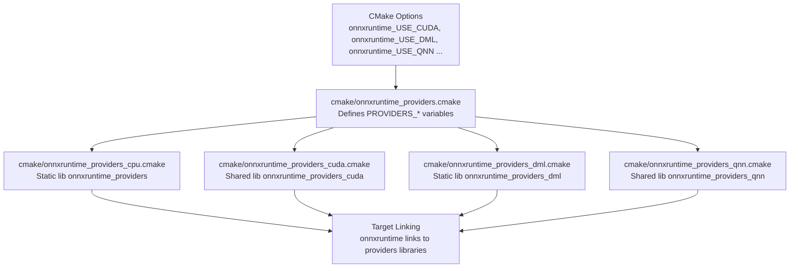
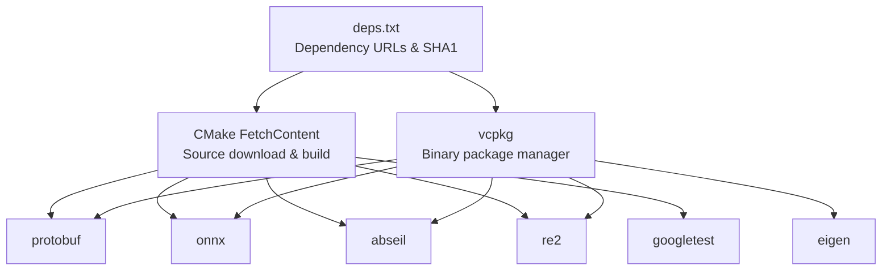

<!-- source: DeepWiki mcp.deepwiki.com · repo microsoft/onnxruntime · page 2.2 CMake Configuration · fetched 2026-10-21 -->

# CMake Configuration

<details>
<summary>Relevant source files</summary>

The following files were used as context for generating this wiki page:

- [ThirdPartyNotices.txt](ThirdPartyNotices.txt)
- [cgmanifests/cgmanifest.json](cgmanifests/cgmanifest.json)
- [cmake/CMakeLists.txt](cmake/CMakeLists.txt)
- [cmake/deps.txt](cmake/deps.txt)
- [cmake/external/onnxruntime_external_deps.cmake](cmake/external/onnxruntime_external_deps.cmake)
- [cmake/onnxruntime.cmake](cmake/onnxruntime.cmake)
- [cmake/onnxruntime_common.cmake](cmake/onnxruntime_common.cmake)
- [cmake/onnxruntime_cuda_source_filters.cmake](cmake/onnxruntime_cuda_source_filters.cmake)
- [cmake/onnxruntime_framework.cmake](cmake/onnxruntime_framework.cmake)
- [cmake/onnxruntime_graph.cmake](cmake/onnxruntime_graph.cmake)
- [cmake/onnxruntime_optimizer.cmake](cmake/onnxruntime_optimizer.cmake)
- [cmake/onnxruntime_providers.cmake](cmake/onnxruntime_providers.cmake)
- [cmake/onnxruntime_providers_cpu.cmake](cmake/onnxruntime_providers_cpu.cmake)
- [cmake/onnxruntime_providers_cuda.cmake](cmake/onnxruntime_providers_cuda.cmake)
- [cmake/onnxruntime_providers_cuda_plugin.cmake](cmake/onnxruntime_providers_cuda_plugin.cmake)
- [cmake/onnxruntime_providers_webgpu.cmake](cmake/onnxruntime_providers_webgpu.cmake)
- [cmake/onnxruntime_python.cmake](cmake/onnxruntime_python.cmake)
- [cmake/onnxruntime_session.cmake](cmake/onnxruntime_session.cmake)
- [cmake/onnxruntime_training.cmake](cmake/onnxruntime_training.cmake)
- [cmake/onnxruntime_unittests.cmake](cmake/onnxruntime_unittests.cmake)
- [docs/BuildWithDawnAgilitySDK.md](docs/BuildWithDawnAgilitySDK.md)
- [docs/contrib_ops/cuda/moe_qmoe.md](docs/contrib_ops/cuda/moe_qmoe.md)
- [docs/contrib_ops/cuda/qmoe_gemv_experiments.md](docs/contrib_ops/cuda/qmoe_gemv_experiments.md)
- [onnxruntime/contrib_ops/cuda/llm/fpA_intB_gemv/details.h](onnxruntime/contrib_ops/cuda/llm/fpA_intB_gemv/details.h)
- [onnxruntime/contrib_ops/cuda/llm/moe_gemm/moe_gemm_profiler.cc](onnxruntime/contrib_ops/cuda/llm/moe_gemm/moe_gemm_profiler.cc)
- [onnxruntime/contrib_ops/cuda/llm/moe_gemm/moe_gemm_profiler.h](onnxruntime/contrib_ops/cuda/llm/moe_gemm/moe_gemm_profiler.h)
- [onnxruntime/contrib_ops/cuda/llm/moe_gemm/moe_gemv.cu](onnxruntime/contrib_ops/cuda/llm/moe_gemm/moe_gemv.cu)
- [onnxruntime/contrib_ops/cuda/llm/moe_gemm/moe_gemv.h](onnxruntime/contrib_ops/cuda/llm/moe_gemm/moe_gemv.h)
- [onnxruntime/contrib_ops/cuda/llm/moe_gemm/moe_gemv_device.cuh](onnxruntime/contrib_ops/cuda/llm/moe_gemm/moe_gemv_device.cuh)
- [onnxruntime/contrib_ops/cuda/llm/moe_gemm/moe_gemv_fp4.cu](onnxruntime/contrib_ops/cuda/llm/moe_gemm/moe_gemv_fp4.cu)
- [onnxruntime/contrib_ops/cuda/llm/moe_gemm/moe_gemv_fp4.h](onnxruntime/contrib_ops/cuda/llm/moe_gemm/moe_gemv_fp4.h)
- [onnxruntime/contrib_ops/cuda/llm/moe_gemm/moe_kernels.cu](onnxruntime/contrib_ops/cuda/llm/moe_gemm/moe_kernels.cu)
- [onnxruntime/contrib_ops/cuda/llm/moe_gemm/moe_kernels.h](onnxruntime/contrib_ops/cuda/llm/moe_gemm/moe_kernels.h)
- [onnxruntime/contrib_ops/cuda/llm/moe_gemm/moe_util_kernels.h](onnxruntime/contrib_ops/cuda/llm/moe_gemm/moe_util_kernels.h)
- [onnxruntime/contrib_ops/cuda/moe/moe_quantization.cc](onnxruntime/contrib_ops/cuda/moe/moe_quantization.cc)
- [onnxruntime/contrib_ops/cuda/moe/moe_quantization.h](onnxruntime/contrib_ops/cuda/moe/moe_quantization.h)
- [onnxruntime/contrib_ops/cuda/moe/qmoe_kernels.cu](onnxruntime/contrib_ops/cuda/moe/qmoe_kernels.cu)
- [onnxruntime/contrib_ops/cuda/moe/qmoe_kernels.h](onnxruntime/contrib_ops/cuda/moe/qmoe_kernels.h)
- [onnxruntime/python/onnxruntime_pybind_cuda_quant.cc](onnxruntime/python/onnxruntime_pybind_cuda_quant.cc)
- [onnxruntime/python/tools/quantization/__init__.py](onnxruntime/python/tools/quantization/__init__.py)
- [onnxruntime/python/tools/quantization/cuda_quantizer.py](onnxruntime/python/tools/quantization/cuda_quantizer.py)
- [onnxruntime/test/python/transformers/profile_qmoe_gemv.py](onnxruntime/test/python/transformers/profile_qmoe_gemv.py)
- [onnxruntime/test/python/transformers/profile_qmoe_gemv.sh](onnxruntime/test/python/transformers/profile_qmoe_gemv.sh)
- [onnxruntime/test/python/transformers/test_moe_cuda.py](onnxruntime/test/python/transformers/test_moe_cuda.py)
- [onnxruntime/test/python/transformers/test_qmoe_cuda.py](onnxruntime/test/python/transformers/test_qmoe_cuda.py)
- [onnxruntime/test/python/transformers/test_qmoe_fp4_cuda.py](onnxruntime/test/python/transformers/test_qmoe_fp4_cuda.py)
- [onnxruntime/test/python/transformers/test_qmoe_nvfp4_cuda.py](onnxruntime/test/python/transformers/test_qmoe_nvfp4_cuda.py)
- [setup.py](setup.py)
- [tools/ci_build/build.py](tools/ci_build/build.py)
- [tools/ci_build/build_args.py](tools/ci_build/build_args.py)
- [tools/ci_build/gen_def.py](tools/ci_build/gen_def.py)

</details>


## Purpose and Scope

This page details the CMake-based build system for **ONNX Runtime (ORT)**. It covers the organization of CMake files, core runtime modules (common, graph, framework, session), and the integration of various execution providers. The document explains how the build is configured, core CMake targets defined, and how dependencies and platform specifics are handled.

The CMake system translates high-level build options into compiler and linker settings, enabling ORT to target multiple platforms, architectures, and hardware accelerators.

---

## CMake File Organization

The CMake system is modular, with the root `cmake/CMakeLists.txt` including submodules responsible for specific concerns:

- **Core libraries:** common, graph, framework, session, optimizer, MLAS, flatbuffers backend
- **Execution providers:** CPU, CUDA, DML, QNN, OpenVINO, CoreML, WebNN, WebGPU, etc.
- **External dependencies** managed via FetchContent or vcpkg
- **Python bindings** and unit test executables
- **Shared library target** for the overall ONNX Runtime library

### Diagram: CMake Module Organization and Includes

```mermaid
graph TD
    Root["cmake/CMakeLists.txt<br/>project(onnxruntime)<br/>include() directives"]
    
    External["cmake/external/onnxruntime_external_deps.cmake<br/>onnxruntime_fetchcontent_declare()"]
    
    Providers["cmake/onnxruntime_providers.cmake<br/>includes onnxruntime_providers_*.cmake"]
    ProvidersCPU["cmake/onnxruntime_providers_cpu.cmake<br/>onnxruntime_add_static_library(onnxruntime_providers)"]
    ProvidersCUDA["cmake/onnxruntime_providers_cuda.cmake<br/>onnxruntime_add_shared_library(onnxruntime_providers_cuda)"]
    ProvidersDML["cmake/onnxruntime_providers_dml.cmake<br/>onnxruntime_add_static_library(onnxruntime_providers_dml)"]
    ProvidersQNN["cmake/onnxruntime_providers_qnn.cmake<br/>onnxruntime_add_shared_library(onnxruntime_providers_qnn)"]
    
    Common["cmake/onnxruntime_common.cmake<br/>onnxruntime_add_static_library(onnxruntime_common)"]
    Framework["cmake/onnxruntime_framework.cmake<br/>onnxruntime_add_static_library(onnxruntime_framework)"]
    Graph["cmake/onnxruntime_graph.cmake<br/>onnxruntime_add_static_library(onnxruntime_graph)"]
    Session["cmake/onnxruntime_session.cmake<br/>onnxruntime_add_static_library(onnxruntime_session)"]
    Optimizer["cmake/onnxruntime_optimizer.cmake<br/>onnxruntime_add_static_library(onnxruntime_optimizer)"]
    
    MLAS["cmake/onnxruntime_mlas.cmake<br/>onnxruntime_add_static_library(onnxruntime_mlas)"]
    
    Python["cmake/onnxruntime_python.cmake<br/>onnxruntime_add_shared_library_module(onnxruntime_pybind11_state)"]
    Tests["cmake/onnxruntime_unittests.cmake<br/>AddTest() function"]
    
    SharedLib["cmake/onnxruntime.cmake<br/>onnxruntime_add_shared_library(onnxruntime)"]
    
    Root --> External
    Root --> Providers
    Root --> Common
    Root --> Framework
    Root --> Graph
    Root --> Session
    Root --> Optimizer
    Root --> MLAS
    Root --> Python
    Root --> Tests
    Root --> SharedLib
    
    Providers --> ProvidersCPU
    Providers --> ProvidersCUDA
    Providers --> ProvidersDML
    Providers --> ProvidersQNN
```



**Sources:** [cmake/CMakeLists.txt:1-650](), [cmake/onnxruntime_providers.cmake:1-198](), [cmake/onnxruntime_common.cmake:125](), [cmake/onnxruntime_framework.cmake:54](), [cmake/onnxruntime_graph.cmake:97]()

---

## Root CMakeLists.txt Structure

The root `cmake/CMakeLists.txt` provides:

- Minimum CMake version 3.28 and project definition
- Global compiler flags and policies (e.g. disabling C++20 modules)
- Configuration options exposed via `option()` and `cmake_dependent_option()`, e.g., `onnxruntime_USE_CUDA`, `onnxruntime_BUILD_SHARED_LIB`
- Inclusion of platform detection and compiler tweaks
- Inclusion of submodules: dependencies, core libraries, providers, Python bindings, tests
- Final shared library target creation if applicable

Key fragmentation by line numbers:

| Lines         | Purpose                         | Key Notes                                      |
|---------------|--------------------------------|------------------------------------------------|
| 6-11          | Basic project setup            | `project(onnxruntime C CXX ASM)`               |
| 62-253        | Options declarations          | Feature toggles for providers, builds, tests   |
| 258           | Platform detection include     | `include(detect_onnxruntime_target_platform.cmake)` |
| 437           | Global compile flags include   | `include(adjust_global_compile_flags.cmake)`    |
| 570           | External dependency setup      | `include(external/onnxruntime_external_deps.cmake)` |
| 1113-1207     | Core library modules includes | Includes common, graph, framework, session     |
| 1209-1226     | Providers include              | Includes CPU, CUDA, DML, QNN etc. providers    |
| 1353-1359     | Python bindings include        | Conditional on `onnxruntime_ENABLE_PYTHON`      |
| 1413          | Shared library include         | Only if `onnxruntime_BUILD_SHARED_LIB` enabled |

**Sources:** [cmake/CMakeLists.txt:1-60](), [cmake/CMakeLists.txt:62-253](), [cmake/CMakeLists.txt:1113-1226](), [cmake/CMakeLists.txt:1353-1413]()

---

## Build Configuration Flow

The build starts from command-line arguments in the `build.py` orchestrator script, which parses arguments, converts them to `cmake` command-line options, and then invokes CMake.

### Diagram: Build Configuration Data Flow

```mermaid
graph LR
    CLI["Command Line<br/>./build.sh --use_cuda --build_shared_lib --parallel 8"]
    
    ParseArgs["tools/ci_build/build.py<br/>parse_arguments()"]
    
    GenTree["generate_build_tree()<br/>cmake_args construction"]
    
    CMakeInvoke["subprocess.run(cmake with options)"]
    
    CMakeVars["CMake Variables<br/>-Donnxruntime_USE_CUDA=ON<br/>-Donnxruntime_BUILD_SHARED_LIB=ON"]
    
    Includes["Include CMake Modules<br/>onnxruntime_providers, common, session ..."]
    
    Targets["CMake Targets<br/>onnxruntime_providers_cuda, onnxruntime, onnxruntime_pybind11_state"]
    
    CLI --> ParseArgs --> GenTree --> CMakeInvoke --> CMakeVars --> Includes --> Targets
```



Key CMake variables set by `build.py` include:

| Argument                         | CMake Variable                  | Description                     |
|---------------------------------|--------------------------------|---------------------------------|
| `--use_cuda`                    | `onnxruntime_USE_CUDA`          | Enable CUDA execution provider  |
| `--use_dml`                     | `onnxruntime_USE_DML`           | Enable DirectML provider        |
| `--use_tensorrt`                | `onnxruntime_USE_TENSORRT`      | Enable TensorRT provider        |
| `--build_shared_lib`            | `onnxruntime_BUILD_SHARED_LIB`  | Build shared library            |
| `--enable_pybind`               | `onnxruntime_ENABLE_PYTHON`     | Build Python bindings           |
| `--disable_contrib_ops`         | `onnxruntime_DISABLE_CONTRIB_OPS` | Exclude contrib ops             |
| `--enable_training`             | `onnxruntime_ENABLE_TRAINING`  | Enable training APIs            |
| `--use_vcpkg`                   | N/A (used for external deps)   | Use vcpkg package manager       |

Multiple hundreds of options can be enabled/disabled through this mechanism.

**Sources:** [tools/ci_build/build.py:340-862](), [cmake/CMakeLists.txt:121-123](), [cmake/onnxruntime_providers.cmake:120-123]()

---

## Execution Provider Configuration

Execution providers (EPs) enable acceleration on specific hardware. They are configured via dedicated CMake modules and aggregated in `cmake/onnxruntime_providers.cmake`.

### Diagram: EP Configuration Flow



### Provider Module Selection

`cmake/onnxruntime_providers.cmake` sets provider variables conditionally:

```cmake
if(onnxruntime_USE_CUDA)
  set(PROVIDERS_CUDA onnxruntime_providers_cuda)
endif()
if(onnxruntime_USE_DML)
  set(PROVIDERS_DML onnxruntime_providers_dml)
endif()
# ... other providers ...
```

It then includes individual provider CMake modules (`onnxruntime_providers_cuda.cmake`, etc.):

```cmake
include(onnxruntime_providers_cpu.cmake)

if(onnxruntime_USE_CUDA)
  include(onnxruntime_providers_cuda.cmake)
endif()

if(onnxruntime_USE_DML)
  include(onnxruntime_providers_dml.cmake)
endif()

if(onnxruntime_USE_QNN)
  include(onnxruntime_providers_qnn.cmake)
endif()
```

Provider modules gather relevant source files, add targets (static/shared libraries), and specify dependencies.

**Example: CUDA provider** collects `.cu`, `.cc`, `.h` files from `core/providers/cuda/` and contrib ops, then defines a shared library with `onnxruntime_add_shared_library(onnxruntime_providers_cuda ...)`.

**Sources:** [cmake/onnxruntime_providers.cmake:62-198](), [cmake/onnxruntime_providers_cuda.cmake:1-100](), [tools/ci_build/build.py:727-737]()

---

## Core Library Modules

Four main ORT core static library modules are built, each handling key runtime responsibilities:

| Module           | CMake Target                | Responsibilities                                 | Path                    |
|------------------|----------------------------|-------------------------------------------------|-------------------------|
| `onnxruntime_common`   | `onnxruntime_common`          | Common utilities, platform abstractions, logging | `core/common/`, `core/platform/` |
| `onnxruntime_graph`    | `onnxruntime_graph`           | ONNX graph representation, nodes, graph utils   | `core/graph/`            |
| `onnxruntime_framework`| `onnxruntime_framework`       | Kernel framework, operator kernels                | `core/framework/`        |
| `onnxruntime_session`  | `onnxruntime_session`         | Session management: inference, execution, I/O    | `core/session/`          |

### onnxruntime_common

Defined as a static library in [cmake/onnxruntime_common.cmake:125]():

- Source files include common utilities and platform-specific code
- Links to dependencies: SafeInt, GSL, Abseil, date library
- Includes Windows or POSIX specific files based on detected platform

### onnxruntime_graph

Defined at [cmake/onnxruntime_graph.cmake:97]():

- Gathers graph source files recursively
- Depends on `onnxruntime_common`, ONNX protobuf, flatbuffers
- Exposes graph data structures, node argument management

### onnxruntime_framework

Defined at [cmake/onnxruntime_framework.cmake:54]():

- Contains kernel and operator implementation
- Optionally includes training interop sources if enabled
- Depends on common, onnx, flatbuffers, protobuf libraries

### onnxruntime_session

Defined at [cmake/onnxruntime_session.cmake:41]():

- Handles model session lifecycle, I/O binding, execution control
- Includes training API sources if training enabled
- Links to `onnxruntime_lora` for LoRA adapter support

---

## Shared Library Target: `onnxruntime`

The final main shared library is assembled in `cmake/onnxruntime.cmake`. It:

- **Consolidates internal static libraries** into the main target:
  - `onnxruntime_session`
  - `onnxruntime_framework`
  - `onnxruntime_graph`
  - `onnxruntime_common`
  - `onnxruntime_optimizer`
  - `onnxruntime_providers` (CPU static), plus other static providers 
- **Manages exported symbol lists** for Windows `.def` files and Unix linker version scripts
- **Sets platform-specific linker flags** to control symbol visibility and dead code stripping
- **Defines properties** when building Apple frameworks (Info.plist and weak frameworks)

### Symbol Export Generation

A custom Python script (`tools/ci_build/gen_def.py`) generates platform-specific symbol exports:

- Windows `.def` file with `EXPORTS` section
- Linux/macOS linker version script or exported symbols text file

This is added in a custom command as a build dependency to the shared target.

### Linking and Dependencies

Internal static libraries and external dependencies (protobuf, absl, threads, etc.) are linked as private dependencies of `onnxruntime`.

**Sources:** [cmake/onnxruntime.cmake:59-300](), [tools/ci_build/gen_def.py:1-92]()

---

## Python Bindings Target

Python bindings are built as a shared library module `onnxruntime_pybind11_state` in `cmake/onnxruntime_python.cmake`:

- Source files include Python API C++ wrappers under `python/`, optionally training binding files
- Uses pybind11 for C++ to Python binding
- Links core ORT static libraries and required Python/NumPy libraries
- Exports symbols using platform-appropriate mechanisms
- Generates a shared module with extension suffix `.pyd` (Windows) or `.so` (Unix)

**Sources:** [cmake/onnxruntime_python.cmake:7-275]()

---

## Unit Test Executable

`onnxruntime_test_all` defined in `cmake/onnxruntime_unittests.cmake`:

- Collects test source files from `test/` directory including providers, core tests, and training tests if enabled
- Defines an executable target linking against core libraries and gtest/gmock
- Registers tests using CMake's `add_test()`
- Applies compiler flags for warnings and suppressions

**Sources:** [cmake/onnxruntime_unittests.cmake:53-301]()

---

## Reduced Ops Build Support

A specialized build mode reduces build size by removing unused operators.

- The Python build orchestration script generates a reduced set of kernel registration source files
- `substitute_op_reduction_srcs()` in `cmake/onnxruntime_providers.cmake` replaces original provider source files with generated ones under `${CMAKE_BINARY_DIR}/op_reduction.generated`
- `add_op_reduction_include_dirs()` adds the generated include directory early in the include path to take precedence

### Diagram: Reduced Ops Build Flow

```mermaid
graph LR
    OpConfig["--include_ops_by_config<br/>config file defines ops"]

    Script["Python Script<br/>Generates Reduced Sources"]

    Original["Original Source Files<br/>cpu_execution_provider.cc etc."]

    Generated["Reduced Ops Sources<br/>op_reduction.generated/"]

    Substitution["substitute_op_reduction_srcs()"

    "Replace sources for build"]

    Build["Final Build<br/>Smaller binary footprint"]

    OpConfig --> Script
    Script --> Generated
    Original --> Substitution
    Generated --> Substitution
    Substitution --> Build
```

**Sources:** [cmake/onnxruntime_providers.cmake:4-59]()

---

## Compile Flags and Warning Suppression

Global compile flags are set in `adjust_global_compile_flags.cmake` and included in root CMake.

- MSVC disables warnings like `/wd4251` (dll interface), `/wd4201` (nameless struct/union), `/wd4324` (padding), etc.
- GCC/Clang have checks for various warnings; those supported are added globally to reduce noise.
- Special flags are set per platform and compiler type.

**Sources:** [cmake/CMakeLists.txt:437](), [cmake/CMakeLists.txt:579-700]()

---

## Platform-Specific Configuration

### Windows

- Controls MSVC runtime linkage (`MultiThreadedDLL` or static)
- Enables delay loading of DLLs for providers like CUDA, DML
- Supports GDK (gaming) toolchain if enabled
- Enables telemetry and Windows-specific logging

### Linux

- Enables RPATH to find shared libs
- Uses linker version scripts for symbol visibility
- Uses position independent code by default

### Apple (macOS/iOS)

- Uses C++20 standard for compilation (for Darwin)
- Builds optionally as Apple framework with Info.plist and weak frameworks (CoreML, Metal, QuartzCore)
- Handles cross-compilation toolchains for iOS and related platforms

### WebAssembly

- Emscripten toolchain file used
- vcpkg integration for wasm-optimized builds
- Options for SIMD, threads, exceptions control available

### Android

- Android ABI detected and mapped to vcpkg triplets for dependencies
- Triplets like `arm64-android` and `arm-neon-android` are generated for different ABIs

**Sources:** [cmake/CMakeLists.txt:39-60](), [tools/ci_build/build.py:536-658]()

---

## Dependency Management

Dependencies like protobuf, abseil, re2, googletest, flatbuffers, and others are managed via two methods:

- **FetchContent:** Download source code during CMake configuration to build statically; controlled in `cmake/external/onnxruntime_external_deps.cmake`
- **vcpkg:** A binary package manager used optionally, especially in CI or cross-builds; enabled via `--use_vcpkg` argument in `build.py`

Dependencies are specified in `deps.txt` listing library names, URL sources, and SHA1 hashes to ensure reproducible builds.

### Diagram: Dependency Management Flow



**Sources:** [cmake/external/onnxruntime_external_deps.cmake:1-50](), [tools/ci_build/build.py:542-689](), [cmake/deps.txt:1-67]()

---

## Summary

The ONNX Runtime CMake build system is a structured modular system that allows flexible configuration for multiple platforms, device providers, and build features.

- The **root CMakeLists.txt** configures global options and includes submodules.
- **Core libraries** (`common`, `graph`, `framework`, `session`) form the backbone of the runtime.
- **Execution providers** are integrated via conditional includes and define their own targets.
- The final shared library `onnxruntime` links all components.
- Python bindings and unit tests are optional modules.
- Dependency management seamlessly blends `FetchContent` and `vcpkg`.
- Platform-specific nuances are carefully handled.
- Reduced ops builds enable lean binaries by tailoring operator support.

This structure ensures that ONNX Runtime can be efficiently built, optimized, and extended for a wide range of use cases and hardware accelerators.

---

# Appendix: Key File References

| Topic                          | File                                                 | Lines          |
|--------------------------------|------------------------------------------------------|----------------|
| Root CMakeLists.txt             | `cmake/CMakeLists.txt`                               | 1-650          |
| External Dependency Setup       | `cmake/external/onnxruntime_external_deps.cmake`    | 1-50           |
| Providers Aggregation           | `cmake/onnxruntime_providers.cmake`                  | 1-204          |
| Core Common Module              | `cmake/onnxruntime_common.cmake`                     | 4-175          |
| Core Graph Module               | `cmake/onnxruntime_graph.cmake`                      | 1-99           |
| Core Framework Module           | `cmake/onnxruntime_framework.cmake`                  | 1-84           |
| Core Session Module             | `cmake/onnxruntime_session.cmake`                    | 1-42           |
| Shared Library Definition       | `cmake/onnxruntime.cmake`                             | 59-300         |
| Python Bindings Target          | `cmake/onnxruntime_python.cmake`                      | 7-275          |
| Unit Tests                     | `cmake/onnxruntime_unittests.cmake`                   | 53-301         |
| Build Orchestration Script      | `tools/ci_build/build.py`                             | 340-862        |
| Reduced Ops Build Support       | `cmake/onnxruntime_providers.cmake`                   | 4-59           |
| Symbol Export Generation Script | `tools/ci_build/gen_def.py`                           | 1-92           |

**Sources consolidated from above referenced files.**

---

