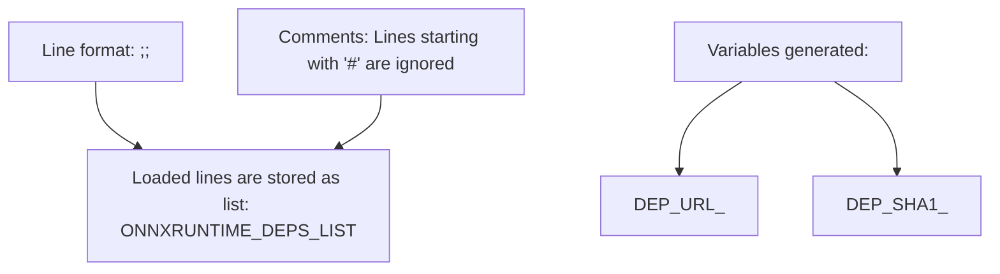
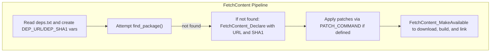
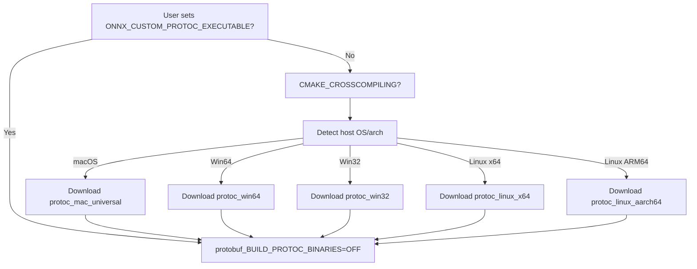
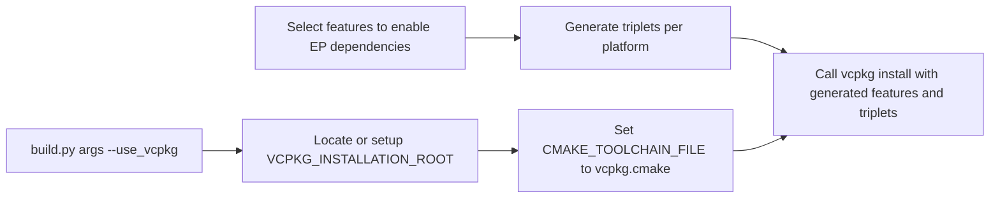
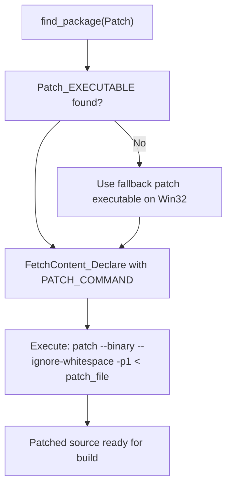
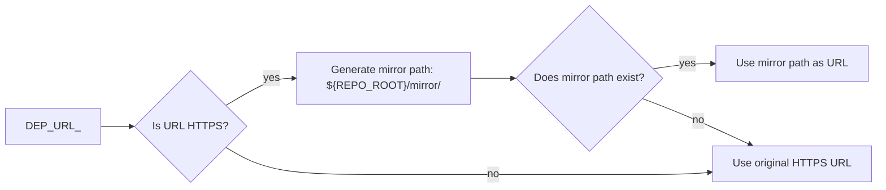
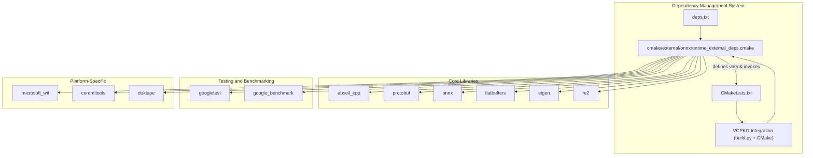
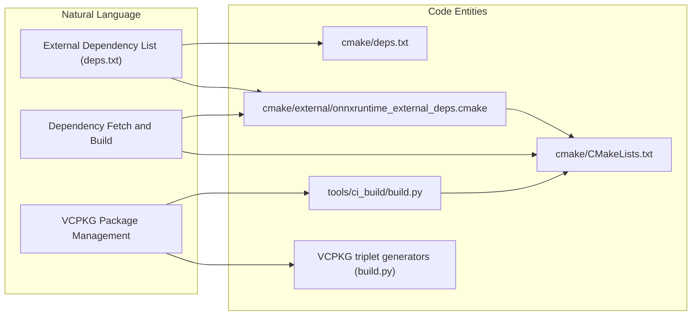

<!-- source: DeepWiki mcp.deepwiki.com · repo microsoft/onnxruntime · page 2.3 External Dependencies · fetched 2026-10-21 -->

# External Dependencies

<details>
<summary>Relevant source files</summary>

The following files were used as context for generating this wiki page:

- [.github/actions/macos-ci-setup/action.yml](.github/actions/macos-ci-setup/action.yml)
- [.github/workflows/ios.yml](.github/workflows/ios.yml)
- [.github/workflows/linux_webgpu.yml](.github/workflows/linux_webgpu.yml)
- [.github/workflows/mac.yml](.github/workflows/mac.yml)
- [.github/workflows/macos-ci-build-and-test-workflow.yml](.github/workflows/macos-ci-build-and-test-workflow.yml)
- [.github/workflows/web.yml](.github/workflows/web.yml)
- [ThirdPartyNotices.txt](ThirdPartyNotices.txt)
- [cgmanifests/cgmanifest.json](cgmanifests/cgmanifest.json)
- [cmake/CMakeLists.txt](cmake/CMakeLists.txt)
- [cmake/CMakePresets.json](cmake/CMakePresets.json)
- [cmake/deps.txt](cmake/deps.txt)
- [cmake/external/onnxruntime_external_deps.cmake](cmake/external/onnxruntime_external_deps.cmake)
- [cmake/onnxruntime.cmake](cmake/onnxruntime.cmake)
- [cmake/onnxruntime_common.cmake](cmake/onnxruntime_common.cmake)
- [cmake/onnxruntime_framework.cmake](cmake/onnxruntime_framework.cmake)
- [cmake/onnxruntime_graph.cmake](cmake/onnxruntime_graph.cmake)
- [cmake/onnxruntime_optimizer.cmake](cmake/onnxruntime_optimizer.cmake)
- [cmake/onnxruntime_providers.cmake](cmake/onnxruntime_providers.cmake)
- [cmake/onnxruntime_providers_cpu.cmake](cmake/onnxruntime_providers_cpu.cmake)
- [cmake/onnxruntime_providers_webgpu.cmake](cmake/onnxruntime_providers_webgpu.cmake)
- [cmake/onnxruntime_python.cmake](cmake/onnxruntime_python.cmake)
- [cmake/onnxruntime_session.cmake](cmake/onnxruntime_session.cmake)
- [cmake/onnxruntime_training.cmake](cmake/onnxruntime_training.cmake)
- [cmake/onnxruntime_unittests.cmake](cmake/onnxruntime_unittests.cmake)
- [cmake/vcpkg-configuration.json](cmake/vcpkg-configuration.json)
- [cmake/vcpkg.json](cmake/vcpkg.json)
- [docs/BuildWithDawnAgilitySDK.md](docs/BuildWithDawnAgilitySDK.md)
- [onnxruntime/core/providers/coreml/model/host_utils.h](onnxruntime/core/providers/coreml/model/host_utils.h)
- [setup.py](setup.py)
- [tools/ci_build/build.py](tools/ci_build/build.py)
- [tools/ci_build/build_args.py](tools/ci_build/build_args.py)
- [tools/ci_build/gen_def.py](tools/ci_build/gen_def.py)
- [tools/ci_build/github/linux/docker/Dockerfile.manylinux2_28_webgpu](tools/ci_build/github/linux/docker/Dockerfile.manylinux2_28_webgpu)

</details>


This document explains ONNX Runtime's external dependency management system, covering the primary mechanisms for managing third-party libraries. It includes a description of the central `deps.txt` configuration, the integration with VCPKG package manager, and key external libraries such as Protocol Buffers, FlatBuffers, and ONNX. The management system ensures consistent downloading, building, patching, and integration of external dependencies across diverse platforms and configurations.

For details on how these dependencies are leveraged in the overall build orchestration, refer to [Build Orchestration](#2.1). For continuous integration and packaging contexts, see [CI/CD Pipelines](#2.4).

---

## Overview

ONNX Runtime manages external dependencies via two main mechanisms:

1. **FetchContent-Based Dependencies:**  
   Declared in the `deps.txt` file, these dependencies are processed using a CMake-based system centered on the [`cmake/external/onnxruntime_external_deps.cmake`](cmake/external/onnxruntime_external_deps.cmake) module. Important foundational libraries such as Protocol Buffers, Abseil, FlatBuffers, ONNX itself, Eigen, and Google Test are handled this way.

2. **VCPKG Package Manager Integration:**  
   Enabled via the CMake option `onnxruntime_USE_VCPKG`, ONNX Runtime supports automatic configuration and installation of dependencies through VCPKG, including execution provider components, platform SDKs, and toolchains. Triplets are dynamically generated based on the target platform and build configuration for consistent builds.

This dual approach balances control over precise dependency versions and patches while supporting easy integration of system-wide or prebuilt libraries in supported environments.

**Key External Libraries Managed:**

- **protobuf** (Protocol Buffers) — for ONNX model serialization/deserialization  
- **flatbuffers** — for efficient memory layout used in some subcomponents  
- **onnx** — ONNX model definitions and operators  
- **absl_cpp** — utility libraries from Abseil used internally  
- **eigen** — linear algebra library used in MLAS and other compute kernels  
- **re2** — regular expressions library used by protobuf  
- **googletest / google_benchmark** — testing and benchmarking frameworks  
- **mimalloc** — optional efficient allocator  
- **pybind11** — for Python bindings generation  
- **cutlass, cudnn_frontend** — NVIDIA CUDA libraries for GPU acceleration  
- **kleidiai, pytorch_cpuinfo** — ARM and CPU optimization libraries  

Sources: [tools/ci_build/build.py:244-341](), [cmake/CMakeLists.txt:62-98](), [cmake/external/onnxruntime_external_deps.cmake:1-153]()

---

## FetchContent Dependency Specification

All core external dependencies are centrally listed in the `deps.txt` file located at `cmake/deps.txt`. This file uses a semicolon-separated CSV format specifying the dependency name, the URL for source or binary downloads, and a SHA1 hash for integrity verification.

### deps.txt Structure



This file includes pinned versions of major dependencies like:

| Dependency     | Description                                |
|----------------|--------------------------------------------|
| abseil_cpp     | Abseil C++ utilities                       |
| protobuf       | Protocol Buffers serialization library    |
| onnx           | ONNX model and operator definitions       |
| flatbuffers    | FlatBuffers serialization support         |
| eigen          | Eigen linear algebra                        |
| googletest     | Google Test framework                      |
| google_benchmark | Google Benchmarking                        |
| pybind11       | C++ bindings for Python                    |
| mimalloc       | Memory allocator                           |
| re2            | Regex library used by protobuf             |

### Processing deps.txt

In [`cmake/external/onnxruntime_external_deps.cmake`](cmake/external/onnxruntime_external_deps.cmake), this file is read line-by-line, skipping comments. For each dependency line, it:

- Extracts the name, URL, and SHA1 hash.
- Defines CMake variables `DEP_URL_<name>` and `DEP_SHA1_<name>`.
- If the URL is HTTPS, attempts to locate a local mirror path under `${REPO_ROOT}/mirror/`.
- Falls back to the HTTPS URL if no local mirror is found.

Example snippet:

```cmake
foreach(ONNXRUNTIME_DEP IN LISTS ONNXRUNTIME_DEPS_LIST)
  if(NOT ONNXRUNTIME_DEP MATCHES "^#")
    list(POP_FRONT ONNXRUNTIME_DEP ONNXRUNTIME_DEP_NAME)
    list(POP_FRONT ONNXRUNTIME_DEP ONNXRUNTIME_DEP_URL)
    set(DEP_URL_${ONNXRUNTIME_DEP_NAME} ${ONNXRUNTIME_DEP_URL})
    set(DEP_SHA1_${ONNXRUNTIME_DEP_NAME} ${ONNXRUNTIME_DEP})
    if(ONNXRUNTIME_DEP_URL MATCHES "^https://")
      string(REGEX REPLACE "^https://" "${onnxruntime_CMAKE_DEPS_MIRROR_DIR}/" LOCAL_URL "${ONNXRUNTIME_DEP_URL}")
      if(EXISTS "${LOCAL_URL}")
        cmake_path(ABSOLUTE_PATH LOCAL_URL)
        set(DEP_URL_${ONNXRUNTIME_DEP_NAME} "${LOCAL_URL}")
      endif()
    endif()
  endif()
endforeach()
```

Sources: [cmake/deps.txt:1-67](), [cmake/external/onnxruntime_external_deps.cmake:8-31]()

---

## FetchContent Processing Pipeline

The core dependency downloading and building logic uses CMake's FetchContent module. ONNX Runtime wraps `FetchContent_Declare` and `FetchContent_MakeAvailable` with additional custom logic:

- First attempts to find the package on the host system or via VCPKG (`find_package`).
- If not found, downloads from the URL (or local mirror), verifies SHA1, and builds.
- Supports patching via the `PATCH_COMMAND` argument.
- Discusses platform-specific configurations and compiler flags.



Key helper functions defined in [`cmake/external/helper_functions.cmake`]():

- `onnxruntime_fetchcontent_declare`: Declares dependencies with optional fallback to Custom FetchContent.
- `onnxruntime_fetchcontent_makeavailable`: Fetches content and makes it available; handles errors robustly.

### Example: Protocol Buffers

protobuf is a critical dependency managed here. Key points:

- Uses prebuilt `protoc` binaries for the build host, which can differ from the target during cross-compilation.
- Supports user override with `ONNX_CUSTOM_PROTOC_EXECUTABLE`.
- Applies patches to fix warnings and Android logging support.
- Configures protobuf's build to disable tests and use external gtest.



Sources: [cmake/external/onnxruntime_external_deps.cmake:114-181](), [cmake/deps.txt:43-49]()

---

## VCPKG Integration

ONNX Runtime optionally supports the [VCPKG](https://github.com/microsoft/vcpkg) package manager as a dependency source, primarily to support easier installation of execution provider dependencies and platform SDKs.

### Configuration via `build.py`

The `tools/ci_build/build.py` script recognizes the `--use_vcpkg` flag and sets:

- `VCPKG_INSTALLATION_ROOT`: either provided or checked out.
- `CMAKE_TOOLCHAIN_FILE`: points to `vcpkg.cmake`.
- Custom feature selection via `--x-feature` flags (e.g., `cuda-ep`, `tensorrt-ep`, `qnn-ep`).
- Overlay triplets for specialized builds like ASAN, static/dynamic runtimes.
- Asset caching integration with Azure or TerrapinRetrievalTool.

The VCPKG integration flow:



### Triplet Generation

VCPKG triplets are generated dynamically per platform in `build.py`:

| Platform | Function | Description |
| -------- | -------- | ----------- |
| Windows  | `generate_windows_triplets` | Generates MSVC runtime and architecture triplets, supports static/dynamic linkage, toolset version. |
| Linux    | `generate_linux_triplets`   | Generates typical Linux triplets for x64 and ARM64. |
| macOS    | `generate_macos_triplets`   | Generates universal macOS triplets with deployment target and SDK paths. |
| Android  | `generate_android_triplets` | Generates triplets with android API levels, ABI, and cpp shared options. |
| WASM     | `generate_vcpkg_triplets_for_emscripten` | Emscripten specific triplets for WebAssembly with js and SIMD features. |

The build system automatically picks the default triplets based on platform and architecture. For example, on Windows, a typical triplet is `x64-windows-static-md`.

Sources: [tools/ci_build/build.py:244-341](), [tools/ci_build/build.py:545-691](), [cmake/CMakeLists.txt:62-98]()

---

## Dependency Patching

ONNX Runtime applies patches to upstream dependencies to fix build issues, improve compatibility, or add platform-specific enhancements.

### Patch Application Workflow

- The CMake `Patch` package is located via `find_package(Patch)` (with fallback on Windows).
- Patch commands are applied as `PATCH_COMMAND` in `FetchContent_Declare`.
- Patches are typically `.patch` files in `cmake/patches/`.



### Key Active Patches

| Dependency     | Patch File                                 | Purpose                                | Details                                              |
|----------------|--------------------------------------------|--------------------------------------|-----------------------------------------------------|
| protobuf       | `protobuf_cmake.patch`                     | Fix protobuf build warnings          | Disable blanket warning suppressions; config extra warnings |
| protobuf       | `protobuf_android_log.patch`                | Android platform logging integration | Adds Android logging API for protobuf messages       |
| protobuf       | `protobuf_s390x.patch`                      | IBM s390x architecture support       | Fixes endianness and atomic pointer handling         |
| dawn (WebGPU)  | `dawn_destroy_buffer_on_destructor.patch` | Proper GPU buffer cleanup             | Adds destructor to call `Destroy()` on buffers       |

Sources: [cmake/external/onnxruntime_external_deps.cmake:187-193](), [cmake/patches/protobuf/protobuf_cmake.patch](), [cmake/patches/dawn/dawn_destroy_buffer_on_destructor.patch:1-25]()

---

## Local Mirror Support

To support offline builds, speed CI pipelines, and provide reproducible builds, ONNX Runtime supports a local mirror directory for dependencies.

### Mirror Resolution Algorithm

When a dependency URL is an HTTPS URL, the build system checks if a corresponding local file exists in `${REPO_ROOT}/mirror/`. If it does, the local file path replaces the URL to avoid network download.



Example mirror directory structure inside project root `/mirror`:

```
mirror/
├── github.com/google/re2/archive/refs/tags/...
├── github.com/google/googletest/archive/refs/tags/...
├── github.com/abseil/abseil-cpp/archive/refs/tags/...
└── github.com/protocolbuffers/protobuf/archive/refs/tags/...
```

This system is critical for environments that lack external internet access and for ensuring consistency across CI machines.

Source: [cmake/external/onnxruntime_external_deps.cmake:21-29](), [cmake/CMakeLists.txt:290-300]()

---

## Platform-Specific Dependencies and Considerations

Some dependencies are included only for certain platforms or configurations:

- **Windows:** `microsoft_wil` for Windows API helpers, DirectX headers.
- **Android/iOS:** CPU information libraries, specific patching for ARM architectures.
- **CoreML support:** Depends on Apple-specific libraries such as `fp16`, `psimd`, and `coremltools`.
- **WebAssembly:** JavaScript engines like `duktape` are included for runtime shader program generation.

Platform support is governed by CMake options and is handled uniformly through the FetchContent pipeline or optionally VCPKG.

Sources: [cmake/external/onnxruntime_external_deps.cmake:530-560](), [cmake/external/onnxruntime_external_deps.cmake:810-840]()

---

## Summary Diagram: System Components vs. Key Dependency Entities



---

## Summary Diagram: From Natural Language Concepts to Code Entities (deps.txt and VCPKG)



---

# References

- `cmake/deps.txt` — central external dependencies list  
- `cmake/external/onnxruntime_external_deps.cmake` — FetchContent wrappers, dependency configuration  
- `tools/ci_build/build.py` — VCPKG integration, triplet generation, build orchestration  
- `cmake/CMakeLists.txt` — top-level build configurations, patch tooling  
- `cmake/patches/*` — dependency patches

Sources: [cmake/deps.txt:1-67](), [cmake/external/onnxruntime_external_deps.cmake:1-311](), [tools/ci_build/build.py:240-341](), [cmake/CMakeLists.txt:40-98](), [cmake/patches/dawn/dawn_destroy_buffer_on_destructor.patch:1-25]()

---

