<!-- source: DeepWiki mcp.deepwiki.com · repo microsoft/onnxruntime · page 2.4 CI/CD Pipelines · fetched 2026-10-21 -->

# CI/CD Pipelines

<details>
<summary>Relevant source files</summary>

The following files were used as context for generating this wiki page:

- [.github/actions/locate-vcvarsall-and-setup-env/action.yml](.github/actions/locate-vcvarsall-and-setup-env/action.yml)
- [.github/workflows/android.yml](.github/workflows/android.yml)
- [.github/workflows/cffconvert.yml](.github/workflows/cffconvert.yml)
- [.github/workflows/codeql.yml](.github/workflows/codeql.yml)
- [.github/workflows/gradle-wrapper-validation.yml](.github/workflows/gradle-wrapper-validation.yml)
- [.github/workflows/lint.yml](.github/workflows/lint.yml)
- [.github/workflows/linux-wasm-ci-build-and-test-workflow.yml](.github/workflows/linux-wasm-ci-build-and-test-workflow.yml)
- [.github/workflows/linux_cuda_ci.yml](.github/workflows/linux_cuda_ci.yml)
- [.github/workflows/linux_cuda_no_cudnn.yml](.github/workflows/linux_cuda_no_cudnn.yml)
- [.github/workflows/linux_cuda_plugin_ci.yml](.github/workflows/linux_cuda_plugin_ci.yml)
- [.github/workflows/linux_minimal_build.yml](.github/workflows/linux_minimal_build.yml)
- [.github/workflows/linux_tensorrt_ci.yml](.github/workflows/linux_tensorrt_ci.yml)
- [.github/workflows/pr_checks.yml](.github/workflows/pr_checks.yml)
- [.github/workflows/publish-c-apidocs.yml](.github/workflows/publish-c-apidocs.yml)
- [.github/workflows/publish-csharp-apidocs.yml](.github/workflows/publish-csharp-apidocs.yml)
- [.github/workflows/publish-java-apidocs.yml](.github/workflows/publish-java-apidocs.yml)
- [.github/workflows/publish-js-apidocs.yml](.github/workflows/publish-js-apidocs.yml)
- [.github/workflows/publish-objectivec-apidocs.yml](.github/workflows/publish-objectivec-apidocs.yml)
- [.github/workflows/publish-python-apidocs.yml](.github/workflows/publish-python-apidocs.yml)
- [.github/workflows/react_native.yml](.github/workflows/react_native.yml)
- [.github/workflows/reusable_linux_build.yml](.github/workflows/reusable_linux_build.yml)
- [.github/workflows/windows-web-ci-workflow.yml](.github/workflows/windows-web-ci-workflow.yml)
- [.github/workflows/windows_cuda.yml](.github/workflows/windows_cuda.yml)
- [.github/workflows/windows_cuda_no_cudnn.yml](.github/workflows/windows_cuda_no_cudnn.yml)
- [.github/workflows/windows_cuda_plugin.yml](.github/workflows/windows_cuda_plugin.yml)
- [.github/workflows/windows_dml.yml](.github/workflows/windows_dml.yml)
- [.github/workflows/windows_openvino.yml](.github/workflows/windows_openvino.yml)
- [.github/workflows/windows_tensorrt.yml](.github/workflows/windows_tensorrt.yml)
- [.github/workflows/windows_webgpu.yml](.github/workflows/windows_webgpu.yml)
- [.github/workflows/windows_x64_debug_build_x64_debug.yml](.github/workflows/windows_x64_debug_build_x64_debug.yml)
- [.github/workflows/windows_x64_release_build_x64_release.yml](.github/workflows/windows_x64_release_build_x64_release.yml)
- [.github/workflows/windows_x64_release_ep_generic_interface_build_x64_release_ep_generic_interface.yml](.github/workflows/windows_x64_release_ep_generic_interface_build_x64_release_ep_generic_interface.yml)
- [.github/workflows/windows_x64_release_vitisai_build_x64_release.yml](.github/workflows/windows_x64_release_vitisai_build_x64_release.yml)
- [.github/workflows/windows_x64_release_xnnpack.yml](.github/workflows/windows_x64_release_xnnpack.yml)
- [.github/workflows/windows_x86.yml](.github/workflows/windows_x86.yml)
- [csharp/ApiDocs/.gitignore](csharp/ApiDocs/.gitignore)
- [csharp/ApiDocs/ApiDocs.csproj](csharp/ApiDocs/ApiDocs.csproj)
- [csharp/ApiDocs/api/.gitignore](csharp/ApiDocs/api/.gitignore)
- [csharp/ApiDocs/docfx.json](csharp/ApiDocs/docfx.json)
- [csharp/ApiDocs/filterConfig.yml](csharp/ApiDocs/filterConfig.yml)
- [csharp/src/Microsoft.ML.OnnxRuntime/targets/netstandard/props.xml](csharp/src/Microsoft.ML.OnnxRuntime/targets/netstandard/props.xml)
- [csharp/src/Microsoft.ML.OnnxRuntime/targets/netstandard/props_qnn.xml](csharp/src/Microsoft.ML.OnnxRuntime/targets/netstandard/props_qnn.xml)
- [csharp/test/Microsoft.ML.OnnxRuntime.EndToEndTests/runtest.bat](csharp/test/Microsoft.ML.OnnxRuntime.EndToEndTests/runtest.bat)
- [csharp/test/Microsoft.ML.OnnxRuntime.EndToEndTests/runtest.sh](csharp/test/Microsoft.ML.OnnxRuntime.EndToEndTests/runtest.sh)
- [tools/ci_build/github/azure-pipelines/c-api-noopenmp-packaging-pipelines.yml](tools/ci_build/github/azure-pipelines/c-api-noopenmp-packaging-pipelines.yml)
- [tools/ci_build/github/azure-pipelines/custom-nuget-packaging-pipeline.yml](tools/ci_build/github/azure-pipelines/custom-nuget-packaging-pipeline.yml)
- [tools/ci_build/github/azure-pipelines/nodejs/templates/test.yml](tools/ci_build/github/azure-pipelines/nodejs/templates/test.yml)
- [tools/ci_build/github/azure-pipelines/nodejs/templates/test_linux.yml](tools/ci_build/github/azure-pipelines/nodejs/templates/test_linux.yml)
- [tools/ci_build/github/azure-pipelines/nodejs/templates/test_macos.yml](tools/ci_build/github/azure-pipelines/nodejs/templates/test_macos.yml)
- [tools/ci_build/github/azure-pipelines/nodejs/templates/test_win.yml](tools/ci_build/github/azure-pipelines/nodejs/templates/test_win.yml)
- [tools/ci_build/github/azure-pipelines/nuget/templates/dml-vs-2022.yml](tools/ci_build/github/azure-pipelines/nuget/templates/dml-vs-2022.yml)
- [tools/ci_build/github/azure-pipelines/nuget/templates/test_linux.yml](tools/ci_build/github/azure-pipelines/nuget/templates/test_linux.yml)
- [tools/ci_build/github/azure-pipelines/nuget/templates/test_macos.yml](tools/ci_build/github/azure-pipelines/nuget/templates/test_macos.yml)
- [tools/ci_build/github/azure-pipelines/nuget/templates/test_win.yml](tools/ci_build/github/azure-pipelines/nuget/templates/test_win.yml)
- [tools/ci_build/github/azure-pipelines/post-merge-jobs.yml](tools/ci_build/github/azure-pipelines/post-merge-jobs.yml)
- [tools/ci_build/github/azure-pipelines/stages/py-cpu-packaging-stage.yml](tools/ci_build/github/azure-pipelines/stages/py-cpu-packaging-stage.yml)
- [tools/ci_build/github/azure-pipelines/templates/android-java-api-aar-test.yml](tools/ci_build/github/azure-pipelines/templates/android-java-api-aar-test.yml)
- [tools/ci_build/github/azure-pipelines/templates/android-java-api-aar.yml](tools/ci_build/github/azure-pipelines/templates/android-java-api-aar.yml)
- [tools/ci_build/github/azure-pipelines/templates/c-api-cpu.yml](tools/ci_build/github/azure-pipelines/templates/c-api-cpu.yml)
- [tools/ci_build/github/azure-pipelines/templates/flex-downloadPipelineArtifact.yml](tools/ci_build/github/azure-pipelines/templates/flex-downloadPipelineArtifact.yml)
- [tools/ci_build/github/azure-pipelines/templates/foundry-local-nuget-packaging.yml](tools/ci_build/github/azure-pipelines/templates/foundry-local-nuget-packaging.yml)
- [tools/ci_build/github/azure-pipelines/templates/jobs/win-ci-vs-2022-job.yml](tools/ci_build/github/azure-pipelines/templates/jobs/win-ci-vs-2022-job.yml)
- [tools/ci_build/github/azure-pipelines/templates/managed-nuget-for-foundry-local.yml](tools/ci_build/github/azure-pipelines/templates/managed-nuget-for-foundry-local.yml)
- [tools/ci_build/github/azure-pipelines/templates/win-ci.yml](tools/ci_build/github/azure-pipelines/templates/win-ci.yml)
- [tools/ci_build/github/azure-pipelines/win-ci-fuzz-testing.yml](tools/ci_build/github/azure-pipelines/win-ci-fuzz-testing.yml)
- [tools/ci_build/github/linux/docker/inference/x86_64/python/openvino/Dockerfile](tools/ci_build/github/linux/docker/inference/x86_64/python/openvino/Dockerfile)
- [tools/ci_build/github/linux/docker/scripts/install_java.sh](tools/ci_build/github/linux/docker/scripts/install_java.sh)
- [tools/ci_build/github/windows/bundle_dlls_gpu.bat](tools/ci_build/github/windows/bundle_dlls_gpu.bat)
- [tools/ci_build/github/windows/extract_nuget_files.ps1](tools/ci_build/github/windows/extract_nuget_files.ps1)
- [tools/ci_build/github/windows/extract_nuget_files_gpu.ps1](tools/ci_build/github/windows/extract_nuget_files_gpu.ps1)
- [tools/nuget/generate_nuspec_for_custom_nuget.py](tools/nuget/generate_nuspec_for_custom_nuget.py)

</details>


This document describes the Continuous Integration and Continuous Deployment (CI/CD) infrastructure used in the ONNX Runtime project. It covers the Azure Pipelines and GitHub Actions configurations, build workflows, linting, testing strategies, artifact generation, and publishing processes to ensure code quality and facilitate consistent releases across multiple platforms.

For detailed information about the core build system, see [Build Orchestration](#2.1). For dependency management, see [External Dependencies](#2.3).

---

## Overview of CI/CD Architecture

ONNX Runtime's CI/CD system is primarily implemented in Azure Pipelines using Microsoft's 1ES (One Engineering System) pipeline templates. It integrates security development lifecycle (SDL) compliance tasks, extensive build/test matrices, artifact packaging, and multi-platform support including Windows, Linux, macOS, Android, and iOS. GitHub Actions workflows supplement this infrastructure with linting and API documentation publishing.

### Pipeline Functional Components and Data Flow

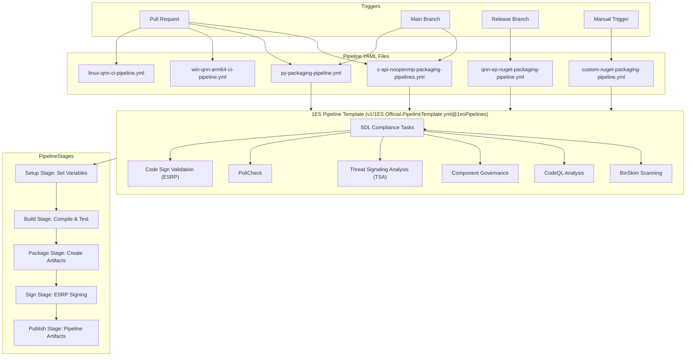

This diagram shows various triggers invoke pipeline YAML workflows, which extend and inject SDL and standardized build/test steps from the OneES pipeline template. These stages execute platform-specific jobs for building, testing, packaging, signing, and publishing ONNX Runtime artifacts.

Sources: [tools/ci_build/github/azure-pipelines/c-api-noopenmp-packaging-pipelines.yml:1-171](), [tools/ci_build/github/azure-pipelines/py-packaging-pipeline.yml:1-94](), [tools/ci_build/github/azure-pipelines/qnn-ep-nuget-packaging-pipeline.yml:1-102]()

---

## Key Pipeline Components

### 1. Pipeline Template Hierarchy and Flow

ONNX Runtime uses a layered template-based pipeline architecture encompassing stages, jobs, and step templates. This modular design facilitates code reuse, consistency, and ease of maintenance.

```mermaid
flowchart TD
    subgraph PipelineYAML["Main Pipeline Files"]
        CAPIPipeline["c-api-noopenmp-packaging-pipelines.yml"]
        PyPipeline["py-packaging-pipeline.yml"]
        QNNPipeline["qnn-ep-nuget-packaging-pipeline.yml"]
    end

    subgraph StageTemplates["Stage Templates (stages/)"]
        SetVarsStage["set_packaging_variables_stage.yml"]
        JavaCudaStage["java-cuda-packaging-stage.yml"]
        NuGetCombineStage["nuget-combine-cuda-stage.yml"]
        NodeJsStage["nodejs-win-packaging-stage.yml"]
        PyCPUStage["py-cpu-packaging-stage.yml"]
    end

    subgraph JobTemplates["Job Templates (templates/)"]
        CAPICPUTemplate["c-api-cpu.yml"]
        WinCITemplate["win-ci.yml"]
        QNNWinTemplate["qnn-ep-win.yml"]
        AndroidAARTemplate["android-java-api-aar.yml"]
        PyLinuxTemplate["py-linux.yml"]
        PyMacOSTemplate["py-macos.yml"]
        PyWinQNNTemplate["py-win-x64-qnn.yml"]
    end

    subgraph StepTemplates["Step Templates (templates/)"]
        SetVersionStep["set-version-number-variables-step.yml"]
        SetupBuildTools["setup-build-tools.yml"]
        WinESRPDLL["win-esrp-dll.yml"]
        ESRPNuGet["esrp_nuget.yml"]
        DownloadQNN["jobs/download_win_qnn_sdk.yml"]
        GetDockerImage["get-docker-image-steps.yml"]
    end

    CAPIPipeline --> SetVarsStage
    CAPIPipeline --> CAPICPUTemplate
    CAPIPipeline --> JavaCudaStage
    CAPIPipeline --> NuGetCombineStage
    CAPIPipeline --> NodeJsStage

    PyPipeline --> PyCPUStage
    PyCPUStage --> PyLinuxTemplate
    PyCPUStage --> PyMacOSTemplate
    PyCPUStage --> PyWinQNNTemplate

    QNNPipeline --> SetVarsStage
    QNNPipeline --> QNNWinTemplate

    CAPICPUTemplate --> WinCITemplate
    CAPICPUTemplate --> AndroidAARTemplate

    WinCITemplate --> SetVersionStep
    WinCITemplate --> SetupBuildTools
    WinCITemplate --> WinESRPDLL

    QNNWinTemplate --> DownloadQNN
    QNNWinTemplate --> WinESRPDLL
    QNNWinTemplate --> ESRPNuGet

    PyLinuxTemplate --> GetDockerImage
    AndroidAARTemplate --> GetDockerImage
```

The pipeline YAML files include stages templates, which orchestrate jobs via job templates. Job templates perform actions using step templates, such as setting version variables, downloading SDKs, building and signing binaries.

Sources: [tools/ci_build/github/azure-pipelines/c-api-noopenmp-packaging-pipelines.yml:121-184](), [tools/ci_build/github/azure-pipelines/templates/c-api-cpu.yml:56-214](), [tools/ci_build/github/azure-pipelines/stages/py-cpu-packaging-stage.yml:64-109](), [tools/ci_build/github/azure-pipelines/templates/qnn-ep-win.yml:20-80]()

---

### 2. Pipeline Parameters and Configuration

The pipelines are extensively parameterized to support diverse build and test scenarios across platforms, architectures, and providers.

| Parameter Group  | Example Parameters                                      | Purpose                                           |
|------------------|---------------------------------------------------------|--------------------------------------------------|
| Build Config     | `IsReleaseBuild` (bool), `build_config` (string)        | Define release/debug mode and build config       |
| Platform        | `buildArch` (x64, arm64, arm64ec), `msbuildPlatform`     | Target CPU architecture                           |
| Tests           | `RunOnnxRuntimeTests` (bool), `UseIncreasedTimeoutForTests` | Control test execution and timeout behavior      |
| Package Suffixes | `PreReleaseVersionSuffixString` (`rc`, `none`), `PreReleaseVersionSuffixNumber` | Version suffixes for pre-release packages        |
| SDK Versions    | `QnnSdk` (e.g. 2.42.0), `CudaVersion` (12.8, 13.0)       | SDK versioning for external dependencies         |
| Debugging       | `SpecificArtifact`, `BuildId`                            | Use specific artifacts or debug build ids         |
| Build Flags     | `AdditionalBuildFlag`, `buildparameter`                  | Extra flags passed through build.py               |

These parameters are defined in pipeline YAML files such as `c-api-noopenmp-packaging-pipelines.yml` and passed down through template stages and jobs.

Sources: [tools/ci_build/github/azure-pipelines/c-api-noopenmp-packaging-pipelines.yml:1-66](), [tools/ci_build/github/azure-pipelines/templates/win-ci.yml:1-92](), [tools/ci_build/github/azure-pipelines/qnn-ep-nuget-packaging-pipeline.yml:1-47]()

---

### 3. Build Matrices

The CI/CD system defines various build matrices for exercising combinations of platforms, architectures, execution providers, and language bindings.

#### Python Packaging Matrix (Partial)

```yaml
strategy:
  matrix:
    Python311:
      PythonVersion: '3.11'
    Python312:
      PythonVersion: '3.12'
    Python313:
      PythonVersion: '3.13'
    Python314:
      PythonVersion: '3.14'
```
(Wheels are built across multiple platforms per Python version.)

#### Platform and Architecture Matrix (Partial)

| Platform | Architecture    | Execution Providers                | Build Config      |
|----------|-----------------|----------------------------------|-------------------|
| Windows  | x64, arm64, arm64ec | CPU, DirectML, CUDA, QNN, WebGPU | RelWithDebInfo    |
| Linux    | x64, aarch64        | CPU, CUDA, TensorRT, QNN         | Release           |
| macOS    | x64, arm64          | CPU, CoreML                     | Release           |
| Android  | arm64-v8a, x86_64   | CPU, NNAPI, QNN                | Release           |
| iOS      | arm64               | CPU, CoreML                   | Release           |

#### QNN Execution Provider Build Variants

```yaml
strategy:
  matrix:
    SHARED_LIB:
      buildParameter: '--client_package_build'
    STATIC_LIB:
      buildParameter: ''
    SHARED_LIB_GENERIC_INTERFACE:
      buildParameter: '--enable_generic_interface'
```

Sources: [tools/ci_build/github/azure-pipelines/py-packaging-pipeline.yml:94](), [tools/ci_build/github/azure-pipelines/c-api-noopenmp-packaging-pipelines.yml:121-184](), [tools/ci_build/github/azure-pipelines/win-qnn-arm64-ci-pipeline.yml:38-66]()

---

## Main Pipeline Types

### 1. C/C++ API Packaging Pipeline

The core pipeline orchestrates builds and packaging for the C API across platforms, producing artifacts like native binaries, Python wheels, NuGet packages, Java packages, and Node.js bindings.

#### Stage Dependencies and Parallelism

```mermaid
flowchart TD
    Setup["Setup Stage: Set Version Variables"]
    LinuxCPU["Linux_C_API_Packaging_CPU"]
    MacOS["MacOS_C_API_Packaging_CPU"]
    AndroidFull["Android_Java_API_AAR_Packaging_Full"]
    AndroidQNN["Android_Java_API_AAR_Packaging_QNN"]
    iOS["iOS_Full_xcframework"]
    WinX64["Windows_Packaging_CPU_x64"]
    WinARM64["Windows_Packaging_CPU_arm64"]
    WinNodeX64["Windows_Nodejs_Packaging_x64"]
    WinNodeARM64["Windows_Nodejs_Packaging_arm64"]

    JarPackaging["Jar_Packaging"]
    NuGetCPU["NuGet_Packaging_CPU"]
    NodejsPackaging["Nodejs_Packaging"]

    JavaCudaStage["Java CUDA Packaging"]
    NuGetCombineCuda["NuGet Combine CUDA"]

    Setup --> LinuxCPU & MacOS & AndroidFull & AndroidQNN & WinX64 & WinARM64 & WinNodeX64 & WinNodeARM64

    LinuxCPU & MacOS & WinX64 --> JarPackaging
    LinuxCPU & MacOS & WinX64 & WinARM64 & AndroidFull & iOS --> NuGetCPU
    WinNodeX64 & WinNodeARM64 & LinuxCPU & MacOS --> NodejsPackaging
    LinuxCPU --> JavaCudaStage & NuGetCombineCuda
```

This structure enables parallel execution of platform-specific builds and subsequent packaging jobs.

Sources: [tools/ci_build/github/azure-pipelines/c-api-noopenmp-packaging-pipelines.yml:120-184]()

#### Example Windows Build Command

```bash
build.py --skip_submodule_sync --build_shared_lib --enable_onnx_tests \
         --enable_wcos --use_telemetry --use_dml --use_webgpu --build_nodejs \
         --cmake_generator "Visual Studio 17 2022"
```

#### Android and iOS Builds

- Android AAR is built inside a Docker container using `build_aar_and_copy_artifacts.sh` configured by `build_settings.json`.
- iOS xcframework is built using `build_apple_framework.py` with platform-specific settings.

Sources: [tools/ci_build/github/azure-pipelines/templates/c-api-cpu.yml:56-214](), [tools/ci_build/github/azure-pipelines/templates/android-java-api-aar.yml:90-149](), [tools/ci_build/github/azure-pipelines/templates/c-api-cpu.yml:111-140]()

---

### 2. Python Packaging Pipeline

Builds Python wheels for multiple Python versions, CPU and specialized EPs (QNN), and platforms.

#### Pipeline Matrix for Python Wheel Builds

An example matrix runs builds for Python 3.11 through 3.14 on Windows, Linux, and macOS CPU platforms, plus on Windows ARM64/ARM64EC QNN variants.

#### Windows Python Build Steps

- Install Python packages for build dependencies.
- Build with `build.py` using flags including `--enable_pybind` and `--build_wheel`.
- Sign `.pyd` files using ESRP (`win-esrp-dll.yml`).
- Package with `setup.py bdist_wheel`.
- Publish artifacts via `1ES.PublishPipelineArtifact@1`.

#### Linux Python Build Steps

- Prepare Docker image (`get-docker-image-steps.yml`).
- Build inside container using scripts like `build_python_wheel.sh`.
- Publish the resulting wheel.

#### QNN-Specific Python Builds

- Download QNN SDK from Azure Blob Storage.
- Build with QNN EP enabled and `--qnn_home` pointing to SDK root.
- Produce wheels with QNN-specific suffixes.

Sources: [tools/ci_build/github/azure-pipelines/py-packaging-pipeline.yml:94](), [tools/ci_build/github/azure-pipelines/stages/py-cpu-packaging-stage.yml:64-109](), [tools/ci_build/github/azure-pipelines/templates/py-win-x64-qnn.yml:47-132](), [tools/ci_build/github/azure-pipelines/templates/py-win-arm64-qnn.yml:55-130]()

---

### 3. QNN Execution Provider Pipelines

Dedicated pipelines build, test, and package the Qualcomm Neural Network (QNN) EP across Windows ARM64, Linux, and Android platforms.

#### QNN SDK Download

- Windows and Linux pipelines download the QNN SDK from HTTPS URLs using `azcopy`.
- SDK versioning is specified and validated via parameters.

#### Build Matrix

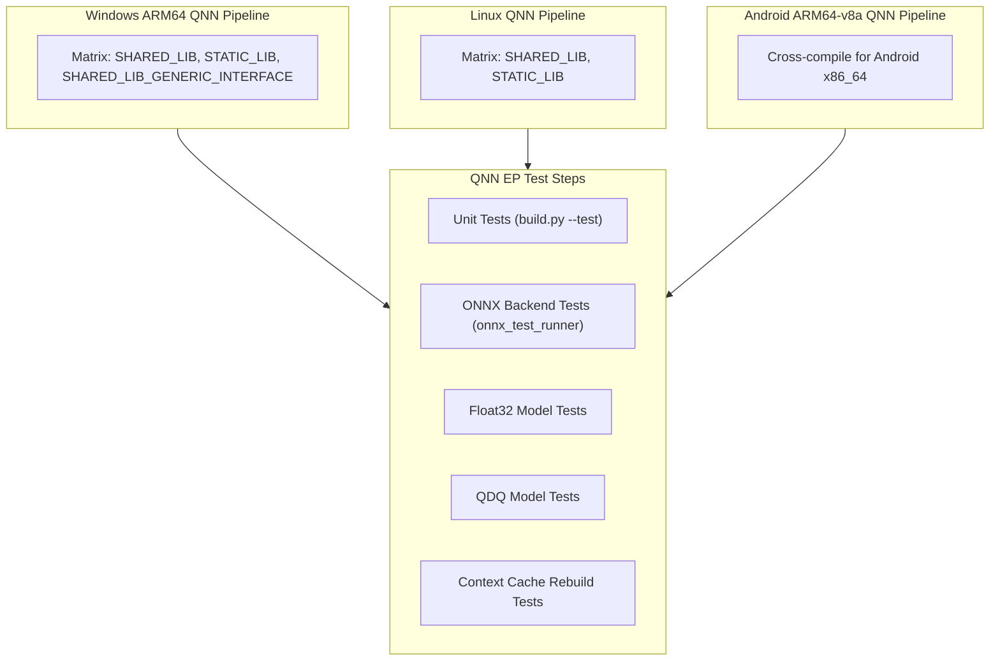

#### Build Command Examples

- Windows ARM64 Shared Library build:

```bash
build.py --config Release --build_dir build --cmake_generator "Visual Studio 17 2022" \
         --build_shared_lib --use_vcpkg --use_vcpkg_ms_internal_asset_cache \
         --use_qnn shared_lib --qnn_home $(QnnSDKRootDir) --update --build --parallel
```

- Linux build (shared or static):

```bash
python3 tools/ci_build/build.py --build_dir build --config Release --use_binskim_compliant_compile_flags \
         --build_java --build_shared_lib --use_qnn static_lib --qnn_home $(QnnSDKRootDir) \
         --cmake_generator Ninja --update --build --parallel --use_vcpkg --use_vcpkg_ms_internal_asset_cache
```

Sources: [tools/ci_build/github/azure-pipelines/win-qnn-arm64-ci-pipeline.yml:38-116](), [tools/ci_build/github/azure-pipelines/linux-qnn-ci-pipeline.yml:38-119](), [tools/ci_build/github/azure-pipelines/android-arm64-v8a-QNN-crosscompile-ci-pipeline.yml:37-105]()

---

### 4. NuGet Packaging and Testing Pipelines

NuGet packages combine native binaries from multiple platform builds and wrap them with managed C# bindings. The pipeline also executes end-to-end tests for the packages.

#### NuGet Packaging Workflow

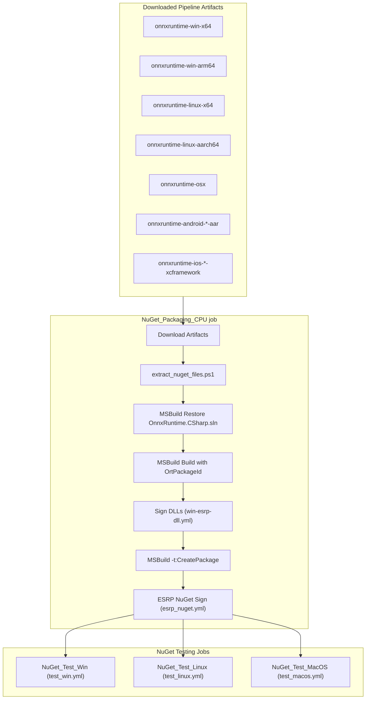

#### Sample Commands

- Restore:

```bash
MSBuild OnnxRuntime.CSharp.sln -t:restore -p:OrtPackageId=$(OrtPackageId)
```

- Build:

```bash
MSBuild OnnxRuntime.CSharp.sln -p:OnnxRuntimeBuildDirectory="$(Build.BinariesDirectory)" \
        -p:OrtPackageId=$(OrtPackageId) -p:IsReleaseBuild=true \
        -p:ReleaseVersionSuffix=$(ReleaseVersionSuffix) -p:PackageVersion=$(OnnxRuntimeVersion)
```

- Package:

```bash
MSBuild OnnxRuntime.CSharp.proj -t:CreatePackage -p:OnnxRuntimeBuildDirectory="$(Build.BinariesDirectory)" \
        -p:OrtPackageId=$(OrtPackageId) -p:IsReleaseBuild=true -p:ReleaseVersionSuffix=$(ReleaseVersionSuffix) \
        -p:CurrentTime=$(BuildTime) -p:CurrentDate=$(BuildDate)
```

#### NuGet Testing

- Windows runs `test\Microsoft.ML.OnnxRuntime.EndToEndTests\runtest.bat` for .NET 8.0 and .NET Framework 4.6.2.
- Linux and macOS run the appropriate shell scripts to validate packages.

Sources: [tools/ci_build/github/azure-pipelines/templates/c-api-cpu.yml:216-379](), [tools/ci_build/github/azure-pipelines/nuget/templates/test_win.yml:16-95](), [tools/ci_build/github/azure-pipelines/nuget/templates/test_linux.yml:13-110](), [tools/ci_build/github/azure-pipelines/nuget/templates/test_macos.yml:4-51]()

---

## Build and Test Process

### 1. Build Process and Toolchain Setup

The build orchestration script `tools/ci_build/build.py` is invoked with parameters to generate CMake configurations and launch platform-specific build tools (MSBuild, Ninja, etc.).

#### Windows Build Process

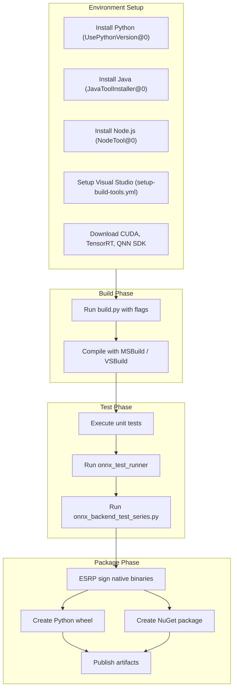

##### Example Windows build.py command

```bash
python.exe tools\ci_build\build.py --config RelWithDebInfo --build_dir $(Build.BinariesDirectory) \
  --skip_submodule_sync --build_csharp --parallel --use_binskim_compliant_compile_flags \
  --cmake_generator "Visual Studio 17 2022" --build_shared_lib --enable_onnx_tests --use_cuda \
  --cuda_home=$(Agent.TempDirectory)\v12.8
```

Sources: [tools/ci_build/github/azure-pipelines/templates/win-ci.yml:150-218](), [tools/ci_build/github/azure-pipelines/templates/jobs/win-ci-vs-2022-job.yml:88-205]()

---

### 2. Linux Build Process with Docker

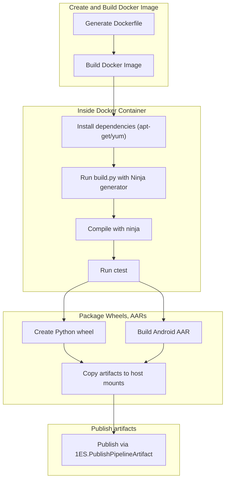

##### Sample Linux build command

```bash
python3 tools/ci_build/build.py --build_dir build --config Release \
  --use_binskim_compliant_compile_flags --build_java --build_shared_lib \
  --use_qnn static_lib --qnn_home $(QnnSDKRootDir) --cmake_generator Ninja --update --build --parallel \
  --use_vcpkg --use_vcpkg_ms_internal_asset_cache
```

Sources: [tools/ci_build/github/azure-pipelines/linux-qnn-ci-pipeline.yml:50-86](), [tools/ci_build/github/azure-pipelines/templates/py-linux.yml:55-90]()

---

## Testing Automation

### Test Executors and Locations

Testing is automated and integrated into CI pipelines, using binaries and scripts invoked by the build orchestrator or pipeline jobs.

| Test Type             | Executor                             | Command Example                               | Test Data Location                                               |
|-----------------------|------------------------------------|-----------------------------------------------|-----------------------------------------------------------------|
| Unit Tests            | `build.py --test`                   | `build.py --config Release --test`             | N/A                                                             |
| ONNX Backend Tests    | `onnx_test_runner`                  | `onnx_test_runner -e qnn -i "backend_path\|QnnCpu.dll" ...` | `cmake/external/onnx/onnx/backend/test/data/node`               |
| Float32 Model Tests   | `onnx_test_runner`                  | `onnx_test_runner -e qnn /data/float32_models` | `/data/float32_models` or `C:\data\float32_models`               |
| QDQ Model Tests       | `onnx_test_runner`                  | `onnx_test_runner -e qnn -i "backend_path\|QnnHtp.dll" /data/qdq_models` | `/data/qdq_models` or `C:\data\qdq_models`                       |
| Context Cache Tests   | `onnx_test_runner` with `-f` flag  | `onnx_test_runner -e qnn -f /data/qdq_models/mobilenetv2-1.0` | Model-specific directories                                      |
| Python Backend Tests  | `onnx_backend_test_series.py`      | `python onnx_backend_test_series.py`            | Filters in `onnx_backend_test_series_filters.jsonc`             |
| C# E2E Tests          | `runtest.bat` / `runtest.sh`       | `runtest.bat $(NuGetArtifactPath) net8.0 x64`  | Various pre-staged model files                                  |
| Android Emulator Tests| `gradlew connectedDebugAndroidTest`| Run via Android Emulator                         | Android test directory                                          |
| Performance Tests     | `onnxruntime_perf_test`             | `onnxruntime_perf_test -e CUDA <model>`         | Model Zoo                                                       |

---

### Sample Test Commands for QNN EP

**Windows QNN Tests**:

```powershell
.\onnx_test_runner -j 1 -v -e qnn -i "backend_path|$(QnnSDKRootDir)\lib\aarch64-windows-msvc\QnnCpu.dll" cmake/external/onnx/onnx/backend/test/data/node
.\onnx_test_runner -j 1 -v -e qnn -i "backend_path|$(QnnSDKRootDir)\lib\aarch64-windows-msvc\QnnCpu.dll" C:\data\float32_models
.\onnx_test_runner -j 1 -v -e qnn -i "backend_path|$(QnnSDKRootDir)\lib\aarch64-windows-msvc\QnnHtp.dll" C:\data\qdq_models
```

**Linux QNN Tests**:

```bash
./build/Release/onnx_test_runner -e qnn -j 1 -i "backend_path|$(QnnSDKRootDir)/lib/x86_64-linux-clang/libQnnCpu.so" cmake/external/onnx/onnx/backend/test/data/node
./build/Release/onnx_test_runner -e qnn -j 1 -i "backend_path|$(QnnSDKRootDir)/lib/x86_64-linux-clang/libQnnCpu.so" /data/float32_models
./build/Release/onnx_test_runner -e qnn -j 1 -i "backend_path|$(QnnSDKRootDir)/lib/x86_64-linux-clang/libQnnHtp.so" /data/qdq_models
./build/Release/onnx_test_runner -e qnn -f -j 1 -i "backend_path|$(QnnSDKRootDir)/lib/x86_64-linux-clang/libQnnHtp.so" /data/qdq_models/mobilenetv2-1.0_add_transpose_quant
```

Sources: [tools/ci_build/github/azure-pipelines/win-qnn-arm64-ci-pipeline.yml:91-117](), [tools/ci_build/github/azure-pipelines/linux-qnn-ci-pipeline.yml:75-119](), [tools/ci_build/github/azure-pipelines/templates/android-java-api-aar-test.yml:29-115](), [tools/ci_build/build.py:206-241]()

---

## Binary Size Validation

ONNX Runtime CI builds include binary size checks to prevent bloat in Android minimal builds via a dedicated pipeline.

### Binary Size Check Pipeline Flow

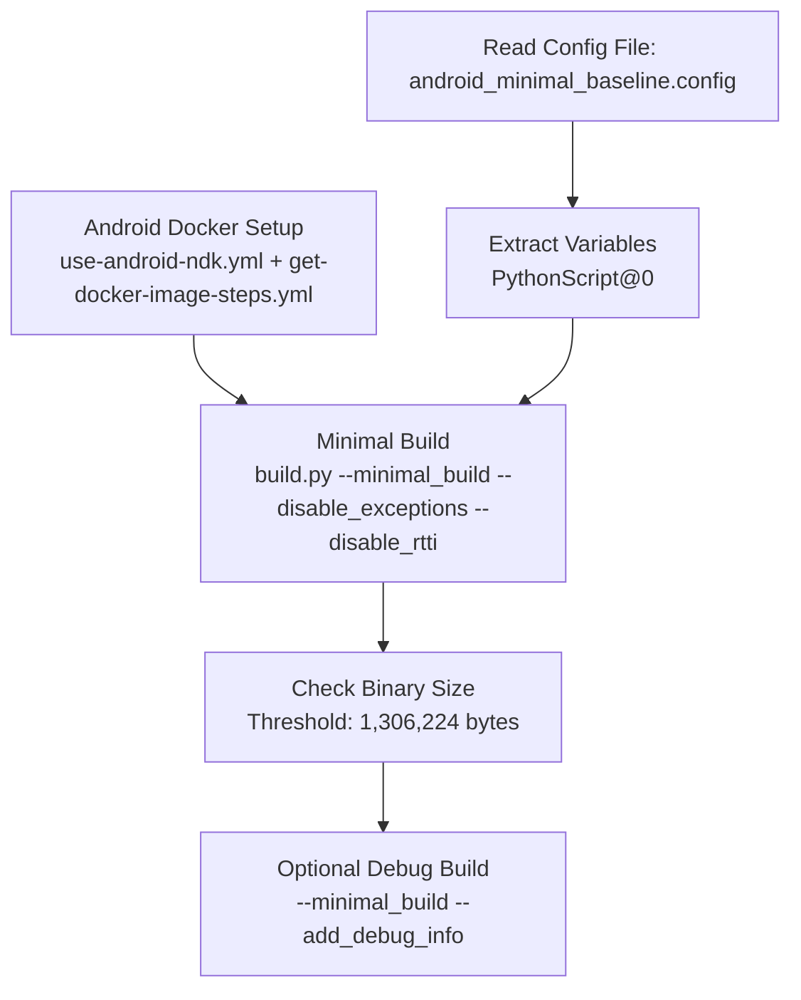

The config file contains flags disabling exceptions and RTTI to minimize binary size.

Sources: [tools/ci_build/github/azure-pipelines/binary-size-checks-pipeline.yml:1-13](), [tools/ci_build/github/azure-pipelines/templates/android-binary-size-check-stage.yml:1-128]()

---

## Packaging and Distribution

### 1. Produced Package Types and Artifact Publishing

ONNX Runtime produces several package types grouped by language and platform and publishes them via 1ES pipeline artifacts and feeds.

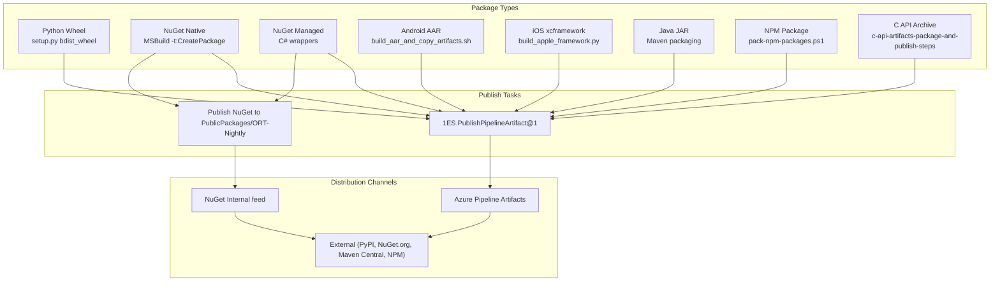

### NPM Packaging

The NPM package aggregates native bindings for different platforms:

- Windows x64 and arm64: `onnxruntime.dll`, `onnxruntime_binding.node`, DirectML/DX dlls.
- Linux x64/arm64: `.so` files, `onnxruntime_binding.node`.
- macOS arm64: `.dylib` and bindings.

Packaging is performed by `pack-npm-packages.ps1` for Windows.

Sources: [tools/ci_build/github/azure-pipelines/templates/c-api-cpu.yml:263-436]()

---

### 2. Code Signing

Code signing is integrated via ESRP (Enterprise Security and Risk Profiling) in the pipelines to ensure authenticity and integrity.

| Package Type  | Signing Process                      | Files Signed                  |
|---------------|------------------------------------|------------------------------|
| NuGet Packages| ESRP NuGet signing via `esrp_nuget.yml`| `.nupkg` files               |
| Windows DLLs  | ESRP DLL signing via `win-esrp-dll.yml`| `.dll`, `.pyd` files          |
| Java JARs    | GPG signing                         | `.jar` files                 |
| Python Wheels | ESRP signing of native `.pyd` files | `.pyd` files                 |

Sources: [tools/ci_build/github/azure-pipelines/templates/c-api-cpu.yml:384-390](), [tools/ci_build/github/azure-pipelines/templates/py-win-x64-qnn.yml:102-108]()

---

## Special Pipeline Configurations

### Custom NuGet Packaging Pipeline

This pipeline creates specialized NuGet packages combining platform-specific builds and execution providers, including CUDA, QNN, and CPU builds.

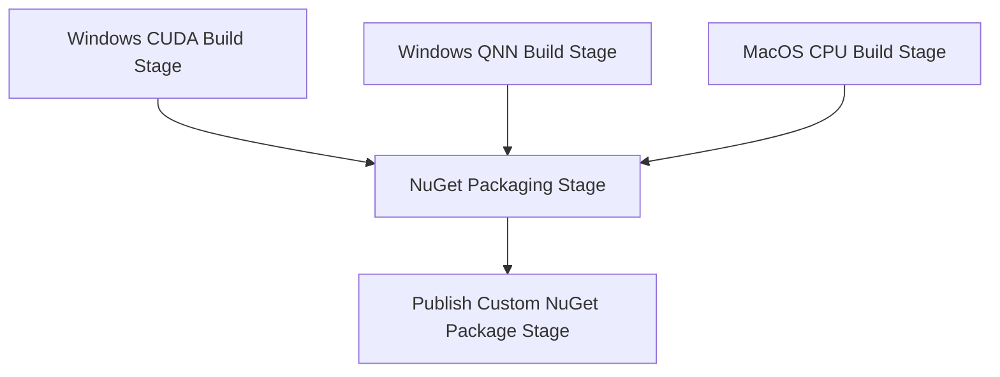

Sources: [tools/ci_build/github/azure-pipelines/custom-nuget-packaging-pipeline.yml:1-151]()

---

### Fuzz Testing Pipeline

This pipeline is dedicated to security testing using fuzzing:

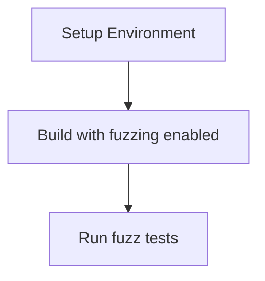

Sources: [tools/ci_build/github/azure-pipelines/win-ci-fuzz-testing.yml:1-68]()

---

## CI/CD Infrastructure Components

### 1. Agent Pools

The CI/CD system uses dedicated agent pools optimized for build purpose, platform, and environment:

| Agent Pool                          | Purpose                                  | Examples                       |
|-----------------------------------|------------------------------------------|-------------------------------|
| onnxruntime-Win-CPU-2022           | Windows CPU builds                        | Windows C# builds, NuGet       |
| onnxruntime-Win2022-GPU-A10        | Windows GPU builds                        | CUDA, TensorRT                |
| onnxruntime-Ubuntu2404-AMD-CPU     | Linux CPU builds                         | Linux python wheel builds      |
| onnxruntime-QNNEP-Windows-2022-CPU | Windows QNN builds                       | QNN EP builds Windows          |
| onnxruntime-qnn-windows-vs-2022-arm64 | Windows ARM64 QNN builds               | QNN EP ARM64 Windows           |
| onnxruntime-qnn-ubuntu-2204-cpu    | Linux QNN builds                        | QNN EP Linux                   |

Sources: [tools/ci_build/github/azure-pipelines/templates/c-api-cpu.yml:181-183](), [tools/ci_build/github/azure-pipelines/templates/qnn-ep-win.yml:19-20]()

---

### 2. External Dependencies

Dependencies are handled as part of the pipeline:

| Dependency   | Purpose               | Management             |
|--------------|-----------------------|-----------------------|
| CUDA         | GPU execution         | Downloaded during build|
| TensorRT     | GPU acceleration      | Downloaded during build|
| QNN SDK      | Qualcomm NPU support  | Download from Azure Blob Storage|
| Android SDK/NDK| Android builds      | Pre-installed or installed on agents|
| Python       | Build and test scripts| Installed during pipeline|
| Java JDK     | Java builds           | Installed on-demand    |
| Node.js      | JavaScript builds     | Installed on-demand    |

Sources: [tools/ci_build/github/azure-pipelines/templates/jobs/download_win_qnn_sdk.yml:1-27](), [tools/ci_build/github/azure-pipelines/templates/jobs/download_linux_qnn_sdk.yml:1-45]()

---

## Release Process

Releases are coordinated by the packaging pipelines with versioning, signing, testing, and publication.

### Version Number Setup and Release Flow

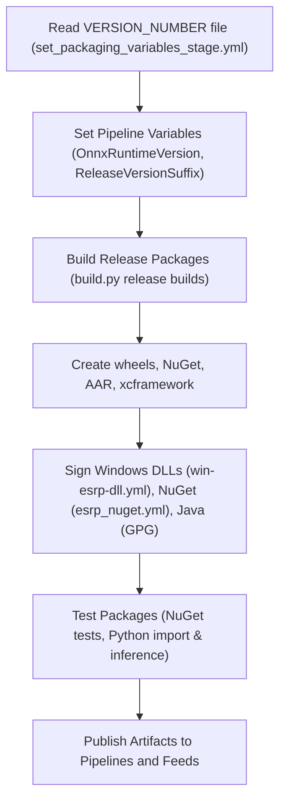

### Version Extraction Example

**Windows batch snippet** to extract NuGet package version from filename:

```cmd
FOR /R %%i IN (Microsoft.ML.OnnxRuntime.Managed*.nupkg) DO (
  SET filename=%%~ni
  SET ortversion=!filename:~33!
  echo ##vso[task.setvariable variable=NuGetPackageVersionNumber;]!ortversion!
)
```

Sources: [tools/ci_build/github/azure-pipelines/stages/set_packaging_variables_stage.yml:1-66](), [tools/ci_build/github/azure-pipelines/nuget/templates/get-nuget-package-version-as-variable.yml:1-42]()

---

## Integration with Azure Kusto Dashboard for Binary Sizes

Binary size statistics are collected and published to an internal Azure Kusto dashboard using Python ingestion code:

```python
from azure.kusto.ingest import QueuedIngestClient, IngestionProperties

# Read the CSV binary size data
binary_size_data = pandas.read_csv(size_data_file)

# Define ingestion properties and send data
ingestion_properties = IngestionProperties(database=database, table=table, data_format=DataFormat.CSV)
ingest_client.ingest_from_dataframe(binary_size_data, ingestion_properties=ingestion_properties)
```

This allows long-term size tracking and trend analysis for essential binaries.

Sources: [tools/ci_build/github/windows/post_binary_sizes_to_dashboard.py:1-99]()

---

## Conclusion

The ONNX Runtime CI/CD pipeline system forms a comprehensive infrastructure to automate building, testing, packaging, signing, and publishing of ONNX Runtime artifacts. It employs a modular hierarchical YAML template design with parameterization to handle a wide matrix of platforms, configurations, and execution providers. Security and compliance are integrated, including SDL tasks and ESRP signing.

This system enables consistent, repeatable, and high quality releases for multiple language bindings and platforms while supporting advanced features like QNN and CUDA execution providers.

---

# Legend of Files Referenced

- `tools/ci_build/github/azure-pipelines/c-api-noopenmp-packaging-pipelines.yml`
- `tools/ci_build/github/azure-pipelines/templates/c-api-cpu.yml`
- `tools/ci_build/github/azure-pipelines/templates/win-ci.yml`
- `tools/ci_build/github/azure-pipelines/stages/py-cpu-packaging-stage.yml`
- `tools/ci_build/github/azure-pipelines/qnn-ep-nuget-packaging-pipeline.yml`
- `tools/ci_build/github/azure-pipelines/templates/qnn-ep-win.yml`
- `tools/ci_build/github/azure-pipelines/templates/android-java-api-aar.yml`
- `tools/ci_build/github/azure-pipelines/linux-qnn-ci-pipeline.yml`
- `.github/workflows/lint.yml`
- `.github/workflows/publish-python-apidocs.yml`
- `.github/workflows/publish-csharp-apidocs.yml`
- `tools/ci_build/build.py`
- `tools/ci_build/github/windows/post_binary_sizes_to_dashboard.py`

Sources: All cited within respective sections.

---

