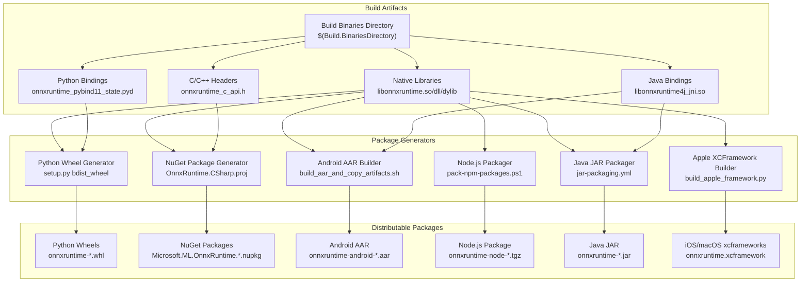
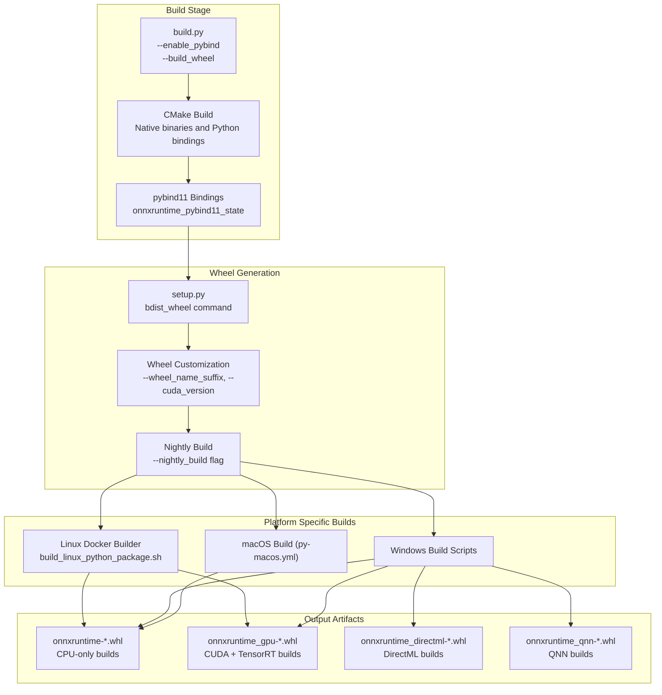
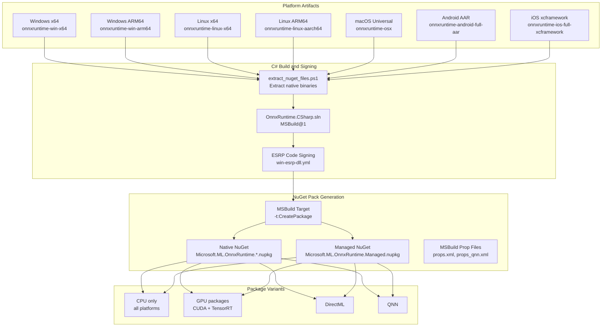
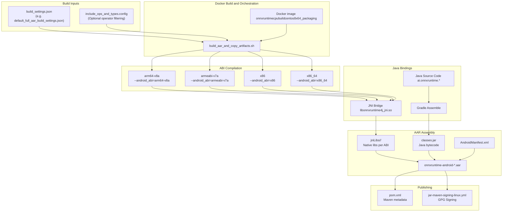
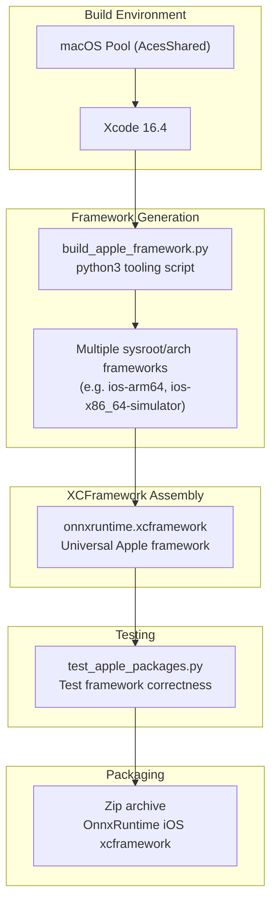
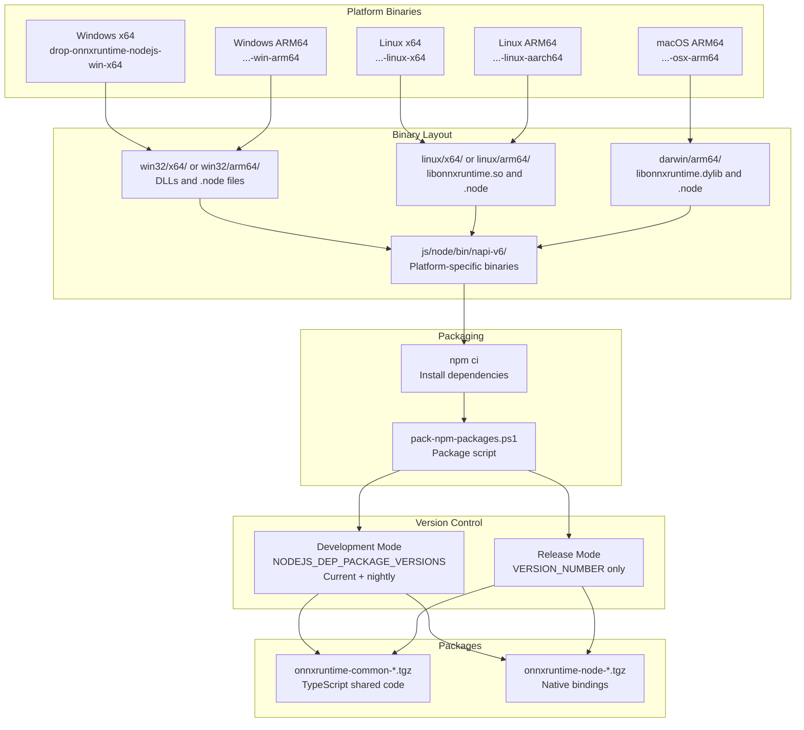
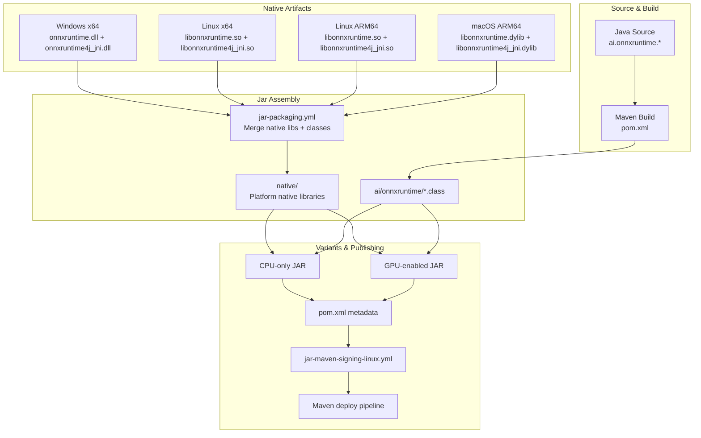
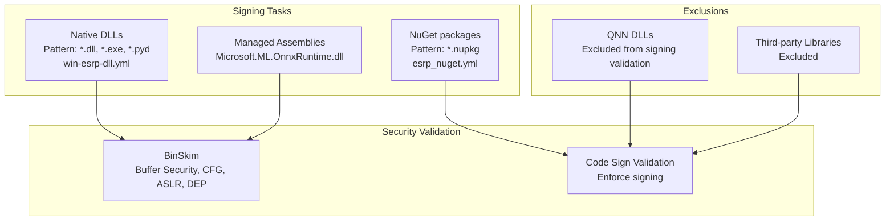
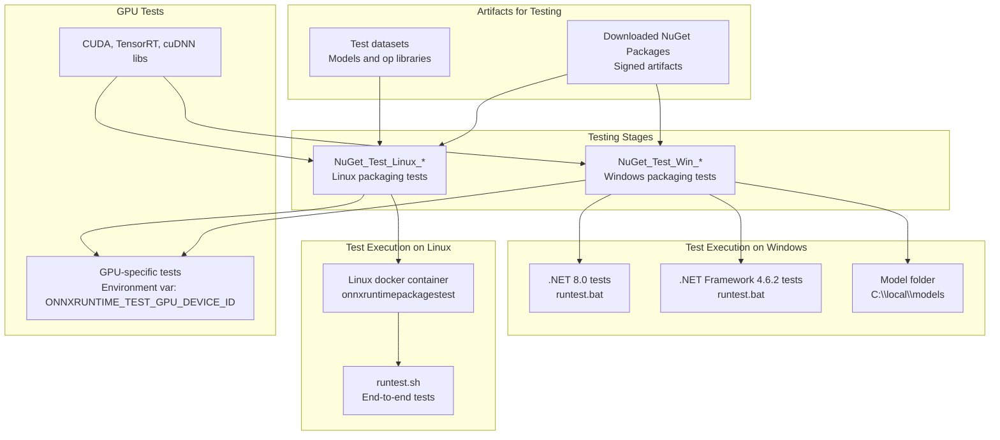
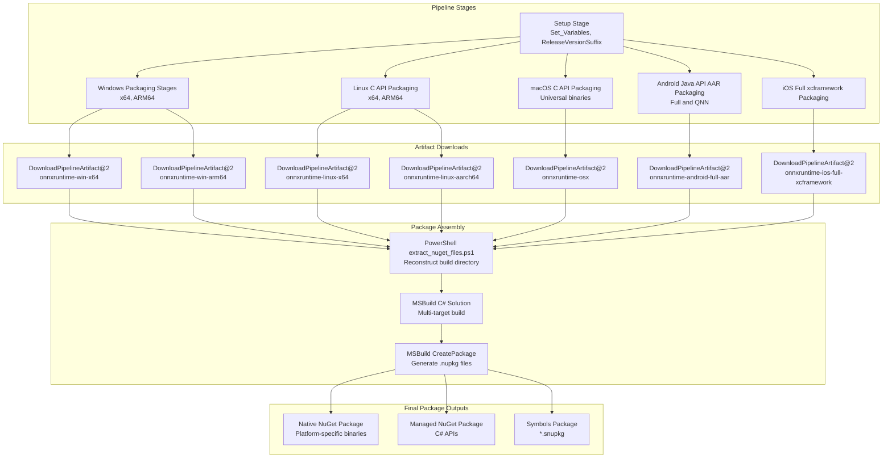

<!-- source: DeepWiki mcp.deepwiki.com · repo microsoft/onnxruntime · page 2.5 Platform-Specific Packaging · fetched 2026-10-21 -->

# Platform-Specific Packaging

<details>
<summary>Relevant source files</summary>

The following files were used as context for generating this wiki page:

- [cmake/external/dml.cmake](cmake/external/dml.cmake)
- [csharp/CONTRIBUTING.md](csharp/CONTRIBUTING.md)
- [csharp/NuGet.CSharp.config](csharp/NuGet.CSharp.config)
- [csharp/OnnxRuntime.CSharp.proj](csharp/OnnxRuntime.CSharp.proj)
- [csharp/sample/InferenceSample/Microsoft.ML.OnnxRuntime.InferenceSample/InferenceSampleApi.cs](csharp/sample/InferenceSample/Microsoft.ML.OnnxRuntime.InferenceSample/InferenceSampleApi.cs)
- [csharp/src/Microsoft.ML.OnnxRuntime/InferenceSession.shared.cs](csharp/src/Microsoft.ML.OnnxRuntime/InferenceSession.shared.cs)
- [csharp/src/Microsoft.ML.OnnxRuntime/Microsoft.ML.OnnxRuntime.csproj](csharp/src/Microsoft.ML.OnnxRuntime/Microsoft.ML.OnnxRuntime.csproj)
- [csharp/src/Microsoft.ML.OnnxRuntime/NativeMethods.shared.cs](csharp/src/Microsoft.ML.OnnxRuntime/NativeMethods.shared.cs)
- [csharp/src/Microsoft.ML.OnnxRuntime/NativeOnnxValueHelper.shared.cs](csharp/src/Microsoft.ML.OnnxRuntime/NativeOnnxValueHelper.shared.cs)
- [csharp/src/Microsoft.ML.OnnxRuntime/OrtAllocator.shared.cs](csharp/src/Microsoft.ML.OnnxRuntime/OrtAllocator.shared.cs)
- [csharp/src/Microsoft.ML.OnnxRuntime/OrtEnv.shared.cs](csharp/src/Microsoft.ML.OnnxRuntime/OrtEnv.shared.cs)
- [csharp/src/Microsoft.ML.OnnxRuntime/OrtEpDevice.shared.cs](csharp/src/Microsoft.ML.OnnxRuntime/OrtEpDevice.shared.cs)
- [csharp/src/Microsoft.ML.OnnxRuntime/OrtHardwareDevice.shared.cs](csharp/src/Microsoft.ML.OnnxRuntime/OrtHardwareDevice.shared.cs)
- [csharp/src/Microsoft.ML.OnnxRuntime/OrtIoBinding.shared.cs](csharp/src/Microsoft.ML.OnnxRuntime/OrtIoBinding.shared.cs)
- [csharp/src/Microsoft.ML.OnnxRuntime/OrtKeyValuePairs.shared.cs](csharp/src/Microsoft.ML.OnnxRuntime/OrtKeyValuePairs.shared.cs)
- [csharp/src/Microsoft.ML.OnnxRuntime/OrtLoraAdapter.shared.cs](csharp/src/Microsoft.ML.OnnxRuntime/OrtLoraAdapter.shared.cs)
- [csharp/src/Microsoft.ML.OnnxRuntime/OrtValue.shared.cs](csharp/src/Microsoft.ML.OnnxRuntime/OrtValue.shared.cs)
- [csharp/src/Microsoft.ML.OnnxRuntime/ProviderOptions.shared.cs](csharp/src/Microsoft.ML.OnnxRuntime/ProviderOptions.shared.cs)
- [csharp/src/Microsoft.ML.OnnxRuntime/SessionOptions.shared.cs](csharp/src/Microsoft.ML.OnnxRuntime/SessionOptions.shared.cs)
- [csharp/src/Microsoft.ML.OnnxRuntime/ShapeUtils.shared.cs](csharp/src/Microsoft.ML.OnnxRuntime/ShapeUtils.shared.cs)
- [csharp/src/Microsoft.ML.OnnxRuntime/Tensors/ArrayUtilities.shared.cs](csharp/src/Microsoft.ML.OnnxRuntime/Tensors/ArrayUtilities.shared.cs)
- [csharp/src/Microsoft.ML.OnnxRuntime/Tensors/Tensor.shared.cs](csharp/src/Microsoft.ML.OnnxRuntime/Tensors/Tensor.shared.cs)
- [csharp/test/Microsoft.ML.OnnxRuntime.Tests.Common/CudaPluginEpTests.cs](csharp/test/Microsoft.ML.OnnxRuntime.Tests.Common/CudaPluginEpTests.cs)
- [csharp/test/Microsoft.ML.OnnxRuntime.Tests.Common/EpCompatibilityTests.cs](csharp/test/Microsoft.ML.OnnxRuntime.Tests.Common/EpCompatibilityTests.cs)
- [csharp/test/Microsoft.ML.OnnxRuntime.Tests.Common/InferenceTest.cs](csharp/test/Microsoft.ML.OnnxRuntime.Tests.Common/InferenceTest.cs)
- [csharp/test/Microsoft.ML.OnnxRuntime.Tests.Common/Microsoft.ML.OnnxRuntime.Tests.Common.csproj](csharp/test/Microsoft.ML.OnnxRuntime.Tests.Common/Microsoft.ML.OnnxRuntime.Tests.Common.csproj)
- [csharp/test/Microsoft.ML.OnnxRuntime.Tests.Common/OrtAutoEpTests.cs](csharp/test/Microsoft.ML.OnnxRuntime.Tests.Common/OrtAutoEpTests.cs)
- [csharp/test/Microsoft.ML.OnnxRuntime.Tests.Common/OrtEnvTests.cs](csharp/test/Microsoft.ML.OnnxRuntime.Tests.Common/OrtEnvTests.cs)
- [csharp/test/Microsoft.ML.OnnxRuntime.Tests.Common/OrtIoBindingAllocationTest.cs](csharp/test/Microsoft.ML.OnnxRuntime.Tests.Common/OrtIoBindingAllocationTest.cs)
- [csharp/test/Microsoft.ML.OnnxRuntime.Tests.Common/OrtValueTests.cs](csharp/test/Microsoft.ML.OnnxRuntime.Tests.Common/OrtValueTests.cs)
- [csharp/test/Microsoft.ML.OnnxRuntime.Tests.Common/Tensors/ArrayTensorExtensionsTests.cs](csharp/test/Microsoft.ML.OnnxRuntime.Tests.Common/Tensors/ArrayTensorExtensionsTests.cs)
- [csharp/test/Microsoft.ML.OnnxRuntime.Tests.Common/Tensors/NativeMemory.cs](csharp/test/Microsoft.ML.OnnxRuntime.Tests.Common/Tensors/NativeMemory.cs)
- [csharp/test/Microsoft.ML.OnnxRuntime.Tests.Common/Tensors/TensorTests.cs](csharp/test/Microsoft.ML.OnnxRuntime.Tests.Common/Tensors/TensorTests.cs)
- [csharp/test/Microsoft.ML.OnnxRuntime.Tests.Common/TestDataLoader.cs](csharp/test/Microsoft.ML.OnnxRuntime.Tests.Common/TestDataLoader.cs)
- [csharp/test/Microsoft.ML.OnnxRuntime.Tests.NetCoreApp/InferenceTest.netcore.cs](csharp/test/Microsoft.ML.OnnxRuntime.Tests.NetCoreApp/InferenceTest.netcore.cs)
- [csharp/test/Microsoft.ML.OnnxRuntime.Tests.NetCoreApp/Microsoft.ML.OnnxRuntime.Tests.NetCoreApp.csproj](csharp/test/Microsoft.ML.OnnxRuntime.Tests.NetCoreApp/Microsoft.ML.OnnxRuntime.Tests.NetCoreApp.csproj)
- [onnxruntime/core/providers/dml/DmlExecutionProvider/src/ApiTraits.cpp](onnxruntime/core/providers/dml/DmlExecutionProvider/src/ApiTraits.cpp)
- [onnxruntime/core/providers/dml/DmlExecutionProvider/src/External/DirectMLHelpers/DmlGraphDeserialization.h](onnxruntime/core/providers/dml/DmlExecutionProvider/src/External/DirectMLHelpers/DmlGraphDeserialization.h)
- [onnxruntime/core/providers/dml/DmlExecutionProvider/src/External/DirectMLHelpers/GeneratedSchemaTypes.h](onnxruntime/core/providers/dml/DmlExecutionProvider/src/External/DirectMLHelpers/GeneratedSchemaTypes.h)
- [onnxruntime/core/providers/dml/DmlExecutionProvider/src/External/DirectMLHelpers/SchemaHelpers.h](onnxruntime/core/providers/dml/DmlExecutionProvider/src/External/DirectMLHelpers/SchemaHelpers.h)
- [onnxruntime/test/framework/hardware_device_compatibility_test.cc](onnxruntime/test/framework/hardware_device_compatibility_test.cc)
- [onnxruntime/test/platform/apple/apple_package_test/Podfile.template](onnxruntime/test/platform/apple/apple_package_test/Podfile.template)
- [onnxruntime/test/platform/apple/apple_package_test/apple_package_test.xcodeproj/project.pbxproj](onnxruntime/test/platform/apple/apple_package_test/apple_package_test.xcodeproj/project.pbxproj)
- [onnxruntime/test/python/onnxruntime_test_python_ep_compatibility.py](onnxruntime/test/python/onnxruntime_test_python_ep_compatibility.py)
- [packages.config](packages.config)
- [tools/ci_build/github/Doxyfile_csharp.cfg](tools/ci_build/github/Doxyfile_csharp.cfg)
- [tools/ci_build/github/apple/assemble_apple_packaging_artifacts.sh](tools/ci_build/github/apple/assemble_apple_packaging_artifacts.sh)
- [tools/ci_build/github/apple/build_and_assemble_apple_pods.py](tools/ci_build/github/apple/build_and_assemble_apple_pods.py)
- [tools/ci_build/github/apple/build_apple_framework.py](tools/ci_build/github/apple/build_apple_framework.py)
- [tools/ci_build/github/apple/c/assemble_c_pod_package.py](tools/ci_build/github/apple/c/assemble_c_pod_package.py)
- [tools/ci_build/github/apple/default_full_apple_framework_build_settings.json](tools/ci_build/github/apple/default_full_apple_framework_build_settings.json)
- [tools/ci_build/github/apple/default_full_ios_framework_build_settings.json](tools/ci_build/github/apple/default_full_ios_framework_build_settings.json)
- [tools/ci_build/github/apple/framework_info.json.template](tools/ci_build/github/apple/framework_info.json.template)
- [tools/ci_build/github/apple/objectivec/assemble_objc_pod_package.py](tools/ci_build/github/apple/objectivec/assemble_objc_pod_package.py)
- [tools/ci_build/github/apple/objectivec/objc.podspec.template](tools/ci_build/github/apple/objectivec/objc.podspec.template)
- [tools/ci_build/github/apple/package_assembly_utils.py](tools/ci_build/github/apple/package_assembly_utils.py)
- [tools/ci_build/github/apple/test_apple_packages.py](tools/ci_build/github/apple/test_apple_packages.py)
- [tools/ci_build/github/azure-pipelines/c-api-noopenmp-packaging-pipelines-cuda13.yml](tools/ci_build/github/azure-pipelines/c-api-noopenmp-packaging-pipelines-cuda13.yml)
- [tools/ci_build/github/azure-pipelines/c-api-noopenmp-test-pipelines.yml](tools/ci_build/github/azure-pipelines/c-api-noopenmp-test-pipelines.yml)
- [tools/ci_build/github/azure-pipelines/dml-nuget-packaging.yml](tools/ci_build/github/azure-pipelines/dml-nuget-packaging.yml)
- [tools/ci_build/github/azure-pipelines/jar_package_testing.yml](tools/ci_build/github/azure-pipelines/jar_package_testing.yml)
- [tools/ci_build/github/azure-pipelines/mac-ios-packaging-pipeline.yml](tools/ci_build/github/azure-pipelines/mac-ios-packaging-pipeline.yml)
- [tools/ci_build/github/azure-pipelines/py-cuda-packaging-pipeline.yml](tools/ci_build/github/azure-pipelines/py-cuda-packaging-pipeline.yml)
- [tools/ci_build/github/azure-pipelines/py-cuda13-packaging-pipeline.yml](tools/ci_build/github/azure-pipelines/py-cuda13-packaging-pipeline.yml)
- [tools/ci_build/github/azure-pipelines/py-dml-packaging-pipeline.yml](tools/ci_build/github/azure-pipelines/py-dml-packaging-pipeline.yml)
- [tools/ci_build/github/azure-pipelines/py-webgpu-packaging-pipeline.yml](tools/ci_build/github/azure-pipelines/py-webgpu-packaging-pipeline.yml)
- [tools/ci_build/github/azure-pipelines/stages/nuget-combine-cuda-stage.yml](tools/ci_build/github/azure-pipelines/stages/nuget-combine-cuda-stage.yml)
- [tools/ci_build/github/azure-pipelines/stages/nuget-cuda-packaging-stage.yml](tools/ci_build/github/azure-pipelines/stages/nuget-cuda-packaging-stage.yml)
- [tools/ci_build/github/azure-pipelines/stages/nuget-linux-cuda-packaging-stage.yml](tools/ci_build/github/azure-pipelines/stages/nuget-linux-cuda-packaging-stage.yml)
- [tools/ci_build/github/azure-pipelines/stages/nuget-win-cuda-packaging-stage.yml](tools/ci_build/github/azure-pipelines/stages/nuget-win-cuda-packaging-stage.yml)
- [tools/ci_build/github/azure-pipelines/stages/py-gpu-packaging-stage.yml](tools/ci_build/github/azure-pipelines/stages/py-gpu-packaging-stage.yml)
- [tools/ci_build/github/azure-pipelines/stages/py-linux-gpu-stage.yml](tools/ci_build/github/azure-pipelines/stages/py-linux-gpu-stage.yml)
- [tools/ci_build/github/azure-pipelines/stages/py-linux-webgpu-stage.yml](tools/ci_build/github/azure-pipelines/stages/py-linux-webgpu-stage.yml)
- [tools/ci_build/github/azure-pipelines/stages/py-webgpu-packaging-stage.yml](tools/ci_build/github/azure-pipelines/stages/py-webgpu-packaging-stage.yml)
- [tools/ci_build/github/azure-pipelines/stages/py-win-gpu-stage.yml](tools/ci_build/github/azure-pipelines/stages/py-win-gpu-stage.yml)
- [tools/ci_build/github/azure-pipelines/stages/py-win-webgpu-stage.yml](tools/ci_build/github/azure-pipelines/stages/py-win-webgpu-stage.yml)
- [tools/ci_build/github/azure-pipelines/stages/set_packaging_variables_stage.yml](tools/ci_build/github/azure-pipelines/stages/set_packaging_variables_stage.yml)
- [tools/ci_build/github/azure-pipelines/templates/c-api-linux-cpu.yml](tools/ci_build/github/azure-pipelines/templates/c-api-linux-cpu.yml)
- [tools/ci_build/github/azure-pipelines/templates/download_maven_for_tests.yml](tools/ci_build/github/azure-pipelines/templates/download_maven_for_tests.yml)
- [tools/ci_build/github/azure-pipelines/templates/esrp_nuget.yml](tools/ci_build/github/azure-pipelines/templates/esrp_nuget.yml)
- [tools/ci_build/github/azure-pipelines/templates/final-jar-testing-gpu.yml](tools/ci_build/github/azure-pipelines/templates/final-jar-testing-gpu.yml)
- [tools/ci_build/github/azure-pipelines/templates/final-jar-testing-linux.yml](tools/ci_build/github/azure-pipelines/templates/final-jar-testing-linux.yml)
- [tools/ci_build/github/azure-pipelines/templates/final-jar-testing-win.yml](tools/ci_build/github/azure-pipelines/templates/final-jar-testing-win.yml)
- [tools/ci_build/github/azure-pipelines/templates/jobs/checkout-and-git-redirect.yml](tools/ci_build/github/azure-pipelines/templates/jobs/checkout-and-git-redirect.yml)
- [tools/ci_build/github/azure-pipelines/templates/mac-cpu-packaging-pipeline.yml](tools/ci_build/github/azure-pipelines/templates/mac-cpu-packaging-pipeline.yml)
- [tools/ci_build/github/azure-pipelines/templates/mac-cpu-packaging-steps.yml](tools/ci_build/github/azure-pipelines/templates/mac-cpu-packaging-steps.yml)
- [tools/ci_build/github/azure-pipelines/templates/mac-cpu-packing-jobs.yml](tools/ci_build/github/azure-pipelines/templates/mac-cpu-packing-jobs.yml)
- [tools/ci_build/github/azure-pipelines/templates/mac-esrp-dylib.yml](tools/ci_build/github/azure-pipelines/templates/mac-esrp-dylib.yml)
- [tools/ci_build/github/azure-pipelines/templates/py-linux.yml](tools/ci_build/github/azure-pipelines/templates/py-linux.yml)
- [tools/ci_build/github/azure-pipelines/templates/py-macos.yml](tools/ci_build/github/azure-pipelines/templates/py-macos.yml)
- [tools/ci_build/github/azure-pipelines/templates/py-packaging-linux-test-cpu.yml](tools/ci_build/github/azure-pipelines/templates/py-packaging-linux-test-cpu.yml)
- [tools/ci_build/github/azure-pipelines/templates/py-packaging-linux-test-cuda.yml](tools/ci_build/github/azure-pipelines/templates/py-packaging-linux-test-cuda.yml)
- [tools/ci_build/github/azure-pipelines/templates/setup-feeds-and-python-steps.yml](tools/ci_build/github/azure-pipelines/templates/setup-feeds-and-python-steps.yml)
- [tools/ci_build/github/azure-pipelines/templates/stages/mac-ios-packaging-build-stage.yml](tools/ci_build/github/azure-pipelines/templates/stages/mac-ios-packaging-build-stage.yml)
- [tools/ci_build/github/azure-pipelines/templates/win-esrp-dll.yml](tools/ci_build/github/azure-pipelines/templates/win-esrp-dll.yml)
- [tools/ci_build/github/linux/build_cuda_c_api_package.sh](tools/ci_build/github/linux/build_cuda_c_api_package.sh)
- [tools/ci_build/github/linux/build_linux_python_package.sh](tools/ci_build/github/linux/build_linux_python_package.sh)
- [tools/ci_build/github/linux/build_nodejs_package.sh](tools/ci_build/github/linux/build_nodejs_package.sh)
- [tools/ci_build/github/linux/build_tensorrt_c_api_package.sh](tools/ci_build/github/linux/build_tensorrt_c_api_package.sh)
- [tools/ci_build/github/linux/java_linux_final_test.sh](tools/ci_build/github/linux/java_linux_final_test.sh)
- [tools/ci_build/github/linux/run_python_dockerbuild.sh](tools/ci_build/github/linux/run_python_dockerbuild.sh)
- [tools/ci_build/github/windows/jar_packaging.py](tools/ci_build/github/windows/jar_packaging.py)
- [tools/ci_build/github/windows/jar_packaging_test.py](tools/ci_build/github/windows/jar_packaging_test.py)
- [tools/nuget/generate_nuspec_for_native_nuget.py](tools/nuget/generate_nuspec_for_native_nuget.py)
- [tools/python/run_packaging_pipelines.py](tools/python/run_packaging_pipelines.py)

</details>


## Purpose and Scope

This document explains the platform-specific packaging system within ONNX Runtime and details how distributable packages are generated for various runtime environments. It covers the creation and distribution of Python wheels, NuGet packages, Android AAR files, Apple iOS/macOS pods and xcframeworks, npm packages for Node.js, and Java JARs. 

This page assumes familiarity with the ONNX Runtime build process (see [Build System](#2)) and language binding APIs (see [Language Bindings](#5)). It complements information about the CI/CD pipelines that orchestrate automated builds and packaging ([CI/CD Pipelines](#2.4)).

---

## Package Types Overview

ONNX Runtime produces platform- and language-specific packages that bundle the built native libraries and language bindings. Below is a high-level diagram that illustrates the flow from build artifacts to final distributed packages.



**Supported package types:**

| Package Type         | Platforms                              | Execution Providers                                    | CI Pipeline Stage(s)                             |
|----------------------|--------------------------------------|--------------------------------------------------------|-------------------------------------------------|
| Python Wheel         | Linux, Windows, macOS                 | CPU, CUDA, TensorRT, DirectML, QNN                      | `py-cpu-packaging-stage.yml`, `py-gpu-packaging-stage.yml` |
| NuGet (native + managed) | Windows, Linux, macOS, Android, iOS | CPU, CUDA, TensorRT, DirectML, QNN                      | `NuGet_Packaging_CPU`, `NuGet_Packaging_GPU`, QNN, DML pipeline stages |
| Android AAR          | Android (arm64-v8a, armeabi-v7a, x86, x86_64) | CPU, NNAPI, QNN                                       | `Android_Java_API_AAR_*`                         |
| iOS/macOS xcframework| iOS device & simulator, macOS catalyst | CPU, CoreML                                          | `iOS_Full_xcframework`                           |
| Node.js (npm package)| Windows, Linux, macOS                 | CPU, CUDA, TensorRT, DirectML, WebGPU                  | `Nodejs_Packaging`                               |
| Java JAR             | Windows, Linux, macOS                 | CPU, CUDA, TensorRT                                   | `Jar_Packaging`                                  |

---

## Python Wheel Packaging

Python wheels are the primary distribution format for ONNX Runtime Python bindings, supporting multiple Python versions, platforms, and execution providers.

### Package Generation Architecture



### Linux Python Wheel Packaging

Linux wheels are built in manylinux Docker containers to ensure broad compatibility. Multiple official Python versions are supported.

**Multi-Python and architecture builds:**

- Python versions: 3.11, 3.12, 3.13 (including free-threaded variants), 3.14
- Architectures: x64, ARM64

**Build flow:**

- Docker image `onnxruntimecpubuildpython{arch}` used with appropriate tools installed.
- Loop over Python runtimes to run `build.py` with `--enable_pybind` and `--build_wheel`.
- Wheels generated by `setup.py bdist_wheel` inside container.
- Wheels saved to artifact staging for publishing.

The relevant orchestration is in [tools/ci_build/github/linux/build_linux_python_package.sh:1-119]().

GPU wheels add CUDA and TensorRT parameters including architecture lists, CUDA home paths, and specific driver versions.

### Windows Python Wheel Packaging

Windows wheels are built using Visual Studio 2022 with ESRP signing for authenticity.

- Build configuration flags include `--use_cuda`, `--use_tensorrt`, `--use_dml`, `--use_qnn` for GPU EPs.
- MSBuild compiles the solution targeting x64 and ARM64.
- ESRP (Enterprise Software Release Process) signs the binary `.pyd` files before wheel packaging.
- Wheels built with `setup.py bdist_wheel` include EP-specific suffixes in the filename (`_gpu`, `_qnn`, `_directml`).
- The multi-stage build, test, and publishing pipeline is automated in [tools/ci_build/github/azure-pipelines/stages/py-win-gpu-stage.yml:44-230]().

### Wheel Naming and Versioning

Python wheels follow PEP 427 conventions with ONNX Runtime-specific suffixes:

```
onnxruntime[_suffix]-{version}[+dev-{date}-{time}-{commit}]-{python_tag}-{abi_tag}-{platform_tag}.whl
```

Examples:

| Wheel Name                                         | Description           |
|---------------------------------------------------|-----------------------|
| `onnxruntime-1.17.0-cp312-cp312-linux_x86_64.whl` | CPU-only Linux wheel   |
| `onnxruntime_gpu-1.17.0-cp312-cp312-win_amd64.whl`| GPU-enabled Windows    |
| `onnxruntime_directml-1.17.0-cp313-cp313-win_amd64.whl` | DirectML Windows   |
| `onnxruntime_qnn-1.17.0-cp311-cp311-win_arm64.whl`| QNN Windows ARM64     |

The `setup.py` accepts options to customize suffixes, nightly build flags, CUDA versions ([tools/ci_build/github/azure-pipelines/templates/py-win-arm64-qnn.yml:99-124]()).

---

## NuGet Package Packaging

NuGet packages bundle native ONNX Runtime libraries and C# bindings for .NET developers.

### Architecture



### CPU NuGet Package Generation

- Aggregates platform-specific build artifacts across Windows (x64, ARM64, ARM64X), Linux (x64, ARM64), macOS, Android AAR, and iOS xcframework.
- Extracts native binaries with PowerShell script `extract_nuget_files.ps1`.
- Builds and packages managed C# bindings with multi-target frameworks (netstandard2.0, android, ios, maccatalyst).
- Signs managed DLLs using ESRP.
- Generates `.nuspec` and MSBuild props files for native integration.
- Creates native, managed, and symbols NuGet packages.

Refer to the pipeline in [tools/ci_build/github/azure-pipelines/templates/c-api-cpu.yml:234-397]().

### GPU NuGet Package Generation

- Bundles CUDA and TensorRT providers for Windows/Linux using separate build artifacts.
- Packages are built using the `Microsoft.ML.OnnxRuntime.Gpu` NuGet ID.
- Native packages contain combined DLLs for CUDA and TensorRT EPs.
- Managed NuGet depends on the native GPU package.
- Windows artifacts merged with `bundle_dlls_gpu.bat` ([tools/ci_build/github/azure-pipelines/stages/nuget-win-cuda-packaging-stage.yml:153-169]()).
- Linux GPU packages similarly combined by `extract_and_bundle_gpu_package.sh` ([tools/ci_build/github/azure-pipelines/stages/nuget-linux-cuda-packaging-stage.yml:130-223]()).

### QNN NuGet Package Generation

- Targets Windows ARM64X devices with Qualcomm Neural Network SDK.
- QNN SDK downloaded via Azure blob storage during the pipeline.
- Builds are done with `--use_qnn` and builds `OnnxRuntime.DesktopOnly.CSharp.sln`.
- NuGet package named `Microsoft.ML.OnnxRuntime.QNN`.
- Special MSBuild props file (`props_qnn.xml`) includes QNN DLLs in `runtimes/win-arm64/native/`.
- QNN DLLs excluded from ESRP code signing validation.

See [tools/ci_build/github/azure-pipelines/templates/qnn-ep-win.yml:14-138]() and [csharp/src/Microsoft.ML.OnnxRuntime/targets/netstandard/props_qnn.xml:1-73]().

### DirectML NuGet Package Generation

- Supports Windows GPU acceleration using DirectML.
- Uses vcpkg to manage DirectML dependencies for x64 builds.
- Enables link-time optimization by default for `RelWithDebInfo` builds.
- NuGet package ID: `Microsoft.ML.OnnxRuntime.DirectML`.

Pipeline reference is [tools/ci_build/github/azure-pipelines/nuget/templates/dml-vs-2022.yml:1-131]().

---

## Mobile Package Packaging

Mobile packaging formats support Android and iOS platforms including their respective native packaging formats.

### Android AAR Packaging

Android Archive (AAR) package contains native libraries for all Android ABIs plus Java bindings.



- Docker container provides Android SDK and NDK along with build environment.
- JSON build setting files specify build variants (full, QNN).
- Multi-ABI native builds produce `.so` libraries.
- Java bindings compiled and assembled using Gradle.
- Final AARs packaged with Android manifest and manifest files.
- Maven metadata and GPG signing enable publishing to Maven Central.

See [tools/ci_build/github/azure-pipelines/templates/android-java-api-aar.yml:63-151]().

**AAR Testing**

- CPU packages tested with Android emulators (x86_64 system images).
- QNN and WebGPU AARs tested on physical ARM64-v8a devices.
- Tests run with Gradle tasks `connectedDebugAndroidTest`.

Samples in [tools/ci_build/github/azure-pipelines/templates/android-java-api-aar-test.yml:29-115]().

**QNN Variant**

- QNN SDK downloaded during CI from Azure.
- Mounted into the Docker container.
- Different build settings JSON `default_qnn_aar_build_settings.json`.
- Packaged as `onnxruntime-android-qnn` AAR.
- Includes QNN runtime JAR dependencies.

### iOS/macOS xcframework Packaging

iOS and macOS Catalyst packages are built as universal xcframeworks supporting multiple platforms and architectures.



- Built on macOS hosted CI pool with configured Xcode.
- Python script drives building multiple architecture-specific frameworks.
- Frameworks combined into an `.xcframework` bundle.
- Testing ensures proper APIs and runtime correctness.
- Results packaged into ZIP for artifact upload.

Build and test details: [tools/ci_build/github/azure-pipelines/templates/c-api-cpu.yml:103-151]().

---

## Node.js Package Packaging

ONNX Runtime provides npm packages with native Node.js bindings to support multiple platforms and EPs.

### Node.js Packaging Architecture



- Binaries from all platforms mapped into `js/node/bin/napi-v6` folder tree.
- Installed dependencies and packaging done with npm commands and PowerShell scripts.
- Development builds have multiple package versions (current + latest nightly), release builds use fixed version.
- Two npm packages: common TypeScript code and platform native bindings.

Node.js packaging pipeline is detailed in [tools/ci_build/github/azure-pipelines/templates/c-api-cpu.yml:399-461]().

**Windows Node.js Build**

Uses Visual Studio 2022 with specific flags:

```
--skip_submodule_sync --build_shared_lib --enable_onnx_tests 
--enable_wcos --use_telemetry --use_dml --use_webgpu --build_nodejs 
--cmake_generator "Visual Studio 17 2022" --enable_generic_interface
```

Enables DirectML and WebGPU EPs with provider bridge pattern.

---

## Java JAR Packaging

Java packages bundle ONNX Runtime native libraries and Java bytecode into JAR files for cross-platform use.

### Java JAR Packaging Flow



- Native libraries for Windows, Linux, and macOS aggregated.
- Java source code compiled using Maven.
- `jar-packaging.yml` consolidates native libraries and compiled classes.
- Separate JARs for CPU-only and GPU-enabled builds.
- GPG signing for release to Maven Central.

See packaging at [tools/ci_build/github/azure-pipelines/templates/c-api-cpu.yml:194-232]() and GPU JARs at [tools/ci_build/github/azure-pipelines/stages/java-cuda-packaging-stage.yml:1-31]().

---

## Code Signing and Validation

Code signing (ESRP) and security validation (BinSkim) are integral to release builds.

### ESRP Signing Overview



- ESRP template `win-esrp-dll.yml` signs native DLLs and native Python `.pyd` files.
- Managed assemblies signed as part of the build.
- NuGet packages signed after packaging.
- QNN DLLs (`QnnCpu.dll`, `QnnGpu.dll`, etc.) are excluded from validation to avoid build breaks.
- BinSkim performs security scans on binaries for various mitigations.

References: [tools/ci_build/github/azure-pipelines/templates/win-ci.yml:263-270](), [tools/ci_build/github/azure-pipelines/qnn-ep-nuget-packaging-pipeline.yml:79-82](), [tools/ci_build/github/azure-pipelines/templates/py-win-arm64-qnn.yml:92-117]().

---

## Package Testing and Validation

Before distribution, packages undergo extensive integration and system testing.

### NuGet Testing Flow



- Windows tests run via `runtest.bat` for both .NET 8.0 and .NET Framework 4.6.2.
- Linux tests run inside a GPU-enabled Docker container.
- GPU tests exercised on both platforms by setting GPU device environment variables.

Similar test integration exists for Python wheels ([tools/ci_build/github/azure-pipelines/stages/py-win-gpu-stage.yml:184-230]()) and Android AARs ([tools/ci_build/github/azure-pipelines/templates/android-java-api-aar-test.yml:56-115]()).

---

## Artifact Collection and Distribution

Multi-platform artifacts are consolidated to produce final packages.



- The multi-stage pipelines depend on artifact outputs from platform-specific builds.
- Artifacts are downloaded and extracted.
- C# solutions restore dependencies, build managed binaries, and generate NuGet packages.
- Separate packages for native libraries (platform-specific) and managed assemblies.
- Final `.nupkg` files published to feeds.

Dependency manifests in pipelines control the sequence and artifact retrieval [tools/ci_build/github/azure-pipelines/templates/c-api-cpu.yml:235-243]().

---

## Build Configuration Matrix

Package generation supports configurable parameters across platforms and execution providers.

### Common Build Flags

Example from Linux Python packaging script [tools/ci_build/github/linux/build_linux_python_package.sh:43-51]().

```bash
BUILD_ARGS=(
  "--build_dir" "/build"
  "--config" "$BUILD_CONFIG"  # Release, Debug, RelWithDebInfo
  "--update" "--build"
  "--skip_submodule_sync"
  "--parallel"
  "--use_binskim_compliant_compile_flags"
  "--build_wheel"
  "--use_vcpkg"
  "--use_vcpkg_ms_internal_asset_cache"
)

if [ "$BUILD_CONFIG" != "Debug" ]; then
    BUILD_ARGS+=("--enable_lto")  # Link-Time Optimization
fi
```

### CUDA Architecture Selection

From [tools/ci_build/github/linux/build_cuda_c_api_package.sh:4-21]():

```bash
if [ "$CUDA_VERSION" == "12.8" ]; then
    CUDA_ARCHS="60-real;70-real;75-real;80-real;90a-real;90-virtual"
elif [ "$CUDA_VERSION" == "13.0" ]; then
    CUDA_ARCHS="75-real;80-real;86-real;89-real;90-real;100-real;120-real;120-virtual"
fi
```

Build commands pass appropriate CUDA home and cudnn paths and specify CUDA archs.

### QNN Build Configuration

Conditional based on device type ([tools/ci_build/github/linux/build_linux_python_package.sh:90-93]()):

```bash
if [ "$BUILD_DEVICE" == "NPU" ]; then
    BUILD_ARGS+=("--build_shared_lib" "--use_qnn" "--qnn_home=/qnn_sdk")
fi
```

### Execution Provider Support Matrix

| EP        | Windows (x64, ARM64) | Linux (x64, ARM64) | macOS (ARM64) | Android (all ABIs) | iOS (ARM64) |
|-----------|----------------------|--------------------|---------------|--------------------|-------------|
| CPU       | ✓                    | ✓                  | ✓             | ✓                  | ✓           |
| CUDA      | ✓                    | ✓                  | -             | -                  | -           |
| TensorRT  | ✓                    | ✓                  | -             | -                  | -           |
| DirectML  | ✓                    | -                  | -             | -                  | -           |
| QNN       | ✓                    | ✓                  | -             | ✓                  | -           |
| CoreML    | -                    | -                  | ✓             | -                  | ✓           |
| NNAPI     | -                    | -                  | -             | ✓                  | -           |
| WebGPU    | ✓                    | ✓                  | -             | -                  | -           |

---

## Custom Package Generation

For advanced use cases, ONNX Runtime supports custom NuGet packages targeting selected platform/EP combinations.

### NuGet Nuspec Generation Script

- `generate_nuspec_for_custom_nuget.py` generates customized `.nuspec` files.
- Scans platform build output directories for native binaries and generates `<files>` sections filtered by execution provider.
- Supports multiple platform binaries including Windows (x64, ARM64), macOS ARM64, Linux (x64, ARM64).
- Excludes certain unwanted binaries like PDBs or specific EP DLLs.
- Produces MSBuild props files for runtime selection.
- Integrated in pipelines with `foundry-local-nuget-packaging.yml`.

Example usage snippet in pipeline [tools/ci_build/github/azure-pipelines/custom-nuget-packaging-pipeline.yml:124-139]().

---

# References for Implementation

| Section                    | Files and Lines                                                                                           |
|----------------------------|---------------------------------------------------------------------------------------------------------|
| NuGet Package Generation   | `tools/nuget/generate_nuspec_for_native_nuget.py:1-148`, `csharp/OnnxRuntime.CSharp.proj:1-115`          |
| Python Packaging           | `tools/ci_build/github/linux/build_linux_python_package.sh:1-119`, `tools/ci_build/github/azure-pipelines/stages/py-win-gpu-stage.yml:44-239` |
| Android AAR Packaging      | `tools/ci_build/github/azure-pipelines/templates/android-java-api-aar.yml:1-152`                         |
| iOS xcframework Packaging  | `tools/ci_build/github/azure-pipelines/templates/c-api-cpu.yml:100-151`                                  |
| Node.js Packaging          | `tools/ci_build/github/azure-pipelines/templates/c-api-cpu.yml:399-676`                                  |
| Java JAR Packaging         | `tools/ci_build/github/azure-pipelines/templates/c-api-cpu.yml:194-232`                                  |
| ESRP Signing and Validation| `tools/ci_build/github/azure-pipelines/templates/win-ci.yml:260-280`, `tools/ci_build/github/azure-pipelines/qnn-ep-nuget-packaging-pipeline.yml:75-85`|
| Package Testing            | `tools/ci_build/github/azure-pipelines/nuget/templates/test_win.yml:1-102`, `tools/ci_build/github/azure-pipelines/nuget/templates/test_linux.yml:1-111`|
| Artifact Consolidation     | `tools/ci_build/github/azure-pipelines/templates/c-api-cpu.yml:230-260`, `tools/ci_build/github/azure-pipelines/stages/nuget-win-cuda-packaging-stage.yml:110-201`|
| Build Configuration        | `tools/ci_build/github/linux/build_linux_python_package.sh:40-60`, `tools/ci_build/github/linux/build_cuda_c_api_package.sh:1-22` |
| Custom NuGet Packaging     | `tools/nuget/generate_nuspec_for_custom_nuget.py:1-135`, `tools/ci_build/github/azure-pipelines/custom-nuget-packaging-pipeline.yml:1-146` |

---

This concludes the detailed documentation on platform-specific packaging in ONNX Runtime.

---

