<!-- source: DeepWiki mcp.deepwiki.com · repo microsoft/onnxruntime · page 3 Core Architecture · fetched 2026-10-21 -->

# Core Architecture

<details>
<summary>Relevant source files</summary>

The following files were used as context for generating this wiki page:

- [include/onnxruntime/core/common/exceptions.h](include/onnxruntime/core/common/exceptions.h)
- [include/onnxruntime/core/framework/sparse_tensor.h](include/onnxruntime/core/framework/sparse_tensor.h)
- [include/onnxruntime/core/graph/graph.h](include/onnxruntime/core/graph/graph.h)
- [include/onnxruntime/core/graph/graph_nodes.h](include/onnxruntime/core/graph/graph_nodes.h)
- [include/onnxruntime/core/graph/model_saving_options.h](include/onnxruntime/core/graph/model_saving_options.h)
- [include/onnxruntime/core/session/onnxruntime_c_api.h](include/onnxruntime/core/session/onnxruntime_c_api.h)
- [include/onnxruntime/core/session/onnxruntime_cxx_api.h](include/onnxruntime/core/session/onnxruntime_cxx_api.h)
- [include/onnxruntime/core/session/onnxruntime_cxx_inline.h](include/onnxruntime/core/session/onnxruntime_cxx_inline.h)
- [include/onnxruntime/core/session/onnxruntime_lite_custom_op.h](include/onnxruntime/core/session/onnxruntime_lite_custom_op.h)
- [onnxruntime/core/flatbuffers/flatbuffers_utils.cc](onnxruntime/core/flatbuffers/flatbuffers_utils.cc)
- [onnxruntime/core/flatbuffers/flatbuffers_utils.h](onnxruntime/core/flatbuffers/flatbuffers_utils.h)
- [onnxruntime/core/framework/prepacked_weights_container.cc](onnxruntime/core/framework/prepacked_weights_container.cc)
- [onnxruntime/core/framework/prepacked_weights_container.h](onnxruntime/core/framework/prepacked_weights_container.h)
- [onnxruntime/core/framework/session_options.h](onnxruntime/core/framework/session_options.h)
- [onnxruntime/core/framework/session_state_utils.cc](onnxruntime/core/framework/session_state_utils.cc)
- [onnxruntime/core/framework/sparse_tensor.cc](onnxruntime/core/framework/sparse_tensor.cc)
- [onnxruntime/core/framework/tensor_external_data_info.cc](onnxruntime/core/framework/tensor_external_data_info.cc)
- [onnxruntime/core/framework/tensor_external_data_info.h](onnxruntime/core/framework/tensor_external_data_info.h)
- [onnxruntime/core/framework/tensorprotoutils.cc](onnxruntime/core/framework/tensorprotoutils.cc)
- [onnxruntime/core/framework/tensorprotoutils.h](onnxruntime/core/framework/tensorprotoutils.h)
- [onnxruntime/core/graph/function_utils.cc](onnxruntime/core/graph/function_utils.cc)
- [onnxruntime/core/graph/function_utils.h](onnxruntime/core/graph/function_utils.h)
- [onnxruntime/core/graph/graph.cc](onnxruntime/core/graph/graph.cc)
- [onnxruntime/core/graph/graph_flatbuffers_utils.cc](onnxruntime/core/graph/graph_flatbuffers_utils.cc)
- [onnxruntime/core/graph/graph_flatbuffers_utils.h](onnxruntime/core/graph/graph_flatbuffers_utils.h)
- [onnxruntime/core/graph/model.cc](onnxruntime/core/graph/model.cc)
- [onnxruntime/core/graph/model.h](onnxruntime/core/graph/model.h)
- [onnxruntime/core/graph/model_helpers.cc](onnxruntime/core/graph/model_helpers.cc)
- [onnxruntime/core/graph/model_helpers.h](onnxruntime/core/graph/model_helpers.h)
- [onnxruntime/core/session/abi_session_options.cc](onnxruntime/core/session/abi_session_options.cc)
- [onnxruntime/core/session/custom_ops.cc](onnxruntime/core/session/custom_ops.cc)
- [onnxruntime/core/session/inference_session.cc](onnxruntime/core/session/inference_session.cc)
- [onnxruntime/core/session/inference_session.h](onnxruntime/core/session/inference_session.h)
- [onnxruntime/core/session/onnxruntime_c_api.cc](onnxruntime/core/session/onnxruntime_c_api.cc)
- [onnxruntime/core/session/ort_apis.h](onnxruntime/core/session/ort_apis.h)
- [onnxruntime/core/session/standalone_op_invoker.cc](onnxruntime/core/session/standalone_op_invoker.cc)
- [onnxruntime/test/framework/function_test.cc](onnxruntime/test/framework/function_test.cc)
- [onnxruntime/test/framework/inference_session_test.cc](onnxruntime/test/framework/inference_session_test.cc)
- [onnxruntime/test/framework/ort_model_only_test.cc](onnxruntime/test/framework/ort_model_only_test.cc)
- [onnxruntime/test/framework/save_model_with_external_initializers.cc](onnxruntime/test/framework/save_model_with_external_initializers.cc)
- [onnxruntime/test/framework/sparse_kernels_test.cc](onnxruntime/test/framework/sparse_kernels_test.cc)
- [onnxruntime/test/framework/tensorutils_test.cc](onnxruntime/test/framework/tensorutils_test.cc)
- [onnxruntime/test/ir/graph_test.cc](onnxruntime/test/ir/graph_test.cc)
- [onnxruntime/test/optimizer/layout_transformation_potentially_added_ops_test.cc](onnxruntime/test/optimizer/layout_transformation_potentially_added_ops_test.cc)
- [onnxruntime/test/shared_lib/custom_op_utils.cc](onnxruntime/test/shared_lib/custom_op_utils.cc)
- [onnxruntime/test/shared_lib/custom_op_utils.h](onnxruntime/test/shared_lib/custom_op_utils.h)
- [onnxruntime/test/shared_lib/test_inference.cc](onnxruntime/test/shared_lib/test_inference.cc)
- [onnxruntime/test/testdata/custom_op_library/cpu/cpu_ops.cc](onnxruntime/test/testdata/custom_op_library/cpu/cpu_ops.cc)
- [onnxruntime/test/testdata/custom_op_library/custom_op_library.cc](onnxruntime/test/testdata/custom_op_library/custom_op_library.cc)
- [onnxruntime/test/testdata/function_with_variadics.onnx](onnxruntime/test/testdata/function_with_variadics.onnx)
- [onnxruntime/test/testdata/fuse_select_filter.onnx](onnxruntime/test/testdata/fuse_select_filter.onnx)
- [onnxruntime/test/testdata/fuse_select_filter_opset_8.onnx](onnxruntime/test/testdata/fuse_select_filter_opset_8.onnx)
- [onnxruntime/test/testdata/merge.onnx](onnxruntime/test/testdata/merge.onnx)
- [onnxruntime/test/testdata/optional_2.onnx](onnxruntime/test/testdata/optional_2.onnx)
- [onnxruntime/test/testdata/optional_3.onnx](onnxruntime/test/testdata/optional_3.onnx)
- [orttraining/orttraining/test/gradient/gradient_checker.cc](orttraining/orttraining/test/gradient/gradient_checker.cc)
- [orttraining/orttraining/test/gradient/gradient_checker.h](orttraining/orttraining/test/gradient/gradient_checker.h)
- [orttraining/orttraining/test/gradient/gradient_op_test_utils.cc](orttraining/orttraining/test/gradient/gradient_op_test_utils.cc)
- [tools/python/sparsify_initializers.py](tools/python/sparsify_initializers.py)

</details>


## Purpose and Scope

This document describes the core runtime architecture of ONNX Runtime, detailing how models are loaded, represented internally as computation graphs, configured via sessions, and prepared for execution. The core architecture consists of several interrelated subsystems:

- Graph representation: modeling computational graphs with `Model`, `Graph`, `Node`, and `NodeArg` classes.
- Model loading and serialization: parsing ONNX protobuf and ORT FlatBuffers formats into internal representations.
- Inference session lifecycle: how `InferenceSession` orchestrates model loading, graph optimization, execution provider registration, and runtime execution.
- Graph optimization pipeline: advanced graph transformation and partitioning before execution.

This page provides a high-level overview of these parts and links to detailed child pages for each subsystem.

## Architecture Overview

At a high level, the runtime architecture revolves around the `InferenceSession` object which manages model loading from files or memory buffers, graph representation, graph optimization, execution provider registration, and session execution.

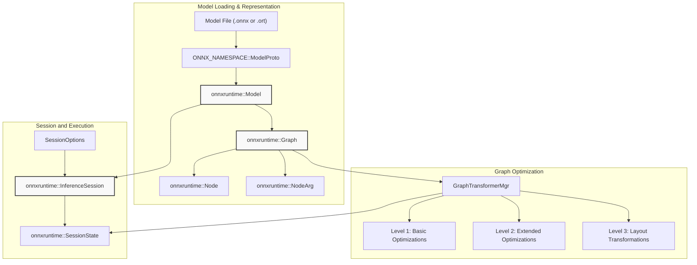

This architecture supports flexible runtime graph optimization, partitioning across execution providers, and efficient inference execution.

Sources: [onnxruntime/core/session/inference_session.h:122-165](), [onnxruntime/core/graph/graph.h:64-68](), [onnxruntime/core/graph/model.h:85-179]()

---

## Model and Graph Representation

### Model Class

The `Model` class encapsulates the complete representation of an ONNX model within the runtime. It contains:

- The computation graph (`Graph` instance).
- Model metadata such as producer name, version, domain.
- Operator set imports and model-local functions.
- IR version.

Models can be loaded via:

- ONNX protobuf (`.onnx`) files.
- ORT FlatBuffers (`.ort`) format.
- Programmatic in-memory protobuf instances.

After loading, the graph is resolved and type-and-shape inference is performed.

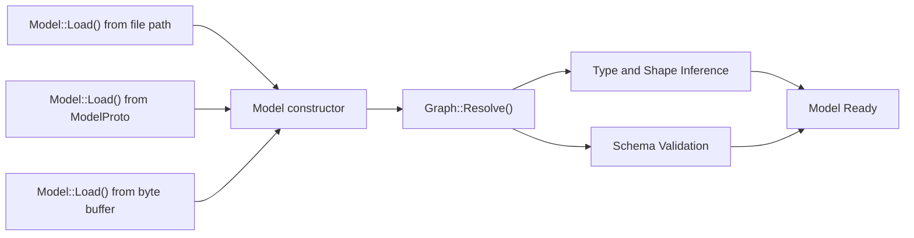

Sources: [onnxruntime/core/graph/model.cc:76-155](), [onnxruntime/core/graph/model.h:85-179]()

### Graph Structure

The `Graph` class represents the computation graph of the model and contains:

- **Nodes**: Each node is an operator instance with inputs, outputs, and attributes.
- **NodeArgs**: Named values flowing between nodes, representing intermediate tensors or external inputs/outputs.
- **Initializers**: Constant tensors (weights, biases).
- **Graph inputs and outputs**: External interface nodes.

Relation between graph components:

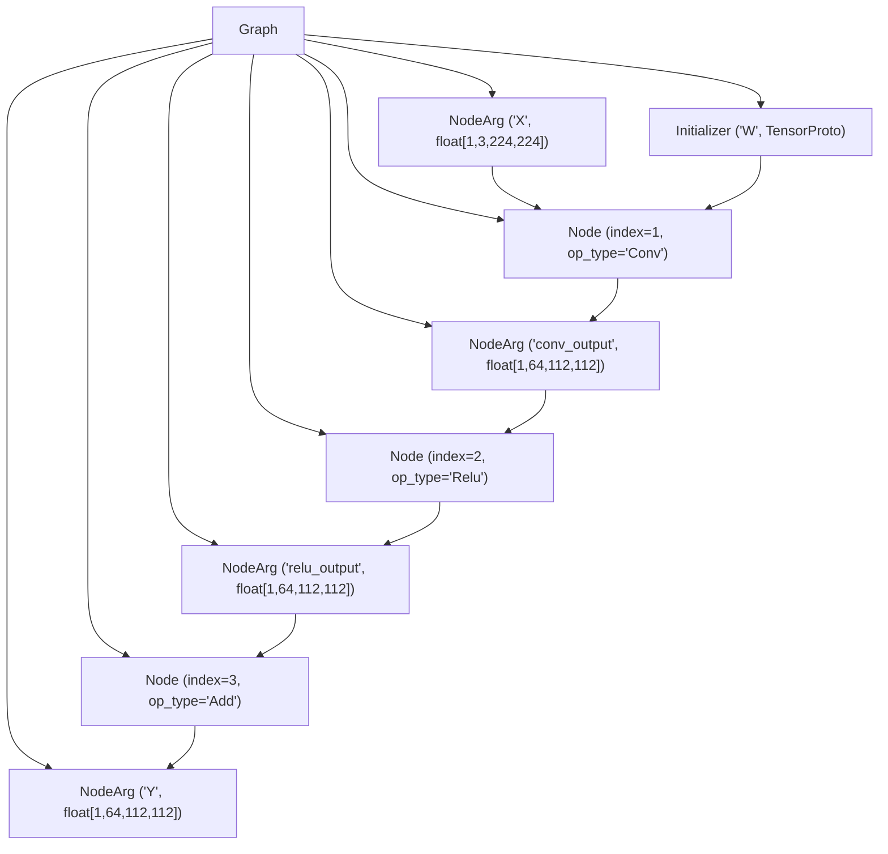

Sources: [onnxruntime/core/graph/graph.h:885-1543](), [onnxruntime/core/graph/graph.cc:1-100]()

### Node and NodeArg Classes

#### Node

The `Node` class represents an individual operator invocation in the graph.

- Attributes:
  - `op_type`: Operator type string (e.g., "Conv", "Add").
  - `domain`: Operator set domain.
  - `since_version`: The opset version of the operator.
  - Input and output `NodeArg` pointers.
  - Operator-specific attributes.
  - May contain subgraphs (for control flow ops).

#### NodeArg

The `NodeArg` class represents a named data value:

- Holds a name and type information in a `TypeProto`.
- The type includes tensor shape and element data type.
- Serves as an edge in the computational graph connecting nodes.

Class structure overview:

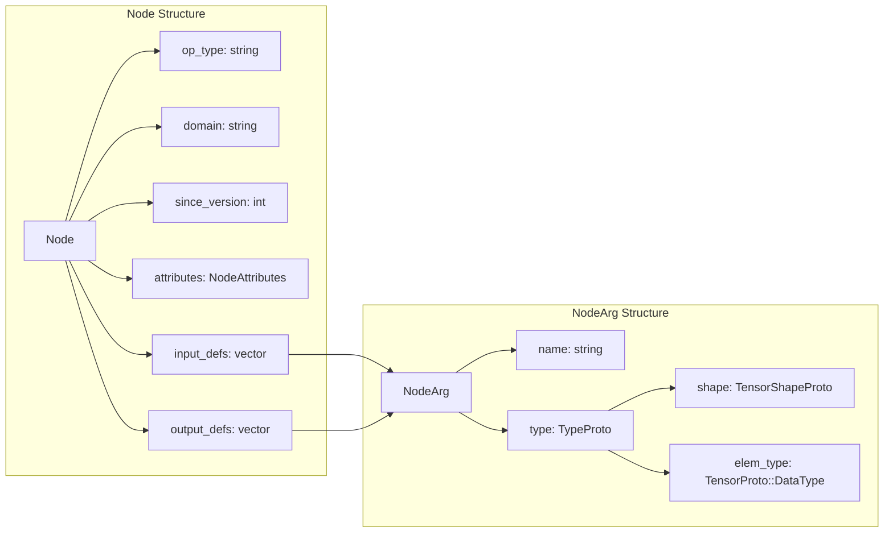

Sources: [onnxruntime/core/graph/graph.h:68-453](), [onnxruntime/core/graph/node_arg.h:23-165](), [onnxruntime/core/graph/graph.cc:187-214]()

---

## InferenceSession Lifecycle

The `InferenceSession` class is the primary runtime interface to load, prepare, and execute a model. It oversees:

- Loading a model from a file or buffer.
- Building and resolving the graph.
- Registering execution providers (e.g. CPU, CUDA).
- Optimizing and partitioning the graph.
- Creating kernels and session state.
- Running inference with input/output data.

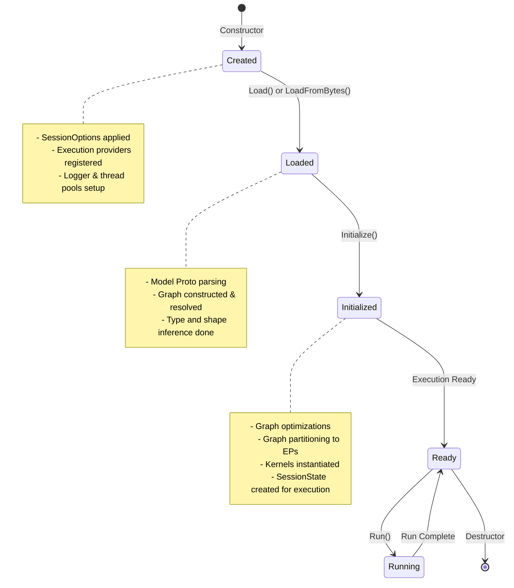

Sources: [onnxruntime/core/session/inference_session.cc:667-708](), [onnxruntime/core/session/inference_session.h:122-256]()

### Construction Phase

During construction (`InferenceSession::InferenceSession()`), several key initializations happen:

- Validate and finalize `SessionOptions`.
- Configure logging infrastructure.
- Initialize intra-op and inter-op thread pools.
- Setup the `GraphTransformerMgr` for graph optimizations.
- Initialize profiling if enabled.

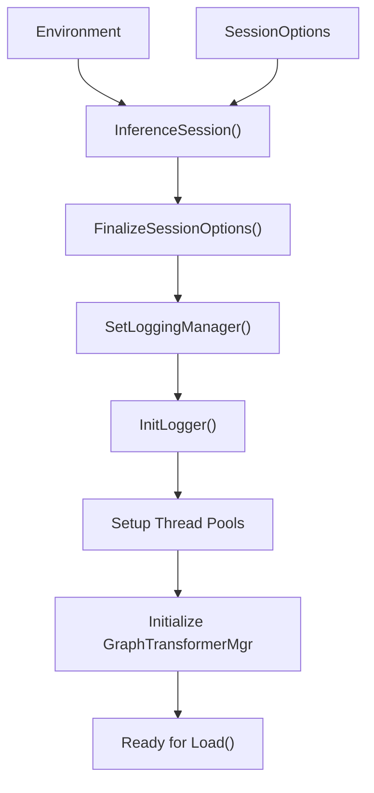

Sources: [onnxruntime/core/session/inference_session.cc:374-423](), [onnxruntime/core/session/inference_session.cc:667-675]()

### Load Phase

The `Load()` method performs:

- Reads the model file or buffer.
- Determines model format (.onnx protobuf or .ort FlatBuffers).
- Parses the model into internal `Model` and `Graph`.
- Calls `Graph::Resolve()` which performs topological checks, and type and shape inference.

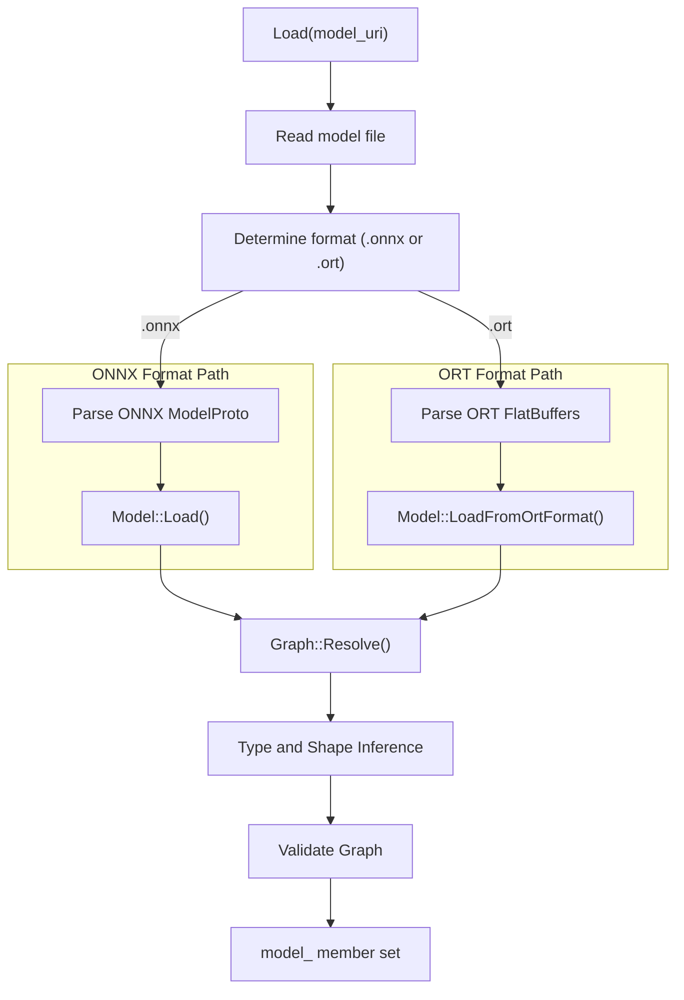

Sources: [onnxruntime/core/session/inference_session.cc:780-838](), [onnxruntime/core/graph/model.cc:228-344]()

### Initialize Phase

The `Initialize()` prepares the loaded model for inference by performing:

| Step | Description                               |
|-------|-----------------------------------------|
| 1     | Register built-in and custom execution providers (`RegisterExecutionProviders()`) |
| 2     | Perform graph optimization passes (`TransformGraph()`) at levels basic, extended, and layout |
| 3     | Partition the graph across execution providers according to node capabilities |
| 4     | Create kernel instances for assigned nodes (`CreateKernels()`) |
| 5     | Create and initialize `SessionState` to hold allocators, executors, and runtime info |
| 6     | Finalize session state and prepare memory patterns for execution |

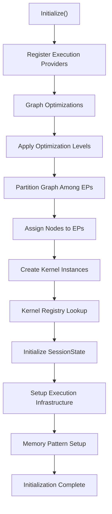

Sources: [onnxruntime/core/session/inference_session.cc:1184-1453](), [onnxruntime/core/session/inference_session.cc:1591-1795]()

### Run Phase

The `Run()` method executes inference given input feeds and requested outputs:

1. Validates input names and types against graph input metadata.
2. Prepares `OrtValue`s for inputs.
3. Creates an execution frame for the run.
4. Executes the graph via the runtime `IExecutor`.
5. Collects output `OrtValue`s into fetches for caller consumption.


Sources: [onnxruntime/core/session/inference_session.cc:2196-2443]()

---

## Session Configuration

`SessionOptions` controls session-level configuration parameters that affect graph loading, optimization, execution, and memory management.

| Option                  | Type                   | Purpose |
|-------------------------|------------------------|---------|
| `execution_mode`        | `ExecutionMode` (sequential/parallel) | How nodes execute concurrently |
| `execution_order`        | `ExecutionOrder` (topological, dependency-based) | Node scheduling strategy |
| `graph_optimization_level` | `GraphOptimizationLevel` enum | Optimization aggressiveness (disable/basic/extended/layout/all) |
| `intra_op_num_threads`  | `int`                  | Thread count inside operators |
| `inter_op_num_threads`  | `int`                  | Threads for parallel node execution |
| `enable_profiling`      | `bool`                 | Collect runtime profiling information |
| `enable_mem_pattern`    | `bool`                 | Use memory pattern optimization for allocations |
| `enable_cpu_mem_arena`  | `bool`                 | Use arena allocator for CPU memory allocations |
| `config_options`        | `ConfigOptions` (key-value strings) | Various runtime tunables |

### Graph Optimization Levels

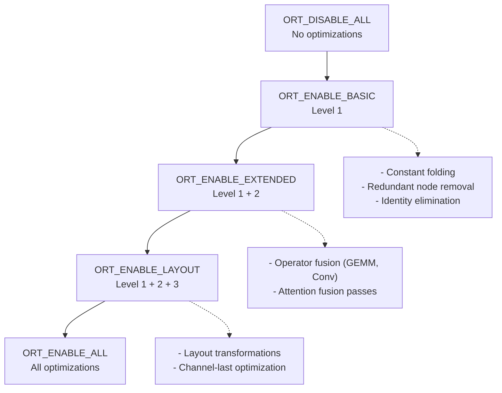

### Configuration via C API

SessionOptions can be configured via the C API (`onnxruntime_c_api.h`) by:

- Creating session options with `OrtApi::CreateSessionOptions`.
- Setting optimization level via `OrtApi::SetSessionGraphOptimizationLevel`.
- Adjusting intra/inter op thread counts.
- Adding execution providers with `OrtApi::SessionOptionsAppendExecutionProvider_*`.
- Setting runtime config entries via `OrtApi::AddSessionConfigEntry`.

Example snippet:

```cpp
OrtSessionOptions* options;
OrtApi::CreateSessionOptions(&options);
OrtApi::SetSessionGraphOptimizationLevel(options, ORT_ENABLE_EXTENDED);
OrtApi::SetIntraOpNumThreads(options, 4);
OrtApi::SetInterOpNumThreads(options, 2);
OrtApi::SessionOptionsAppendExecutionProvider_CUDA(options, cuda_options);
OrtApi::AddSessionConfigEntry(options, "key", "value");
```

Sources: [onnxruntime/core/framework/session_options.h:43-189](), [include/onnxruntime/core/session/onnxruntime_c_api.h:427-438](), [onnxruntime/core/session/onnxruntime_c_api.cc:199-246]()

---

## Graph Optimization Pipeline

The graph optimization pipeline in ONNX Runtime is implemented by the `GraphTransformerMgr`, which applies a series of `GraphTransformer` passes grouped in three levels reflecting optimization aggressiveness.

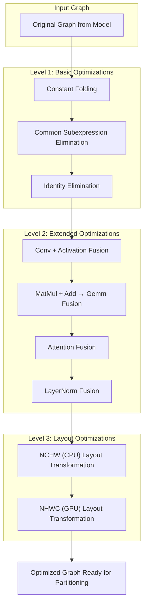

### Transformer Levels

- **Level 1: Basic**  
  Cleanup passes such as constant folding, removing no-op identity nodes, and eliminating redundant computations.

- **Level 2: Extended**  
  Fusions of common operator patterns, e.g. Conv + Relu, MatMul + Add into Gemm, attention mechanisms, and layer norm.

- **Level 3: Layout**  
  Graph layout transformations for improved memory access patterns and compatibility with hardware accelerators.

### Fusion Example: MatMul + Add → Gemm

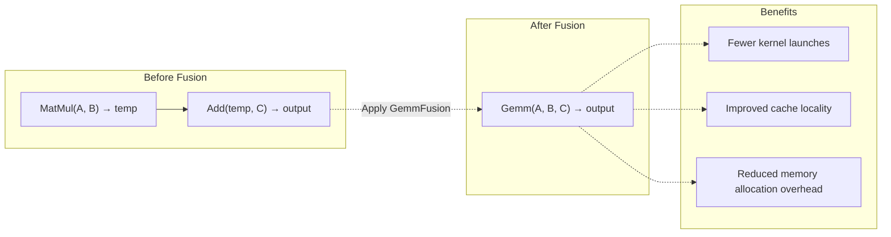

Sources: [onnxruntime/core/session/inference_session.cc:1591-1795](), [onnxruntime/core/optimizer/graph_transformer_mgr.h:1-59](), [onnxruntime/core/optimizer/conv_activation_fusion.h](), [onnxruntime/core/optimizer/gemm_activation_fusion.h](), [onnxruntime/core/optimizer/attention_fusion.h]()

---

## Graph Partitioning

After graph optimization, the runtime partitions the graph across registered execution providers based on their capability to execute specific nodes or subgraphs.

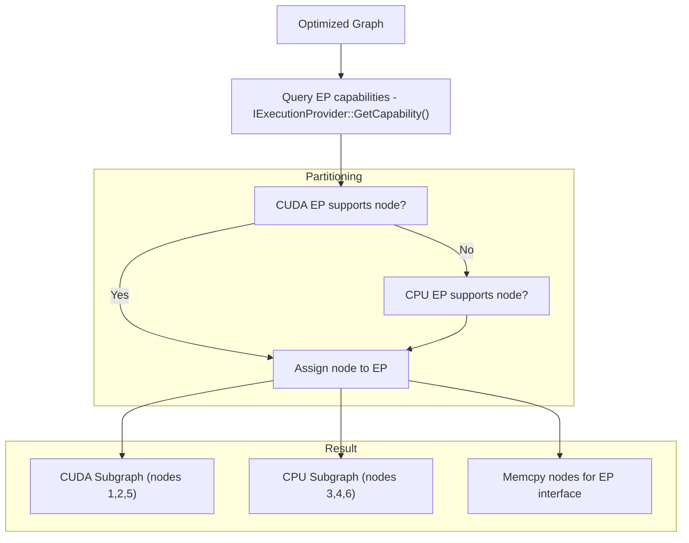

Key points:

- The partitioner queries each execution provider’s capabilities in order.
- Nodes or subgraphs that an EP can fully handle are assigned to that EP.
- Memory copy nodes are inserted when data crosses EP boundaries.
- Nodes unsupported by accelerated EPs fallback to the CPU EP.

Sources: [onnxruntime/core/framework/graph_partitioner.cc](), [onnxruntime/core/session/inference_session.cc:1697-1795]()

---

## Data Flow Summary

The overall flow from model to executable runtime:

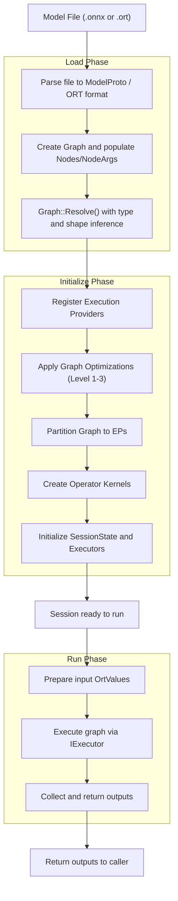

---

## Summary of Key Code Entities and Their Roles

| Component              | Code Entity (class/file)                       | Responsibility                                      |
| ---------------------- | --------------------------------------------- | ------------------------------------------------- |
| Model & Graph          | `onnxruntime::Model` ([model.h])               | Holds model metadata and computation graph         |
|                        | `onnxruntime::Graph` ([graph.h])               | Manages nodes, NodeArgs, graph topologies           |
|                        | `onnxruntime::Node` ([graph.h])                 | Operator invocation with inputs, outputs, attributes |
|                        | `onnxruntime::NodeArg` ([node_arg.h])          | Named tensor inputs/outputs with type info          |
| Inference Session      | `onnxruntime::InferenceSession` ([inference_session.h]) | Manages model loading, optimization, partitioning, and execution |
| Session Configuration  | `onnxruntime::SessionOptions` ([session_options.h]) | Defines runtime parameters for sessions              |
| Graph Optimization     | `onnxruntime::GraphTransformerMgr` ([graph_transformer_mgr.h]) | Implements multi-level graph transformation pipeline |
| Execution Providers    | `onnxruntime::IExecutionProvider` ([execution_provider.h]) | Defines hardware backend interface                   |
| Session Execution State| `onnxruntime::SessionState` ([session_state.h]) | Holds runtime data structures and execution framework |

---

For detailed information on each topic, see the child pages:

- [Graph System](#3.1)
- [Model Loading and Serialization](#3.2)
- [Inference Session](#3.3)
- [Session Configuration](#3.4)
- [Graph Optimizations](#3.5)
- [Execution Framework and Memory](#3.6)

---

Sources:  
[onnxruntime/core/session/inference_session.h:122-165](),  
[onnxruntime/core/session/inference_session.cc:374-838,1184-1795,2196-2443](),  
[onnxruntime/core/graph/graph.h:64-453,885-1543](),  
[onnxruntime/core/graph/graph.cc:1-100,187-214](),  
[onnxruntime/core/graph/model.h:85-179](),  
[onnxruntime/core/graph/model.cc:76-155,228-344](),  
[onnxruntime/core/framework/session_options.h:43-189](),  
[include/onnxruntime/core/session/onnxruntime_c_api.h:1-4985](),  
[onnxruntime/core/framework/graph_partitioner.cc](),  
[onnxruntime/core/optimizer/graph_transformer_mgr.h:1-59](),  
[onnxruntime/core/optimizer/conv_activation_fusion.h](),  
[onnxruntime/core/optimizer/gemm_activation_fusion.h](),  
[onnxruntime/core/optimizer/attention_fusion.h]()

---

