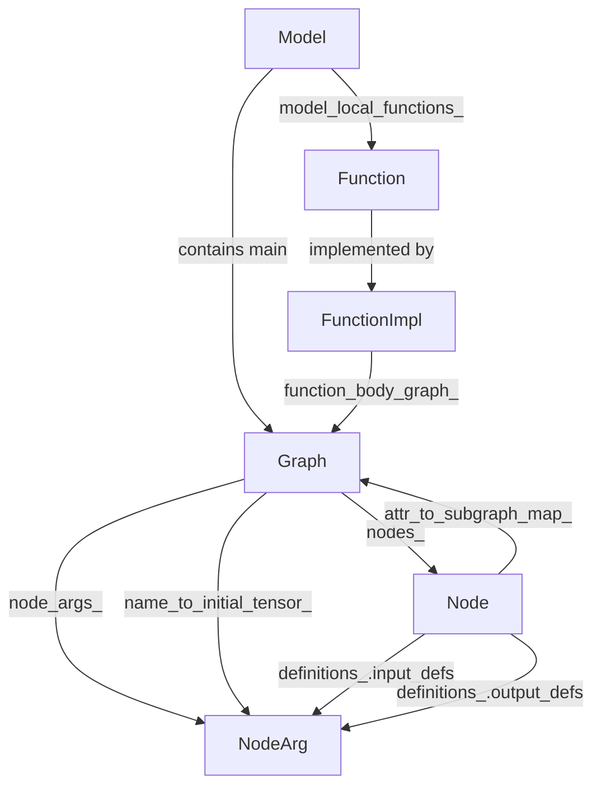
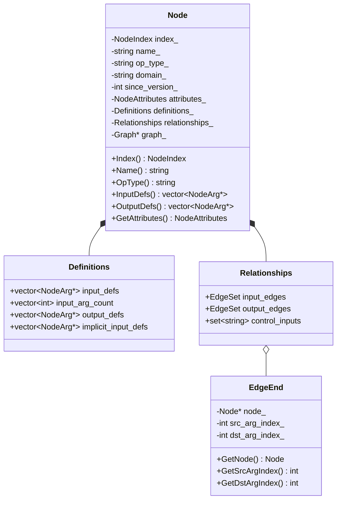
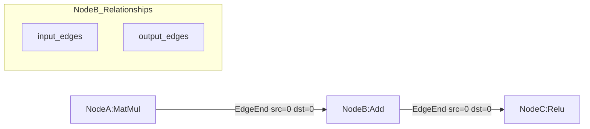
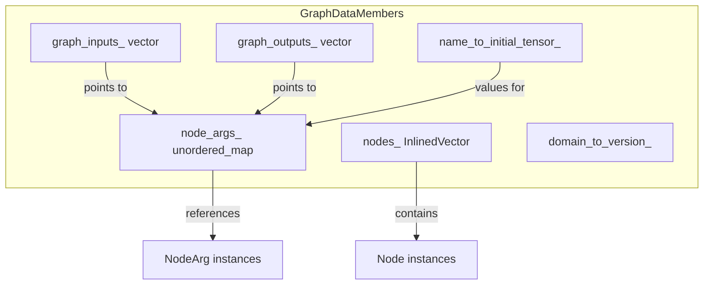
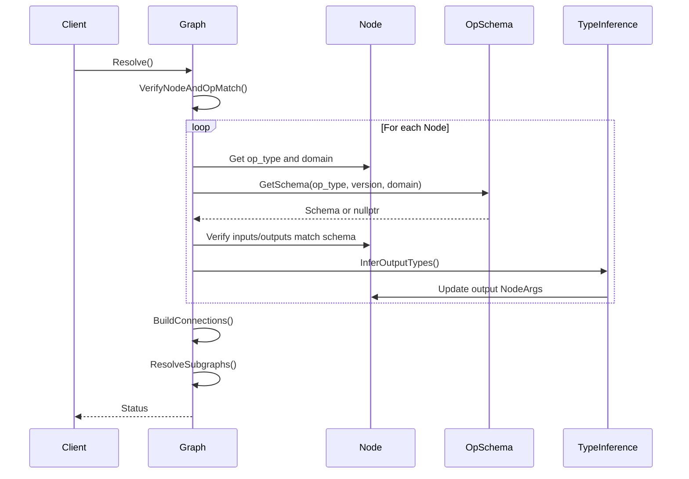
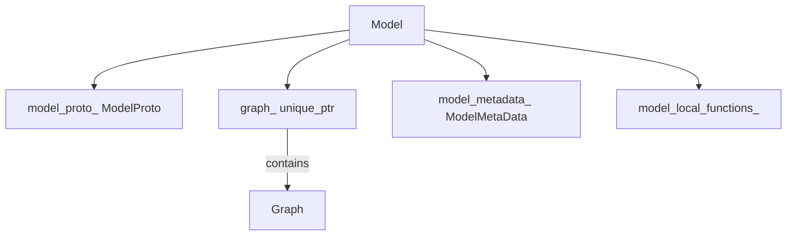
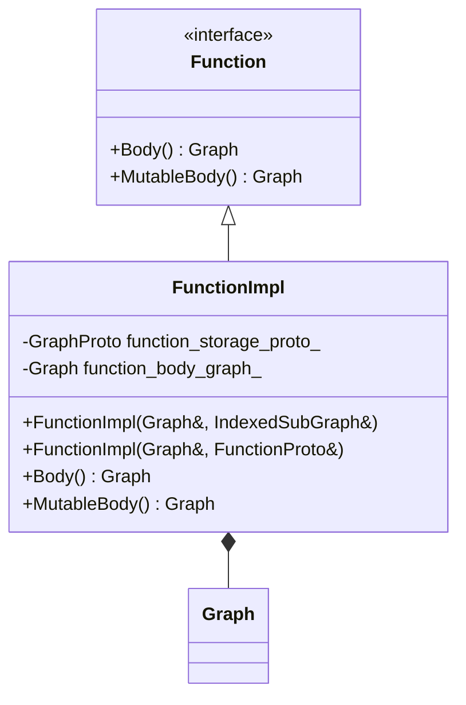
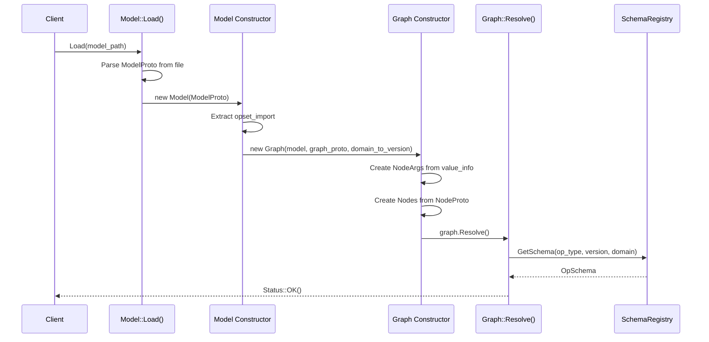

<!-- source: DeepWiki mcp.deepwiki.com · repo microsoft/onnxruntime · page 3.1 Graph System · fetched 2026-10-21 -->

# Graph System

<details>
<summary>Relevant source files</summary>

The following files were used as context for generating this wiki page:

- [cmake/external/eigen.cmake](cmake/external/eigen.cmake)
- [cmake/patches/eigen/s390x-build-werror.patch](cmake/patches/eigen/s390x-build-werror.patch)
- [include/onnxruntime/core/common/exceptions.h](include/onnxruntime/core/common/exceptions.h)
- [include/onnxruntime/core/framework/sparse_tensor.h](include/onnxruntime/core/framework/sparse_tensor.h)
- [include/onnxruntime/core/graph/graph.h](include/onnxruntime/core/graph/graph.h)
- [include/onnxruntime/core/graph/graph_nodes.h](include/onnxruntime/core/graph/graph_nodes.h)
- [include/onnxruntime/core/graph/model_saving_options.h](include/onnxruntime/core/graph/model_saving_options.h)
- [onnxruntime/core/flatbuffers/flatbuffers_utils.cc](onnxruntime/core/flatbuffers/flatbuffers_utils.cc)
- [onnxruntime/core/flatbuffers/flatbuffers_utils.h](onnxruntime/core/flatbuffers/flatbuffers_utils.h)
- [onnxruntime/core/framework/prepacked_weights_container.cc](onnxruntime/core/framework/prepacked_weights_container.cc)
- [onnxruntime/core/framework/prepacked_weights_container.h](onnxruntime/core/framework/prepacked_weights_container.h)
- [onnxruntime/core/framework/session_state_utils.cc](onnxruntime/core/framework/session_state_utils.cc)
- [onnxruntime/core/framework/sparse_tensor.cc](onnxruntime/core/framework/sparse_tensor.cc)
- [onnxruntime/core/framework/tensor_external_data_info.cc](onnxruntime/core/framework/tensor_external_data_info.cc)
- [onnxruntime/core/framework/tensor_external_data_info.h](onnxruntime/core/framework/tensor_external_data_info.h)
- [onnxruntime/core/framework/tensorprotoutils.cc](onnxruntime/core/framework/tensorprotoutils.cc)
- [onnxruntime/core/framework/tensorprotoutils.h](onnxruntime/core/framework/tensorprotoutils.h)
- [onnxruntime/core/graph/function_utils.cc](onnxruntime/core/graph/function_utils.cc)
- [onnxruntime/core/graph/function_utils.h](onnxruntime/core/graph/function_utils.h)
- [onnxruntime/core/graph/graph.cc](onnxruntime/core/graph/graph.cc)
- [onnxruntime/core/graph/graph_flatbuffers_utils.cc](onnxruntime/core/graph/graph_flatbuffers_utils.cc)
- [onnxruntime/core/graph/graph_flatbuffers_utils.h](onnxruntime/core/graph/graph_flatbuffers_utils.h)
- [onnxruntime/core/graph/graph_utils.cc](onnxruntime/core/graph/graph_utils.cc)
- [onnxruntime/core/graph/graph_utils.h](onnxruntime/core/graph/graph_utils.h)
- [onnxruntime/core/graph/model.cc](onnxruntime/core/graph/model.cc)
- [onnxruntime/core/graph/model.h](onnxruntime/core/graph/model.h)
- [onnxruntime/core/graph/model_helpers.cc](onnxruntime/core/graph/model_helpers.cc)
- [onnxruntime/core/graph/model_helpers.h](onnxruntime/core/graph/model_helpers.h)
- [onnxruntime/core/mlas/lib/s390x/Quantize.cpp](onnxruntime/core/mlas/lib/s390x/Quantize.cpp)
- [onnxruntime/core/optimizer/attention_fusion.cc](onnxruntime/core/optimizer/attention_fusion.cc)
- [onnxruntime/core/optimizer/attention_fusion_helper.h](onnxruntime/core/optimizer/attention_fusion_helper.h)
- [onnxruntime/core/optimizer/gelu_fusion.cc](onnxruntime/core/optimizer/gelu_fusion.cc)
- [onnxruntime/core/optimizer/gemm_activation_fusion.cc](onnxruntime/core/optimizer/gemm_activation_fusion.cc)
- [onnxruntime/core/optimizer/matmul_add_fusion.cc](onnxruntime/core/optimizer/matmul_add_fusion.cc)
- [onnxruntime/core/optimizer/reshape_fusion.cc](onnxruntime/core/optimizer/reshape_fusion.cc)
- [onnxruntime/core/optimizer/reshape_fusion.h](onnxruntime/core/optimizer/reshape_fusion.h)
- [onnxruntime/core/optimizer/utils.cc](onnxruntime/core/optimizer/utils.cc)
- [onnxruntime/core/optimizer/utils.h](onnxruntime/core/optimizer/utils.h)
- [onnxruntime/test/framework/function_test.cc](onnxruntime/test/framework/function_test.cc)
- [onnxruntime/test/framework/ort_model_only_test.cc](onnxruntime/test/framework/ort_model_only_test.cc)
- [onnxruntime/test/framework/save_model_with_external_initializers.cc](onnxruntime/test/framework/save_model_with_external_initializers.cc)
- [onnxruntime/test/framework/sparse_kernels_test.cc](onnxruntime/test/framework/sparse_kernels_test.cc)
- [onnxruntime/test/framework/tensorutils_test.cc](onnxruntime/test/framework/tensorutils_test.cc)
- [onnxruntime/test/ir/graph_test.cc](onnxruntime/test/ir/graph_test.cc)
- [onnxruntime/test/optimizer/layout_transformation_potentially_added_ops_test.cc](onnxruntime/test/optimizer/layout_transformation_potentially_added_ops_test.cc)
- [onnxruntime/test/testdata/function_with_variadics.onnx](onnxruntime/test/testdata/function_with_variadics.onnx)
- [onnxruntime/test/testdata/transform/fusion/attention_distilbert.onnx](onnxruntime/test/testdata/transform/fusion/attention_distilbert.onnx)
- [onnxruntime/test/testdata/transform/fusion/attention_gen.py](onnxruntime/test/testdata/transform/fusion/attention_gen.py)
- [onnxruntime/test/testdata/transform/fusion/attention_mask_no_cast.onnx](onnxruntime/test/testdata/transform/fusion/attention_mask_no_cast.onnx)
- [onnxruntime/test/testdata/transform/fusion/gelu_gen.py](onnxruntime/test/testdata/transform/fusion/gelu_gen.py)
- [onnxruntime/test/testdata/transform/fusion/gpt2_past_mask_one_layer.onnx](onnxruntime/test/testdata/transform/fusion/gpt2_past_mask_one_layer.onnx)
- [onnxruntime/test/testdata/transform/fusion/reshape_fusion_concat_subgraph.onnx](onnxruntime/test/testdata/transform/fusion/reshape_fusion_concat_subgraph.onnx)
- [onnxruntime/test/testdata/transform/fusion/reshape_fusion_concat_subgraph_div.onnx](onnxruntime/test/testdata/transform/fusion/reshape_fusion_concat_subgraph_div.onnx)
- [onnxruntime/test/testdata/transform/fusion/reshape_fusion_concat_subgraph_mul.onnx](onnxruntime/test/testdata/transform/fusion/reshape_fusion_concat_subgraph_mul.onnx)
- [onnxruntime/test/testdata/transform/fusion/reshape_fusion_concat_subgraph_multiple_outputs.onnx](onnxruntime/test/testdata/transform/fusion/reshape_fusion_concat_subgraph_multiple_outputs.onnx)
- [onnxruntime/test/testdata/transform/fusion/reshape_fusion_concat_subgraph_not_triggered.onnx](onnxruntime/test/testdata/transform/fusion/reshape_fusion_concat_subgraph_not_triggered.onnx)
- [onnxruntime/test/testdata/transform/fusion/reshape_fusion_distillbert.onnx](onnxruntime/test/testdata/transform/fusion/reshape_fusion_distillbert.onnx)
- [onnxruntime/test/testdata/transform/fusion/reshape_fusion_gen.py](onnxruntime/test/testdata/transform/fusion/reshape_fusion_gen.py)
- [onnxruntime/test/testdata/transform/fusion/reshape_fusion_with_slice1.onnx](onnxruntime/test/testdata/transform/fusion/reshape_fusion_with_slice1.onnx)
- [onnxruntime/test/testdata/transform/matmul_add_fusion/matmul_add_missing_shape.onnx](onnxruntime/test/testdata/transform/matmul_add_fusion/matmul_add_missing_shape.onnx)
- [orttraining/orttraining/test/gradient/gradient_checker.cc](orttraining/orttraining/test/gradient/gradient_checker.cc)
- [orttraining/orttraining/test/gradient/gradient_checker.h](orttraining/orttraining/test/gradient/gradient_checker.h)
- [orttraining/orttraining/test/gradient/gradient_op_test_utils.cc](orttraining/orttraining/test/gradient/gradient_op_test_utils.cc)
- [tools/python/sparsify_initializers.py](tools/python/sparsify_initializers.py)

</details>


The Graph System is the core data structure layer in ONNX Runtime that represents machine learning models as computational graphs. It provides classes for models (`Model`), graphs (`Graph`), nodes (`Node`), and tensor arguments (`NodeArg`), along with mechanisms for managing relationships between these entities, resolving operator schemas, and maintaining type/shape information.

For information about loading models into the graph system, see [Model Loading and Serialization](#3.2). For graph transformation and optimization, see [Graph Optimizations](#3.5).

## Core Class Hierarchy

The Graph System is built around a containment hierarchy where a `Model` contains a main `Graph`, which contains multiple `Node` instances, and each `Node` references `NodeArg` instances for its inputs and outputs.

**Class Hierarchy Diagram**



Sources: [include/onnxruntime/core/graph/graph.h:1-1500](), [onnxruntime/core/graph/model.h:1-387](), [include/onnxruntime/core/graph/function.h:1-31]()

## NodeArg: Tensor Value Representation

`NodeArg` represents a value (typically a tensor) in the computational graph. It stores the name, type, and shape information for inputs, outputs, and intermediate values.

### NodeArg Structure

| Member | Type | Purpose |
|--------|------|---------|
| `node_arg_info_` | `NodeArgInfo` | Stores name, type, and documentation |
| `type_` | `DataType` | Cached pointer to the data type |
| `exists_` | `bool` | Whether this argument actually exists (false for optional args) |

**Key Methods:**

- `NodeArg(const std::string& name, const TypeProto* p_node_arg_type)` - Constructor [onnxruntime/core/graph/graph.cc:187-202]()
- `const std::string& Name()` - Returns the NodeArg name [onnxruntime/core/graph/graph.cc:216-218]()
- `DataType Type()` - Returns the data type [onnxruntime/core/graph/graph.cc:220-222]()
- `const TypeProto* TypeAsProto()` - Returns type as protobuf [onnxruntime/core/graph/graph.cc:224-229]()
- `const TensorShapeProto* Shape()` - Returns shape information [onnxruntime/core/graph/graph.cc:231-269]()
- `UpdateTypeAndShape()` - Updates type/shape during graph resolution [onnxruntime/core/graph/graph.cc:388-504]()

### Type and Shape Information

NodeArgs support multiple type cases through the `TypeProto` message:
- **Tensor types**: Standard dense tensors with element type and shape
- **Sparse tensor types**: Sparse representation (if not disabled)
- **Sequence types**: Sequences of values
- **Map types**: Key-value mappings
- **Optional types**: Optional values that may or may not exist

Sources: [include/onnxruntime/core/graph/graph.h:187-230](), [onnxruntime/core/graph/graph.cc:187-524]()

## Node: Operation Representation

`Node` represents an operator instance in the graph. Each node has an operator type, inputs, outputs, attributes, and relationships to other nodes.

### Node Structure



Sources: [include/onnxruntime/core/graph/graph.h:68-690](), [onnxruntime/core/graph/graph.cc:530-1000]()

### Node Types

Nodes have a `Type` enum indicating whether they are primitive operators or fused functions:

| Node Type | Value | Description |
|-----------|-------|-------------|
| `Primitive` | 0 | Standard ONNX operator |
| `Fused` | 1 | Fused subgraph represented as a function |

[include/onnxruntime/core/graph/graph.h:71-74]()

### Node Definitions

The `Node::Definitions` inner class tracks the node's inputs and outputs:

- **`input_defs`**: Explicit input NodeArgs
- **`input_arg_count`**: Number of inputs for each operator parameter (for variadic inputs)
- **`output_defs`**: Output NodeArgs
- **`implicit_input_defs`**: Implicit inputs from outer scope (for subgraphs)

[include/onnxruntime/core/graph/graph.h:509-537]()

### Node Attributes

Nodes store attributes in a `NodeAttributes` map (string to `AttributeProto`). Attributes can contain:
- Scalars: float, int, string
- Tensors: `TensorProto`
- Graphs: `GraphProto` (for control flow operators)
- Lists: floats, ints, strings, tensors, graphs

Attributes are added via `AddAttribute()` methods and accessed via `GetAttributes()` [include/onnxruntime/core/graph/graph.h:350-394]().

Sources: [include/onnxruntime/core/graph/graph.h:350-444](), [onnxruntime/core/graph/graph.cc:655-697]()

## Node Relationships and Edges

Nodes are connected through edges that represent data flow in the computational graph. The `Node::Relationships` structure tracks these connections.

### Edge Representation



Sources: [include/onnxruntime/core/graph/graph.h:101-132](), [onnxruntime/core/graph/graph.cc:530-567]()

### EdgeEnd Structure

The `Node::EdgeEnd` class represents one end of an edge:

- **`node_`**: Pointer to the connected node
- **`src_arg_index_`**: Index in the source node's output definitions
- **`dst_arg_index_`**: Index in the destination node's input definitions

For control edges (without data flow), both indices are set to `INT_MAX` [onnxruntime/core/graph/graph.cc:536-538]().

### Edge Iteration

Nodes provide iterators for traversing connected nodes:

| Iterator Method | Purpose |
|----------------|---------|
| `InputNodesBegin()` / `InputNodesEnd()` | Iterate over nodes providing inputs |
| `OutputNodesBegin()` / `OutputNodesEnd()` | Iterate over nodes consuming outputs |
| `InputEdgesBegin()` / `InputEdgesEnd()` | Iterate over input edges with full edge info |
| `OutputEdgesBegin()` / `OutputEdgesEnd()` | Iterate over output edges with full edge info |

[include/onnxruntime/core/graph/graph.h:314-339]()

Sources: [include/onnxruntime/core/graph/graph.h:275-349](), [onnxruntime/core/graph/graph.cc:540-583]()

## Graph: Computational Graph Container

`Graph` represents a computational graph containing nodes, edges, initializers, and metadata. It manages the graph structure and provides methods for construction, traversal, and validation.

### Graph Structure

**Graph Components Diagram**



Sources: [include/onnxruntime/core/graph/graph.h:692-1600](), [onnxruntime/core/graph/graph.cc:1000-3000]()

### Key Graph Methods

| Method | Purpose |
|--------|---------|
| `AddNode()` | Creates and adds a new node to the graph |
| `RemoveNode()` | Removes a node and updates edges |
| `AddEdge()` | Creates an edge between two nodes |
| `RemoveEdge()` | Removes an edge between nodes |
| `GetOrCreateNodeArg()` | Gets or creates a NodeArg by name |
| `AddInitializedTensor()` | Adds a constant initializer |
| `SetInputs()` / `SetOutputs()` | Sets graph inputs/outputs |
| `Resolve()` | Validates and resolves the graph |

[include/onnxruntime/core/graph/graph.h:800-1200]()

### Graph Resolution

The `Graph::Resolve()` method performs critical validation and setup:

1. **Node validation**: Checks each node against its operator schema
2. **Type inference**: Infers output types and shapes for each node
3. **Edge validation**: Verifies all edges connect valid inputs/outputs
4. **Initializer handling**: Processes constant initializers
5. **Subgraph resolution**: Recursively resolves nested subgraphs



Sources: [onnxruntime/core/graph/graph.cc:2800-3500]()

### Subgraphs

Nodes can contain subgraphs for control flow operators (If, Loop, Scan):

- Subgraphs are stored in `Node::attr_to_subgraph_map_` (attribute name → Graph*)
- Subgraphs have a parent graph pointer (`parent_graph_`)
- Subgraphs can access outer scope values via implicit inputs
- Subgraphs are recursively resolved during graph resolution

[include/onnxruntime/core/graph/graph.h:426-456](), [onnxruntime/core/graph/graph.cc:980-989]()

Sources: [include/onnxruntime/core/graph/graph.h:692-1600](), [onnxruntime/core/graph/graph.cc:2000-4000]()

## Model: Top-Level Container

`Model` is the top-level container that wraps a `Graph` along with model-level metadata, opset imports, and model-local functions.

### Model Structure

**Model Composition**



Sources: [include/onnxruntime/core/graph/model.h:57-400](), [onnxruntime/core/graph/model.cc:1-600]()

### Model Properties

| Property | Accessor | Description |
|----------|----------|-------------|
| IR Version | `IrVersion()` | ONNX IR version used |
| Producer Name | `ProducerName()` | Name of the tool that produced the model |
| Producer Version | `ProducerVersion()` | Version of the producer |
| Domain | `Domain()` | Model domain |
| Model Version | `ModelVersion()` | Model version number |
| Doc String | `DocString()` | Model documentation |
| Metadata | `MetaData()` | Custom metadata key-value pairs |
| Main Graph | `MainGraph()` | The primary computational graph |

[onnxruntime/core/graph/model.h:117-199]()

### Model Construction

Models can be constructed in several ways:

1. **From ModelProto**: Load from a protobuf message
2. **From scratch**: Create a new model with a graph name
3. **From file**: Use static `Model::Load()` methods

Sources: [include/onnxruntime/core/graph/model.h:65-111](), [onnxruntime/core/graph/model.cc:76-283]()

### Opset Imports

Models track domain-to-version mappings for operator resolution:

- Stored in `model_proto_.opset_import()`
- Each opset import specifies a domain and version number
- Used to resolve which operator schema version to use
- Passed to the main graph during construction

Sources: [include/onnxruntime/core/graph/model.h:57-400](), [onnxruntime/core/graph/model.cc:155-283]()

## Functions and Function Bodies

Functions represent callable subgraphs that can be used as operators. ONNX Runtime supports both ONNX-defined functions and model-local functions.

### Function Interface

The `Function` abstract class provides access to the function body:

```cpp
class Function {
public:
  virtual ~Function() = default;
  virtual const onnxruntime::Graph& Body() const = 0;
  virtual onnxruntime::Graph& MutableBody() = 0;
};
```

[include/onnxruntime/core/graph/function.h:16-31]()

### FunctionImpl

`FunctionImpl` is the concrete implementation that stores a function body as a `Graph`:



Sources: [onnxruntime/core/graph/function_impl.h:1-50](), [onnxruntime/core/graph/function.cc:1-108]()

### Model-Local Functions

Models can define custom functions that are used by nodes in the graph:

- Stored in `model_proto_.functions()`
- Mapped by function identifier (domain:name)
- Available to all graphs in the model
- Resolved during graph resolution

Sources: [include/onnxruntime/core/graph/function.h:1-31](), [onnxruntime/core/graph/function_impl.h:1-50](), [onnxruntime/core/graph/model.cc:45-147]()

## Graph Construction and Initialization Flow

**Graph Lifecycle Diagram**



Sources: [onnxruntime/core/graph/model.cc:155-496](), [onnxruntime/core/graph/graph.cc:2000-3500]()

### Graph Construction Steps

1. **Parse model file**: Load protobuf or ORT format [onnxruntime/core/graph/model.cc:437-450]()
2. **Extract opsets**: Build domain-to-version map [onnxruntime/core/graph/model.cc:207-235]()
3. **Process functions**: Register model-local functions [onnxruntime/core/graph/model.cc:257-277]()
4. **Create graph**: Construct Graph from GraphProto [onnxruntime/core/graph/graph.cc:1100-1300]()
5. **Add nodes**: Create Node instances from NodeProto [onnxruntime/core/graph/graph.cc:1400-1600]()
6. **Resolve graph**: Validate and infer types/shapes [onnxruntime/core/graph/graph.cc:2800-3500]()

Sources: [onnxruntime/core/graph/model.cc:437-496](), [onnxruntime/core/graph/graph.cc:1100-3500](), [onnxruntime/test/ir/graph_test.cc:533-650]()

---

