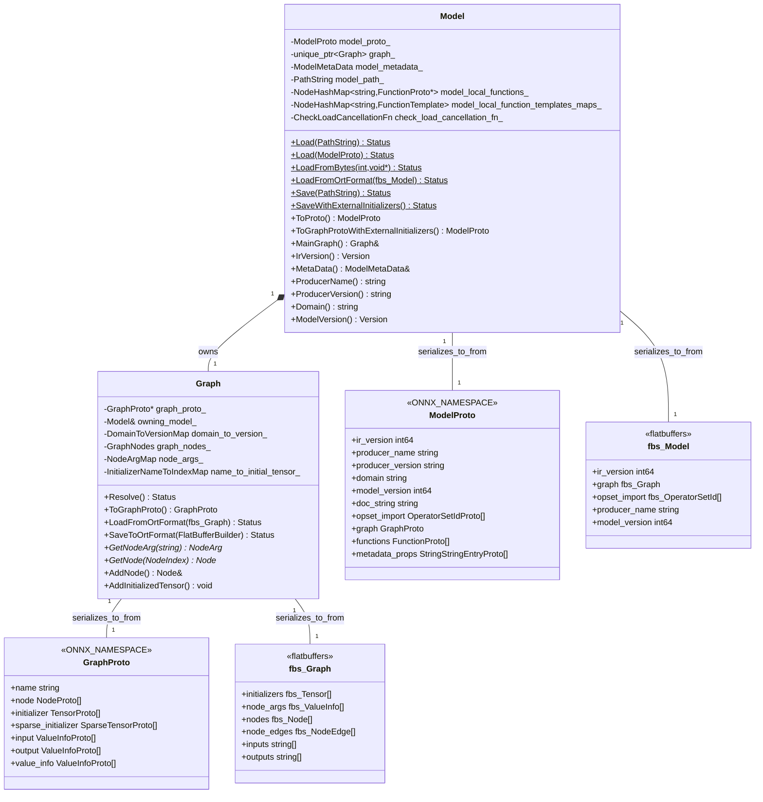
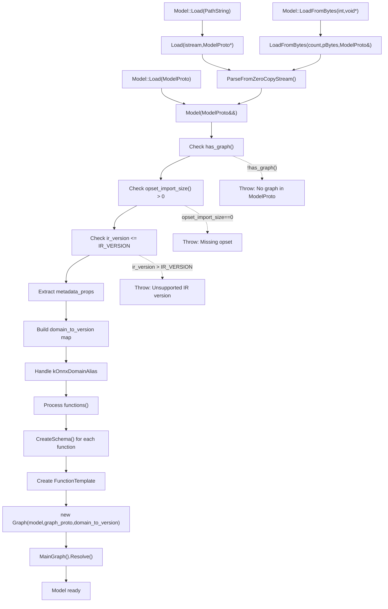
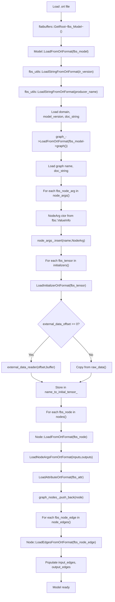
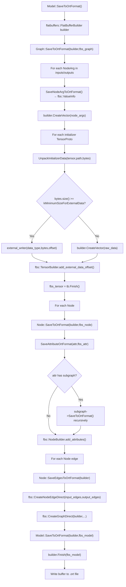
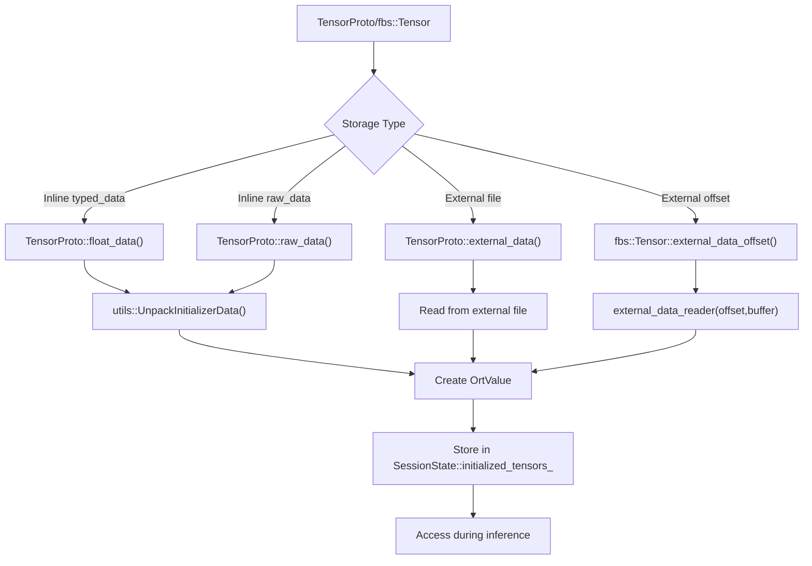
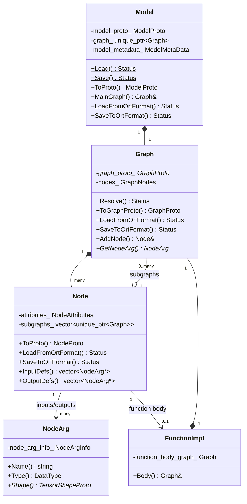

<!-- source: DeepWiki mcp.deepwiki.com · repo microsoft/onnxruntime · page 3.2 Model Loading and Serialization · fetched 2026-10-21 -->

# Model Loading and Serialization

<details>
<summary>Relevant source files</summary>

The following files were used as context for generating this wiki page:

- [include/onnxruntime/core/common/exceptions.h](include/onnxruntime/core/common/exceptions.h)
- [include/onnxruntime/core/framework/sparse_tensor.h](include/onnxruntime/core/framework/sparse_tensor.h)
- [include/onnxruntime/core/graph/graph.h](include/onnxruntime/core/graph/graph.h)
- [include/onnxruntime/core/graph/graph_nodes.h](include/onnxruntime/core/graph/graph_nodes.h)
- [include/onnxruntime/core/graph/model_saving_options.h](include/onnxruntime/core/graph/model_saving_options.h)
- [onnxruntime/core/flatbuffers/flatbuffers_utils.cc](onnxruntime/core/flatbuffers/flatbuffers_utils.cc)
- [onnxruntime/core/flatbuffers/flatbuffers_utils.h](onnxruntime/core/flatbuffers/flatbuffers_utils.h)
- [onnxruntime/core/framework/prepacked_weights_container.cc](onnxruntime/core/framework/prepacked_weights_container.cc)
- [onnxruntime/core/framework/prepacked_weights_container.h](onnxruntime/core/framework/prepacked_weights_container.h)
- [onnxruntime/core/framework/session_state_utils.cc](onnxruntime/core/framework/session_state_utils.cc)
- [onnxruntime/core/framework/sparse_tensor.cc](onnxruntime/core/framework/sparse_tensor.cc)
- [onnxruntime/core/framework/tensor_external_data_info.cc](onnxruntime/core/framework/tensor_external_data_info.cc)
- [onnxruntime/core/framework/tensor_external_data_info.h](onnxruntime/core/framework/tensor_external_data_info.h)
- [onnxruntime/core/framework/tensorprotoutils.cc](onnxruntime/core/framework/tensorprotoutils.cc)
- [onnxruntime/core/framework/tensorprotoutils.h](onnxruntime/core/framework/tensorprotoutils.h)
- [onnxruntime/core/graph/function_utils.cc](onnxruntime/core/graph/function_utils.cc)
- [onnxruntime/core/graph/function_utils.h](onnxruntime/core/graph/function_utils.h)
- [onnxruntime/core/graph/graph.cc](onnxruntime/core/graph/graph.cc)
- [onnxruntime/core/graph/graph_flatbuffers_utils.cc](onnxruntime/core/graph/graph_flatbuffers_utils.cc)
- [onnxruntime/core/graph/graph_flatbuffers_utils.h](onnxruntime/core/graph/graph_flatbuffers_utils.h)
- [onnxruntime/core/graph/model.cc](onnxruntime/core/graph/model.cc)
- [onnxruntime/core/graph/model.h](onnxruntime/core/graph/model.h)
- [onnxruntime/core/graph/model_helpers.cc](onnxruntime/core/graph/model_helpers.cc)
- [onnxruntime/core/graph/model_helpers.h](onnxruntime/core/graph/model_helpers.h)
- [onnxruntime/test/framework/function_test.cc](onnxruntime/test/framework/function_test.cc)
- [onnxruntime/test/framework/ort_model_only_test.cc](onnxruntime/test/framework/ort_model_only_test.cc)
- [onnxruntime/test/framework/save_model_with_external_initializers.cc](onnxruntime/test/framework/save_model_with_external_initializers.cc)
- [onnxruntime/test/framework/sparse_kernels_test.cc](onnxruntime/test/framework/sparse_kernels_test.cc)
- [onnxruntime/test/framework/tensorutils_test.cc](onnxruntime/test/framework/tensorutils_test.cc)
- [onnxruntime/test/ir/graph_test.cc](onnxruntime/test/ir/graph_test.cc)
- [onnxruntime/test/optimizer/layout_transformation_potentially_added_ops_test.cc](onnxruntime/test/optimizer/layout_transformation_potentially_added_ops_test.cc)
- [onnxruntime/test/testdata/function_with_variadics.onnx](onnxruntime/test/testdata/function_with_variadics.onnx)
- [orttraining/orttraining/test/gradient/gradient_checker.cc](orttraining/orttraining/test/gradient/gradient_checker.cc)
- [orttraining/orttraining/test/gradient/gradient_checker.h](orttraining/orttraining/test/gradient/gradient_checker.h)
- [orttraining/orttraining/test/gradient/gradient_op_test_utils.cc](orttraining/orttraining/test/gradient/gradient_op_test_utils.cc)
- [tools/python/sparsify_initializers.py](tools/python/sparsify_initializers.py)

</details>


## Purpose and Scope

This page documents how ONNX Runtime loads and serializes machine learning models. It covers the `Model` class, which represents the in-memory model structure, and the mechanisms for reading models from disk (or other sources) and writing them back. The loading process supports two model formats: ONNX protobuf format (.onnx files) and ORT flatbuffer format (.ort files). Serialization includes converting models between formats and handling large initializer tensors through external data storage.

For information about the `Graph` class and its internal representation, see [Graph System](#3.1). For details about how models are optimized after loading, see [Session Configuration](#3.4).

Sources: [onnxruntime/core/graph/model.h:1-310](), [onnxruntime/core/graph/model.cc:1-551]()

---

## Model Formats

ONNX Runtime supports two serialization formats:

| Format | File Extension | Encoding | Primary Use Case | Build Support |
|--------|---------------|----------|------------------|---------------|
| **ONNX** | .onnx | Protobuf | Model interchange, full build | All builds |
| **ORT** | .ort | Flatbuffers | Optimized models, minimal build | All builds |

**ONNX Format**: Uses protobuf encoding defined by the ONNX specification. This is the standard format for model interchange between frameworks and tools. It supports all ONNX features including subgraphs, functions, and external data.

**ORT Format**: Uses flatbuffers for efficient zero-copy loading. This format is primarily used for saving optimized models and enables faster loading in production scenarios, especially in minimal builds where memory and startup time are critical.

Sources: [onnxruntime/core/graph/model.h:1-310](), [onnxruntime/core/graph/model.cc:1-551]()

---

## Model Class Architecture



**Model and Graph Class Relationships**

The `Model` class owns a single `Graph` instance and manages serialization to/from both ONNX protobuf (`ModelProto`) and ORT flatbuffers (`fbs::Model`) formats. The `Graph` similarly manages its own serialization.

Sources: [onnxruntime/core/graph/model.h:60-310](), [include/onnxruntime/core/graph/graph.h:692-1100](), [onnxruntime/core/flatbuffers/schema/ort.fbs]()

---

## Loading Models from ONNX Format



**ONNX Model Loading Flow**

The loading process validates the ModelProto, builds domain-to-version mappings, processes function definitions, creates the Graph instance, and finally resolves the graph to complete type/shape inference.

Sources: [onnxruntime/core/graph/model.cc:437-451](), [onnxruntime/core/graph/model.cc:161-283](), [onnxruntime/core/graph/model.cc:491-496]()

### Entry Points

The `Model` class provides multiple static loading methods:

1. **From File Path**
   ```cpp
   Status Model::Load(const PathString& file_path,
                      std::shared_ptr<Model>& p_model,
                      const IOnnxRuntimeOpSchemaRegistryList* local_registries,
                      const logging::Logger& logger,
                      const ModelOptions& options)
   ```
   [onnxruntime/core/graph/model.cc:527-575]()

2. **From ModelProto** (protobuf object)
   ```cpp
   Status Model::Load(const ModelProto& model_proto,
                      std::shared_ptr<Model>& p_model,
                      const IOnnxRuntimeOpSchemaRegistryList* local_registries,
                      const logging::Logger& logger,
                      const ModelOptions& options)
   ```
   [onnxruntime/core/graph/model.cc:453-496]()

3. **From Byte Buffer**
   ```cpp
   Status Model::LoadFromBytes(int count, void* pBytes,
                                std::shared_ptr<Model>& p_model,
                                const IOnnxRuntimeOpSchemaRegistryList* local_registries,
                                const logging::Logger& logger,
                                const ModelOptions& options)
   ```
   [onnxruntime/core/graph/model.cc:652-703]()

4. **From File Descriptor**
   ```cpp
   Status Model::Load(int fd,
                      std::shared_ptr<Model>& p_model,
                      const IOnnxRuntimeOpSchemaRegistryList* local_registries,
                      const logging::Logger& logger,
                      const ModelOptions& options)
   ```
   [onnxruntime/core/graph/model.cc:577-650]()

Sources: [onnxruntime/core/graph/model.h:242-309](), [onnxruntime/core/graph/model.cc:437-703]()

### Model Constructor Validation

When a `Model` is constructed from a `ModelProto`, the constructor performs validation and initialization:

```cpp
Model::Model(ModelProto&& model_proto, const PathString& model_path,
             const IOnnxRuntimeOpSchemaRegistryList* local_registries,
             const logging::Logger& logger, const ModelOptions& options)
```

**Validation Steps**:

1. **Check for Graph**: Verify `utils::HasGraph(model_proto)` is true
   [onnxruntime/core/graph/model.cc:165-167]()

2. **Validate Opset Imports**: Ensure `model_proto.opset_import_size() > 0`
   [onnxruntime/core/graph/model.cc:169-173]()

3. **Check IR Version**: Verify `model_proto.ir_version() <= ONNX_NAMESPACE::Version::IR_VERSION`
   [onnxruntime/core/graph/model.cc:179-183]()

4. **Extract Metadata**: Load `metadata_props` into `model_metadata_` map
   [onnxruntime/core/graph/model.cc:186-188]()

5. **Build Schema Registry**: Register custom op schemas from `local_registries`
   [onnxruntime/core/graph/model.cc:190-195]()

6. **Process Opset Imports**: Build `domain_to_version` map, handle `kOnnxDomainAlias` → `kOnnxDomain` normalization
   [onnxruntime/core/graph/model.cc:208-235]()

7. **Process Local Functions**: For each function in `model_proto.functions()`:
   - Store pointer in `model_local_functions_` map
   - Call `function_utils::CreateSchema()` to build OpSchema
   - Wrap in `FunctionTemplate` and store in `model_local_function_templates_maps_`
   [onnxruntime/core/graph/model.cc:257-277]()

8. **Create Graph**: Construct `Graph` instance with domain-to-version map
   ```cpp
   graph_.reset(new Graph(*this, model_proto_.mutable_graph(), 
                         domain_to_version, IrVersion(), 
                         schema_registry, logger, 
                         options.strict_shape_type_inference));
   ```
   [onnxruntime/core/graph/model.cc:281-282]()

Sources: [onnxruntime/core/graph/model.cc:161-283]()

### Graph Resolution

After the `Model` object is constructed, `Graph::Resolve()` must be called to complete initialization:

```cpp
Graph::ResolveOptions resolve_options;
resolve_options.no_proto_sync_required = true;
ORT_RETURN_IF_ERROR(model->MainGraph().Resolve(resolve_options));
```

This performs:
- Type and shape inference
- Node validation against operator schemas
- Subgraph resolution (recursive)
- Function body instantiation

Sources: [onnxruntime/core/graph/model.cc:491-493]()

---

## Loading Models from ORT Format



**ORT Format Loading Process**

ORT format uses flatbuffers for efficient deserialization. The `LoadFromOrtFormat` methods reconstruct the Model, Graph, and Node structures from the flatbuffer schema, with support for external data storage via callback functions.

Sources: [onnxruntime/core/graph/model.cc:752-815](), [onnxruntime/core/graph/graph.cc:5371-5552](), [onnxruntime/core/graph/graph.cc:787-862](), [onnxruntime/core/graph/graph_flatbuffers_utils.cc:237-476]()

### ORT Format Structure

The ORT format uses FlatBuffers for serialization. Key structures:

- `fbs::Model`: Root structure containing IR version, graph, and metadata
- `fbs::Graph`: Contains nodes, node args, initializers, and edges
- `fbs::Node`: Node definition with inputs, outputs, and attributes
- `fbs::NodeEdge`: Graph connectivity information
- `fbs::Tensor`: Initializer data (inline or external reference)

Sources: [onnxruntime/core/flatbuffers/schema/ort.fbs](), [onnxruntime/core/graph/graph_flatbuffers_utils.h:1-152]()

### Loading from ORT Format

**Model Level Loading**:
```cpp
Status Model::LoadFromOrtFormat(const fbs::Model& fbs_model,
                                const OrtFormatLoadOptions& load_options,
                                const logging::Logger& logger)
```
[onnxruntime/core/graph/model.cc:752-815]()

**Graph Level Loading**:
```cpp
Status Graph::LoadFromOrtFormat(const fbs::Graph& fbs_graph,
                                const OrtFormatLoadOptions& load_options,
                                const logging::Logger& logger)
```
[onnxruntime/core/graph/graph.cc:5371-5552]()

**Node Level Loading**:
```cpp
Status Node::LoadFromOrtFormat(const fbs::Node& fbs_node,
                               const OrtFormatLoadOptions& load_options,
                               const logging::Logger& logger)
```
[onnxruntime/core/graph/graph.cc:787-862]()

Sources: [onnxruntime/core/graph/graph.cc:5371-5552](), [onnxruntime/core/graph/graph.cc:787-862]()

---

## Serializing Models to ONNX Format

### Converting to ModelProto

The `Model::ToProto()` method creates a protobuf representation:

```cpp
ModelProto Model::ToProto() const {
  ModelProto result(model_proto_);
  
  // Sync metadata back to protobuf
  result.clear_metadata_props();
  for (const auto& metadata : model_metadata_) {
    auto* prop = result.add_metadata_props();
    prop->set_key(metadata.first);
    prop->set_value(metadata.second);
  }
  
  // Convert graph to protobuf
  const auto& graph = *graph_;
  *(result.mutable_graph()) = graph.ToGraphProto();
  return result;
}
```

[onnxruntime/core/graph/model.cc:377-396]()

### Saving to File

```cpp
Status Model::Save(Model& model, const PathString& file_path) {
  auto model_proto = model.ToProto();
  return Model::Save(model_proto, file_path);
}
```

This writes the serialized protobuf to disk using:
- Google protobuf serialization for .onnx files
- Zero-copy output streams for efficiency

Sources: [onnxruntime/core/graph/model.cc:377-396](), [onnxruntime/core/graph/model.cc:705-750]()

---

## Serializing Models to ORT Format



**ORT Format Serialization Process**

The serialization process uses `flatbuffers::FlatBufferBuilder` to construct the binary representation. Large initializers (>= 64 bytes) can be written to external storage via the `ExternalDataWriter` callback, with offsets recorded in `fbs::Tensor`.

Sources: [onnxruntime/core/graph/graph.cc:4918-5157](), [onnxruntime/core/graph/graph.cc:698-767](), [onnxruntime/core/graph/graph_flatbuffers_utils.cc:29-92](), [onnxruntime/core/graph/graph_flatbuffers_utils.cc:135-200]()

### Graph Serialization to ORT Format

The `Graph::SaveToOrtFormat()` method orchestrates flatbuffer creation:

```cpp
Status Graph::SaveToOrtFormat(flatbuffers::FlatBufferBuilder& builder,
                               flatbuffers::Offset<fbs::Graph>& fbs_graph,
                               const ExternalDataWriter& external_data_writer) const
```

Key steps:
1. Serialize all `NodeArg` instances (inputs, outputs, value_info)
2. Serialize all initializers (with optional external storage)
3. Serialize all nodes and their attributes
4. Serialize node connectivity (edges)
5. Build the final `fbs::Graph` structure

[onnxruntime/core/graph/graph.cc:4918-5157]()

### Node Serialization

Each node is converted to `fbs::Node`:

```cpp
Status Node::SaveToOrtFormat(flatbuffers::FlatBufferBuilder& builder,
                             flatbuffers::Offset<fbs::Node>& fbs_node) const
```

This serializes:
- Node name, op_type, domain, and version
- Input and output NodeArg names
- Node attributes (including subgraphs)
- Execution provider type

[onnxruntime/core/graph/graph.cc:698-767]()

Sources: [onnxruntime/core/graph/graph.cc:698-767](), [onnxruntime/core/graph/graph.cc:4918-5157]()

---

## External Data Handling

Large initializers can be stored externally to avoid bloating the model file. This is critical for models with large weight tensors.

### External Data in ONNX Format

When saving with external initializers:

```cpp
Status Model::SaveWithExternalInitializers(
    Model& model,
    const std::filesystem::path& file_path,
    const std::filesystem::path& external_file_path,
    const ModelSavingOptions& save_options)
```

The `ModelSavingOptions` controls:
- `size_threshold`: Minimum size (in bytes) for external storage
- `align_offset`: Alignment for mmap support
- `align_threshold`: When to apply alignment

Tensors larger than the threshold are written to the external file, and the `TensorProto` includes `external_data` metadata with:
- Location (file path)
- Offset (byte position in file)
- Length (number of bytes)

Sources: [onnxruntime/core/graph/model.cc:398-416]()

### External Data in ORT Format

For ORT format, external data handling uses a delegate pattern:

```cpp
using ExternalDataWriter = 
    std::function<Status(int32_t data_type, 
                        gsl::span<const uint8_t> bytes, 
                        uint64_t& offset)>;
```

The writer is called for each initializer >= `kMinimumSizeForExternalData` (64 bytes). The writer:
1. Receives the tensor data as bytes
2. Writes to external storage (file or buffer)
3. Returns the offset where data was written

The `fbs::Tensor` stores this offset in the `external_data_offset` field.

[onnxruntime/core/graph/graph_flatbuffers_utils.h:44-62](), [onnxruntime/core/graph/graph_flatbuffers_utils.cc:29-92]()

### Loading External Data

When loading, the inverse delegate is used:

```cpp
using ExternalDataReader = 
    std::function<Status(uint64_t offset, 
                        gsl::span<uint8_t> output_buffer)>;
```

The reader is called when a tensor has `external_data_offset >= 0`, providing a pre-allocated buffer to fill.

Sources: [onnxruntime/core/graph/graph_flatbuffers_utils.h:44-62](), [onnxruntime/core/graph/graph_flatbuffers_utils.cc:237-476]()

---

## Model Options and Configuration

### ModelOptions

The `ModelOptions` structure controls model loading behavior:

```cpp
struct ModelOptions {
  bool allow_released_opsets_only;
  bool strict_shape_type_inference;
  CheckLoadCancellationFn check_load_cancellation_fn;
};
```

- `allow_released_opsets_only`: Only allow officially released ONNX opset versions
- `strict_shape_type_inference`: Strict validation during shape/type inference
- `check_load_cancellation_fn`: Callback to check if loading should be cancelled

[onnxruntime/core/graph/model.h:34-55]()

### OrtFormatLoadOptions

For ORT format loading, additional options control behavior:

```cpp
struct OrtFormatLoadOptions {
  bool use_ort_model_bytes_directly;
  bool use_ort_model_bytes_for_initializers;
  // ...
};
```

These options enable zero-copy loading where the flatbuffer is used directly without copying data.

Sources: [onnxruntime/core/graph/model.h:34-55](), [include/onnxruntime/core/graph/ort_format_load_options.h]()

---

## Model Metadata

The `Model` class maintains metadata separate from the graph structure:

```cpp
using ModelMetaData = std::unordered_map<std::string, std::string>;

class Model {
  ModelMetaData model_metadata_;
  
  const ModelMetaData& MetaData() const noexcept;
  ModelMetaData& MetaData() noexcept;
};
```

Metadata includes:
- Producer name and version
- Model version and domain
- Custom key-value pairs
- Documentation strings

This metadata is synchronized with `ModelProto::metadata_props` during serialization.

Sources: [onnxruntime/core/graph/model.h:30](), [onnxruntime/core/graph/model.cc:360-366]()

---

## Initializer Handling

### Initializer Storage Mechanisms

Initializers (constant weight tensors) can be stored and loaded in multiple ways:

| Storage Method | Format | When Used | Access |
|----------------|--------|-----------|--------|
| **Inline Data** | `TensorProto` typed fields (`float_data`, `int32_data`) | Small tensors | Direct field access |
| **Raw Data** | `TensorProto::raw_data` bytes | Medium tensors | Deserialize from bytes |
| **External Data** | `TensorProto::external_data` reference | Large tensors (ONNX) | Read from file with offset/length |
| **External Offset** | `fbs::Tensor::external_data_offset` | Large tensors (ORT) | Read from file at offset |
| **OrtValue Cache** | Deserialized `OrtValue` | Runtime | Pre-loaded in `SessionState` |



**Initializer Loading and Storage Flow**

The `Graph` class maintains initializers in two representations:
- `name_to_initial_tensor_`: Maps name → `TensorProto` from the model
- `SessionState::initialized_tensors_`: Maps index → deserialized `OrtValue` for runtime use

Sources: [onnxruntime/core/graph/graph.cc:1-6500](), [onnxruntime/core/framework/tensorprotoutils.h](), [onnxruntime/core/graph/graph_flatbuffers_utils.cc:237-476]()

### Adding Initializers to Graph

In a full build, initializers can be added or replaced in a graph:

**Add TensorProto Initializer**:
```cpp
void Graph::AddInitializedTensor(const TensorProto& tensor_proto);
```
This adds the tensor to `graph_proto_->initializers` and updates internal maps. Used when constructing or modifying graphs programmatically.
[include/onnxruntime/core/graph/graph.h:753]()

**Add Pre-Deserialized OrtValue**:
```cpp
Status Graph::AddInitializedOrtValue(
    const TensorProto& tensor_proto,
    const OrtValue& ort_value_initializer);
```
This method optimizes loading by accepting an already-deserialized `OrtValue`. The `TensorProto` may reference external data, but the `OrtValue` contains the actual tensor. This avoids re-deserializing data that's already in memory.
[include/onnxruntime/core/graph/graph.h:764-765]()

**Replace Initializer**:
```cpp
Status Graph::ReplaceInitializedTensor(
    const TensorProto& new_initializer, 
    const OrtValue& ort_value);
```
Replaces an existing initializer with a new one. Validates that type and shape match the original. Used for weight updates or quantization.
[include/onnxruntime/core/graph/graph.h:727-734]()

**Inject External Initializers**:
```cpp
Status Graph::InjectExternalInitializedTensors(
    const InlinedHashMap<std::string, OrtValue>& external_initializers);
```
Allows providing externally-loaded initializers by name, useful for loading large models where initializers are managed separately.
[include/onnxruntime/core/graph/graph.h:740-741]()

Sources: [include/onnxruntime/core/graph/graph.h:752-766]()

---

## Function Templates and Local Functions

Models can include custom function definitions (model-local functions) that define reusable sub-graphs:

```cpp
class Model {
  // Map: function_id -> FunctionProto*
  NodeHashMap<std::string, const FunctionProto*> model_local_functions_;
  
  // Map: function_id -> FunctionTemplate (schema + proto)
  NodeHashMap<std::string, std::unique_ptr<FunctionTemplate>> 
      model_local_function_templates_maps_;
};
```

**Function Loading Process**:

1. **Extract Function Protos**: From `ModelProto::functions()`, each `FunctionProto` is stored by identifier
   ```cpp
   auto func_id = function_utils::GetFunctionIdentifier(func.domain(), func.name());
   model_local_functions_.insert_or_assign(func_id, &func);
   ```
   [onnxruntime/core/graph/model.cc:257-260]()

2. **Create OpSchema**: For each function, call `function_utils::CreateSchema()` to build an `OpSchema` that describes inputs, outputs, and type constraints
   [onnxruntime/core/graph/model.cc:264-270]()

3. **Wrap in FunctionTemplate**: Create `FunctionTemplate` containing both the schema and the original proto
   ```cpp
   auto func_template_ptr = std::make_unique<FunctionTemplate>();
   func_template_ptr->op_schema_ = std::move(func_schema_ptr);
   func_template_ptr->onnx_func_proto_ = &func;
   ```
   [onnxruntime/core/graph/model.cc:271-273]()

4. **Register for Use**: Store in `model_local_function_templates_maps_` for lookup during graph resolution
   [onnxruntime/core/graph/model.cc:274-276]()

**Function Body Instantiation**:

When a `Node` references a function op:
- During `Graph::Resolve()`, the function body is retrieved
- A `FunctionImpl` instance is created containing a sub-`Graph`
- The function body graph is populated from the `FunctionProto` nodes
- Inputs/outputs are mapped from the calling node to the function parameters

The `FunctionImpl` class provides access to the function body:

```cpp
class FunctionImpl : public Function {
  Graph function_body_graph_;
  
  const Graph& Body() const override;
  Graph& MutableBody() override;
};
```

Sources: [onnxruntime/core/graph/model.cc:257-277](), [onnxruntime/core/graph/function_impl.h:1-50](), [onnxruntime/core/graph/function.cc:23-96]()

---

## Sparse Tensor Support

Both ONNX and ORT formats support sparse tensors for initializers:

### SparseTensorProto Structure
- `values`: Dense tensor of non-zero values
- `indices`: Tensor indicating positions of values
- `dims`: Shape of the full tensor

### Serialization
```cpp
Status SaveSparseInitializerOrtFormat(
    flatbuffers::FlatBufferBuilder& builder,
    const SparseTensorProto& initializer,
    const std::filesystem::path& model_path,
    flatbuffers::Offset<fbs::SparseTensor>& fbs_sparse_tensor);
```

### Loading
```cpp
Status LoadSparseInitializerOrtFormat(
    const fbs::SparseTensor& fbs_sparse_tensor,
    SparseTensorProto& initializer,
    const OrtFormatLoadOptions& load_options);
```

Sparse tensors are primarily used when models have large, mostly-zero weight tensors.

Sources: [onnxruntime/core/graph/graph_flatbuffers_utils.cc:94-121](), [onnxruntime/test/ir/graph_test.cc:218-285]()

---

## Key Classes and Relationships



**Core Model Loading Classes**

Sources: [include/onnxruntime/core/graph/graph.h:68-690](), [onnxruntime/core/graph/model.h:57-310](), [onnxruntime/core/graph/function_impl.h:1-50]()

---

## Code Examples and Usage Patterns

### Loading an ONNX Model

```cpp
// From file path
auto logger = DefaultLoggingManager().CreateLogger("model_loader");
std::shared_ptr<Model> model;
Status status = Model::Load(
    ORT_TSTR("model.onnx"),
    model,
    nullptr,  // no custom registries
    *logger);

// Resolve the graph
if (status.IsOK()) {
    status = model->MainGraph().Resolve();
}
```

### Loading an ORT Format Model

```cpp
// ORT format models can be loaded the same way
// File extension determines format
Status status = Model::Load(
    ORT_TSTR("model.ort"),
    model,
    nullptr,
    *logger);
```

### Saving with External Initializers

```cpp
ModelSavingOptions save_options;
save_options.initializer_size_threshold = 1024;  // 1KB threshold
save_options.align_offset = true;
save_options.align_threshold = 4096;

Status status = Model::SaveWithExternalInitializers(
    *model,
    "output.onnx",
    "output.onnx.data",
    save_options);
```

Sources: [onnxruntime/test/framework/ort_model_only_test.cc:215-243](), [onnxruntime/test/ir/graph_test.cc:287-331]()

---

