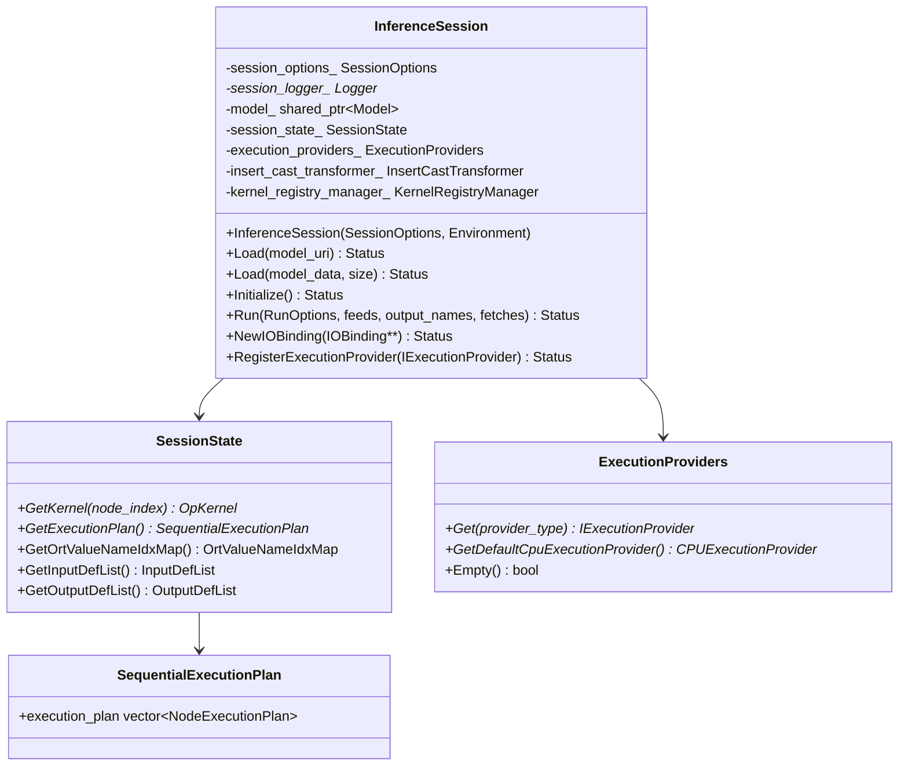
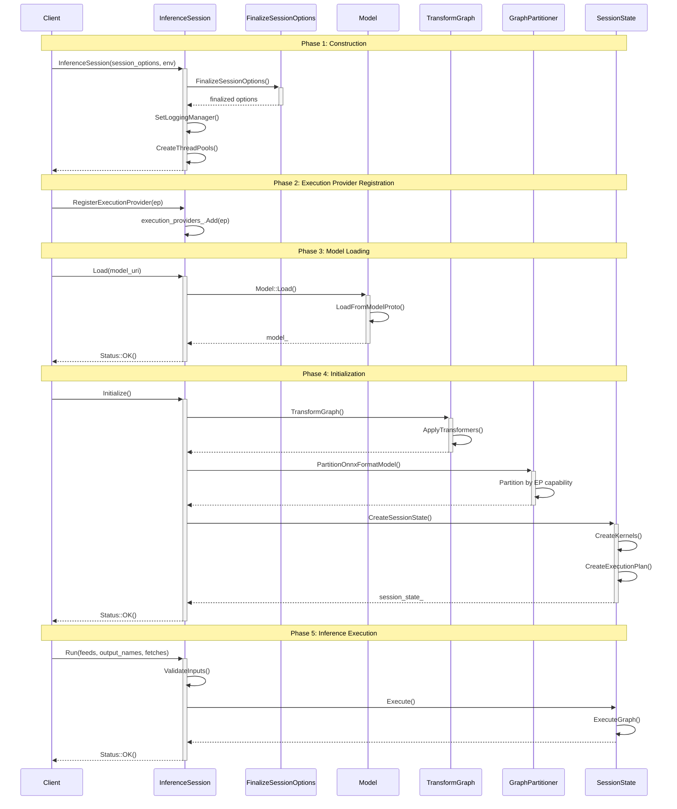
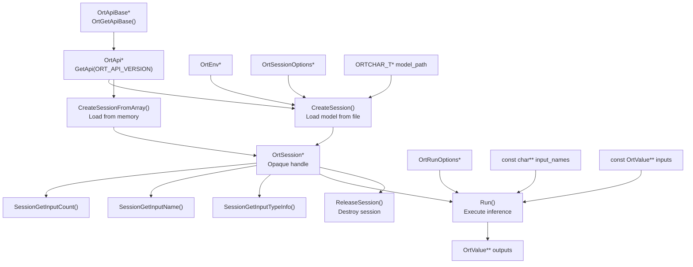
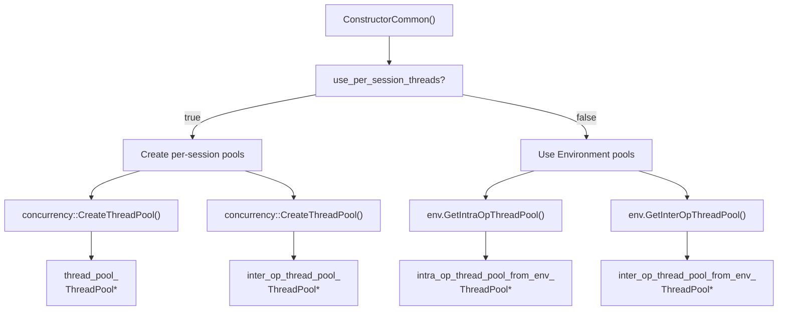
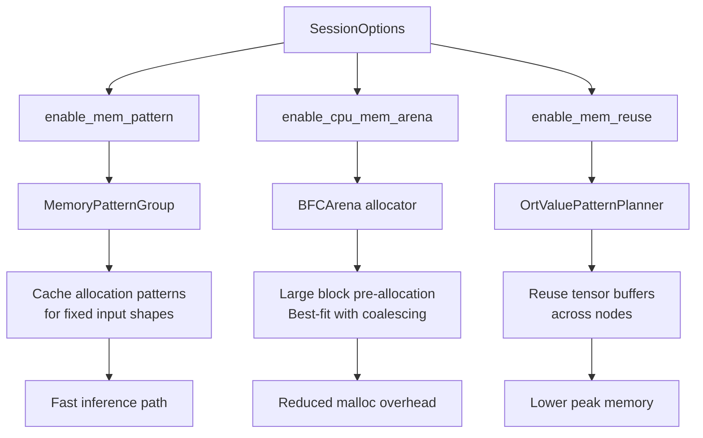
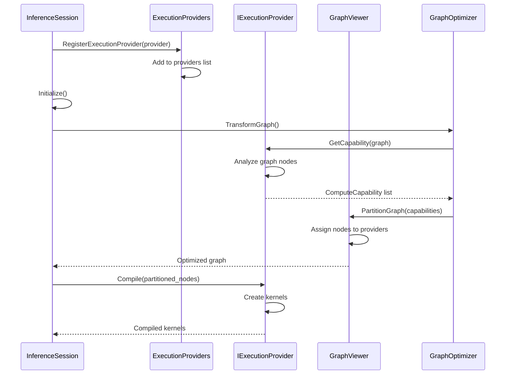
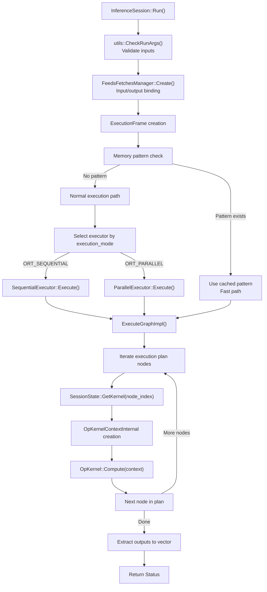
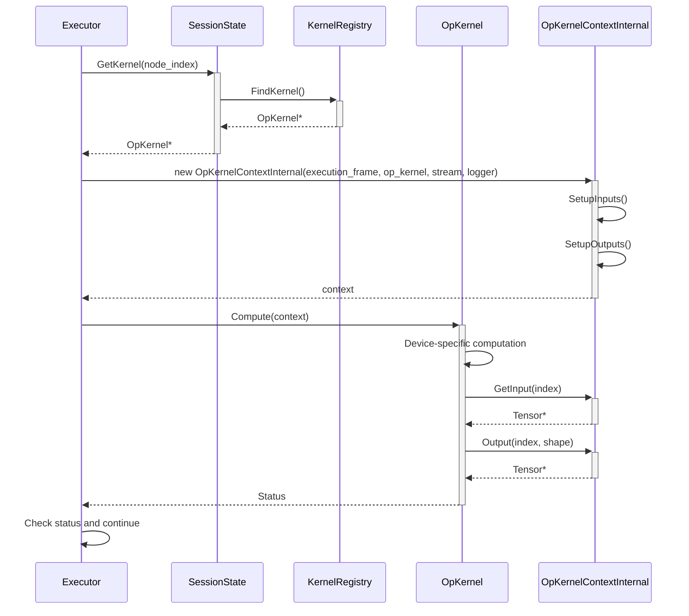

<!-- source: DeepWiki mcp.deepwiki.com · repo microsoft/onnxruntime · page 3.3 Inference Session · fetched 2026-10-21 -->

# Inference Session

<details>
<summary>Relevant source files</summary>

The following files were used as context for generating this wiki page:

- [include/onnxruntime/core/framework/provider_shutdown.h](include/onnxruntime/core/framework/provider_shutdown.h)
- [include/onnxruntime/core/session/environment.h](include/onnxruntime/core/session/environment.h)
- [include/onnxruntime/core/session/onnxruntime_c_api.h](include/onnxruntime/core/session/onnxruntime_c_api.h)
- [include/onnxruntime/core/session/onnxruntime_cxx_api.h](include/onnxruntime/core/session/onnxruntime_cxx_api.h)
- [include/onnxruntime/core/session/onnxruntime_cxx_inline.h](include/onnxruntime/core/session/onnxruntime_cxx_inline.h)
- [include/onnxruntime/core/session/onnxruntime_lite_custom_op.h](include/onnxruntime/core/session/onnxruntime_lite_custom_op.h)
- [onnxruntime/core/framework/session_options.h](onnxruntime/core/framework/session_options.h)
- [onnxruntime/core/providers/dnnl/dnnl_provider_factory.cc](onnxruntime/core/providers/dnnl/dnnl_provider_factory.cc)
- [onnxruntime/core/session/abi_session_options.cc](onnxruntime/core/session/abi_session_options.cc)
- [onnxruntime/core/session/custom_ops.cc](onnxruntime/core/session/custom_ops.cc)
- [onnxruntime/core/session/environment.cc](onnxruntime/core/session/environment.cc)
- [onnxruntime/core/session/inference_session.cc](onnxruntime/core/session/inference_session.cc)
- [onnxruntime/core/session/inference_session.h](onnxruntime/core/session/inference_session.h)
- [onnxruntime/core/session/onnxruntime_c_api.cc](onnxruntime/core/session/onnxruntime_c_api.cc)
- [onnxruntime/core/session/ort_apis.h](onnxruntime/core/session/ort_apis.h)
- [onnxruntime/core/session/ort_env.cc](onnxruntime/core/session/ort_env.cc)
- [onnxruntime/core/session/ort_env.h](onnxruntime/core/session/ort_env.h)
- [onnxruntime/core/session/standalone_op_invoker.cc](onnxruntime/core/session/standalone_op_invoker.cc)
- [onnxruntime/test/framework/inference_session_test.cc](onnxruntime/test/framework/inference_session_test.cc)
- [onnxruntime/test/shared_lib/custom_op_utils.cc](onnxruntime/test/shared_lib/custom_op_utils.cc)
- [onnxruntime/test/shared_lib/custom_op_utils.h](onnxruntime/test/shared_lib/custom_op_utils.h)
- [onnxruntime/test/shared_lib/test_inference.cc](onnxruntime/test/shared_lib/test_inference.cc)
- [onnxruntime/test/testdata/custom_op_library/cpu/cpu_ops.cc](onnxruntime/test/testdata/custom_op_library/cpu/cpu_ops.cc)
- [onnxruntime/test/testdata/custom_op_library/custom_op_library.cc](onnxruntime/test/testdata/custom_op_library/custom_op_library.cc)
- [onnxruntime/test/testdata/fuse_select_filter.onnx](onnxruntime/test/testdata/fuse_select_filter.onnx)
- [onnxruntime/test/testdata/fuse_select_filter_opset_8.onnx](onnxruntime/test/testdata/fuse_select_filter_opset_8.onnx)
- [onnxruntime/test/testdata/merge.onnx](onnxruntime/test/testdata/merge.onnx)
- [onnxruntime/test/testdata/optional_2.onnx](onnxruntime/test/testdata/optional_2.onnx)
- [onnxruntime/test/testdata/optional_3.onnx](onnxruntime/test/testdata/optional_3.onnx)

</details>


The `InferenceSession` class [onnxruntime/core/session/inference_session.h:121-446]() is the core runtime API in ONNX Runtime responsible for managing the entire lifecycle of model inference. It encapsulates the model loading, graph optimization, execution provider registration, session initialization, and actual inference execution phases. The class maintains the model graph, execution state, session options, execution providers, and kernel registries.

This page provides detailed insight into the internal workings of the `InferenceSession`, its lifecycle, how it interfaces with the environment, registration of execution providers, and the execution flow of running a model.

This page corresponds to section 3.3 of the Core Architecture documentation.

---

## Overview of InferenceSession

The `InferenceSession` class is the main engine that runs ONNX models. It acts as a controller that parses or loads the model, applies graph optimizations, partitions the graph for different execution providers, creates kernels for compute nodes, manages thread pools, and finally executes the model given input data to produce outputs.

From the user-facing side, the session is typically created and managed through language API wrappers built on top of the C API (such as `Ort::Session` in C++). Internally, `InferenceSession` governs all runtime aspects.

---

## InferenceSession Class Structure

The key data members and components in `InferenceSession` include:

- **SessionOptions**: Configuration for the session (graph optimization level, threading, memory management, etc.).
- **Environment**: Global runtime environment containing logging and threading infrastructure.
- **Model**: The in-memory representation of the ONNX model, including the graph.
- **SessionState**: Contains the compiled kernels, execution plans, and OrtValue mapping.
- **ExecutionProviders**: Manages a list of registered execution providers, which provide hardware-specific implementations.
- **KernelRegistryManager**: Manages kernel lookup and registrations.
- **InsertCastTransformer**: A special transformer to insert cast nodes during graph optimization.

### UML Diagram: InferenceSession Core Components and Relationships



---

## Session Lifecycle and Execution Flow

`InferenceSession` manages its internal state through five main lifecycle phases:

1. **Construction**: Instantiation with session options and environment. Thread pools and logging are set up.
2. **Execution Provider Registration**: Register hardware-specific execution providers.
3. **Model Loading**: Parsing of ONNX/ORT format protobuf model from file or serialized data.
4. **Initialization**: Graph optimization, partitioning, kernel creation, and session state setup.
5. **Inference Execution**: Input validation, graph execution through the proper executor, and output extraction.

### Sequence Diagram: InferenceSession Lifecycle



### Phase Details

| Phase | Main Function(s) | Description | Code Location |
|-------|------------------|-------------|---------------|
| Construction | `InferenceSession::ConstructorCommon()` | Finalizes session options with environment overrides, sets up thread pools, logging, and default providers. | [inference_session.cc:367-600]() |
| Execution Provider Registration | `RegisterExecutionProvider()` | Adds new EP to the session, respecting priority order. | [inference_session.cc:1940-1998]() |
| Model Loading | `InferenceSession::Load()` | Loads model protobuf, creates Model instance, sets model metadata. | [inference_session.cc:789-893]() |
| Initialization | `InferenceSession::Initialize()` | Applies graph optimizations, partitions graph based on EPs, creates kernels, compiles execution plan, sets up session state. | [inference_session.cc:1355-1527]() |
| Inference Execution | `InferenceSession::Run()` | Validates inputs, manages OrtValue bindings, launches executor to run the graph, extracts outputs. | [inference_session.cc:2031-2080]() |

---

## Core Runtime APIs for InferenceSession

### C API Functions

`InferenceSession` is wrapped by the C API in `OrtSession` handles. Key functions are exposed in `OrtApis`:



Important functions with relative code locations:

| Function | Description | Implementation Location |
|----------|-------------|-------------------------|
| `CreateSession` | Loads model from serialized file or memory to create a session | [onnxruntime_c_api.cc:1008-1057]() |
| `Run` | Execute graph inference with inputs and output fetching | [onnxruntime_c_api.cc:1069-1136]() |
| `SessionGetInputCount` / `SessionGetOutputCount` | Query number of model inputs/outputs | Wrapper calls on `session_state_.GetInputDefList().size()` |

### C++ API Wrapper

The `Ort::Session` class wraps the C API with RAII, exceptions, and easier management.

```cpp
// Initialize ONNX Runtime environment and session options
Ort::Env env(ORT_LOGGING_LEVEL_WARNING, "test");
Ort::SessionOptions session_options;
session_options.SetIntraOpNumThreads(1);
session_options.SetGraphOptimizationLevel(GraphOptimizationLevel::ORT_ENABLE_EXTENDED);

// Create session from model file
Ort::Session session(env, model_path, session_options);

// Query input count and names
size_t num_inputs = session.GetInputCount();
Ort::AllocatedStringPtr input_name = session.GetInputNameAllocated(0, allocator);
Ort::TypeInfo type_info = session.GetInputTypeInfo(0);

// Prepare input/output arrays for inference
std::vector<const char*> input_names = {"input"};
std::vector<const char*> output_names = {"output"};
std::vector<Ort::Value> input_tensors = {std::move(input_tensor)};

// Run inference
std::vector<Ort::Value> output_tensors = session.Run(Ort::RunOptions{nullptr},
                                                    input_names.data(), input_tensors.data(), 1,
                                                    output_names.data(), 1);
```

This layer forwards calls to the C API and throws on errors.

---

## Session Configuration: SessionOptions

Configuration details for an `InferenceSession` come from the `SessionOptions` object [onnxruntime/core/framework/session_options.h:87-180](), which controls:

- Execution mode (sequential or parallel)
- Graph optimization level
- Threading policies (intra-op, inter-op)
- Memory management strategies (arena allocators, memory pattern optimizations)
- Profiling options
- ConfigOptions dictionary for arbitrary key-value strings

### SessionOptions Structure and Key Fields

```mermaid
graph TD
    SessionOptions["SessionOptions"] --> ExecutionMode["execution_mode<br/>ExecutionMode"]
    SessionOptions --> OptLevel["graph_optimization_level<br/>GraphOptimizationLevel"]
    SessionOptions --> ThreadConfig["Thread Pool Configuration"]
    SessionOptions --> MemoryConfig["Memory Management"]
    SessionOptions --> ConfigOptions["config_options<br/>ConfigOptions"]
    
    ExecutionMode --> Sequential["ORT_SEQUENTIAL<br/>Single-threaded execution"]
    ExecutionMode --> Parallel["ORT_PARALLEL<br/>Multi-threaded execution"]
    
    OptLevel --> DisableAll["ORT_DISABLE_ALL"]
    OptLevel --> EnableBasic["ORT_ENABLE_BASIC"]
    OptLevel --> EnableExtended["ORT_ENABLE_EXTENDED"]
    OptLevel --> EnableAll["ORT_ENABLE_ALL"]
    
    ThreadConfig --> use_per_session_threads["use_per_session_threads<br/>bool"]
    ThreadConfig --> intra_op_param["intra_op_param<br/>OrtThreadPoolParams"]
    ThreadConfig --> inter_op_param["inter_op_param<br/>OrtThreadPoolParams"]
    
    intra_op_param --> thread_pool_size["thread_pool_size<br/>int (0=auto)"]
    intra_op_param --> allow_spinning["allow_spinning<br/>bool"]
    
    MemoryConfig --> enable_mem_pattern["enable_mem_pattern<br/>bool"]
    MemoryConfig --> enable_cpu_mem_arena["enable_cpu_mem_arena<br/>bool"]
    MemoryConfig --> enable_mem_reuse["enable_mem_reuse<br/>bool"]
    
    ConfigOptions --> AddConfigEntry["AddConfigEntry(key, value)"]
    ConfigOptions --> GetConfigOrDefault["GetConfigOrDefault(key, default)"]
```



### SessionOptions Flags and Defaults

| Category | Field | Type | Default | Description |
|----------|--------|------|---------|-------------|
| **Execution** | `execution_mode` | `ExecutionMode` enum | `ORT_SEQUENTIAL` | Controls single-threaded vs multi-threaded node execution |
| | `use_per_session_threads` | `bool` | `true` | Whether to create dedicated thread pools per session or share global ones from Environment |
| | `intra_op_param.thread_pool_size` | `int` | 0 (auto) | Threads for intra-operator parallelism |
| | `inter_op_param.thread_pool_size` | `int` | 0 (auto) | Threads for parallel node execution (inter-op) |
| **Optimization** | `graph_optimization_level` | `GraphOptimizationLevel` | `ORT_ENABLE_ALL` | Graph transformation level (disable, basic, extended, all) |
| | `optimized_model_filepath` | `PathString` | Empty | If set, session saves optimized model file after initialization |
| **Memory** | `enable_mem_pattern` | `bool` | `true` | Enables recording memory allocation patterns for reuse to improve performance |
| | `enable_cpu_mem_arena` | `bool` | `true` | Enables a best-fit with coalescing allocators for CPU to reduce fragmentation |
| | `enable_mem_reuse` | `bool` | `true` | Enables reusing tensor buffers when safe to lower peak memory usage |
| **Profiling** | `enable_profiling` | `bool` | `false` | Enable session profiling |
| | `profile_file_prefix` | `PathString` | `"onnxruntime_profile_"` | Profiling output file prefix |

---

## Thread Pool Creation and Management

The `InferenceSession` creates or assigns thread pools during construction based on `SessionOptions` and environment.

### Thread Pool Decision Flow



### Details

- **Intra-op Thread Pool**: Used for parallelization inside one operator (e.g., matrix multiply).
- **Inter-op Thread Pool**: Used for parallelizing nodes independently when execution mode is `ORT_PARALLEL`.
- The thread pool parameters (`thread_pool_size`, `allow_spinning`, and custom creation functions) are used during pool construction.
- If `use_per_session_threads` is false, session uses the global pools from the `Environment` instance.

---

## Memory Management Strategies

Memory management in `InferenceSession` is carefully designed to optimize performance and resource usage.



### Features:

- **Memory Pattern Caching** (`MemoryPatternGroup`):
  - On first run with particular input shapes, records memory allocation patterns into a cache.
  - Subsequent runs with matching shapes reuse these allocation plans for faster inference.
  
- **CPU Memory Arena** (`BFCArena`):
  - Uses a best-fit with coalescing (BFC) algorithm to allocate large contiguous memory blocks.
  - Reduces fragmentation and reduces overhead from multiple small allocations.
  
- **Buffer Reuse** (`OrtValuePatternPlanner`):
  - Exploits non-overlapping tensor lifetimes to reuse buffers and reduce peak memory.

### Allocators:

- **Execution Providers** register preferred allocators during initialization.
- CPU EP typically registers allocator(s) for CPU memory and potentially the arena allocator if enabled.
- GPU EPs register device allocators and pinned host memory allocators to optimize transfers.

---

## Execution Providers Integration

`InferenceSession` manages the relationship and registration of execution providers (EPs), which provide kernels optimized for specific hardware.

### EP Registration Flow



### Key Points:

- Providers are registered in order of preference; this order influences node assignment.
- Each provider reports `ComputeCapability`, the subset of nodes they can execute.
- Graph partitioner assigns nodes to providers aiming to maximize EP usage.
- Nodes without assigned providers fall back to CPU provider.
- After graph partitioning, providers create kernels for their assigned nodes.
- `InferenceSession` stores these kernels for runtime execution lookup.

---

## Inference Execution Flow

The `Run()` method of `InferenceSession` manages input validation, execution path selection, kernel invocation, and output extraction.

### Execution Architecture Diagram



### Execution Components:

- **FeedsFetchesManager**: Prepares mapping of input/output names to OrtValue indices for fast lookup.
- **ExecutionFrame**: Holds OrtValues for runtime storage and enables kernel context creation.
- **SequentialExecutor / ParallelExecutor**: Executes graph nodes according to execution mode.
- **OpKernelContextInternal**: Created for each kernel execution, provides kernel access to inputs and outputs.
- **OpKernel**: Represents a compute node for which `Compute()` is called.

### Kernel Invocation Loop



---

## IOBinding: Explicit Input and Output Binding

`IOBinding` [onnxruntime/core/session/IOBinding.h]() allows advanced users to explicitly bind inputs and outputs to specific devices or memory locations.

### Example Usage

```cpp
IOBinding* io_binding;
session.NewIOBinding(&io_binding);

// Bind input tensor already on GPU device memory
OrtMemoryInfo gpu_mem_info("Cuda", OrtDeviceAllocator, 0, OrtMemTypeDefault);
io_binding->BindInput("input_name", input_gpu_ort_value);

// Bind output to GPU device memory
io_binding->BindOutput("output_name", gpu_mem_info);

// Run the inference with the specified bindings
session.Run(*io_binding);

// Access outputs
auto output_names = io_binding->GetOutputNames();
auto output_values = io_binding->GetOutputValues();
```

This allows zero-copy input feeding and output retrieval on devices, improving performance when integrating with external memory sources or accelerators.

---

# Summary

- `InferenceSession` orchestrates the entire model execution lifecycle in ONNX Runtime.
- Lifecycle phases include construction, provider registration, model loading, initialization, and inference run.
- The session options control threading, memory, and optimization settings.
- Multiple execution providers can be registered and graph partitioned accordingly.
- The runtime execution uses executors that invoke kernels based on the compiled execution plan.
- Advanced features such as memory pattern caching and explicit device binding are supported.

---

## Sources

- [onnxruntime/core/session/inference_session.h:121-446]()
- [onnxruntime/core/session/inference_session.cc:367-600]()
- [onnxruntime/core/session/inference_session.cc:789-893]()
- [onnxruntime/core/session/inference_session.cc:1355-1527]()
- [onnxruntime/core/session/inference_session.cc:1940-1998]()
- [onnxruntime/core/session/inference_session.cc:2031-2080]()
- [onnxruntime/core/session/onnxruntime_c_api.h:869-1520]()
- [onnxruntime/core/session/onnxruntime_c_api.cc:1008-1136]()
- [include/onnxruntime/core/session/onnxruntime_cxx_api.h:1925-2000]()
- [onnxruntime/core/framework/session_options.h:87-180]()
- [onnxruntime/core/session/abi_session_options.cc:86-147]()
- [onnxruntime/core/session/IOBinding.h]()

---

