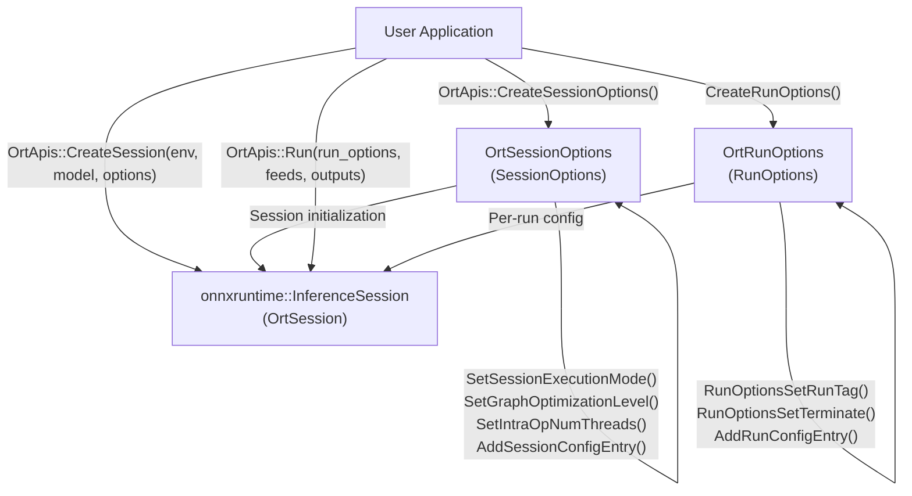
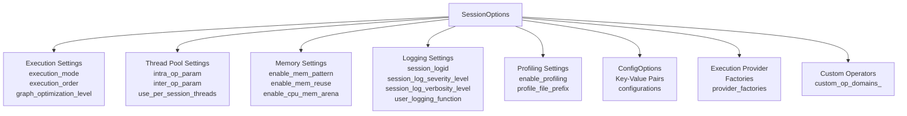
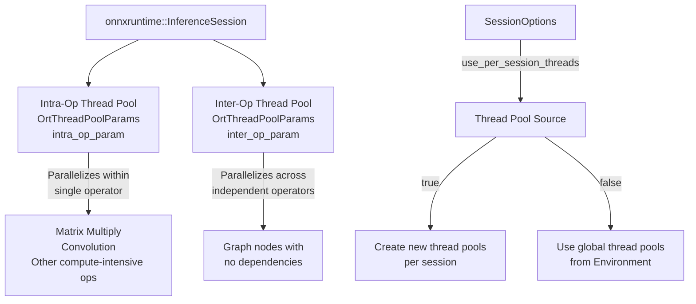
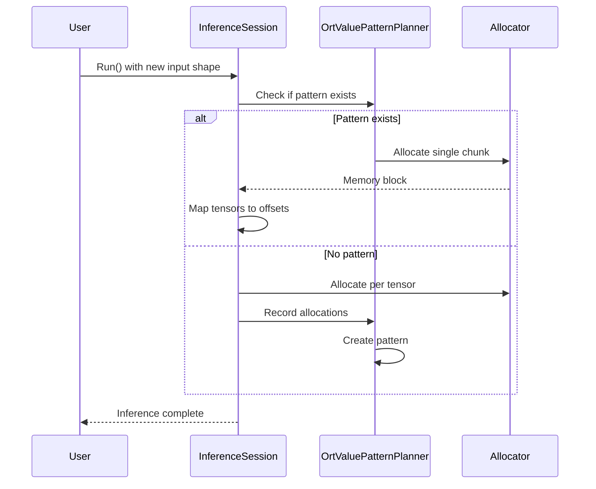
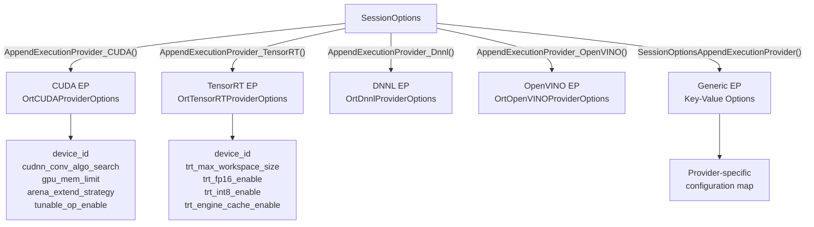
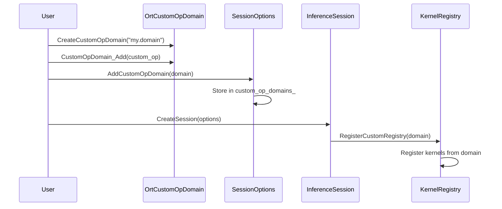
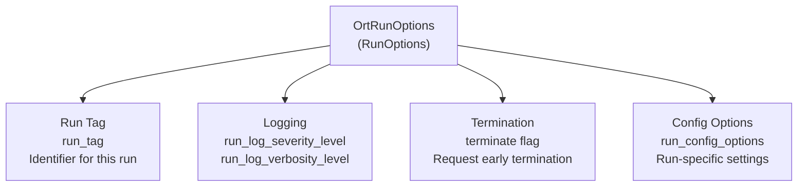
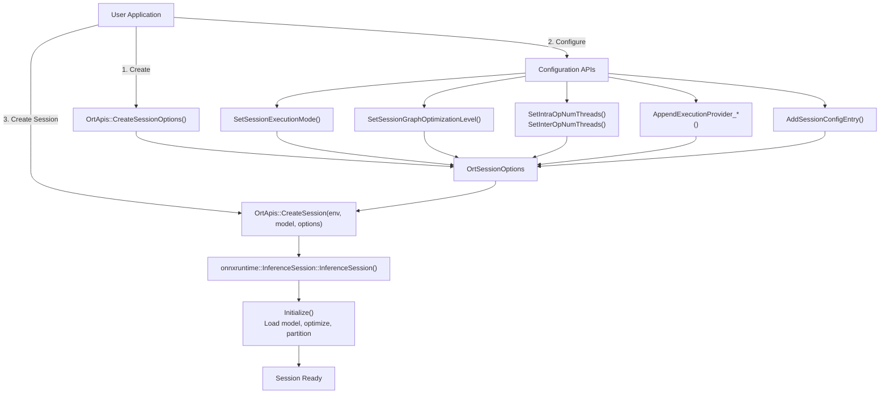

<!-- source: DeepWiki mcp.deepwiki.com · repo microsoft/onnxruntime · page 3.4 Session Configuration · fetched 2026-10-21 -->

# Session Configuration

<details>
<summary>Relevant source files</summary>

The following files were used as context for generating this wiki page:

- [docs/NotesOnThreading.md](docs/NotesOnThreading.md)
- [include/onnxruntime/core/platform/Barrier.h](include/onnxruntime/core/platform/Barrier.h)
- [include/onnxruntime/core/platform/EigenNonBlockingThreadPool.h](include/onnxruntime/core/platform/EigenNonBlockingThreadPool.h)
- [include/onnxruntime/core/platform/threadpool.h](include/onnxruntime/core/platform/threadpool.h)
- [include/onnxruntime/core/session/onnxruntime_c_api.h](include/onnxruntime/core/session/onnxruntime_c_api.h)
- [include/onnxruntime/core/session/onnxruntime_cxx_api.h](include/onnxruntime/core/session/onnxruntime_cxx_api.h)
- [include/onnxruntime/core/session/onnxruntime_cxx_inline.h](include/onnxruntime/core/session/onnxruntime_cxx_inline.h)
- [include/onnxruntime/core/session/onnxruntime_lite_custom_op.h](include/onnxruntime/core/session/onnxruntime_lite_custom_op.h)
- [onnxruntime/core/common/threadpool.cc](onnxruntime/core/common/threadpool.cc)
- [onnxruntime/core/framework/session_options.h](onnxruntime/core/framework/session_options.h)
- [onnxruntime/core/platform/env.cc](onnxruntime/core/platform/env.cc)
- [onnxruntime/core/platform/env.h](onnxruntime/core/platform/env.h)
- [onnxruntime/core/platform/posix/env.cc](onnxruntime/core/platform/posix/env.cc)
- [onnxruntime/core/platform/windows/env.cc](onnxruntime/core/platform/windows/env.cc)
- [onnxruntime/core/platform/windows/env.h](onnxruntime/core/platform/windows/env.h)
- [onnxruntime/core/platform/windows/stacktrace.cc](onnxruntime/core/platform/windows/stacktrace.cc)
- [onnxruntime/core/session/abi_session_options.cc](onnxruntime/core/session/abi_session_options.cc)
- [onnxruntime/core/session/custom_ops.cc](onnxruntime/core/session/custom_ops.cc)
- [onnxruntime/core/session/inference_session.cc](onnxruntime/core/session/inference_session.cc)
- [onnxruntime/core/session/inference_session.h](onnxruntime/core/session/inference_session.h)
- [onnxruntime/core/session/onnxruntime_c_api.cc](onnxruntime/core/session/onnxruntime_c_api.cc)
- [onnxruntime/core/session/ort_apis.h](onnxruntime/core/session/ort_apis.h)
- [onnxruntime/core/session/standalone_op_invoker.cc](onnxruntime/core/session/standalone_op_invoker.cc)
- [onnxruntime/core/util/thread_utils.cc](onnxruntime/core/util/thread_utils.cc)
- [onnxruntime/core/util/thread_utils.h](onnxruntime/core/util/thread_utils.h)
- [onnxruntime/test/framework/inference_session_test.cc](onnxruntime/test/framework/inference_session_test.cc)
- [onnxruntime/test/global_thread_pools/test_main.cc](onnxruntime/test/global_thread_pools/test_main.cc)
- [onnxruntime/test/perftest/posix/utils.cc](onnxruntime/test/perftest/posix/utils.cc)
- [onnxruntime/test/platform/barrier_test.cc](onnxruntime/test/platform/barrier_test.cc)
- [onnxruntime/test/platform/env_test.cc](onnxruntime/test/platform/env_test.cc)
- [onnxruntime/test/platform/file_io_test.cc](onnxruntime/test/platform/file_io_test.cc)
- [onnxruntime/test/platform/threadpool_test.cc](onnxruntime/test/platform/threadpool_test.cc)
- [onnxruntime/test/shared_lib/custom_op_utils.cc](onnxruntime/test/shared_lib/custom_op_utils.cc)
- [onnxruntime/test/shared_lib/custom_op_utils.h](onnxruntime/test/shared_lib/custom_op_utils.h)
- [onnxruntime/test/shared_lib/test_inference.cc](onnxruntime/test/shared_lib/test_inference.cc)
- [onnxruntime/test/testdata/custom_op_library/cpu/cpu_ops.cc](onnxruntime/test/testdata/custom_op_library/cpu/cpu_ops.cc)
- [onnxruntime/test/testdata/custom_op_library/custom_op_library.cc](onnxruntime/test/testdata/custom_op_library/custom_op_library.cc)
- [onnxruntime/test/testdata/fuse_select_filter.onnx](onnxruntime/test/testdata/fuse_select_filter.onnx)
- [onnxruntime/test/testdata/fuse_select_filter_opset_8.onnx](onnxruntime/test/testdata/fuse_select_filter_opset_8.onnx)
- [onnxruntime/test/testdata/merge.onnx](onnxruntime/test/testdata/merge.onnx)
- [onnxruntime/test/testdata/optional_2.onnx](onnxruntime/test/testdata/optional_2.onnx)
- [onnxruntime/test/testdata/optional_3.onnx](onnxruntime/test/testdata/optional_3.onnx)
- [orttraining/orttraining/core/graph/training_op_defs.h](orttraining/orttraining/core/graph/training_op_defs.h)
- [tools/python/benchmark_mmap_ort.py](tools/python/benchmark_mmap_ort.py)

</details>


## Purpose and Scope

This document describes how to configure ONNX Runtime sessions using `SessionOptions` and `RunOptions`. `SessionOptions` controls session-level settings such as graph optimization, threading, memory management, and execution provider registration within `onnxruntime::InferenceSession`. `RunOptions` provides per-inference-run configuration for logging, tagging, and runtime control.

For information about the `InferenceSession` lifecycle and execution flow, see [Inference Session](#3.3). For execution provider registration details, see [Execution Provider Interface](#6.1). For graph optimization specifics, see [Graph Optimizations](#3.5).

Sources: `[include/onnxruntime/core/session/onnxruntime_c_api.h:306-310]`, `[onnxruntime/core/session/inference_session.h:123-183]`, `[onnxruntime/core/session/ort_apis.h:59-78]()`

## SessionOptions and RunOptions Overview

`SessionOptions` configures the `onnxruntime::InferenceSession` during initialization. It determines how the model is loaded, optimized, and prepared for execution. `RunOptions` provides transient configuration for individual `Run()` calls without affecting the persistent session state.

The following diagram bridges natural language configuration concepts to code entities (`InferenceSession`, `SessionOptions`, `OrtSessionOptions`, `OrtRunOptions`, and API functions like `OrtApis::CreateSessionOptions`):



Sources: `[include/onnxruntime/core/session/onnxruntime_c_api.h:306-310]`, `[onnxruntime/core/session/inference_session.h:166-184]`, `[onnxruntime/core/session/ort_apis.h:53-78]()`

## Configuration Structure

The internal structure of `SessionOptions` aggregates execution settings, thread pool parameters, memory management flags, logging options, profiling configurations, config option key-value pairs, and execution provider factories:



Sources: `[onnxruntime/core/session/inference_session.h:123-184]`, `[onnxruntime/core/session/ort_apis.h:59-78]()`

## Core Configuration Settings

### Execution Mode

The execution mode determines how nodes in the graph are scheduled for execution:

| Mode | Value | Description |
|------|-------|-------------|
| `ORT_SEQUENTIAL` | 0 | Nodes execute one at a time in topological order |
| `ORT_PARALLEL` | 1 | Independent nodes execute concurrently using inter-op thread pool |

Set via `OrtApi::SetSessionExecutionMode()`:

```c
OrtSessionOptions* options;
OrtApi->CreateSessionOptions(&options);
OrtApi->SetSessionExecutionMode(options, ORT_PARALLEL);
```

Sources: `[include/onnxruntime/core/session/onnxruntime_c_api.h:431-434]`, `[onnxruntime/core/session/ort_apis.h:61-68]()`

### Graph Optimization Level

Controls which graph transformations are applied during session initialization:

| Level | Value | Optimizations Applied |
|-------|-------|----------------------|
| `ORT_DISABLE_ALL` | 0 | No optimizations |
| `ORT_ENABLE_BASIC` | 1 | Basic optimizations (constant folding, redundant node elimination) |
| `ORT_ENABLE_EXTENDED` | 2 | Extended optimizations (node fusion, layout transformations) |
| `ORT_ENABLE_LAYOUT` | 3 | Layout optimizations (NHWC transformations) |
| `ORT_ENABLE_ALL` | 99 | All available optimizations |

Set via `OrtApi::SetSessionGraphOptimizationLevel()`:

```c
OrtApi->SetSessionGraphOptimizationLevel(options, ORT_ENABLE_EXTENDED);
```

Sources: `[include/onnxruntime/core/session/onnxruntime_c_api.h:418-429]`, `[onnxruntime/core/session/ort_apis.h:74-75]()`

### Threading Configuration

ONNX Runtime uses two types of thread pools for parallel execution:



**Thread Pool Parameters:**

| Parameter | Type | Description |
|-----------|------|-------------|
| `thread_pool_size` | int | Number of threads (0 = auto-detect) |
| `auto_set_affinity` | bool | Automatically bind threads to CPU core allocations via `Env::Thread` |
| `allow_spinning` | bool | Enable busy-waiting for better latency |
| `stack_size` | uint32_t | Stack size per thread |

Set via `OrtApi::SetIntraOpNumThreads()` and `OrtApi::SetInterOpNumThreads()`:

```c
OrtApi->SetIntraOpNumThreads(options, 4);  // 4 intra-op threads
OrtApi->SetInterOpNumThreads(options, 2);  // 2 inter-op threads
```

Sources: `[onnxruntime/core/session/inference_session.cc:1-156]`, `[include/onnxruntime/core/session/onnxruntime_c_api.h:932-1006]`, `[onnxruntime/core/platform/windows/env.cc:67-121]()`

### Memory Management

ONNX Runtime provides several memory optimization features:

| Setting | API Function | Default | Description |
|---------|-------------|---------|-------------|
| CPU Memory Arena | `EnableCpuMemArena()` / `DisableCpuMemArena()` | Enabled | Pre-allocates memory pools via `BFC Arena` to reduce allocation overhead |
| Memory Pattern | `EnableMemPattern()` / `DisableMemPattern()` | Enabled | Traces memory allocation patterns for reuse across runs |
| Memory Reuse | N/A (internal) | Enabled | Reuses tensor buffers when shapes match |

**Memory Pattern Flow:**



Sources: `[onnxruntime/core/session/onnxruntime_c_api.cc:19-42]`, `[onnxruntime/core/session/inference_session.cc:1-100]`, `[onnxruntime/core/session/ort_apis.h:65-70]()`

### Logging Configuration

Configure session-specific logging behavior:

| Setting | API Function | Description |
|---------|-------------|-------------|
| Log ID | `SetSessionLogId()` | Identifier prefix for log messages |
| Severity Level | `SetSessionLogSeverityLevel()` | Minimum severity: 0=VERBOSE, 1=INFO, 2=WARNING, 3=ERROR, 4=FATAL |
| Verbosity Level | `SetSessionLogVerbosityLevel()` | Detail level for logging |
| Custom Logger | `CreateEnvWithCustomLogger()` | User-provided logging function |

Sources: `[onnxruntime/core/session/ort_apis.h:36-42]`, `[onnxruntime/core/session/ort_apis.h:71-73]()`

### Profiling Configuration

Enable performance profiling to analyze execution time:

```c
// Enable profiling with custom file prefix
OrtApi->EnableProfiling(options, L"my_profile_");

// Disable profiling
OrtApi->DisableProfiling(options);

// After session runs, retrieve profile file
char* profile_file;
OrtApi->SessionEndProfiling(session, allocator, &profile_file);
```

Sources: `[onnxruntime/core/session/ort_apis.h:63-64]`, `[onnxruntime/core/session/ort_apis.h:94-95]()`

## Execution Provider Configuration

Execution providers (EPs) are registered with the session to enable hardware acceleration:



EP-specific options are exposed through config entries with prefix `ep.<provider_name>.<key>`:

```c
OrtApi->AddSessionConfigEntry(options, "ep.cuda.device_id", "0");
OrtApi->AddSessionConfigEntry(options, "ep.cuda.tunable_op_enable", "1");
```

Sources: `[include/onnxruntime/core/session/onnxruntime_c_api.h:597-683]`, `[onnxruntime/test/shared_lib/test_inference.cc:276-280]()`

## Custom Operators

Register custom operators via custom op domains or shared libraries:

### Custom Op Domain Registration



### Shared Library Registration

```c
void* library_handle;
OrtApi->RegisterCustomOpsLibrary(options, "path/to/custom_ops.dll", &library_handle);
```

Sources: `[onnxruntime/core/session/custom_ops.cc:37-125]`, `[onnxruntime/core/session/ort_apis.h:79-82]()`

## Advanced Configuration (Config Options)

`ConfigOptions` provides a key-value map for advanced settings not exposed as dedicated APIs:

### Common Config Keys

| Key | Type | Description |
|-----|------|-------------|
| `session.disable_prepacking` | "0"/"1" | Disable weight pre-packing optimization |
| `session.use_env_allocators` | "0"/"1" | Use allocators from Environment instead of creating new ones |
| `session.set_denormal_as_zero` | "0"/"1" | Treat denormal floats as zero |
| `session.intra_op.allow_spinning` | "0"/"1" | Allow intra-op threads to busy-wait |
| `session.inter_op.allow_spinning` | "0"/"1" | Allow inter-op threads to busy-wait |
| `ep.context_enable` | "0"/"1" | Enable EP context caching |

Sources: `[onnxruntime/core/session/inference_session.cc:1-156]`, `[onnxruntime/test/shared_lib/test_inference.cc:25-32]()`

## RunOptions

`RunOptions` provides per-inference-run configuration without modifying the session:



### Key RunOptions Features

| Feature | API Function | Description |
|---------|-------------|-------------|
| Run Tag | `RunOptionsSetRunTag()` | Set identifier for logging/profiling |
| Terminate | `RunOptionsSetTerminate()` / `RunOptionsUnsetTerminate()` | Signal graceful termination |
| Log Levels | `RunOptionsSetRunLogSeverityLevel()` | Override session log level for this run |
| Config Entries | `AddRunConfigEntry()` | Pass run-specific configuration |

Sources: `[include/onnxruntime/core/session/onnxruntime_c_api.h:450-480]`, `[onnxruntime/test/shared_lib/test_inference.cc:25-32]()`

## Configuration Flow

The following diagram bridges natural language configuration flow to code entities (`OrtApis::CreateSessionOptions`, `OrtApis::CreateSession`, `InferenceSession::InferenceSession`):



Sources: `[onnxruntime/core/session/inference_session.cc:1-120]`, `[onnxruntime/core/session/ort_apis.h:47-59]()`

## Configuration Best Practices

### Thread Pool Sizing
- Use `SetIntraOpNumThreads(options, 0)` for auto-detection based on available hardware cores.
- Set `SetSessionExecutionMode(options, ORT_SEQUENTIAL)` for low-latency single-request streaming scenarios.

### Memory Optimization
- Enable CPU memory arena via `EnableCpuMemArena()` to reduce kernel allocation latency.
- Enable memory patterns via `EnableMemPattern()` when input shapes remain static across inference iterations.

Sources: `[onnxruntime/core/session/inference_session.cc:1-156]`, `[onnxruntime/core/session/ort_apis.h:65-70]()`

---

