<!-- source: DeepWiki mcp.deepwiki.com · repo microsoft/onnxruntime · page 3.5 Graph Optimizations · fetched 2026-10-21 -->

# Graph Optimizations

<details>
<summary>Relevant source files</summary>

The following files were used as context for generating this wiki page:

- [include/onnxruntime/core/optimizer/graph_transformer_utils.h](include/onnxruntime/core/optimizer/graph_transformer_utils.h)
- [onnxruntime/contrib_ops/cpu/fused_activation.cc](onnxruntime/contrib_ops/cpu/fused_activation.cc)
- [onnxruntime/contrib_ops/cpu/nchwc_ops.cc](onnxruntime/contrib_ops/cpu/nchwc_ops.cc)
- [onnxruntime/contrib_ops/cpu/nchwc_ops.h](onnxruntime/contrib_ops/cpu/nchwc_ops.h)
- [onnxruntime/core/framework/kernel_type_str_resolver_utils.cc](onnxruntime/core/framework/kernel_type_str_resolver_utils.cc)
- [onnxruntime/core/graph/contrib_ops/internal_nhwc_onnx_schemas.cc](onnxruntime/core/graph/contrib_ops/internal_nhwc_onnx_schemas.cc)
- [onnxruntime/core/graph/contrib_ops/nchwc_schema_defs.cc](onnxruntime/core/graph/contrib_ops/nchwc_schema_defs.cc)
- [onnxruntime/core/graph/extended_graph_edge.h](onnxruntime/core/graph/extended_graph_edge.h)
- [onnxruntime/core/mlas/lib/activate.cpp](onnxruntime/core/mlas/lib/activate.cpp)
- [onnxruntime/core/mlas/lib/activate_fp16.cpp](onnxruntime/core/mlas/lib/activate_fp16.cpp)
- [onnxruntime/core/mlas/lib/dwconv.cpp](onnxruntime/core/mlas/lib/dwconv.cpp)
- [onnxruntime/core/mlas/lib/fp16_common.h](onnxruntime/core/mlas/lib/fp16_common.h)
- [onnxruntime/core/mlas/lib/hqnbitgemm_kernel_neon_fp16.cpp](onnxruntime/core/mlas/lib/hqnbitgemm_kernel_neon_fp16.cpp)
- [onnxruntime/core/mlas/lib/intrinsics/avx512/gelu_avx512f.cpp](onnxruntime/core/mlas/lib/intrinsics/avx512/gelu_avx512f.cpp)
- [onnxruntime/core/mlas/lib/intrinsics/avx512/reorder_avx512f.cpp](onnxruntime/core/mlas/lib/intrinsics/avx512/reorder_avx512f.cpp)
- [onnxruntime/core/mlas/lib/pooling_fp16.cpp](onnxruntime/core/mlas/lib/pooling_fp16.cpp)
- [onnxruntime/core/mlas/lib/reorder.cpp](onnxruntime/core/mlas/lib/reorder.cpp)
- [onnxruntime/core/mlas/lib/snchwc.cpp](onnxruntime/core/mlas/lib/snchwc.cpp)
- [onnxruntime/core/mlas/lib/softmax.h](onnxruntime/core/mlas/lib/softmax.h)
- [onnxruntime/core/mlas/lib/softmax_kernel_neon.cpp](onnxruntime/core/mlas/lib/softmax_kernel_neon.cpp)
- [onnxruntime/core/mlas/lib/sqnbitgemm_kernel_neon_fp32.cpp](onnxruntime/core/mlas/lib/sqnbitgemm_kernel_neon_fp32.cpp)
- [onnxruntime/core/optimizer/bias_gelu_fusion.cc](onnxruntime/core/optimizer/bias_gelu_fusion.cc)
- [onnxruntime/core/optimizer/bias_skip_layer_norm_fusion.cc](onnxruntime/core/optimizer/bias_skip_layer_norm_fusion.cc)
- [onnxruntime/core/optimizer/bias_skip_layer_norm_fusion.h](onnxruntime/core/optimizer/bias_skip_layer_norm_fusion.h)
- [onnxruntime/core/optimizer/conv_add_fusion.cc](onnxruntime/core/optimizer/conv_add_fusion.cc)
- [onnxruntime/core/optimizer/conv_bn_fusion.cc](onnxruntime/core/optimizer/conv_bn_fusion.cc)
- [onnxruntime/core/optimizer/conv_mul_fusion.cc](onnxruntime/core/optimizer/conv_mul_fusion.cc)
- [onnxruntime/core/optimizer/fast_gelu_fusion.cc](onnxruntime/core/optimizer/fast_gelu_fusion.cc)
- [onnxruntime/core/optimizer/gather_fusion.cc](onnxruntime/core/optimizer/gather_fusion.cc)
- [onnxruntime/core/optimizer/gather_fusion.h](onnxruntime/core/optimizer/gather_fusion.h)
- [onnxruntime/core/optimizer/gelu_fusion.h](onnxruntime/core/optimizer/gelu_fusion.h)
- [onnxruntime/core/optimizer/graph_transformer_utils.cc](onnxruntime/core/optimizer/graph_transformer_utils.cc)
- [onnxruntime/core/optimizer/group_query_attention_fusion.cc](onnxruntime/core/optimizer/group_query_attention_fusion.cc)
- [onnxruntime/core/optimizer/group_query_attention_fusion.h](onnxruntime/core/optimizer/group_query_attention_fusion.h)
- [onnxruntime/core/optimizer/layer_norm_fusion.cc](onnxruntime/core/optimizer/layer_norm_fusion.cc)
- [onnxruntime/core/optimizer/layer_norm_fusion.h](onnxruntime/core/optimizer/layer_norm_fusion.h)
- [onnxruntime/core/optimizer/layout_transformation/layout_transformation.cc](onnxruntime/core/optimizer/layout_transformation/layout_transformation.cc)
- [onnxruntime/core/optimizer/layout_transformation/layout_transformation_potentially_added_ops.h](onnxruntime/core/optimizer/layout_transformation/layout_transformation_potentially_added_ops.h)
- [onnxruntime/core/optimizer/nchwc_transformer.cc](onnxruntime/core/optimizer/nchwc_transformer.cc)
- [onnxruntime/core/optimizer/qdq_transformer/qdq_final_cleanup.cc](onnxruntime/core/optimizer/qdq_transformer/qdq_final_cleanup.cc)
- [onnxruntime/core/optimizer/qdq_transformer/qdq_final_cleanup.h](onnxruntime/core/optimizer/qdq_transformer/qdq_final_cleanup.h)
- [onnxruntime/core/optimizer/qdq_transformer/qdq_propagation.cc](onnxruntime/core/optimizer/qdq_transformer/qdq_propagation.cc)
- [onnxruntime/core/optimizer/qdq_transformer/qdq_propagation.h](onnxruntime/core/optimizer/qdq_transformer/qdq_propagation.h)
- [onnxruntime/core/optimizer/qdq_transformer/qdq_util.cc](onnxruntime/core/optimizer/qdq_transformer/qdq_util.cc)
- [onnxruntime/core/optimizer/qdq_transformer/qdq_util.h](onnxruntime/core/optimizer/qdq_transformer/qdq_util.h)
- [onnxruntime/core/optimizer/qdq_transformer/selectors_actions/qdq_actions.cc](onnxruntime/core/optimizer/qdq_transformer/selectors_actions/qdq_actions.cc)
- [onnxruntime/core/optimizer/qdq_transformer/selectors_actions/qdq_actions.h](onnxruntime/core/optimizer/qdq_transformer/selectors_actions/qdq_actions.h)
- [onnxruntime/core/optimizer/qdq_transformer/selectors_actions/qdq_selector_action_transformer.cc](onnxruntime/core/optimizer/qdq_transformer/selectors_actions/qdq_selector_action_transformer.cc)
- [onnxruntime/core/optimizer/qdq_transformer/selectors_actions/qdq_selector_action_transformer.h](onnxruntime/core/optimizer/qdq_transformer/selectors_actions/qdq_selector_action_transformer.h)
- [onnxruntime/core/optimizer/qdq_transformer/selectors_actions/qdq_selectors.cc](onnxruntime/core/optimizer/qdq_transformer/selectors_actions/qdq_selectors.cc)
- [onnxruntime/core/optimizer/qdq_transformer/selectors_actions/qdq_selectors.h](onnxruntime/core/optimizer/qdq_transformer/selectors_actions/qdq_selectors.h)
- [onnxruntime/core/optimizer/qdq_transformer/where_dummy_dq.cc](onnxruntime/core/optimizer/qdq_transformer/where_dummy_dq.cc)
- [onnxruntime/core/optimizer/qdq_transformer/where_dummy_dq.h](onnxruntime/core/optimizer/qdq_transformer/where_dummy_dq.h)
- [onnxruntime/core/optimizer/transpose_optimization/onnx_transpose_optimization.cc](onnxruntime/core/optimizer/transpose_optimization/onnx_transpose_optimization.cc)
- [onnxruntime/core/optimizer/transpose_optimization/onnx_transpose_optimization.h](onnxruntime/core/optimizer/transpose_optimization/onnx_transpose_optimization.h)
- [onnxruntime/core/optimizer/transpose_optimization/optimizer_api.h](onnxruntime/core/optimizer/transpose_optimization/optimizer_api.h)
- [onnxruntime/core/optimizer/transpose_optimization/ort_optimizer_api_impl.cc](onnxruntime/core/optimizer/transpose_optimization/ort_optimizer_api_impl.cc)
- [onnxruntime/core/optimizer/transpose_optimization/ort_transpose_optimization.cc](onnxruntime/core/optimizer/transpose_optimization/ort_transpose_optimization.cc)
- [onnxruntime/core/optimizer/transpose_optimization/ort_transpose_optimization.h](onnxruntime/core/optimizer/transpose_optimization/ort_transpose_optimization.h)
- [onnxruntime/core/optimizer/transpose_optimizer.cc](onnxruntime/core/optimizer/transpose_optimizer.cc)
- [onnxruntime/core/optimizer/transpose_optimizer.h](onnxruntime/core/optimizer/transpose_optimizer.h)
- [onnxruntime/core/providers/cpu/fp16/fp16_conv.cc](onnxruntime/core/providers/cpu/fp16/fp16_conv.cc)
- [onnxruntime/core/providers/cuda/cuda_nhwc_kernels.cc](onnxruntime/core/providers/cuda/cuda_nhwc_kernels.cc)
- [onnxruntime/core/providers/js/operators/resize.cc](onnxruntime/core/providers/js/operators/resize.cc)
- [onnxruntime/test/framework/kernel_type_str_resolver_utils_test.cc](onnxruntime/test/framework/kernel_type_str_resolver_utils_test.cc)
- [onnxruntime/test/mlas/unittest/test_activation.cpp](onnxruntime/test/mlas/unittest/test_activation.cpp)
- [onnxruntime/test/mlas/unittest/test_conv2d_nchwc.h](onnxruntime/test/mlas/unittest/test_conv2d_nchwc.h)
- [onnxruntime/test/mlas/unittest/test_erf.cpp](onnxruntime/test/mlas/unittest/test_erf.cpp)
- [onnxruntime/test/mlas/unittest/test_fp16_activation.cpp](onnxruntime/test/mlas/unittest/test_fp16_activation.cpp)
- [onnxruntime/test/mlas/unittest/test_pool2d_nchwc.h](onnxruntime/test/mlas/unittest/test_pool2d_nchwc.h)
- [onnxruntime/test/mlas/unittest/test_reorder_input.cpp](onnxruntime/test/mlas/unittest/test_reorder_input.cpp)
- [onnxruntime/test/mlas/unittest/test_reorder_output.cpp](onnxruntime/test/mlas/unittest/test_reorder_output.cpp)
- [onnxruntime/test/mlas/unittest/test_scaleoutput.cpp](onnxruntime/test/mlas/unittest/test_scaleoutput.cpp)
- [onnxruntime/test/optimizer/graph_transform_test.cc](onnxruntime/test/optimizer/graph_transform_test.cc)
- [onnxruntime/test/optimizer/graph_transform_test_layernorm.cc](onnxruntime/test/optimizer/graph_transform_test_layernorm.cc)
- [onnxruntime/test/optimizer/graph_transform_utils_test.cc](onnxruntime/test/optimizer/graph_transform_utils_test.cc)
- [onnxruntime/test/optimizer/nchwc_optimizer_test.cc](onnxruntime/test/optimizer/nchwc_optimizer_test.cc)
- [onnxruntime/test/optimizer/qdq_matmulnbits_transformer_test.cc](onnxruntime/test/optimizer/qdq_matmulnbits_transformer_test.cc)
- [onnxruntime/test/optimizer/qdq_transformer_test.cc](onnxruntime/test/optimizer/qdq_transformer_test.cc)
- [onnxruntime/test/optimizer/transpose_optimizer_test.cc](onnxruntime/test/optimizer/transpose_optimizer_test.cc)
- [onnxruntime/test/testdata/gh_issue_24203.onnx](onnxruntime/test/testdata/gh_issue_24203.onnx)
- [onnxruntime/test/testdata/transform/constant_folding_transpose_empty_initializer.onnx](onnxruntime/test/testdata/transform/constant_folding_transpose_empty_initializer.onnx)
- [onnxruntime/test/testdata/transform/fusion/fast_gelu3_with_casts.onnx](onnxruntime/test/testdata/transform/fusion/fast_gelu3_with_casts.onnx)
- [onnxruntime/test/testdata/transform/fusion/fast_gelu3_with_casts.py](onnxruntime/test/testdata/transform/fusion/fast_gelu3_with_casts.py)
- [onnxruntime/test/testdata/transform/fusion/gelu_opset20.onnx](onnxruntime/test/testdata/transform/fusion/gelu_opset20.onnx)
- [onnxruntime/test/testdata/transform/fusion/gqa_fusion_different_head_sizes.onnx](onnxruntime/test/testdata/transform/fusion/gqa_fusion_different_head_sizes.onnx)
- [onnxruntime/test/testdata/transform/fusion/gqa_fusion_quantized_different_head_sizes.onnx](onnxruntime/test/testdata/transform/fusion/gqa_fusion_quantized_different_head_sizes.onnx)
- [onnxruntime/test/testdata/transform/fusion/gqa_fusion_quantized_simple.onnx](onnxruntime/test/testdata/transform/fusion/gqa_fusion_quantized_simple.onnx)
- [onnxruntime/test/testdata/transform/fusion/layer_norm_fp16.onnx](onnxruntime/test/testdata/transform/fusion/layer_norm_fp16.onnx)
- [onnxruntime/test/testdata/transform/fusion/layer_norm_fp16.py](onnxruntime/test/testdata/transform/fusion/layer_norm_fp16.py)
- [onnxruntime/test/testdata/transform/fusion/layer_norm_fusion_scale_bias.onnx](onnxruntime/test/testdata/transform/fusion/layer_norm_fusion_scale_bias.onnx)
- [onnxruntime/test/testdata/transform/fusion/layer_norm_fusion_scale_bias.py](onnxruntime/test/testdata/transform/fusion/layer_norm_fusion_scale_bias.py)
- [onnxruntime/test/testdata/transform/fusion/layer_norm_t5_gen.py](onnxruntime/test/testdata/transform/fusion/layer_norm_t5_gen.py)
- [onnxruntime/test/testdata/transform/fusion/layer_norm_with_cast_2.onnx](onnxruntime/test/testdata/transform/fusion/layer_norm_with_cast_2.onnx)
- [onnxruntime/test/testdata/transform/fusion/layer_norm_with_cast_2.py](onnxruntime/test/testdata/transform/fusion/layer_norm_with_cast_2.py)
- [onnxruntime/test/testdata/transform/fusion/simplified_layer_norm_with_casts.onnx](onnxruntime/test/testdata/transform/fusion/simplified_layer_norm_with_casts.onnx)
- [onnxruntime/test/testdata/transpose_optimizer_shared_initializers.onnx](onnxruntime/test/testdata/transpose_optimizer_shared_initializers.onnx)
- [onnxruntime/test/testdata/transpose_optimizer_shared_initializers.py](onnxruntime/test/testdata/transpose_optimizer_shared_initializers.py)
- [orttraining/orttraining/core/optimizer/batchnorm_replacement.h](orttraining/orttraining/core/optimizer/batchnorm_replacement.h)
- [orttraining/orttraining/core/optimizer/conv1d_replacement.cc](orttraining/orttraining/core/optimizer/conv1d_replacement.cc)
- [orttraining/orttraining/core/optimizer/conv1d_replacement.h](orttraining/orttraining/core/optimizer/conv1d_replacement.h)
- [orttraining/orttraining/core/optimizer/graph_transformer_utils.cc](orttraining/orttraining/core/optimizer/graph_transformer_utils.cc)
- [orttraining/orttraining/core/optimizer/insert_output_rewriter.cc](orttraining/orttraining/core/optimizer/insert_output_rewriter.cc)
- [orttraining/orttraining/core/optimizer/insert_output_rewriter.h](orttraining/orttraining/core/optimizer/insert_output_rewriter.h)
- [orttraining/orttraining/test/optimizer/graph_transform_test.cc](orttraining/orttraining/test/optimizer/graph_transform_test.cc)
- [orttraining/orttraining/test/optimizer/graph_transformer_utils_test.cc](orttraining/orttraining/test/optimizer/graph_transformer_utils_test.cc)

</details>


## Purpose and Scope

Graph optimizations are transformations applied to the computational graph to improve inference performance, reduce memory usage, and simplify the graph structure. This document covers the graph transformation system in ONNX Runtime, including the transformer architecture, optimization levels, and common transformation patterns.

For information about the Graph data structure itself, see [Graph System](#3.1). For model loading and validation, see [Model Loading and Serialization](#3.2). For how optimizations are configured at the session level, see [Session Configuration](#3.4).

## Transformer Architecture Overview

The graph optimization system is built around the `GraphTransformer` base class and managed by `GraphTransformerManager`. Transformations are organized into discrete levels and applied sequentially during session initialization.

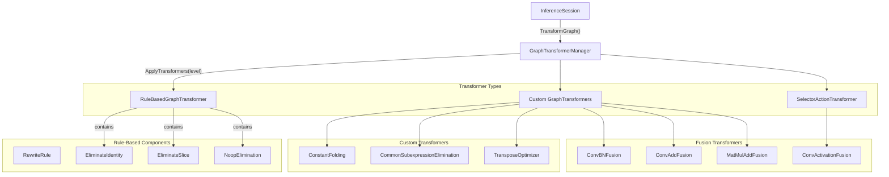

**Transformer Architecture: Core components and their relationships**

Sources: [onnxruntime/core/optimizer/graph_transformer_utils.cc:96-545](), [include/onnxruntime/core/optimizer/graph_transformer_utils.h:1-97]()

## Transformation Levels

Graph transformations are organized into four levels, applied sequentially during session initialization. Each level has specific optimization goals and constraints.

| Level | Name | Focus | Graph State Requirements |
|-------|------|-------|-------------------------|
| **Level 1** | Basic | Simple node eliminations, constant folding, basic fusions | No EP assignment required |
| **Level 2** | Extended | EP-specific fusions, quantization optimizations | Nodes assigned to EPs |
| **Level 3** | Layout | Layout transformations (NHWC, NCHWc) | EP-specific kernel support |
| **Level 4** | Precision | Data type conversions (FP16→FP32 initializers) | Final optimizations |

### Level 1: Basic Optimizations

Level 1 optimizations are applied before execution provider assignment and focus on simplifying the graph structure.

**Key Transformers:**
- **Rule-Based Transformer**: Contains multiple rewrite rules applied pattern-by-pattern
- **ConstantFolding**: Evaluates constant operations at graph build time
- **CommonSubexpressionElimination**: Removes duplicate computations
- **ConstantSharing**: Deduplicates initializers with identical values
- **TransposeOptimizer**: Moves or eliminates Transpose operations


**Level 1 Rule Application: Sequential pattern matching and rewriting**

Sources: [onnxruntime/core/optimizer/graph_transformer_utils.cc:117-164](), [onnxruntime/core/optimizer/graph_transformer_utils.cc:229-280]()

### Level 2: Extended Optimizations

Level 2 optimizations are applied after execution provider partitioning and include EP-specific fusions and quantization optimizations.

**Key Transformers:**
- **ConvActivationFusion**: Fuses Conv with activation functions (Relu, Sigmoid, etc.)
- **AttentionFusion**: Fuses MatMul-Add patterns into Attention operators
- **LayerNormFusion**: Recognizes and fuses LayerNorm patterns
- **QDQSelectorActionTransformer**: Applies QDQ (Quantize-Dequantize) transformations
- **GeluFusion**: Fuses GELU activation patterns

Sources: [onnxruntime/core/optimizer/graph_transformer_utils.cc:282-410]()

### Level 3: Layout Optimizations

Level 3 transformations modify tensor layouts for specific hardware optimizations.

**Key Transformers:**
- **NchwcTransformer**: Converts NCHW layout to NCHWc (blocked layout) for CPU
- **NhwcTransformer**: Converts NCHW to NHWC for mobile/ARM processors
- **ConvAddActivationFusion**: Three-way fusion for CPU execution

Sources: [onnxruntime/core/optimizer/graph_transformer_utils.cc:413-437]()

### Level 4: Precision Optimizations

Level 4 handles data type conversions and precision management.

**Key Transformers:**
- **FuseInitializersTransformer**: Converts FP16 initializers to FP32 for nodes requiring FP32

Sources: [onnxruntime/core/optimizer/graph_transformer_utils.cc:439-447]()

## Graph Transformer Base Classes

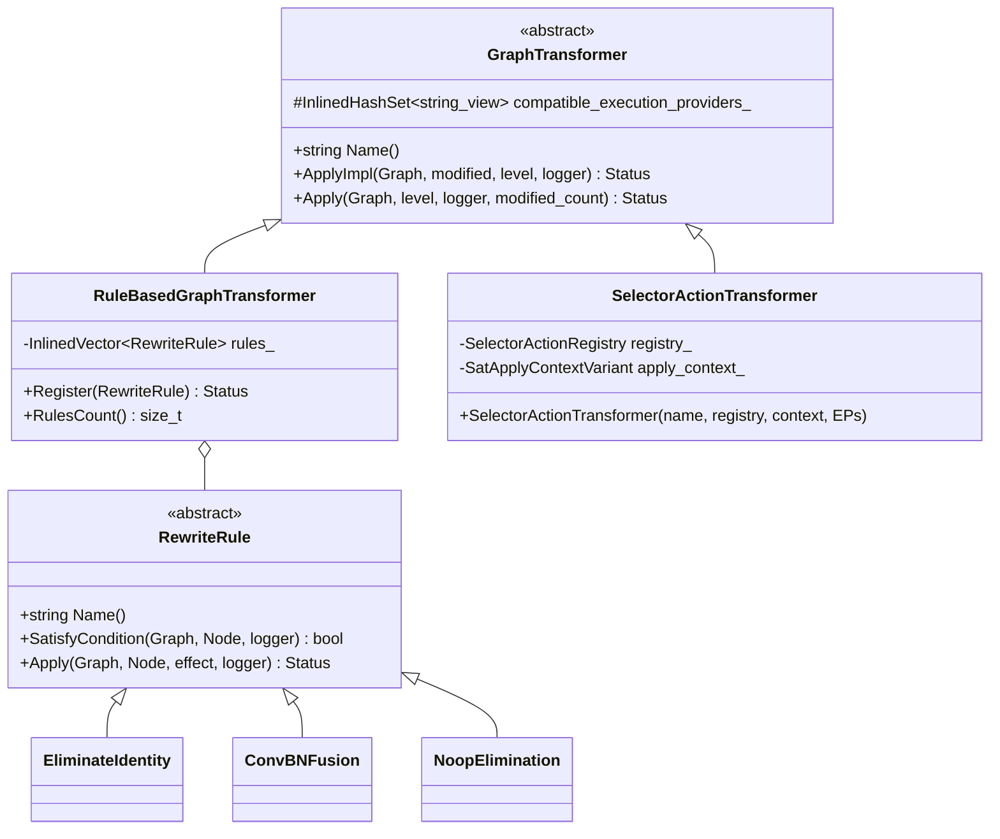

**Class Hierarchy: GraphTransformer inheritance structure**

Sources: [onnxruntime/core/optimizer/graph_transformer.h](), [onnxruntime/core/optimizer/rule_based_graph_transformer.h](), [onnxruntime/core/optimizer/rewrite_rule.h]()

### RewriteRule Interface

`RewriteRule` is the base class for simple pattern-matching transformations:

- `SatisfyCondition()`: Returns true if the pattern matches
- `Apply()`: Performs the transformation when conditions are satisfied

Example rules include `EliminateIdentity`, `EliminateSlice`, and `ConvBNFusion`.

Sources: [onnxruntime/core/optimizer/identity_elimination.cc:12-84](), [onnxruntime/core/optimizer/slice_elimination.cc:10-122]()

### SelectorActionTransformer Framework

The Selector-Action framework provides a more flexible pattern matching and transformation system, particularly useful for complex multi-node patterns.

**Components:**
- **NodeSelector**: Identifies node patterns for optimization
- **Action**: Performs the transformation on selected nodes
- **SelectorActionRegistry**: Maps operations to selector-action pairs

Sources: [onnxruntime/core/optimizer/selectors_actions/selector_action_transformer.h:1-158](), [onnxruntime/core/optimizer/qdq_transformer/selectors_actions/qdq_selector_action_transformer.cc:1-420]()

## Common Optimization Patterns

### Fusion Optimizations

Fusion combines multiple operations into single optimized kernels to reduce memory bandwidth and kernel launch overhead.

#### Conv + BatchNormalization Fusion

Mathematically folds BatchNorm parameters into Conv weights and biases.

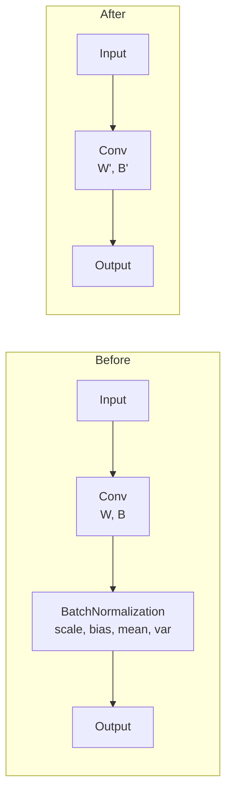

**Conv-BN Fusion: Eliminating BatchNorm by folding into Conv**

**Transformation Logic:**
1. Compute: `W' = W * scale / sqrt(var + epsilon)`
2. Compute: `B' = (B - mean) * scale / sqrt(var + epsilon) + bias`
3. Replace Conv weights/bias with W', B'
4. Remove BatchNorm node

Sources: [onnxruntime/core/optimizer/conv_bn_fusion.cc:12-186]()

#### Conv + Add Fusion

Adds bias to Conv when Conv has no bias, or combines biases when Conv already has bias.

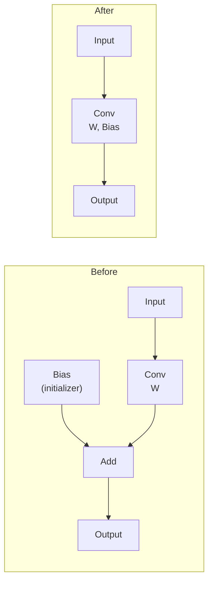

**Conv-Add Fusion: Incorporating Add into Conv bias**

Sources: [onnxruntime/core/optimizer/conv_add_fusion.cc:13-137]()

#### MatMul + Add → Gemm Fusion

Converts MatMul followed by Add into a single Gemm operation with bias.

**Conditions:**
- MatMul inputs must be 2D matrices (or can be reshaped to 2D)
- Add bias shape must broadcast correctly: `(N)`, `(1, N)`, `(M, 1)`, or `(M, N)`
- Both inputs must have same data type (float/float16/bfloat16)

**Special Handling:**
- If MatMul input is >2D, adds Reshape nodes before/after Gemm
- Preserves attention patterns when `preserve_attention_pattern_ = true`

Sources: [onnxruntime/core/optimizer/matmul_add_fusion.cc:70-259]()

#### Conv + Activation Fusion

Fuses convolution with activation functions into a single `FusedConv` operator.

**Supported Activations (CPU/JS/WebGPU):**
- Relu, Sigmoid, Tanh, LeakyRelu
- Clip (with constant min/max)
- HardSigmoid

**Implementation:**
- Converts `Conv → Activation` into `FusedConv` with activation attribute
- Stores activation parameters (e.g., LeakyRelu alpha) as node attributes

Sources: [onnxruntime/core/optimizer/conv_activation_fusion.cc:1-236]()

### Elimination Optimizations

Elimination transformations remove redundant or no-op nodes from the graph.

#### Identity Elimination

Removes Identity nodes when safe to do so.

**Conditions for Removal:**
1. Input has only one consumer (the Identity node)
2. Input is not a graph output
3. OR Identity output is a graph output (special case: update producer's output def)

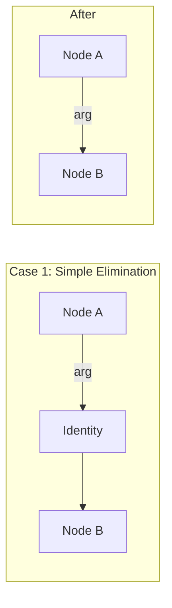

**Identity Elimination: Removing pass-through nodes**

Sources: [onnxruntime/core/optimizer/identity_elimination.cc:12-84]()

#### Dropout Elimination

Eliminates Dropout nodes during inference when:
- `ratio` attribute is 0.0, OR
- `training_mode` is false, OR
- Optional `mask` output is unused

Sources: [onnxruntime/test/optimizer/graph_transform_test.cc:536-558]()

#### Noop Elimination

Removes arithmetic operations that have no effect:
- `x + 0` → `x`
- `x - 0` → `x`
- `x * 1` → `x`
- `x / 1` → `x`

**Constraints:**
- Constant must broadcast correctly
- Output is not a graph output
- Constant rank must not exceed input rank

Sources: [onnxruntime/test/optimizer/graph_transform_test.cc:233-534]()

### Constant Folding

Evaluates operations with constant inputs at graph build time, replacing them with pre-computed initializers.

**Process:**
1. Identify nodes with all constant inputs
2. Create temporary ORT session to evaluate the node
3. Replace node with initializer containing the result
4. Override node EP assignment to CPU for evaluation

**Special Handling:**
- Works across execution provider boundaries (evaluates on CPU)
- Processes subgraphs recursively
- Skips DequantizeLinear when `skip_dequantize_linear = true`

Sources: [onnxruntime/test/optimizer/graph_transform_test.cc:582-681](), [onnxruntime/core/optimizer/graph_transformer_utils.cc:254-256]()

### Common Subexpression Elimination

Removes duplicate computations by reusing results from identical operations.

**Criteria for Deduplication:**
- Same operator type
- Same inputs (in the same order)
- Same attributes
- **Exception**: Does not merge DequantizeLinear nodes (to support QDQ patterns)

Sources: [onnxruntime/test/optimizer/graph_transform_test.cc:168-209](), [onnxruntime/core/optimizer/graph_transformer_utils.cc:254]()

## QDQ Transformers

QDQ (Quantize-Dequantize) transformers are crucial for optimizing quantized models. They identify patterns of `QuantizeLinear` and `DequantizeLinear` nodes and replace them with fused quantized operations or eliminate redundant QDQ pairs.

The `QDQSelectorActionTransformer` [onnxruntime/core/optimizer/qdq_transformer/selectors_actions/qdq_selector_action_transformer.cc:9-16]() is a key component, using the Selector-Action framework to apply these transformations.

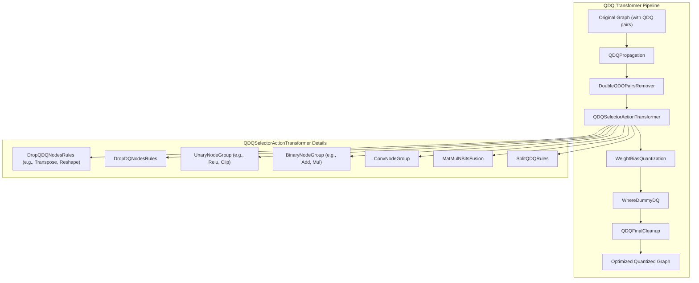

**QDQ Transformer Pipeline: Key stages and `QDQSelectorActionTransformer` components**

Sources: [onnxruntime/core/optimizer/qdq_transformer/qdq_propagation.cc:1-519](), [onnxruntime/core/optimizer/double_qdq_pairs_remover.cc:1-100](), [onnxruntime/core/optimizer/qdq_transformer/weight_bias_quantization.cc:1-265](), [onnxruntime/core/optimizer/qdq_transformer/where_dummy_dq.cc:1-100](), [onnxruntime/core/optimizer/qdq_transformer/qdq_final_cleanup.cc:1-100](), [onnxruntime/core/optimizer/qdq_transformer/selectors_actions/qdq_selector_action_transformer.cc:40-122]()

### QDQ Selector Logic

The `QDQ::NodeGroupSelector` [onnxruntime/core/optimizer/qdq_transformer/selectors_actions/qdq_selectors.h:18-40]() is a base class for identifying patterns of QDQ nodes around a target operation.

**Key Selector Types:**
- `DropQDQNodeGroupSelector`: For operations that don't change data (e.g., `Transpose`, `Reshape`). These can often have their QDQ pairs removed entirely. [onnxruntime/core/optimizer/qdq_transformer/selectors_actions/qdq_selectors.h:49-63]()
- `DropDQNodeGroupSelector`: For operations where only the `DequantizeLinear` can be removed. [onnxruntime/core/optimizer/qdq_transformer/selectors_actions/qdq_selectors.h:66-78]()
- `UnaryNodeGroupSelector`: For unary operations like `Relu` or `Clip`. [onnxruntime/core/optimizer/qdq_transformer/selectors_actions/qdq_selectors.h:81-93]()
- `BinaryNodeGroupSelector`: For binary operations like `Add` or `Mul`. [onnxruntime/core/optimizer/qdq_transformer/selectors_actions/qdq_selectors.h:110-122]()
- `ConvNodeGroupSelector`: Specifically for `Conv` operations, handling multiple inputs (X, W, B). [onnxruntime/core/optimizer/qdq_transformer/selectors_actions/qdq_selectors.h:159-171]()
- `SplitNodeGroupSelector`: For `Split` operations, ensuring consistent quantization parameters across outputs. [onnxruntime/core/optimizer/qdq_transformer/selectors_actions/qdq_selectors.h:143-157]()

These selectors check conditions like data types (e.g., `Is16BitIntType`, `Is4BitIntType`, `Is8BitIntType` [onnxruntime/core/optimizer/qdq_transformer/selectors_actions/qdq_selectors.cc:21-39]()), constant scales/zero points, and whether the target node produces a graph output.

Sources: [onnxruntime/core/optimizer/qdq_transformer/selectors_actions/qdq_selectors.cc:70-96]()

### MatMulNBits Fusion

This fusion pattern targets `MatMul` operations where one of the inputs (typically weights) is quantized to 2, 4, or 8 bits. It replaces the `DequantizeLinear` and `MatMul` with a single `MatMulNBits` operator.

**Pattern:**
`DequantizeLinear` (for N-bit weight) -> `MatMul`

**Conditions:**
- The weight input to `MatMul` is N-bit quantized (INT2, UINT2, INT4, UINT4, INT8, UINT8). [onnxruntime/core/optimizer/qdq_transformer/selectors_actions/qdq_selectors.cc:43-45]()
- The `DequantizeLinear` node's scale and zero point are initializers.
- The `MatMul` operation can be efficiently implemented with N-bit weights.

**Example:**
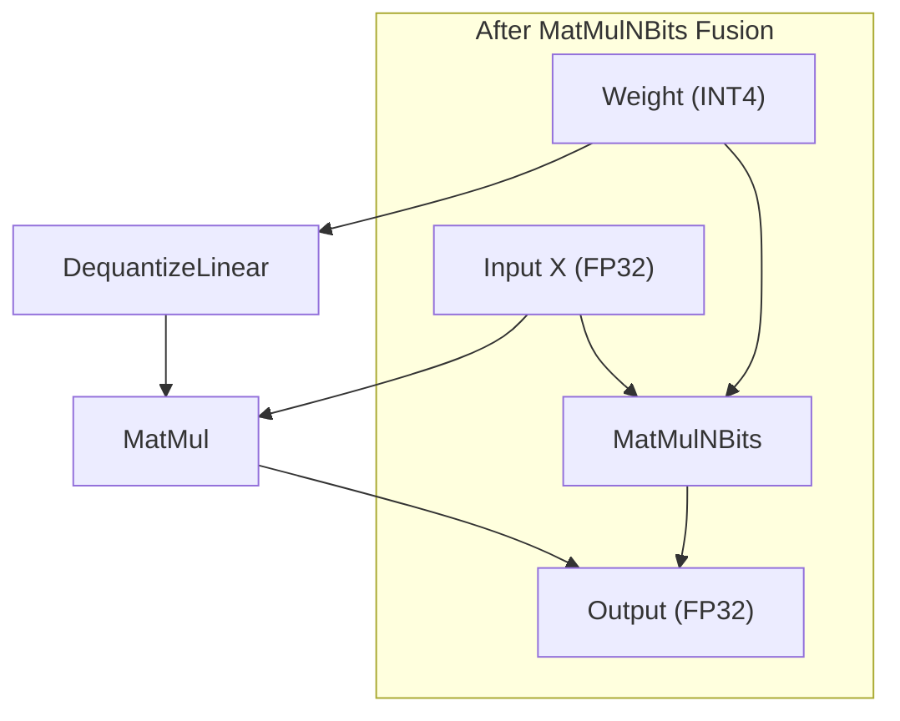

Sources: [onnxruntime/core/optimizer/matmul_nbits_fusion.h](), [onnxruntime/core/optimizer/graph_transformer_utils.cc:13]()

## Transpose and Layout Optimization

Transpose and layout optimizations aim to reduce the overhead of `Transpose` operations and convert models to more hardware-efficient layouts like NHWC or NCHWc.

### TransposeOptimizer

The `TransposeOptimizer` [onnxruntime/core/optimizer/transpose_optimizer.h]() attempts to eliminate or merge `Transpose` nodes. It works by propagating `Transpose` operations through compatible nodes or by canceling out inverse `Transpose` pairs.

**Key Strategies:**
- **Eliminate `Transpose(Transpose(X, P1), P2)`**: If `P1` and `P2` are inverse permutations, both can be removed.
- **Propagate `Transpose` through element-wise ops**: `Op(Transpose(X, P), Transpose(Y, P))` can become `Transpose(Op(X, Y), P)`.
- **Propagate `Transpose` through `Reshape`, `Squeeze`, `Unsqueeze`**: Adjusts the `perm` attribute of the `Transpose` or the attributes of the other node.
- **Propagate `Transpose` through `Split`, `Concat`**: Adjusts the `axis` attribute of `Split`/`Concat` and the `perm` of `Transpose`. [onnxruntime/test/optimizer/transpose_optimizer_test.cc:96-128]()

The optimization is implemented using the `onnx_transpose_optimization` namespace, which provides helper functions for manipulating permutations and node attributes. [onnxruntime/core/optimizer/transpose_optimization/onnx_transpose_optimization.cc:20-147]()

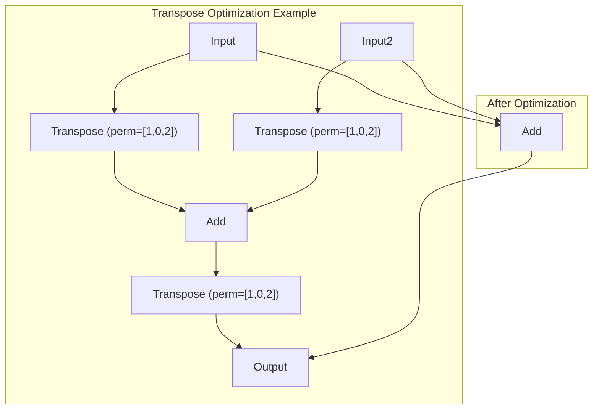

**Transpose Optimization: Eliminating redundant Transpose nodes around an Add operation**

Sources: [onnxruntime/core/optimizer/transpose_optimization/onnx_transpose_optimization.cc:20-147](), [onnxruntime/test/optimizer/transpose_optimizer_test.cc:96-128]()

### NCHWc Transformer

The `NchwcTransformer` [onnxruntime/core/optimizer/nchwc_transformer.h]() converts the NCHW (batch, channel, height, width) layout to NCHWc (batch, channel_block, height, width, channel_in_block) for certain CPU operations. This blocked layout can improve cache utilization and vectorization for kernels like `Conv` and `MaxPool`.

**Transformation Process:**
1. **Identify NCHWc-compatible nodes**: `Conv`, `MaxPool`, `Add`, `Mul`, `BatchNormalization`, `Clip`, `Relu`, `LeakyRelu`, `Reshape`, `Resize`, `Transpose`. [onnxruntime/core/optimizer/nchwc_transformer.cc:118-134]()
2. **Insert reorder nodes**: `Transpose` and `Reshape` nodes are inserted to convert NCHW inputs to NCHWc.
3. **Modify node attributes**: Update `Conv` weights to NCHWc layout (e.g., OIHW to OIHWc).
4. **Fuse activations**: Activations like `Relu` or `Clip` can be fused into the NCHWc `Conv` node. [onnxruntime/core/optimizer/nchwc_transformer.cc:138-140]()
5. **Track NCHWc arguments**: The `NchwcArgument` struct tracks the transformed `NodeArg`s and their properties (channels, shape, original uses). [onnxruntime/core/optimizer/nchwc_transformer.cc:28-106]()
6. **Insert reorder back to NCHW**: If an NCHWc output is consumed by a non-NCHWc compatible node or a graph output, reorder nodes are inserted to convert it back to NCHW.

**Conditions for NCHWc conversion:**
- The MLAS library must support NCHWc (checked by `MlasNchwcGetBlockSize()`). [onnxruntime/test/optimizer/nchwc_optimizer_test.cc:177-179]()
- Input/output shapes must be compatible with the blocked layout.

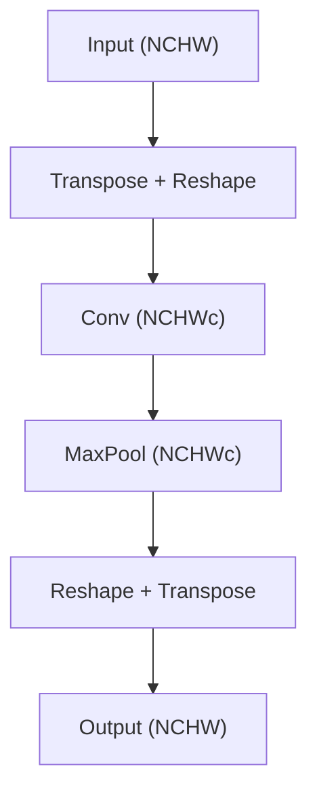

**NCHWc Transformation: Converting NCHW to NCHWc and back for optimized kernels**

Sources: [onnxruntime/core/optimizer/nchwc_transformer.cc:16-163](), [onnxruntime/test/optimizer/nchwc_optimizer_test.cc:172-185]()

### NHWC Transformer

The `NhwcTransformer` [onnxruntime/core/optimizer/nhwc_transformer.h]() converts NCHW models to NHWC (batch, height, width, channel) layout, primarily for mobile and ARM processors where NHWC is often more efficient.

**Transformation Process:**
- Inserts `Transpose` nodes to convert NCHW inputs to NHWC.
- Modifies `Conv` and other operators to operate on NHWC data.
- Inserts `Transpose` nodes to convert NHWC outputs back to NCHW if required by subsequent nodes or graph outputs.

Sources: [onnxruntime/core/optimizer/graph_transformer_utils.cc:14]()

## GraphTransformerManager

The `GraphTransformerManager` orchestrates transformer registration and application.

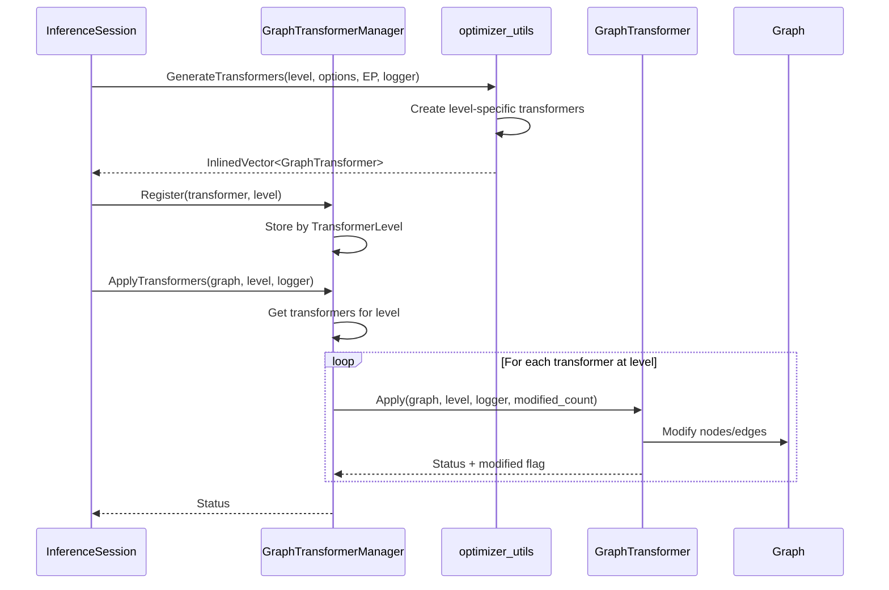

**GraphTransformerManager: Registration and application workflow**

**Key Methods:**
- `Register(transformer, level)`: Registers a transformer for a specific level
- `ApplyTransformers(graph, level, logger)`: Applies all transformers for the given level
- `GetTransformersForLevel(level)`: Retrieves transformers for a specific level (internal)

**Usage Pattern:**
```cpp
GraphTransformerManager manager{max_steps_per_level};
manager.Register(std::make_unique<ConstantFolding>(...), TransformerLevel::Level1);
manager.Register(std::make_unique<ConvBNFusion>(), TransformerLevel::Level1);
manager.ApplyTransformers(graph, TransformerLevel::Level1, logger);
```

Sources: [onnxruntime/core/optimizer/graph_transformer_utils.cc:96-109](), [onnxruntime/test/optimizer/graph_transform_test.cc:115-123]()

## Transformer Generation and Registration

### Full Build (Non-Minimal)

In full builds, transformers are generated dynamically based on configuration.

**Generation Flow:**
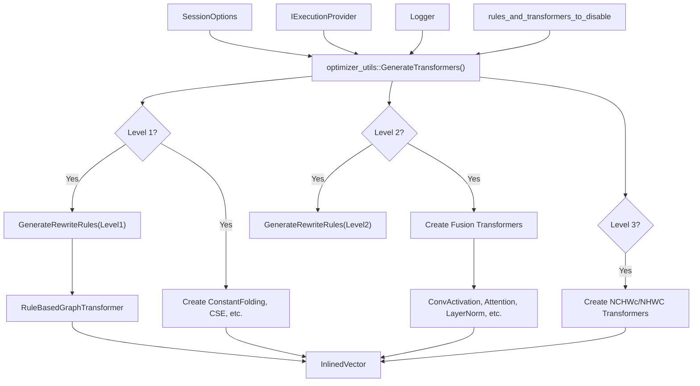

**Transformer Generation: Dynamic creation based on level and configuration**

**Disabling Transformers:**

Specific transformers can be disabled via the `rules_and_transformers_to_disable` set:

```cpp
InlinedHashSet<std::string> disabled = {"EliminateIdentity", "ConstantFolding"};
auto transformers = optimizer_utils::GenerateTransformers(
    TransformerLevel::Level1, session_options, cpu_ep, logger, disabled);
```

Sources: [onnxruntime/core/optimizer/graph_transformer_utils.cc:201-456](), [onnxruntime/test/optimizer/graph_transform_utils_test.cc:18-71]()

### Minimal Build

In minimal builds (ORT format models), only runtime-applicable transformers are included:

**Supported Transformers:**
- **Level 2**: QDQSelectorActionTransformer, ConvActivationFusion, MatMulNBitsFusion
- **Level 3**: NhwcTransformer (if active)
- QDQFinalCleanupTransformer (if enabled)

**Key Difference:**
- Transformers use `SatApplyContextVariant` to replay saved optimization decisions
- Graph::Resolve() is not available, so transformers must maintain graph validity
- Selector logic was executed during model export; only Action logic runs at runtime

Sources: [onnxruntime/core/optimizer/graph_transformer_utils.cc:462-541]()

## Execution Provider Compatibility

Many transformers are restricted to specific execution providers to ensure correct behavior.

**Compatibility Specification:**
```cpp
// CPU-only transformer
ConvActivationFusion transformer(
    InlinedHashSet<std::string_view>{kCpuExecutionProvider});

// Multi-EP transformer
GeluFusion transformer(
    InlinedHashSet<std::string_view>{
        kCpuExecutionProvider,
        kCudaExecutionProvider,
        kDmlExecutionProvider
    });
```

**Compatibility Check:**
The transformer checks if a node's assigned EP is in the compatible list before transforming:

```cpp
if (!graph_utils::IsSupportedProvider(node, compatible_execution_providers_)) {
    continue; // Skip this node
}
```

Sources: [onnxruntime/core/graph/graph_utils.h:178-182](), [onnxruntime/core/graph/graph_utils.cc:534-538]()

## Graph Modification Utilities

The `graph_utils` namespace provides utilities for safe graph manipulation during transformations.

### Node Removal Functions

| Function | Purpose | Requirements |
|----------|---------|--------------|
| `CanRemoveNode()` | Checks if node removal is safe | Node has single input edge or no edges, single used output, not producing graph output |
| `RemoveNode()` | Removes node and updates edges | Passes `CanRemoveNode()` checks |
| `CanReplaceNodeWithInitializer()` | Checks if node can be replaced with constant | Single used output, name matches if producing graph output |
| `ReplaceNodeWithInitializer()` | Replaces node with initializer | Passes replacement checks |

### Edge Manipulation

```cpp
// Replace downstream inputs
ReplaceDownstreamNodeInput(graph, node, output_idx, replacement, replacement_output_idx);

// Move edges
MoveAllNodeInputEdges(graph, src_node, target_node);
ReplaceNodeInput(node, input_idx, new_node_arg);
```

### Node Fusion

```cpp
// Fuse two nodes (e.g., Conv + BN)
FinalizeNodeFusion(graph, first_node, second_node);

// Fuse multiple nodes with replacement
FinalizeNodeFusion(graph, {node1, node2, node3}, replacement_node);
```

**FinalizeNodeFusion behavior:**
1. Moves output definitions from last node to replacement node
2. Moves input edges from first node to replacement node
3. Removes all original nodes
4. Updates graph structure

Sources: [onnxruntime/core/graph/graph_utils.h:290-394](), [onnxruntime/core/graph/graph_utils.cc:154-208]()

## Optimization in Training

Training graphs have specialized transformations to support gradient computation and memory optimization.

**Training-Specific Transformers:**
- **GeluRecompute**: Recomputes GELU in backward pass to save memory
- **AttentionDropoutRecompute**: Recomputes attention dropout masks
- **TransformerLayerRecompute**: Selective recomputation of transformer layers
- **InsertMaxPoolOutput**: Adds required outputs for gradient computation
- **BatchNormReplacement**: Converts BatchNormalization to BatchNormInternal with training outputs

**Optimization Ordering:**
1. Apply CommonSubexpressionElimination early (before recompute transformations)
2. Apply recompute transformations
3. Apply standard fusions (GeluFusion, LayerNormFusion)
4. Apply compute optimizations (PaddingElimination, UpStreamGather)

Sources: [orttraining/orttraining/core/optimizer/graph_transformer_utils.cc:82-251]()

## Testing Graph Transformations

The codebase provides extensive testing infrastructure for transformers.

**Test Helpers:**
- `GraphTransformationTests`: Test fixture with logger
- `ModelTestBuilder`: Programmatic graph construction
- `TestGraphTransformer()`: Applies transformer and validates results
- `CountOpsInGraph()`: Counts operator types before/after transformation

**Example Test Pattern:**
```cpp
TEST_F(GraphTransformationTests, ConvBNFusion) {
    // Build test graph with Conv → BN pattern
    auto build_test_case = [](ModelTestBuilder& builder) { ... };
    
    // Verify initial state
    auto pre_graph_checker = [](Graph& graph) {
        TEST_RETURN_IF_NOT(CountOpsInGraph(graph)["BatchNormalization"] == 1);
        return Status::OK();
    };
    
    // Verify transformed state
    auto post_graph_checker = [](Graph& graph) {
        TEST_RETURN_IF_NOT(CountOpsInGraph(graph)["BatchNormalization"] == 0);
        TEST_RETURN_IF_NOT(CountOpsInGraph(graph)["Conv"] == 1);
        return Status::OK();
    };
    
    // Apply transformation
    ASSERT_STATUS_OK(TestGraphTransformer(
        build_test_case, opset, logger, 
        std::make_unique<ConvBNFusion>(), 
        TransformerLevel::Level1, 1,
        pre_graph_checker, post_graph_checker));
}
```

Sources: [onnxruntime/test/optimizer/graph_transform_test.cc:107-123](), [orttraining/orttraining/test/optimizer/graph_transform_test.cc:51-93]()

---

