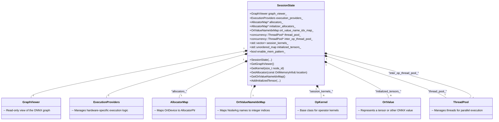
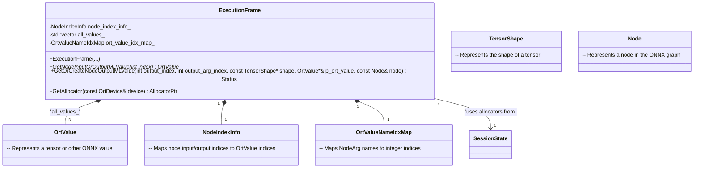
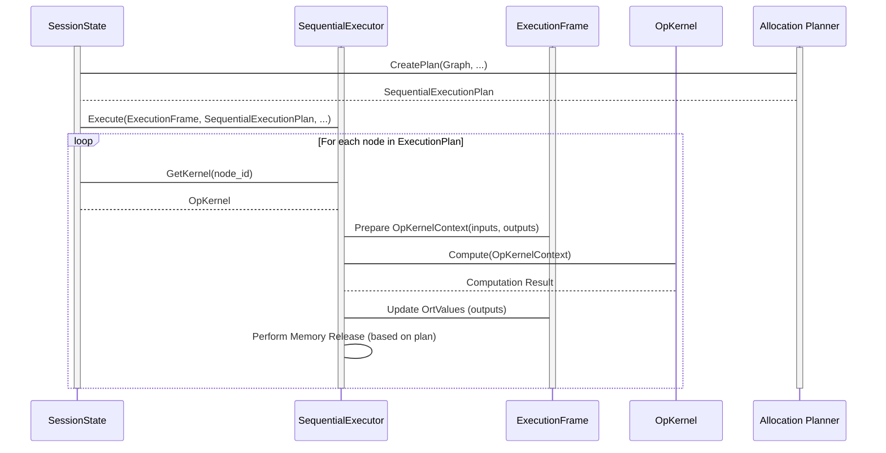
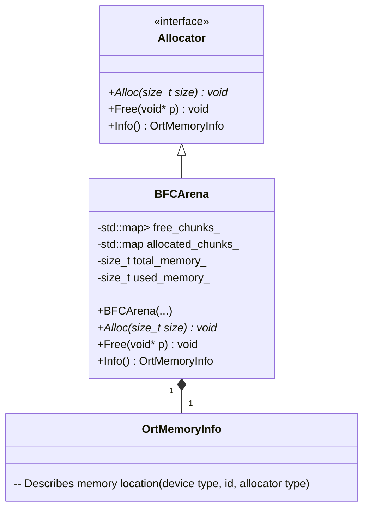
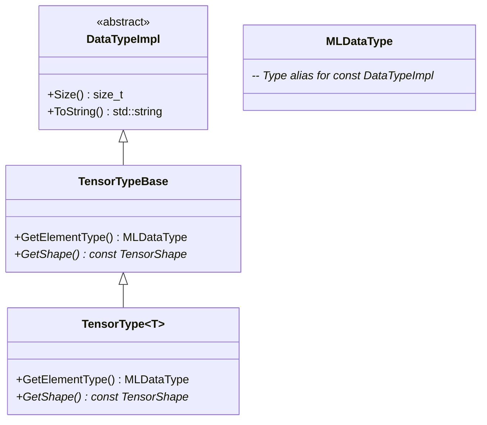
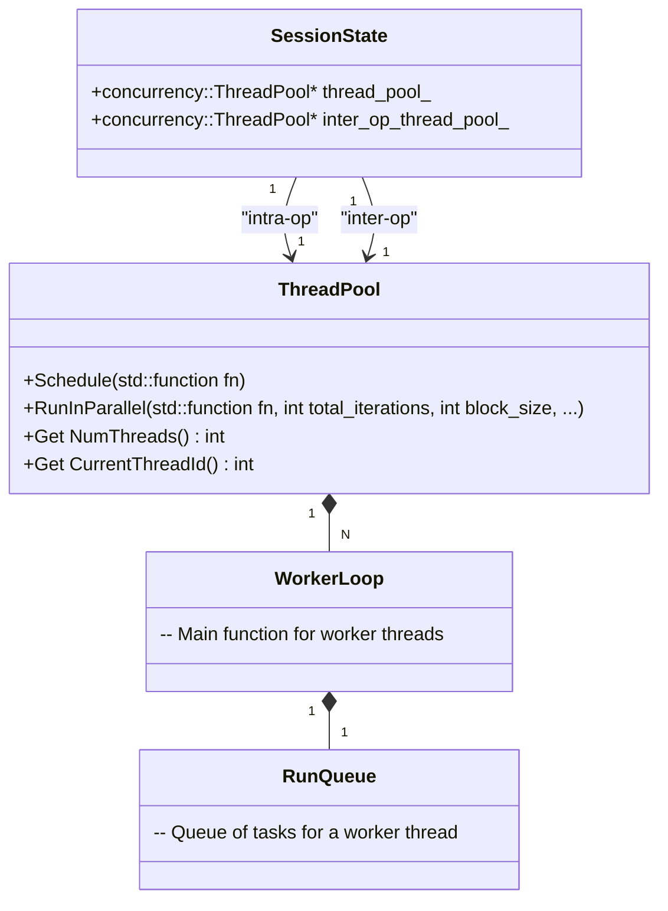

<!-- source: DeepWiki mcp.deepwiki.com · repo microsoft/onnxruntime · page 3.6 Execution Framework and Memory · fetched 2026-10-21 -->

# Execution Framework and Memory

<details>
<summary>Relevant source files</summary>

The following files were used as context for generating this wiki page:

- [docs/NotesOnThreading.md](docs/NotesOnThreading.md)
- [include/onnxruntime/core/common/endian.h](include/onnxruntime/core/common/endian.h)
- [include/onnxruntime/core/common/float16.h](include/onnxruntime/core/common/float16.h)
- [include/onnxruntime/core/framework/allocator.h](include/onnxruntime/core/framework/allocator.h)
- [include/onnxruntime/core/framework/data_types.h](include/onnxruntime/core/framework/data_types.h)
- [include/onnxruntime/core/framework/data_types_internal.h](include/onnxruntime/core/framework/data_types_internal.h)
- [include/onnxruntime/core/framework/op_kernel_context.h](include/onnxruntime/core/framework/op_kernel_context.h)
- [include/onnxruntime/core/framework/to_tensor_proto_element_type.h](include/onnxruntime/core/framework/to_tensor_proto_element_type.h)
- [include/onnxruntime/core/platform/Barrier.h](include/onnxruntime/core/platform/Barrier.h)
- [include/onnxruntime/core/platform/EigenNonBlockingThreadPool.h](include/onnxruntime/core/platform/EigenNonBlockingThreadPool.h)
- [include/onnxruntime/core/platform/threadpool.h](include/onnxruntime/core/platform/threadpool.h)
- [include/onnxruntime/core/session/onnxruntime_float16.h](include/onnxruntime/core/session/onnxruntime_float16.h)
- [onnxruntime/contrib_ops/cpu/quantization/dequantize_blockwise_bnb4.h](onnxruntime/contrib_ops/cpu/quantization/dequantize_blockwise_bnb4.h)
- [onnxruntime/core/common/threadpool.cc](onnxruntime/core/common/threadpool.cc)
- [onnxruntime/core/framework/allocation_planner.cc](onnxruntime/core/framework/allocation_planner.cc)
- [onnxruntime/core/framework/allocation_planner.h](onnxruntime/core/framework/allocation_planner.h)
- [onnxruntime/core/framework/allocator.cc](onnxruntime/core/framework/allocator.cc)
- [onnxruntime/core/framework/allocator_stats.h](onnxruntime/core/framework/allocator_stats.h)
- [onnxruntime/core/framework/bfc_arena.cc](onnxruntime/core/framework/bfc_arena.cc)
- [onnxruntime/core/framework/bfc_arena.h](onnxruntime/core/framework/bfc_arena.h)
- [onnxruntime/core/framework/data_types.cc](onnxruntime/core/framework/data_types.cc)
- [onnxruntime/core/framework/element_type_lists.h](onnxruntime/core/framework/element_type_lists.h)
- [onnxruntime/core/framework/execution_frame.cc](onnxruntime/core/framework/execution_frame.cc)
- [onnxruntime/core/framework/execution_frame.h](onnxruntime/core/framework/execution_frame.h)
- [onnxruntime/core/framework/onnxruntime_map_type_info.cc](onnxruntime/core/framework/onnxruntime_map_type_info.cc)
- [onnxruntime/core/framework/onnxruntime_map_type_info.h](onnxruntime/core/framework/onnxruntime_map_type_info.h)
- [onnxruntime/core/framework/onnxruntime_typeinfo.cc](onnxruntime/core/framework/onnxruntime_typeinfo.cc)
- [onnxruntime/core/framework/op_kernel.cc](onnxruntime/core/framework/op_kernel.cc)
- [onnxruntime/core/framework/op_kernel_context_internal.h](onnxruntime/core/framework/op_kernel_context_internal.h)
- [onnxruntime/core/framework/sequential_execution_plan.h](onnxruntime/core/framework/sequential_execution_plan.h)
- [onnxruntime/core/framework/sequential_executor.cc](onnxruntime/core/framework/sequential_executor.cc)
- [onnxruntime/core/framework/session_state.cc](onnxruntime/core/framework/session_state.cc)
- [onnxruntime/core/framework/session_state.h](onnxruntime/core/framework/session_state.h)
- [onnxruntime/core/framework/session_state_utils.h](onnxruntime/core/framework/session_state_utils.h)
- [onnxruntime/core/framework/simple_tensor_allocator.cc](onnxruntime/core/framework/simple_tensor_allocator.cc)
- [onnxruntime/core/framework/simple_tensor_allocator.h](onnxruntime/core/framework/simple_tensor_allocator.h)
- [onnxruntime/core/framework/tensor_allocator.cc](onnxruntime/core/framework/tensor_allocator.cc)
- [onnxruntime/core/framework/tensor_allocator.h](onnxruntime/core/framework/tensor_allocator.h)
- [onnxruntime/core/framework/tensor_allocator_with_mem_pattern.h](onnxruntime/core/framework/tensor_allocator_with_mem_pattern.h)
- [onnxruntime/core/framework/tensor_type_and_shape.cc](onnxruntime/core/framework/tensor_type_and_shape.cc)
- [onnxruntime/core/framework/utils.cc](onnxruntime/core/framework/utils.cc)
- [onnxruntime/core/framework/utils.h](onnxruntime/core/framework/utils.h)
- [onnxruntime/core/optimizer/constant_folding.cc](onnxruntime/core/optimizer/constant_folding.cc)
- [onnxruntime/core/optimizer/optimizer_execution_frame.cc](onnxruntime/core/optimizer/optimizer_execution_frame.cc)
- [onnxruntime/core/optimizer/optimizer_execution_frame.h](onnxruntime/core/optimizer/optimizer_execution_frame.h)
- [onnxruntime/core/platform/env.cc](onnxruntime/core/platform/env.cc)
- [onnxruntime/core/platform/env.h](onnxruntime/core/platform/env.h)
- [onnxruntime/core/platform/posix/env.cc](onnxruntime/core/platform/posix/env.cc)
- [onnxruntime/core/platform/windows/env.cc](onnxruntime/core/platform/windows/env.cc)
- [onnxruntime/core/platform/windows/env.h](onnxruntime/core/platform/windows/env.h)
- [onnxruntime/core/platform/windows/stacktrace.cc](onnxruntime/core/platform/windows/stacktrace.cc)
- [onnxruntime/core/providers/cuda/math/clip.cc](onnxruntime/core/providers/cuda/math/clip.cc)
- [onnxruntime/core/providers/cuda/math/clip.h](onnxruntime/core/providers/cuda/math/clip.h)
- [onnxruntime/core/providers/cuda/math/clip_impl.cu](onnxruntime/core/providers/cuda/math/clip_impl.cu)
- [onnxruntime/core/session/allocator_adapters.cc](onnxruntime/core/session/allocator_adapters.cc)
- [onnxruntime/core/session/allocator_adapters.h](onnxruntime/core/session/allocator_adapters.h)
- [onnxruntime/core/session/default_cpu_allocator_c_api.cc](onnxruntime/core/session/default_cpu_allocator_c_api.cc)
- [onnxruntime/core/util/thread_utils.cc](onnxruntime/core/util/thread_utils.cc)
- [onnxruntime/core/util/thread_utils.h](onnxruntime/core/util/thread_utils.h)
- [onnxruntime/test/framework/allocation_planner_test.cc](onnxruntime/test/framework/allocation_planner_test.cc)
- [onnxruntime/test/framework/bfc_arena_test.cc](onnxruntime/test/framework/bfc_arena_test.cc)
- [onnxruntime/test/framework/data_types_test.cc](onnxruntime/test/framework/data_types_test.cc)
- [onnxruntime/test/framework/execution_frame_test.cc](onnxruntime/test/framework/execution_frame_test.cc)
- [onnxruntime/test/framework/session_state_test.cc](onnxruntime/test/framework/session_state_test.cc)
- [onnxruntime/test/framework/type_info_test.cc](onnxruntime/test/framework/type_info_test.cc)
- [onnxruntime/test/global_thread_pools/test_main.cc](onnxruntime/test/global_thread_pools/test_main.cc)
- [onnxruntime/test/optimizer/optimizer_test.cc](onnxruntime/test/optimizer/optimizer_test.cc)
- [onnxruntime/test/perftest/posix/utils.cc](onnxruntime/test/perftest/posix/utils.cc)
- [onnxruntime/test/platform/barrier_test.cc](onnxruntime/test/platform/barrier_test.cc)
- [onnxruntime/test/platform/env_test.cc](onnxruntime/test/platform/env_test.cc)
- [onnxruntime/test/platform/file_io_test.cc](onnxruntime/test/platform/file_io_test.cc)
- [onnxruntime/test/platform/threadpool_test.cc](onnxruntime/test/platform/threadpool_test.cc)
- [onnxruntime/test/shared_lib/test_allocator.cc](onnxruntime/test/shared_lib/test_allocator.cc)
- [onnxruntime/test/shared_lib/test_nontensor_types.cc](onnxruntime/test/shared_lib/test_nontensor_types.cc)
- [onnxruntime/test/testdata/multi_stream_models/cpu_if.onnx](onnxruntime/test/testdata/multi_stream_models/cpu_if.onnx)
- [onnxruntime/test/util/include/test_allocator.h](onnxruntime/test/util/include/test_allocator.h)
- [onnxruntime/test/util/test_allocator.cc](onnxruntime/test/util/test_allocator.cc)
- [orttraining/orttraining/core/graph/training_op_defs.h](orttraining/orttraining/core/graph/training_op_defs.h)
- [tools/python/benchmark_mmap_ort.py](tools/python/benchmark_mmap_ort.py)

</details>


This page details the core components involved in executing an ONNX Runtime model and managing memory during inference. It covers `SessionState`, the allocation planner, `ExecutionFrame`, the `SequentialExecutor`, memory allocators (including `BFCArena`), data types, and thread pools.

## SessionState

The `SessionState` class [onnxruntime/core/framework/session_state.h:91-104]() is a central component that holds all the necessary information for executing a graph. It is initialized by the `InferenceSession` and contains kernels, allocators, execution providers, and other runtime data.

Key responsibilities of `SessionState` include:
*   **Graph Representation**: It holds a `GraphViewer` [onnxruntime/core/framework/session_state.h:110-110]() that provides a read-only view of the ONNX computation graph.
*   **Execution Providers**: Manages a collection of `ExecutionProviders` [onnxruntime/core/framework/session_state.h:123-123]() which are responsible for executing nodes on specific hardware.
*   **Kernels**: Stores `OpKernel` instances [onnxruntime/core/framework/session_state.h:114-116]() for each node in the graph, mapping node IDs to their corresponding kernel implementations.
*   **Allocators**: Manages `AllocatorPtr` instances [onnxruntime/core/framework/session_state.h:128-131]() for different memory locations (e.g., CPU, GPU). It provides methods to retrieve the appropriate allocator based on `OrtMemoryInfo` or `OrtDevice`.
*   **Initialized Tensors**: Stores pre-initialized tensors (weights) [onnxruntime/core/framework/session_state.h:157-160]() that are part of the model. These are loaded once and reused across multiple inference runs.
*   **OrtValue Name to Index Mapping**: Maintains a map (`OrtValueNameIdxMap`) [onnxruntime/core/framework/session_state.h:146-146]() that translates `NodeArg` names to unique integer indices, which are used internally for efficient access to `OrtValue`s.
*   **Thread Pools**: Holds references to `concurrency::ThreadPool` instances [onnxruntime/core/framework/session_state.h:109-110]() for intra-op and inter-op parallelism.
*   **Memory Pattern Optimization**: Can enable memory pattern optimization (`enable_mem_pattern_`) [onnxruntime/core/framework/session_state.cc:120-121]() for sequential execution, which helps in reusing memory buffers.


Sources: [onnxruntime/core/framework/session_state.h:91-104](), [onnxruntime/core/framework/session_state.h:110-110](), [onnxruntime/core/framework/session_state.h:123-123](), [onnxruntime/core/framework/session_state.h:128-131](), [onnxruntime/core/framework/session_state.h:146-146](), [onnxruntime/core/framework/session_state.h:114-116](), [onnxruntime/core/framework/session_state.h:157-160](), [onnxruntime/core/framework/session_state.h:109-110](), [onnxruntime/core/framework/session_state.cc:120-121]()

## Allocation Planner

The allocation planner is responsible for determining how memory should be allocated and reused for intermediate tensors during model execution. This is a crucial optimization, especially for sequential execution, to minimize memory footprint. The `SequentialExecutionPlan` [onnxruntime/core/framework/sequential_execution_plan.h:20-20]() encapsulates the results of this planning.

The `PlannerImpl` class [onnxruntime/core/framework/allocation_planner.cc:134-160]() is the core of the allocation planning logic. It takes a `GraphViewer`, execution providers, kernel information, and the `OrtValueNameIdxMap` as input. Its `CreatePlan` method [onnxruntime/core/framework/allocation_planner.cc:163-166]() generates the `SequentialExecutionPlan`.

The plan includes:
*   **Allocation Plan (`allocation_plan`)**: A vector of `PlannedAllocation` entries, one for each `OrtValue` index. Each entry specifies the `AllocKind` (e.g., `kAllocate`, `kReuse`, `kPreExisting`) and the `OrtMemoryInfo` location.
*   **Execution Plan (`execution_plan`)**: A sequence of `ExecutionStep` objects, which represent the order of operations and memory management actions.

The `AllocKind` enum [onnxruntime/core/framework/allocation_planner.cc:51-77]() defines different strategies for memory handling:
*   `kAllocate`: A new buffer needs to be allocated.
*   `kAllocateStatically`: A new buffer needs to be allocated and will be kept for the entire session.
*   `kPreExisting`: The buffer is already provided (e.g., model input).
*   `kReuse`: The buffer can reuse an existing buffer from a previous operation.
*   `kAllocateOutput`: An output buffer needs to be allocated.
*   `kShare`: The buffer is shared with another `OrtValue`.
*   `kAllocatedExternally`: The buffer is allocated by an external component.

The planner aims to maximize `kReuse` to reduce memory allocations and deallocations.

```mermaid
graph TD
    A[GraphViewer] --> B{PlannerImpl::CreatePlan};
    C[ExecutionProviders] --> B;
    D[KernelCreateInfoMap] --> B;
    E[OrtValueNameIdxMap] --> B;
    B --> F[SequentialExecutionPlan];
    F --> G[Allocation Plan (PlannedAllocation[])];
    F --> H[Execution Plan (ExecutionStep[])];

    subgraph PlannedAllocation
        G1[AllocKind]
        G2[OrtMemoryInfo]
    end

    subgraph ExecutionStep
        H1[NodeIndex]
        H2[Memory Management Actions]
    end
```
Sources: [onnxruntime/core/framework/sequential_execution_plan.h:20-20](), [onnxruntime/core/framework/allocation_planner.cc:134-160](), [onnxruntime/core/framework/allocation_planner.cc:163-166](), [onnxruntime/core/framework/allocation_planner.cc:51-77]()

## Execution Frame

The `ExecutionFrame` [onnxruntime/core/framework/execution_frame.h:28-38]() is responsible for managing the `OrtValue`s (tensors, sequences, etc.) during a single inference run. It acts as a container for all intermediate and output values.

Key aspects of `ExecutionFrame`:
*   **`OrtValue` Storage**: It maintains a vector `all_values_` [onnxruntime/core/framework/execution_frame.h:33-34]() that stores all `OrtValue`s indexed by their `OrtValue` index.
*   **Input/Output Management**: Provides methods like `GetNodeInputOrOutputMLValue` [onnxruntime/core/framework/execution_frame.cc:131-134]() and `GetOrCreateNodeOutputMLValue` [onnxruntime/core/framework/execution_frame.cc:144-146]() to access and allocate `OrtValue`s for node inputs and outputs.
*   **Memory Allocation**: When a node produces an output, the `ExecutionFrame` uses the `SessionState`'s allocators and the `SequentialExecutionPlan` to either allocate new memory or reuse existing buffers for the `OrtValue`.
*   **Shape Inference**: For outputs, it uses the provided `TensorShape` to allocate memory of the correct size. If an output `OrtValue` is pre-allocated by the user, the `ExecutionFrame` checks for shape compatibility and potentially reallocates if shapes differ [onnxruntime/core/framework/execution_frame.cc:156-167]().


Sources: [onnxruntime/core/framework/execution_frame.h:28-38](), [onnxruntime/core/framework/execution_frame.h:33-34](), [onnxruntime/core/framework/execution_frame.cc:131-134](), [onnxruntime/core/framework/execution_frame.cc:144-146](), [onnxruntime/core/framework/execution_frame.cc:156-167]()

## Sequential Executor

The `SequentialExecutor` [onnxruntime/core/framework/sequential_executor.h:4-4]() is responsible for executing the nodes of the ONNX graph in a predefined sequential order. It iterates through the `ExecutionPlan` generated by the allocation planner.

The `Execute` method [onnxruntime/core/framework/sequential_executor.cc:300-300]() is the entry point for running the model. For each node in the execution plan, it performs the following steps:
1.  **Kernel Retrieval**: Obtains the `OpKernel` associated with the current node from `SessionState`.
2.  **Input/Output Setup**: Prepares the `OpKernelContextInternal` [onnxruntime/core/framework/op_kernel_context_internal.h:20-20]() for the kernel, providing access to input `OrtValue`s and mechanisms to get/create output `OrtValue`s from the `ExecutionFrame`.
3.  **Kernel Execution**: Calls the `Compute` or `ComputeAsync` method of the `OpKernel` to perform the actual computation.
4.  **Memory Management**: After a node's execution, it performs memory release operations as specified by the `ExecutionPlan` to free up intermediate buffers that are no longer needed, enabling reuse.

The `SessionScope` class [onnxruntime/core/framework/sequential_executor.cc:156-179]() is used to manage profiling and debugging information for a session execution.


Sources: [onnxruntime/core/framework/sequential_executor.h:4-4](), [onnxruntime/core/framework/sequential_executor.cc:300-300](), [onnxruntime/core/framework/op_kernel_context_internal.h:20-20](), [onnxruntime/core/framework/sequential_executor.cc:156-179]()

## Allocators and BFC Arena

ONNX Runtime uses an abstract `Allocator` interface [include/onnxruntime/core/framework/allocator.h:30-30]() to manage memory. Different execution providers implement their own allocators.

The `BFCArena` (Best-Fit Caching Arena) [onnxruntime/core/framework/bfc_arena.h:20-20]() is a common memory allocator implementation used by ONNX Runtime, particularly for CPU and CUDA execution providers. It is designed to reduce memory fragmentation and improve allocation performance by reusing previously allocated blocks.

Key features of `BFCArena`:
*   **Best-Fit Strategy**: When a memory request comes, it searches for the smallest available block that can satisfy the request.
*   **Caching**: It keeps track of freed memory blocks and reuses them for subsequent allocations, avoiding repeated calls to the underlying system allocator (e.g., `malloc` or `cudaMalloc`).
*   **Coalescing**: When blocks are freed, `BFCArena` attempts to merge adjacent free blocks to form larger contiguous blocks, reducing fragmentation.
*   **Debug Features**: Includes options for tracking memory usage, detecting leaks, and logging allocation events [onnxruntime/core/framework/bfc_arena.cc:100-100]().

The `Allocator` interface defines methods like `Alloc` [include/onnxruntime/core/framework/allocator.h:40-40()] and `Free` [include/onnxruntime/core/framework/allocator.h:41-41()] for memory management. `BFCArena` implements these methods efficiently.


Sources: [include/onnxruntime/core/framework/allocator.h:30-30](), [onnxruntime/core/framework/bfc_arena.h:20-20](), [include/onnxruntime/core/framework/allocator.h:40-40](), [include/onnxruntime/core/framework/allocator.h:41-41](), [onnxruntime/core/framework/bfc_arena.cc:100-100]()

## Data Types

ONNX Runtime supports a variety of data types for tensors and other values. These are defined in `data_types.h` [include/onnxruntime/core/framework/data_types.h:18-18]() and `data_types_internal.h` [include/onnxruntime/core/framework/data_types_internal.h:18-18]().

Key data type classes:
*   `DataTypeImpl`: Base class for all data types [include/onnxruntime/core/framework/data_types.h:20-20]().
*   `TensorTypeBase`: Base class for tensor types, providing common tensor properties [include/onnxruntime/core/framework/data_types.h:26-26]().
*   `TensorType<T>`: Template for specific tensor types (e.g., `TensorType<float>`, `TensorType<int32_t>`) [include/onnxruntime/core/framework/data_types.h:30-30]().
*   `MLDataType`: A type alias for `const DataTypeImpl*` [include/onnxruntime/core/framework/data_types.h:18-18](), used to represent the type of an `OrtValue`.

The `utils::Get =` functions [onnxruntime/core/framework/data_types.cc:10-10]() provide a way to retrieve `MLDataType` instances for common types.


Sources: [include/onnxruntime/core/framework/data_types.h:18-18](), [include/onnxruntime/core/framework/data_types_internal.h:18-18](), [include/onnxruntime/core/framework/data_types.h:20-20](), [include/onnxruntime/core/framework/data_types.h:26-26](), [include/onnxruntime/core/framework/data_types.h:30-30](), [onnxruntime/core/framework/data_types.cc:10-10]()

## Thread Pools

ONNX Runtime utilizes thread pools for parallel execution, both for operations within a single operator (intra-op parallelism) and for executing multiple independent operators concurrently (inter-op parallelism).

The `concurrency::ThreadPool` class [include/onnxruntime/core/platform/threadpool.h:30-30]() is the primary interface for managing threads. It is built upon a modified Eigen non-blocking thread pool [include/onnxruntime/core/platform/EigenNonBlockingThreadPool.h:12-12]().

Key components and concepts:
*   **`ThreadPool`**: Manages a set of worker threads.
*   **`WorkerLoop`**: The main function executed by each worker thread, which picks tasks from its run queue.
*   **Run Queues**: Each thread has its own queue of tasks. Workers can steal tasks from other threads' queues if their own is empty.
*   **Task Types**:
    *   **One-shot tasks**: Submitted via `Schedule()` for asynchronous work.
    *   **Parallel loop tasks**: Used for parallelizing loops within an operator. These tasks pick off iterations using atomic operations [include/onnxruntime/core/platform/EigenNonBlockingThreadPool.h:97-102]().
    *   **Parallel section tasks**: An extension for amortizing task creation costs over a series of loops [include/onnxruntime/core/platform/EigenNonBlockingThreadPool.h:108-112]().
*   **Revocation**: A mechanism to remove unexecuted tasks from queues, useful for managing captured state in parallel loops [include/onnxruntime/core/platform/EigenNonBlockingThreadPool.h:130-146]().
*   **Thread Options**: Allows configuration of thread properties like stack size and custom thread creation/joining functions [onnxruntime/core/platform/windows/env.cc:88-97]().

The `SessionState` holds two `ThreadPool` instances: `thread_pool_` for intra-op parallelism and `inter_op_thread_pool_` for inter-op parallelism [onnxruntime/core/framework/session_state.h:95-96]().


Sources: [include/onnxruntime/core/platform/threadpool.h:30-30](), [include/onnxruntime/core/platform/EigenNonBlockingThreadPool.h:12-12](), [include/onnxruntime/core/platform/EigenNonBlockingThreadPool.h:97-102](), [include/onnxruntime/core/platform/EigenNonBlockingThreadPool.h:108-112](), [include/onnxruntime/core/platform/EigenNonBlockingThreadPool.h:130-146](), [onnxruntime/core/platform/windows/env.cc:88-97](), [onnxruntime/core/framework/session_state.h:95-96]()

---

