<!-- source: DeepWiki mcp.deepwiki.com · repo microsoft/onnxruntime · page 4 Low-Level Compute Library · fetched 2026-10-21 -->

# Low-Level Compute Library

<details>
<summary>Relevant source files</summary>

The following files were used as context for generating this wiki page:

- [cmake/onnxruntime_mlas.cmake](cmake/onnxruntime_mlas.cmake)
- [onnxruntime/core/common/cpuid_info.cc](onnxruntime/core/common/cpuid_info.cc)
- [onnxruntime/core/common/cpuid_info.h](onnxruntime/core/common/cpuid_info.h)
- [onnxruntime/core/mlas/inc/mlas.h](onnxruntime/core/mlas/inc/mlas.h)
- [onnxruntime/core/mlas/lib/amd64/QgemmU8S8KernelAmx.asm](onnxruntime/core/mlas/lib/amd64/QgemmU8S8KernelAmx.asm)
- [onnxruntime/core/mlas/lib/amx_common.h](onnxruntime/core/mlas/lib/amx_common.h)
- [onnxruntime/core/mlas/lib/convolve.cpp](onnxruntime/core/mlas/lib/convolve.cpp)
- [onnxruntime/core/mlas/lib/dgemm.cpp](onnxruntime/core/mlas/lib/dgemm.cpp)
- [onnxruntime/core/mlas/lib/kleidiai/convolve_kleidiai.cpp](onnxruntime/core/mlas/lib/kleidiai/convolve_kleidiai.cpp)
- [onnxruntime/core/mlas/lib/kleidiai/mlasi_kleidiai.h](onnxruntime/core/mlas/lib/kleidiai/mlasi_kleidiai.h)
- [onnxruntime/core/mlas/lib/kleidiai/qgemm_kleidiai.cpp](onnxruntime/core/mlas/lib/kleidiai/qgemm_kleidiai.cpp)
- [onnxruntime/core/mlas/lib/kleidiai/sbgemm_kleidiai.cpp](onnxruntime/core/mlas/lib/kleidiai/sbgemm_kleidiai.cpp)
- [onnxruntime/core/mlas/lib/kleidiai/sgemm_kleidiai.cpp](onnxruntime/core/mlas/lib/kleidiai/sgemm_kleidiai.cpp)
- [onnxruntime/core/mlas/lib/mlasi.h](onnxruntime/core/mlas/lib/mlasi.h)
- [onnxruntime/core/mlas/lib/platform.cpp](onnxruntime/core/mlas/lib/platform.cpp)
- [onnxruntime/core/mlas/lib/qdwconv.cpp](onnxruntime/core/mlas/lib/qdwconv.cpp)
- [onnxruntime/core/mlas/lib/qgemm.cpp](onnxruntime/core/mlas/lib/qgemm.cpp)
- [onnxruntime/core/mlas/lib/qgemm.h](onnxruntime/core/mlas/lib/qgemm.h)
- [onnxruntime/core/mlas/lib/qgemm_kernel_amx.cpp](onnxruntime/core/mlas/lib/qgemm_kernel_amx.cpp)
- [onnxruntime/core/mlas/lib/qgemm_kernel_avx2.cpp](onnxruntime/core/mlas/lib/qgemm_kernel_avx2.cpp)
- [onnxruntime/core/mlas/lib/qgemm_kernel_default.cpp](onnxruntime/core/mlas/lib/qgemm_kernel_default.cpp)
- [onnxruntime/core/mlas/lib/qgemm_kernel_neon.cpp](onnxruntime/core/mlas/lib/qgemm_kernel_neon.cpp)
- [onnxruntime/core/mlas/lib/qgemm_kernel_sdot.cpp](onnxruntime/core/mlas/lib/qgemm_kernel_sdot.cpp)
- [onnxruntime/core/mlas/lib/qgemm_kernel_sse.cpp](onnxruntime/core/mlas/lib/qgemm_kernel_sse.cpp)
- [onnxruntime/core/mlas/lib/qgemm_kernel_sse41.cpp](onnxruntime/core/mlas/lib/qgemm_kernel_sse41.cpp)
- [onnxruntime/core/mlas/lib/qgemm_kernel_udot.cpp](onnxruntime/core/mlas/lib/qgemm_kernel_udot.cpp)
- [onnxruntime/core/mlas/lib/qgemm_kernel_wasmsimd.cpp](onnxruntime/core/mlas/lib/qgemm_kernel_wasmsimd.cpp)
- [onnxruntime/core/mlas/lib/sgemm.cpp](onnxruntime/core/mlas/lib/sgemm.cpp)
- [onnxruntime/core/mlas/lib/x86_64/QgemmU8S8KernelAmx.S](onnxruntime/core/mlas/lib/x86_64/QgemmU8S8KernelAmx.S)
- [onnxruntime/core/mlas/lib/x86_64/QgemmU8S8KernelAmxCommon.S](onnxruntime/core/mlas/lib/x86_64/QgemmU8S8KernelAmxCommon.S)
- [onnxruntime/test/contrib_ops/fused_conv_test.cc](onnxruntime/test/contrib_ops/fused_conv_test.cc)
- [onnxruntime/test/mlas/bench/bench_qgemm.cpp](onnxruntime/test/mlas/bench/bench_qgemm.cpp)
- [onnxruntime/test/mlas/bench/bench_sconv.cpp](onnxruntime/test/mlas/bench/bench_sconv.cpp)
- [onnxruntime/test/mlas/unittest/test_conv2d.h](onnxruntime/test/mlas/unittest/test_conv2d.h)
- [onnxruntime/test/mlas/unittest/test_fgemm.cpp](onnxruntime/test/mlas/unittest/test_fgemm.cpp)
- [onnxruntime/test/mlas/unittest/test_fgemm.h](onnxruntime/test/mlas/unittest/test_fgemm.h)
- [onnxruntime/test/mlas/unittest/test_fgemm_fixture.h](onnxruntime/test/mlas/unittest/test_fgemm_fixture.h)
- [onnxruntime/test/mlas/unittest/test_qgemm.cpp](onnxruntime/test/mlas/unittest/test_qgemm.cpp)
- [onnxruntime/test/mlas/unittest/test_qgemm_fixture.h](onnxruntime/test/mlas/unittest/test_qgemm_fixture.h)

</details>


## Purpose and Scope

This document describes **MLAS (Microsoft Linear Algebra Subprograms)**, the low-level compute library that provides highly optimized implementations of linear algebra operations and convolutions for ONNX Runtime. MLAS serves as the CPU execution backend, delivering hardware-specific kernel implementations for operations like matrix multiplication (GEMM), convolution, pooling, and quantization across multiple CPU architectures.

MLAS operates at the lowest level of the execution stack, directly above the hardware. For higher-level operator implementations that consume MLAS, see [Operators and Kernels](#7). For execution provider integration, see [CPU Execution Provider](#6.2).

**Scope of MLAS**:
- Matrix multiplication kernels (single/double precision, quantized)
- Convolution operations (direct, im2col, depthwise)
- Pooling operations (max, average)
- Activation functions (ReLU, tanh, logistic, ERF)
- Quantization/dequantization primitives
- Platform detection and runtime dispatch
- Architecture-specific assembly/intrinsic implementations

## Architecture Overview

MLAS provides a unified API that dispatches to platform-specific optimized kernels based on runtime CPU feature detection. The library is structured as a single static library with conditional compilation of platform-specific sources.

```mermaid
graph TB
    subgraph "Public API Layer"
        PublicAPI["mlas.h<br/>MlasGemm, MlasConv, etc."]
    end
    
    subgraph "Platform Abstraction"
        Platform["MLAS_PLATFORM<br/>platform.cpp"]
        Dispatch["Function Pointer Tables<br/>GemmFloatKernel, etc."]
        CPUIDInfo["MLAS_CPUIDINFO<br/>Feature Detection"]
    end
    
    subgraph "Operation Implementations"
        SGEMM["sgemm.cpp<br/>Single Precision"]
        DGEMM["dgemm.cpp<br/>Double Precision"]
        QGEMM["qgemm.cpp<br/>Quantized Integer"]
        Conv["convolve.cpp<br/>Convolutions"]
        Pool["pooling.cpp<br/>Pooling Ops"]
        Quant["quantize.cpp<br/>dequantize.cpp"]
        QNBitGemm["qnbitgemm.cpp<br/>N-bit Quantized"]
    end
    
    subgraph "x86/AMD64 Kernels"
        SSE["SSE2/SSE4.1<br/>Baseline x86"]
        AVX["AVX/AVX2<br/>256-bit SIMD"]
        AVX512["AVX512F/VNNI<br/>512-bit SIMD"]
        AMX["AMX<br/>Tile Matrix"]
    end
    
    subgraph "ARM Kernels"
        NEON["NEON<br/>128-bit SIMD"]
        DotProd["DotProd/UDOT/SDOT<br/>Integer dot products"]
        I8MM["i8mm<br/>8-bit matrix multiply"]
        SVE["SVE<br/>Scalable vectors"]
        KleidiAI["KleidiAI<br/>SME/SME2"]
    end
    
    subgraph "Other Platforms"
        Power["Power VSX/MMA"]
        Wasm["WebAssembly SIMD"]
        LoongArch["LoongArch LSX/LASX"]
        RISCV["RISC-V RVV"]
    end
    
    PublicAPI --> Platform
    Platform --> Dispatch
    CPUIDInfo --> Platform
    
    Dispatch --> SGEMM
    Dispatch --> DGEMM
    Dispatch --> QGEMM
    Dispatch --> Conv
    Dispatch --> Pool
    Dispatch --> Quant
    Dispatch --> QNBitGemm
    
    SGEMM --> SSE
    SGEMM --> AVX
    SGEMM --> AVX512
    
    QGEMM --> SSE
    QGEMM --> AVX
    QGEMM --> AMX
    QGEMM --> NEON
    QGEMM --> DotProd
    QGEMM --> KleidiAI
    
    Conv --> NEON
    Conv --> AVX
    Conv --> KleidiAI
    
    Platform --> SSE
    Platform --> AVX
    Platform --> AVX512
    Platform --> AMX
    Platform --> NEON
    Platform --> DotProd
    Platform --> I8MM
    Platform --> SVE
    Platform --> KleidiAI
    Platform --> Power
    Platform --> Wasm
    Platform --> LoongArch
    Platform --> RISCV
```

Sources: [onnxruntime/core/mlas/inc/mlas.h:1-100](), [onnxruntime/core/mlas/lib/platform.cpp:237-255](), [onnxruntime/core/mlas/lib/mlasi.h:1-50](), [cmake/onnxruntime_mlas.cmake:20-70]()

## Platform Detection and Initialization

MLAS uses runtime CPU feature detection to select the best available kernel implementation. The `MLAS_PLATFORM` singleton is initialized on first use and configures function pointers to architecture-specific implementations.

### Platform Detection Flow

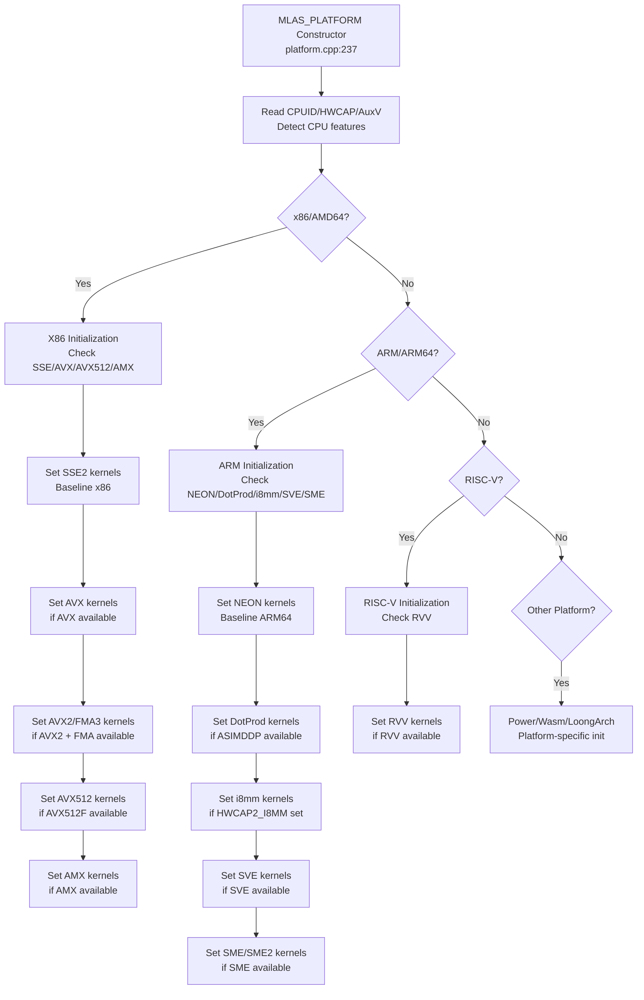

**Key Detection Mechanisms**:

| Platform | Detection Method | Key Features Checked |
|----------|-----------------|---------------------|
| x86/AMD64 | `__cpuid` / `__cpuidex` | SSE2, SSE4.1, AVX, AVX2, FMA3, AVX512F, AVX512VNNI, AMX |
| ARM64 Linux | `getauxval(AT_HWCAP)` | HWCAP_ASIMDDP, HWCAP2_I8MM, HWCAP_SVE, HWCAP2_SVEI8MM, HWCAP2_BF16, HWCAP_SME, HWCAP_SME2 |
| ARM64 Windows | `IsProcessorFeaturePresent` | PF_ARM_V82_DP_INSTRUCTIONS_AVAILABLE |
| ARM64 macOS | cpuinfo library | Feature detection via cpuinfo |
| Power | `getauxval` / systemcfg | POWER9, POWER10, MMA |
| RISC-V | `getauxval` / `riscv_hwprobe` | RVV |

Sources: [onnxruntime/core/mlas/lib/platform.cpp:68-267](), [onnxruntime/core/common/cpuid_info.cc:141-219](), [onnxruntime/core/mlas/lib/mlasi.h:253-261]()

### MLAS_PLATFORM Structure

The `MLAS_PLATFORM` class holds function pointers to selected kernel implementations. For details, see [MLAS Architecture](#4.1).

Sources: [onnxruntime/core/mlas/lib/mlasi.h:1800-2100](), [onnxruntime/core/mlas/lib/platform.cpp:264-556]()

## Matrix Multiplication (GEMM)

MLAS provides highly optimized General Matrix Multiply (GEMM) implementations for single precision (SGEMM), double precision (DGEMM), and quantized integer formats (QGEMM). For details, see [GEMM Operations](#4.2).

### SGEMM Architecture

Single-precision GEMM is the most commonly used operation. MLAS implements a blocked algorithm with optional matrix packing.

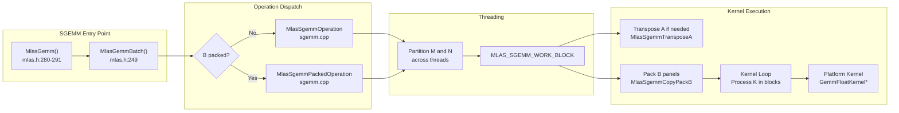

**Key SGEMM Parameters** [onnxruntime/core/mlas/lib/mlasi.h:326-335]():

| Parameter | Description |
|-----------|-------------|
| `MLAS_SGEMM_STRIDEN` | Default N stride: 128 |
| `MLAS_SGEMM_STRIDEK` | Default K stride: 128 |
| `MLAS_SGEMM_PACKED_STRIDEN` | Packed N stride: 128 |
| `MLAS_SGEMM_PACKED_STRIDEK` | Packed K stride: 256 |
| `MLAS_SGEMM_STRIDEN_THREAD_ALIGN` | Thread alignment: 16 |

Sources: [onnxruntime/core/mlas/lib/sgemm.cpp:1-100](), [onnxruntime/core/mlas/inc/mlas.h:217-292]()

### Platform-Specific GEMM Kernels

Each platform provides assembly/intrinsic implementations of the core GEMM kernel. For details, see [GEMM Operations](#4.2).

Sources: [cmake/onnxruntime_mlas.cmake:191-256](), [onnxruntime/core/mlas/lib/mlasi.h:912-930]()

### Quantized GEMM (QGEMM)

MLAS supports quantized integer matrix multiplication for reduced precision inference. This includes `QGEMM` for 8-bit integers and `QNBitGemm` for N-bit integers (e.g., 4-bit). For details, see [Quantized Operations](#4.3).

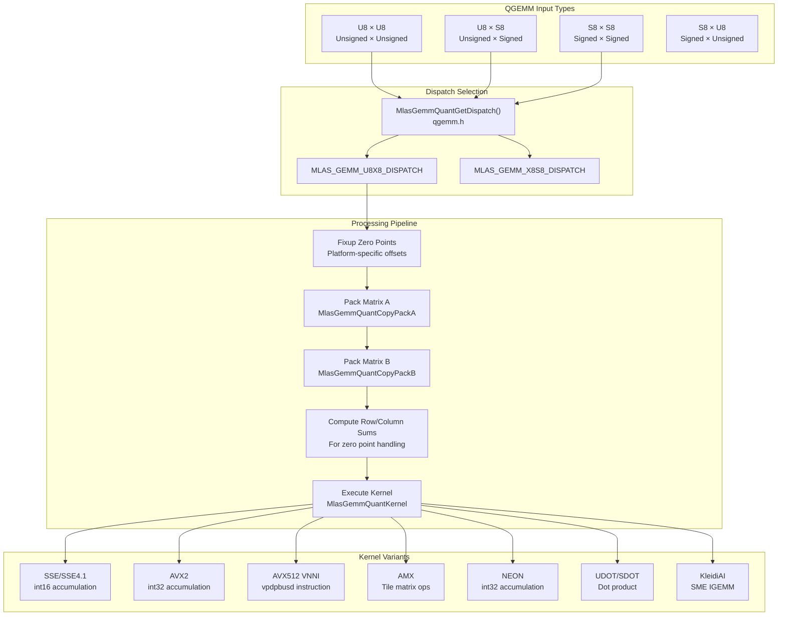

**QGEMM Kernel Dispatch Structure** [onnxruntime/core/mlas/lib/qgemm.h:1-50]():

```
MLAS_GEMM_QUANT_DISPATCH {
    Operation: MLAS_GEMM_QUANT_OPERATION*
    PackedOperation: MLAS_GEMM_QUANT_OPERATION*
    PackedK: size_t
    PackedStrideK: size_t
    StrideM: size_t
}
```

**Zero Point Handling**: Quantized GEMM requires careful handling of zero points. For U8×S8:
- Zero point A (input) is subtracted from activations
- Zero point B (weights) is subtracted from weights  
- Result = Σ(A-ZPA)(B-ZPB) = ΣAB - ZPA·ΣB - ZPB·ΣA + ZPA·ZPB·K

Sources: [onnxruntime/core/mlas/lib/qgemm.cpp:1-50](), [onnxruntime/core/mlas/lib/qgemm.h:1-300]()

### QGEMM Platform Implementations

Different platforms provide specialized quantized kernels. For details, see [Quantized Operations](#4.3).

Sources: [onnxruntime/core/mlas/lib/qgemm_kernel_sse.cpp:20-30](), [onnxruntime/core/mlas/lib/qgemm_kernel_avx2.cpp:1-50](), [onnxruntime/core/mlas/lib/qgemm_kernel_neon.cpp:45-60](), [onnxruntime/core/mlas/lib/qgemm_kernel_wasmsimd.cpp:30-45]()

## Convolution Operations

MLAS provides multiple convolution implementations optimized for different problem sizes and layouts. For details, see [Platform Optimizations](#4.4).

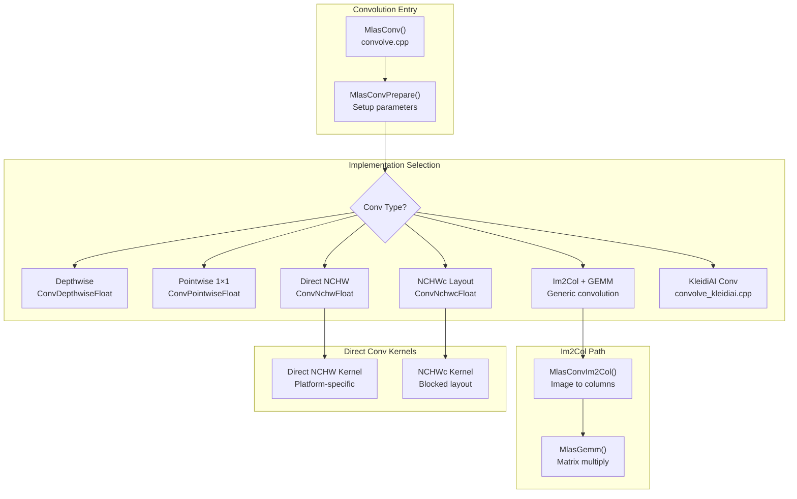

### Convolution Implementations

**1. Im2Col + GEMM** [onnxruntime/core/mlas/lib/convolve.cpp:46-90]():
- Converts input image patches to column matrix
- Calls optimized GEMM kernel
- Used for general convolutions
- Formula: `Output = Filter × Im2Col(Input) + Bias`

**2. Direct NCHW Convolution** [cmake/onnxruntime_mlas.cmake:972-976]():
- Processes input in NCHW (batch, channel, height, width) layout
- Uses micro-kernels optimized for small filter sizes
- ARM64 assembly: `aarch64/SconvKernelNeon.S`
- Available on ARM64 with NCHWC support

**3. NCHWc Convolution** [onnxruntime/core/mlas/lib/platform.cpp:592]():
- Uses blocked channel layout for better cache locality
- `NchwcBlockSize` typically 8 or 16
- Optimizes for AVX/AVX512 vector widths

**4. Depthwise Convolution** [onnxruntime/core/mlas/lib/qdwconv.cpp:21-45]():
- Each channel convolved independently
- Lower memory footprint than standard convolution
- Specialized kernels for mobile workloads

**5. KleidiAI Convolution** [onnxruntime/core/mlas/lib/kleidiai/convolve_kleidiai.cpp]():
- Utilizes Arm KleidiAI library for SME/SME2 optimized convolutions.
- Dispatched via `SelectConvRoute` based on convolution parameters.
- Can use IGEMM kernels for specific configurations.

**Platform-Specific Conv Kernels**: For details, see [Platform Optimizations](#4.4).

Sources: [onnxruntime/core/mlas/lib/convolve.cpp:1-100](), [onnxruntime/core/mlas/lib/platform.cpp:567-593](), [cmake/onnxruntime_mlas.cmake:970-995](), [onnxruntime/core/mlas/lib/kleidiai/mlasi_kleidiai.h:122-185]()

### Quantized Depthwise Convolution

MLAS provides specialized kernels for quantized depthwise convolution [onnxruntime/core/mlas/lib/qdwconv.cpp:1-50]():

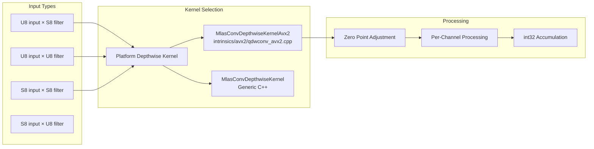

Sources: [onnxruntime/core/mlas/lib/qdwconv.cpp:19-100](), [cmake/onnxruntime_mlas.cmake:724]()

## Pooling and Activation Operations

### Pooling Kernels

MLAS provides optimized pooling operations for maximum and average pooling:

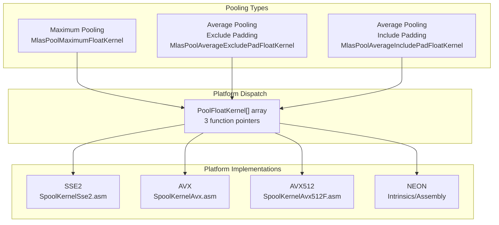

**Pooling Array Index** [onnxruntime/core/mlas/lib/mlasi.h:160-172]():
```
enum MLAS_POOLING_KIND {
    MlasMaximumPooling,
    MlasAveragePoolingExcludePad,
    MlasAveragePoolingIncludePad,
};
```

**Platform Kernels** [cmake/onnxruntime_mlas.cmake:244-246]():
- `amd64/SpoolKernelSse2.asm` - SSE2 baseline
- `amd64/SpoolKernelAvx.asm` - AVX 8-wide
- `amd64/SpoolKernelAvx512F.asm` - AVX512 16-wide

Sources: [onnxruntime/core/mlas/lib/platform.cpp:282-284](), [cmake/onnxruntime_mlas.cmake:244-246]()

### Activation Functions

MLAS provides vectorized activation function kernels:

| Activation | Kernel Function | Platform Variants |
|------------|-----------------|-------------------|
| Logistic (Sigmoid) | `MlasLogisticKernel` | SSE2, FMA3, ARM NEON |
| Tanh | `MlasTanhKernel` | SSE2, FMA3, ARM NEON |
| ERF | `MlasErfKernel` | SSE2, FMA3, ARM SVE |
| Exponential | `MlasComputeExpF32Kernel` | SSE2, FMA3, AVX512F |
| Softmax | `MlasComputeSoftmaxOutputF32Kernel` | SSE2, AVX, AVX512F, NEON |
| LogSoftmax | `MlasComputeLogSoftmaxOutputF32Kernel` | SSE2, AVX, AVX512F, ARM SVE |

**Activation Kernel Structure** [onnxruntime/core/mlas/lib/mlasi.h:605-644]():

```
typedef void (MLASCALL MLAS_COMPUTE_UNARY_FLOAT_KERNEL)(
    const float* Input,
    float* Output,
    size_t N
);

typedef float (MLASCALL MLAS_COMPUTE_SUMEXP_FLOAT_KERNEL)(
    const float* Input,
    float* Output,
    size_t N,
    const float* NegativeMaximum
);
```

**Example: Logistic Activation Dispatch** [onnxruntime/core/mlas/lib/platform.cpp:286-288]():
```
this->LogisticKernelRoutine = MlasLogisticKernel;        // SSE2 baseline
// If FMA3 available:
this->LogisticKernelRoutine = MlasComputeLogisticF32KernelFma3;
```

Sources: [onnxruntime/core/mlas/lib/platform.cpp:286-410](), [cmake/onnxruntime_mlas.cmake:253-255]()

## Quantization Primitives

MLAS provides kernels for quantizing and dequantizing floating-point tensors to/from integer formats. This includes standard 8-bit quantization and N-bit quantization (e.g., 4-bit). For details, see [Quantized Operations](#4.3).

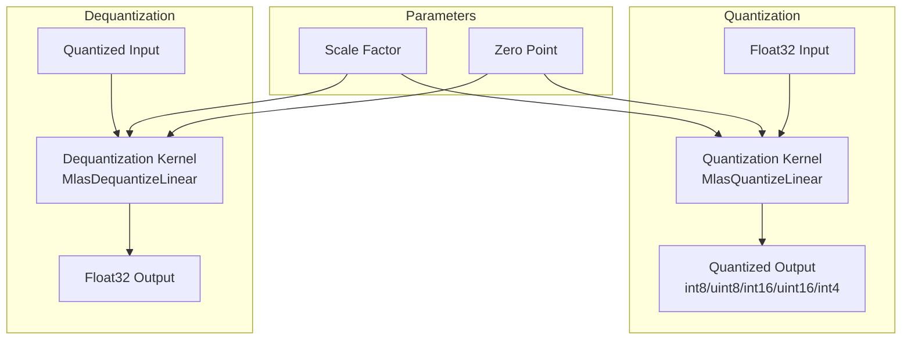

### Quantization Kernel Types

| Data Type | Quantize Kernel | Dequantize Kernel | Platforms |
|-----------|----------------|-------------------|-----------|
| uint8 | `MlasQuantizeLinearU8Kernel` | `MlasDequantizeLinearU8Kernel` | All |
| int8 | `MlasQuantizeLinearS8Kernel` | `MlasDequantizeLinearS8Kernel` | All |
| uint16 | `MlasQuantizeLinearU16Kernel` | - | SSE2+ |
| int16 | `MlasQuantizeLinearS16Kernel` | - | SSE2+ |
| uint4 | `MlasQuantizeLinearU4Kernel` | - | SSE2+ |
| int4 | `MlasQuantizeLinearS4Kernel` | - | SSE2+ |

**Platform Optimizations** [onnxruntime/core/mlas/lib/platform.cpp:296-303]():

| Platform | Kernel | Notes |
|----------|--------|-------|
| Baseline | Generic C++ | Scalar loop |
| AVX2 | `intrinsics/avx2/*` | 8×float32 vectors |
| AVX512F | `intrinsics/avx512/quantize_avx512f.cpp` | 16×float32 vectors |
| Power VSX | `MlasQuantizeLinearS8KernelVSX` | AltiVec intrinsics |

**Quantization Formula**:
```
Quantized = clamp(round(Float / Scale) + ZeroPoint, Min, Max)
Dequantized = (Quantized - ZeroPoint) * Scale
```

Sources: [onnxruntime/core/mlas/lib/quantize.cpp:1-100](), [onnxruntime/core/mlas/lib/dequantize.cpp:1-100](), [onnxruntime/core/mlas/lib/platform.cpp:296-303]()

## Build System Integration

MLAS is built as a static library with platform-specific source compilation controlled by CMake:

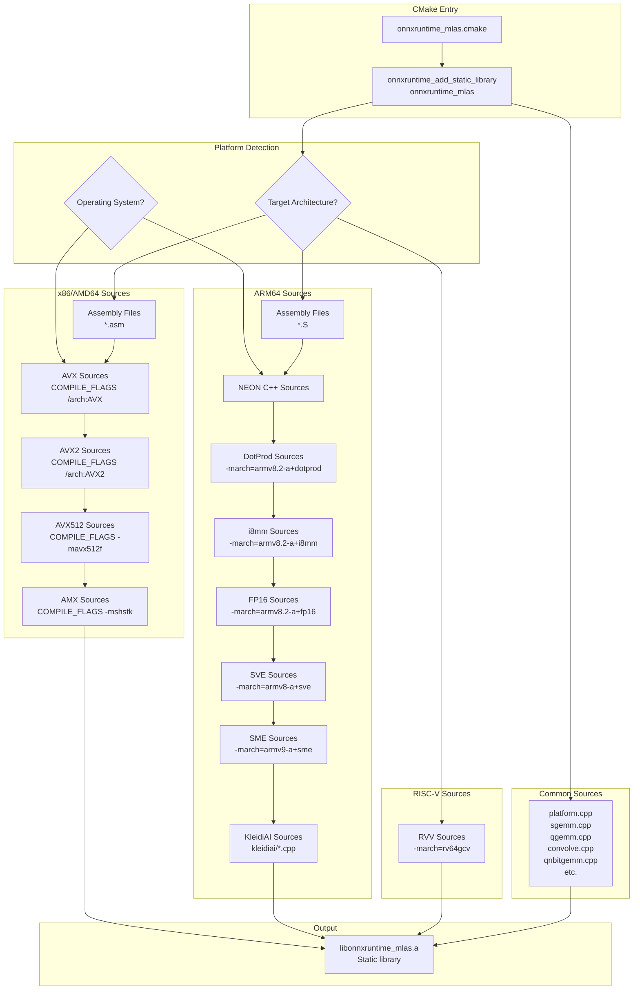

### Platform-Specific Compilation

**Windows x64** [cmake/onnxruntime_mlas.cmake:191-280]():
- Uses `MASM` for `.asm` files
- Preprocesses ARM64 assembly with `cl.exe` then `armasm64.exe`
- Intrinsic files compiled with `/arch:AVX`, `/arch:AVX2`

**Linux/macOS x64** [cmake/onnxruntime_mlas.cmake:667-818]():
- Uses GAS assembler for `.S` files
- Compile flags: `-msse2`, `-mavx`, `-mavx2 -mfma -mf16c`, `-mavx512f`
- Checks GCC version for AVX-VNNI support (GCC 11+)

**ARM64 Linux/Android** [cmake/onnxruntime_mlas.cmake:104-178]():
- Assembly files: `.S` format
- Conditional compilation based on features:
  - Base: NEON assembly kernels
  - `+dotprod`: UDOT/SDOT kernels
  - `+i8mm`: I8MM kernels
  - `+fp16`: FP16 activation kernels
  - `onnxruntime_USE_KLEIDIAI`: KleidiAI kernels

**WebAssembly** [cmake/onnxruntime_mlas.cmake:345-365]():
- Intrinsic-based implementation in `wasm_simd/*.cpp`
- Supports both SIMD128 and relaxed SIMD

**RISC-V** [cmake/onnxruntime_mlas.cmake:1000-1020]():
- Conditional compilation for RVV (RISC-V Vector Extension) support.

Sources: [cmake/onnxruntime_mlas.cmake:1-900](), [cmake/onnxruntime_mlas.cmake:104-178]()

### Key Build Variables

| Variable | Purpose | Example |
|----------|---------|---------|
| `MLAS_ROOT` | MLAS source root | `${ONNXRUNTIME_ROOT}/core/mlas` |
| `MLAS_SRC_DIR` | Implementation files | `${MLAS_ROOT}/lib` |
| `MLAS_INC_DIR` | Public headers | `${MLAS_ROOT}/inc` |
| `onnxruntime_target_platform` | Windows architecture | `ARM64`, `x64`, `x86` |
| `CMAKE_SYSTEM_PROCESSOR` | Unix architecture | `aarch64`, `x86_64`, `ppc64le` |
| `onnxruntime_USE_KLEIDIAI` | Enable KleidiAI kernels | `ON` |
| `onnxruntime_USE_RVV` | Enable RISC-V Vector Extension | `ON` |

Sources: [cmake/onnxruntime_mlas.cmake:4-7](), [cmake/onnxruntime_mlas.cmake:174-176](), [cmake/onnxruntime_mlas.cmake:1000-1002]()

## Threading and Work Partitioning

MLAS integrates with ONNX Runtime's thread pool for parallel execution:

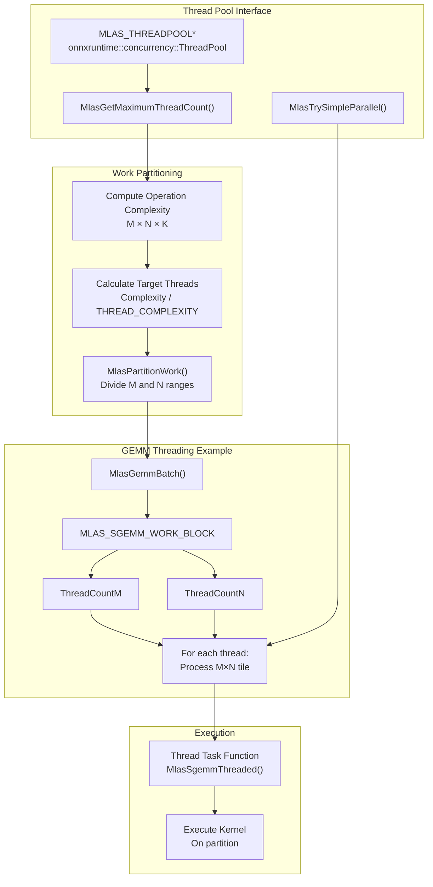

**Thread Complexity Thresholds** [onnxruntime/core/mlas/lib/mlasi.h:321]():
```
#define MLAS_MAXIMUM_THREAD_COUNT 16
```

**GEMM Threading** [onnxruntime/core/mlas/lib/sgemm.cpp:600-700]():
- Complexity = `M × N × K × BatchSize`
- Thread threshold = `MLAS_SGEMM_THREAD_COMPLEXITY` (typically 50,000)
- Partitions along M or N dimension based on which is larger
- Alignment: `MLAS_SGEMM_STRIDEN_THREAD_ALIGN = 16`

**QGEMM Threading** [onnxruntime/core/mlas/lib/qgemm.cpp:136-202]():
- Complexity = `M × N × K × BatchSize`
- Thread threshold = `MLAS_QGEMM_THREAD_COMPLEXITY`
- Partitions with alignment: `MLAS_QGEMM_STRIDEN_THREAD_ALIGN = 16`

Sources: [onnxruntime/core/mlas/lib/sgemm.cpp:600-700](), [onnxruntime/core/mlas/lib/qgemm.cpp:136-202](), [onnxruntime/core/mlas/lib/mlasi.h:321]()

## Public API Reference

MLAS exposes its functionality through a C API in `mlas.h`:

### Core GEMM Operations

| Function | Purpose | Signature |
|----------|---------|-----------|
| `MlasGemm` | Single precision GEMM | `(TransA, TransB, M, N, K, alpha, A, lda, B, ldb, beta, C, ldc, ThreadPool, BackendConfig)` |
| `MlasGemmBatch` | Batched SGEMM | `(TransA, TransB, M, N, K, Data[], BatchSize, ThreadPool, BackendConfig)` |
| `MlasGemm` (double) | Double precision GEMM | Same as SGEMM with `double*` |
| `MlasGemmBatch` (QGEMM) | Quantized integer GEMM | `(Shape, DataParams[], BatchN, ThreadPool)` |
| `MlasDynamicQGemmBatch` | Dynamic N-bit quantized GEMM | `(Shape, DataParams[], BatchN, ThreadPool, BackendKernelSelectorConfig)` |

**Data Structures** [onnxruntime/core/mlas/inc/mlas.h:218-228]():
```cpp
struct MLAS_SGEMM_DATA_PARAMS {
    const float* A;
    size_t lda;
    const float* B;
    size_t ldb;
    float* C;
    size_t ldc;
    float alpha;
    float beta;
    bool BIsPacked;
};
```

Sources: [onnxruntime/core/mlas/inc/mlas.h:210-525](), [onnxruntime/core/mlas/lib/qgemm.cpp:218-225]()

### Convolution Operations

| Function | Purpose |
|----------|---------|
| `MlasConvPrepare` | Setup convolution parameters |
| `MlasConv` | Execute convolution operation |
| `MlasConvDepthwise` | Depthwise separable convolution |

Sources: [onnxruntime/core/mlas/inc/mlas.h:1200-1400]()

### Quantization Operations

| Function | Purpose | Input → Output |
|----------|---------|----------------|
| `MlasQuantizeLinear` | Quantize float to int | `float* → uint8/int8/int16/uint16*` |
| `MlasDequantizeLinear` | Dequantize int to float | `uint8/int8* → float*` |

Sources: [onnxruntime/core/mlas/inc/mlas.h:1500-1700]()

### Utility Functions

| Function | Purpose |
|----------|---------|
| `MlasGetPreferredBufferAlignment` | Get preferred buffer alignment for platform |
| `MlasPlatformU8S8Overflow` | Check if platform has U8S8 saturation issues (Intel) |
| `MlasIsDynamicQGemmAvailable` | Check if dynamic N-bit QGEMM is available |

Sources: [onnxruntime/core/mlas/inc/mlas.h:137-156](), [onnxruntime/core/mlas/lib/qgemm.cpp:205-214]()

## Integration with CPU Execution Provider

MLAS is primarily consumed by the CPU Execution Provider:

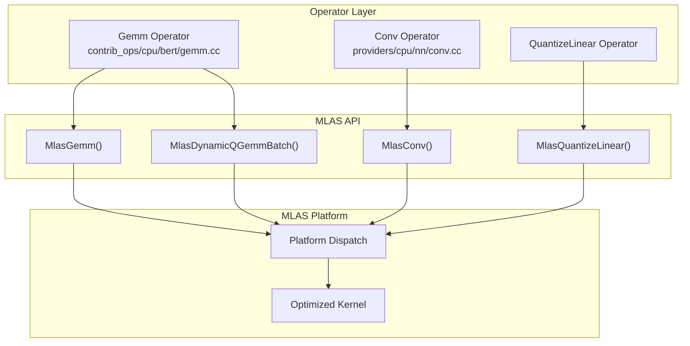

**Key Integration Points**:
1. CPU kernels call MLAS functions directly
2. Thread pool passed from execution provider to MLAS
3. Memory allocated by execution provider, passed to MLAS
4. MLAS provides kernel implementations, operators provide scheduling

Sources: [onnxruntime/core/mlas/inc/mlas.h:1-200]()

---

