<!-- source: DeepWiki mcp.deepwiki.com · repo microsoft/onnxruntime · page 4.1 MLAS Architecture · fetched 2026-10-21 -->

# MLAS Architecture

<details>
<summary>Relevant source files</summary>

The following files were used as context for generating this wiki page:

- [cmake/onnxruntime_mlas.cmake](cmake/onnxruntime_mlas.cmake)
- [onnxruntime/core/common/cpuid_info.cc](onnxruntime/core/common/cpuid_info.cc)
- [onnxruntime/core/common/cpuid_info.h](onnxruntime/core/common/cpuid_info.h)
- [onnxruntime/core/mlas/inc/mlas.h](onnxruntime/core/mlas/inc/mlas.h)
- [onnxruntime/core/mlas/lib/amd64/QgemmU8S8KernelAmx.asm](onnxruntime/core/mlas/lib/amd64/QgemmU8S8KernelAmx.asm)
- [onnxruntime/core/mlas/lib/amx_common.h](onnxruntime/core/mlas/lib/amx_common.h)
- [onnxruntime/core/mlas/lib/convolve.cpp](onnxruntime/core/mlas/lib/convolve.cpp)
- [onnxruntime/core/mlas/lib/dgemm.cpp](onnxruntime/core/mlas/lib/dgemm.cpp)
- [onnxruntime/core/mlas/lib/kleidiai/convolve_kleidiai.cpp](onnxruntime/core/mlas/lib/kleidiai/convolve_kleidiai.cpp)
- [onnxruntime/core/mlas/lib/kleidiai/mlasi_kleidiai.h](onnxruntime/core/mlas/lib/kleidiai/mlasi_kleidiai.h)
- [onnxruntime/core/mlas/lib/kleidiai/qgemm_kleidiai.cpp](onnxruntime/core/mlas/lib/kleidiai/qgemm_kleidiai.cpp)
- [onnxruntime/core/mlas/lib/kleidiai/sbgemm_kleidiai.cpp](onnxruntime/core/mlas/lib/kleidiai/sbgemm_kleidiai.cpp)
- [onnxruntime/core/mlas/lib/kleidiai/sgemm_kleidiai.cpp](onnxruntime/core/mlas/lib/kleidiai/sgemm_kleidiai.cpp)
- [onnxruntime/core/mlas/lib/mlasi.h](onnxruntime/core/mlas/lib/mlasi.h)
- [onnxruntime/core/mlas/lib/platform.cpp](onnxruntime/core/mlas/lib/platform.cpp)
- [onnxruntime/core/mlas/lib/qdwconv.cpp](onnxruntime/core/mlas/lib/qdwconv.cpp)
- [onnxruntime/core/mlas/lib/qgemm.cpp](onnxruntime/core/mlas/lib/qgemm.cpp)
- [onnxruntime/core/mlas/lib/qgemm.h](onnxruntime/core/mlas/lib/qgemm.h)
- [onnxruntime/core/mlas/lib/qgemm_kernel_amx.cpp](onnxruntime/core/mlas/lib/qgemm_kernel_amx.cpp)
- [onnxruntime/core/mlas/lib/qgemm_kernel_avx2.cpp](onnxruntime/core/mlas/lib/qgemm_kernel_avx2.cpp)
- [onnxruntime/core/mlas/lib/qgemm_kernel_default.cpp](onnxruntime/core/mlas/lib/qgemm_kernel_default.cpp)
- [onnxruntime/core/mlas/lib/qgemm_kernel_neon.cpp](onnxruntime/core/mlas/lib/qgemm_kernel_neon.cpp)
- [onnxruntime/core/mlas/lib/qgemm_kernel_sdot.cpp](onnxruntime/core/mlas/lib/qgemm_kernel_sdot.cpp)
- [onnxruntime/core/mlas/lib/qgemm_kernel_sse.cpp](onnxruntime/core/mlas/lib/qgemm_kernel_sse.cpp)
- [onnxruntime/core/mlas/lib/qgemm_kernel_sse41.cpp](onnxruntime/core/mlas/lib/qgemm_kernel_sse41.cpp)
- [onnxruntime/core/mlas/lib/qgemm_kernel_udot.cpp](onnxruntime/core/mlas/lib/qgemm_kernel_udot.cpp)
- [onnxruntime/core/mlas/lib/qgemm_kernel_wasmsimd.cpp](onnxruntime/core/mlas/lib/qgemm_kernel_wasmsimd.cpp)
- [onnxruntime/core/mlas/lib/sgemm.cpp](onnxruntime/core/mlas/lib/sgemm.cpp)
- [onnxruntime/core/mlas/lib/x86_64/QgemmU8S8KernelAmx.S](onnxruntime/core/mlas/lib/x86_64/QgemmU8S8KernelAmx.S)
- [onnxruntime/core/mlas/lib/x86_64/QgemmU8S8KernelAmxCommon.S](onnxruntime/core/mlas/lib/x86_64/QgemmU8S8KernelAmxCommon.S)
- [onnxruntime/test/contrib_ops/fused_conv_test.cc](onnxruntime/test/contrib_ops/fused_conv_test.cc)
- [onnxruntime/test/mlas/bench/bench_qgemm.cpp](onnxruntime/test/mlas/bench/bench_qgemm.cpp)
- [onnxruntime/test/mlas/bench/bench_sconv.cpp](onnxruntime/test/mlas/bench/bench_sconv.cpp)
- [onnxruntime/test/mlas/unittest/test_conv2d.h](onnxruntime/test/mlas/unittest/test_conv2d.h)
- [onnxruntime/test/mlas/unittest/test_fgemm.cpp](onnxruntime/test/mlas/unittest/test_fgemm.cpp)
- [onnxruntime/test/mlas/unittest/test_fgemm.h](onnxruntime/test/mlas/unittest/test_fgemm.h)
- [onnxruntime/test/mlas/unittest/test_fgemm_fixture.h](onnxruntime/test/mlas/unittest/test_fgemm_fixture.h)
- [onnxruntime/test/mlas/unittest/test_qgemm.cpp](onnxruntime/test/mlas/unittest/test_qgemm.cpp)
- [onnxruntime/test/mlas/unittest/test_qgemm_fixture.h](onnxruntime/test/mlas/unittest/test_qgemm_fixture.h)

</details>


## Purpose and Scope

MLAS (Microsoft Machine Algebra Subprograms) is a low-level compute library that provides optimized implementations of fundamental linear algebra operations such as matrix multiplication (GEMM), convolution, pooling, and quantization. This document describes the architecture of MLAS, focusing on its platform detection mechanism, kernel dispatch system, and build-time configuration.

For information about specific GEMM operations and optimizations, see [GEMM Operations](#4.2). For quantized operations, see [Quantized Operations](#4.3). For platform-specific kernel implementations, see [Platform Optimizations](#4.4).

## System Overview

MLAS provides a hardware abstraction layer that enables ONNX Runtime to leverage platform-specific optimizations transparently. The library uses runtime CPU feature detection combined with build-time conditional compilation to select the most efficient kernel implementations for the target hardware.

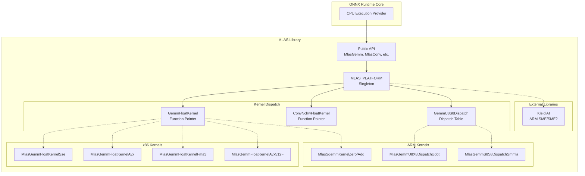

**MLAS System Architecture**

Sources: [onnxruntime/core/mlas/lib/mlasi.h:38-40](), [onnxruntime/core/mlas/lib/platform.cpp:18-29](), [onnxruntime/core/mlas/inc/mlas.h:238-249]()

## Platform Abstraction Layer

The `MLAS_PLATFORM` structure serves as the central abstraction layer, containing function pointers to platform-specific kernel implementations and configuration parameters. A single global instance is accessed via `GetMlasPlatform()`.

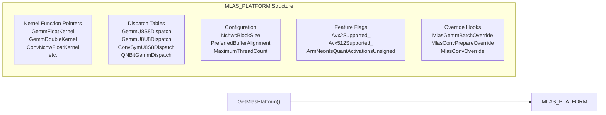

**MLAS_PLATFORM Structure Organization**

The structure is initialized once at startup in its constructor, which performs platform detection and sets all function pointers and configuration values.

Sources: [onnxruntime/core/mlas/lib/mlasi.h:3300-3497](), [onnxruntime/core/mlas/lib/platform.cpp:234-850]()

## Platform Detection and Initialization

MLAS uses a multi-stage initialization process that combines compile-time architecture detection with runtime CPU feature detection.

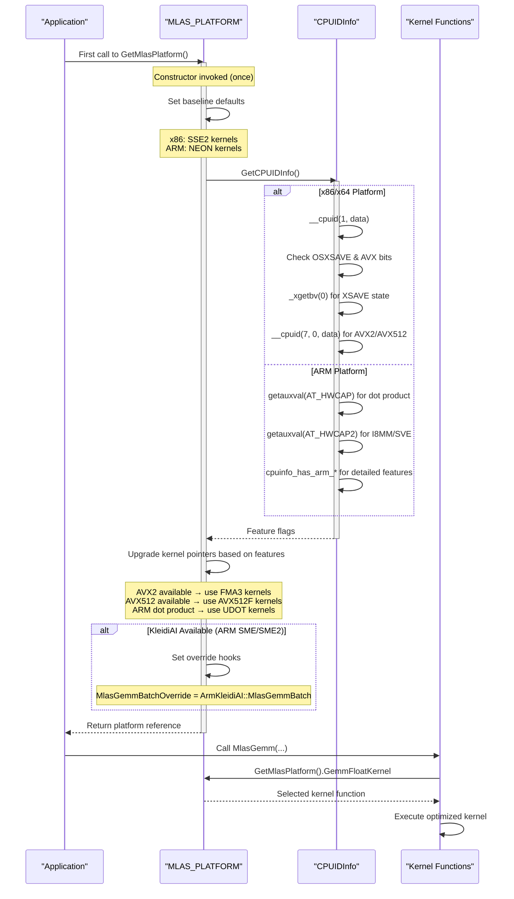

**Platform Initialization Sequence**

The initialization happens lazily on first access to `GetMlasPlatform()`, which returns a static instance constructed once.

Sources: [onnxruntime/core/mlas/lib/platform.cpp:234-850](), [onnxruntime/core/common/cpuid_info.cc:111-184]()

### x86/x64 Platform Detection

On x86/x64 platforms, MLAS uses the CPUID instruction and XGETBV to detect available instruction set extensions:

| Feature Check | CPUID Leaf | Bit Position | Kernel Upgrade |
|--------------|------------|--------------|----------------|
| SSE4.1 | EAX=1, ECX | Bit 19 | `GemmU8S8DispatchSse41` |
| AVX | EAX=1, ECX | Bit 28 | `MlasGemmFloatKernelAvx` |
| AVX2 + FMA3 | EAX=7, EBX | Bit 5 | `MlasGemmFloatKernelFma3` |
| AVX512F | EAX=7, EBX | Bit 16 | `MlasGemmFloatKernelAvx512F` |
| AVX512 Core | EAX=7, EBX | Bits 16,17,28,30,31 | `MlasGemmU8S8KernelAvx512Core` |
| AVX512VNNI | EAX=7, ECX | Bit 11 | `MlasGemmU8S8KernelAvx512Vnni` |
| AVXVNNI | EAX=7,1, EAX | Bit 4 | `MlasGemmU8S8KernelAvxVnni` |
| AMX-TILE | EAX=7, EDX | Bit 24 | `MlasGemmU8S8DispatchAmx` |

Sources: [onnxruntime/core/mlas/lib/platform.cpp:138-233](), [onnxruntime/core/common/cpuid_info.cc:141-184]()

### ARM Platform Detection

On ARM platforms, MLAS uses `getauxval()` (Linux) or `IsProcessorFeaturePresent()` (Windows) to query hardware capabilities:

| Feature | Detection Method | Kernel Upgrade |
|---------|-----------------|----------------|
| NEON Dot Product | `AT_HWCAP & HWCAP_ASIMDDP` | `GemmU8X8DispatchUdot` |
| I8MM | `AT_HWCAP2 & HWCAP2_I8MM` | `GemmS8S8DispatchSmmla` |
| SVE | `AT_HWCAP & HWCAP_SVE` | `MlasSveErfKernel` |
| BF16 | `AT_HWCAP2 & HWCAP2_BF16` | Feature flag set |
| SME/SME2 | `cpuinfo_has_arm_sme2()` | KleidiAI override hooks |

Sources: [onnxruntime/core/mlas/lib/platform.cpp:68-136](), [onnxruntime/core/common/cpuid_info.cc:189-219]()

## Build-Time Configuration

The MLAS build system uses conditional compilation to include only the kernel implementations that are relevant for each target platform. The CMake configuration in `onnxruntime_mlas.cmake` controls which source files are compiled.

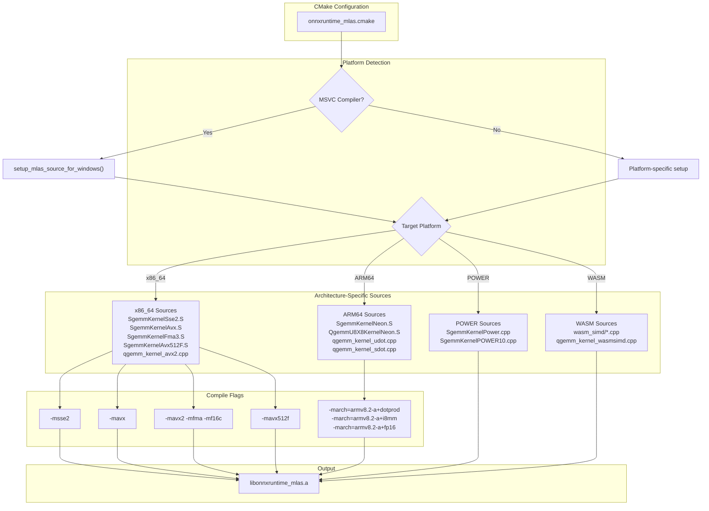

**Build-Time Kernel Selection**

Sources: [cmake/onnxruntime_mlas.cmake:1-178]()

### Instruction Set Specific Compilation

MLAS compiles the same logical operation multiple times with different compiler flags to generate specialized kernels for each instruction set extension. For example, on x86_64:

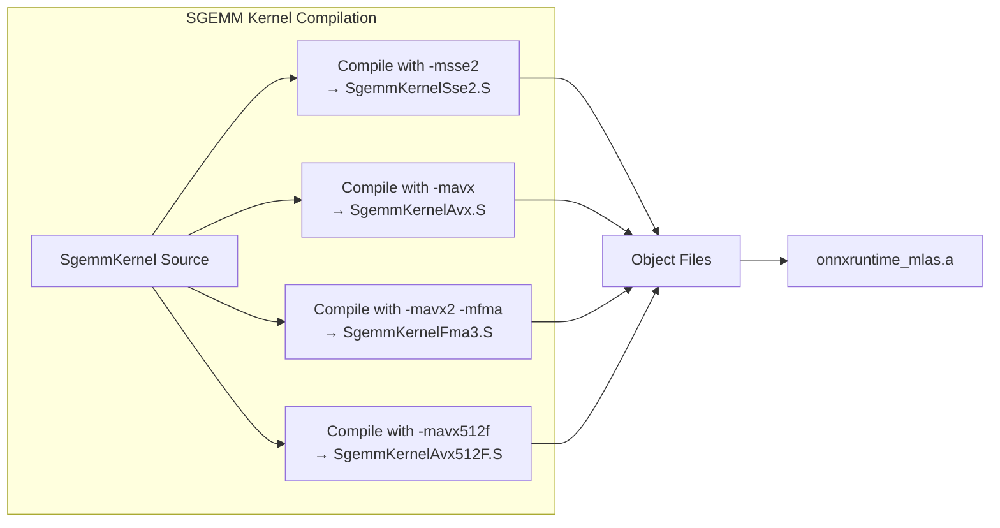

**Multi-ISA Compilation Strategy**

This approach allows the runtime to select the best available kernel without runtime code generation.

Sources: [cmake/onnxruntime_mlas.cmake:104-147]()

### Conditional Features

Several MLAS features are conditionally included based on build flags:

| Build Flag | Effect | Files Affected |
|-----------|--------|----------------|
| `onnxruntime_USE_KLEIDIAI` | Enable KleidiAI integration for ARM SME | `kleidiai/*.cpp` files added |
| `onnxruntime_USE_ARM_NEON_NCHWC` | Enable NCHWC layout optimizations | `sconv_nchw_depthwise_multiplier_1.cpp` |
| `onnxruntime_USE_SVE` | Enable SVE support on ARM | `sve/*.cpp` files with `-march=armv8.2-a+sve+fp16` |
| `onnxruntime_ORT_MINIMAL_BUILD` | Exclude FP4 GEMM kernels | `q4_dq.cpp`, `q4gemm.cpp` not compiled |
| `onnxruntime_ENABLE_WEBASSEMBLY_SIMD` | Enable WASM SIMD kernels | `wasm_simd/*.cpp` files added |

Sources: [cmake/onnxruntime_mlas.cmake:81-86](), [cmake/onnxruntime_mlas.cmake:170-172]()

## Kernel Dispatch Mechanism

MLAS uses two dispatch strategies depending on the operation:

1. **Direct Function Pointer Dispatch**: For operations with a single best implementation per platform (e.g., `GemmFloatKernel`)
2. **Dispatch Table**: For quantized operations where multiple variants exist based on signedness and packing (e.g., `GemmU8S8Dispatch`)

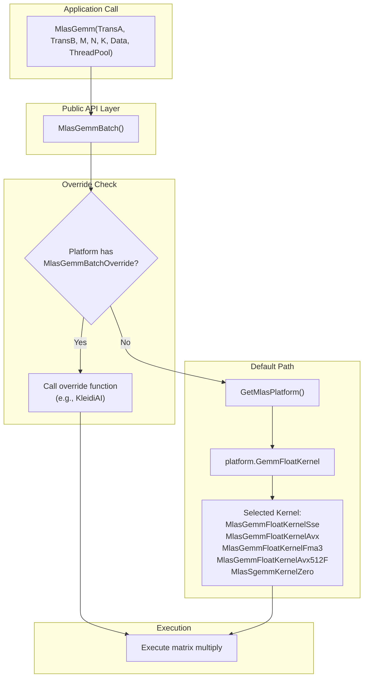

**GEMM Dispatch Flow**

Sources: [onnxruntime/core/mlas/lib/sgemm.cpp:134-194]()

### Quantized GEMM Dispatch

For quantized GEMM operations, MLAS uses dispatch tables that select implementations based on the signedness of matrices A and B:

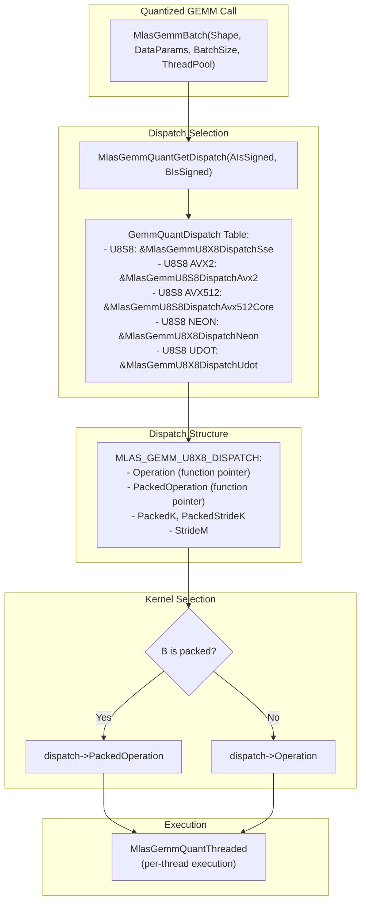

**Quantized GEMM Dispatch Mechanism**

The dispatch table approach allows MLAS to support different quantization schemes (U8S8, U8U8, S8S8) with platform-specific optimizations.

Sources: [onnxruntime/core/mlas/lib/qgemm.cpp:105-114](), [onnxruntime/core/mlas/lib/qgemm.h:44-48]()

## Key Data Structures

### MLAS_PLATFORM

The `MLAS_PLATFORM` structure is the central repository for all platform-specific configuration and kernel implementations:

```cpp
// Core kernel function pointers (float/double GEMM)
MLAS_GEMM_FLOAT_KERNEL* GemmFloatKernel;
MLAS_GEMM_DOUBLE_KERNEL* GemmDoubleKernel;

// Quantized GEMM dispatch tables
const MLAS_GEMM_U8X8_DISPATCH* GemmU8S8Dispatch;
const MLAS_GEMM_U8X8_DISPATCH* GemmU8U8Dispatch;

// Convolution kernels
MLAS_CONV_FLOAT_KERNEL* ConvNchwFloatKernel;
MLAS_CONV_FLOAT_KERNEL* ConvNchwcFloatKernel;

// Configuration parameters
uint32_t NchwcBlockSize;              // Block size for NCHWC layout (8 or 16)
size_t PreferredBufferAlignment;      // Alignment for temporary buffers
size_t MaximumThreadCount;            // Max threads for parallel execution

// Feature flags
bool Avx2Supported_;
bool Avx512Supported_;

// Override hooks for external libraries
MLAS_GEMM_BATCH_OVERRIDE* MlasGemmBatchOverride;
MLAS_CONV_PREPARE_FLOAT_OVERRIDE* MlasConvPrepareOverride;
MLAS_CONV_FLOAT_OVERRIDE* MlasConvOverride;
```

Sources: [onnxruntime/core/mlas/lib/mlasi.h:3300-3497]()

### Dispatch Table Structure

For quantized operations, dispatch tables contain operation variants and metadata:

```cpp
struct MLAS_GEMM_U8X8_DISPATCH {
    // Core operation (unpacked B)
    MLAS_GEMM_U8X8_OPERATION* Operation;
    
    // Optimized operation for pre-packed B matrix
    MLAS_GEMM_U8X8_OPERATION* PackedOperation;
    
    // Packing parameters
    size_t PackedK;                    // K dimension alignment for packing
    size_t PackedStrideK;              // Stride for packed K dimension
    
    // Kernel tile size
    size_t StrideM;                    // Rows processed per kernel invocation
};
```

Sources: [onnxruntime/core/mlas/lib/mlasi.h:1400-1440]()

## Platform-Specific Implementations

MLAS provides optimized kernels for multiple platforms. Each platform has a distinct set of capabilities and instruction sets.

### x86/x64 Kernel Hierarchy

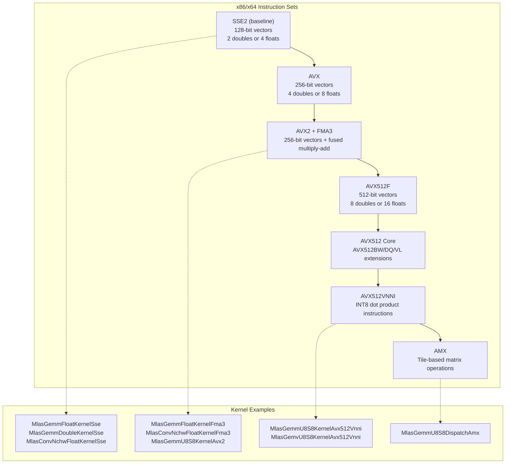

**x86/x64 Instruction Set Evolution**

Each instruction set level builds upon the previous, offering increased vector width or new specialized instructions.

Sources: [onnxruntime/core/mlas/lib/platform.cpp:138-233]()

### ARM Kernel Hierarchy

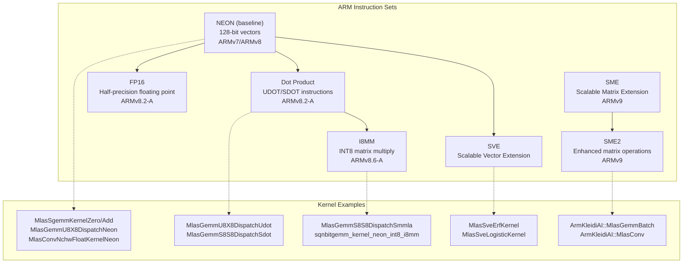

**ARM Instruction Set Evolution**

ARM's evolution focuses on adding specialized matrix/vector instructions and scalable architectures.

Sources: [onnxruntime/core/mlas/lib/platform.cpp:68-136](), [cmake/onnxruntime_mlas.cmake:104-147]()

### KleidiAI Integration

For ARM systems with SME/SME2 support, MLAS integrates the KleidiAI library through override hooks:

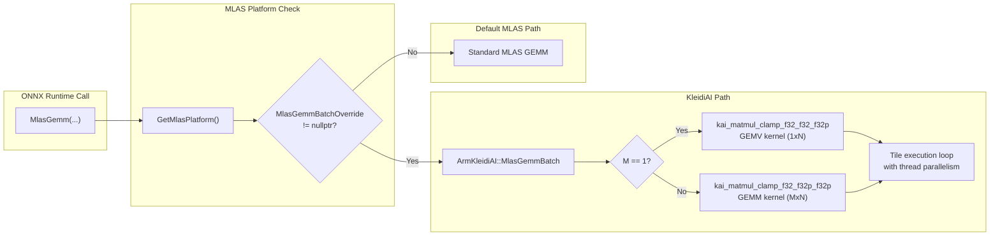

**KleidiAI Override Mechanism**

When SME2 is available, MLAS defers to KleidiAI for GEMM and convolution operations. The override hooks are set during platform initialization.

Sources: [onnxruntime/core/mlas/lib/qgemm.cpp:206-239](), [onnxruntime/core/mlas/lib/kleidiai/mlasi_kleidiai.h:67-70](), [onnxruntime/core/mlas/lib/kleidiai/sgemm_kleidiai.cpp:33-178]()

## Thread Parallelism

MLAS operations can be parallelized across multiple threads using the ONNX Runtime thread pool. The library partitions work across M and N dimensions to balance load.

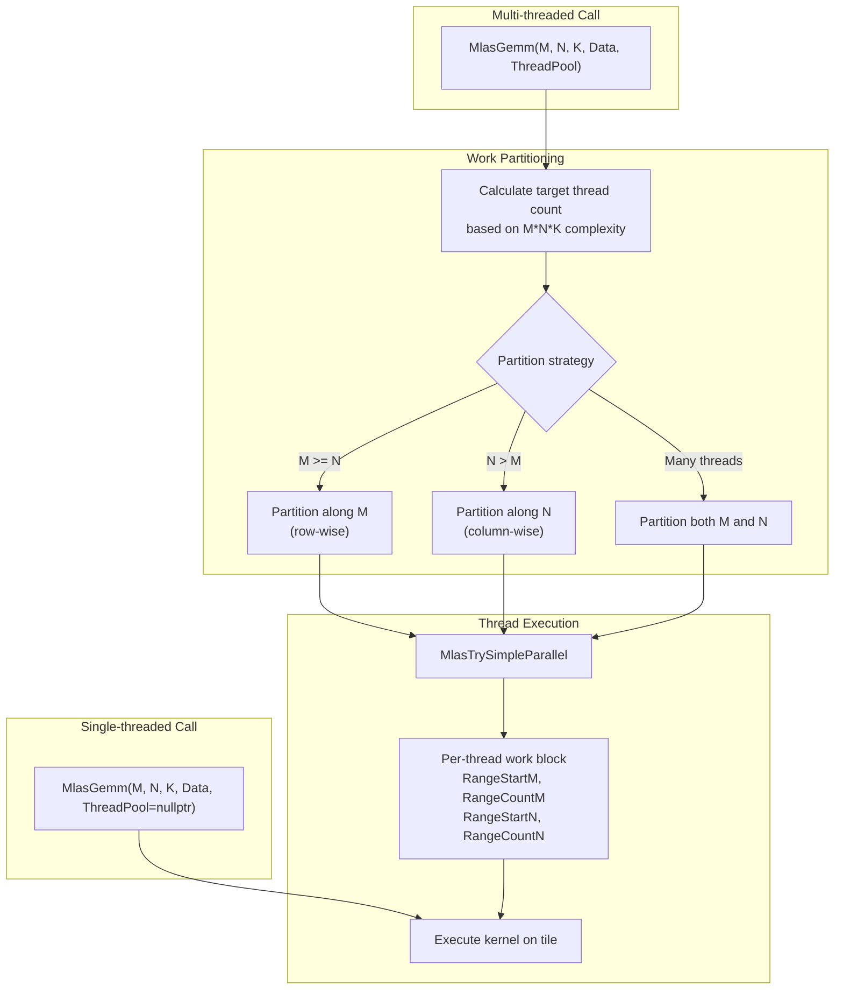

**Thread Parallelism Strategy**

MLAS prefers to partition along the larger dimension (N or M) to minimize synchronization overhead. For quantized GEMM, alignment requirements (e.g., `MLAS_QGEMM_STRIDEN_THREAD_ALIGN = 16`) ensure efficient memory access patterns.

Sources: [onnxruntime/core/mlas/lib/sgemm.cpp:600-750](), [onnxruntime/core/mlas/lib/qgemm.cpp:32-202]()

## Initialization and Singleton Access

MLAS uses the Singleton pattern for the platform abstraction layer. The single instance is initialized on first access through lazy static initialization.

```cpp
// Global accessor function
inline const MLAS_PLATFORM& GetMlasPlatform() {
    static MLAS_PLATFORM platform;  // Constructed once, thread-safe in C++11+
    return platform;
}

// Constructor performs all initialization
MLAS_PLATFORM::MLAS_PLATFORM() {
    // 1. Set baseline defaults
    this->GemmFloatKernel = MlasGemmFloatKernelSse;  // x86 baseline
    
    // 2. Detect CPU features
    unsigned Cpuid1[4];
    __cpuid(1, Cpuid1[0], Cpuid1[1], Cpuid1[2], Cpuid1[3]);
    
    // 3. Upgrade kernel pointers based on available features
    if (has_avx) {
        this->GemmFloatKernel = MlasGemmFloatKernelAvx;
    }
    if (has_avx2) {
        this->GemmFloatKernel = MlasGemmFloatKernelFma3;
        this->GemmU8S8Dispatch = &MlasGemmU8S8DispatchAvx2;
    }
    
    // 4. Set configuration parameters
    this->NchwcBlockSize = 8;
    this->PreferredBufferAlignment = MLAS_DEFAULT_PREFERRED_BUFFER_ALIGNMENT;
}
```

The singleton is accessed throughout MLAS to retrieve the appropriate kernel implementations:

```cpp
void MlasGemm(...) {
    const auto& platform = GetMlasPlatform();
    
    // Use selected kernel
    auto kernel = platform.GemmFloatKernel;
    kernel(A, B, C, ...);
}
```

Sources: [onnxruntime/core/mlas/lib/mlasi.h:3300-3497](), [onnxruntime/core/mlas/lib/platform.cpp:234-850]()

---

