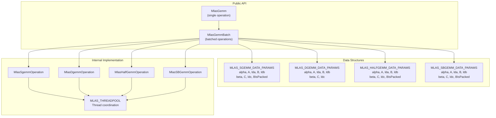
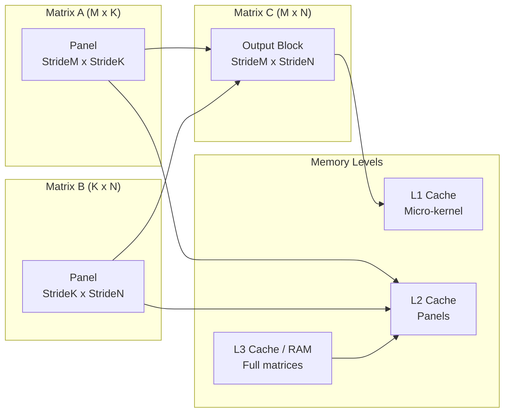
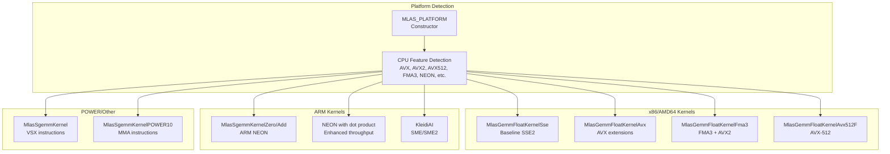
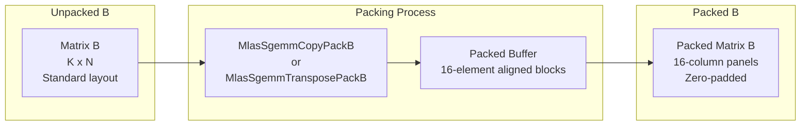
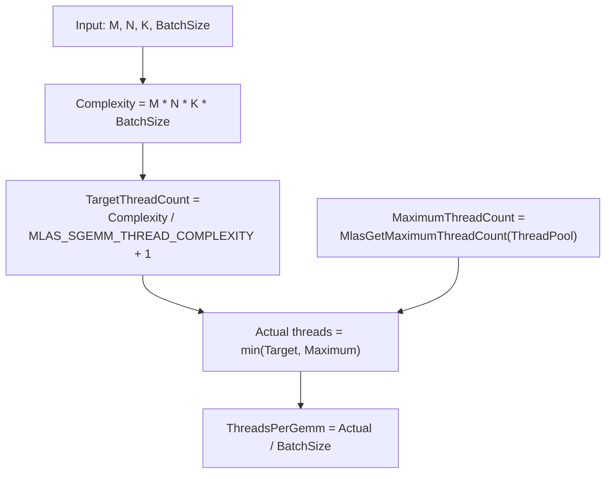
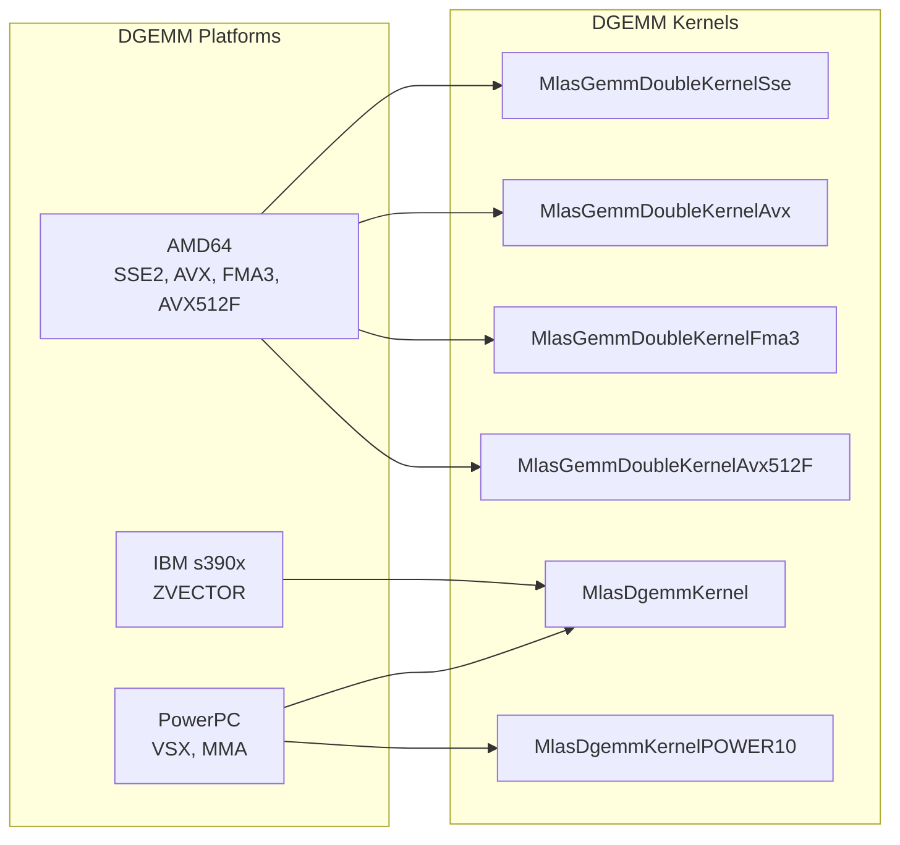
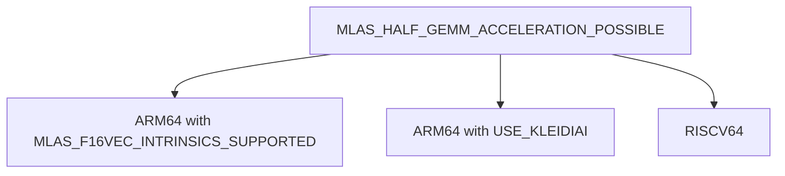
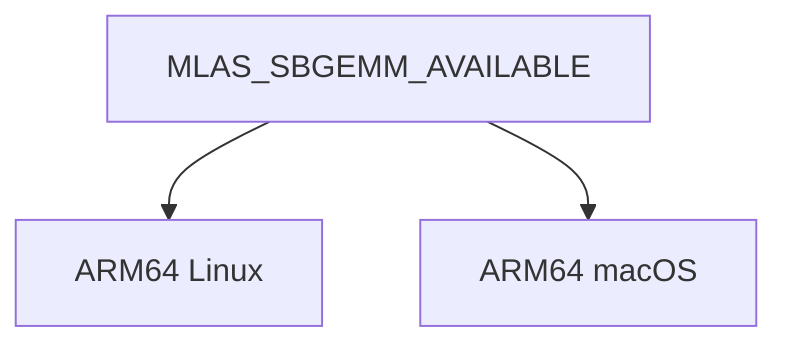
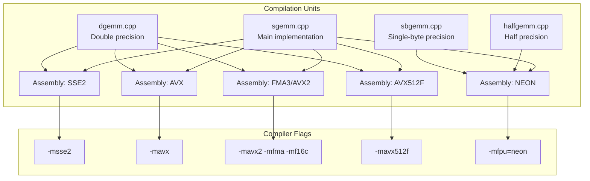

<!-- source: DeepWiki mcp.deepwiki.com · repo microsoft/onnxruntime · page 4.2 GEMM Operations · fetched 2026-10-21 -->

# GEMM Operations

<details>
<summary>Relevant source files</summary>

The following files were used as context for generating this wiki page:

- [cmake/onnxruntime_mlas.cmake](cmake/onnxruntime_mlas.cmake)
- [onnxruntime/core/common/cpuid_info.cc](onnxruntime/core/common/cpuid_info.cc)
- [onnxruntime/core/common/cpuid_info.h](onnxruntime/core/common/cpuid_info.h)
- [onnxruntime/core/mlas/inc/mlas.h](onnxruntime/core/mlas/inc/mlas.h)
- [onnxruntime/core/mlas/lib/aarch64/SbgemmKernelNeon.S](onnxruntime/core/mlas/lib/aarch64/SbgemmKernelNeon.S)
- [onnxruntime/core/mlas/lib/amd64/QgemmU8S8KernelAmx.asm](onnxruntime/core/mlas/lib/amd64/QgemmU8S8KernelAmx.asm)
- [onnxruntime/core/mlas/lib/amx_common.h](onnxruntime/core/mlas/lib/amx_common.h)
- [onnxruntime/core/mlas/lib/convolve.cpp](onnxruntime/core/mlas/lib/convolve.cpp)
- [onnxruntime/core/mlas/lib/dgemm.cpp](onnxruntime/core/mlas/lib/dgemm.cpp)
- [onnxruntime/core/mlas/lib/halfgemm.cpp](onnxruntime/core/mlas/lib/halfgemm.cpp)
- [onnxruntime/core/mlas/lib/halfgemm.h](onnxruntime/core/mlas/lib/halfgemm.h)
- [onnxruntime/core/mlas/lib/halfgemm_kernel_neon_fp16.cpp](onnxruntime/core/mlas/lib/halfgemm_kernel_neon_fp16.cpp)
- [onnxruntime/core/mlas/lib/hgemm_kernel_neon.cpp](onnxruntime/core/mlas/lib/hgemm_kernel_neon.cpp)
- [onnxruntime/core/mlas/lib/kleidiai/convolve_kleidiai.cpp](onnxruntime/core/mlas/lib/kleidiai/convolve_kleidiai.cpp)
- [onnxruntime/core/mlas/lib/kleidiai/mlasi_kleidiai.h](onnxruntime/core/mlas/lib/kleidiai/mlasi_kleidiai.h)
- [onnxruntime/core/mlas/lib/kleidiai/qgemm_kleidiai.cpp](onnxruntime/core/mlas/lib/kleidiai/qgemm_kleidiai.cpp)
- [onnxruntime/core/mlas/lib/kleidiai/sbgemm_kleidiai.cpp](onnxruntime/core/mlas/lib/kleidiai/sbgemm_kleidiai.cpp)
- [onnxruntime/core/mlas/lib/kleidiai/sgemm_kleidiai.cpp](onnxruntime/core/mlas/lib/kleidiai/sgemm_kleidiai.cpp)
- [onnxruntime/core/mlas/lib/mlasi.h](onnxruntime/core/mlas/lib/mlasi.h)
- [onnxruntime/core/mlas/lib/platform.cpp](onnxruntime/core/mlas/lib/platform.cpp)
- [onnxruntime/core/mlas/lib/qdwconv.cpp](onnxruntime/core/mlas/lib/qdwconv.cpp)
- [onnxruntime/core/mlas/lib/qgemm.cpp](onnxruntime/core/mlas/lib/qgemm.cpp)
- [onnxruntime/core/mlas/lib/qgemm.h](onnxruntime/core/mlas/lib/qgemm.h)
- [onnxruntime/core/mlas/lib/qgemm_kernel_amx.cpp](onnxruntime/core/mlas/lib/qgemm_kernel_amx.cpp)
- [onnxruntime/core/mlas/lib/qgemm_kernel_avx2.cpp](onnxruntime/core/mlas/lib/qgemm_kernel_avx2.cpp)
- [onnxruntime/core/mlas/lib/qgemm_kernel_default.cpp](onnxruntime/core/mlas/lib/qgemm_kernel_default.cpp)
- [onnxruntime/core/mlas/lib/qgemm_kernel_neon.cpp](onnxruntime/core/mlas/lib/qgemm_kernel_neon.cpp)
- [onnxruntime/core/mlas/lib/qgemm_kernel_sdot.cpp](onnxruntime/core/mlas/lib/qgemm_kernel_sdot.cpp)
- [onnxruntime/core/mlas/lib/qgemm_kernel_sse.cpp](onnxruntime/core/mlas/lib/qgemm_kernel_sse.cpp)
- [onnxruntime/core/mlas/lib/qgemm_kernel_sse41.cpp](onnxruntime/core/mlas/lib/qgemm_kernel_sse41.cpp)
- [onnxruntime/core/mlas/lib/qgemm_kernel_udot.cpp](onnxruntime/core/mlas/lib/qgemm_kernel_udot.cpp)
- [onnxruntime/core/mlas/lib/qgemm_kernel_wasmsimd.cpp](onnxruntime/core/mlas/lib/qgemm_kernel_wasmsimd.cpp)
- [onnxruntime/core/mlas/lib/sbgemm.h](onnxruntime/core/mlas/lib/sbgemm.h)
- [onnxruntime/core/mlas/lib/sbgemm_kernel_neon.cpp](onnxruntime/core/mlas/lib/sbgemm_kernel_neon.cpp)
- [onnxruntime/core/mlas/lib/sgemm.cpp](onnxruntime/core/mlas/lib/sgemm.cpp)
- [onnxruntime/core/mlas/lib/x86_64/QgemmU8S8KernelAmx.S](onnxruntime/core/mlas/lib/x86_64/QgemmU8S8KernelAmx.S)
- [onnxruntime/core/mlas/lib/x86_64/QgemmU8S8KernelAmxCommon.S](onnxruntime/core/mlas/lib/x86_64/QgemmU8S8KernelAmxCommon.S)
- [onnxruntime/core/providers/cpu/math/gemm.cc](onnxruntime/core/providers/cpu/math/gemm.cc)
- [onnxruntime/core/providers/cpu/math/gemm.h](onnxruntime/core/providers/cpu/math/gemm.h)
- [onnxruntime/core/providers/cpu/math/matmul.cc](onnxruntime/core/providers/cpu/math/matmul.cc)
- [onnxruntime/core/providers/cpu/math/matmul.h](onnxruntime/core/providers/cpu/math/matmul.h)
- [onnxruntime/core/providers/webgpu/math/gemm.cc](onnxruntime/core/providers/webgpu/math/gemm.cc)
- [onnxruntime/core/providers/webgpu/math/gemm.h](onnxruntime/core/providers/webgpu/math/gemm.h)
- [onnxruntime/core/providers/webgpu/math/subgroup_matrix_gemm.h](onnxruntime/core/providers/webgpu/math/subgroup_matrix_gemm.h)
- [onnxruntime/test/contrib_ops/fused_conv_test.cc](onnxruntime/test/contrib_ops/fused_conv_test.cc)
- [onnxruntime/test/mlas/bench/bench_hgemm.cpp](onnxruntime/test/mlas/bench/bench_hgemm.cpp)
- [onnxruntime/test/mlas/bench/bench_qgemm.cpp](onnxruntime/test/mlas/bench/bench_qgemm.cpp)
- [onnxruntime/test/mlas/bench/bench_sconv.cpp](onnxruntime/test/mlas/bench/bench_sconv.cpp)
- [onnxruntime/test/mlas/unittest/test_conv2d.h](onnxruntime/test/mlas/unittest/test_conv2d.h)
- [onnxruntime/test/mlas/unittest/test_fgemm.cpp](onnxruntime/test/mlas/unittest/test_fgemm.cpp)
- [onnxruntime/test/mlas/unittest/test_fgemm.h](onnxruntime/test/mlas/unittest/test_fgemm.h)
- [onnxruntime/test/mlas/unittest/test_fgemm_fixture.h](onnxruntime/test/mlas/unittest/test_fgemm_fixture.h)
- [onnxruntime/test/mlas/unittest/test_hgemm_neon.cpp](onnxruntime/test/mlas/unittest/test_hgemm_neon.cpp)
- [onnxruntime/test/mlas/unittest/test_qgemm.cpp](onnxruntime/test/mlas/unittest/test_qgemm.cpp)
- [onnxruntime/test/mlas/unittest/test_qgemm_fixture.h](onnxruntime/test/mlas/unittest/test_qgemm_fixture.h)
- [onnxruntime/test/mlas/unittest/test_sbgemm.cpp](onnxruntime/test/mlas/unittest/test_sbgemm.cpp)
- [onnxruntime/test/mlas/unittest/test_sbgemm.h](onnxruntime/test/mlas/unittest/test_sbgemm.h)
- [onnxruntime/test/providers/cpu/cpu_execution_provider_test.cc](onnxruntime/test/providers/cpu/cpu_execution_provider_test.cc)
- [onnxruntime/test/providers/cpu/math/gemm_test.cc](onnxruntime/test/providers/cpu/math/gemm_test.cc)
- [onnxruntime/test/providers/cpu/math/matmul_fastmath_test.cc](onnxruntime/test/providers/cpu/math/matmul_fastmath_test.cc)
- [onnxruntime/test/providers/cpu/math/matmul_test.cc](onnxruntime/test/providers/cpu/math/matmul_test.cc)
- [onnxruntime/test/providers/webgpu/gemm_large_test.cc](onnxruntime/test/providers/webgpu/gemm_large_test.cc)

</details>


## Purpose and Scope

This page documents the General Matrix Multiply (GEMM) operations implemented in MLAS (Microsoft Linear Algebra Subprograms), specifically focusing on floating-point matrix multiplication. GEMM operations compute `C := alpha * op(A) * op(B) + beta * C` where `op(X)` can be the matrix itself, its transpose, or conjugate transpose.

This page covers single-precision (SGEMM) and double-precision (DGEMM) implementations, blocking strategies, data packing optimizations, and platform-specific kernel dispatch. It also details half-precision (HalfGEMM) and single-byte (SBGEMM) implementations. For quantized integer GEMM operations, see [Quantized Operations](#4.3). For overall MLAS architecture and platform detection, see [MLAS Architecture](#4.1).

Sources: [onnxruntime/core/mlas/inc/mlas.h:210-525](), [onnxruntime/core/mlas/lib/sgemm.cpp:1-16](), [onnxruntime/core/mlas/lib/dgemm.cpp:1-16]()

## GEMM API Structure

### Public API Functions

MLAS provides batched and single GEMM operations through a unified interface. The primary entry point is `MlasGemmBatch`, which processes multiple GEMM operations in a single call for better threading efficiency.



**Figure 1: GEMM API Entry Points**

The `MLAS_SGEMM_DATA_PARAMS`, `MLAS_DGEMM_DATA_PARAMS`, `MLAS_HALFGEMM_DATA_PARAMS`, and `MLAS_SBGEMM_DATA_PARAMS` structures supply matrix pointers and scalar multipliers for each GEMM operation. The `BIsPacked` flag indicates whether matrix B has been pre-packed using `MlasGemmPackBSize` and related functions.

Sources: [onnxruntime/core/mlas/inc/mlas.h:218-291](), [onnxruntime/core/mlas/inc/mlas.h:410-473](), [onnxruntime/core/mlas/inc/mlas.h:293-355](), [onnxruntime/core/mlas/inc/mlas.h:357-408]()

## Blocking Strategy and Memory Hierarchy

GEMM implementations use blocking (tiling) to optimize cache utilization. The computation is divided into panels that fit in different cache levels, minimizing memory traffic.

### Blocking Parameters

| Parameter | SGEMM Value | DGEMM Value | HalfGEMM Value | SBGEMM Value | Purpose |
|-----------|-------------|-------------|----------------|--------------|---------|
| `MLAS_SGEMM_STRIDEN` | 128 | 64 | 128 | 128 | Rows of C per outer loop iteration |
| `MLAS_SGEMM_STRIDEK` | 128 | 128 | 128 | 128 | Columns of A / rows of B per panel |
| `MLAS_SGEMM_PACKED_STRIDEN` | 128 | N/A | 128 | 128 | Stride for packed B operations |
| `MLAS_SGEMM_PACKED_STRIDEK` | 256 | N/A | 256 | 256 | K-dimension stride for packed B |
| `MLAS_SGEMM_STRIDEN_THREAD_ALIGN` | 16 | 8 | 16 | 16 | Alignment for thread partitioning |

Sources: [onnxruntime/core/mlas/lib/mlasi.h:327-347]()



**Figure 2: GEMM Blocking Hierarchy**

Sources: [onnxruntime/core/mlas/lib/mlasi.h:324-348]()

## Kernel Architecture

### Kernel Function Signatures

MLAS defines platform-specific kernel signatures for floating-point GEMM operations:

```mermaid
graph TB
    subgraph "AMD64/x86 Kernels"
        FloatKernelAMD["MLAS_GEMM_FLOAT_KERNEL<br/>(A, B, C, CountK, CountM, CountN,<br/>lda, ldc, alpha, ZeroMode)"]
        DoubleKernelAMD["MLAS_GEMM_DOUBLE_KERNEL<br/>(A, B, C, CountK, CountM, CountN,<br/>lda, ldc, alpha, ZeroMode)"]
        HalfKernelAMD["MLAS_GEMM_HALF_KERNEL<br/>(A, B, C, CountK, CountM, CountN,<br/>lda, ldc, alpha, ZeroMode)"]
        SBGemmKernelAMD["MLAS_SBGEMM_KERNEL<br/>(A, B, C, CountK, CountM, CountN,<br/>lda, ldc, alpha, ZeroMode)"]
    end
    
    subgraph "ARM/Other Kernels"
        FloatKernelARM["MLAS_GEMM_FLOAT_KERNEL<br/>(A, B, C, CountK, CountM, CountN,<br/>lda, ldc, alpha)"]
        DoubleKernelARM["MLAS_GEMM_DOUBLE_KERNEL<br/>(A, B, C, CountK, CountM, CountN,<br/>lda, ldc, alpha)"]
        HalfKernelARM["MLAS_GEMM_HALF_KERNEL<br/>(A, B, C, CountK, CountM, CountN,<br/>lda, ldc, alpha)"]
        SBGemmKernelARM["MLAS_SBGEMM_KERNEL<br/>(A, B, C, CountK, CountM, CountN,<br/>lda, ldc, alpha)"]
    end
    
    subgraph "Specialized Kernels"
        GemvKernel["MLAS_GEMV_FLOAT_KERNEL<br/>Matrix-vector multiply"]
        KernelM1["MLAS_SGEMM_KERNEL_M1_ROUTINE<br/>Single row optimization"]
        TransposePackB["MLAS_SGEMM_TRANSPOSE_PACKB_BLOCK_ROUTINE<br/>B matrix packing"]
    end
    
    FloatKernelAMD -.-> GemvKernel
    FloatKernelARM -.-> GemvKernel
    FloatKernelAMD -.-> KernelM1
    FloatKernelAMD -.-> TransposePackB
```



**Figure 3: GEMM Kernel Function Types**

The difference between AMD64/x86 and ARM kernels lies in the `ZeroMode` parameter: AMD64 kernels explicitly control whether to zero-initialize or accumulate into the output matrix, while ARM kernels always use the `alpha` scalar to control this behavior.

Sources: [onnxruntime/core/mlas/lib/mlasi.h:357-447]()

### Platform Dispatch

The `MLAS_PLATFORM` structure selects the appropriate kernel based on runtime CPU feature detection:



**Figure 4: Runtime Kernel Selection**

The platform initialization code in `MLAS_PLATFORM::MLAS_PLATFORM()` performs runtime detection and sets function pointers to the most capable kernel implementation available. The `MLAS_BACKEND_KERNEL_SELECTOR_CONFIG` structure allows for configuration of backend kernel selection, such as enabling/disabling KleidiAI.

Sources: [onnxruntime/core/mlas/lib/platform.cpp:237-556](), [onnxruntime/core/mlas/lib/mlasi.h:912-999](), [onnxruntime/core/mlas/inc/mlas.h:230-234]()

## Matrix Transposition and Packing

### Transpose for Matrix A

When `TransA == CblasTrans`, matrix A is transposed into a local buffer before computation. This improves cache locality by converting row-major to column-major access patterns.

**Key Function:** `MlasSgemmTransposeA` / `MlasDgemmTransposeA`

The transpose operation processes 4 columns at a time (2 for DGEMM), interleaving elements to create a cache-friendly layout:

```
Input A (row-major):    Transposed buffer:
[ A0 A1 A2 A3 ]         [ A0 B0 C0 D0 ]
[ B0 B1 B2 B3 ]   →     [ A1 B1 C1 D1 ]
[ C0 C1 C2 C3 ]         [ A2 B2 C2 D2 ]
[ D0 D1 D2 D3 ]         [ A3 B3 C3 D3 ]
```

Sources: [onnxruntime/core/mlas/lib/sgemm.cpp:95-209](), [onnxruntime/core/mlas/lib/dgemm.cpp:90-204]()

### PackB Optimization

Matrix B can be pre-packed into an optimized layout that eliminates runtime packing overhead. Packed B matrices are reusable across multiple GEMM calls with the same B matrix.

**Key Functions:**
- `MlasGemmPackBSize` - Computes required buffer size
- `MlasSgemmCopyPackB` / `MlasDgemmCopyPackB` / `MlasHalfGemmCopyPackB` / `MlasSBGemmCopyPackB` - Packs matrix B
- `MlasSgemmTransposePackB` - Packs transposed B



**Figure 5: Matrix B Packing Pipeline**

Packed B matrices store 16 columns (8 for DGEMM) physically contiguous, with zero-padding for partial panels. This layout optimizes SIMD loads in the inner kernel loops.

Sources: [onnxruntime/core/mlas/lib/sgemm.cpp:213-357](), [onnxruntime/core/mlas/lib/dgemm.cpp:207-321](), [onnxruntime/core/mlas/lib/halfgemm.cpp:199-343](), [onnxruntime/core/mlas/lib/sbgemm.cpp:213-357]()

## Threading Model

GEMM operations are parallelized across multiple threads using work partitioning based on computational complexity.

### Thread Count Determination



**Figure 6: Thread Count Calculation**

The constant `MLAS_SGEMM_THREAD_COMPLEXITY` (64K for SGEMM, 2M for DGEMM) determines how much work justifies spawning an additional thread.

Sources: [onnxruntime/core/mlas/lib/sgemm.cpp:597-641]()

### Work Partitioning

Work is divided along the M or N dimension depending on matrix shape:

| Condition | Partition Strategy | Thread Assignment |
|-----------|-------------------|-------------------|
| `N > M` | Partition along N | `ThreadCountN = ThreadsPerGemm` |
| `M >= N` | Partition along M | `ThreadCountM = ThreadsPerGemm` |

Each thread processes a rectangular region `[RangeStartM:RangeStartM+RangeCountM, RangeStartN:RangeStartN+RangeCountN]` of the output matrix C.

Sources: [onnxruntime/core/mlas/lib/sgemm.cpp:643-703]()

## Single-Precision GEMM (SGEMM)

### Operation Flow

```mermaid
graph TB
    subgraph "Entry"
        Entry["MlasGemm / MlasGemmBatch"]
        ThreadDecision{"Use threading?"}
    end
    
    subgraph "Single-Threaded"
        SingleThread["MlasSgemmOperation"]
        BetaMul["MlasSgemmMultiplyBeta<br/>if beta != 0"]
    end
    
    subgraph "Multi-Threaded"
        WorkBlock["MLAS_SGEMM_WORK_BLOCK<br/>Thread partition info"]
        ThreadTask["MlasSgemmThreaded<br/>Per-thread task"]
    end
    
    subgraph "Core Computation"
        TransposeA{"TransA?"}
        BufferA["MlasSgemmTransposeA<br/>Copy to buffer"]
        PackedB{"B packed?"}
        ComputePacked["Compute with<br/>packed B kernel"]
        ComputeUnpacked["Compute with<br/>standard kernel"]
    end
    
    Entry --> ThreadDecision
    ThreadDecision -->|"Small"| SingleThread
    ThreadDecision -->|"Large"| WorkBlock
    WorkBlock --> ThreadTask
    SingleThread --> BetaMul
    ThreadTask --> TransposeA
    TransposeA -->|"Yes"| BufferA
    TransposeA -->|"No"| PackedB
    BufferA --> PackedB
    PackedB -->|"Yes"| ComputePacked
    PackedB -->|"No"| ComputeUnpacked
```

**Figure 7: SGEMM Execution Flow**

Sources: [onnxruntime/core/mlas/lib/sgemm.cpp:427-849]()

### Kernel Assembly Files

Platform-specific kernels are implemented in assembly for maximum performance:

| Platform | Assembly File | Description |
|----------|---------------|-------------|
| AMD64 SSE2 | `amd64/SgemmKernelSse2.asm` | Baseline x64 |
| AMD64 AVX | `amd64/SgemmKernelAvx.asm` | AVX optimized |
| AMD64 FMA3 | `amd64/SgemmKernelFma3.asm` | FMA3 + AVX2 |
| AMD64 AVX512F | `amd64/SgemmKernelAvx512F.asm` | AVX-512 |
| ARM64 NEON | `aarch64/SgemmKernelNeon.S` | ARM NEON |
| x86 SSE2 | `x86/SgemmKernelSse2.S` | 32-bit x86 |
| x86 AVX | `x86/SgemmKernelAvx.S` | 32-bit AVX |
| POWER | `power/SgemmKernelPower.cpp` | PowerPC VSX |
| POWER10 | `power/SgemmKernelPOWER10.cpp` | PowerPC MMA |

Sources: [cmake/onnxruntime_mlas.cmake:235-239](), [cmake/onnxruntime_mlas.cmake:471-472](), [cmake/onnxruntime_mlas.cmake:564-565](), [cmake/onnxruntime_mlas.cmake:618-622](), [cmake/onnxruntime_mlas.cmake:680-752]()

## Double-Precision GEMM (DGEMM)

DGEMM follows the same architecture as SGEMM but operates on 64-bit floating-point values. Key differences:

1.  **Smaller blocking parameters** - `MLAS_DGEMM_STRIDEN = 64` (vs. 128 for SGEMM)
2.  **Higher thread complexity threshold** - 2M operations (vs. 64K for SGEMM)
3.  **8-column packing** - Packed B uses 8-column panels instead of 16
4.  **Platform support** - Only available on AMD64, PowerPC, and s390x architectures



**Figure 8: DGEMM Platform Support**

Sources: [onnxruntime/core/mlas/lib/dgemm.cpp:29-30](), [onnxruntime/core/mlas/inc/mlas.h:86-88](), [onnxruntime/core/mlas/lib/mlasi.h:921-930]()

## Half-Precision GEMM (HalfGEMM)

HalfGEMM operations (`MLFloat16`) are supported on platforms with specific hardware acceleration.

### Operation Flow

The flow is similar to SGEMM, but uses `MLAS_HALFGEMM_DATA_PARAMS` and `MlasHalfGemmOperation`.

Sources: [onnxruntime/core/mlas/lib/halfgemm.cpp:35-40]()

### Platform Support

HalfGEMM acceleration is possible on ARM64 platforms with F16VEC intrinsics or KleidiAI, and on RISCV64.



**Figure 9: HalfGEMM Platform Support**

Sources: [onnxruntime/core/mlas/inc/mlas.h:124-127]()

### Kernel Implementations

Specific kernels are available for ARM64:
- `halfgemm_kernel_neon.cpp`
- `halfgemm_kernel_neon_fp16.cpp`
- KleidiAI provides `hgemm_kleidiai.cpp` for SME/SME2.

Sources: [cmake/onnxruntime_mlas.cmake:110-111](), [cmake/onnxruntime_mlas.cmake:137]()

## Single-Byte GEMM (SBGEMM)

SBGEMM operations perform matrix multiplication with `MLFloat16` inputs and `float` outputs, often used in mixed-precision scenarios.

### Operation Flow

The flow is similar to SGEMM, using `MLAS_SBGEMM_DATA_PARAMS` and `MlasSBGemmOperation`.

Sources: [onnxruntime/core/mlas/lib/sbgemm.cpp:35-40]()

### Platform Support

SBGEMM is available on ARM64 Linux and macOS.



**Figure 10: SBGEMM Platform Support**

Sources: [onnxruntime/core/mlas/inc/mlas.h:99-105]()

### Kernel Implementations

Specific kernels are available for ARM64:
- `sbgemm_kernel_neon.cpp`
- KleidiAI provides `sbgemm_kleidiai.cpp` for SME/SME2.

Sources: [cmake/onnxruntime_mlas.cmake:116](), [onnxruntime/core/mlas/lib/kleidiai/sbgemm_kleidiai.cpp]()

## Special Optimizations

### Matrix-Vector Multiply (GEMV)

When M=1 (single row output), specialized GEMV kernels provide better performance:

**Key Type:** `MLAS_GEMV_FLOAT_KERNEL`

Available on ARM64 and WebAssembly platforms, these kernels avoid unnecessary register pressure from full GEMM kernels.

Sources: [onnxruntime/core/mlas/lib/mlasi.h:451-459](), [onnxruntime/core/mlas/lib/mlasi.h:1004-1006]()

### Single-Row Kernel (M=1)

AMD64 platforms provide specialized `MLAS_SGEMM_KERNEL_M1_ROUTINE` kernels for single-row output:

- `MlasSgemmKernelM1Avx` - Single row without transpose
- `MlasSgemmKernelM1TransposeBAvx` - Single row with B transposed

These kernels optimize register allocation and instruction scheduling for the M=1 case.

Sources: [onnxruntime/core/mlas/lib/mlasi.h:463-471](), [onnxruntime/core/mlas/lib/mlasi.h:1002-1003]()

### Beta Multiplication

When `beta != 0`, the output matrix C must be scaled before accumulation. The `MlasSgemmMultiplyBeta` function vectorizes this operation:

```
C[i,j] := beta * C[i,j]    for all i,j
```

This is performed as a separate pass before computing the matrix products, processing 4 elements at a time using SIMD instructions.

Sources: [onnxruntime/core/mlas/lib/sgemm.cpp:34-92](), [onnxruntime/core/mlas/lib/dgemm.cpp:32-87]()

## Build Configuration

MLAS GEMM kernels are compiled with platform-specific optimization flags:



**Figure 11: Platform-Specific Compilation**

The CMake build system (`cmake/onnxruntime_mlas.cmake`) applies instruction set flags to enable specific SIMD features for each compilation unit, allowing runtime dispatch to select the best available implementation. For example, ARM64 NEON kernels are added if `onnxruntime_target_platform` is ARM64.

Sources: [cmake/onnxruntime_mlas.cmake:108-147](), [cmake/onnxruntime_mlas.cmake:680-804]()

## Performance Characteristics

### Cache Blocking Benefits

The blocking strategy ensures:

1.  **L1 Cache** - Inner kernel loop fits micro-panel in L1
2.  **L2 Cache** - K-dimension panel fits in L2
3.  **L3 Cache** - Outer loop panels minimize L3 thrashing

### SIMD Utilization

| Platform | SIMD Width | Elements/Cycle | Register Usage |
|----------|------------|----------------|----------------|
| SSE2 | 128-bit | 4 floats | 8 XMM registers |
| AVX | 256-bit | 8 floats | 8 YMM registers |
| AVX2 + FMA3 | 256-bit | 8 floats + FMA | 16 YMM registers |
| AVX-512 | 512-bit | 16 floats + FMA | 32 ZMM registers |
| ARM NEON | 128-bit | 4 floats | 32 Q registers |
| ARM SME/SME2 | Vector Length Agnostic | Variable | Variable |

FMA (Fused Multiply-Add) instructions compute `a*b+c` in a single operation, doubling throughput for GEMM operations. KleidiAI leverages ARM's Scalable Matrix Extension (SME) and SME2 for highly optimized matrix multiplication.

Sources: [onnxruntime/core/mlas/lib/mlasi.h:912-925](), [onnxruntime/core/mlas/lib/platform.cpp:270-556](), [onnxruntime/core/mlas/lib/kleidiai/mlasi_kleidiai.h]()

---

