<!-- source: DeepWiki mcp.deepwiki.com · repo microsoft/onnxruntime · page 4.3 Quantized Operations · fetched 2026-10-21 -->

# Quantized Operations

<details>
<summary>Relevant source files</summary>

The following files were used as context for generating this wiki page:

- [cmake/onnxruntime_mlas.cmake](cmake/onnxruntime_mlas.cmake)
- [onnxruntime/contrib_ops/cpu/quantization/matmul_nbits.cc](onnxruntime/contrib_ops/cpu/quantization/matmul_nbits.cc)
- [onnxruntime/core/common/cpuid_info.cc](onnxruntime/core/common/cpuid_info.cc)
- [onnxruntime/core/common/cpuid_info.h](onnxruntime/core/common/cpuid_info.h)
- [onnxruntime/core/mlas/inc/mlas.h](onnxruntime/core/mlas/inc/mlas.h)
- [onnxruntime/core/mlas/inc/mlas_qnbit.h](onnxruntime/core/mlas/inc/mlas_qnbit.h)
- [onnxruntime/core/mlas/lib/amd64/QgemmU8S8KernelAmx.asm](onnxruntime/core/mlas/lib/amd64/QgemmU8S8KernelAmx.asm)
- [onnxruntime/core/mlas/lib/amx_common.h](onnxruntime/core/mlas/lib/amx_common.h)
- [onnxruntime/core/mlas/lib/convolve.cpp](onnxruntime/core/mlas/lib/convolve.cpp)
- [onnxruntime/core/mlas/lib/dgemm.cpp](onnxruntime/core/mlas/lib/dgemm.cpp)
- [onnxruntime/core/mlas/lib/kleidiai/convolve_kleidiai.cpp](onnxruntime/core/mlas/lib/kleidiai/convolve_kleidiai.cpp)
- [onnxruntime/core/mlas/lib/kleidiai/mlasi_kleidiai.h](onnxruntime/core/mlas/lib/kleidiai/mlasi_kleidiai.h)
- [onnxruntime/core/mlas/lib/kleidiai/qgemm_kleidiai.cpp](onnxruntime/core/mlas/lib/kleidiai/qgemm_kleidiai.cpp)
- [onnxruntime/core/mlas/lib/kleidiai/sbgemm_kleidiai.cpp](onnxruntime/core/mlas/lib/kleidiai/sbgemm_kleidiai.cpp)
- [onnxruntime/core/mlas/lib/kleidiai/sgemm_kleidiai.cpp](onnxruntime/core/mlas/lib/kleidiai/sgemm_kleidiai.cpp)
- [onnxruntime/core/mlas/lib/mlasi.h](onnxruntime/core/mlas/lib/mlasi.h)
- [onnxruntime/core/mlas/lib/platform.cpp](onnxruntime/core/mlas/lib/platform.cpp)
- [onnxruntime/core/mlas/lib/qdwconv.cpp](onnxruntime/core/mlas/lib/qdwconv.cpp)
- [onnxruntime/core/mlas/lib/qgemm.cpp](onnxruntime/core/mlas/lib/qgemm.cpp)
- [onnxruntime/core/mlas/lib/qgemm.h](onnxruntime/core/mlas/lib/qgemm.h)
- [onnxruntime/core/mlas/lib/qgemm_kernel_amx.cpp](onnxruntime/core/mlas/lib/qgemm_kernel_amx.cpp)
- [onnxruntime/core/mlas/lib/qgemm_kernel_avx2.cpp](onnxruntime/core/mlas/lib/qgemm_kernel_avx2.cpp)
- [onnxruntime/core/mlas/lib/qgemm_kernel_default.cpp](onnxruntime/core/mlas/lib/qgemm_kernel_default.cpp)
- [onnxruntime/core/mlas/lib/qgemm_kernel_neon.cpp](onnxruntime/core/mlas/lib/qgemm_kernel_neon.cpp)
- [onnxruntime/core/mlas/lib/qgemm_kernel_sdot.cpp](onnxruntime/core/mlas/lib/qgemm_kernel_sdot.cpp)
- [onnxruntime/core/mlas/lib/qgemm_kernel_sse.cpp](onnxruntime/core/mlas/lib/qgemm_kernel_sse.cpp)
- [onnxruntime/core/mlas/lib/qgemm_kernel_sse41.cpp](onnxruntime/core/mlas/lib/qgemm_kernel_sse41.cpp)
- [onnxruntime/core/mlas/lib/qgemm_kernel_udot.cpp](onnxruntime/core/mlas/lib/qgemm_kernel_udot.cpp)
- [onnxruntime/core/mlas/lib/qgemm_kernel_wasmsimd.cpp](onnxruntime/core/mlas/lib/qgemm_kernel_wasmsimd.cpp)
- [onnxruntime/core/mlas/lib/qnbitgemm.cpp](onnxruntime/core/mlas/lib/qnbitgemm.cpp)
- [onnxruntime/core/mlas/lib/qnbitgemm.h](onnxruntime/core/mlas/lib/qnbitgemm.h)
- [onnxruntime/core/mlas/lib/qnbitgemm_kernel_neon.cpp](onnxruntime/core/mlas/lib/qnbitgemm_kernel_neon.cpp)
- [onnxruntime/core/mlas/lib/qnbitgemm_kernel_neon.h](onnxruntime/core/mlas/lib/qnbitgemm_kernel_neon.h)
- [onnxruntime/core/mlas/lib/riscv64/hqnbitgemm_kernel_rvv.cpp](onnxruntime/core/mlas/lib/riscv64/hqnbitgemm_kernel_rvv.cpp)
- [onnxruntime/core/mlas/lib/riscv64/qnbitgemm_kernel_rvv.cpp](onnxruntime/core/mlas/lib/riscv64/qnbitgemm_kernel_rvv.cpp)
- [onnxruntime/core/mlas/lib/sgemm.cpp](onnxruntime/core/mlas/lib/sgemm.cpp)
- [onnxruntime/core/mlas/lib/sqnbitgemm_kernel_avx2.cpp](onnxruntime/core/mlas/lib/sqnbitgemm_kernel_avx2.cpp)
- [onnxruntime/core/mlas/lib/sqnbitgemm_kernel_avx512.cpp](onnxruntime/core/mlas/lib/sqnbitgemm_kernel_avx512.cpp)
- [onnxruntime/core/mlas/lib/sqnbitgemm_kernel_avx512vnni.cpp](onnxruntime/core/mlas/lib/sqnbitgemm_kernel_avx512vnni.cpp)
- [onnxruntime/core/mlas/lib/sqnbitgemm_kernel_avx512vnni_2bit.cpp](onnxruntime/core/mlas/lib/sqnbitgemm_kernel_avx512vnni_2bit.cpp)
- [onnxruntime/core/mlas/lib/sqnbitgemm_kernel_avx_common.h](onnxruntime/core/mlas/lib/sqnbitgemm_kernel_avx_common.h)
- [onnxruntime/core/mlas/lib/sqnbitgemm_kernel_neon_int8.cpp](onnxruntime/core/mlas/lib/sqnbitgemm_kernel_neon_int8.cpp)
- [onnxruntime/core/mlas/lib/x86_64/QgemmU8S8KernelAmx.S](onnxruntime/core/mlas/lib/x86_64/QgemmU8S8KernelAmx.S)
- [onnxruntime/core/mlas/lib/x86_64/QgemmU8S8KernelAmxCommon.S](onnxruntime/core/mlas/lib/x86_64/QgemmU8S8KernelAmxCommon.S)
- [onnxruntime/test/contrib_ops/fused_conv_test.cc](onnxruntime/test/contrib_ops/fused_conv_test.cc)
- [onnxruntime/test/mlas/bench/bench_qgemm.cpp](onnxruntime/test/mlas/bench/bench_qgemm.cpp)
- [onnxruntime/test/mlas/bench/bench_sconv.cpp](onnxruntime/test/mlas/bench/bench_sconv.cpp)
- [onnxruntime/test/mlas/unittest/test_conv2d.h](onnxruntime/test/mlas/unittest/test_conv2d.h)
- [onnxruntime/test/mlas/unittest/test_fgemm.cpp](onnxruntime/test/mlas/unittest/test_fgemm.cpp)
- [onnxruntime/test/mlas/unittest/test_fgemm.h](onnxruntime/test/mlas/unittest/test_fgemm.h)
- [onnxruntime/test/mlas/unittest/test_fgemm_fixture.h](onnxruntime/test/mlas/unittest/test_fgemm_fixture.h)
- [onnxruntime/test/mlas/unittest/test_qgemm.cpp](onnxruntime/test/mlas/unittest/test_qgemm.cpp)
- [onnxruntime/test/mlas/unittest/test_qgemm_fixture.h](onnxruntime/test/mlas/unittest/test_qgemm_fixture.h)
- [onnxruntime/test/mlas/unittest/test_qnbitgemm_rvv_fp16.cpp](onnxruntime/test/mlas/unittest/test_qnbitgemm_rvv_fp16.cpp)
- [onnxruntime/test/mlas/unittest/test_sq8bitgemm.cpp](onnxruntime/test/mlas/unittest/test_sq8bitgemm.cpp)
- [onnxruntime/test/mlas/unittest/test_sqnbitgemm.cpp](onnxruntime/test/mlas/unittest/test_sqnbitgemm.cpp)

</details>


This document describes the quantized integer matrix operations in MLAS, which provide optimized INT8 and UINT8 computation primitives for reduced memory footprint and accelerated inference. These operations form the foundation for quantized neural network execution in ONNX Runtime.

For general GEMM operations with floating-point data types, see [GEMM Operations](#4.2). For platform-specific SIMD optimizations, see [Platform Optimizations](#4.4). For higher-level quantization operators in ONNX Runtime, see [Quantization Operators](#7.6).

## Purpose and Scope

Quantized operations in MLAS implement:
- **Quantization/Dequantization**: Converting between floating-point and 8-bit integer representations
- **Quantized GEMM (QGEMM)**: Matrix multiplication with INT8/UINT8 inputs and INT32 accumulation
- **Symmetric QGEMM**: Optimized path for symmetric (zero-point = 0) quantization
- **Dynamic Quantization**: Runtime quantization of activations with pre-quantized weights
- **Platform Dispatch**: Hardware-specific implementations for x86, ARM, and WebAssembly
- **QNBitGemm (MatMulNBits)**: Matrix multiplication for N-bit quantized weights (e.g., 2-bit, 4-bit)

Sources: [onnxruntime/core/mlas/inc/mlas.h:502-593](), [onnxruntime/core/mlas/lib/qgemm.h:1-30]()

## Quantization Primitives

### Quantization Formula

MLAS implements the ONNX quantization formula:

```
Output = Saturate(RoundToEven(Input / Scale) + ZeroPoint)
```

The quantization process involves:
1. **Scaling**: Divide input by scale factor
2. **Rounding**: Round to nearest even integer
3. **Zero Point Adjustment**: Add zero point offset
4. **Saturation**: Clamp to INT8 [-128, 127] or UINT8 [0, 255] range

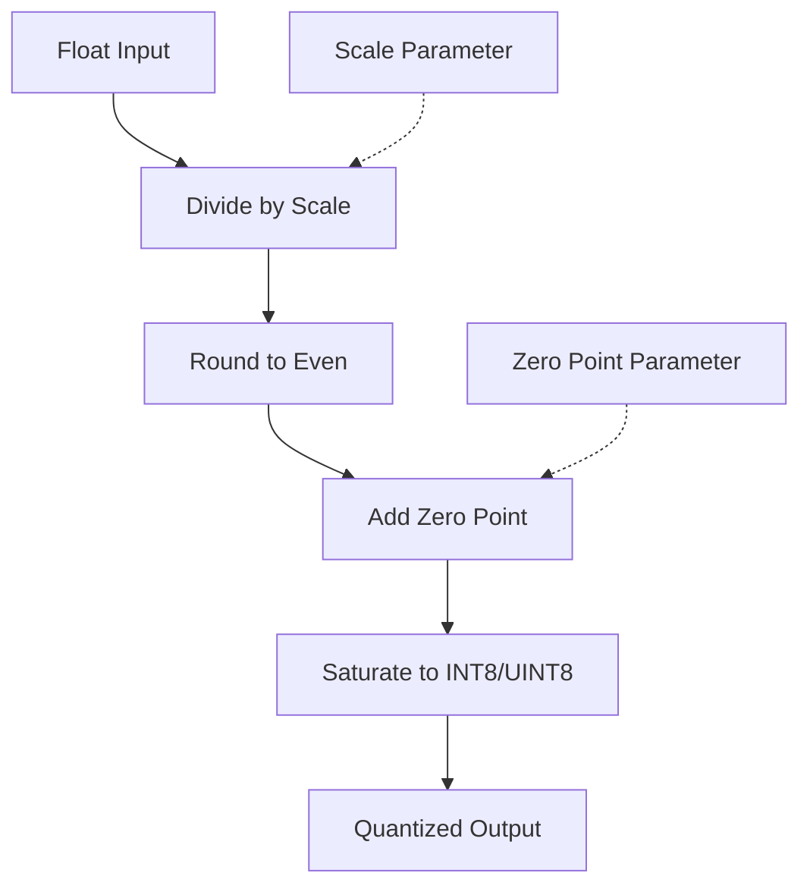

**Diagram: Quantization Pipeline**

Sources: [onnxruntime/core/mlas/lib/quantize.cpp:15-19]()

### Quantization API

The public API provides separate routines for different data types:

| Function | Input Type | Output Type | Purpose |
|----------|------------|-------------|---------|
| `MlasQuantizeLinearU8Kernel` | `float*` | `uint8_t*` | Unsigned 8-bit quantization |
| `MlasQuantizeLinearS8Kernel` | `float*` | `int8_t*` | Signed 8-bit quantization |
| `MlasQuantizeLinearU16Kernel` | `float*` | `uint16_t*` | Unsigned 16-bit quantization |
| `MlasQuantizeLinearS16Kernel` | `float*` | `int16_t*` | Signed 16-bit quantization |
| `MlasDequantizeLinearU8Kernel` | `uint8_t*` | `float*` | Unsigned 8-bit dequantization |
| `MlasDequantizeLinearS8Kernel` | `int8_t*` | `float*` | Signed 8-bit dequantization |

Sources: [onnxruntime/core/mlas/inc/mlas.h:702-772](), [onnxruntime/core/mlas/lib/quantize.cpp:1-19]()

### Vectorized Implementation

Quantization kernels use SIMD intrinsics for performance. The core quantization operation processes 4 elements at a time:

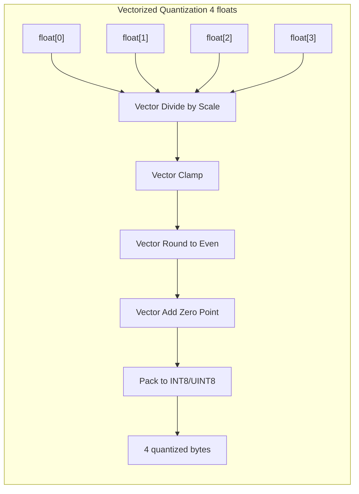

**Diagram: SIMD Quantization Vector Processing**

The implementation uses platform-specific intrinsics:
- **NEON**: `vcvtnq_s32_f32` for rounding, `vaddq_s32` for zero point adjustment
- **SSE2**: `_mm_cvtps_epi32` for rounding, `_mm_add_epi32` for zero point adjustment
- **LSX**: `__lsx_vftint_w_s` for rounding, `__lsx_vadd_w` for zero point adjustment

Sources: [onnxruntime/core/mlas/lib/quantize.cpp:32-83]()

## Quantized GEMM Architecture

### QGEMM Dispatch System

MLAS uses a dispatch table to select optimal QGEMM implementations based on matrix data types (signed vs unsigned):

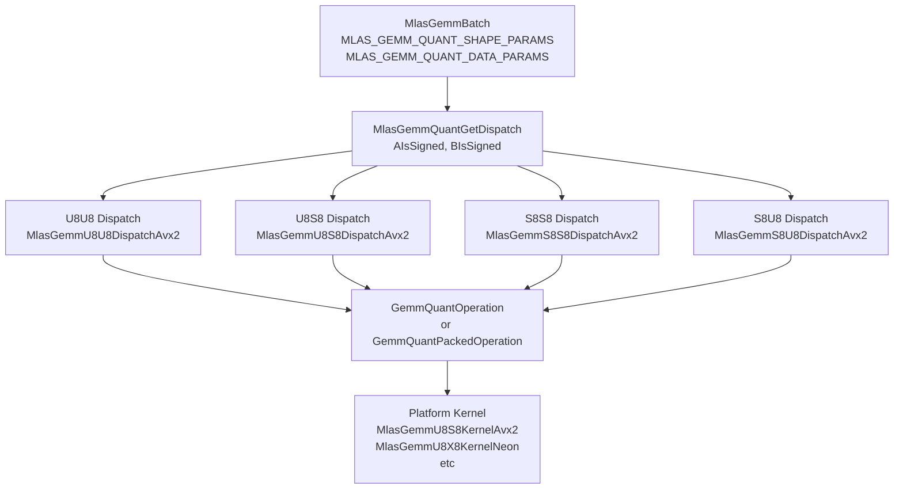

**Diagram: QGEMM Dispatch Architecture**

Sources: [onnxruntime/core/mlas/lib/qgemm.cpp:104-115](), [onnxruntime/core/mlas/lib/qgemm.h:30-35]()

### QGEMM Operation Structure

The `MLAS_GEMM_QUANT_SHAPE_PARAMS` structure defines matrix dimensions and data type information:

| Field | Type | Description |
|-------|------|-------------|
| `M` | `size_t` | Number of rows in matrix A and output C |
| `N` | `size_t` | Number of columns in matrix B and output C |
| `K` | `size_t` | Number of columns in A, rows in B |
| `AIsSigned` | `bool` | Whether matrix A is INT8 (true) or UINT8 (false) |
| `BIsSigned` | `bool` | Whether matrix B is INT8 (true) or UINT8 (false) |
| `IsAccumulateMode` | `bool` | Accumulate to C (true) or overwrite C (false) |

The `MLAS_GEMM_QUANT_DATA_PARAMS` structure provides matrix pointers and quantization parameters:

| Field | Type | Description |
|-------|------|-------------|
| `A` | `const uint8_t*` | Pointer to matrix A data |
| `lda` | `size_t` | Leading dimension of A |
| `ZeroPointA` | `uint8_t` | Zero point for A |
| `B` | `const uint8_t*` | Pointer to matrix B data (or packed B) |
| `ldb` | `size_t` | Leading dimension of B |
| `ZeroPointB` | `const uint8_t*` | Zero point(s) for B |
| `PerColumnZeroPoints` | `bool` | Per-column zero points for B |
| `BIsPacked` | `bool` | Whether B is pre-packed |
| `C` | `int32_t*` | Pointer to output matrix C (INT32 accumulation) |
| `ldc` | `size_t` | Leading dimension of C |
| `OutputProcessor` | `MLAS_QGEMM_OUTPUT_PROCESSOR*` | Optional output post-processing |

Sources: [onnxruntime/core/mlas/inc/mlas.h:585-673]()

### Matrix Packing

QGEMM performance is optimized through matrix packing, which reorganizes data for better cache locality and SIMD utilization:

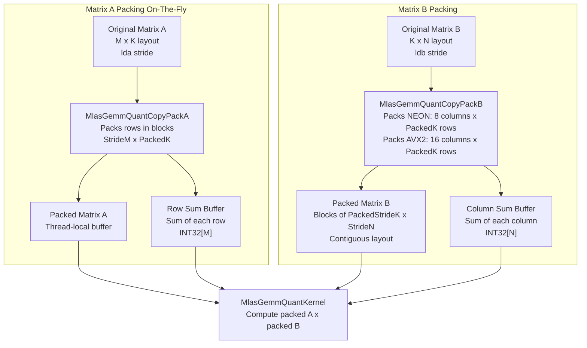

**Diagram: QGEMM Matrix Packing Flow**

The packing process:
1. **Matrix B Pre-packing** (optional): Done once at model load time via `MlasGemmPackBSize` and packing routines
2. **Matrix A On-the-fly Packing**: Done during computation in thread-local buffers
3. **Sum Buffers**: Row and column sums computed during packing, used for zero-point adjustment

Sources: [onnxruntime/core/mlas/lib/qgemm.h:131-153](), [onnxruntime/core/mlas/lib/qgemm.cpp:340-428]()

### Zero Point Adjustment

Quantized GEMM requires adjustment for zero points. Given quantized values `A_q`, `B_q` with zero points `ZP_A`, `ZP_B`:

```
C = (A_q - ZP_A) * (B_q - ZP_B)
  = A_q * B_q - A_q * ZP_B - ZP_A * B_q + ZP_A * ZP_B * K
```

The implementation:
1. Computes `A_q * B_q` in the kernel (INT32 accumulation)
2. Subtracts `A_q * ZP_B` using pre-computed column sums
3. Subtracts `ZP_A * B_q` using pre-computed row sums
4. Adds `ZP_A * ZP_B * K` constant offset

Sources: [onnxruntime/core/mlas/lib/qgemm.h:285-340]()

### Thread Partitioning

QGEMM operations are parallelized across M and N dimensions:

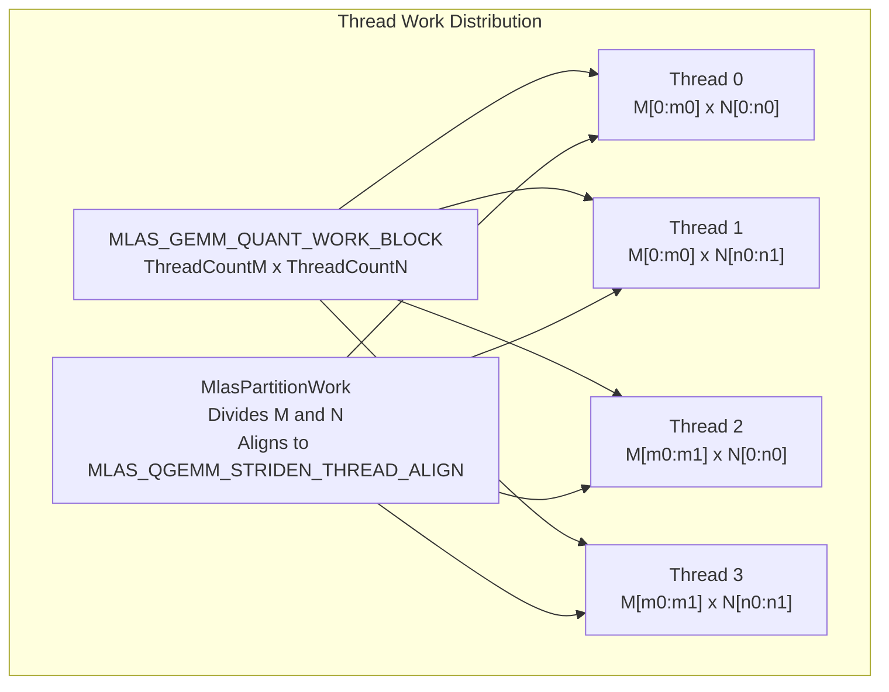

**Diagram: QGEMM Thread Partitioning**

The partitioning strategy:
- **Skinny matrices (N > M)**: Partition along N dimension
- **Tall matrices (M > N)**: Partition along M dimension
- **Alignment**: N dimension aligned to `MLAS_QGEMM_STRIDEN_THREAD_ALIGN` (16 elements)

Sources: [onnxruntime/core/mlas/lib/qgemm.cpp:32-115]()

## Platform-Specific Implementations

### x86 Implementations

MLAS provides multiple x86 QGEMM kernels, dispatched based on CPU capabilities:

| Kernel | ISA Requirements | Matrix Layouts | Accumulation Width |
|--------|-----------------|----------------|-------------------|
| `MlasGemmU8S8KernelAvx2` | AVX2, FMA3 | U8 x S8 | 16x6 (16N x 6M) |
| `MlasGemmU8S8KernelAvx512Core` | AVX512BW/DQ/VL | U8 x S8 | 16x6 |
| `MlasGemmU8S8KernelAvx512Vnni` | AVX512VNNI | U8 x S8 | 16x6 |
| `MlasGemmU8S8KernelAvxVnni` | AVXVNNI | U8 x S8 | 16x6 |
| `MlasGemmU8S8KernelAmx` | AMX-INT8 | U8 x S8 | 16x16 (tile) |
| `MlasGemmU8U8KernelAvx2` | AVX2 | U8 x U8 (as S16) | 16x3 |

The AVX2 kernel uses the following micro-kernel structure:

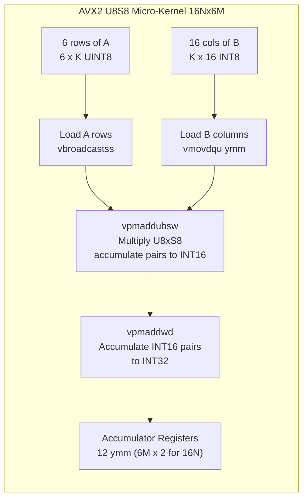

**Diagram: AVX2 QGEMM Micro-Kernel Operation**

The `vpmaddubsw` instruction is central to x86 quantized operations:
- Multiplies unsigned bytes with signed bytes
- Performs horizontal addition of adjacent pairs
- Outputs INT16 intermediate results
- Followed by `vpmaddwd` to accumulate INT16 pairs to INT32

Sources: [onnxruntime/core/mlas/lib/qgemm_kernel_avx2.cpp:1-19](), [cmake/onnxruntime_mlas.cmake:216-223]()

### ARM NEON Implementations

ARM implementations leverage dot product and i8mm instructions when available:

| Kernel | ISA Requirements | Instructions Used | Matrix Dimensions |
|--------|-----------------|-------------------|-------------------|
| `MlasGemmU8X8KernelNeon` | NEON | `vmull_u8`, `vmlal_u8` | 8x4 micro-kernel |
| `MlasGemmU8X8KernelUdot` | NEON + DotProd | `udot`, `sdot` | 8x4 micro-kernel |
| `MlasGemmS8S8KernelSdot` | NEON + DotProd | `sdot` | 8x4 micro-kernel |
| `MlasGemmU8X8KernelUmmla` | NEON + I8MM | `ummla`, `smmla` | 8x8 micro-kernel |
| `MlasGemmS8S8KernelSmmla` | NEON + I8MM | `smmla` | 8x8 micro-kernel |

The dot product instruction significantly improves performance:

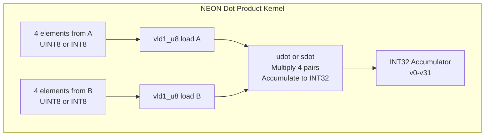

**Diagram: ARM NEON Dot Product Micro-Kernel**

The dot product instructions (`udot`, `sdot`) compute:
```
result[i] += a[4*i] * b[4*i] + a[4*i+1] * b[4*i+1] + 
             a[4*i+2] * b[4*i+2] + a[4*i+3] * b[4*i+3]
```

This replaces 4 multiplies and 3 adds with a single instruction.

Sources: [onnxruntime/core/mlas/lib/qgemm_kernel_neon.cpp:1-19](), [onnxruntime/core/mlas/lib/qgemm_kernel_udot.cpp:1-20](), [cmake/onnxruntime_mlas.cmake:95-116]()

### WebAssembly SIMD

The WebAssembly SIMD implementation uses 128-bit vectors:

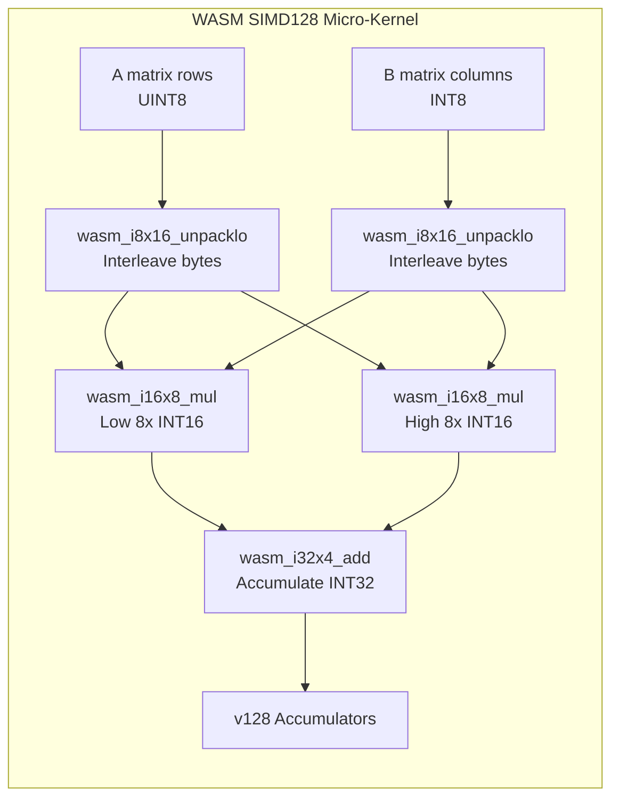

**Diagram: WebAssembly SIMD QGEMM Processing**

Sources: [onnxruntime/core/mlas/lib/qgemm_kernel_wasmsimd.cpp:1-25](), [cmake/onnxruntime_mlas.cmake:324-330]()

## Symmetric Quantization

### Symmetric QGEMM API

Symmetric quantization (zero point = 0) enables optimized code paths. The `MlasSymmQgemmBatch` API operates on INT8 x INT8 matrices:

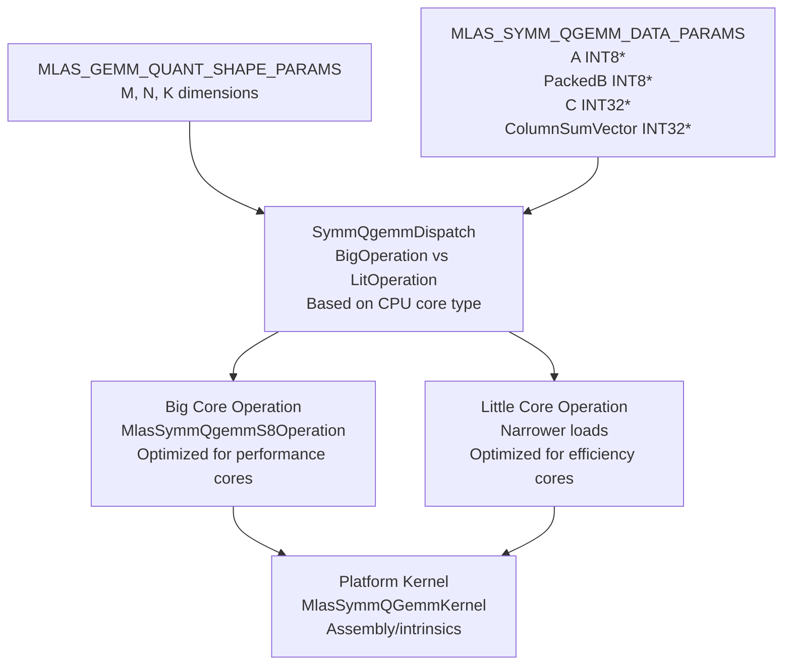

**Diagram: Symmetric QGEMM Dispatch Flow**

Key differences from asymmetric QGEMM:
- **No row sum buffer**: Zero point for A is 0, eliminating `RowSum * ZP_B` term
- **Simplified column adjustment**: Only `ColumnSum * ZP_A` term remains, pre-computed
- **Hybrid-aware dispatch**: Different kernels for big (performance) vs little (efficiency) ARM cores

Sources: [onnxruntime/core/mlas/lib/qgemm.cpp:236-331](), [onnxruntime/core/mlas/inc/mlas.h:876-920]()

### Symmetric Quantization Benefits

| Aspect | Asymmetric Quantization | Symmetric Quantization |
|--------|------------------------|------------------------|
| Zero Point | Non-zero (typical: 128 for UINT8) | Zero |
| Range | Asymmetric around zero | Symmetric around zero |
| Memory for Activations | Row sum buffer required | No row sum buffer |
| Computation | More complex adjustment | Simplified adjustment |
| Accuracy | Better for asymmetric distributions | Sufficient for many models |

Sources: [onnxruntime/core/mlas/lib/qgemm.h:172-198]()

## Dynamic Quantization

### Dynamic Quantization Overview

Dynamic quantization quantizes activations at runtime while using pre-quantized weights:

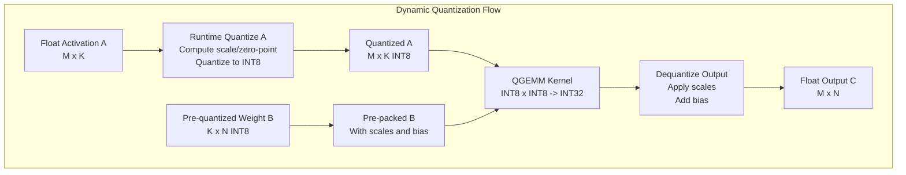

**Diagram: Dynamic Quantization Execution Flow**

The dynamic quantization API:
- `MlasIsDynamicQGemmAvailable()`: Check if dynamic QGEMM is supported (requires KleidiAI) [onnxruntime/core/mlas/lib/qgemm.cpp:204-215]()
- `MlasDynamicQgemmPackBSize()`: Get packed weight size [onnxruntime/core/mlas/inc/mlas.h:1000]()
- `MlasDynamicQgemmPackB()`: Pre-pack weight matrix with scales and bias [onnxruntime/core/mlas/inc/mlas.h:1008]()
- `MlasDynamicQGemmBatch()`: Execute dynamic quantized GEMM [onnxruntime/core/mlas/lib/qgemm.cpp:217-239]()

Sources: [onnxruntime/core/mlas/lib/qgemm.cpp:204-234](), [onnxruntime/contrib_ops/cpu/quantization/dynamic_quantize_matmul.cc:160-224]()

### KleidiAI Integration

KleidiAI provides optimized implementations for ARM SME/SME2:

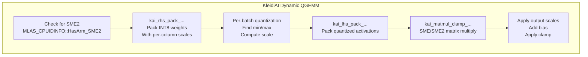

**Diagram: KleidiAI Dynamic QGEMM Pipeline**

The KleidiAI integration provides:
- **SME tiles**: Use ARM Scalable Matrix Extension for larger tile sizes
- **Dynamic vector length**: Adapts to hardware vector length (128-2048 bits)
- **Symmetric quantization**: Requires zero point = 0 for weights
- **Per-column scales**: Maintains per-column quantization granularity

Sources: [onnxruntime/core/mlas/lib/kleidiai/mlasi_kleidiai.h:106-132](), [onnxruntime/contrib_ops/cpu/quantization/dynamic_quantize_matmul.cc:166-200]()

### Dynamic Quantization Operator

The `DynamicQuantizeMatMul` operator implements dynamic quantization at the ONNX operator level:

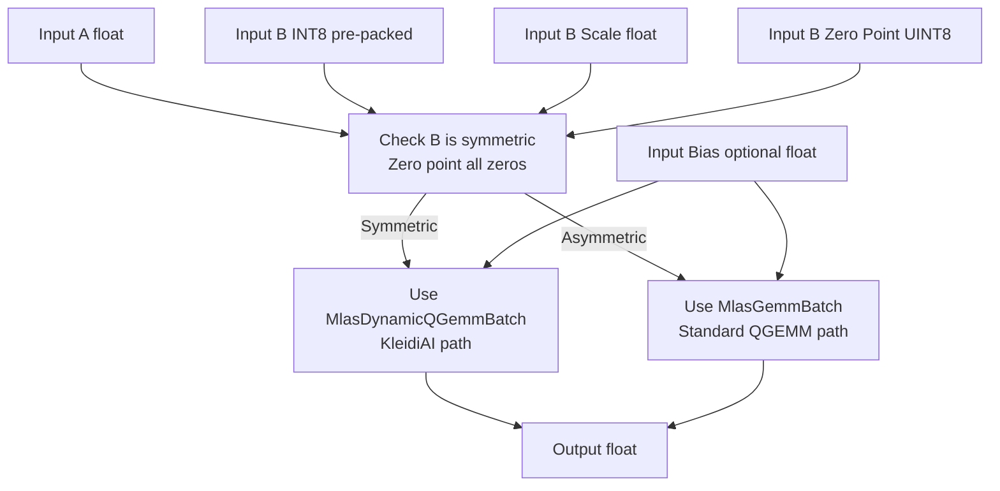

**Diagram: DynamicQuantizeMatMul Operator Logic**

Sources: [onnxruntime/contrib_ops/cpu/quantization/dynamic_quantize_matmul.cc:42-158]()

## N-Bit Quantized GEMM (QNBitGemm / MatMulNBits)

The `MatMulNBits` operator (implemented as `QNBitGemm` in MLAS) supports matrix multiplication with N-bit quantized weights, where N can be 2, 4, or 8 bits. This is particularly useful for extreme quantization scenarios, such as LLMs.

### QNBitGemm Overview

The `MatMulNBits` operator takes a floating-point input matrix `A` and an N-bit quantized weight matrix `B`. It performs the matrix multiplication and outputs a floating-point result.

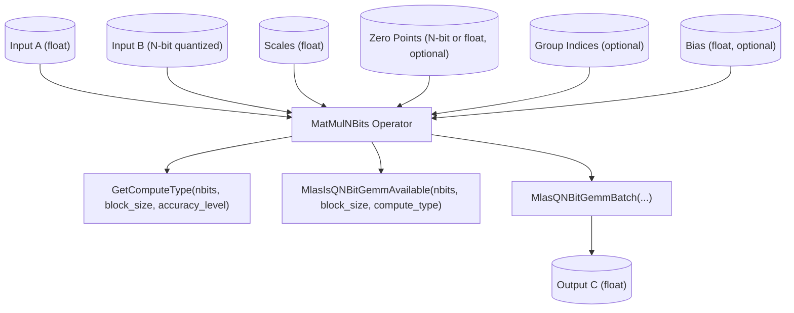

**Diagram: MatMulNBits Operator Data Flow**

The `MatMulNBits` operator supports:
- **N-bit weights**: Currently 2-bit, 4-bit, and 8-bit are supported. [onnxruntime/contrib_ops/cpu/quantization/matmul_nbits.cc:130]()
- **Block-wise quantization**: Weights are quantized in blocks, with per-block scales and zero points. [onnxruntime/contrib_ops/cpu/quantization/matmul_nbits.cc:104]()
- **Group indices (`g_idx`)**: Allows for more fine-grained quantization groups. [onnxruntime/contrib_ops/cpu/quantization/matmul_nbits.cc:106]()
- **Compute types**: Can perform computation in FP32, FP16, or INT8, depending on hardware support and `accuracy_level` attribute. [onnxruntime/contrib_ops/cpu/quantization/matmul_nbits.cc:51-80]()

Sources: [onnxruntime/contrib_ops/cpu/quantization/matmul_nbits.cc:1-166](), [onnxruntime/core/mlas/inc/mlas_qnbit.h:1-10]()

### QNBitGemm Compute Types

The `MLAS_QNBIT_GEMM_COMPUTE_TYPE` enum defines the internal accumulation precision:

| Compute Type | Input Type | Accumulator Type | Supported N-bits | Description |
|--------------|------------|------------------|------------------|-------------|
| `SQNBIT_CompFp32` | `float` | `float` | 2, 4, 8 | Standard FP32 accumulation. |
| `SQNBIT_CompInt8` | `float` | `int32_t` | 2, 4, 8 | INT8 computation with INT32 accumulation, then dequantized to FP32. |
| `HQNBIT_CompFp16` | `MLFloat16` | `MLFloat16` | 2, 4, 8 | FP16 accumulation (ARM64 only). |
| `HQNBIT_CompInt8` | `MLFloat16` | `int32_t` | 2, 4, 8 | INT8 computation with INT32 accumulation, then dequantized to FP16 (ARM64 only). |

The `GetComputeType` function determines the optimal compute type based on the input data type, `nbits`, `block_size`, and `accuracy_level` attribute. For `float` inputs, it prefers `SQNBIT_CompInt8` if available and `accuracy_level` is `Level4`. For `MLFloat16` inputs (on ARM64), it prefers `HQNBIT_CompInt8` if available.

Sources: [onnxruntime/contrib_ops/cpu/quantization/matmul_nbits.cc:41-80](), [onnxruntime/core/mlas/inc/mlas_qnbit.h:12-20]()

### QNBitGemm Kernels

MLAS provides specialized kernels for `QNBitGemm` across different architectures:

- **x86 (AVX2, AVX512, VNNI)**:
    - `MlasSqnbitGemmKernelAvx2`: For 4-bit weights. [onnxruntime/core/mlas/lib/sqnbitgemm_kernel_avx2.cpp]()
    - `MlasSqnbitGemmKernelAvx512`: For 4-bit weights. [onnxruntime/core/mlas/lib/sqnbitgemm_kernel_avx512.cpp]()
    - `MlasSqnbitGemmKernelAvx512Vnni`: For 4-bit weights. [onnxruntime/core/mlas/lib/sqnbitgemm_kernel_avx512vnni.cpp]()
    - `MlasSqnbitGemmKernelAvx512Vnni2Bit`: For 2-bit weights. [onnxruntime/core/mlas/lib/sqnbitgemm_kernel_avx512vnni_2bit.cpp]()
- **ARM64 (NEON)**:
    - `MlasSqnbitGemmKernelNeon`: For 4-bit weights. [onnxruntime/core/mlas/lib/qnbitgemm_kernel_neon.cpp]()
    - `MlasSqnbitGemmKernelNeonInt8`: For 4-bit weights with INT8 compute. [onnxruntime/core/mlas/lib/sqnbitgemm_kernel_neon_int8.cpp]()
    - `MlasSqnbitGemmKernelNeonInt8_2Bit`: For 2-bit weights with INT8 compute. [cmake/onnxruntime_mlas.cmake:126]()
    - `MlasHqnbitGemmKernelNeonFp16`: For 4-bit weights with FP16 compute. [cmake/onnxruntime_mlas.cmake:128]()
    - `MlasHqnbitGemmKernelNeonFp16_8Bit`: For 8-bit weights with FP16 compute. [cmake/onnxruntime_mlas.cmake:129]()

These kernels handle the unpacking of N-bit weights, multiplication with FP32 or FP16 inputs, and accumulation to the specified compute type.

Sources: [onnxruntime/core/mlas/lib/qnbitgemm.cpp](), [onnxruntime/core/mlas/lib/qnbitgemm_kernel_neon.cpp](), [onnxruntime/core/mlas/lib/sqnbitgemm_kernel_avx512vnni.cpp](), [onnxruntime/core/mlas/lib/sqnbitgemm_kernel_neon_int8.cpp](), [onnxruntime/core/mlas/lib/sqnbitgemm_kernel_avx512.cpp](), [onnxruntime/core/mlas/lib/sqnbitgemm_kernel_avx2.cpp](), [onnxruntime/core/mlas/lib/sqnbitgemm_kernel_avx512vnni_2bit.cpp](), [cmake/onnxruntime_mlas.cmake:114-129]()

## Output Processing

### Output Processor Interface

QGEMM operations output INT32 accumulated values. The `MLAS_QGEMM_OUTPUT_PROCESSOR` interface enables flexible post-processing:

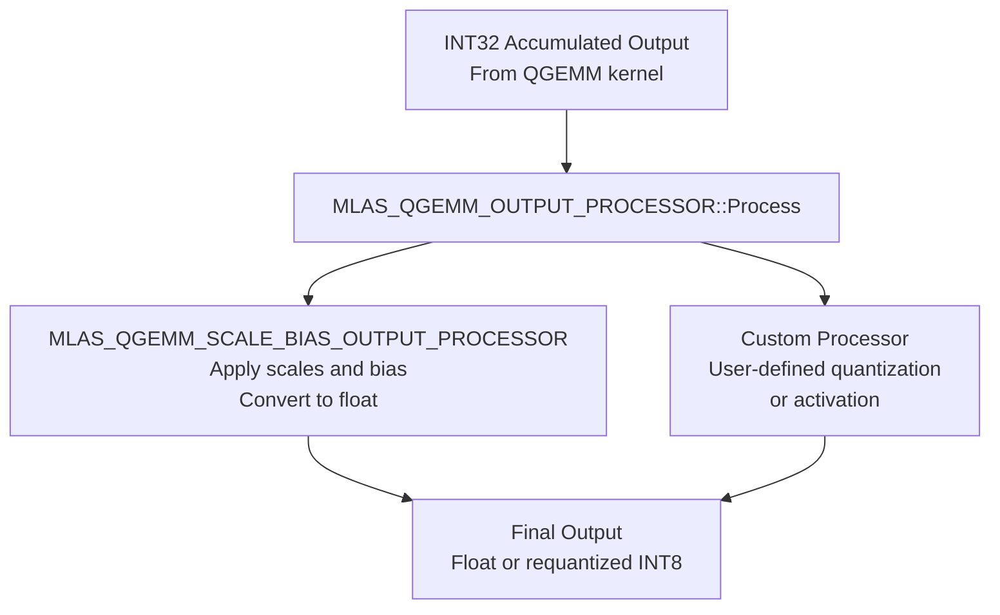

**Diagram: QGEMM Output Processing Pipeline**

The `MLAS_QGEMM_SCALE_BIAS_OUTPUT_PROCESSOR` implements the most common post-processing:

```
Output[m, n] = (C[m, n] * Scale[n]) + Bias[n]
```

Where:
- `Scale[n]`: Per-column or per-tensor scale factor
- `Bias[n]`: Optional per-column bias
- Granularity: Per-matrix or per-column quantization

Sources: [onnxruntime/core/mlas/inc/mlas.h:512-576](), [onnxruntime/core/mlas/lib/qgemm.cpp:62-158]()

### Quantization Granularity

| Granularity | Scale/ZeroPoint | Memory | Accuracy | Use Case |
|-------------|----------------|---------|----------|----------|
| Per-Matrix | Single value | Minimal | Lower | Fast inference, large batches |
| Per-Column | N values | N × sizeof(float) | Higher | Convolution filters, attention |
| Per-Row | M values | M × sizeof(float) | Higher | Rare, special cases |
| Per-Channel | C values | C × sizeof(float) | Highest | Grouped convolutions |

Sources: [onnxruntime/core/mlas/inc/mlas.h:502-505]()

## Platform Dispatch Initialization

### Dispatch Table Population

The platform detection system initializes dispatch tables at runtime:

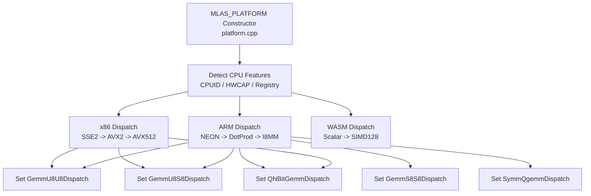

**Diagram: Quantization Dispatch Table Initialization**

For x86 platforms, the initialization sequence:
1. Default to SSE2 implementation
2. Check AVX and OSXSAVE → upgrade to AVX kernels
3. Check AVX2 and FMA3 → upgrade to AVX2 kernels
4. Check AVX512F and state saving → upgrade to AVX512 kernels
5. Check AVX512VNNI → upgrade to VNNI kernels
6. Check AMX and initialize → upgrade to AMX kernels (requires OS support)

Sources: [onnxruntime/core/mlas/lib/platform.cpp:234-552]()

### ARM Platform Initialization

ARM initialization considers multiple instruction sets:

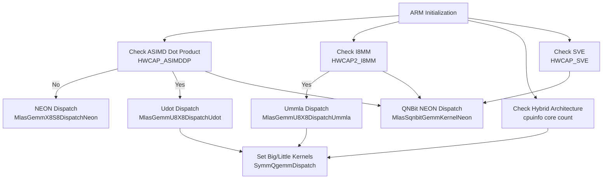

**Diagram: ARM QGEMM and QNBitGemm Dispatch Initialization**

Sources: [onnxruntime/core/mlas/lib/platform.cpp:556-650](), [onnxruntime/core/common/cpuid_info.cc:192-206]()

## Testing and Validation

### Unit Test Coverage

QGEMM operations are validated through comprehensive unit tests:

| Test Suite | Coverage | Validation |
|------------|----------|------------|
| `test_qgemm_fixture.h` | All dispatch paths | Correctness vs reference implementation |
| `test_dynamic_qgemm.cpp` | Dynamic quantization | End-to-end accuracy |
| `test_sqnbitgemm.cpp` | N-bit quantization | Correctness for 2-bit, 4-bit, 8-bit |
| `test_transpose.cpp` | Matrix packing | Layout correctness |
| Backend tests | ONNX compliance | Standard conformance |

Dynamic quantization test workflow:
1. Generate random float matrices A and B
2. Quantize B to INT8 with per-column scales
3. Execute dynamic QGEMM
4. Compare against float reference with tolerance

Sources: [onnxruntime/test/mlas/unittest/test_dynamic_qgemm.cpp:10-140](), [onnxruntime/test/mlas/unittest/test_sqnbitgemm.cpp:1-100]()

### Numerical Accuracy

Quantization introduces several sources of error:
- **Quantization error**: Rounding during quantization (bounded by 0.5 * scale)
- **Accumulation error**: Limited INT32 range (2^31 - 1)
- **Dequantization error**: Floating-point multiplication precision

Typical accuracy metrics:
- **INT8 asymmetric**: 1-2% accuracy loss vs FP32
- **INT8 symmetric**: 2-3% accuracy loss vs FP32  
- **Dynamic quantization**: 0.5-1% additional loss from activation quantization
- **N-bit quantization**: Higher accuracy loss, but significantly reduced model size.

Sources: [onnxruntime/core/mlas/lib/quantize.cpp:15-19]()

---

