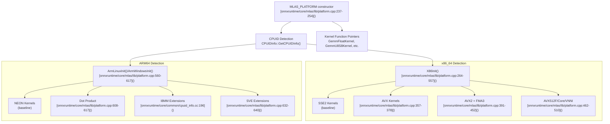
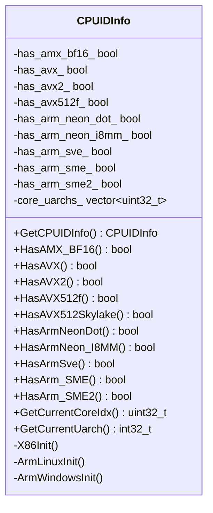
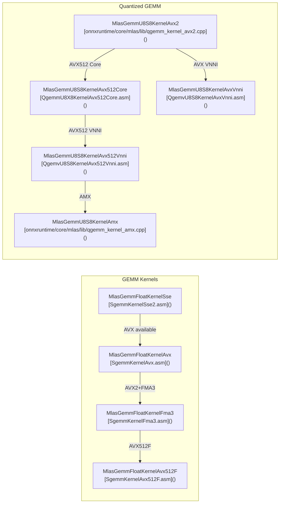
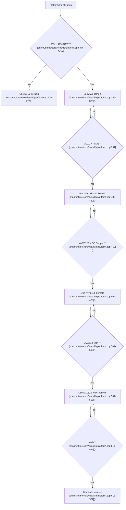
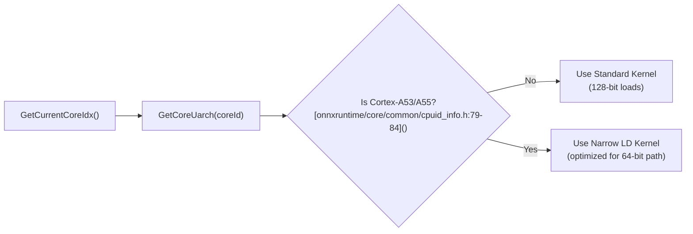
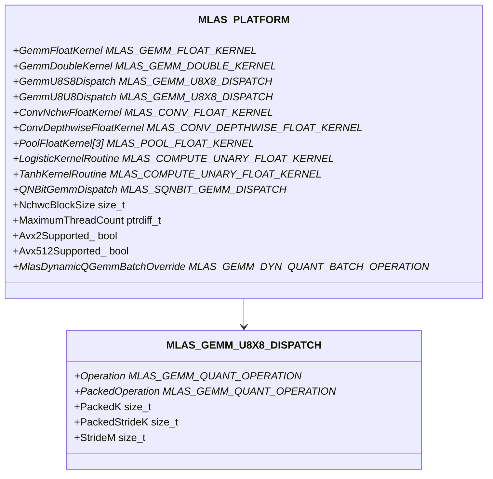
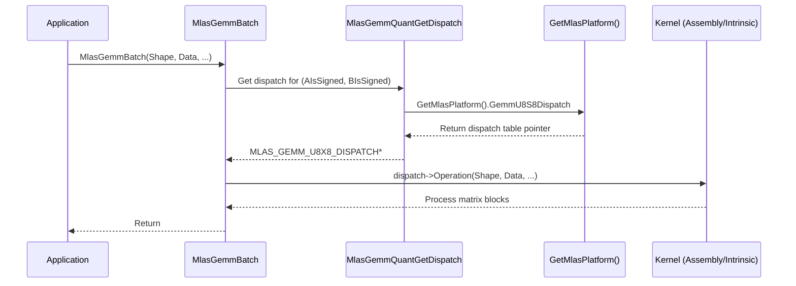
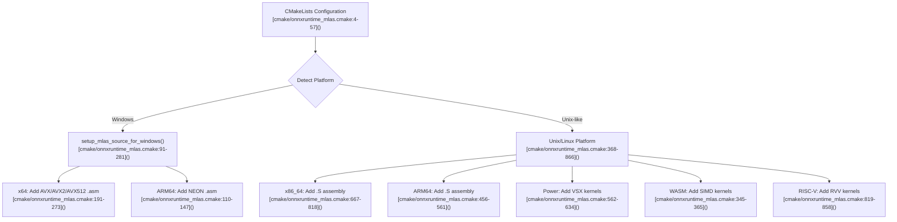

<!-- source: DeepWiki mcp.deepwiki.com · repo microsoft/onnxruntime · page 4.4 Platform Optimizations · fetched 2026-10-21 -->

# Platform Optimizations

<details>
<summary>Relevant source files</summary>

The following files were used as context for generating this wiki page:

- [cmake/onnxruntime_mlas.cmake](cmake/onnxruntime_mlas.cmake)
- [onnxruntime/contrib_ops/cpu/fused_activation.cc](onnxruntime/contrib_ops/cpu/fused_activation.cc)
- [onnxruntime/contrib_ops/cpu/nchwc_ops.cc](onnxruntime/contrib_ops/cpu/nchwc_ops.cc)
- [onnxruntime/contrib_ops/cpu/nchwc_ops.h](onnxruntime/contrib_ops/cpu/nchwc_ops.h)
- [onnxruntime/core/common/cpuid_info.cc](onnxruntime/core/common/cpuid_info.cc)
- [onnxruntime/core/common/cpuid_info.h](onnxruntime/core/common/cpuid_info.h)
- [onnxruntime/core/graph/contrib_ops/nchwc_schema_defs.cc](onnxruntime/core/graph/contrib_ops/nchwc_schema_defs.cc)
- [onnxruntime/core/mlas/inc/mlas.h](onnxruntime/core/mlas/inc/mlas.h)
- [onnxruntime/core/mlas/lib/activate.cpp](onnxruntime/core/mlas/lib/activate.cpp)
- [onnxruntime/core/mlas/lib/activate_fp16.cpp](onnxruntime/core/mlas/lib/activate_fp16.cpp)
- [onnxruntime/core/mlas/lib/amd64/QgemmU8S8KernelAmx.asm](onnxruntime/core/mlas/lib/amd64/QgemmU8S8KernelAmx.asm)
- [onnxruntime/core/mlas/lib/amx_common.h](onnxruntime/core/mlas/lib/amx_common.h)
- [onnxruntime/core/mlas/lib/convolve.cpp](onnxruntime/core/mlas/lib/convolve.cpp)
- [onnxruntime/core/mlas/lib/dgemm.cpp](onnxruntime/core/mlas/lib/dgemm.cpp)
- [onnxruntime/core/mlas/lib/dwconv.cpp](onnxruntime/core/mlas/lib/dwconv.cpp)
- [onnxruntime/core/mlas/lib/fp16_common.h](onnxruntime/core/mlas/lib/fp16_common.h)
- [onnxruntime/core/mlas/lib/hqnbitgemm_kernel_neon_fp16.cpp](onnxruntime/core/mlas/lib/hqnbitgemm_kernel_neon_fp16.cpp)
- [onnxruntime/core/mlas/lib/intrinsics/avx512/gelu_avx512f.cpp](onnxruntime/core/mlas/lib/intrinsics/avx512/gelu_avx512f.cpp)
- [onnxruntime/core/mlas/lib/intrinsics/avx512/reorder_avx512f.cpp](onnxruntime/core/mlas/lib/intrinsics/avx512/reorder_avx512f.cpp)
- [onnxruntime/core/mlas/lib/kleidiai/convolve_kleidiai.cpp](onnxruntime/core/mlas/lib/kleidiai/convolve_kleidiai.cpp)
- [onnxruntime/core/mlas/lib/kleidiai/mlasi_kleidiai.h](onnxruntime/core/mlas/lib/kleidiai/mlasi_kleidiai.h)
- [onnxruntime/core/mlas/lib/kleidiai/qgemm_kleidiai.cpp](onnxruntime/core/mlas/lib/kleidiai/qgemm_kleidiai.cpp)
- [onnxruntime/core/mlas/lib/kleidiai/sbgemm_kleidiai.cpp](onnxruntime/core/mlas/lib/kleidiai/sbgemm_kleidiai.cpp)
- [onnxruntime/core/mlas/lib/kleidiai/sgemm_kleidiai.cpp](onnxruntime/core/mlas/lib/kleidiai/sgemm_kleidiai.cpp)
- [onnxruntime/core/mlas/lib/mlasi.h](onnxruntime/core/mlas/lib/mlasi.h)
- [onnxruntime/core/mlas/lib/platform.cpp](onnxruntime/core/mlas/lib/platform.cpp)
- [onnxruntime/core/mlas/lib/pooling_fp16.cpp](onnxruntime/core/mlas/lib/pooling_fp16.cpp)
- [onnxruntime/core/mlas/lib/qdwconv.cpp](onnxruntime/core/mlas/lib/qdwconv.cpp)
- [onnxruntime/core/mlas/lib/qgemm.cpp](onnxruntime/core/mlas/lib/qgemm.cpp)
- [onnxruntime/core/mlas/lib/qgemm.h](onnxruntime/core/mlas/lib/qgemm.h)
- [onnxruntime/core/mlas/lib/qgemm_kernel_amx.cpp](onnxruntime/core/mlas/lib/qgemm_kernel_amx.cpp)
- [onnxruntime/core/mlas/lib/qgemm_kernel_avx2.cpp](onnxruntime/core/mlas/lib/qgemm_kernel_avx2.cpp)
- [onnxruntime/core/mlas/lib/qgemm_kernel_default.cpp](onnxruntime/core/mlas/lib/qgemm_kernel_default.cpp)
- [onnxruntime/core/mlas/lib/qgemm_kernel_neon.cpp](onnxruntime/core/mlas/lib/qgemm_kernel_neon.cpp)
- [onnxruntime/core/mlas/lib/qgemm_kernel_sdot.cpp](onnxruntime/core/mlas/lib/qgemm_kernel_sdot.cpp)
- [onnxruntime/core/mlas/lib/qgemm_kernel_sse.cpp](onnxruntime/core/mlas/lib/qgemm_kernel_sse.cpp)
- [onnxruntime/core/mlas/lib/qgemm_kernel_sse41.cpp](onnxruntime/core/mlas/lib/qgemm_kernel_sse41.cpp)
- [onnxruntime/core/mlas/lib/qgemm_kernel_udot.cpp](onnxruntime/core/mlas/lib/qgemm_kernel_udot.cpp)
- [onnxruntime/core/mlas/lib/qgemm_kernel_wasmsimd.cpp](onnxruntime/core/mlas/lib/qgemm_kernel_wasmsimd.cpp)
- [onnxruntime/core/mlas/lib/reorder.cpp](onnxruntime/core/mlas/lib/reorder.cpp)
- [onnxruntime/core/mlas/lib/sgemm.cpp](onnxruntime/core/mlas/lib/sgemm.cpp)
- [onnxruntime/core/mlas/lib/snchwc.cpp](onnxruntime/core/mlas/lib/snchwc.cpp)
- [onnxruntime/core/mlas/lib/softmax.h](onnxruntime/core/mlas/lib/softmax.h)
- [onnxruntime/core/mlas/lib/softmax_kernel_neon.cpp](onnxruntime/core/mlas/lib/softmax_kernel_neon.cpp)
- [onnxruntime/core/mlas/lib/sqnbitgemm_kernel_neon_fp32.cpp](onnxruntime/core/mlas/lib/sqnbitgemm_kernel_neon_fp32.cpp)
- [onnxruntime/core/mlas/lib/x86_64/QgemmU8S8KernelAmx.S](onnxruntime/core/mlas/lib/x86_64/QgemmU8S8KernelAmx.S)
- [onnxruntime/core/mlas/lib/x86_64/QgemmU8S8KernelAmxCommon.S](onnxruntime/core/mlas/lib/x86_64/QgemmU8S8KernelAmxCommon.S)
- [onnxruntime/core/optimizer/conv_add_fusion.cc](onnxruntime/core/optimizer/conv_add_fusion.cc)
- [onnxruntime/core/optimizer/conv_bn_fusion.cc](onnxruntime/core/optimizer/conv_bn_fusion.cc)
- [onnxruntime/core/optimizer/conv_mul_fusion.cc](onnxruntime/core/optimizer/conv_mul_fusion.cc)
- [onnxruntime/core/optimizer/nchwc_transformer.cc](onnxruntime/core/optimizer/nchwc_transformer.cc)
- [onnxruntime/core/providers/cpu/fp16/fp16_conv.cc](onnxruntime/core/providers/cpu/fp16/fp16_conv.cc)
- [onnxruntime/test/contrib_ops/fused_conv_test.cc](onnxruntime/test/contrib_ops/fused_conv_test.cc)
- [onnxruntime/test/mlas/bench/bench_qgemm.cpp](onnxruntime/test/mlas/bench/bench_qgemm.cpp)
- [onnxruntime/test/mlas/bench/bench_sconv.cpp](onnxruntime/test/mlas/bench/bench_sconv.cpp)
- [onnxruntime/test/mlas/unittest/test_activation.cpp](onnxruntime/test/mlas/unittest/test_activation.cpp)
- [onnxruntime/test/mlas/unittest/test_conv2d.h](onnxruntime/test/mlas/unittest/test_conv2d.h)
- [onnxruntime/test/mlas/unittest/test_conv2d_nchwc.h](onnxruntime/test/mlas/unittest/test_conv2d_nchwc.h)
- [onnxruntime/test/mlas/unittest/test_erf.cpp](onnxruntime/test/mlas/unittest/test_erf.cpp)
- [onnxruntime/test/mlas/unittest/test_fgemm.cpp](onnxruntime/test/mlas/unittest/test_fgemm.cpp)
- [onnxruntime/test/mlas/unittest/test_fgemm.h](onnxruntime/test/mlas/unittest/test_fgemm.h)
- [onnxruntime/test/mlas/unittest/test_fgemm_fixture.h](onnxruntime/test/mlas/unittest/test_fgemm_fixture.h)
- [onnxruntime/test/mlas/unittest/test_fp16_activation.cpp](onnxruntime/test/mlas/unittest/test_fp16_activation.cpp)
- [onnxruntime/test/mlas/unittest/test_pool2d_nchwc.h](onnxruntime/test/mlas/unittest/test_pool2d_nchwc.h)
- [onnxruntime/test/mlas/unittest/test_qgemm.cpp](onnxruntime/test/mlas/unittest/test_qgemm.cpp)
- [onnxruntime/test/mlas/unittest/test_qgemm_fixture.h](onnxruntime/test/mlas/unittest/test_qgemm_fixture.h)
- [onnxruntime/test/mlas/unittest/test_reorder_input.cpp](onnxruntime/test/mlas/unittest/test_reorder_input.cpp)
- [onnxruntime/test/mlas/unittest/test_reorder_output.cpp](onnxruntime/test/mlas/unittest/test_reorder_output.cpp)
- [onnxruntime/test/mlas/unittest/test_scaleoutput.cpp](onnxruntime/test/mlas/unittest/test_scaleoutput.cpp)
- [onnxruntime/test/optimizer/nchwc_optimizer_test.cc](onnxruntime/test/optimizer/nchwc_optimizer_test.cc)

</details>


## Purpose and Scope

This document describes how MLAS (Microsoft Linear Algebra Subprograms) optimizes computational kernels for different CPU architectures and instruction set extensions. It covers CPU feature detection, runtime kernel dispatch, and the organization of platform-specific implementations.

For information about the overall MLAS architecture and kernel interfaces, see [MLAS Architecture](#4.1). For details on specific operation implementations (GEMM, quantized operations), see [GEMM Operations](#4.2) and [Quantized Operations](#4.3).

## Platform Detection System

MLAS performs runtime detection of CPU capabilities to select the most optimized kernel for the available hardware. The platform initialization occurs in the `MLAS_PLATFORM` constructor, which probes CPU features and configures function pointers to the appropriate kernel implementations.



**Platform Detection Flow**

Sources: [onnxruntime/core/mlas/lib/platform.cpp:237-656](), [onnxruntime/core/common/cpuid_info.cc:358-387]()

### CPUID Information Structure

The `CPUIDInfo` class provides a unified interface for querying CPU capabilities across platforms:



**CPU Feature Detection Interface**

Sources: [onnxruntime/core/common/cpuid_info.h:11-174](), [onnxruntime/core/common/cpuid_info.cc:1-388]()

## CPU Instruction Set Detection

### x86_64 Feature Detection

On x86_64 platforms, MLAS uses the CPUID instruction to query available features. The detection checks for progressively more advanced instruction sets:

| Instruction Set | Detection Method | Key Features | Minimum CPU |
|----------------|------------------|--------------|-------------|
| SSE2 | Baseline (always available on x86_64) | 128-bit SIMD | Any x86_64 |
| SSE4.1 | CPUID leaf 1, ECX bit 19 | Additional SIMD instructions | Core 2 Penryn |
| AVX | CPUID leaf 1, ECX bits 27-28 + XGETBV | 256-bit SIMD | Sandy Bridge |
| AVX2 + FMA3 | CPUID leaf 7, EBX bit 5 + CPUID leaf 1, ECX bit 12 | Fused multiply-add | Haswell |
| AVX512F | CPUID leaf 7, EBX bit 16 + XGETBV AVX512 state | 512-bit SIMD | Skylake-X |
| AVX512 Core | AVX512F + AVX512BW/DQ/VL | Full AVX512 support | Skylake-X |
| AVX512 VNNI | AVX512 Core + CPUID leaf 7, ECX bit 11 | Vector neural network instructions | Cascade Lake |
| AVX VNNI | AVX2 + CPUID leaf 7.1, EAX bit 4 | VNNI on 256-bit vectors | Alder Lake |
| AMX | CPUID leaf 7, EDX bits 24-25 + XGETBV XTILE | Matrix multiply instructions | Sapphire Rapids |

Sources: [onnxruntime/core/common/cpuid_info.cc:131-180](), [onnxruntime/core/mlas/lib/platform.cpp:319-557]()

### ARM64 Feature Detection

On ARM64 platforms, feature detection uses different mechanisms depending on the operating system:

**Linux Detection Methods:**
- **Hardware Capabilities**: Reads `AT_HWCAP` and `AT_HWCAP2` via `getauxval()` to detect:
  - `HWCAP_ASIMDDP`: Dot product instructions [onnxruntime/core/common/cpuid_info.cc:29]()
  - `HWCAP2_I8MM`: 8-bit integer matrix multiply instructions [onnxruntime/core/common/cpuid_info.cc:37]()
  - `HWCAP2_SVEI8MM`: SVE with I8MM support [onnxruntime/core/common/cpuid_info.cc:40]()
  - `HWCAP2_BF16`: BFloat16 support [onnxruntime/core/common/cpuid_info.cc:43]()
  - `HWCAP_SVE`: Scalable Vector Extension [onnxruntime/core/common/cpuid_info.cc:32]()
  - `HWCAP_SME`: Scalable Matrix Extension [onnxruntime/core/common/cpuid_info.cc:204]()
  - `HWCAP_SME2`: Scalable Matrix Extension 2 [onnxruntime/core/common/cpuid_info.cc:205]()

**Windows Detection Methods:**
- **Processor Feature**: Uses `IsProcessorFeaturePresent(PF_ARM_V82_DP_INSTRUCTIONS_AVAILABLE)` for basic features [onnxruntime/core/mlas/lib/platform.cpp:79]()
- **Registry MIDR**: Reads MIDR register values from Windows registry to identify core microarchitectures

Sources: [onnxruntime/core/common/cpuid_info.cc:188-235](), [onnxruntime/core/mlas/lib/platform.cpp:560-617]()

### RISC-V Feature Detection

On RISC-V platforms, feature detection is performed by checking hardware capabilities:

**Linux Detection Methods:**
- **Hardware Capabilities**: Reads `AT_HWCAP` via `getauxval()` to detect:
  - `COMPAT_HWCAP_ISA_V`: Vector extension support [onnxruntime/core/mlas/lib/platform.cpp:38-40]()
- **Hardware Probe**: Uses `syscall(__NR_riscv_hwprobe)` to detect:
  - `RISCV_HWPROBE_EXT_ZVFH`: ZVFH extension for half-precision floating point [onnxruntime/core/common/cpuid_info.cc:53-54]()
  - `RISCV_HWPROBE_IMA_V`: Vector extension [onnxruntime/core/common/cpuid_info.cc:56-57]()

Sources: [onnxruntime/core/mlas/lib/platform.cpp:35-41](), [onnxruntime/core/common/cpuid_info.cc:50-58]()

### WebAssembly SIMD Detection

For WebAssembly, MLAS checks for SIMD capabilities during compilation:

- `MLAS_TARGET_WASM_SIMD`: Defined if `__wasm_simd128__` is enabled. [onnxruntime/core/mlas/inc/mlas.h:79-80]()
- `MLAS_TARGET_WASM_RELAXED_SIMD`: Defined if `__wasm_relaxed_simd__` is enabled. [onnxruntime/core/mlas/inc/mlas.h:76-77]()

Sources: [onnxruntime/core/mlas/inc/mlas.h:74-83]()

## Platform-Specific Kernel Implementations

### x86_64 Kernels

MLAS provides a hierarchy of optimized kernels for x86_64, with each tier offering improved performance:



**x86_64 Kernel Selection Hierarchy**

The runtime dispatch logic in `MLAS_PLATFORM` constructor assigns function pointers based on detected capabilities:



**x86_64 Runtime Dispatch Logic**

Sources: [onnxruntime/core/mlas/lib/platform.cpp:264-557](), [cmake/onnxruntime_mlas.cmake:191-280]()

### Assembly File Organization (x86_64)

The x86_64 kernels are primarily implemented in assembly for maximum performance:

| Operation | SSE2/AVX | AVX2/FMA3 | AVX512 |
|-----------|----------|-----------|--------|
| SGEMM | [SgemmKernelSse2.asm]() | [SgemmKernelFma3.asm]() | [SgemmKernelAvx512F.asm]() |
| DGEMM | [onnxruntime/core/mlas/lib/dgemm.cpp]() | [DgemmKernelFma3.asm]() | [DgemmKernelAvx512F.asm]() |
| QGEMM U8S8 | N/A | [onnxruntime/core/mlas/lib/qgemm_kernel_avx2.cpp]() | [QgemmU8X8KernelAvx512Core.asm]() |
| Convolution | [SconvKernelSse2.asm]() | [SconvKernelFma3.asm]() | [SconvKernelAvx512F.asm]() |
| Pooling | [SpoolKernelSse2.asm]() | [SpoolKernelAvx.asm]() | [SpoolKernelAvx512F.asm]() |
| Transpose | N/A | [TransKernelFma3.asm]() | [TransKernelAvx512F.asm]() |

Sources: [cmake/onnxruntime_mlas.cmake:220-256]()

### ARM64 Kernels

ARM64 implementations use a combination of assembly and intrinsics:

```mermaid
graph TB
    subgraph "GEMM Kernels"
        NEON_G["MlasSgemmKernelNeon<br/>[SgemmKernelNeon.S]()"]
        UDOT_G["MlasGemmU8X8KernelUdot<br/>[onnxruntime/core/mlas/lib/qgemm_kernel_udot.cpp]()"]
        SDOT_G["MlasGemmS8S8KernelSDot<br/>[QgemmS8S8KernelSdot.S]()"]
    end
    
    subgraph "Extended Precision"
        I8MM_K["Kernel with I8MM<br/>[sqnbitgemm_kernel_neon_int8_i8mm.cpp]()"]
        FP16_K["Half Precision<br/>[HalfGemmKernelNeon.S]()"]
        BF16_K["BFloat16<br/>[SbgemmKernelNeon.S]()"]
    end
    
    subgraph "SVE Kernels"
        SVE_E["SVE Elementwise<br/>[sve/elementwise_sve.cpp]()"]
        SVE_L["SVE Logistic<br/>[onnxruntime/core/mlas/lib/platform.cpp:635]()"]
        SVE_S["SVE Softmax<br/>[onnxruntime/core/mlas/lib/platform.cpp:638-639]()"]
    end
    
    NEON_G -->|"Dot Product"| UDOT_G
    NEON_G -->|"Dot Product"| SDOT_G
    NEON_G -->|"I8MM Extension"| I8MM_K
    NEON_G -->|"FP16 Support"| FP16_K
    NEON_G -->|"BF16 Support"| BF16_K
    NEON_G -->|"SVE Available"| SVE_E
```



**ARM64 Kernel Organization**

Sources: [cmake/onnxruntime_mlas.cmake:456-551](), [onnxruntime/core/mlas/lib/platform.cpp:560-656]()

#### ARM64 Microarchitecture-Specific Optimizations

MLAS detects ARM core microarchitectures and selects optimized kernels for power-efficient cores:



**ARM64 Core-Specific Dispatch**

Cores with narrower load/store pipelines (Cortex-A53, Cortex-A55) receive specialized kernels optimized for reduced load width:

Sources: [onnxruntime/core/common/cpuid_info.h:79-101](), [onnxruntime/core/common/cpuid_info.cc:216-222]()

### RISC-V Vector (RVV) Kernels

MLAS provides RVV-optimized kernels for RISC-V architectures:

- **SGEMM**: `MlasSgemmCopyPackBRvv` for packing B matrix [onnxruntime/core/mlas/lib/sgemm.cpp:251-254]()
- **QGEMM**: RVV kernels are dispatched via `MlasGemmQuantGetDispatch` if RVV is enabled.
- **Half-precision GEMM**: `MlasHgemmCopyPackBRvv` for packing B matrix.

Sources: [onnxruntime/core/mlas/lib/sgemm.cpp:251-254]()

### WebAssembly SIMD Kernels

MLAS includes kernels optimized for WebAssembly SIMD128:

- **QGEMM**: `MlasGemmU8X8DispatchWasmSimd` provides optimized kernels for 8-bit integer GEMM. [onnxruntime/core/mlas/lib/qgemm_kernel_wasmsimd.cpp]()
- **Element-wise operations**: SIMD-accelerated element-wise operations.

Sources: [onnxruntime/core/mlas/lib/qgemm_kernel_wasmsimd.cpp]()

### Other Platform Support

**Power (PowerPC):**
- Baseline kernels with VSX (Vector Scalar Extension)
- POWER10-specific optimizations with MMA (Matrix-Multiply Assist)
- Runtime detection via `getauxval(AT_HWCAP2)` on Linux [onnxruntime/core/mlas/lib/platform.cpp:44-58]()

**LoongArch64:**
- LSX (Loongson SIMD Extension) kernels for 128-bit operations
- LASX (Advanced SIMD Extension) kernels for 256-bit operations

**S390x (IBM Z):**
- ZVECTOR instruction support
- Vector extensions for GEMM and quantization

Sources: [cmake/onnxruntime_mlas.cmake:562-858](), [onnxruntime/core/mlas/lib/platform.cpp:562-858]()

## Runtime Dispatch Mechanism

### Dispatch Table Structure

The `MLAS_PLATFORM` structure maintains function pointers to selected kernels:



**Platform Dispatch Structure**

Sources: [onnxruntime/core/mlas/lib/mlasi.h:2170-2386]()

### Kernel Selection Example: QGEMM

The quantized GEMM operation demonstrates the dispatch mechanism:



**QGEMM Dispatch Flow**

The dispatch tables are defined per kernel type and selected based on CPU capabilities:

**SSE (x86_64 baseline):**
- Kernel type: `MLAS_GEMM_U8X8_KERNEL_SSE`
- Packed format: 16-bit intermediate values
- Dispatch: `MlasGemmU8X8DispatchSse`

**AVX2 (x86_64 with AVX2):**
- Kernel type: `MLAS_GEMM_U8X8_KERNEL_AVX2`
- Packed format: Native 8-bit with assembly optimization
- Dispatch: `MlasGemmU8S8DispatchAvx2`

**AVX512 VNNI:**
- Kernel type: `MLAS_GEMM_U8X8_KERNEL_AVX512VNNI`
- Special feature: VPDPBUSD instruction for fused dot-product
- Dispatch: `MlasGemmU8S8DispatchAvx512Vnni`

**ARM NEON (baseline):**
- Kernel type: `MLAS_GEMM_U8X8_KERNEL_NEON`
- Packed format: 8-bit interleaved
- Dispatch: `MlasGemmU8X8DispatchNeon`

**ARM UDOT:**
- Kernel type: `MLAS_GEMM_U8X8_KERNEL_UDOT`
- Special feature: UDOT instruction for 4-way dot product
- Dispatch: `MlasGemmU8X8DispatchUdot`

Sources: [onnxruntime/core/mlas/lib/qgemm.cpp:104-115](), [onnxruntime/core/mlas/lib/qgemm.h:1-30]()

## Build Configuration

### CMake Platform Configuration

The CMake build system configures platform-specific sources based on the target architecture:



**CMake Build Configuration Flow**

Sources: [cmake/onnxruntime_mlas.cmake:1-880]()

### Compiler Flags for Instruction Sets

Platform-specific files are compiled with architecture flags to enable instruction set features:

**x86_64 Compilation Flags:**

| File Pattern | Compiler Flag | Purpose |
|-------------|--------------|---------|
| `intrinsics/avx/*.cpp` | `/arch:AVX` or `-mavx` | Enable AVX instructions |
| `intrinsics/avx2/*.cpp` | `/arch:AVX2` or `-mavx2 -mfma -mf16c` | Enable AVX2 + FMA3 |
| `sqnbitgemm_kernel_avx512*.cpp` | `-mfma -mavx512vnni -mavx512bw -mavx512dq -mavx512vl` | Enable AVX512 Core + VNNI |
| `qgemm_kernel_amx.cpp` | `-mavx2 -mavx512bw -mavx512dq -mavx512vl -mavx512f` | Enable AVX512 for AMX support |

**ARM64 Compilation Flags:**

| File Pattern | Compiler Flag | Purpose |
|-------------|--------------|---------|
| `sqnbitgemm_kernel_neon_int8.cpp` | `-march=armv8.2-a+dotprod` | Enable dot product |
| `sqnbitgemm_kernel_neon_int8_i8mm.cpp` | `-march=armv8.2-a+i8mm` | Enable I8MM |
| `activate_fp16.cpp` | `-march=armv8.2-a+fp16` | Enable FP16 arithmetic |
| `HalfGemmKernelNeon.S` | `-march=armv8.2-a+fp16` | Enable FP16 in assembly |
| `QgemmS8S8KernelSmmla.S` | `-march=armv8.2-a+i8mm` | Enable SMMLA instruction |
| `sve/elementwise_sve.cpp` | `-march=armv8.2-a+sve+fp16` | Enable SVE |

Sources: [cmake/onnxruntime_mlas.cmake:196-804]()

### Optional Feature Integration

MLAS supports optional backend integrations configured at build time:

**KleidiAI Integration (ARM64):**
- Enabled via: `onnxruntime_USE_KLEIDIAI` CMake option [cmake/onnxruntime_mlas.cmake:174]()
- Provides: Optimized SGEMM and dynamic quantized GEMM for ARM SME/SME2 [onnxruntime/core/mlas/lib/kleidiai/sgemm_kleidiai.cpp](), [onnxruntime/core/mlas/lib/kleidiai/qgemm_kleidiai.cpp]()
- Function overrides: `MlasSGemmBatchOverride`, `MlasDynamicQGemmBatchOverride` [onnxruntime/core/mlas/lib/kleidiai/mlasi_kleidiai.h]()
- Source: [cmake/onnxruntime_mlas.cmake:283-323]()

**ARM NEON NCHWc Layout:**
- Enabled via: `onnxruntime_USE_ARM_NEON_NCHWC` CMake option [cmake/onnxruntime_mlas.cmake:170]()
- Provides: Optimized convolution kernels for channel-packed format [onnxruntime/core/mlas/lib/snchwc.cpp]()
- Block size: 8 channels per block
- Source: [cmake/onnxruntime_mlas.cmake:325-343](), [onnxruntime/core/mlas/lib/platform.cpp:573-593]()

Sources: [cmake/onnxruntime_mlas.cmake:142-323](), [onnxruntime/core/mlas/lib/platform.cpp:619-630]()

## NCHWc Kernels

NCHWc (N-Channel-Height-Width-channel-block) is a memory layout optimization for convolutional neural networks, primarily targeting CPU architectures with SIMD capabilities. It reorders data from the standard NCHW layout to group channels into blocks, which can improve cache utilization and SIMD vectorization.

### NCHWc Layout Transformation

The `NchwcTransformer` in ONNX Runtime converts eligible nodes in the computation graph to use the NCHWc layout. This involves:
1. **Identifying eligible nodes**: Typically `Conv`, `Pool`, `Add`, `Mul`, `BatchNormalization`, `Clip`, `LeakyRelu`, `Reshape`, `Transpose`.
2. **Inserting reorder nodes**: If an input to an NCHWc-eligible node is in NCHW format, a reorder node is inserted to convert it to NCHWc. Similarly, if an NCHWc output is consumed by an NCHW-only node, a reorder back to NCHW is inserted.
3. **Transforming node attributes**: For `Conv` nodes, filter weights are reordered from OIHW to OIHWc or OIHWBiBo. Bias tensors are also aligned to the NCHWc block size.
4. **Fusing activations**: Activations like `Clip`, `LeakyRelu`, `HardSigmoid`, `HardSwish` can be fused directly into the NCHWc `Conv` node.

The `NchwcTransformerImpl` class [onnxruntime/core/optimizer/nchwc_transformer.cc:15-16]() manages this transformation.

```mermaid
graph TD
    A[Original NCHW Graph] --> B{NchwcTransformer}
    B --> C{Identify NCHWc-eligible Nodes}
    C --> D{Convert Inputs to NCHWc}
    D --> E{Transform Node Attributes (e.g., Conv weights)}
    E --> F{Fuse Activations}
    F --> G{Convert Outputs back to NCHW (if needed)}
    G --> H[Optimized NCHWc Graph]

    subgraph "NchwcArgument State"
        NA[NchwcArgument<br/>[onnxruntime/core/optimizer/nchwc_transformer.cc:28-105]()]
        NA -- "Tracks original NodeArg" --> NodeArgOriginal
        NA -- "Tracks NCHWc NodeArg" --> NodeArgNchwc
        NA -- "Shape info" --> ShapeInfo
    end

    B -- "Uses" --> NA
```

**NCHWc Transformation Flow**

Sources: [onnxruntime/core/optimizer/nchwc_transformer.cc:1-163](), [onnxruntime/core/graph/contrib_ops/nchwc_schema_defs.cc]()

### NCHWc Kernel Implementations

MLAS provides specific kernels for NCHWc operations, primarily for convolution:

- **`MlasNchwcGetBlockSize()`**: Returns the optimal channel block size for the current platform (e.g., 8 for ARM NEON). [onnxruntime/core/mlas/inc/mlas.h:2400]()
- **`MlasConvNchwc()`**: The main entry point for NCHWc convolution.
- **`MlasConvNchwcDepthwise()`**: Optimized depthwise convolution for NCHWc.
- **`MlasConvNchwcPointwise()`**: Optimized pointwise convolution for NCHWc.

These kernels are implemented in `onnxruntime/core/mlas/lib/snchwc.cpp` and dispatched based on the `MLAS_PLATFORM` configuration.

```mermaid
graph TD
    A[NCHWc Conv Node] --> B{MlasConvNchwc<br/>[onnxruntime/core/mlas/lib/snchwc.cpp]()}
    B --> C{Determine Conv Type}
    C --> D{MlasConvNchwcDepthwise<br/>[onnxruntime/core/mlas/lib/snchwc.cpp]()}
    C --> E{MlasConvNchwcPointwise<br/>[onnxruntime/core/mlas/lib/snchwc.cpp]()}
    C --> F{MlasConvNchwcGeneral<br/>[onnxruntime/core/mlas/lib/snchwc.cpp]()}
    D --> G[Platform-specific Depthwise Kernel]
    E --> H[Platform-specific Pointwise Kernel]
    F --> I[Platform-specific General Conv Kernel]
```

**NCHWc Convolution Dispatch**

Sources: [onnxruntime/core/mlas/lib/snchwc.cpp](), [onnxruntime/core/mlas/inc/mlas.h:2400]()

### NCHWc Operator Schemas

ONNX Runtime defines custom operator schemas for NCHWc operations under the `com.microsoft` domain. These schemas allow the graph transformer to replace standard ONNX operators with their NCHWc counterparts. Examples include:
- `ConvNchwc`
- `PoolNchwc`
- `AddNchwc`
- `MulNchwc`
- `BatchNormalizationNchwc`

These schemas are registered in `onnxruntime/core/graph/contrib_ops/nchwc_schema_defs.cc`.

Sources: [onnxruntime/core/graph/contrib_ops/nchwc_schema_defs.cc]()

## Performance Characteristics

### Register Utilization by Instruction Set

Different instruction sets provide varying degrees of parallelism:

| Architecture | Instruction Set | Vector Width | SIMD Registers | Effective Parallelism |
|-------------|----------------|--------------|----------------|----------------------|
| x86_64 | SSE2 | 128-bit | 16 (xmm0-xmm15) | 4 FP32 or 2 FP64 per register |
| x86_64 | AVX | 256-bit | 16 (ymm0-ymm15) | 8 FP32 or 4 FP64 per register |
| x86_64 | AVX2 + FMA3 | 256-bit | 16 (ymm0-ymm15) | 8 FP32 + fused ops |
| x86_64 | AVX512F | 512-bit | 32 (zmm0-zmm31) | 16 FP32 or 8 FP64 per register |
| ARM64 | NEON | 128-bit | 32 (v0-v31) | 4 FP32 or 2 FP64 per register |
| ARM64 | SVE | 128-2048 bits | 32 (z0-z31) | Variable length vectors |
| RISC-V | RVV | Configurable | 32 (v0-v31) | Variable length vectors |
| WASM | SIMD128 | 128-bit | 16 (v0-v15) | 4 FP32 or 8 Int16 per register |

### Kernel M/N/K Blocking Parameters

Each kernel variant uses different blocking strategies optimized for its instruction set:

**SGEMM Blocking (Float32):**

| Kernel | M Block | N Block | K Block | Notes |
|--------|---------|---------|---------|-------|
| SSE2 | 4 rows | 4 cols | 16 | [onnxruntime/core/mlas/lib/sgemm.cpp:28]() |
| AVX | 6 rows | 8 cols | 16 | [onnxruntime/core/mlas/lib/sgemm.cpp:28]() |
| FMA3 | 6 rows | 16 cols | 16 | [onnxruntime/core/mlas/lib/sgemm.cpp:28]() |
| AVX512F | 12 rows | 16 cols | 16 | [onnxruntime/core/mlas/lib/sgemm.cpp:28]() |
| NEON | 8 rows | 12 cols | 4 | [SgemmKernelNeon.S]() |

**QGEMM Blocking (Int8):**

| Kernel | M Block | N Block | K Block | PackedK |
|--------|---------|---------|---------|---------|
| SSE | 12 rows | 128 cols | 128 | 2 (16-bit intermediate) |
| AVX2 | 12 rows | 128 cols | 256 | 4 (8-bit packed) |
| AVX512 Core | 12 rows | 128 cols | 256 | 4 |
| NEON | 24 rows | 128 cols | 256 | 4 |
| UDOT | 24 rows | 128 cols | 256 | 4 |

Sources: [onnxruntime/core/mlas/lib/mlasi.h:327-348](), [onnxruntime/core/mlas/lib/qgemm_kernel_neon.cpp:53-54](), [onnxruntime/core/mlas/lib/qgemm_kernel_avx2.cpp:274-276]()

---

