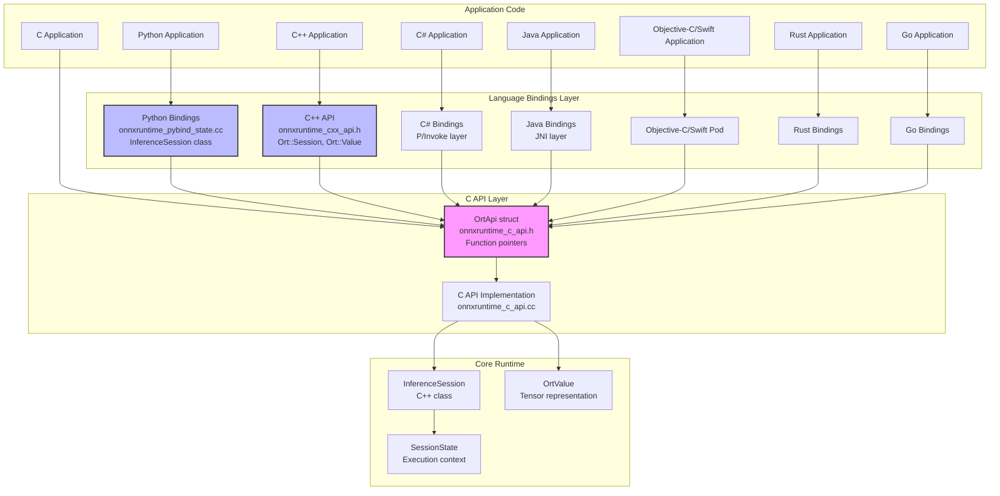
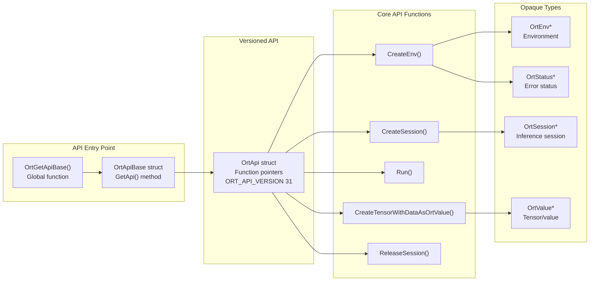
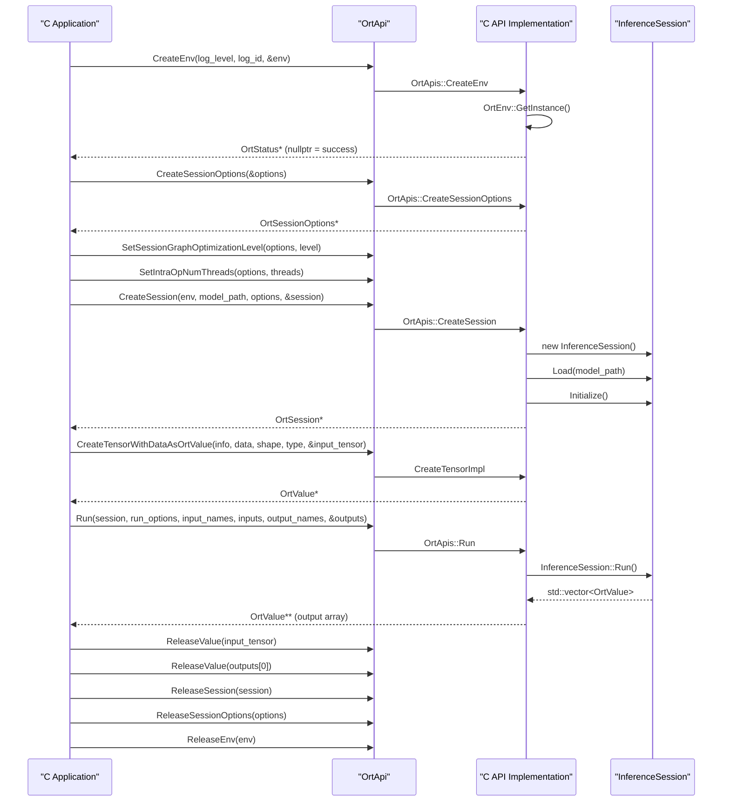
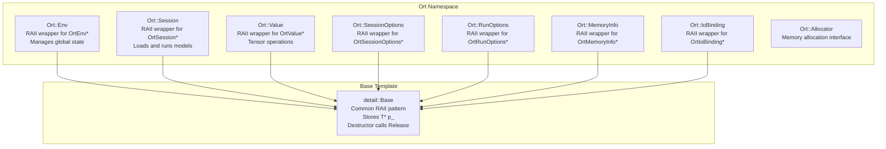
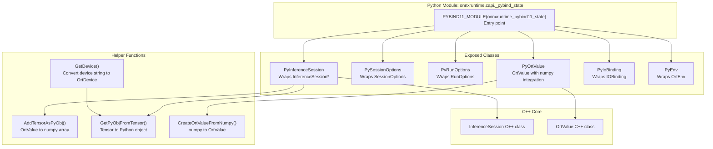
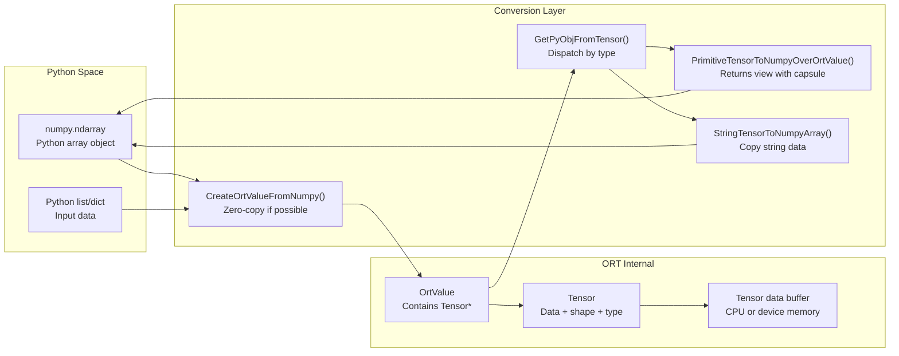
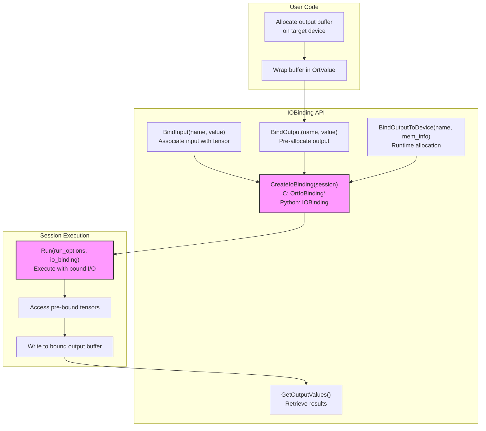

<!-- source: DeepWiki mcp.deepwiki.com · repo microsoft/onnxruntime · page 5 Language Bindings · fetched 2026-10-21 -->

# Language Bindings

<details>
<summary>Relevant source files</summary>

The following files were used as context for generating this wiki page:

- [include/onnxruntime/core/session/onnxruntime_c_api.h](include/onnxruntime/core/session/onnxruntime_c_api.h)
- [include/onnxruntime/core/session/onnxruntime_cxx_api.h](include/onnxruntime/core/session/onnxruntime_cxx_api.h)
- [include/onnxruntime/core/session/onnxruntime_cxx_inline.h](include/onnxruntime/core/session/onnxruntime_cxx_inline.h)
- [include/onnxruntime/core/session/onnxruntime_lite_custom_op.h](include/onnxruntime/core/session/onnxruntime_lite_custom_op.h)
- [onnxruntime/core/framework/session_options.h](onnxruntime/core/framework/session_options.h)
- [onnxruntime/core/session/abi_session_options.cc](onnxruntime/core/session/abi_session_options.cc)
- [onnxruntime/core/session/custom_ops.cc](onnxruntime/core/session/custom_ops.cc)
- [onnxruntime/core/session/inference_session.cc](onnxruntime/core/session/inference_session.cc)
- [onnxruntime/core/session/inference_session.h](onnxruntime/core/session/inference_session.h)
- [onnxruntime/core/session/onnxruntime_c_api.cc](onnxruntime/core/session/onnxruntime_c_api.cc)
- [onnxruntime/core/session/ort_apis.h](onnxruntime/core/session/ort_apis.h)
- [onnxruntime/core/session/standalone_op_invoker.cc](onnxruntime/core/session/standalone_op_invoker.cc)
- [onnxruntime/test/framework/inference_session_test.cc](onnxruntime/test/framework/inference_session_test.cc)
- [onnxruntime/test/shared_lib/custom_op_utils.cc](onnxruntime/test/shared_lib/custom_op_utils.cc)
- [onnxruntime/test/shared_lib/custom_op_utils.h](onnxruntime/test/shared_lib/custom_op_utils.h)
- [onnxruntime/test/shared_lib/test_inference.cc](onnxruntime/test/shared_lib/test_inference.cc)
- [onnxruntime/test/testdata/custom_op_library/cpu/cpu_ops.cc](onnxruntime/test/testdata/custom_op_library/cpu/cpu_ops.cc)
- [onnxruntime/test/testdata/custom_op_library/custom_op_library.cc](onnxruntime/test/testdata/custom_op_library/custom_op_library.cc)
- [onnxruntime/test/testdata/fuse_select_filter.onnx](onnxruntime/test/testdata/fuse_select_filter.onnx)
- [onnxruntime/test/testdata/fuse_select_filter_opset_8.onnx](onnxruntime/test/testdata/fuse_select_filter_opset_8.onnx)
- [onnxruntime/test/testdata/merge.onnx](onnxruntime/test/testdata/merge.onnx)
- [onnxruntime/test/testdata/optional_2.onnx](onnxruntime/test/testdata/optional_2.onnx)
- [onnxruntime/test/testdata/optional_3.onnx](onnxruntime/test/testdata/optional_3.onnx)

</details>


## Purpose and Scope

This document describes ONNX Runtime's language bindings, which provide programmatic interfaces for loading models and running inference from different programming languages. The primary APIs are the C API (the foundational interface), the C++ API (a header-only wrapper), and Python bindings (via pybind11). For information about the training-specific APIs, see [Training System](#8).

The language bindings handle:
- Model loading and session lifecycle management
- Input/output tensor creation and memory management
- Inference execution across different execution providers
- Configuration of session options and runtime parameters
- Advanced features like IOBinding for zero-copy operations

---

## API Architecture Overview

ONNX Runtime uses a layered architecture where the C API forms the stable ABI (Application Binary Interface) foundation, with higher-level language bindings built on top.



**Sources:** [include/onnxruntime/core/session/onnxruntime_c_api.h:1-913](), [onnxruntime/python/onnxruntime_pybind_state.cc:1-100](), [include/onnxruntime/core/session/onnxruntime_cxx_api.h:1-250]()

---

## C API: Foundation Layer

### API Structure and Versioning

The C API is defined through the `OrtApi` struct, which contains function pointers for all runtime operations. This design ensures ABI stability across versions.



**API Version Constant:** The current API version is defined as `ORT_API_VERSION 31` at [include/onnxruntime/core/session/onnxruntime_c_api.h:43]().

**Entry Point:** Applications access the API through `OrtGetApiBase()` at [onnxruntime/core/session/ort_apis.h:6](), which returns an `OrtApiBase` pointer containing a versioned `GetApi()` function.

**Sources:** [include/onnxruntime/core/session/onnxruntime_c_api.h:37-913](), [onnxruntime/core/session/ort_apis.h:1-250]()

### Core C API Types

| Type | Purpose | Lifecycle Management |
|------|---------|---------------------|
| `OrtEnv` | Global environment and logging manager | `CreateEnv()` / `ReleaseEnv()` |
| `OrtSession` | Loaded model and execution context | `CreateSession()` / `ReleaseSession()` |
| `OrtSessionOptions` | Configuration for session creation | `CreateSessionOptions()` / `ReleaseSessionOptions()` |
| `OrtValue` | Input/output tensors and values | `CreateTensorAsOrtValue()` / `ReleaseValue()` |
| `OrtMemoryInfo` | Memory allocation location descriptor | `CreateCpuMemoryInfo()` / `ReleaseMemoryInfo()` |
| `OrtRunOptions` | Per-inference runtime configuration | `CreateRunOptions()` / `ReleaseRunOptions()` |
| `OrtIoBinding` | Pre-bound input/output buffers | `CreateIoBinding()` / `ReleaseIoBinding()` |
| `OrtStatus` | Error status and message | Return value from most API calls / `ReleaseStatus()` |

**Type Definitions:** All opaque types are defined using the `ORT_RUNTIME_CLASS` macro at [include/onnxruntime/core/session/onnxruntime_c_api.h:294-332]().

**Memory Management Pattern:** All `Create*()` functions allocate resources that must be freed with corresponding `Release*()` functions. The `OrtStatus*` return value indicates success (nullptr) or error (non-null pointer that must be released).

**Sources:** [include/onnxruntime/core/session/onnxruntime_c_api.h:294-332](), [onnxruntime/core/session/onnxruntime_c_api.cc:1-100]()

### Session Lifecycle in C API



**Implementation:** Session creation is implemented in [onnxruntime/core/session/onnxruntime_c_api.cc:47-51]() with the `CreateSession` function wrapping the C++ `InferenceSession` class from [onnxruntime/core/session/inference_session.h:171](). The `CreateTensorImpl` function is used for tensor creation [onnxruntime/core/session/onnxruntime_c_api.cc:136-142]().

**Sources:** [onnxruntime/core/session/onnxruntime_c_api.cc:1-300](), [onnxruntime/core/session/ort_apis.h:47-51]()

---

## C++ API: Header-Only Wrapper

The C++ API provides RAII (Resource Acquisition Is Initialization) wrappers around the C API, converting error codes to exceptions and automating memory management.

### Key C++ Wrapper Classes



**Template Base:** All wrapper classes inherit from `detail::Base<T>` which stores the underlying C pointer and calls the appropriate `Release*()` function in the destructor. Defined at [include/onnxruntime/core/session/onnxruntime_cxx_api.h:1-100]().

**Exception Handling:** The `ThrowOnError()` helper function converts `OrtStatus*` into `Ort::Exception`, defined at [include/onnxruntime/core/session/onnxruntime_cxx_inline.h:44-55]().

**Sources:** [include/onnxruntime/core/session/onnxruntime_cxx_api.h:1-500](), [include/onnxruntime/core/session/onnxruntime_cxx_inline.h:1-100]()

### C++ API Usage Pattern

The C++ API eliminates manual memory management:

**Env Creation:** `Ort::Env env(ORT_LOGGING_LEVEL_WARNING, "test");` automatically releases the `OrtEnv*` when `env` goes out of scope. Constructor at [include/onnxruntime/core/session/onnxruntime_cxx_api.h:800-900]().

**Session Creation:** `Ort::Session session(env, model_path, session_options);` throws `Ort::Exception` on error instead of returning status. Constructor at [include/onnxruntime/core/session/onnxruntime_cxx_api.h:1200-1300]().

**Running Inference:**
```cpp
// Input tensor from raw data
Ort::Value input_tensor = Ort::Value::CreateTensor<float>(
    memory_info, input_data, input_size, shape, shape_len);

// Run inference
std::vector<Ort::Value> outputs = session.Run(
    run_options, input_names, &input_tensor, 1, output_names, 1);
```

**Type Safety:** The C++ API includes `TypeToTensorType<T>` template to map C++ types to `ONNXTensorElementDataType` at [include/onnxruntime/core/session/onnxruntime_cxx_inline.h:86-156]().

**Sources:** [include/onnxruntime/core/session/onnxruntime_cxx_api.h:1-2000](), [onnxruntime/test/shared_lib/test_inference.cc:260-335]()

---

## Python Bindings Architecture

### pybind11 Module Structure

Python bindings are implemented using pybind11 to expose C++ functionality. The main module is defined in `onnxruntime_pybind_state.cc`.



**Module Definition:** The pybind11 module is defined at [onnxruntime/python/onnxruntime_pybind_state.cc:1-100]() using the `PYBIND11_MODULE` macro.

**Sources:** [onnxruntime/python/onnxruntime_pybind_state.cc:1-200](), [onnxruntime/python/onnxruntime_pybind_state_common.h:1-150]()

### InferenceSession Python Class

The high-level Python API is provided by the `InferenceSession` class in `onnxruntime_inference_collection.py`, which wraps the pybind11-exposed `PyInferenceSession`.

**Class Structure:**

| Method | Purpose | Implementation |
|--------|---------|----------------|
| `__init__(model_path, sess_options, providers)` | Load model and create session | [onnxruntime/python/onnxruntime_inference_collection.py:1-100]() |
| `run(output_names, input_feed, run_options)` | Execute inference | Calls `PyInferenceSession.run()` |
| `get_inputs()` | Retrieve input metadata | Returns `NodeArg` information |
| `get_outputs()` | Retrieve output metadata | Returns `NodeArg` information |
| `get_providers()` | List active execution providers | Query session state |
| `set_providers(providers, provider_options)` | Configure execution providers | Must be called before session creation |

**Initialization Flow:**
1. Parse `providers` argument to determine execution provider order
2. Create `SessionOptions` with configuration (graph optimization level, threading, etc.)
3. Append execution providers in specified order
4. Call underlying C++ `InferenceSession` constructor via pybind11
5. Load and initialize model

**Run Method:** The `run()` method at [onnxruntime/python/onnxruntime_inference_collection.py:200-300]() converts Python inputs (numpy arrays, lists) to `OrtValue` objects, executes inference, and converts outputs back to numpy arrays.

**Sources:** [onnxruntime/python/onnxruntime_inference_collection.py:1-500](), [onnxruntime/test/python/onnxruntime_test_python.py:51-150]()

### OrtValue and NumPy Integration

`OrtValue` is the internal representation of tensors and other data types. The Python bindings provide seamless conversion between `OrtValue` and NumPy arrays.



**Zero-Copy Optimization:** For CPU tensors with numeric types, `PrimitiveTensorToNumpyOverOrtValue()` at [onnxruntime/python/onnxruntime_pybind_state.cc:225-244]() creates a NumPy array that references the original `OrtValue` data without copying. A Python capsule with a custom destructor ensures the `OrtValue` remains alive.

**Device Memory Handling:** For GPU tensors, `PrimitiveTensorToNumpyFromDevice()` at [onnxruntime/python/onnxruntime_pybind_state.cc:246-261]() allocates CPU memory and copies data from device using the `DataTransferManager`.

**String Tensors:** String tensors always require copying since they must be converted to Python string objects, handled by `StringTensorToNumpyArray()` at [onnxruntime/python/onnxruntime_pybind_state.cc:214-223]().

**Sources:** [onnxruntime/python/onnxruntime_pybind_state.cc:214-460](), [onnxruntime/python/onnxruntime_pybind_mlvalue.cc:1-200]()

---

## C# Bindings

The C# bindings for ONNX Runtime are provided through a .NET API, typically consumed via NuGet packages. They leverage Platform Invoke (P/Invoke) to call the underlying C API functions.

**High-Level Overview:**
- **NuGet Packages:** Distributed as `Microsoft.ML.OnnxRuntime` and `Microsoft.ML.OnnxRuntime.Gpu` (and other provider-specific packages).
- **P/Invoke Layer:** C# methods are declared with `[DllImport]` attributes to map to the C API functions.
- **`InferenceSession`:** The primary class for loading models and running inference, mirroring the C++ `InferenceSession`.
- **`OrtValue`:** Represents tensors and other ONNX data types, with methods for creating from and converting to .NET types.

For details, see [C# Bindings](#5.3).

---

## IOBinding and Advanced Memory Management

### IOBinding Concept

`IOBinding` allows pre-allocating output buffers and binding inputs/outputs to specific memory locations, enabling zero-copy operations and better control over memory placement.



**C API Functions:**
- `OrtApi::CreateIoBinding()` - Create binding object at [onnxruntime/core/session/onnxruntime_c_api.cc:1-100]()
- `OrtApi::BindInput()` - Bind input tensor at [onnxruntime/core/session/onnxruntime_c_api.cc:100-200]()
- `OrtApi::BindOutput()` - Bind pre-allocated output at [onnxruntime/core/session/onnxruntime_c_api.cc:200-300]()
- `OrtApi::BindOutputToDevice()` - Bind to device with runtime allocation at [onnxruntime/core/session/onnxruntime_c_api.cc:300-400]()

**Sources:** [onnxruntime/core/session/onnxruntime_c_api.cc:1-500](), [onnxruntime/core/session/IOBinding.h:1-100](), [onnxruntime/python/onnxruntime_inference_collection.py:500-700]()

### Device Memory Management

ONNX Runtime supports multiple device types for tensor allocation. The `OrtMemoryInfo` struct describes memory location.

**Device Types:**

| Device Type | Constant | Description |
|-------------|----------|-------------|
| CPU | `OrtDevice::CPU` | Host memory |
| CUDA | `OrtDevice::GPU` | NVIDIA GPU memory |
| DML | `OrtDevice::DML` | DirectML (Windows GPU) |
| NPU | `OrtDevice::NPU` | Neural Processing Unit |
| CANN | `OrtDevice::CANN` | Huawei Ascend NPU |

**OrtDevice Structure:** Defined at [include/onnxruntime/core/session/onnxruntime_c_api.h:478-496]() with fields for device type, vendor ID, device ID, and memory type.

**Allocator Selection:** Each execution provider registers allocators for its device type. The `AllocatorManager` selects the appropriate allocator based on `OrtMemoryInfo`. See [onnxruntime/core/framework/allocator.h:1-100]().

**Python Device Specification:** The `get_ort_device_type()` function at [onnxruntime/python/onnxruntime_inference_collection.py:24-40]() converts device strings ("cuda", "cpu", "dml") to `OrtDevice` constants.

**Sources:** [include/onnxruntime/core/session/onnxruntime_c_api.h:463-496](), [onnxruntime/python/onnxruntime_inference_collection.py:24-40]()

### Zero-Copy Operations with IOBinding

IOBinding enables efficient inference pipelines by eliminating unnecessary memory copies.

**Python IOBinding Usage Example Pattern:**

```python
# Create session
session = onnxruntime.InferenceSession("model.onnx", providers=["CUDAExecutionProvider"])

# Create IOBinding
io_binding = session.io_binding()

# Bind input (already on GPU)
input_ortvalue = onnxruntime.OrtValue.ortvalue_from_numpy(input_array, "cuda", 0)
io_binding.bind_input("input_name", input_ortvalue)

# Bind output to device (runtime allocation)
io_binding.bind_output("output_name", "cuda")

# Run inference - no host/device copies
session.run_with_iobinding(io_binding)

# Get outputs (still on GPU)
outputs = io_binding.get_outputs()
```

**Implementation:** The `PyIoBinding` class at [onnxruntime/python/onnxruntime_pybind_state.cc:1-100]() wraps the C++ `IOBinding` class from [onnxruntime/core/session/IOBinding.h:1-100]().

**Memory Copy Elimination:**
1. Input tensors already on device (GPU) can be bound directly without CPU→GPU copy
2. Output buffers allocated on device avoid GPU→CPU copy for subsequent operations
3. Multiple inferences can reuse the same IOBinding, avoiding repeated setup

For details, see [IOBinding and Memory Management](#5.4).

**Sources:** [onnxruntime/python/onnxruntime_inference_collection.py:400-600](), [onnxruntime/test/python/onnxruntime_test_python_iobinding.py:1-100](), [onnxruntime/core/session/IOBinding.h:1-118]()

---

## Java and Android Bindings

ONNX Runtime provides Java bindings, which are particularly useful for Android applications. These bindings use JNI (Java Native Interface) to interact with the underlying C API.

**High-Level Overview:**
- **Java API:** Classes like `OrtEnvironment` and `OrtSession` provide the Java-friendly interface.
- **JNI Layer:** Native methods in Java classes are implemented in C++ code that calls the ONNX Runtime C API.
- **Gradle Build:** Android AAR (Android Archive) packages are built using Gradle, integrating the native libraries.

For details, see [Java and Android Bindings](#5.5).

---

## Mobile and Other Language Bindings

ONNX Runtime extends its reach to mobile platforms and other programming languages to support a wide range of deployment scenarios.

**Objective-C/Swift:**
- **Pod:** An Objective-C/Swift pod is available for iOS and macOS development, providing an API similar to the C++ and C# bindings.
- **React Native:** A React Native module allows JavaScript applications to leverage ONNX Runtime on mobile devices.

**Rust and Go:**
- **Rust Bindings:** Provide a safe, idiomatic Rust interface to the ONNX Runtime C API.
- **Go Bindings:** Offer a Go language interface for integrating ONNX Runtime into Go applications.

These bindings are typically found in their respective language directories within the ONNX Runtime repository, often with samples demonstrating their usage.

For details, see [Mobile and Other Language Bindings](#5.6).

---

## Cross-Language Type Mapping

### Tensor Element Types

The type system must be consistent across C, C++, and Python interfaces.

| ONNX Type | C API Enum | C++ Type | NumPy Type | Code |
|-----------|------------|----------|------------|------|
| `float` | `ONNX_TENSOR_ELEMENT_DATA_TYPE_FLOAT` | `float` | `np.float32` | 1 |
| `double` | `ONNX_TENSOR_ELEMENT_DATA_TYPE_DOUBLE` | `double` | `np.float64` | 11 |
| `int8` | `ONNX_TENSOR_ELEMENT_DATA_TYPE_INT8` | `int8_t` | `np.int8` | 3 |
| `int16` | `ONNX_TENSOR_ELEMENT_DATA_TYPE_INT16` | `int16_t` | `np.int16` | 5 |
| `int32` | `ONNX_TENSOR_ELEMENT_DATA_TYPE_INT32` | `int32_t` | `np.int32` | 6 |
| `int64` | `ONNX_TENSOR_ELEMENT_DATA_TYPE_INT64` | `int64_t` | `np.int64` | 7 |
| `uint8` | `ONNX_TENSOR_ELEMENT_DATA_TYPE_UINT8` | `uint8_t` | `np.uint8` | 2 |
| `float16` | `ONNX_TENSOR_ELEMENT_DATA_TYPE_FLOAT16` | `Ort::Float16_t` | `np.float16` | 10 |
| `bfloat16` | `ONNX_TENSOR_ELEMENT_DATA_TYPE_BFLOAT16` | `Ort::BFloat16_t` | Custom | 16 |
| `string` | `ONNX_TENSOR_ELEMENT_DATA_TYPE_STRING` | `std::string` | `object` | 8 |
| `bool` | `ONNX_TENSOR_ELEMENT_DATA_TYPE_BOOL` | `bool` | `np.bool_` | 9 |

**Type Enum Definition:** `ONNXTensorElementDataType` enum at [include/onnxruntime/core/session/onnxruntime_c_api.h:193-212]().

**C++ Type Traits:** The `TypeToTensorType<T>` template at [include/onnxruntime/core/session/onnxruntime_cxx_inline.h:86-156]() maps C++ types to ONNX type enums.

**NumPy Conversion:** `OnnxRuntimeTensorToNumpyType()` function converts ONNX types to NumPy type codes, used in [onnxruntime/python/onnxruntime_pybind_state.cc:234]().

**Sources:** [include/onnxruntime/core/session/onnxruntime_c_api.h:193-212](), [include/onnxruntime/core/session/onnxruntime_cxx_inline.h:86-156](), [onnxruntime/python/numpy_helper.h:1-19]()

### Non-Tensor Types

ONNX Runtime also supports non-tensor types like sequences and maps (primarily for traditional ML models).

**ONNX Type Enum:** `ONNXType` enum at [include/onnxruntime/core/session/onnxruntime_c_api.h:215-223]() includes:
- `ONNX_TYPE_TENSOR` - Standard tensor
- `ONNX_TYPE_SEQUENCE` - Sequence of tensors (`TensorSeq`)
- `ONNX_TYPE_MAP` - Map types (key-value pairs)
- `ONNX_TYPE_OPTIONAL` - Optional value
- `ONNX_TYPE_SPARSETENSOR` - Sparse tensor format

**Python Handling:** Non-tensor outputs are converted by `AddNonTensorAsPyObj()` at [onnxruntime/python/onnxruntime_pybind_state.cc:415-454](), which dispatches to type-specific converters for maps and sequences.

**Sources:** [include/onnxruntime/core/session/onnxruntime_c_api.h:215-223](), [onnxruntime/python/onnxruntime_pybind_state.cc:415-454]()

---

## Provider Configuration Through APIs

### Provider Options

Each execution provider can be configured through provider-specific options passed at session creation.

**C API Provider Configuration:**
- `OrtApi::SessionOptionsAppendExecutionProvider_CUDA()` - Append CUDA EP with `OrtCUDAProviderOptions` struct
- `OrtApi::SessionOptionsAppendExecutionProvider()` - Generic append with string key-value pairs
- Provider option structs: `OrtCUDAProviderOptions` at [include/onnxruntime/core/session/onnxruntime_c_api.h:601-682](), `OrtTensorRTProviderOptions` at [include/onnxruntime/core/session/onnxruntime_c_api.h:777-799]()

**Python Provider Configuration:**

```python
providers = [
    ("CUDAExecutionProvider", {
        "device_id": 0,
        "gpu_mem_limit": 2 * 1024 * 1024 * 1024,  # 2GB
        "arena_extend_strategy": "kSameAsRequested",
        "cudnn_conv_algo_search": "EXHAUSTIVE",
        "do_copy_in_default_stream": True,
    }),
    "CPUExecutionProvider"  # Fallback
]
session = onnxruntime.InferenceSession("model.onnx", providers=providers)
```

**Provider Options Normalization:** The `check_and_normalize_provider_args()` function at [onnxruntime/python/onnxruntime_inference_collection.py:89-150]() validates and normalizes the `providers` and `provider_options` arguments.

**C++ Provider Configuration:**
```cpp
Ort::SessionOptions session_options;
OrtCUDAProviderOptions cuda_options;
cuda_options.device_id = 0;
cuda_options.gpu_mem_limit = SIZE_MAX;
session_options.AppendExecutionProvider_CUDA(cuda_options);
```

**Sources:** [include/onnxruntime/core/session/onnxruntime_c_api.h:601-833](), [onnxruntime/python/onnxruntime_inference_collection.py:89-200](), [onnxruntime/python/onnxruntime_pybind_state.cc:479-542]()

---

