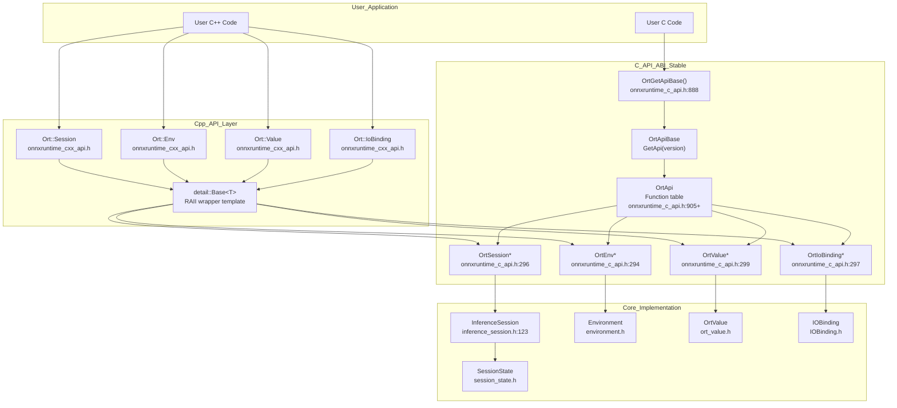
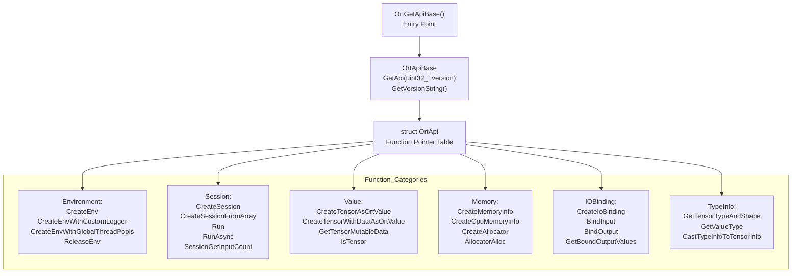
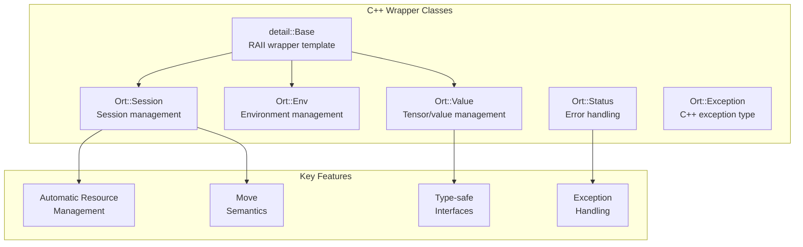
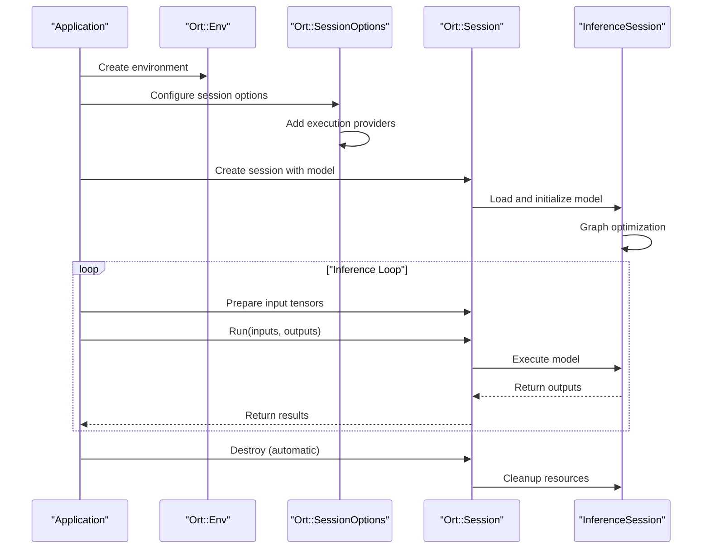
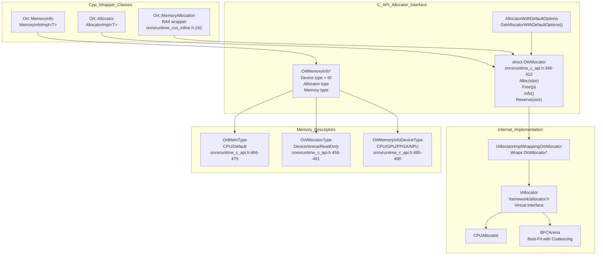
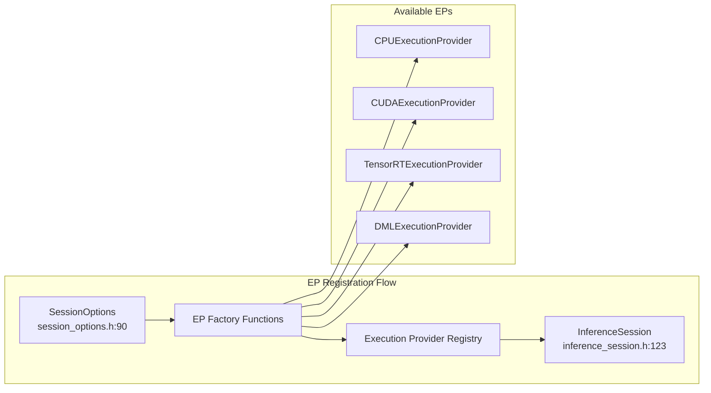
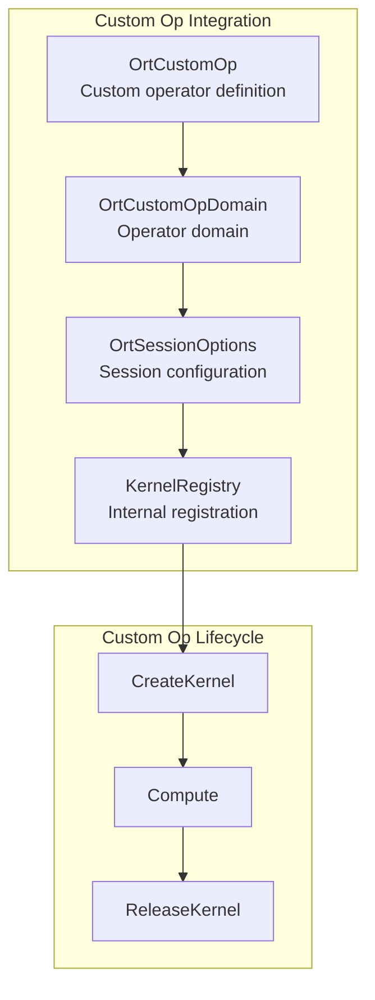

<!-- source: DeepWiki mcp.deepwiki.com · repo microsoft/onnxruntime · page 5.1 C/C++ API · fetched 2026-10-21 -->

# C/C++ API

<details>
<summary>Relevant source files</summary>

The following files were used as context for generating this wiki page:

- [include/onnxruntime/core/session/onnxruntime_c_api.h](include/onnxruntime/core/session/onnxruntime_c_api.h)
- [include/onnxruntime/core/session/onnxruntime_cxx_api.h](include/onnxruntime/core/session/onnxruntime_cxx_api.h)
- [include/onnxruntime/core/session/onnxruntime_cxx_inline.h](include/onnxruntime/core/session/onnxruntime_cxx_inline.h)
- [include/onnxruntime/core/session/onnxruntime_lite_custom_op.h](include/onnxruntime/core/session/onnxruntime_lite_custom_op.h)
- [onnxruntime/core/framework/session_options.h](onnxruntime/core/framework/session_options.h)
- [onnxruntime/core/session/abi_session_options.cc](onnxruntime/core/session/abi_session_options.cc)
- [onnxruntime/core/session/custom_ops.cc](onnxruntime/core/session/custom_ops.cc)
- [onnxruntime/core/session/inference_session.cc](onnxruntime/core/session/inference_session.cc)
- [onnxruntime/core/session/inference_session.h](onnxruntime/core/session/inference_session.h)
- [onnxruntime/core/session/onnxruntime_c_api.cc](onnxruntime/core/session/onnxruntime_c_api.cc)
- [onnxruntime/core/session/ort_apis.h](onnxruntime/core/session/ort_apis.h)
- [onnxruntime/core/session/standalone_op_invoker.cc](onnxruntime/core/session/standalone_op_invoker.cc)
- [onnxruntime/test/framework/inference_session_test.cc](onnxruntime/test/framework/inference_session_test.cc)
- [onnxruntime/test/shared_lib/custom_op_utils.cc](onnxruntime/test/shared_lib/custom_op_utils.cc)
- [onnxruntime/test/shared_lib/custom_op_utils.h](onnxruntime/test/shared_lib/custom_op_utils.h)
- [onnxruntime/test/shared_lib/test_inference.cc](onnxruntime/test/shared_lib/test_inference.cc)
- [onnxruntime/test/testdata/custom_op_library/cpu/cpu_ops.cc](onnxruntime/test/testdata/custom_op_library/cpu/cpu_ops.cc)
- [onnxruntime/test/testdata/custom_op_library/custom_op_library.cc](onnxruntime/test/testdata/custom_op_library/custom_op_library.cc)
- [onnxruntime/test/testdata/fuse_select_filter.onnx](onnxruntime/test/testdata/fuse_select_filter.onnx)
- [onnxruntime/test/testdata/fuse_select_filter_opset_8.onnx](onnxruntime/test/testdata/fuse_select_filter_opset_8.onnx)
- [onnxruntime/test/testdata/merge.onnx](onnxruntime/test/testdata/merge.onnx)
- [onnxruntime/test/testdata/optional_2.onnx](onnxruntime/test/testdata/optional_2.onnx)
- [onnxruntime/test/testdata/optional_3.onnx](onnxruntime/test/testdata/optional_3.onnx)

</details>


This document covers the foundational C and C++ APIs for ONNX Runtime, which provide the core interfaces for model loading, session management, and inference execution. These APIs serve as the base layer for all other language bindings and offer the most direct access to ONNX Runtime's capabilities.

For information about Python bindings, see [Python Bindings](#5.2). For details about the core inference engine implementation, see [Inference Session](#3.3).

## Purpose and Scope

The C/C++ Core APIs provide:
- **C API**: A stable, ABI-compatible interface defined in the `OrtApi` structure
- **C++ API**: Header-only RAII wrappers around the C API with exception handling  
- Foundational interfaces for execution providers and custom operators
- Core memory management through allocator abstraction
- Essential session lifecycle management for model loading and inference
- Base layer that all other language bindings depend on

## API Architecture

The ONNX Runtime C/C++ API follows a layered architecture where the C++ API wraps the stable C API. The entry point is `OrtGetApiBase()` which returns an `OrtApiBase` structure containing the `GetApi()` function to retrieve the versioned `OrtApi` function table.

Core API Architecture



**Sources:** [include/onnxruntime/core/session/onnxruntime_c_api.h:294-299](), [include/onnxruntime/core/session/onnxruntime_c_api.h:888-905](), [include/onnxruntime/core/session/onnxruntime_cxx_api.h:605-684](), [onnxruntime/core/session/inference_session.h:123]()

## C API Structure

The C API is organized around the `OrtApi` structure containing function pointers for all operations. The structure is defined as `struct OrtApi` starting at [include/onnxruntime/core/session/onnxruntime_c_api.h:905](). Access to the API is through `OrtGetApiBase()` defined at [include/onnxruntime/core/session/onnxruntime_c_api.h:888]().

C API Function Categories



The API version is controlled through `ORT_API_VERSION` (currently 31) defined at [include/onnxruntime/core/session/onnxruntime_c_api.h:43](). Access requires calling `OrtGetApiBase()->GetApi(ORT_API_VERSION)`. All function implementations are in [onnxruntime/core/session/onnxruntime_c_api.cc]() and function declarations are in [onnxruntime/core/session/ort_apis.h]().

**Sources:** [include/onnxruntime/core/session/onnxruntime_c_api.h:43](), [include/onnxruntime/core/session/onnxruntime_c_api.h:888-905](), [onnxruntime/core/session/ort_apis.h:4-99](), [onnxruntime/core/session/onnxruntime_c_api.cc:192-232]()

## C++ API Wrapper Design

The C++ API provides RAII wrappers and exception handling over the C API:



All wrapper classes inherit from `detail::Base<T>` which provides automatic cleanup via destructors. The `ORT_CXX_API_THROW` macro is used to throw `Ort::Exception` on errors, or call `abort()` if `ORT_NO_EXCEPTIONS` is defined [include/onnxruntime/core/session/onnxruntime_cxx_api.h:70-81]().

**Sources:** [include/onnxruntime/core/session/onnxruntime_cxx_api.h:54-81](), [include/onnxruntime/core/session/onnxruntime_cxx_inline.h:36-54]()

## Session Lifecycle Workflow

The typical session lifecycle follows this pattern:



**Sources:** [onnxruntime/core/session/inference_session.cc:368-417](), [onnxruntime/test/shared_lib/test_inference.cc:264-347]()

## Memory Management Model

ONNX Runtime uses an allocator-based memory management system where each tensor has an associated `OrtMemoryInfo` that describes its memory location and allocator type.

Memory Management Architecture



**Key Allocator Functions:**

| Function | Location | Purpose |
|----------|----------|---------|
| `CreateAllocator` | [onnxruntime/core/session/onnxruntime_c_api.cc:258-260]() | Create allocator for a session |
| `GetAllocatorWithDefaultOptions` | [include/onnxruntime/core/session/onnxruntime_cxx_inline.h:254-256]() | Get default CPU allocator |
| `CreateMemoryInfo` | [include/onnxruntime/core/session/onnxruntime_cxx_inline.h:325-327]() | Create memory location descriptor |
| `CreateCpuMemoryInfo` | [include/onnxruntime/core/session/onnxruntime_cxx_inline.h:319-323]() | Create CPU memory info |
| `AllocatorAlloc` | [include/onnxruntime/core/session/onnxruntime_cxx_inline.h:220-224]() | Allocate memory |
| `AllocatorFree` | [include/onnxruntime/core/session/onnxruntime_cxx_inline.h:235-237]() | Free allocated memory |

**Sources:** [include/onnxruntime/core/session/onnxruntime_c_api.h:346-412](), [include/onnxruntime/core/session/onnxruntime_c_api.h:456-490](), [include/onnxruntime/core/session/onnxruntime_cxx_inline.h:182-256](), [onnxruntime/core/session/onnxruntime_c_api.cc:258-260]()

## Core API Types and Operations

### Essential Core Types

| C API Type | C++ Wrapper | Definition Location | Purpose |
|------------|-------------|-------------------|---------|
| `OrtEnv` | `Ort::Env` | [include/onnxruntime/core/session/onnxruntime_c_api.h:294]() | Global environment and threading |
| `OrtSession` | `Ort::Session` | [include/onnxruntime/core/session/onnxruntime_c_api.h:296]() | Model session for inference |
| `OrtValue` | `Ort::Value` | [include/onnxruntime/core/session/onnxruntime_c_api.h:299]() | Tensor and value container |
| `OrtSessionOptions` | `Ort::SessionOptions` | [include/onnxruntime/core/session/onnxruntime_c_api.h:304]() | Session configuration |
| `OrtRunOptions` | `Ort::RunOptions` | [include/onnxruntime/core/session/onnxruntime_c_api.h:298]() | Per-run configuration |
| `OrtMemoryInfo` | `Ort::MemoryInfo` | [include/onnxruntime/core/session/onnxruntime_c_api.h:294]() | Memory location descriptor |
| `OrtAllocator` | `Ort::Allocator` | [include/onnxruntime/core/session/onnxruntime_c_api.h:344]() | Memory allocation interface |
| `OrtStatus` | `Ort::Status` | [include/onnxruntime/core/session/onnxruntime_c_api.h:293]() | Error handling and status |

### Key Operations

**Environment Creation:**
```cpp
// C++ API
Ort::Env env(ORT_LOGGING_LEVEL_WARNING, "test");

// C API  
OrtEnv* env;
OrtGetApiBase()->GetApi(ORT_API_VERSION)->CreateEnv(ORT_LOGGING_LEVEL_WARNING, "test", &env);
```

**Session Creation and Model Loading:**
```cpp
// C++ API
Ort::SessionOptions session_options;
Ort::Session session(env, model_path, session_options);

// C API
OrtSessionOptions* options;
api->CreateSessionOptions(&options);
OrtSession* session;
api->CreateSession(env, model_path, options, &session);
```

**Sources:** [include/onnxruntime/core/session/onnxruntime_c_api.h:293-304](), [onnxruntime/core/session/onnxruntime_c_api.cc:192-232](), [onnxruntime/test/shared_lib/test_inference.cc:275-318]()

## Integration with Execution Providers

Execution providers are registered through session options:



**Sources:** [onnxruntime/core/session/inference_session.h:123](), [onnxruntime/core/session/inference_session.cc:237](), [onnxruntime/core/session/abi_session_options.cc:86-105](), [onnxruntime/core/framework/session_options.h:90]()

## Error Handling and Status Management

The APIs use different error handling approaches:

- **C API**: Returns `OrtStatus*` (NULL for success)
- **C++ API**: Throws `Ort::Exception` or uses `Ort::Status`

```cpp
// C++ Exception handling
try {
    Ort::Session session(env, model_path, options);
} catch (const Ort::Exception& e) {
    std::cout << "Error: " << e.what() << std::endl;
}

// C++ Status handling  
Ort::Status status = some_operation();
if (status) {
    // Handle error
}
```

**Sources:** [include/onnxruntime/core/session/onnxruntime_cxx_api.h:54-80](), [include/onnxruntime/core/session/onnxruntime_cxx_inline.h:36-54]()

## Custom Operators Integration

The API supports custom operator registration through `OrtCustomOpDomain`:



The `OrtCustomOpDomain` allows grouping custom operators under a specific domain. This domain can then be added to `OrtSessionOptions` using `AddCustomOpDomain` [onnxruntime/core/session/ort_apis.h:81](). Alternatively, custom operator libraries can be registered dynamically using `RegisterCustomOpsLibrary` [onnxruntime/core/session/ort_apis.h:82](), which loads a shared library and calls an exported `RegisterCustomOps` function [onnxruntime/core/session/abi_session_options.cc:73-78]().

**Sources:** [onnxruntime/core/session/custom_ops.cc:623-635](), [onnxruntime/test/testdata/custom_op_library/custom_op_library.cc:29-58](), [onnxruntime/core/session/ort_apis.h:81-82](), [onnxruntime/core/session/abi_session_options.cc:73-78]()

---

