<!-- source: DeepWiki mcp.deepwiki.com · repo microsoft/onnxruntime · page 5.2 Python Bindings · fetched 2026-10-21 -->

# Python Bindings

<details>
<summary>Relevant source files</summary>

The following files were used as context for generating this wiki page:

- [onnxruntime/core/framework/sparse_utils.cc](onnxruntime/core/framework/sparse_utils.cc)
- [onnxruntime/python/onnxruntime_inference_collection.py](onnxruntime/python/onnxruntime_inference_collection.py)
- [onnxruntime/python/onnxruntime_pybind_iobinding.cc](onnxruntime/python/onnxruntime_pybind_iobinding.cc)
- [onnxruntime/python/onnxruntime_pybind_mlvalue.cc](onnxruntime/python/onnxruntime_pybind_mlvalue.cc)
- [onnxruntime/python/onnxruntime_pybind_mlvalue.h](onnxruntime/python/onnxruntime_pybind_mlvalue.h)
- [onnxruntime/python/onnxruntime_pybind_ortvalue.cc](onnxruntime/python/onnxruntime_pybind_ortvalue.cc)
- [onnxruntime/python/onnxruntime_pybind_sparse_tensor.cc](onnxruntime/python/onnxruntime_pybind_sparse_tensor.cc)
- [onnxruntime/python/onnxruntime_pybind_state.cc](onnxruntime/python/onnxruntime_pybind_state.cc)
- [onnxruntime/python/onnxruntime_pybind_state_common.cc](onnxruntime/python/onnxruntime_pybind_state_common.cc)
- [onnxruntime/python/onnxruntime_pybind_state_common.h](onnxruntime/python/onnxruntime_pybind_state_common.h)
- [onnxruntime/test/python/onnxruntime_test_python.py](onnxruntime/test/python/onnxruntime_test_python.py)
- [onnxruntime/test/python/onnxruntime_test_python_iobinding.py](onnxruntime/test/python/onnxruntime_test_python_iobinding.py)
- [onnxruntime/test/python/onnxruntime_test_python_nv_tensorrt_rtx_ep_tests.py](onnxruntime/test/python/onnxruntime_test_python_nv_tensorrt_rtx_ep_tests.py)
- [orttraining/orttraining/python/orttraining_pybind_state.cc](orttraining/orttraining/python/orttraining_pybind_state.cc)

</details>


## Purpose and Scope

The Python bindings provide a comprehensive interface to ONNX Runtime's C++ inference engine using pybind11. They facilitate model loading, execution, memory management, and interaction with ONNX Runtime in a Python-friendly way. The bindings expose core functionalities including:

- Inference with `InferenceSession`
- Data encapsulation via `OrtValue`
- Zero-copy I/O using `IOBinding`
- Device memory management for various execution providers (CPU, CUDA, ROCm, DirectML, CANN, etc.)
- Execution provider configuration and customization

The implementation is organized across multiple layers:

- **pybind11 C++ Bindings:** Expose core runtime classes and functions (`onnxruntime/python/onnxruntime_pybind_state.cc`)
- **Python Wrappers:** User-friendly Python classes and helpers (`onnxruntime/python/onnxruntime_inference_collection.py`)
- **Data Conversion Helpers:** Manage numpy and tensor transformations (`onnxruntime/python/onnxruntime_pybind_mlvalue.cc`, `onnxruntime/python/onnxruntime_pybind_ortvalue.cc`)
- **I/O Binding:** Zero-copy input/output and memory binding (`onnxruntime/python/onnxruntime_pybind_iobinding.cc`)

This page documents the internal architecture, key components, data flow, and Python-specific features of the bindings.

---

## Architecture Overview

### Layered Binding Architecture

The Python API is layered, decoupling the pybind11 bindings, Python user interface, and lower-level conversion utilities.

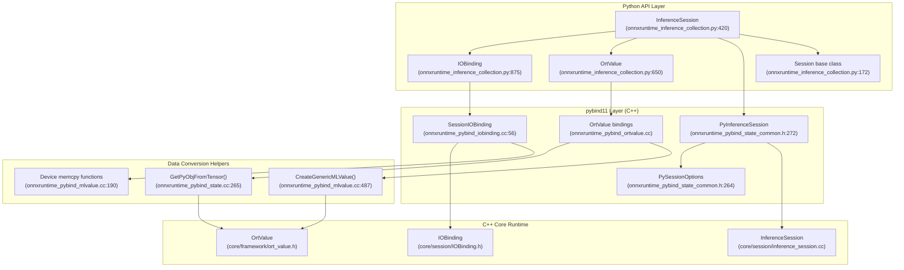

**Sources:**

- [onnxruntime/python/onnxruntime_inference_collection.py:172-648]()
- [onnxruntime/python/onnxruntime_pybind_state.cc:1-184]()
- [onnxruntime/python/onnxruntime_pybind_state_common.h:260-320]()
- [onnxruntime/python/onnxruntime_pybind_mlvalue.cc:480-580]()
- [onnxruntime/python/onnxruntime_pybind_ortvalue.cc:20-160]()
- [onnxruntime/python/onnxruntime_pybind_iobinding.cc:50-140]()

---

## Core Components

### InferenceSession and Session Classes

`InferenceSession` is the main Python interface for loading and running ONNX models. It binds to the C++ `onnxruntime::InferenceSession` via the pybind11 wrapper class `PyInferenceSession`.

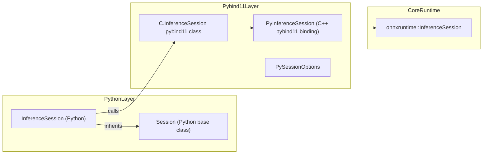

- `Session` provides common methods such as `run()`, `run_async()`, and properties like `inputs`, `outputs`.
- `InferenceSession` extends `Session`, exposing model-specific functionality.
- `PyInferenceSession` holds the C++ `InferenceSession` instance and bridges method calls.
- `PySessionOptions` wraps session options including execution provider configurations.

**Sources:**

- [onnxruntime/python/onnxruntime_inference_collection.py:172-419]()
- [onnxruntime/python/onnxruntime_pybind_state_common.h:260-320]()

---

### Session Initialization Flow

The lifecycle to create and initialize an inference session involves processing user parameters, pybind11 instantiation, and C++ core initialization.

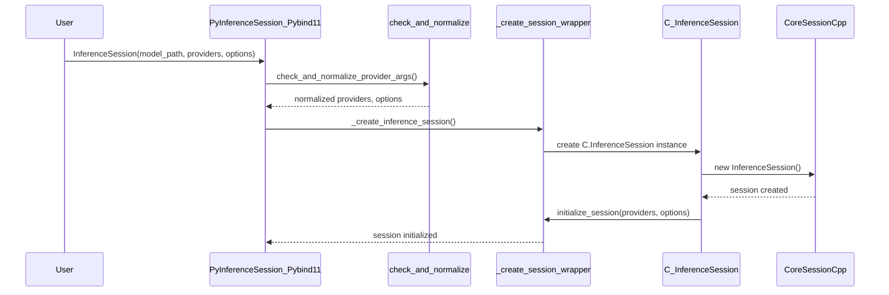

Initialization includes:

- Validation and normalization of execution providers and options in Python (`check_and_normalize_provider_args()`)
- Creation of C++ `InferenceSession` via pybind11 bindings
- Session initialization with provider registration and model loading
- Falling back to CPU provider if initialization or inference fails (optional)

**Sources:**

- [onnxruntime/python/onnxruntime_inference_collection.py:425-619]()
- [onnxruntime/python/onnxruntime_pybind_state_common.cc:112]()
- [onnxruntime/python/onnxruntime_pybind_state.cc:850-920]()

---

### OrtValue: Unified Data Container

`OrtValue` represents data buffers including tensors, sparse tensors, sequences, and maps, enabling data flow between Python and the runtime.

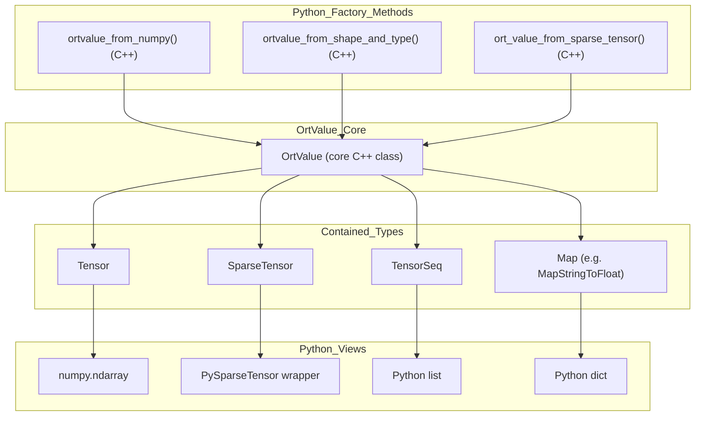

Key factory methods:

- `ortvalue_from_numpy()`: Create OrtValue tensor by copying numpy data to the specified device.
- `ortvalue_from_shape_and_type()`: Allocate uninitialized tensor OrtValue on the specified device and shape.
- `ort_value_from_sparse_tensor()`: Create from sparse tensor representation.

OrtValue supports zero-copy sharing with numpy via carefully managed lifetimes and memory ownership.

**Sources:**

- [onnxruntime/python/onnxruntime_pybind_ortvalue.cc:27-126]()
- [onnxruntime/python/onnxruntime_pybind_mlvalue.cc:50-100]()

---

### IOBinding: Zero-copy Input/Output Binding

The `IOBinding` class allows efficient inference by binding pre-allocated memory buffers directly to model inputs and outputs, avoiding copies.

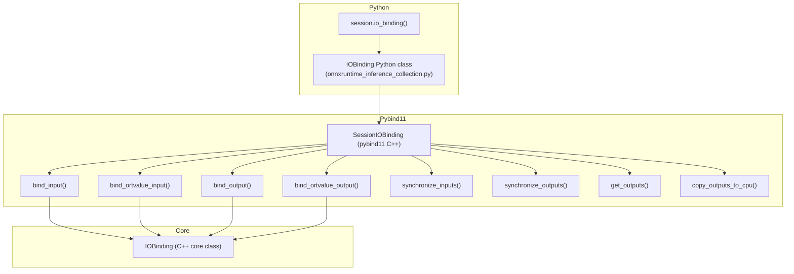

Functions include:

- Binding tensor inputs via numpy arrays or OrtValues
- Binding outputs to specific devices and memory
- Synchronization of input/output device streams
- Retrieving result tensors as OrtValue vectors or numpy arrays

**Sources:**

- [onnxruntime/python/onnxruntime_pybind_iobinding.cc:24-112]()
- [onnxruntime/python/onnxruntime_inference_collection.py:880-900]()

---

### SessionOptions and RunOptions

`SessionOptions` configure session behavior during creation:

- Control graph optimization level, threading, memory management
- Define execution providers and their options
- Enable debug/logging features

`RunOptions` configure per-run attributes:

- Run tag and log severity
- Active LoRA adapters
- Terminate flag support

**Sources:**

- [onnxruntime/python/onnxruntime_inference_collection.py:180-185]()
- [onnxruntime/python/onnxruntime_pybind_state_common.h:260-290]()

---

## Data Type Conversions

### Numpy to OrtValue Tensor Conversion

```mermaid
graph TB
    NumpyArray["numpy.ndarray (Python)"]
    
    CreateGenericMLValue["CreateGenericMLValue()<br/>(onnxruntime_pybind_mlvalue.cc:487)"]
    GetNumpyType["GetNumpyArrayType(PyArray_TYPE)"]
    MapType["NumpyTypeToOnnxRuntimeTensorType()"]
    AllocateTensor["Tensor::Tensor() alloc on device"]
    
    subgraph MemCopyToDevice[Device-specific memcpy]
        CpuToCpu[CpuToCpuMemCpy()]
        CpuToCuda[CpuToCudaMemCpy()]
        CpuToRocm[CpuToRocmMemCpy()]
        CpuToDml[CpuToDmlMemCpy()]
        CpuToCann[CpuToCannMemCpy()]
    end
    
    OrtValueOut["OrtValue (Tensor on device)"]
    
    NumpyArray --> CreateGenericMLValue
    CreateGenericMLValue --> GetNumpyType
    CreateGenericMLValue --> MapType
    CreateGenericMLValue --> AllocateTensor
    AllocateTensor --> MemCopyToDevice
    
    MemCopyToDevice --> OrtValueOut
```

Conversion steps:

- Extract numpy dtype and shape
- Map numpy dtype to ONNX Runtime MLDataType
- Allocate tensor memory on target device using appropriate allocator
- Copy data from numpy buffer to tensor memory (device-specific memcpy)

Supported numpy to ONNX mappings include standard numeric types and some ONNX-specific types like BFloat16.

**Sources:**

- [onnxruntime/python/onnxruntime_pybind_mlvalue.cc:487-580]()
- [onnxruntime/python/onnxruntime_pybind_mlvalue.cc:140-143]()

---

### OrtValue Tensor to Numpy Conversion

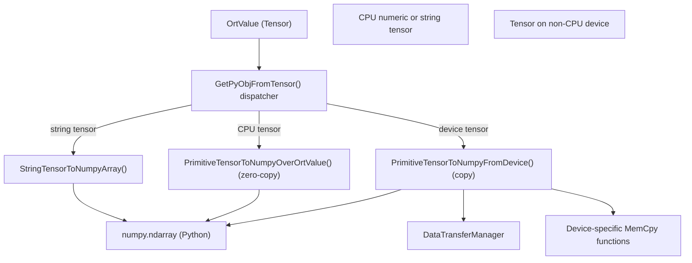

- String tensors are always copied into Python Unicode arrays.
- CPU tensors provide zero-copy views to avoid copying.
- Non-CPU tensors are copied via device-specific transfer to CPU before conversion.

**Sources:**

- [onnxruntime/python/onnxruntime_pybind_state.cc:214-327]()
- [onnxruntime/python/onnxruntime_pybind_mlvalue.cc:214-260]()

---

### String Tensor Handling

String tensors use a distinct conversion path because of Python Unicode requirements. They are always converted to Python Unicode objects and copied from runtime memory. Attempts to bind string tensors via raw pointer binding are rejected.

**Sources:**

- [onnxruntime/python/onnxruntime_pybind_state.cc:214-223]()
- [onnxruntime/python/onnxruntime_pybind_mlvalue.cc:214-223]()

---

## Device Management

### OrtDevice Types, Vendors, and Allocators

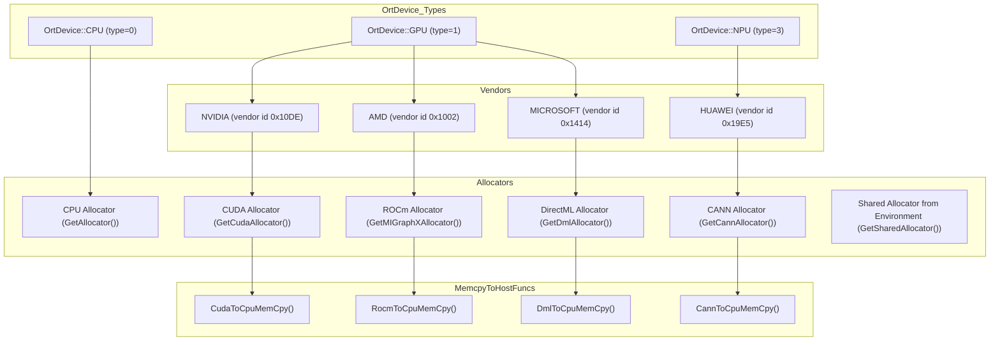

- Devices have type and vendor attributes.
- Allocators are device- and vendor-specific.
- Memory copy functions exist to transfer data device↔host.

Device lookup and validation code ensures that device IDs correspond to physical devices on the system.

**Sources:**

- [onnxruntime/python/onnxruntime_pybind_state.cc:329-361]()
- [onnxruntime/python/onnxruntime_pybind_mlvalue.cc:145-484]()

---

### Device Memory Copy Implementations

Each supported device type provides memcpy implementations using vendor APIs:

| Device       | Host→Device               | Device→Host               | Device Validation                 |
|--------------|--------------------------|--------------------------|---------------------------------|
| CUDA (NVIDIA)| `CpuToCudaMemCpy()`       | `CudaToCpuMemCpy()`       | `IsCudaDeviceIdValid()`          |
| ROCm (AMD)   | `CpuToRocmMemCpy()`       | `RocmToCpuMemCpy()`       | `IsRocmDeviceIdValid()`          |
| DirectML     | `CpuToDmlMemCpy()`        | `DmlToCpuMemCpy()`        | Uses DML EP device               |
| CANN (Huawei)| `CpuToCannMemCpy()`       | `CannToCpuMemCpy()`       | `IsCannDeviceIdValid()`          |

These implementations use asynchronous memory copy APIs (e.g., `cudaMemcpyAsync`, `hipMemcpyAsync`, or D3D12 copy commands) and synchronize as needed.

**Sources:**

- [onnxruntime/python/onnxruntime_pybind_mlvalue.cc:190-484]()

---

### Plugin Execution Provider Data Transfer

Plugin execution providers (custom shared libraries) can register their own allocators and data transfer mechanisms via environment registration. The Python layer queries these to get shared allocators or data transfer functions for device type combinations.

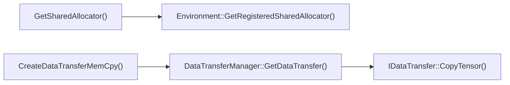

This enables extending device support dynamically without recompiling ONNX Runtime core.

**Sources:**

- [onnxruntime/python/onnxruntime_pybind_mlvalue.cc:102-138]()

---

## Execution Provider Configuration and Management

### Provider Registration and Initialization Flow

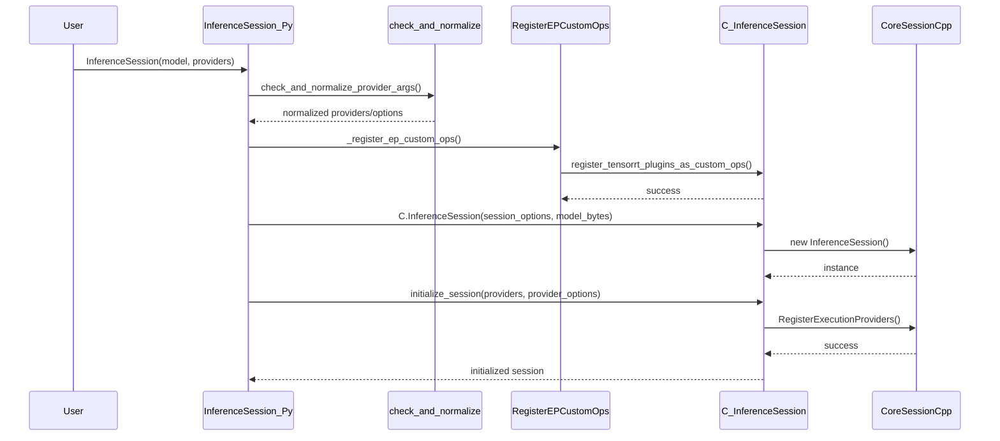

- User specifies providers on session creation.
- Providers and options are normalized.
- Any EP-specific custom ops (e.g. TensorRT plugins) are registered.
- The pybind11 C++ session is created and initialized with providers.

**Sources:**

- [onnxruntime/python/onnxruntime_inference_collection.py:89-169]()
- [onnxruntime/python/onnxruntime_inference_collection.py:502-648]()
- [onnxruntime/python/onnxruntime_pybind_state.cc:534-1150]()

---

### Provider Options Configuration

Each execution provider may support specific configuration options passed as dictionaries. The `CreateExecutionProviderFactoryInstance()` function in C++ processes these options into provider-specific structures.

**Examples:**

| Provider | Common Options                       | Extra Options                                          |
|----------|-----------------------------------|-------------------------------------------------------|
| TensorRT | `device_id` (int), workspace size | `trt_fp16_enable`, `trt_int8_enable`, caching options|
| CUDA     | `device_id`, `gpu_mem_limit`       | `arena_extend_strategy`, `cudnn_conv_algo_search`, CUDA graph options |

Managed options allow tuning provider behavior including precision, memory limits, algorithm selections, and caching.

**Sources:**

- [onnxruntime/python/onnxruntime_pybind_state.cc:610-1150]()
- [onnxruntime/test/python/onnxruntime_test_python.py:263-453]()

---

### Runtime Provider Switching

Python API provides `set_providers()` to change execution providers after session creation:

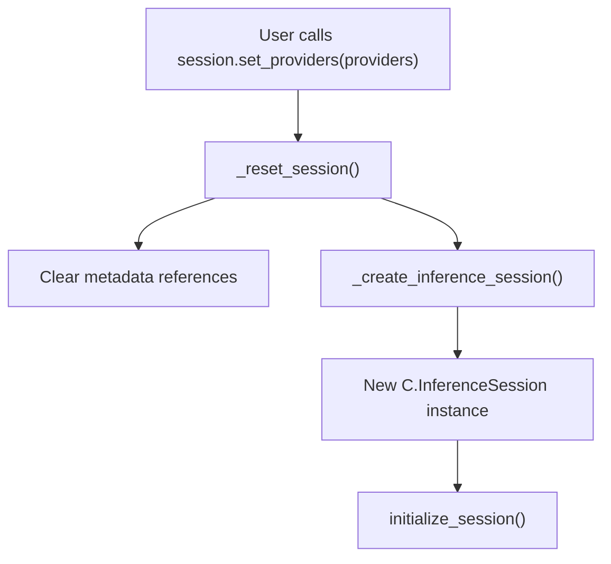

- The underlying C++ session is recreated with new providers.
- References to metadata are cleared.
- User must reuse the new `InferenceSession` object from the binding.

**Sources:**

- [onnxruntime/python/onnxruntime_inference_collection.py:222-243]()
- [onnxruntime/python/onnxruntime_inference_collection.py:599-619]()

---

## Advanced Features

### Sparse Tensor Support

ONNX Runtime Python binding supports sparse tensor types (COO, CSR, BlockSparse) using `SparseTensor` and `PySparseTensor` classes.

```mermaid
graph TB
    subgraph SparseTensorFactoryMethods (Python)
        coo_factory["SparseTensor.sparse_coo_from_numpy()"]
        csr_factory["SparseTensor.sparse_csr_from_numpy()"]
        blocksparse_factory["SparseTensor.blocksparse_from_numpy()"]
    end
    
    subgraph PySparseTensor (Wrapper Class)
        PySparseTensor["PySparseTensor: holds OrtValue or numpy arrays"]
        CooView["PySparseCooView (indices)"]
        CsrView["PySparseCsrView (inner, outer)"]
        BlockSparseView["PySparseBlockSparseView (indices)"]
    end
    
    subgraph CoreSparseTensor
        CoreSparse["SparseTensor in C++ core"]
    end
    
    coo_factory --> PySparseTensor
    csr_factory --> PySparseTensor
    blocksparse_factory --> PySparseTensor
    
    PySparseTensor --> CooView
    PySparseTensor --> CsrView
    PySparseTensor --> BlockSparseView
    PySparseTensor --> CoreSparse
```

- Factory methods create Python sparse tensor views backed by numpy arrays for inputs or OrtValue for outputs.
- PySparseTensor instances keep references to memory backing to control lifetimes.
- Sparse tensor views provide access to indices and value tensors.

**Sources:**

- [onnxruntime/python/onnxruntime_pybind_state_common.h:334-414]()
- [onnxruntime/python/onnxruntime_pybind_sparse_tensor.cc:60-283]()
- [onnxruntime/test/python/onnxruntime_test_python_sparse_matmul.py:16-424]()

---

### Asynchronous Execution

`run_async()` allows running inference asynchronously in a dedicated thread separate from ORT thread pools.

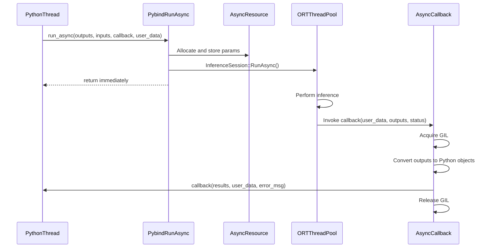

- `run_async()` creates an `AsyncResource` holding callback and inputs.
- C++ runtime executes inference asynchronously.
- Callback is called with results or error on Python thread after acquiring GIL.

**Sources:**

- [onnxruntime/python/onnxruntime_inference_collection.py:298-326]()
- [onnxruntime/python/onnxruntime_pybind_state.cc:160-184]()

---

### LoRA Adapter Support

LoRA (Low-Rank Adaptation) model adapters are supported via the `AdapterFormat` class in Python.

| Method              | Purpose                              |
|---------------------|------------------------------------|
| `read_adapter()`    | Load adapter parameters from file   |
| `export_adapter()`  | Save adapter parameters to file     |
| `set_parameters()`  | Set adapter parameters from dict    |
| `get_parameters()`  | Retrieve adapter parameters          |
| `set_adapter_version()` / `get_adapter_version()` | Manage adapter versioning    |
| `set_model_version()` / `get_model_version()`   | Manage model compatibility  |

- LoRA adapters can be activated in `RunOptions.active_adapters`.
- They are automatically appended as inputs during inference.

**Sources:**

- [onnxruntime/python/onnxruntime_inference_collection.py:43-87]()
- [onnxruntime/python/onnxruntime_pybind_state.cc:186-202]()

---

### DLPack Interoperability

When compiled with `ENABLE_DLPACK`, ONNX Runtime supports zero-copy tensor exchange with frameworks like PyTorch via DLPack.

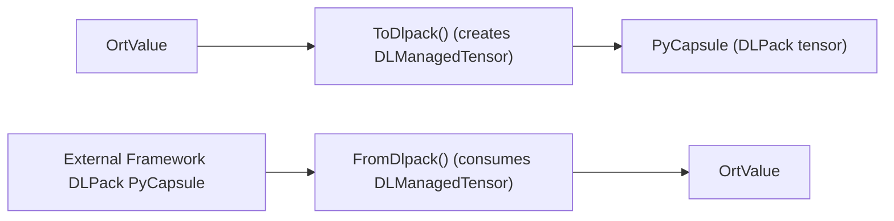

- `ToDlpack()` exports ONNX Runtime tensor as DLPack PyCapsule.
- `FromDlpack()` imports DLPack tensor to OrtValue.
- Capsule destructor ensures proper memory cleanup.

**Sources:**

- [onnxruntime/python/onnxruntime_pybind_state_common.cc:58-90]()

---

### Fallback Mechanism

The Python `InferenceSession` supports a fallback mechanism when inference provider failures occur.

Flow:

1. Attempt session creation/inference with requested providers.
2. On failure with `EPFail` error and enabled fallback, automatically fall back to CPU or alternative providers.
3. Fallback providers depend on the initial provider (e.g. TensorRT → CUDA + CPU).
4. Session is recreated with fallback providers, and fallback disabled for subsequent calls.

This helps gracefully handle unsupported operators or provider crashes in multi-EP scenarios.

**Sources:**

- [onnxruntime/python/onnxruntime_inference_collection.py:244-257]()
- [onnxruntime/python/onnxruntime_inference_collection.py:484-500]()
- [onnxruntime/python/onnxruntime_inference_collection.py:502-552]()

---

### Tunable Operator Support

For GPU execution providers, ONNX Runtime supports operator tuning to optimize performance.

- `get_tuning_results()`: Retrieve current tuning cache entries.
- `set_tuning_results()`: Load tuning cache from prior runs for faster startup.

Tuning results include metadata: provider name, op signatures, selected parameters, and validators.

**Sources:**

- [onnxruntime/python/onnxruntime_inference_collection.py:400-404]()
- [onnxruntime/test/python/onnxruntime_test_python.py:598-664]()

---

# Summary

The Python bindings for ONNX Runtime provide a rich, performant interface to load, configure, and run ONNX models. With robust support for multiple hardware devices, zero-copy data sharing, asynchronous execution, and fine-tuned execution provider configuration, they enable seamless integration within Python ML workflows.

The binding architecture leverages pybind11 for native interop, layered abstractions for ease-of-use, and extensive device and memory management to maximize efficiency and flexibility.

---

# References

| Topic                      | Source File & Lines                                      |
|----------------------------|---------------------------------------------------------|
| Pybind11 bindings          | `onnxruntime/python/onnxruntime_pybind_state.cc:1-184` |
| Python API classes          | `onnxruntime/python/onnxruntime_inference_collection.py:172-648` |
| OrtValue conversion        | `onnxruntime/python/onnxruntime_pybind_ortvalue.cc:27-126` |
| Data conversion helpers    | `onnxruntime/python/onnxruntime_pybind_mlvalue.cc:480-580` |
| IOBinding                  | `onnxruntime/python/onnxruntime_pybind_iobinding.cc:24-112` |
| Execution provider config  | `onnxruntime/python/onnxruntime_pybind_state.cc:534-1150` |
| Async run                  | `onnxruntime/python/onnxruntime_pybind_state.cc:160-184` |
| Sparse tensor support      | `onnxruntime/python/onnxruntime_pybind_state_common.h:334-414`<br/>`onnxruntime/python/onnxruntime_pybind_sparse_tensor.cc:60-283` |
| DLPack integration         | `onnxruntime/python/onnxruntime_pybind_state_common.cc:58-90` |
| Tests & tuning             | `onnxruntime/test/python/onnxruntime_test_python.py:263-664` |

---

