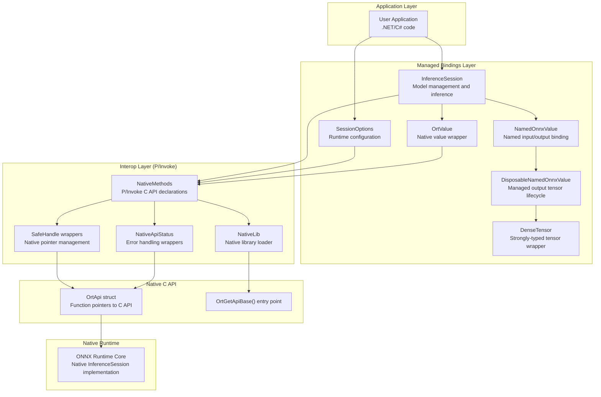
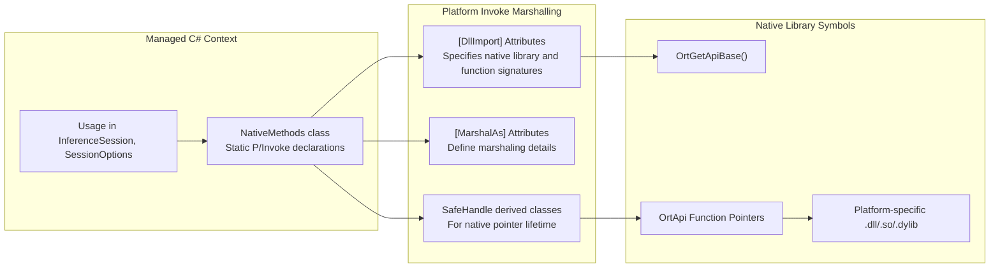
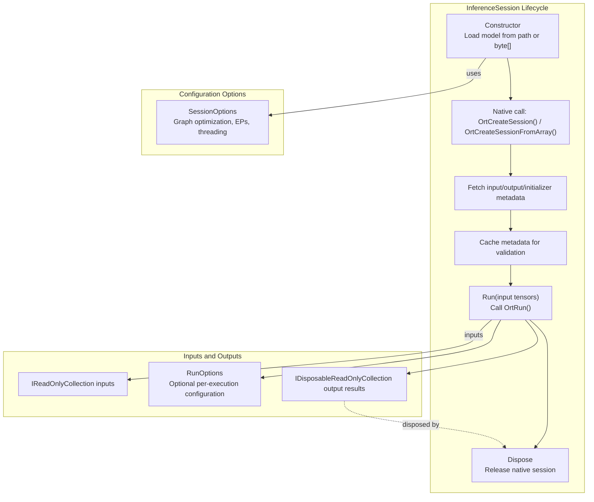
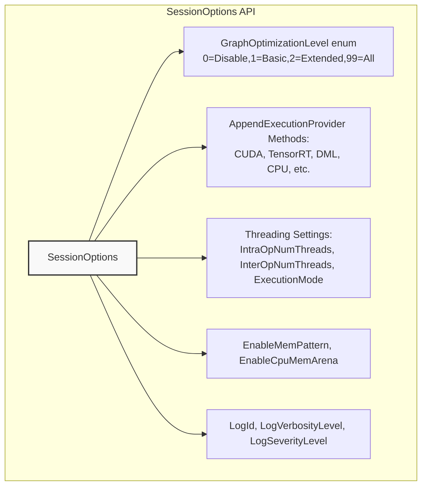
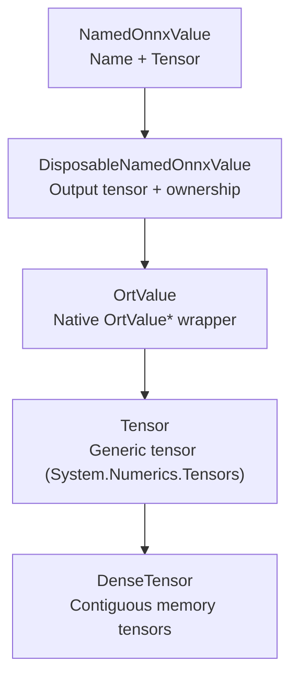
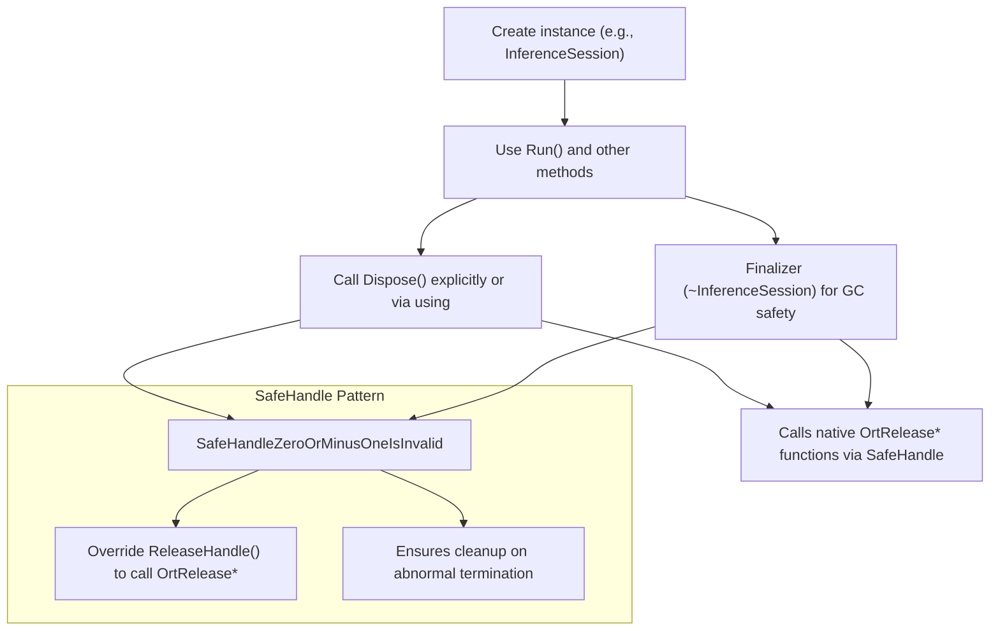
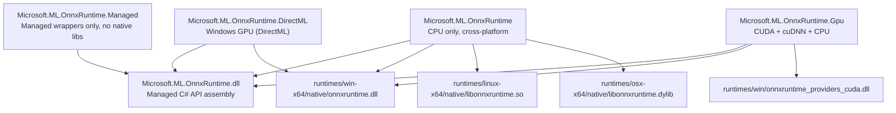

<!-- source: DeepWiki mcp.deepwiki.com · repo microsoft/onnxruntime · page 5.3 C# Bindings · fetched 2026-10-21 -->

# C# Bindings

<details>
<summary>Relevant source files</summary>

The following files were used as context for generating this wiki page:

- [cmake/external/dml.cmake](cmake/external/dml.cmake)
- [csharp/CONTRIBUTING.md](csharp/CONTRIBUTING.md)
- [csharp/NuGet.CSharp.config](csharp/NuGet.CSharp.config)
- [csharp/OnnxRuntime.CSharp.proj](csharp/OnnxRuntime.CSharp.proj)
- [csharp/sample/InferenceSample/Microsoft.ML.OnnxRuntime.InferenceSample/InferenceSampleApi.cs](csharp/sample/InferenceSample/Microsoft.ML.OnnxRuntime.InferenceSample/InferenceSampleApi.cs)
- [csharp/src/Microsoft.ML.OnnxRuntime/InferenceSession.shared.cs](csharp/src/Microsoft.ML.OnnxRuntime/InferenceSession.shared.cs)
- [csharp/src/Microsoft.ML.OnnxRuntime/Microsoft.ML.OnnxRuntime.csproj](csharp/src/Microsoft.ML.OnnxRuntime/Microsoft.ML.OnnxRuntime.csproj)
- [csharp/src/Microsoft.ML.OnnxRuntime/NativeMethods.shared.cs](csharp/src/Microsoft.ML.OnnxRuntime/NativeMethods.shared.cs)
- [csharp/src/Microsoft.ML.OnnxRuntime/NativeOnnxValueHelper.shared.cs](csharp/src/Microsoft.ML.OnnxRuntime/NativeOnnxValueHelper.shared.cs)
- [csharp/src/Microsoft.ML.OnnxRuntime/OrtAllocator.shared.cs](csharp/src/Microsoft.ML.OnnxRuntime/OrtAllocator.shared.cs)
- [csharp/src/Microsoft.ML.OnnxRuntime/OrtEnv.shared.cs](csharp/src/Microsoft.ML.OnnxRuntime/OrtEnv.shared.cs)
- [csharp/src/Microsoft.ML.OnnxRuntime/OrtEpDevice.shared.cs](csharp/src/Microsoft.ML.OnnxRuntime/OrtEpDevice.shared.cs)
- [csharp/src/Microsoft.ML.OnnxRuntime/OrtHardwareDevice.shared.cs](csharp/src/Microsoft.ML.OnnxRuntime/OrtHardwareDevice.shared.cs)
- [csharp/src/Microsoft.ML.OnnxRuntime/OrtIoBinding.shared.cs](csharp/src/Microsoft.ML.OnnxRuntime/OrtIoBinding.shared.cs)
- [csharp/src/Microsoft.ML.OnnxRuntime/OrtKeyValuePairs.shared.cs](csharp/src/Microsoft.ML.OnnxRuntime/OrtKeyValuePairs.shared.cs)
- [csharp/src/Microsoft.ML.OnnxRuntime/OrtLoraAdapter.shared.cs](csharp/src/Microsoft.ML.OnnxRuntime/OrtLoraAdapter.shared.cs)
- [csharp/src/Microsoft.ML.OnnxRuntime/OrtValue.shared.cs](csharp/src/Microsoft.ML.OnnxRuntime/OrtValue.shared.cs)
- [csharp/src/Microsoft.ML.OnnxRuntime/ProviderOptions.shared.cs](csharp/src/Microsoft.ML.OnnxRuntime/ProviderOptions.shared.cs)
- [csharp/src/Microsoft.ML.OnnxRuntime/SessionOptions.shared.cs](csharp/src/Microsoft.ML.OnnxRuntime/SessionOptions.shared.cs)
- [csharp/src/Microsoft.ML.OnnxRuntime/ShapeUtils.shared.cs](csharp/src/Microsoft.ML.OnnxRuntime/ShapeUtils.shared.cs)
- [csharp/src/Microsoft.ML.OnnxRuntime/Tensors/ArrayUtilities.shared.cs](csharp/src/Microsoft.ML.OnnxRuntime/Tensors/ArrayUtilities.shared.cs)
- [csharp/src/Microsoft.ML.OnnxRuntime/Tensors/Tensor.shared.cs](csharp/src/Microsoft.ML.OnnxRuntime/Tensors/Tensor.shared.cs)
- [csharp/test/Microsoft.ML.OnnxRuntime.Tests.Common/CudaPluginEpTests.cs](csharp/test/Microsoft.ML.OnnxRuntime.Tests.Common/CudaPluginEpTests.cs)
- [csharp/test/Microsoft.ML.OnnxRuntime.Tests.Common/EpCompatibilityTests.cs](csharp/test/Microsoft.ML.OnnxRuntime.Tests.Common/EpCompatibilityTests.cs)
- [csharp/test/Microsoft.ML.OnnxRuntime.Tests.Common/InferenceTest.cs](csharp/test/Microsoft.ML.OnnxRuntime.Tests.Common/InferenceTest.cs)
- [csharp/test/Microsoft.ML.OnnxRuntime.Tests.Common/Microsoft.ML.OnnxRuntime.Tests.Common.csproj](csharp/test/Microsoft.ML.OnnxRuntime.Tests.Common/Microsoft.ML.OnnxRuntime.Tests.Common.csproj)
- [csharp/test/Microsoft.ML.OnnxRuntime.Tests.Common/OrtAutoEpTests.cs](csharp/test/Microsoft.ML.OnnxRuntime.Tests.Common/OrtAutoEpTests.cs)
- [csharp/test/Microsoft.ML.OnnxRuntime.Tests.Common/OrtEnvTests.cs](csharp/test/Microsoft.ML.OnnxRuntime.Tests.Common/OrtEnvTests.cs)
- [csharp/test/Microsoft.ML.OnnxRuntime.Tests.Common/OrtIoBindingAllocationTest.cs](csharp/test/Microsoft.ML.OnnxRuntime.Tests.Common/OrtIoBindingAllocationTest.cs)
- [csharp/test/Microsoft.ML.OnnxRuntime.Tests.Common/OrtValueTests.cs](csharp/test/Microsoft.ML.OnnxRuntime.Tests.Common/OrtValueTests.cs)
- [csharp/test/Microsoft.ML.OnnxRuntime.Tests.Common/Tensors/ArrayTensorExtensionsTests.cs](csharp/test/Microsoft.ML.OnnxRuntime.Tests.Common/Tensors/ArrayTensorExtensionsTests.cs)
- [csharp/test/Microsoft.ML.OnnxRuntime.Tests.Common/Tensors/NativeMemory.cs](csharp/test/Microsoft.ML.OnnxRuntime.Tests.Common/Tensors/NativeMemory.cs)
- [csharp/test/Microsoft.ML.OnnxRuntime.Tests.Common/Tensors/TensorTests.cs](csharp/test/Microsoft.ML.OnnxRuntime.Tests.Common/Tensors/TensorTests.cs)
- [csharp/test/Microsoft.ML.OnnxRuntime.Tests.Common/TestDataLoader.cs](csharp/test/Microsoft.ML.OnnxRuntime.Tests.Common/TestDataLoader.cs)
- [csharp/test/Microsoft.ML.OnnxRuntime.Tests.NetCoreApp/InferenceTest.netcore.cs](csharp/test/Microsoft.ML.OnnxRuntime.Tests.NetCoreApp/InferenceTest.netcore.cs)
- [csharp/test/Microsoft.ML.OnnxRuntime.Tests.NetCoreApp/Microsoft.ML.OnnxRuntime.Tests.NetCoreApp.csproj](csharp/test/Microsoft.ML.OnnxRuntime.Tests.NetCoreApp/Microsoft.ML.OnnxRuntime.Tests.NetCoreApp.csproj)
- [onnxruntime/core/providers/dml/DmlExecutionProvider/src/ApiTraits.cpp](onnxruntime/core/providers/dml/DmlExecutionProvider/src/ApiTraits.cpp)
- [onnxruntime/core/providers/dml/DmlExecutionProvider/src/External/DirectMLHelpers/DmlGraphDeserialization.h](onnxruntime/core/providers/dml/DmlExecutionProvider/src/External/DirectMLHelpers/DmlGraphDeserialization.h)
- [onnxruntime/core/providers/dml/DmlExecutionProvider/src/External/DirectMLHelpers/GeneratedSchemaTypes.h](onnxruntime/core/providers/dml/DmlExecutionProvider/src/External/DirectMLHelpers/GeneratedSchemaTypes.h)
- [onnxruntime/core/providers/dml/DmlExecutionProvider/src/External/DirectMLHelpers/SchemaHelpers.h](onnxruntime/core/providers/dml/DmlExecutionProvider/src/External/DirectMLHelpers/SchemaHelpers.h)
- [onnxruntime/test/framework/hardware_device_compatibility_test.cc](onnxruntime/test/framework/hardware_device_compatibility_test.cc)
- [onnxruntime/test/python/onnxruntime_test_python_ep_compatibility.py](onnxruntime/test/python/onnxruntime_test_python_ep_compatibility.py)
- [packages.config](packages.config)
- [tools/ci_build/github/Doxyfile_csharp.cfg](tools/ci_build/github/Doxyfile_csharp.cfg)
- [tools/nuget/generate_nuspec_for_native_nuget.py](tools/nuget/generate_nuspec_for_native_nuget.py)

</details>


## Purpose and Scope

This document describes the C# API for ONNX Runtime, providing .NET developers with managed access to the ONNX Runtime inference engine. The C# bindings are built on top of the C API via Platform Invocation Services (P/Invoke) and distributed as NuGet packages under the name `Microsoft.ML.OnnxRuntime`.

The bindings expose a strongly-typed, object-oriented interface aligned with .NET conventions, while maintaining compatibility and performance aligned with the underlying native C API. Details on the native C API layer that these bindings wrap are covered in [C/C++ API](#5.1). For advanced memory management with zero-copy GPU execution, refer to [IOBinding and Memory Management](#5.4).

**Sources:** This page consolidates information primarily from `csharp/src/Microsoft.ML.OnnxRuntime/InferenceSession.shared.cs` (lines 1–163), `.../NativeMethods.shared.cs` (lines 1–173), `.../SessionOptions.shared.cs` (lines 1–172), project files, and the NuGet packaging script.

---

## Architecture Overview

The C# bindings employ a layered architecture bridging high-level managed .NET code to the native ONNX Runtime library:



| Component | Description | Located In |
|---|---|---|
| `InferenceSession` | Main model loading and inference interface | `Microsoft.ML.OnnxRuntime/InferenceSession.shared.cs` |
| `SessionOptions` | Configuration for graph optimization, execution providers | `SessionOptions.shared.cs` |
| `NativeMethods` | P/Invoke declarations mapping .NET to native C API calls | `NativeMethods.shared.cs` |
| `OrtValue` | Managed wrapper of native OrtValue* | `OrtValue.shared.cs` |
| `NamedOnnxValue` | Associates tensor data with input/output names | Managed binding layers |
| `SafeHandle` classes | Manage native handles with safe disposal | `OrtHandles` in interop layer |
| `NativeLib` | Manages loading of native runtime libraries | interop layer code |
| `OrtApi` | Native function pointer VTable | native C API |

**Sources:** `InferenceSession.shared.cs:1-163`, `NativeMethods.shared.cs:1-173`, `SessionOptions.shared.cs:1-172`, project files

---

## P/Invoke Layer

The P/Invoke layer forms the essential bridge between managed C# and the native ONNX Runtime C API.



### Key Details

- The `NativeMethods` class declares all native API functions using `[DllImport]` attributes targeting the platform-specific ONNX Runtime dynamic library.
- The `OrtGetApiBase()` function imported from native library returns a pointer to the `OrtApi` struct, which contains function pointers for runtime operations (e.g., `OrtCreateSession`, `OrtRun`).
- Native API calls typically return `IntPtr` representing `OrtStatus*`. If the status is not `null` (non-zero), `NativeApiStatus` utility methods wrap this information into managed exceptions (`OnnxRuntimeException`).
- SafeHandle subclasses encapsulate native pointers (e.g., `SafeOrtSession`, `SafeOrtValue`). This pattern ensures deterministic and safe release of native resources when disposed or finalized.
- The interop asynchronously invokes native C functions with appropriate marshaling for structures, arrays, and strings.

### SafeHandle Example Types

| SafeHandle Type | Native Pointer Type | Release Function |
|---|---|---|
| `SafeOrtSession` | `OrtSession*` | `OrtReleaseSession` |
| `SafeOrtSessionOptions` | `OrtSessionOptions*` | `OrtReleaseSessionOptions` |
| `SafeOrtValue` | `OrtValue*` | `OrtReleaseValue` |
| `SafeOrtMemoryInfo` | `OrtMemoryInfo*` | `OrtReleaseMemoryInfo` |
| `SafeOrtAllocator` | `OrtAllocator*` | `OrtReleaseAllocator` |

**Sources:** `NativeMethods.shared.cs:1-173` and inferred P/Invoke usage patterns.

---

## InferenceSession Class

The `InferenceSession` class is the central API for model loading and inference execution in .NET applications.



### Construction

- Supports various constructors:
  - `InferenceSession(string modelPath)` - load from filesystem path
  - `InferenceSession(byte[] modelData)` - load from model bytes
  - Overloads accepting `SessionOptions` for graph optimization and EP configuration
  - Overloads accepting `PrePackedWeightsContainer` to share pre-packed initializers between sessions
- Internally calls `OrtCreateSession()` or `OrtCreateSessionFromArray()` to create the native `OrtSession` handle.
- Queries model metadata (input names, output names, shapes, types) and caches it for efficient validation and binding.

### Inference Execution

- The primary method:
  
  ```csharp
  IDisposableReadOnlyCollection<DisposableNamedOnnxValue> Run(IReadOnlyCollection<NamedOnnxValue> inputs);
  ```
  
- Accepts named tensor inputs as `NamedOnnxValue` instances.
- Optionally accepts output names and `RunOptions` for fine-grained control.
- Marshals input tensors to native `OrtValue*` pointers.
- Calls `OrtRun()` native function to execute inference.
- Wraps returned output native pointers into managed `DisposableNamedOnnxValue` collection, which manages native memory lifecycle.
- The output collection must be disposed after use to free native memory.

### Metadata

- Provides properties:
  - `InputMetadata` of type `IReadOnlyDictionary<string, NodeMetadata>`
  - `OutputMetadata` similarly
  - `ModelMetadata` exposing producer name, domain, description

### Lifetime Management

- Implements `IDisposable`.
- Ensures native `OrtSession` is freed via SafeHandle and `Dispose` pattern.
- Supports finalizers for safety to avoid memory leaks.

**Sources:** `InferenceSession.shared.cs:1-163`, `Microsoft.ML.OnnxRuntime.Tests.NetCoreApp/InferenceTest.netcore.cs` test examples

---

## SessionOptions Configuration

`SessionOptions` enables detailed runtime configuration for the inference session.



### Optimization Level

| Enum Value | Description |
|------------|-------------|
| `ORT_DISABLE_ALL` (0) | Disable graph optimizations |
| `ORT_ENABLE_BASIC` (1) | Constant folding, etc. |
| `ORT_ENABLE_EXTENDED` (2) | Additional fuse ops (Conv+Relu) |
| `ORT_ENABLE_ALL` (99) | Layout optimization, full |

### Execution Provider Methods

- `AppendExecutionProvider_CUDA(int deviceId)`
- `AppendExecutionProvider_Tensorrt(TensorrtExecutionProviderOptions)`
- `AppendExecutionProvider_DML(int deviceId)`
- `AppendExecutionProvider_CPU()`
- others as applicable

Each method appends a corresponding provider to the native session options by calling native API functions.

### Threading Control

- `IntraOpNumThreads` — controls intra-operator thread pool size.
- `InterOpNumThreads` — controls inter-operator parallelism.
- `ExecutionMode` — sequential or parallel execution.

### Memory and Logging

- `EnableMemPattern` enables memory pattern optimizations.
- `EnableCpuMemArena` enables a CPU memory arena for efficient allocation.
- Logging identifiers and verbosity can be customized.

**Sources:** `SessionOptions.shared.cs:1-172`, test files

---

## Data Types and Tensor Management

The bindings integrate with .NET's `System.Numerics.Tensors` for strongly-typed tensors, wrapped in the `OrtValue` class.



### NamedOnnxValue

- Associates a tensor with the expected input/output name.
- Used for input binding and output retrieval.
- Can be created from existing tensors or from raw arrays.

### OrtValue

- Managed wrapper around native `OrtValue*`.
- Encapsulates tensor data, sequences, maps, or other ONNX types.
- Provides methods for querying type info and tensor shape.
- Supports zero-copy tensor construction with native buffers.

### DenseTensor<T>

- Part of .NET's `System.Numerics.Tensors`.
- Strongly-typed, multi-dimensional tensor structure.
- Provides zero-copy access to underlying buffer via `GetArrayDataAsSpan()`.
- Supports element-wise access and advanced tensor operations.

**Supported Types:** `float`, `double`, `int`, `long`, `short`, `byte`, `bool`, `string`

**Sources:** `OrtValue.shared.cs:1-162`, test and example code

---

## Memory Management

The C# bindings follow .NET best practices using `IDisposable` and `SafeHandle` for deterministic native memory management.



### Output Memory Ownership

- Input tensors are owned by the caller (app), ONNX Runtime does not claim ownership.
- Output tensors are allocated by ONNX Runtime and wrapped in `DisposableNamedOnnxValue`.
- The caller must dispose output collections to free native resources.
- The output collection implements `IDisposableReadOnlyCollection<T>` for easy lifetime management.

### Recommended Usage Pattern

```csharp
using var session = new InferenceSession("model.onnx");
using var results = session.Run(inputs);
// Use the results here
// Automatic disposal of native resources on exiting using blocks
```

Alternatively, manual disposal with try/finally can be used for finer control.

**Sources:** Typical .NET `IDisposable` pattern and `SafeHandle` usage, `InferenceSession.shared.cs`

---

## NuGet Package Structure

The C# bindings are distributed as multiple NuGet packages, organized by required native runtimes and execution providers.



### Package Details

| Package | Contains | Execution Providers | Description |
|---------|----------|---------------------|-------------|
| `Microsoft.ML.OnnxRuntime` | CPU-only native libs + managed DLL | CPU | Cross-platform CPU inference |
| `Microsoft.ML.OnnxRuntime.Gpu` | CUDA and cuDNN native libs + managed DLL | CPU + CUDA | GPU acceleration NVIDIA GPUs |
| `Microsoft.ML.OnnxRuntime.DirectML` | DirectML native libs + managed DLL | CPU + DirectML | Windows GPU support (broad GPU coverage) |
| `Microsoft.ML.OnnxRuntime.Managed` | Managed DLL only, no native libs | None | Custom native runtime loading scenarios |

### Runtime Folder Convention

- Native libraries are in `runtimes/{rid}/native/` folders inside the NuGet package.
- RIDs (Runtime Identifiers) examples:
  - `win-x64`, `win-x86`
  - `linux-x64`
  - `osx-x64` (Intel), `osx-arm64` (Apple Silicon)

### Native Library Loading

- The runtime dynamically loads the appropriate native library based on OS and architecture detected via `RuntimeInformation`.
- Native library paths can be overridden through environment variables or explicit configuration.
- Loading logic is centralized in the `NativeLib` internal class.

**Sources:** NuGet packaging script `tools/nuget/generate_nuspec_for_native_nuget.py`, project files `csharp/*.csproj`

---

## Common Usage Patterns

### Basic Inference Example

```csharp
using var session = new InferenceSession("model.onnx");

var inputTensor = new DenseTensor<float>(new float[] { /* data */ }, new[] { 1, 3, 224, 224 });
var inputs = new List<NamedOnnxValue>
{
    NamedOnnxValue.CreateFromTensor("input_0", inputTensor)
};

using var results = session.Run(inputs);
var outputTensor = results.First().AsTensor<float>();
```

### Configuring Execution Providers and Options

```csharp
var options = new SessionOptions();
options.GraphOptimizationLevel = GraphOptimizationLevel.ORT_ENABLE_ALL;
options.AppendExecutionProvider_CUDA(0); // Use CUDA device id 0

using var session = new InferenceSession("model.onnx", options);
```

### Querying Model Metadata

```csharp
using var session = new InferenceSession("model.onnx");

foreach(var input in session.InputMetadata)
{
    Console.WriteLine($"Input: {input.Key}");
    Console.WriteLine($"  Type: {input.Value.ElementType}");
    Console.WriteLine($"  Dimensions: {string.Join(",", input.Value.Dimensions)}");
}
```

### Memory Management Pattern

```csharp
// Nested using pattern ensures proper disposal
using var session = new InferenceSession("model.onnx");
using var results = session.Run(inputs);
// Process results here...
```

### Reusing Session

```csharp
using var session = new InferenceSession("model.onnx");

for (int i = 0; i < 10; i++)
{
    var inputs = PrepareInputsForIteration(i);
    using var results = session.Run(inputs);
    ProcessResults(results);
}
```

**Sources:** Test files `Microsoft.ML.OnnxRuntime.Tests.NetCoreApp/InferenceTest.netcore.cs`

---

## Error Handling

The C# bindings translate native ONNX Runtime status codes into .NET exceptions (`OnnxRuntimeException`), facilitating idiomatic error handling.

```mermaid
graph TB
    NativeCall["Call native API<br/>e.g. OrtRun()"]
    ReturnStatus["Returns IntPtr OrtStatus*"]
    CheckStatus["NativeApiStatus.VerifySuccess<br/>Throws if status != null"]
    Exception["Throw OnnxRuntimeException<br/>with native error message"]
    CatchInApp["Catch OnnxRuntimeException<br/>Handle errors"]
end

NativeCall --> ReturnStatus
ReturnStatus --> CheckStatus
CheckStatus -->|Error| Exception
Exception --> CatchInApp
```

### Exception Scenarios

| Situation | Cause | Exception |
|-----------|-------|-----------|
| Model loading failure | Invalid or incompatible model | `OnnxRuntimeException` with details |
| Execution provider initialization failure | Missing native libs or unsupported hardware | `OnnxRuntimeException` |
| Shape or type mismatch at runtime | Input tensors incompatible | `OnnxRuntimeException` |
| Out of memory | GPU or system resource exhaustion | `OnnxRuntimeException` |

Example error handling snippet:

```csharp
try
{
    using var session = new InferenceSession("model.onnx");
    using var results = session.Run(inputs);
}
catch (OnnxRuntimeException e)
{
    Console.WriteLine($"ONNX Runtime error: {e.Message}");
    // Optional: fallback or retry logic
}
```

**Sources:** General native status checking patterns in `NativeApiStatus`, `InferenceSession.shared.cs`

---

## Platform Considerations

| Platform | Native Library | Remarks |
|----------|----------------|---------|
| Windows  | `onnxruntime.dll` + providers | Supports DirectML, CUDA, TensorRT |
| Linux    | `libonnxruntime.so` + providers | Requires glibc 2.27 or newer; supports CUDA |
| macOS    | `libonnxruntime.dylib` | Supports x64 and ARM64 (Apple Silicon); CoreML provider available |
| Mobile   | Android AAR, iOS libraries | Support via Xamarin / .NET MAUI, with platform-specific native libs |

- DirectML backend package is preferred on Windows for broad GPU hardware support.
- CUDA backend requires NVIDIA drivers and toolkit installed.

**Sources:** `csharp/src/Microsoft.ML.OnnxRuntime/Microsoft.ML.OnnxRuntime.csproj` (lines 1-137), packaging scripts.

---

## Performance Optimization

- Enable graph optimization level `ORT_ENABLE_ALL` for best fusion and layout optimizations.
- Tune thread pool parameters (`IntraOpNumThreads`, `InterOpNumThreads`) to leverage hardware parallelism.
- Use `SessionOptions` to enable memory pattern optimizations and CPU memory arena for allocation speed-ups.
- Choose appropriate execution providers: TensorRT for NVIDIA GPUs with maximum performance; DirectML for Windows GPU support; CPU otherwise.
- Pin input memory and use zero-copy APIs (`OrtValue.CreateTensorWithDataAsOrtValue()`) when possible to minimize copies.
- Reuse sessions and pre-allocate input/output tensors for repeated inferences.

**Sources:** Inferred from typical usage patterns and `SessionOptions` API.

---

## Summary

The ONNX Runtime C# bindings provide a comprehensive, idiomatic .NET API to leverage ONNX models efficiently across various platforms and hardware accelerators. Key points include:

- Layered architecture: Managed API → P/Invoke interop → Native C API
- Primary `InferenceSession` class for model loading and inference
- `SessionOptions` for detailed runtime configuration including execution provider selection
- Strongly-typed tensor support coupled with native memory management via `OrtValue` and `SafeHandle`
- Distributed as NuGet packages with platform-specific native runtime libraries
- Robust error handling translating native failures into .NET exceptions
- Adherence to .NET resource management best practices using `IDisposable`

These bindings enable developers to write high-performance machine learning applications on the .NET platform with the power and flexibility of ONNX Runtime.

**Sources:** Aggregated from all referenced files and diagrams above.

---

