<!-- source: DeepWiki mcp.deepwiki.com · repo microsoft/onnxruntime · page 5.4 IOBinding and Memory Management · fetched 2026-10-21 -->

# IOBinding and Memory Management

<details>
<summary>Relevant source files</summary>

The following files were used as context for generating this wiki page:

- [include/onnxruntime/core/framework/allocator.h](include/onnxruntime/core/framework/allocator.h)
- [onnxruntime/core/framework/allocator.cc](onnxruntime/core/framework/allocator.cc)
- [onnxruntime/core/framework/allocator_stats.h](onnxruntime/core/framework/allocator_stats.h)
- [onnxruntime/core/framework/bfc_arena.cc](onnxruntime/core/framework/bfc_arena.cc)
- [onnxruntime/core/framework/bfc_arena.h](onnxruntime/core/framework/bfc_arena.h)
- [onnxruntime/core/framework/sparse_utils.cc](onnxruntime/core/framework/sparse_utils.cc)
- [onnxruntime/core/session/allocator_adapters.cc](onnxruntime/core/session/allocator_adapters.cc)
- [onnxruntime/core/session/allocator_adapters.h](onnxruntime/core/session/allocator_adapters.h)
- [onnxruntime/core/session/default_cpu_allocator_c_api.cc](onnxruntime/core/session/default_cpu_allocator_c_api.cc)
- [onnxruntime/python/onnxruntime_inference_collection.py](onnxruntime/python/onnxruntime_inference_collection.py)
- [onnxruntime/python/onnxruntime_pybind_iobinding.cc](onnxruntime/python/onnxruntime_pybind_iobinding.cc)
- [onnxruntime/python/onnxruntime_pybind_mlvalue.cc](onnxruntime/python/onnxruntime_pybind_mlvalue.cc)
- [onnxruntime/python/onnxruntime_pybind_mlvalue.h](onnxruntime/python/onnxruntime_pybind_mlvalue.h)
- [onnxruntime/python/onnxruntime_pybind_ortvalue.cc](onnxruntime/python/onnxruntime_pybind_ortvalue.cc)
- [onnxruntime/python/onnxruntime_pybind_sparse_tensor.cc](onnxruntime/python/onnxruntime_pybind_sparse_tensor.cc)
- [onnxruntime/python/onnxruntime_pybind_state.cc](onnxruntime/python/onnxruntime_pybind_state.cc)
- [onnxruntime/python/onnxruntime_pybind_state_common.cc](onnxruntime/python/onnxruntime_pybind_state_common.cc)
- [onnxruntime/python/onnxruntime_pybind_state_common.h](onnxruntime/python/onnxruntime_pybind_state_common.h)
- [onnxruntime/test/framework/bfc_arena_test.cc](onnxruntime/test/framework/bfc_arena_test.cc)
- [onnxruntime/test/python/onnxruntime_test_python.py](onnxruntime/test/python/onnxruntime_test_python.py)
- [onnxruntime/test/python/onnxruntime_test_python_iobinding.py](onnxruntime/test/python/onnxruntime_test_python_iobinding.py)
- [onnxruntime/test/python/onnxruntime_test_python_nv_tensorrt_rtx_ep_tests.py](onnxruntime/test/python/onnxruntime_test_python_nv_tensorrt_rtx_ep_tests.py)
- [onnxruntime/test/shared_lib/test_allocator.cc](onnxruntime/test/shared_lib/test_allocator.cc)
- [onnxruntime/test/util/include/test_allocator.h](onnxruntime/test/util/include/test_allocator.h)
- [onnxruntime/test/util/test_allocator.cc](onnxruntime/test/util/test_allocator.cc)
- [orttraining/orttraining/python/orttraining_pybind_state.cc](orttraining/orttraining/python/orttraining_pybind_state.cc)

</details>


This document describes ONNX Runtime's IOBinding API and memory management infrastructure. IOBinding enables efficient, zero-copy model execution by allowing users to explicitly control where inputs and outputs are allocated, eliminating unnecessary data transfers between CPU and GPU memory. This is particularly valuable for GPU-accelerated inference workflows.

For information about the core InferenceSession API and basic model execution, see [Inference Session](#3.3). For details on execution providers and hardware acceleration, see [Execution Providers](#6).

## Overview

ONNX Runtime provides two primary mechanisms for model execution:
1. **Standard Run API**: Automatically manages memory allocation and data transfer
2. **IOBinding API**: Provides explicit control over input/output memory locations

The IOBinding API is designed for scenarios where:
- Inputs already reside in GPU memory
- Outputs should be written directly to GPU memory
- Multiple inference calls reuse the same memory buffers
- Minimizing CPU-GPU data transfers is critical for performance

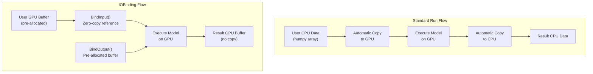

Sources: [onnxruntime/python/onnxruntime_pybind_iobinding.cc:1-200](), [onnxruntime/core/session/inference_session.cc:1-100]()

## OrtValue: The Fundamental Data Container

`OrtValue` is ONNX Runtime's unified container for all data types (tensors, sequences, maps, sparse tensors). It encapsulates both the data and metadata about its location and type.

### OrtValue Structure

| Component | Purpose | Key Classes |
|-----------|---------|-------------|
| **Data Storage** | Raw memory buffer | `Tensor`, `SparseTensor`, `TensorSeq` |
| **Memory Info** | Location descriptor | `OrtMemoryInfo` |
| **Data Type** | Type metadata | `MLDataType`, `DataTypeImpl` |
| **Allocator** | Memory management | `IAllocator`, `AllocatorPtr` |

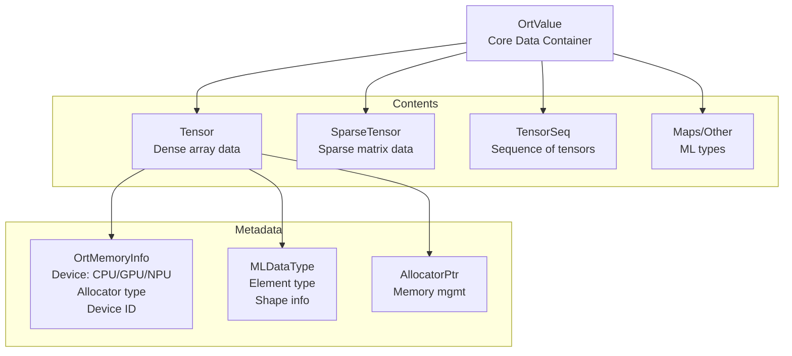

Sources: [onnxruntime/python/onnxruntime_pybind_mlvalue.cc:1-100](), [include/onnxruntime/core/session/onnxruntime_c_api.h:296-302]()

### Creating OrtValues

OrtValues can be created in several ways depending on memory ownership:

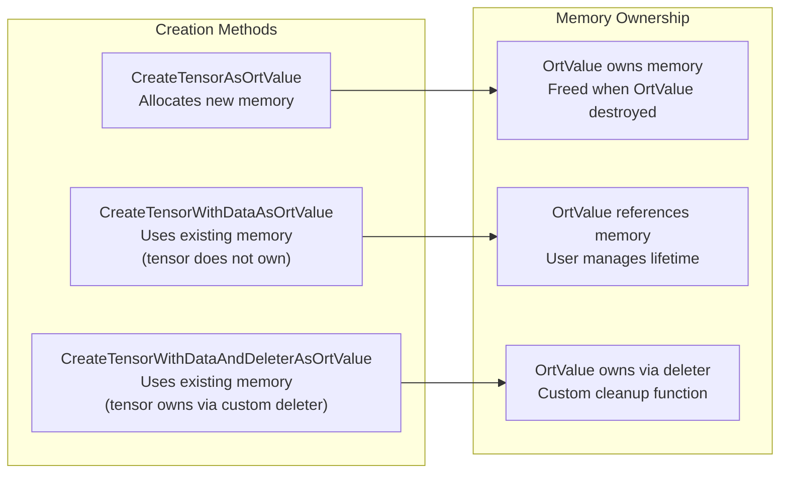

Sources: [onnxruntime/core/session/onnxruntime_c_api.cc:327-363](), [onnxruntime/python/onnxruntime_pybind_ortvalue.cc:22-50]()

## Memory Management Architecture

ONNX Runtime's memory management system provides flexibility across different hardware backends while maintaining efficiency.

### Memory Info Hierarchy

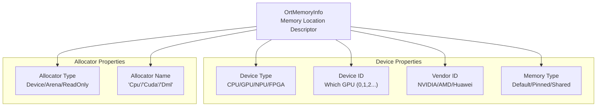

**Key Functions**:
- `CreateCpuMemoryInfo()`: Creates memory info for CPU [onnxruntime_cxx_inline.h:320-324]()
- `CreateMemoryInfo()`: Creates memory info with specific parameters [onnxruntime_cxx_inline.h:326-328]()
- `CompareMemoryInfo()`: Checks if two memory locations match [onnxruntime_cxx_inline.h:313-316]()

Sources: [include/onnxruntime/core/session/onnxruntime_c_api.h:473-500](), [include/onnxruntime/core/session/onnxruntime_cxx_inline.h:264-318]()

### Allocator Types

ONNX Runtime supports multiple allocator implementations optimized for different use cases:

| Allocator Type | Description | Use Case |
|----------------|-------------|----------|
| **CPUAllocator** | Standard CPU memory allocation | Default for CPU execution |
| **ArenaAllocator** | Pooled memory with arena strategy | Reduces allocation overhead |
| **BFCAllocator** | Best-Fit with Coalescing | GPU memory management |
| **DeviceAllocator** | Device-specific allocation | GPU, NPU hardware |
| **IAllocatorImplWrappingOrtAllocator** | Wraps OrtAllocator for internal use | Bridge between C API and internal |

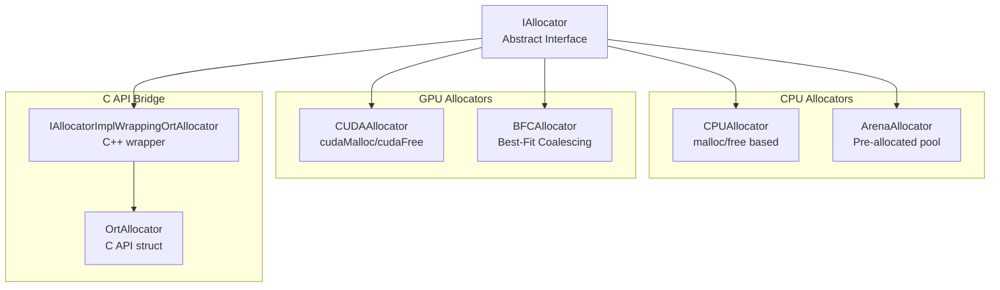

Sources: [include/onnxruntime/core/session/onnxruntime_c_api.h:355-421](), [onnxruntime/core/session/onnxruntime_c_api.cc:134-196]()

### Allocator Interface

The `OrtAllocator` struct provides a function pointer interface for memory operations:

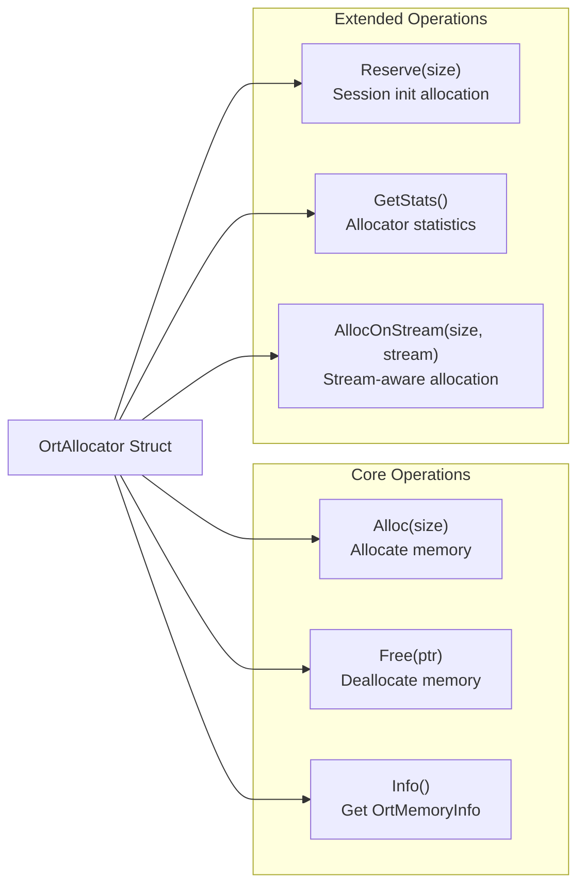

**Key Features**:
- **Reserve()**: Separate allocation for session initialization (v1.18+) [include/onnxruntime/core/framework/allocator.h:101-103]()
- **GetStats()**: Query allocator statistics (limit, in-use, peak usage) [include/onnxruntime/core/framework/allocator.h:9-10]()
- **AllocOnStream()**: Stream-aware allocation for async operations [include/onnxruntime/core/framework/allocator.h:121-141]()

Sources: [include/onnxruntime/core/session/onnxruntime_c_api.h:355-421]()

## IOBinding API

The IOBinding API provides explicit control over input and output memory locations across C, C++, and Python interfaces.

### C API

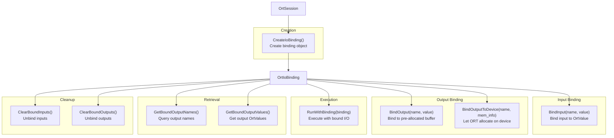

Sources: [include/onnxruntime/core/session/onnxruntime_c_api.h:300](), [onnxruntime/core/session/ort_apis.h:177-185]()

### C++ API

The C++ API provides RAII wrappers around the C API:

| Class | Purpose |
|-------|---------|
| `Ort::IoBinding` | Mutable IOBinding with full API |
| `Ort::ConstIoBinding` | Const-only view (GetOutputNames, GetOutputValues) |

**Key Methods**:
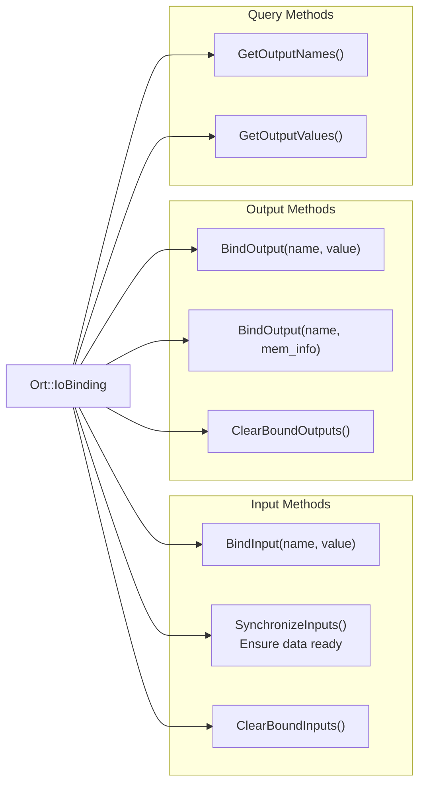

Sources: [include/onnxruntime/core/session/onnxruntime_cxx_api.h:1437-1505](), [include/onnxruntime/core/session/onnxruntime_cxx_inline.h:360-382]()

### Python API

The Python API exposes IOBinding through the `InferenceSession.io_binding()` method:

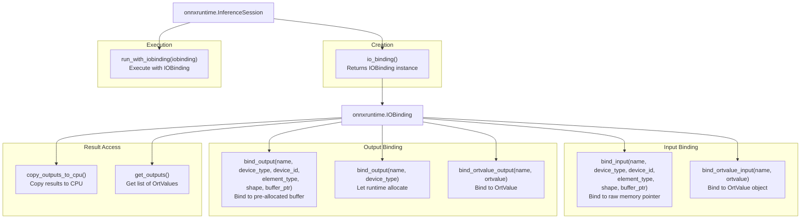

Sources: [onnxruntime/python/onnxruntime_inference_collection.py:1-194](), [onnxruntime/python/onnxruntime_pybind_iobinding.cc:1-200]()

## Zero-Copy GPU Execution Workflow

IOBinding enables zero-copy execution by eliminating intermediate CPU transfers:

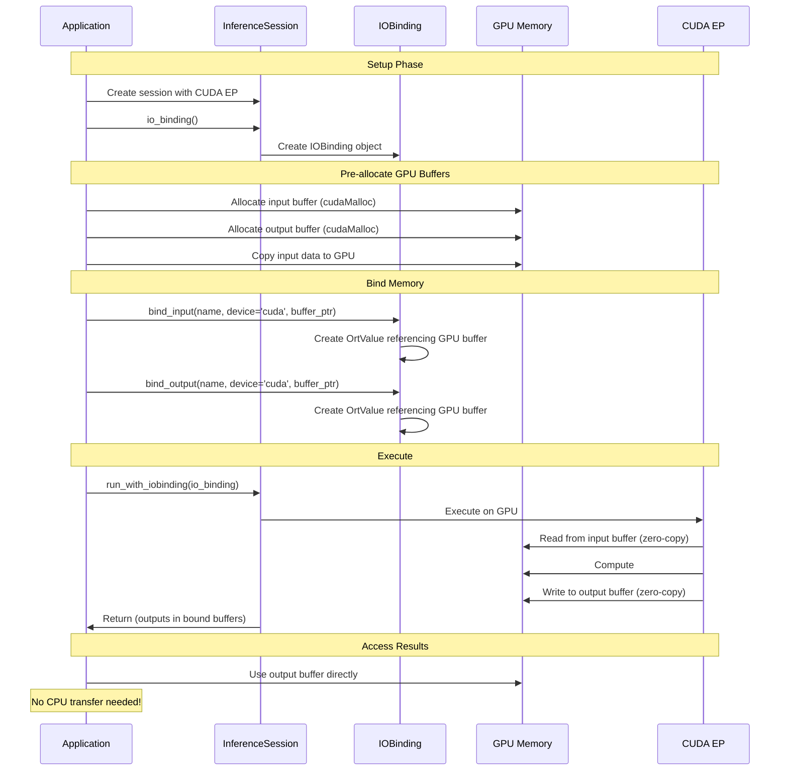

**Key Performance Benefits**:
1. **Zero Memory Copies**: Data never leaves GPU memory
2. **Buffer Reuse**: Same buffers across multiple inferences
3. **Reduced Latency**: No synchronization for CPU transfers
4. **Memory Efficiency**: No duplicate allocations

Sources: [onnxruntime/python/onnxruntime_pybind_iobinding.cc:1-100](), [onnxruntime/test/python/onnxruntime_test_python_iobinding.py:1-100]()

## Device-Specific Memory Management

### CUDA Memory Management

CUDA execution uses specialized allocators for GPU memory:

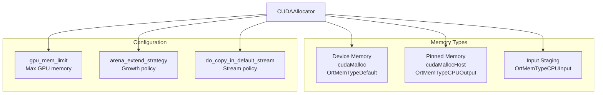

**CUDA Provider Options** [onnxruntime_pybind_state_common.h:116-118]():
- `device_id`: Which GPU to use (default: 0) [onnxruntime/python/onnxruntime_pybind_state_common.cc:18]()
- `gpu_mem_limit`: Maximum memory (default: SIZE_MAX) [onnxruntime/python/onnxruntime_pybind_state_common.cc:20]()
- `arena_extend_strategy`: How arena grows (0=NextPowerOfTwo, 1=SameAsRequested) [onnxruntime/python/onnxruntime_pybind_state_common.cc:34]()
- `do_copy_in_default_stream`: Stream synchronization policy [onnxruntime/python/onnxruntime_pybind_state_common.cc:26]()
- `user_compute_stream`: Custom CUDA stream for execution

Sources: [onnxruntime/python/onnxruntime_pybind_state_common.h:116-118](), [onnxruntime/python/onnxruntime_pybind_state.cc:479-498]()

### DML (DirectML) Memory Management

DirectML execution on Windows uses D3D12 resources:

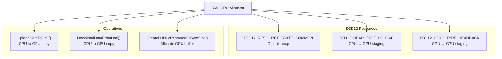

**DML IOBinding Integration**:
- `CreateGPUAllocationFromD3DResource()`: Wrap D3D12 resource as OrtValue [onnxruntime/test/shared_lib/test_inference.cc:239]()
- `FreeGPUAllocation()`: Release wrapped resource
- Uses command lists for asynchronous operations [onnxruntime/test/shared_lib/test_inference.cc:148-226]()

Sources: [onnxruntime/test/shared_lib/test_inference.cc:77-260](), [onnxruntime/python/onnxruntime_pybind_mlvalue.cc:26-39]()

## Memory Optimization Strategies

### Arena Allocators

Arena allocators pre-allocate large memory pools to reduce allocation overhead:

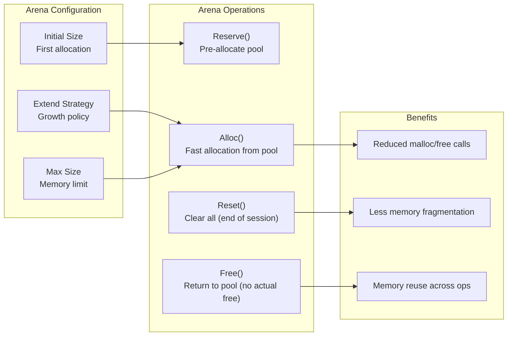

**Configuration via SessionOptions**:
- `enable_cpu_mem_arena`: Enable/disable CPU arena [onnxruntime/core/session/ort_apis.h:67-68]()
- `OrtArenaCfg`: Configure arena parameters [include/onnxruntime/core/framework/allocator.h:18-71]()

Sources: [include/onnxruntime/core/framework/allocator.h:18-71](), [onnxruntime/core/session/ort_apis.h:65-68]()

### BFC (Best-Fit with Coalescing) Allocator

Used primarily for GPU memory management:

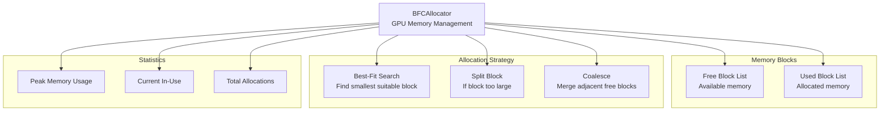

**Key Features**:
- Reduces fragmentation through coalescing [onnxruntime/core/framework/bfc_arena.cc:78-81]()
- Tracks allocation statistics [onnxruntime/core/framework/allocator_stats.h:9-10]()
- Supports arena extension strategies [onnxruntime/core/framework/bfc_arena.cc:10-16]()

Sources: [onnxruntime/core/framework/bfc_arena.cc:10-16](), [onnxruntime/core/framework/bfc_arena.cc:78-81](), [onnxruntime/core/framework/allocator_stats.h:9-10]()

### Memory Pattern Optimization

ONNX Runtime can analyze execution patterns to optimize memory allocation:

| Feature | Description | Configuration |
|---------|-------------|---------------|
| **Memory Pattern** | Pre-plan allocations based on graph | `enable_mem_pattern` in SessionOptions |
| **Memory Reuse** | Reuse buffers for non-overlapping tensors | `enable_mem_reuse` in SessionOptions |
| **Execution Order** | Optimize execution to minimize peak memory | `execution_order` in SessionOptions |

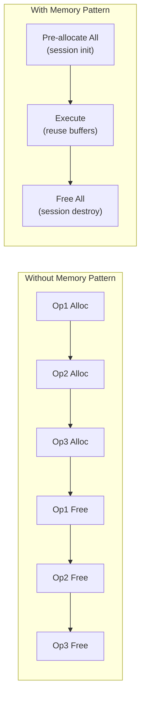

**Sources**: [include/onnxruntime/core/framework/session_options.h:62-150](), [onnxruntime/core/session/ort_apis.h:65-68]()

## Common Usage Patterns

### Pattern 1: Python GPU Inference with Buffer Reuse

```python
# Typical workflow for GPU inference with IOBinding
import onnxruntime as ort
import numpy as np

# Create session with CUDA provider
session = ort.InferenceSession("model.onnx", 
                               providers=['CUDAExecutionProvider'])

# Create IOBinding
io_binding = session.io_binding()

# Allocate GPU buffers (external library like cupy/torch)
import cupy as cp
input_gpu = cp.zeros((1, 3, 224, 224), dtype=cp.float32)
output_gpu = cp.zeros((1, 1000), dtype=cp.float32)

# Bind buffers
io_binding.bind_input(
    name='input',
    device_type='cuda',
    device_id=0,
    element_type=np.float32,
    shape=input_gpu.shape,
    buffer_ptr=input_gpu.data.ptr
)

io_binding.bind_output(
    name='output',
    device_type='cuda',
    device_id=0,
    element_type=np.float32,
    shape=output_gpu.shape,
    buffer_ptr=output_gpu.data.ptr
)

# Execute multiple times with same buffers
for i in range(100):
    # Update input_gpu with new data
    # ... 
    
    # Run inference (zero-copy)
    session.run_with_iobinding(io_binding)
    
    # Results immediately available in output_gpu
    # ...
```

Sources: [onnxruntime/test/python/onnxruntime_test_python_iobinding.py:50-150]()

### Pattern 2: C++ IOBinding with Custom Allocators

```cpp
// C++ workflow with custom allocator
Ort::SessionOptions session_options;
Ort::Session session(env, "model.onnx", session_options);

// Create IOBinding
Ort::IoBinding io_binding(session);

// Create memory info for GPU device 0
Ort::MemoryInfo mem_info("Cuda", OrtAllocatorType::OrtArenaAllocator, 
                         0, OrtMemType::OrtMemTypeDefault);

// Create input tensor on GPU
std::array<int64_t, 4> shape = {1, 3, 224, 224};
Ort::Value input_tensor = Ort::Value::CreateTensor(
    mem_info, gpu_buffer, buffer_size,
    shape.data(), shape.size(),
    ONNX_TENSOR_ELEMENT_DATA_TYPE_FLOAT
);

// Bind input
io_binding.BindInput("input", input_tensor);

// Let runtime allocate output on GPU
io_binding.BindOutput("output", mem_info);

// Execute
session.Run(Ort::RunOptions{nullptr}, io_binding);

// Get outputs
std::vector<Ort::Value> outputs = io_binding.GetOutputValues();
```

Sources: [include/onnxruntime/core/session/onnxruntime_cxx_api.h:1437-1505](), [onnxruntime/test/shared_lib/test_inference.cc:182-337]()

### Pattern 3: Cross-Device Data Transfer

When inputs and outputs are on different devices:

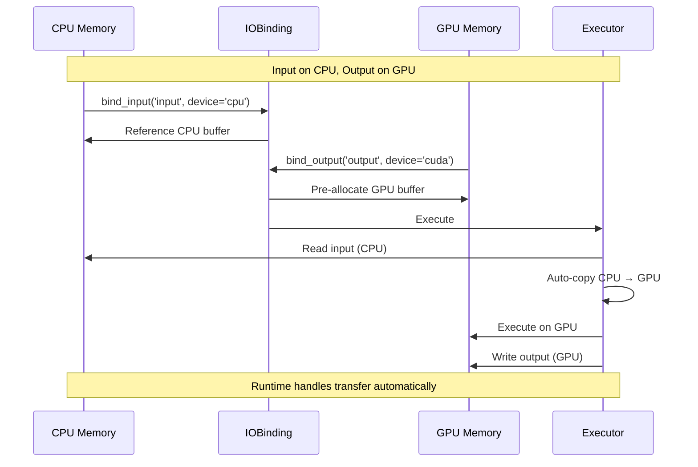

**Automatic Transfer Handling**:
- Runtime inserts `MemcpyToHost` / `MemcpyFromHost` nodes
- Data transfer manager coordinates copies [onnxruntime/python/onnxruntime_pybind_mlvalue.cc:118-119]()
- Can override with custom data transfer implementations

Sources: [onnxruntime/python/onnxruntime_pybind_mlvalue.cc:118-119](), [onnxruntime/python/onnxruntime_pybind_state.cc:245-327]()

## OrtValue Python Integration

Python OrtValue provides seamless integration between numpy and ONNX Runtime:

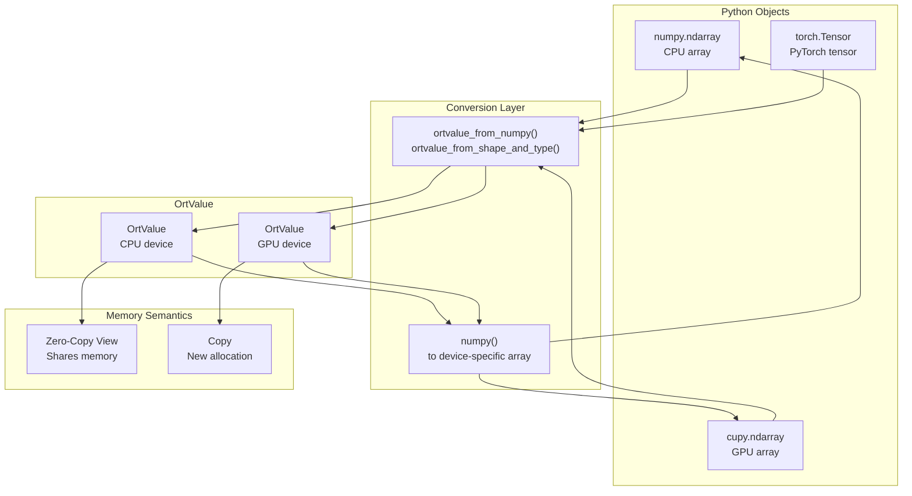

**Key Functions**:
- `OrtValue.numpy()`: Convert to numpy array (may copy if on GPU) [onnxruntime/python/onnxruntime_pybind_mlvalue.h:137-139]()
- `OrtValue.device_name()`: Get device location [onnxruntime/python/onnxruntime_pybind_ortvalue.cc:22-25]()
- `OrtValue.data_ptr()`: Get raw memory pointer
- `OrtValue.is_tensor()`: Check if contains tensor [onnxruntime/python/onnxruntime_pybind_ortvalue.cc:22-25]()

Sources: [onnxruntime/python/onnxruntime_pybind_ortvalue.cc:1-151](), [onnxruntime/python/onnxruntime_pybind_mlvalue.cc:213-327](), [onnxruntime/python/onnxruntime_pybind_mlvalue.h:137-139]()

## Advanced Topics

### Sparse Tensor Support

ONNX Runtime supports sparse tensors with specialized memory layouts:

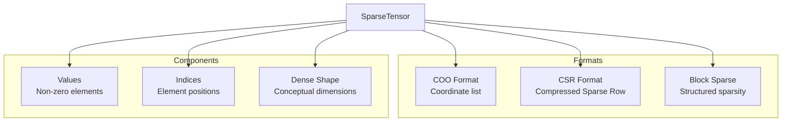

**API Functions**:
- `CreateSparseTensorAsOrtValue()`: Create sparse tensor
- `FillSparseTensorCoo()`: Fill COO format
- `FillSparseTensorCsr()`: Fill CSR format

Sources: [onnxruntime/python/onnxruntime_pybind_state_common.cc:81-82](), [onnxruntime/python/onnxruntime_pybind_sparse_tensor.cc:1-100]()

### Synchronization and Streams

For asynchronous execution with streams:

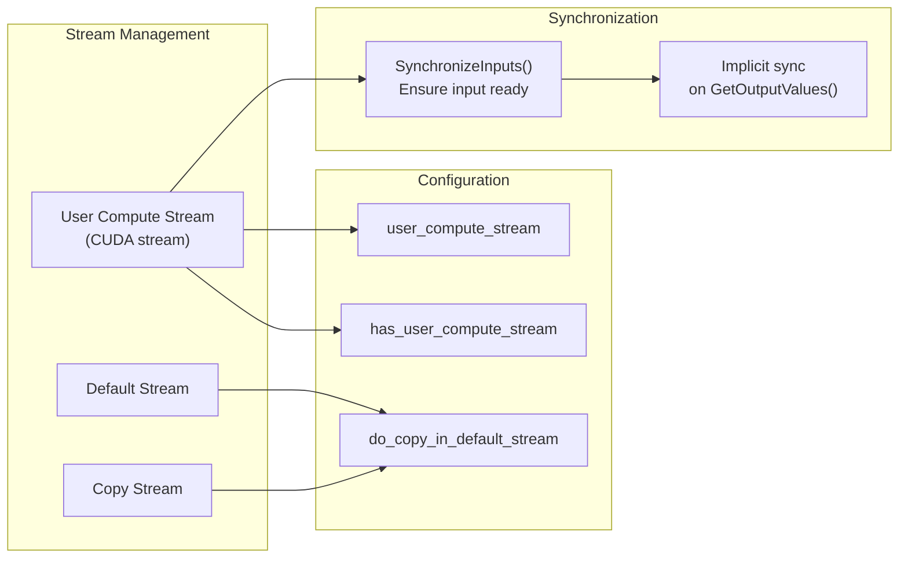

**Stream Configuration**:
- CUDA: `user_compute_stream` in provider options
- Synchronization: `IOBinding::SynchronizeInputs()` [include/onnxruntime/core/session/onnxruntime_cxx_inline.h:385-387]()
- Stream-aware allocation: `AllocOnStream()` [include/onnxruntime/core/framework/allocator.h:121-141]()

Sources: [onnxruntime/python/onnxruntime_pybind_state_common.h:116-118](), [include/onnxruntime/core/session/onnxruntime_cxx_inline.h:385-387](), [include/onnxruntime/core/framework/allocator.h:121-141]()

### External Memory Import/Export

For advanced scenarios with external resource sharing:

| Feature | Purpose | API |
|---------|---------|-----|
| **D3D12 Resource Import** | Use existing D3D12 buffers | `CreateGPUAllocationFromD3DResource()` |
| **External Initializers** | Load large weights externally | `OrtExternalResourceImporter` |
| **Shared Memory** | Cross-process tensor sharing | `OrtExternalMemoryHandle` |
| **Semaphore Sync** | External synchronization | `OrtExternalSemaphoreHandle` |

Sources: [include/onnxruntime/core/session/onnxruntime_c_api.h:332-338](), [onnxruntime/test/shared_lib/test_inference.cc:228-258]()

## Performance Considerations

### When to Use IOBinding

| Scenario | Recommendation |
|----------|----------------|
| Single inference call | Use standard Run() API (simpler) |
| Multiple inferences with same model | Use IOBinding (amortizes setup cost) |
| Data already on GPU | Use IOBinding (avoids transfer) |
| Need minimal latency | Use IOBinding (no copy overhead) |
| Prototyping/debugging | Use standard Run() API (easier) |
| Production high-throughput | Use IOBinding (best performance) |

### Memory Layout Considerations

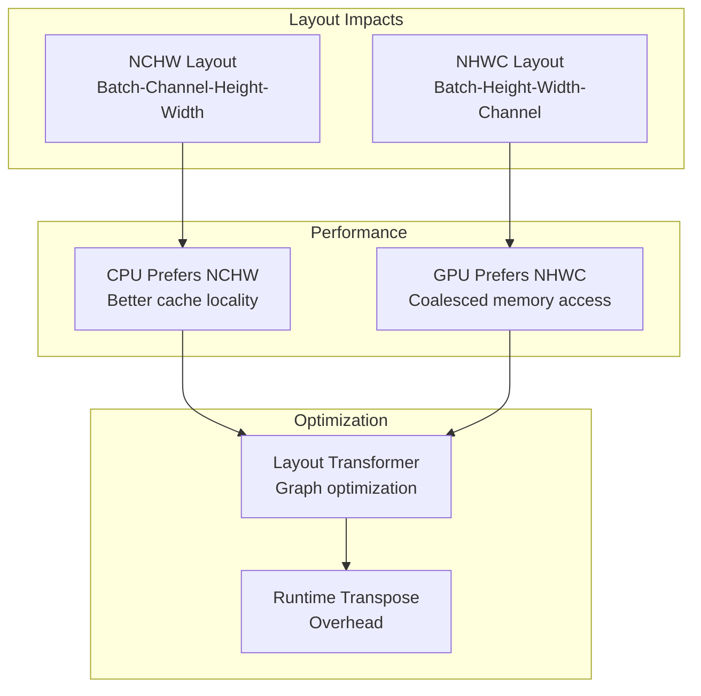

**Optimization Levels**:
- Level 3 (Layout): Inserts layout transformations
- Configure via: `SetGraphOptimizationLevel(ORT_ENABLE_LAYOUT)` [onnxruntime/core/session/ort_apis.h:72-73]()

Sources: [include/onnxruntime/core/framework/session_options.h:62-150](), [onnxruntime/core/session/ort_apis.h:72-73]()

### Profiling Memory Usage

ONNX Runtime provides tools to profile memory usage:

```mermaid
graph LR
    subgraph "Profiling Tools"
        EnableProfiling["EnableProfiling()<br/>Session option"]
        AllocStats["GetStats()<br/>Allocator statistics"]
        SessionEnd["SessionEndProfiling()<br/>Generate report"]
    end
    
    subgraph "Metrics"
        InUse["Bytes in use"]
        Peak["Peak usage"]
        NumAllocs["Number of allocations"]
        ArenaExt["Arena extensions"]
    end
    
    EnableProfiling --> AllocStats
    AllocStats --> InUse
    AllocStats --> Peak
    AllocStats --> NumAllocs
    AllocStats --> ArenaExt
    SessionEnd --> AllocStats
```

**Key APIs**:
- `EnableProfiling()`: Start profiling [onnxruntime/core/session/ort_apis.h:63-64]()
- `SessionEndProfiling()`: Get profile file path [onnxruntime/core/session/ort_apis.h:92-93]()
- `GetStats()`: Query allocator statistics [include/onnxruntime/core/framework/allocator_stats.h:9-10]()

Sources: [onnxruntime/core/session/ort_apis.h:63-64](), [onnxruntime/core/session/ort_apis.h:92-93](), [include/onnxruntime/core/framework/allocator_stats.h:9-10]()

---

