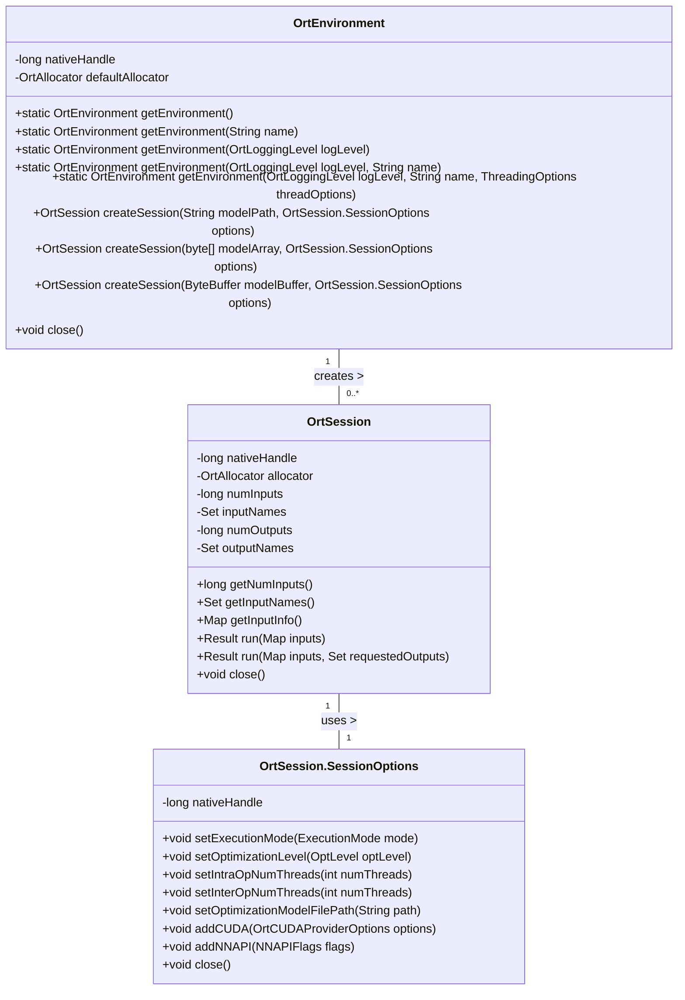
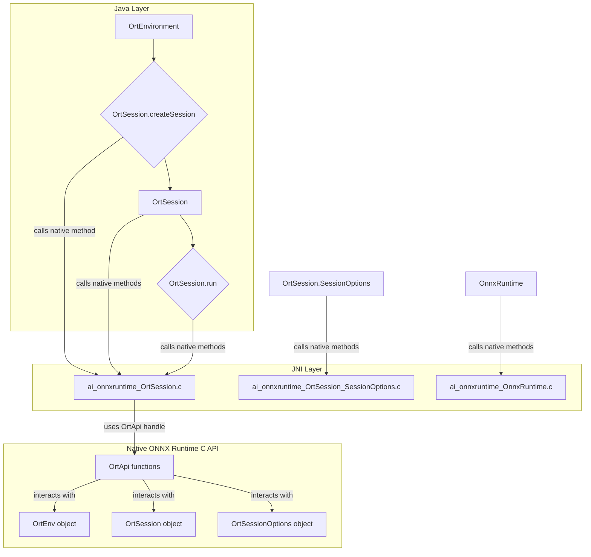

<!-- source: DeepWiki mcp.deepwiki.com · repo microsoft/onnxruntime · page 5.5 Java and Android Bindings · fetched 2026-10-21 -->

# Java and Android Bindings

Relevant source files

The following files were used as context for generating this wiki page:

- [cmake/onnxruntime_java.cmake](cmake/onnxruntime_java.cmake)
- [cmake/onnxruntime_java_unittests.cmake](cmake/onnxruntime_java_unittests.cmake)
- [java/build-android.gradle](java/build-android.gradle)
- [java/build.gradle](java/build.gradle)
- [java/src/main/java/ai/onnxruntime/OnnxModelMetadata.java](java/src/main/java/ai/onnxruntime/OnnxModelMetadata.java)
- [java/src/main/java/ai/onnxruntime/OnnxRuntime.java](java/src/main/java/ai/onnxruntime/OnnxRuntime.java)
- [java/src/main/java/ai/onnxruntime/OrtEnvironment.java](java/src/main/java/ai/onnxruntime/OrtEnvironment.java)
- [java/src/main/java/ai/onnxruntime/OrtLoggingLevel.java](java/src/main/java/ai/onnxruntime/OrtLoggingLevel.java)
- [java/src/main/java/ai/onnxruntime/OrtProvider.java](java/src/main/java/ai/onnxruntime/OrtProvider.java)
- [java/src/main/java/ai/onnxruntime/OrtSession.java](java/src/main/java/ai/onnxruntime/OrtSession.java)
- [java/src/main/java/ai/onnxruntime/OrtTrainingSession.java](java/src/main/java/ai/onnxruntime/OrtTrainingSession.java)
- [java/src/main/java/ai/onnxruntime/providers/CoreMLFlags.java](java/src/main/java/ai/onnxruntime/providers/CoreMLFlags.java)
- [java/src/main/java/ai/onnxruntime/providers/NNAPIFlags.java](java/src/main/java/ai/onnxruntime/providers/NNAPIFlags.java)
- [java/src/main/native/ai_onnxruntime_OnnxRuntime.c](java/src/main/native/ai_onnxruntime_OnnxRuntime.c)
- [java/src/main/native/ai_onnxruntime_OrtSession.c](java/src/main/native/ai_onnxruntime_OrtSession.c)
- [java/src/main/native/ai_onnxruntime_OrtSession_RunOptions.c](java/src/main/native/ai_onnxruntime_OrtSession_RunOptions.c)
- [java/src/main/native/ai_onnxruntime_OrtSession_SessionOptions.c](java/src/main/native/ai_onnxruntime_OrtSession_SessionOptions.c)
- [java/src/main/native/ai_onnxruntime_OrtTrainingSession.c](java/src/main/native/ai_onnxruntime_OrtTrainingSession.c)
- [java/src/main/native/ai_onnxruntime_OrtTrainingSession_OrtCheckpointState.c](java/src/main/native/ai_onnxruntime_OrtTrainingSession_OrtCheckpointState.c)
- [java/src/test/java/ai/onnxruntime/InferenceTest.java](java/src/test/java/ai/onnxruntime/InferenceTest.java)
- [java/src/test/java/ai/onnxruntime/ModelGenerators.java](java/src/test/java/ai/onnxruntime/ModelGenerators.java)
- [java/src/test/java/ai/onnxruntime/SparseTensorTest.java](java/src/test/java/ai/onnxruntime/SparseTensorTest.java)
- [java/src/test/java/ai/onnxruntime/TestHelpers.java](java/src/test/java/ai/onnxruntime/TestHelpers.java)
- [java/src/test/java/ai/onnxruntime/TrainingTest.java](java/src/test/java/ai/onnxruntime/TrainingTest.java)
- [java/src/test/resources/java-three-output-matmul.onnx](java/src/test/resources/java-three-output-matmul.onnx)
- [tools/ci_build/github/android/build_aar_and_copy_artifacts.sh](tools/ci_build/github/android/build_aar_and_copy_artifacts.sh)
- [tools/ci_build/github/android/build_aar_package.py](tools/ci_build/github/android/build_aar_package.py)
- [tools/ci_build/github/android/default_full_aar_build_settings.json](tools/ci_build/github/android/default_full_aar_build_settings.json)
- [tools/ci_build/github/azure-pipelines/binary-size-checks-pipeline.yml](tools/ci_build/github/azure-pipelines/binary-size-checks-pipeline.yml)
- [tools/ci_build/github/azure-pipelines/templates/android-binary-size-check-stage.yml](tools/ci_build/github/azure-pipelines/templates/android-binary-size-check-stage.yml)
- [tools/ci_build/github/azure-pipelines/templates/make_java_win_binaries.yml](tools/ci_build/github/azure-pipelines/templates/make_java_win_binaries.yml)
- [tools/ci_build/github/linux/ort_minimal/build_full_ort_and_create_ort_files.sh](tools/ci_build/github/linux/ort_minimal/build_full_ort_and_create_ort_files.sh)

This page documents the Java API for ONNX Runtime, covering its core components like `OrtEnvironment` and `OrtSession`, the underlying JNI native layer, the Gradle build system, and the Android AAR packaging process. The Java bindings enable developers to integrate ONNX Runtime into Java applications, including Android, for high-performance ONNX model inference.

## Java API Overview

The Java API provides a high-level interface to interact with the ONNX Runtime. Key classes include `OrtEnvironment` for managing the runtime environment and `OrtSession` for loading and executing ONNX models.

### OrtEnvironment

The `OrtEnvironment` class [java/src/main/java/ai/onnxruntime/OrtEnvironment.java:29-29]() is the entry point for using ONNX Runtime in Java. It manages the native ONNX Runtime environment and is responsible for creating `OrtSession` instances.

- **Singleton Pattern**: `OrtEnvironment` is designed as a singleton. Multiple calls to `OrtEnvironment.getEnvironment()` [java/src/main/java/ai/onnxruntime/OrtEnvironment.java:56-63]() will return the same instance.
- **Initialization**: The environment is initialized with a logging level and a name. If an environment already exists, subsequent calls with different logging levels or names will log a warning [java/src/main/java/ai/onnxruntime/OrtEnvironment.java:113-116]().
- **Thread Pool Configuration**: It's possible to configure global thread pool options during environment creation using `getEnvironment(OrtLoggingLevel loggingLevel, String name, ThreadingOptions threadOptions)` [java/src/main/java/ai/onnxruntime/OrtEnvironment.java:132-148](). However, this method will throw an `IllegalStateException` if an environment already exists, as thread pool configurations cannot be changed dynamically.
- **Native Handle**: Each `OrtEnvironment` instance holds a `nativeHandle` [java/src/main/java/ai/onnxruntime/OrtEnvironment.java:150-150]() which is a pointer to the underlying native `OrtEnv` object.
- **Default Allocator**: It also manages a `defaultAllocator` [java/src/main/java/ai/onnxruntime/OrtEnvironment.java:152-152]() for memory management.
- **Shutdown Hook**: A JVM shutdown hook is registered upon construction to ensure proper cleanup of native resources [java/src/main/java/ai/onnxruntime/OrtEnvironment.java:173-175]().

**Diagram 1: Core Java API Classes**

Sources:
- [java/src/main/java/ai/onnxruntime/OrtEnvironment.java:29-29]()
- [java/src/main/java/ai/onnxruntime/OrtEnvironment.java:56-63]()
- [java/src/main/java/ai/onnxruntime/OrtEnvironment.java:113-116]()
- [java/src/main/java/ai/onnxruntime/OrtEnvironment.java:132-148]()
- [java/src/main/java/ai/onnxruntime/OrtEnvironment.java:150-150]()
- [java/src/main/java/ai/onnxruntime/OrtEnvironment.java:152-152]()
- [java/src/main/java/ai/onnxruntime/OrtEnvironment.java:173-175]()

### OrtSession

The `OrtSession` class [java/src/main/java/ai/onnxruntime/OrtSession.java:37-37]() represents a loaded ONNX model and provides methods for inference.

- **Model Loading**: `OrtSession` instances can be created from a model file path [java/src/main/java/ai/onnxruntime/OrtSession.java:72-77](), a byte array [java/src/main/java/ai/onnxruntime/OrtSession.java:89-94](), or a direct `ByteBuffer` [java/src/main/java/ai/onnxruntime/OrtSession.java:109-120]().
- **Native Handle**: Similar to `OrtEnvironment`, `OrtSession` holds a `nativeHandle` [java/src/main/java/ai/onnxruntime/OrtSession.java:131-131]() to the native `OrtSession` object.
- **Input/Output Information**: It provides methods to query the number of inputs (`getNumInputs()` [java/src/main/java/ai/onnxruntime/OrtSession.java:148-154]()), outputs (`getNumOutputs()` [java/src/main/java/ai/onnxruntime/OrtSession.java:157-163]()), their names (`getInputNames()` [java/src/main/java/ai/onnxruntime/OrtSession.java:174-180](), `getOutputNames()` [java/src/main/java/ai/onnxruntime/OrtSession.java:187-193]()), and detailed information (`getInputInfo()` [java/src/main/java/ai/onnxruntime/OrtSession.java:202-208](), `getOutputInfo()`).
- **Inference Execution**: The `run()` method [java/src/test/java/ai/onnxruntime/InferenceTest.java:160-163]() executes the model with provided inputs and returns a `Result` object.
- **Session Options**: `OrtSession.SessionOptions` [java/src/main/java/ai/onnxruntime/OrtSession.java:72-77]() allows configuring various aspects of the session, such as execution mode, optimization level, and thread settings. It also supports adding execution providers like CUDA [java/src/main/java/ai/onnxruntime/OrtSession.java:OrtCUDAProviderOptions](), NNAPI [java/src/main/java/ai/onnxruntime/OrtSession.java:NNAPIFlags](), and CoreML [java/src/main/java/ai/onnxruntime/OrtSession.java:CoreMLFlags]().

Sources:
- [java/src/main/java/ai/onnxruntime/OrtSession.java:37-37]()
- [java/src/main/java/ai/onnxruntime/OrtSession.java:72-77]()
- [java/src/main/java/ai/onnxruntime/OrtSession.java:89-94]()
- [java/src/main/java/ai/onnxruntime/OrtSession.java:109-120]()
- [java/src/main/java/ai/onnxruntime/OrtSession.java:131-131]()
- [java/src/main/java/ai/onnxruntime/OrtSession.java:148-154]()
- [java/src/main/java/ai/onnxruntime/OrtSession.java:157-163]()
- [java/src/main/java/ai/onnxruntime/OrtSession.java:174-180]()
- [java/src/main/java/ai/onnxruntime/OrtSession.java:187-193]()
- [java/src/main/java/ai/onnxruntime/OrtSession.java:202-208]()
- [java/src/test/java/ai/onnxruntime/InferenceTest.java:160-163]()
- [java/src/main/java/ai/onnxruntime/OrtSession.java:OrtCUDAProviderOptions]()
- [java/src/main/java/ai/onnxruntime/OrtSession.java:NNAPIFlags]()
- [java/src/main/java/ai/onnxruntime/OrtSession.java:CoreMLFlags]()

## JNI Native Layer

The Java bindings rely on the Java Native Interface (JNI) to communicate with the underlying C API of ONNX Runtime.

- **Native Library Loading**: The `OnnxRuntime.init()` method [java/src/main/java/ai/onnxruntime/OnnxRuntime.java:170-170]() is responsible for loading the native libraries. It first attempts to load `onnxruntime` and then `onnxruntime4j_jni` [java/src/main/java/ai/onnxruntime/OnnxRuntime.java:58-61]().
- **Library Discovery**: The native libraries can be found either by specifying the `onnxruntime.native.path` system property [java/src/main/java/ai/onnxruntime/OnnxRuntime.java:55-55]() or by extracting them from the JAR file to a temporary directory [java/src/main/java/ai/onnxruntime/OnnxRuntime.java:99-100]().
- **API Handles**: `OnnxRuntime` stores the `OrtApi` handle (`ortApiHandle`) [java/src/main/java/ai/onnxruntime/OnnxRuntime.java:109-109]() and potentially `OrtTrainingApi` handle (`ortTrainingApiHandle`) [java/src/main/java/ai/onnxruntime/OnnxRuntime.java:112-112]() and `OrtCompileApi` handle (`ortCompileApiHandle`) [java/src/main/java/ai/onnxruntime/OnnxRuntime.java:115-115]() which are pointers to the native ONNX Runtime C API functions.
- **JNI Functions**: Native methods in Java classes (e.g., `ai.onnxruntime.OrtSession.createSession`) are implemented in C files like `ai_onnxruntime_OrtSession.c` [java/src/main/native/ai_onnxruntime_OrtSession.c:23-23](). These C functions receive the `OrtApi` handle and other parameters, then call the corresponding ONNX Runtime C API functions.
- **Error Handling**: The `checkOrtStatus` utility function [java/src/main/native/ai_onnxruntime_OrtSession.c:38-39]() is used in the JNI layer to convert native ONNX Runtime errors into Java `OrtException`s.

**Diagram 2: Java to Native Interaction via JNI**

Sources:
- [java/src/main/java/ai/onnxruntime/OnnxRuntime.java:170-170]()
- [java/src/main/java/ai/onnxruntime/OnnxRuntime.java:58-61]()
- [java/src/main/java/ai/onnxruntime/OnnxRuntime.java:55-55]()
- [java/src/main/java/ai/onnxruntime/OnnxRuntime.java:99-100]()
- [java/src/main/java/ai/onnxruntime/OnnxRuntime.java:109-109]()
- [java/src/main/java/ai/onnxruntime/OnnxRuntime.java:112-112]()
- [java/src/main/java/ai/onnxruntime/OnnxRuntime.java:115-115]()
- [java/src/main/native/ai_onnxruntime_OrtSession.c:23-23]()
- [java/src/main/native/ai_onnxruntime_OrtSession.c:38-39]()

## Gradle Build

The Java and Android bindings use Gradle for their build process, orchestrated by CMake.

- **`java/build.gradle`**: This file [java/build.gradle:1-283]() defines the build logic for the standard Java JAR.
    - It sets up `java-library` and `maven-publish` plugins [java/build.gradle:1-3]().
    - It configures source and target compatibility to Java 17 [java/build.gradle:36-38]().
    - It defines tasks for creating `sourcesJar` [java/build.gradle:47-55]() and `javadocJar` [java/build.gradle:58-66]().
    - It includes `spotless` for code formatting [java/build.gradle:68-78]().
    - The `compileJava` task [java/build.gradle:81-91]() generates JNI header files into `build/headers/`.
    - It specifies test resources, including ONNX model test data and compiled native libraries [java/build.gradle:107-122]().
    - The `allJar` task [java/build.gradle:129-142]() packages the Java classes and native JNI libraries into a single JAR.
    - The `cmakeBuild` task [java/build.gradle:144-150]() copies build artifacts to the CMake output directory.
- **`cmake/onnxruntime_java.cmake`**: This CMake script [cmake/onnxruntime_java.cmake:1-298]() orchestrates the Java build from the C++ build system.
    - It finds Java and JNI [cmake/onnxruntime_java.cmake:8-11]().
    - It defines `JAVA_ROOT` and `JAVA_OUTPUT_DIR` [cmake/onnxruntime_java.cmake:14-15]().
    - It uses `add_custom_command` [cmake/onnxruntime_java.cmake:40-45]() to invoke Gradle (`${GRADLE_EXECUTABLE} ${COMMON_GRADLE_ARGS} ${GRADLE_ARGS}`) to build the Java JAR (`${JAVA_OUTPUT_JAR}`). This command depends on Java source files and Gradle files, ensuring recompilation when changes occur.
    - It defines the `onnxruntime4j_jni` target [cmake/onnxruntime_java.cmake:58-58]() for the JNI native library, linking it against `onnxruntime` [cmake/onnxruntime_java.cmake:75-75]() and including JNI headers generated by the Java build [cmake/onnxruntime_java.cmake:74-74]().
    - It sets platform and architecture variables (`JAVA_PLAT`, `JNI_ARCH`, `JAVA_OS_ARCH`) [cmake/onnxruntime_java.cmake:85-145]() to correctly package native libraries.
    - Post-build commands copy the `onnxruntime` and `onnxruntime4j_jni` shared libraries into specific directories (`JAVA_PACKAGE_LIB_DIR`, `JAVA_PACKAGE_JNI_DIR`) [cmake/onnxruntime_java.cmake:157-165]() within the Java output structure, which are then included in the final JAR/AAR.

Sources:
- [java/build.gradle:1-283]()
- [java/build.gradle:1-3]()
- [java/build.gradle:36-38]()
- [java/build.gradle:47-55]()
- [java/build.gradle:58-66]()
- [java/build.gradle:68-78]()
- [java/build.gradle:81-91]()
- [java/build.gradle:107-122]()
- [java/build.gradle:129-142]()
- [java/build.gradle:144-150]()
- [cmake/onnxruntime_java.cmake:1-298]()
- [cmake/onnxruntime_java.cmake:8-11]()
- [cmake/onnxruntime_java.cmake:14-15]()
- [cmake/onnxruntime_java.cmake:40-45]()
- [cmake/onnxruntime_java.cmake:58-58]()
- [cmake/onnxruntime_java.cmake:75-75]()
- [cmake/onnxruntime_java.cmake:74-74]()
- [cmake/onnxruntime_java.cmake:85-145]()
- [cmake/onnxruntime_java.cmake:157-165]()

## Android AAR Packaging

The Android bindings are packaged as an Android Archive (AAR) file, which includes the Java code, resources, and native libraries for different architectures.

- **`java/build-android.gradle`**: This Gradle file [java/build-android.gradle:1-269]() is specifically for building the Android AAR.
    - It applies the `com.android.library` plugin [java/build-android.gradle:1-1]().
    - It defines `minSdkVersion` and `targetSdkVersion` [java/build-android.gradle:94-95]().
    - The `jniLibs.srcDirs` property [java/build-android.gradle:126-126]() is set to `jniLibsDir`, which points to the directory containing the native `.so` files for different ABIs.
    - It includes logic for telemetry if enabled [java/build-android.gradle:129-136]().
    - The `mavenArtifactId` is constructed based on whether training APIs are enabled and if QNN is used [java/build-android.gradle:53-53]().
    - The `publishing` block [java/build-android.gradle:181-190]() specifies that the AAR, sources JAR, and javadoc JAR should be published.
- **`tools/ci_build/github/android/build_aar_package.py`**: This Python script [tools/ci_build/github/android/build_aar_package.py:1-269]() orchestrates the Android AAR build process.
    - It parses build settings from a JSON file, including target ABIs (`build_abis`) [tools/ci_build/github/android/build_aar_package.py:41-41]() and build parameters (`build_params`) [tools/ci_build/github/android/build_aar_package.py:50-51]().
    - It sets up `ANDROID_HOME` and `ANDROID_NDK_HOME` environment variables [tools/ci_build/github/android/build_aar_package.py:89-91]().
    - For each specified Android ABI (e.g., `armeabi-v7a`, `arm64-v8a`, `x86`, `x86_64`) [tools/ci_build/github/android/build_aar_package.py:22-22](), it calls `build.py` [tools/ci_build/github/android/build_aar_package.py:100-103]() to build the native ONNX Runtime library (`libonnxruntime.so`) and the JNI library (`libonnxruntime4j_jni.so`).
    - It then creates symbolic links [tools/ci_build/github/android/build_aar_package.py:131-142]() for these native libraries into the `jnilibs/[abi]` directory, which is then picked up by the Android Gradle build.
- **`tools/ci_build/github/azure-pipelines/templates/android-binary-size-check-stage.yml`**: This Azure Pipeline template [tools/ci_build/github/azure-pipelines/binary-size-checks-pipeline.yml:8-12]() includes a stage for checking the binary size of the Android AAR, ensuring that the minimal baseline size is within acceptable limits.

Sources:
- [java/build-android.gradle:1-269]()
- [java/build-android.gradle:1-1]()
- [java/build-android.gradle:94-95]()
- [java/build-android.gradle:126-126]()
- [java/build-android.gradle:129-136]()
- [java/build-android.gradle:53-53]()
- [java/build-android.gradle:181-190]()
- [tools/ci_build/github/android/build_aar_package.py:1-269]()
- [tools/ci_build/github/android/build_aar_package.py:41-41]()
- [tools/ci_build/github/android/build_aar_package.py:50-51]()
- [tools/ci_build/github/android/build_aar_package.py:89-91]()
- [tools/ci_build/github/android/build_aar_package.py:22-22]()
- [tools/ci_build/github/android/build_aar_package.py:100-103]()
- [tools/ci_build/github/android/build_aar_package.py:131-142]()
- [tools/ci_build/github/azure-pipelines/binary-size-checks-pipeline.yml:8-12]()

---

