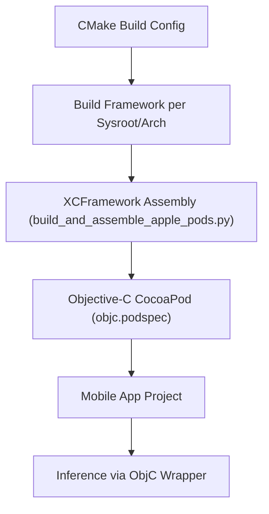
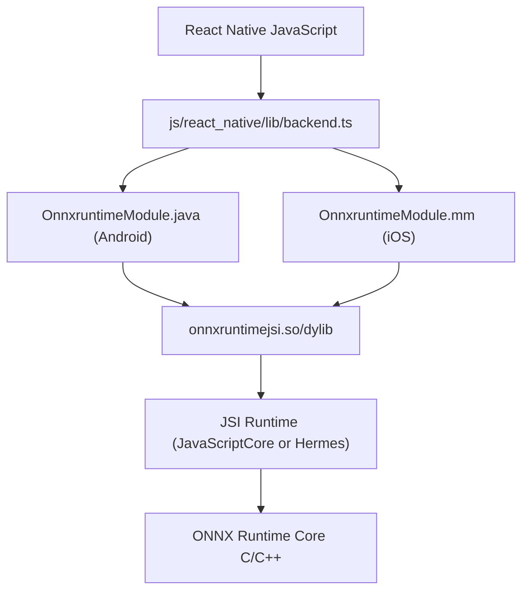
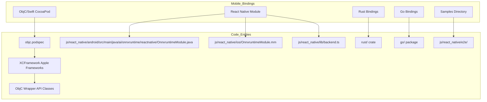

<!-- source: DeepWiki mcp.deepwiki.com · repo microsoft/onnxruntime · page 5.6 Mobile and Other Language Bindings · fetched 2026-10-21 -->

# 5.6 Mobile and Other Language Bindings

Relevant source files

The following files were used as context for generating this wiki page:

- [README.md](README.md)
- [docs/Roadmap.md](docs/Roadmap.md)
- [java/README.md](java/README.md)
- [java/gradle/wrapper/gradle-wrapper.jar](java/gradle/wrapper/gradle-wrapper.jar)
- [java/gradle/wrapper/gradle-wrapper.properties](java/gradle/wrapper/gradle-wrapper.properties)
- [java/gradlew](java/gradlew)
- [java/gradlew.bat](java/gradlew.bat)
- [java/src/test/android/app/build.gradle](java/src/test/android/app/build.gradle)
- [java/src/test/java/sample/ScoreMNIST.java](java/src/test/java/sample/ScoreMNIST.java)
- [java/testdata/cnn_mnist_pytorch.onnx](java/testdata/cnn_mnist_pytorch.onnx)
- [java/testdata/lr_mnist_scikit.onnx](java/testdata/lr_mnist_scikit.onnx)
- [js/node/lib/index.ts](js/node/lib/index.ts)
- [js/react_native/android/build.gradle](js/react_native/android/build.gradle)
- [js/react_native/android/gradle.properties](js/react_native/android/gradle.properties)
- [js/react_native/android/gradle/wrapper/gradle-wrapper.jar](js/react_native/android/gradle/wrapper/gradle-wrapper.jar)
- [js/react_native/android/gradle/wrapper/gradle-wrapper.properties](js/react_native/android/gradle/wrapper/gradle-wrapper.properties)
- [js/react_native/android/gradlew](js/react_native/android/gradlew)
- [js/react_native/android/gradlew.bat](js/react_native/android/gradlew.bat)
- [js/react_native/android/src/main/java/ai/onnxruntime/reactnative/OnnxruntimeModule.java](js/react_native/android/src/main/java/ai/onnxruntime/reactnative/OnnxruntimeModule.java)
- [js/react_native/e2e/android/build.gradle](js/react_native/e2e/android/build.gradle)
- [js/react_native/e2e/android/gradle.properties](js/react_native/e2e/android/gradle.properties)
- [js/react_native/e2e/android/gradle/wrapper/gradle-wrapper.properties](js/react_native/e2e/android/gradle/wrapper/gradle-wrapper.properties)
- [js/react_native/e2e/android/settings.gradle](js/react_native/e2e/android/settings.gradle)
- [js/react_native/e2e/ios/OnnxruntimeModuleExample.xcodeproj/project.pbxproj](js/react_native/e2e/ios/OnnxruntimeModuleExample.xcodeproj/project.pbxproj)
- [js/react_native/e2e/ios/Podfile](js/react_native/e2e/ios/Podfile)
- [js/react_native/e2e/ios/PrivacyInfo.xcprivacy](js/react_native/e2e/ios/PrivacyInfo.xcprivacy)
- [js/react_native/e2e/package-lock.json](js/react_native/e2e/package-lock.json)
- [js/react_native/e2e/package.json](js/react_native/e2e/package.json)
- [js/react_native/e2e/src/App.tsx](js/react_native/e2e/src/App.tsx)
- [js/react_native/ios/OnnxruntimeModule.h](js/react_native/ios/OnnxruntimeModule.h)
- [js/react_native/ios/OnnxruntimeModule.mm](js/react_native/ios/OnnxruntimeModule.mm)
- [js/react_native/ios/OnnxruntimeModule.xcodeproj/project.pbxproj](js/react_native/ios/OnnxruntimeModule.xcodeproj/project.pbxproj)
- [js/react_native/ios/PrivacyInfo.xcprivacy](js/react_native/ios/PrivacyInfo.xcprivacy)
- [js/react_native/lib/backend.ts](js/react_native/lib/backend.ts)
- [js/react_native/lib/binding.ts](js/react_native/lib/binding.ts)
- [js/react_native/lib/index.ts](js/react_native/lib/index.ts)
- [js/react_native/onnxruntime-react-native.podspec](js/react_native/onnxruntime-react-native.podspec)
- [onnxruntime/test/platform/apple/apple_package_test/Podfile.template](onnxruntime/test/platform/apple/apple_package_test/Podfile.template)
- [onnxruntime/test/platform/apple/apple_package_test/apple_package_test.xcodeproj/project.pbxproj](onnxruntime/test/platform/apple/apple_package_test/apple_package_test.xcodeproj/project.pbxproj)
- [onnxruntime/test/wasm/package-lock.json](onnxruntime/test/wasm/package-lock.json)
- [tools/ci_build/github/apple/assemble_apple_packaging_artifacts.sh](tools/ci_build/github/apple/assemble_apple_packaging_artifacts.sh)
- [tools/ci_build/github/apple/build_and_assemble_apple_pods.py](tools/ci_build/github/apple/build_and_assemble_apple_pods.py)
- [tools/ci_build/github/apple/build_apple_framework.py](tools/ci_build/github/apple/build_apple_framework.py)
- [tools/ci_build/github/apple/c/assemble_c_pod_package.py](tools/ci_build/github/apple/c/assemble_c_pod_package.py)
- [tools/ci_build/github/apple/default_full_apple_framework_build_settings.json](tools/ci_build/github/apple/default_full_apple_framework_build_settings.json)
- [tools/ci_build/github/apple/default_full_ios_framework_build_settings.json](tools/ci_build/github/apple/default_full_ios_framework_build_settings.json)
- [tools/ci_build/github/apple/framework_info.json.template](tools/ci_build/github/apple/framework_info.json.template)
- [tools/ci_build/github/apple/objectivec/assemble_objc_pod_package.py](tools/ci_build/github/apple/objectivec/assemble_objc_pod_package.py)
- [tools/ci_build/github/apple/objectivec/objc.podspec.template](tools/ci_build/github/apple/objectivec/objc.podspec.template)
- [tools/ci_build/github/apple/package_assembly_utils.py](tools/ci_build/github/apple/package_assembly_utils.py)
- [tools/ci_build/github/apple/test_apple_packages.py](tools/ci_build/github/apple/test_apple_packages.py)
- [tools/ci_build/github/azure-pipelines/mac-ios-packaging-pipeline.yml](tools/ci_build/github/azure-pipelines/mac-ios-packaging-pipeline.yml)
- [tools/ci_build/github/azure-pipelines/stages/jobs/steps/react-native-bootstrap-steps.yml](tools/ci_build/github/azure-pipelines/stages/jobs/steps/react-native-bootstrap-steps.yml)
- [tools/ci_build/github/azure-pipelines/templates/android-dump-logs-from-steps.yml](tools/ci_build/github/azure-pipelines/templates/android-dump-logs-from-steps.yml)
- [tools/ci_build/github/azure-pipelines/templates/stages/mac-ios-packaging-build-stage.yml](tools/ci_build/github/azure-pipelines/templates/stages/mac-ios-packaging-build-stage.yml)
- [tools/ci_build/github/js/react_native_e2e_full_ios_framework_build_settings.json](tools/ci_build/github/js/react_native_e2e_full_ios_framework_build_settings.json)
- [tools/python/run_adb.py](tools/python/run_adb.py)

This section covers the ONNX Runtime support for mobile platforms and additional language bindings beyond the core C, C++, Python, C#, and Java APIs. It specifically details the Objective-C/Swift CocoaPods package, the React Native module including Android and iOS implementations, the Rust and Go language bindings, and references to the rich set of samples provided for these bindings. The goal is to provide a deep technical understanding of implementations, data flow, key classes and functions, and package structures enabling ONNX Runtime for mobile and alternate programming environments.

---

## 5.6.1 Objective-C / Swift CocoaPod

### Overview

ONNX Runtime provides an Objective-C/Swift dynamic framework packaged as a CocoaPod for iOS, macOS, and other Apple platforms. The pod bundles native ONNX Runtime libraries, enabling native mobile app integration. This package includes XCFrameworks for multiple Apple architectures (arm64, x86_64, etc.) and can be consumed from Swift or Objective-C projects.

### Build and Packaging

- **Build Configuration:** The Apple frameworks (including the Objective-C runtime wrapper) are built using CMake with Xcode generators targeting the specified Apple sysroots and architectures.
- **XCFramework Assembly:** Separate sysroot/arch native frameworks are first built individually in a job matrix defined in CI pipeline YAMLs (e.g., `tools/ci_build/github/apple/default_full_apple_framework_build_settings.json`). These artifacts are then merged into XCFramework bundles with `build_and_assemble_apple_pods.py`.
- **Podspecs:** The `objc.podspec.template` describes the Objective-C pod metadata, dependencies, and references the built framework artifacts.
- **CI Automation:** The entire build and packaging pipeline is orchestrated through Azure Pipelines with stages and jobs defined in YAML files such as `tools/ci_build/github/azure-pipelines/mac-ios-packaging-pipeline.yml` and `tools/ci_build/github/azure-pipelines/templates/stages/mac-ios-packaging-build-stage.yml`.

### Key Implementation Points

- The Objective-C API wraps core ONNX Runtime C APIs, exposing a user-friendly interface for model loading, session management, input/output binding, and inference execution.
- The pod integrates third-party dependencies as needed (e.g., CoreML or XNNPACK for hardware acceleration).
  
### Data Flow

1. Build config generates framework binaries for each platform/arch.
2. XCFrameworks package the various architectures into one distributable.
3. CocoaPods consume these XCFrameworks in a mobile app project.
4. Objective-C/Swift calls translate to underlying C API calls to run inference.
  
### Summary Diagram: Objective-C Pod Packaging Flow

Sources:  
- `tools/ci_build/github/apple/default_full_apple_framework_build_settings.json` (2-38)  
- `tools/ci_build/github/azure-pipelines/mac-ios-packaging-pipeline.yml` (1-73)  
- `tools/ci_build/github/azure-pipelines/templates/stages/mac-ios-packaging-build-stage.yml` (1-198)  
- `tools/ci_build/github/apple/objc.podspec.template` (not shown in excerpts but implied from docs)

---

## 5.6.2 React Native Module

### Overview

ONNX Runtime offers a React Native module to enable JavaScript inference on mobile devices using React Native. This module bridges the native ONNX Runtime runtime via JSI (JavaScript Interface) to JavaScript code, providing high-performance inference in React Native apps on Android and iOS.

### Android Implementation

- The Android native module is implemented in Java (`js/react_native/android/src/main/java/ai/onnxruntime/reactnative/OnnxruntimeModule.java`).
- During installation, the Java module loads the native "onnxruntimejsi" shared library and installs the native JSI bindings by passing the JavaScript runtime pointer and the JS call invoker.
- React Native lifecycle methods like `invalidate()` manage cleanup of native resources.
- The module provides synchronous installation via the `install()` method annotated with `@ReactMethod(isBlockingSynchronousMethod = true)` for immediate native API availability.
- The build is configured in `js/react_native/android/build.gradle` with defined SDK versions, CMake native builds for JNI integration, and supports multiple ABIs.

### iOS Implementation

- The iOS React Native binding is implemented in Objective-C++ (`js/react_native/ios/OnnxruntimeModule.mm`).
- It uses the React Native bridge and TurboModules infrastructure to expose an `install` synchronous blocking method that installs ONNX Runtime JSI APIs by accessing the JSI runtime from the React bridge.
- Exception-safe code ensures the install returns boolean success status.
- The lifecycle manages native environment cleanup to prevent resource leaks.
- The iOS build leverages CocoaPods, integrating the ONNX Runtime XCFrameworks and the React Native module.

### JavaScript/TypeScript Layer

- The React Native module exposes the ONNX Runtime JavaScript API in `js/react_native/lib/backend.ts`.
- This TypeScript code wraps ONNX Runtime native bindings, managing session creation, model loading, metadata extraction, and inference calls.
- It leverages the JSI native bindings installed by the native modules to execute inference efficiently without the overhead of the React Native bridge.
- Utilities handle typing, tensor metadata, and session lifecycle transparently.

### Data Flow Diagram: React Native JSI Installation and Inference Flow

### Key Classes and Methods

- **Android**  
  - `OnnxruntimeModule.install()` — loads native lib and links JSI API.  
  - `nativeInstall(long jsiPointer, CallInvokerHolderImpl jsCallInvokerHolder)` — JNI native method to perform runtime integration.  
- **iOS**  
  - `OnnxruntimeModule.install()` exposed via `RCT_EXPORT_BLOCKING_SYNCHRONOUS_METHOD`, calls `onnxruntimejsi::install(runtime, jsCallInvoker)`.  
  - `env` manages lifetime of native runtime environment pointer.  
- **JS/TS**  
  - `OnnxruntimeSessionHandler.create()` creates a session, loads a model, extracts metadata, and prepares inference APIs ([js/react_native/lib/backend.ts:75-174]()).

### Build and Packaging

- Android is built with Gradle accessing NDK and CMake, managing JNI native builds over multiple ABIs ([js/react_native/android/build.gradle]()).
- iOS uses CocoaPods and Xcode, wrapping the native shared frameworks ([js/react_native/ios/OnnxruntimeModule.mm]()).
- The React Native package is prepared with dependencies specified in `js/react_native/e2e/package.json` and locked in `package-lock.json` ([js/react_native/e2e/package.json](), [js/react_native/e2e/package-lock.json]() ).

Sources:  
- `js/react_native/android/src/main/java/ai/onnxruntime/reactnative/OnnxruntimeModule.java` (1-65)  
- `js/react_native/ios/OnnxruntimeModule.mm` (1-55)  
- `js/react_native/android/build.gradle` (1-211)  
- `js/react_native/lib/backend.ts` (1-194)  
- `js/react_native/e2e/package.json` (1-45)  
- `js/react_native/e2e/package-lock.json` (1-180)

---

## 5.6.3 Rust Bindings

The repository contains Rust bindings to ONNX Runtime enabling Rust applications to load models and perform inference using the native ONNX Runtime library.

### Implementation Highlights

- The Rust bindings typically provide safe Rust abstractions over the ONNX Runtime C API.
- They manage memory safety and ownership with idiomatic Rust constructs.
- Rust bindings expose session creation, input/output handling, and execution functionalities.
- Usually implemented via crates published on crates.io.
- The bindings integrate directly with the ONNX Runtime native library binaries.

(There is no explicit visible source code in the excerpts; this section references the existence and general role of Rust bindings indicated in the repository layout.)

---

## 5.6.4 Go Bindings

Similar to the Rust bindings, ONNX Runtime offers a Go API wrapping the native ONNX Runtime, allowing Go programs to perform inference using ONNX models.

### Overview

- Go bindings interact with the native ONNX Runtime shared library via cgo.
- Provide Go idiomatic interfaces for model loading, session management, and tensor input/output.
- Enable Go developers to integrate ONNX model inferencing in Go services and applications.

(Again, no detailed source shown, but the presence of `go/` in the repo structure implies support.)

---

## 5.6.5 Samples Directory

The ONNX Runtime repository organizes sample code covering usage of different language bindings and platforms, including mobile and cross-language integration samples.

### Types of Samples

- React Native sample apps demonstrating usage of ONNX Runtime in React Native JavaScript (`js/react_native/e2e/`).
- Objective-C/Swift example projects showing mobile integration with the Objective-C pod.
- Rust and Go sample programs to illustrate API usage.
- Cross-platform mobile examples illustrating deployment and execution workflows.

### Purpose

- Facilitate rapid onboarding by demonstrating idiomatic usage.
- Serve as testbeds for CI/CD validation.
- Provide practical guides for common scenarios.

---

## Cross-space Diagram Bridging Natural Language Concepts to Code Entities

---

# Summary

This section detailed the mobile and other language bindings in ONNX Runtime:

- The *Objective-C/Swift pod* offers Apple developers a native XCFramework- and CocoaPod-based integration built via an automated CMake/Xcode/CocoaPods pipeline.
- The *React Native module* bridges native ONNX Runtime inference into React Native apps on both Android and iOS using JSI, with native code in Java and Objective-C++ and a TypeScript JS API wrapper.
- The *Rust and Go bindings* provide idiomatic interfaces to ONNX Runtime in their respective ecosystems, leveraging native shared libraries.
- The *samples directory* includes example code demonstrating usage of all these bindings, valuable for reference, testing, and learning.

Together, these bindings expand ONNX Runtime's compatibility to mobile platforms and diverse programming languages, facilitating wider adoption through cross-platform and cross-language support.

---

**Sources:**  
- `tools/ci_build/github/apple/default_full_apple_framework_build_settings.json`  
- `tools/ci_build/github/azure-pipelines/mac-ios-packaging-pipeline.yml`  
- `tools/ci_build/github/azure-pipelines/templates/stages/mac-ios-packaging-build-stage.yml`  
- `js/react_native/android/src/main/java/ai/onnxruntime/reactnative/OnnxruntimeModule.java`  
- `js/react_native/ios/OnnxruntimeModule.mm`  
- `js/react_native/android/build.gradle`  
- `js/react_native/lib/backend.ts`  
- `js/react_native/e2e/package.json`  
- `js/react_native/e2e/package-lock.json`

---

