<!-- source: DeepWiki mcp.deepwiki.com · repo microsoft/onnxruntime · page 6 Execution Providers · fetched 2026-10-21 -->

# Execution Providers

<details>
<summary>Relevant source files</summary>

The following files were used as context for generating this wiki page:

- [include/onnxruntime/core/framework/execution_provider.h](include/onnxruntime/core/framework/execution_provider.h)
- [include/onnxruntime/core/framework/kernel_def_builder.h](include/onnxruntime/core/framework/kernel_def_builder.h)
- [include/onnxruntime/core/framework/kernel_registry.h](include/onnxruntime/core/framework/kernel_registry.h)
- [onnxruntime/core/framework/execution_provider.cc](onnxruntime/core/framework/execution_provider.cc)
- [onnxruntime/core/framework/kernel_def_builder.cc](onnxruntime/core/framework/kernel_def_builder.cc)
- [onnxruntime/core/framework/kernel_registry.cc](onnxruntime/core/framework/kernel_registry.cc)
- [onnxruntime/core/framework/kernel_registry_manager.cc](onnxruntime/core/framework/kernel_registry_manager.cc)
- [onnxruntime/core/framework/kernel_registry_manager.h](onnxruntime/core/framework/kernel_registry_manager.h)
- [onnxruntime/test/framework/kernel_registry_test.cc](onnxruntime/test/framework/kernel_registry_test.cc)

</details>


## Purpose and Scope

This document describes the Execution Provider (EP) system in ONNX Runtime, which enables hardware-accelerated inference and training across diverse compute platforms including CPUs, GPUs, and specialized accelerators. An execution provider is responsible for implementing ONNX operators on a specific hardware backend, managing device memory, and optimizing computational graphs for its target hardware.

This page covers the core EP abstraction (`IExecutionProvider`), graph partitioning mechanisms, kernel registration, and memory management patterns. For information about specific operator implementations, see [Operators and Kernels](#7). For training-specific EP usage, see [Training System](#8). For API-level EP configuration, see [Session Configuration](#3.4).

## Architecture Overview

The execution provider system provides a pluggable architecture where hardware-specific implementations can be added without modifying the core runtime. The runtime uses a capability-based partitioning scheme to assign graph nodes to EPs.

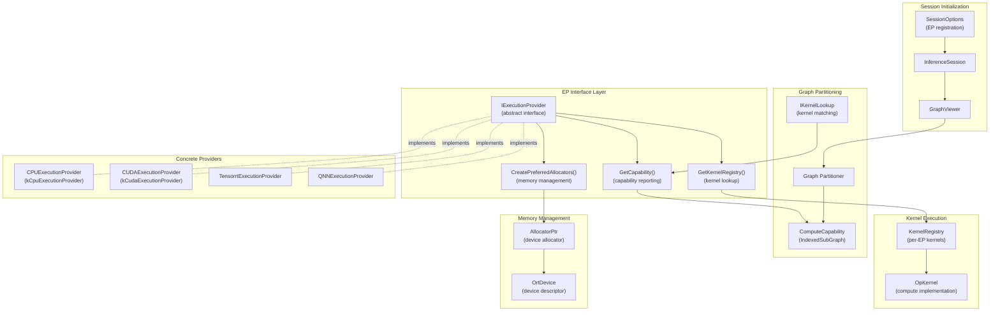

**Sources:** [include/onnxruntime/core/framework/execution_provider.h:74-282](), [onnxruntime/core/framework/execution_provider.cc:14-30]()

## IExecutionProvider Interface

The `IExecutionProvider` abstract class defines the contract that all execution providers must implement. Each EP is identified by a unique type string (e.g., `kCpuExecutionProvider`, `kCudaExecutionProvider`) and is associated with an `OrtDevice` descriptor. For details, see [Execution Provider Interface](#6.1).

### Core Members

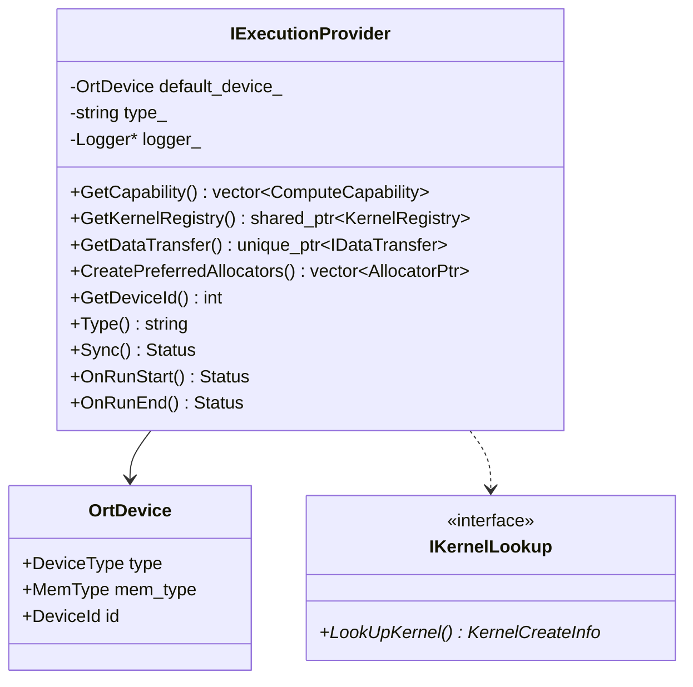

| Method | Purpose |
|--------|---------|
| `GetCapability()` | Reports which graph nodes the EP can execute, returns `ComputeCapability` objects |
| `GetKernelRegistry()` | Provides EP-specific kernel implementations |
| `GetDataTransfer()` | Returns data transfer interface for moving data to/from device |
| `CreatePreferredAllocators()` | Creates memory allocators for the EP's device |
| `Sync()` | Blocks until all device work completes |
| `OnRunStart()` / `OnRunEnd()` | Lifecycle hooks for per-inference setup/teardown |

**Sources:** [include/onnxruntime/core/framework/execution_provider.h:74-282](), [onnxruntime/core/providers/cpu/cpu_execution_provider.cc:58-67]()

## Graph Partitioning and Capability Reporting

The runtime uses a capability-based system to partition the computational graph across multiple execution providers. Each EP examines the graph and reports which nodes it can execute. For details, see [Execution Provider Interface](#6.1).

### Capability Reporting Flow

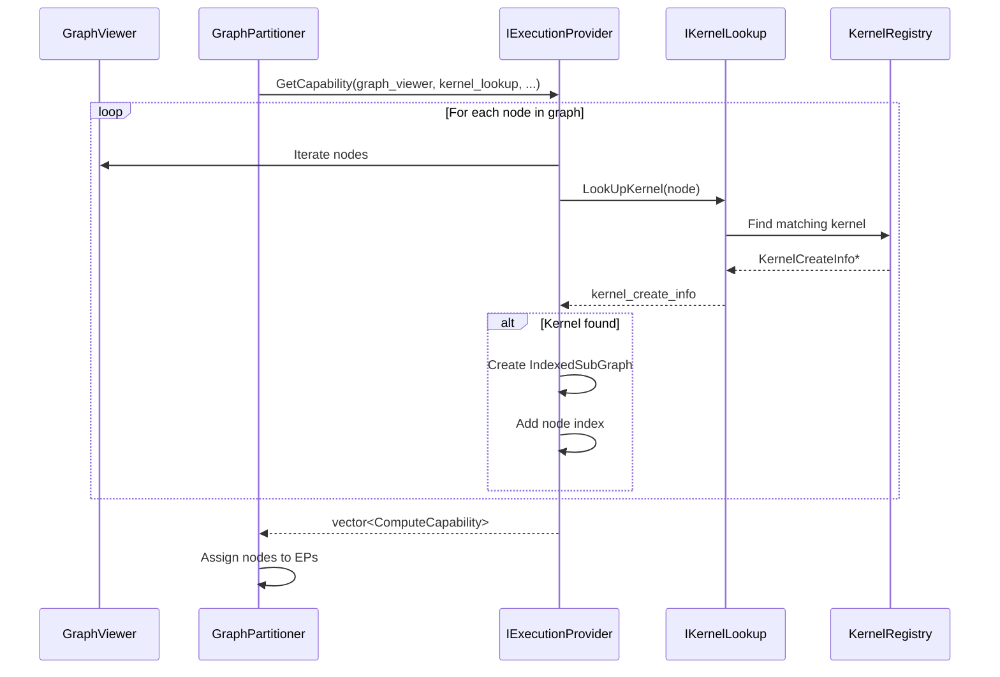

The default `GetCapability()` implementation in `IExecutionProvider` checks each node against the EP's kernel registry:

```cpp
// onnxruntime/core/framework/execution_provider.cc:19-29
std::vector<std::unique_ptr<ComputeCapability>>
IExecutionProvider::GetCapability(const onnxruntime::GraphViewer& graph,
                                  const IKernelLookup& kernel_lookup,
                                  const GraphOptimizerRegistry&,
                                  IResourceAccountant*) const {
  std::vector<std::unique_ptr<ComputeCapability>> result;
  for (const auto& node : graph.Nodes()) {
    if (const KernelCreateInfo* kernel_create_info = kernel_lookup.LookUpKernel(node);
        kernel_create_info != nullptr) {
      std::unique_ptr<IndexedSubGraph> sub_graph = std::make_unique<IndexedSubGraph>();
      sub_graph->nodes.push_back(node.Index());
      result.push_back(std::make_unique<ComputeCapability>(std::move(sub_graph)));
    }
  }

  return result;
}
```

Execution providers can override this to implement custom partitioning logic, such as fusing multiple nodes into a single subgraph.

**Sources:** [onnxruntime/core/framework/execution_provider.cc:14-30](), [include/onnxruntime/core/framework/execution_provider.h:158-162]()

### ComputeCapability Structure

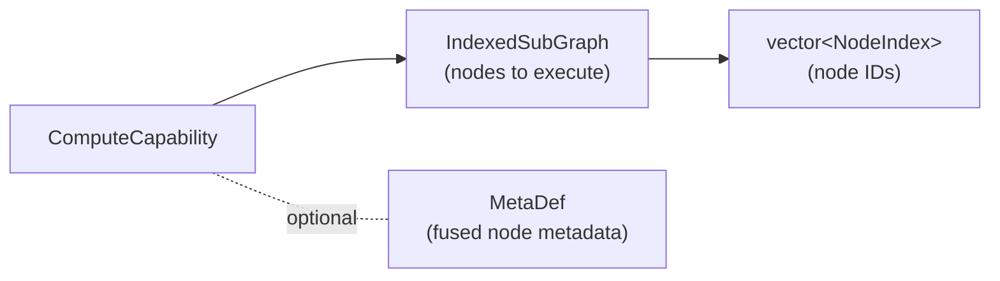

A `ComputeCapability` contains an `IndexedSubGraph` specifying which nodes the EP will execute. For fused subgraphs, it may also include a `MetaDef` describing the fused operation.

**Sources:** [include/onnxruntime/core/framework/execution_provider.h:158-162]()

## Kernel Registration

Each execution provider maintains its own `KernelRegistry` containing operator implementations specific to its hardware. Kernels are registered using opset versioning and type constraints. For details, see [Execution Provider Interface](#6.1).

### Registration Pattern

EPs typically register kernels using macros that specify:
- Operator name (e.g., "Add", "Conv")
- Domain (typically `kOnnxDomain`)
- Opset version range
- Type constraints (supported data types)
- Implementation class

Example from CPU EP:

```cpp
// onnxruntime/core/providers/cpu/cpu_execution_provider.cc:157-178
ONNX_OPERATOR_VERSIONED_TYPED_KERNEL(
    Add,           // operator name
    7, 12,         // opset version range
    float,         // data type
    Add<float>     // implementation class
)
```

**Sources:** [onnxruntime/core/providers/cpu/cpu_execution_provider.cc:157-178]()

### Kernel Lookup Mechanism

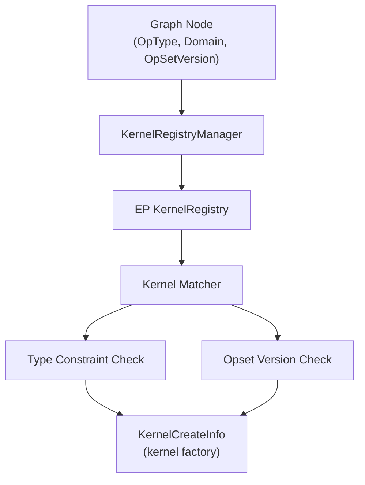

The `IKernelLookup` interface abstracts kernel matching, allowing the runtime to find appropriate kernel implementations without exposing registry internals. The `KernelRegistryManager` orchestrates the search across multiple registries, including custom ones, as shown in `SearchKernelRegistry` [onnxruntime/core/framework/kernel_registry_manager.cc:60-105](). The `KernelRegistry::VerifyKernelDef` function [onnxruntime/core/framework/kernel_registry.cc:146-175]() performs the actual type and version matching.

**Sources:** [include/onnxruntime/core/framework/execution_provider.h:122-132](), [onnxruntime/core/framework/kernel_registry_manager.cc:60-105](), [onnxruntime/core/framework/kernel_registry.cc:146-175]()

## Memory Management

Execution providers manage device memory through the allocator abstraction. Each EP creates allocators for its specific memory types (device memory, pinned memory, etc.).

### Allocator Creation

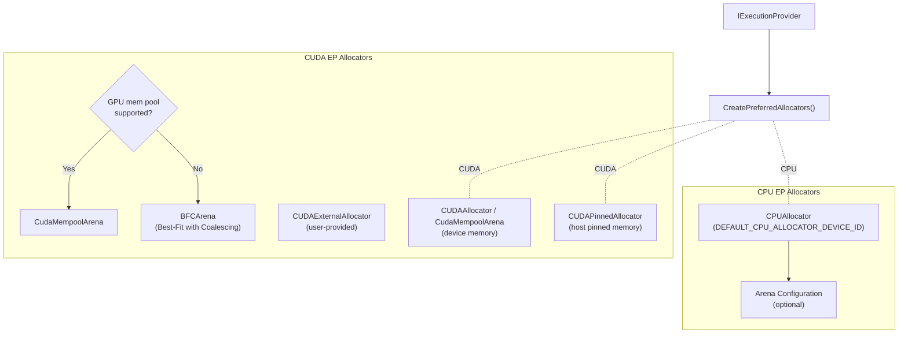

| Allocator Type | Purpose | Memory Location |
|----------------|---------|-----------------|
| `CPUAllocator` | Default CPU memory | Host RAM |
| `CUDAAllocator` | GPU device memory | Device VRAM |
| `CUDAPinnedAllocator` | Pinned host memory | Host RAM (page-locked) |
| `CudaMempoolArena` | CUDA memory pool allocator | Device VRAM (pooled) |

**Sources:** [onnxruntime/core/providers/cpu/cpu_execution_provider.cc:61-67](), [onnxruntime/core/providers/cuda/cuda_execution_provider.cc:140-206]()

### Device Synchronization

EPs implement the `Sync()` method to ensure all device work completes before returning control. This is critical for `IOBinding` and ensuring data consistency.

For CUDA EP:
```cpp
// onnxruntime/core/providers/cuda/cuda_execution_provider.cc:505-508
Status CUDAExecutionProvider::Sync() const {
  CUDA_RETURN_IF_ERROR(cudaDeviceSynchronize());
  return Status::OK();
}
```

**Sources:** [onnxruntime/core/providers/cuda/cuda_execution_provider.cc:505-508]()

## Concrete Execution Provider Implementations

### CPU Execution Provider

The `CPUExecutionProvider` is the default fallback provider supporting all standard ONNX operators. It uses MLAS (Microsoft Linear Algebra Subprograms) for optimized BLAS operations. For details, see [CPU Execution Provider](#6.2).

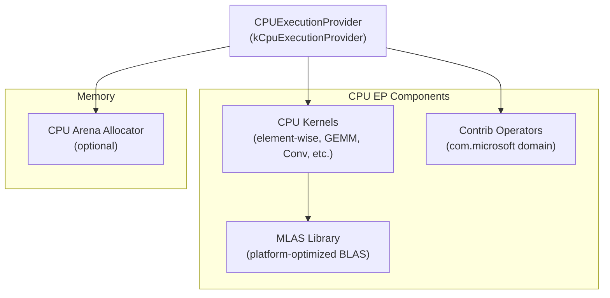

The CPU EP registers standard operations in [onnxruntime/core/providers/cpu/cpu_execution_provider.cc:70-1500]() and contrib operations conditionally based on build configuration.

**Sources:** [onnxruntime/core/providers/cpu/cpu_execution_provider.cc:1-1500]()

### CUDA Execution Provider

The `CUDAExecutionProvider` enables GPU acceleration using NVIDIA CUDA, cuDNN, and cuBLAS libraries. It supports advanced features like CUDA graphs for reduced kernel launch overhead. For details, see [CUDA Execution Provider](#6.3).

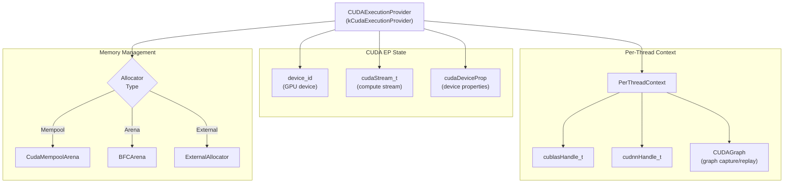

**Key CUDA EP Features:**

| Feature | Configuration | Purpose |
|---------|---------------|---------|
| CUDA Graphs | `enable_cuda_graph` | Capture and replay execution graphs to reduce overhead |
| Tunable Operations | `tunable_op_enable` | Auto-tune kernels for optimal performance |
| TF32 Mode | `use_tf32` | Use Tensor Float 32 for faster GEMM/Conv |
| NHWC Layout | `prefer_nhwc` | Prefer NHWC data layout for conv operations |
| External Stream | `user_compute_stream` | Use user-provided CUDA stream |

**Sources:** [onnxruntime/core/providers/cuda/cuda_execution_provider.h:29-282](), [onnxruntime/core/providers/cuda/cuda_execution_provider.cc:326-372]()

### Per-Thread Context Management

CUDA EP maintains thread-local contexts containing library handles and CUDA graphs. This allows thread-safe execution with multiple concurrent inference sessions.

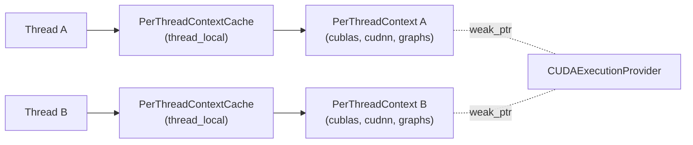

The EP maintains weak pointers to thread-local contexts and a pool of retired contexts for reuse. Context acquisition happens in `GetPerThreadContext()` [onnxruntime/core/providers/cuda/cuda_execution_provider.cc:446-482]().

**Sources:** [onnxruntime/core/providers/cuda/cuda_execution_provider.h:148-240](), [onnxruntime/core/providers/cuda/cuda_execution_provider.cc:446-503]()

### Other Execution Providers

The system supports numerous other EPs for different hardware. For details, see [Other Execution Providers](#6.5).

| EP Type | Provider String | Hardware |
|---------|----------------|----------|
| TensorRT | `kTensorrtExecutionProvider` | NVIDIA GPUs (optimizing compiler) |
| QNN | `kQnnExecutionProvider` | Qualcomm NPUs |
| CoreML | `kCoreMLExecutionProvider` | Apple Neural Engine |
| OpenVINO | `kOpenVINOExecutionProvider` | Intel accelerators |
| NNAPI | `kNnapiExecutionProvider` | Android Neural Networks API |
| DirectML | `kDmlExecutionProvider` | DirectX 12 GPUs |
| SNPE | `kSnpeExecutionProvider` | Qualcomm Snapdragon NPE |

Each follows the same `IExecutionProvider` interface but implements hardware-specific optimizations and memory management.

**Sources:** [onnxruntime/test/onnx/main.cc:58-60](), [onnxruntime/test/python/onnx_backend_test_series.py:132-165]()

## Configuration and Lifecycle

### EP Registration

Execution providers are registered with an `InferenceSession` through `SessionOptions`. The order of registration determines EP priority during graph partitioning (first registered = highest priority).

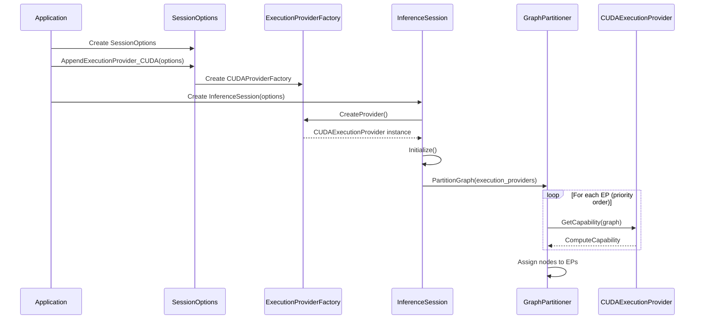

Common registration patterns:

**C API:**
```c
OrtCUDAProviderOptionsV2 cuda_options;
// Configure cuda_options...
OrtSessionOptionsAppendExecutionProvider_CUDA_V2(session_options, &cuda_options);
```

**C++ API:**
```cpp
Ort::SessionOptions options;
OrtCUDAProviderOptionsV2 cuda_options{};
cuda_options.device_id = 0;
options.AppendExecutionProvider_CUDA_V2(cuda_options);
```

**Sources:** [onnxruntime/test/onnx/main.cc:484-522](), [onnxruntime/core/providers/cuda/cuda_provider_factory.cc:206-224]()

### EP Information Structures

Each EP defines an info structure for configuration parameters. For CUDA EP, this is `CUDAExecutionProviderInfo`:

| Field | Type | Default | Purpose |
|-------|------|---------|---------|
| `device_id` | `int` | 0 | GPU device index |
| `gpu_mem_limit` | `size_t` | max | Maximum GPU memory for arena |
| `arena_extend_strategy` | enum | kNextPowerOfTwo | How arena grows |
| `cudnn_conv_algo_search` | enum | EXHAUSTIVE | Conv algorithm selection |
| `enable_cuda_graph` | `bool` | false | Enable CUDA graph capture |
| `tunable_op.enable` | `bool` | false | Enable tunable ops |
| `prefer_nhwc` | `bool` | false | Prefer NHWC layout |

Configuration is typically parsed from `ProviderOptions` (string key-value pairs) into the info structure via `FromProviderOptions()`.

**Sources:** [onnxruntime/core/providers/cuda/cuda_execution_provider_info.h:48-105](), [onnxruntime/core/providers/cuda/cuda_execution_provider_info.cc:54-166]()

### Lifecycle Hooks

EPs can participate in session lifecycle through hooks:

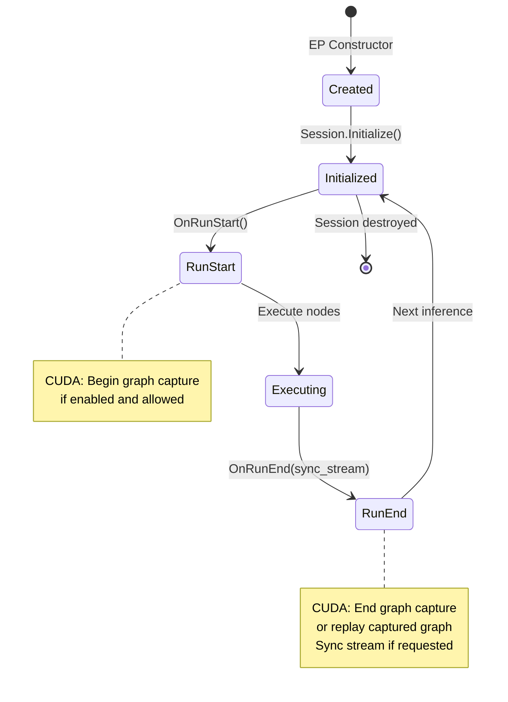

The CUDA EP uses these hooks for CUDA graph management:
- `OnRunStart()`: Begins graph capture if conditions are met
- `OnRunEnd()`: Completes capture or replays existing graph

**Sources:** [onnxruntime/core/providers/cuda/cuda_execution_provider.cc:510-552](), [include/onnxruntime/core/framework/execution_provider.h:231-241]()

### Provider Priority and Fallback

When multiple EPs are registered, the graph partitioner processes them in registration order. Nodes claimed by higher-priority EPs are removed from consideration for lower-priority EPs. Nodes not claimed by any EP default to the CPU EP.

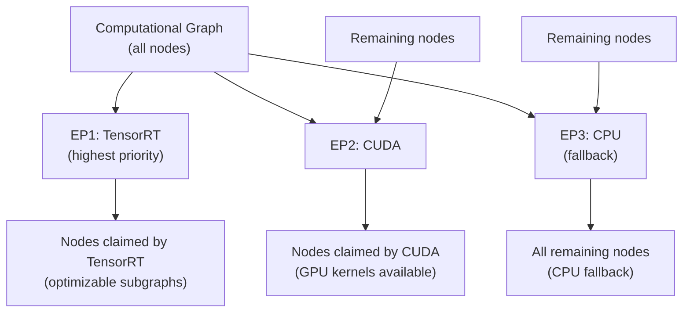

This ensures maximum hardware utilization while maintaining complete operator coverage through CPU fallback.

**Sources:** [onnxruntime/test/onnx/main.cc:484-522](), [onnxruntime/test/python/onnx_backend_test_series.py:177-178]()

---

