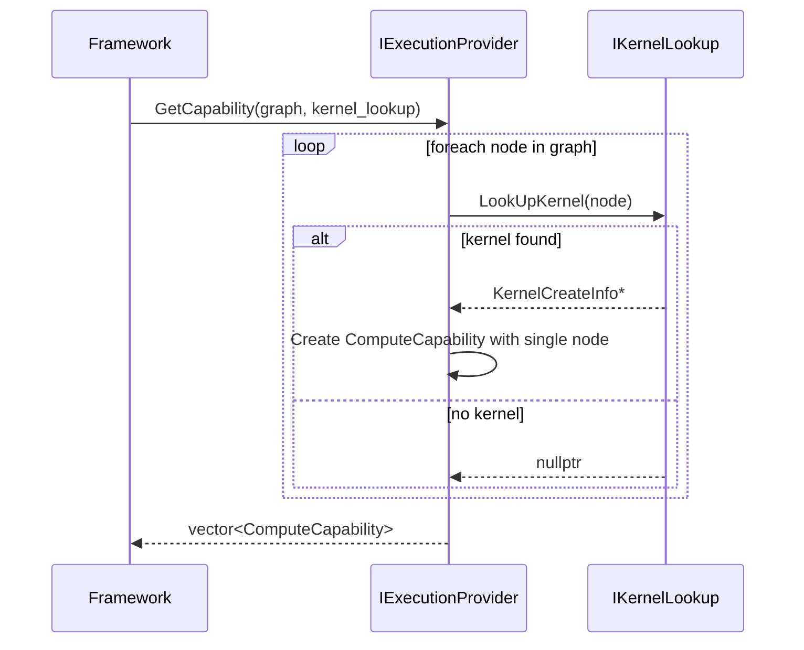
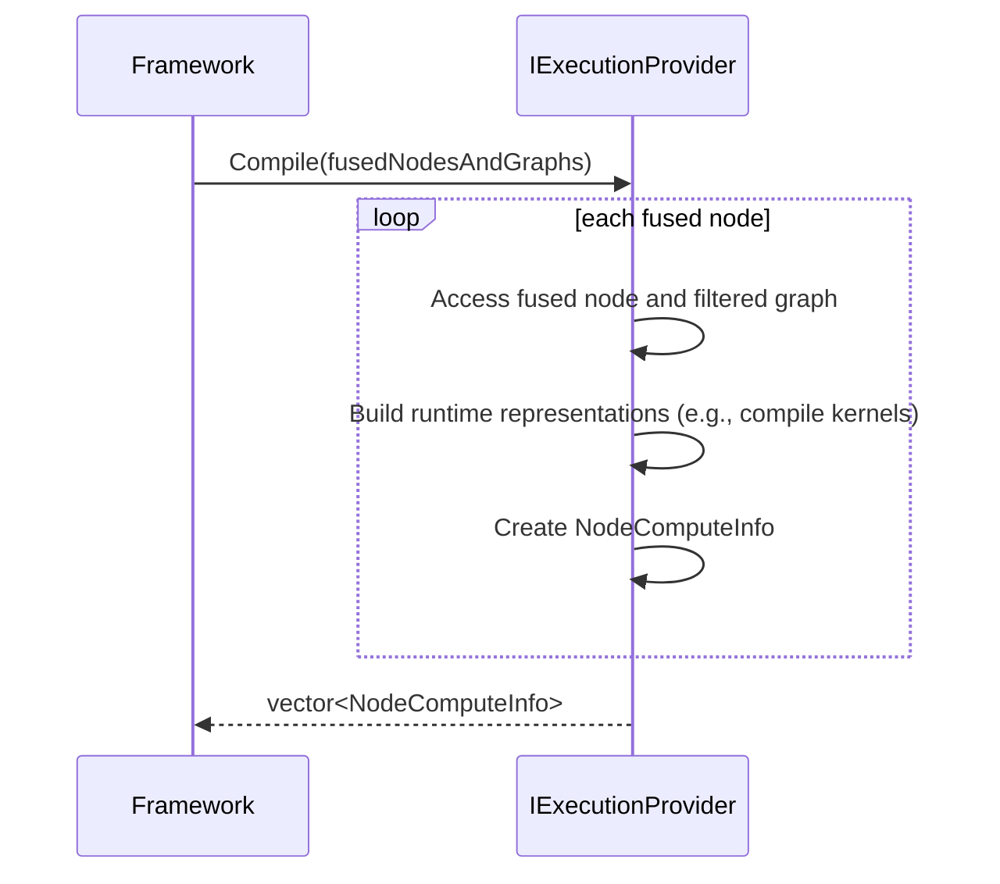
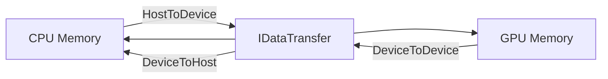
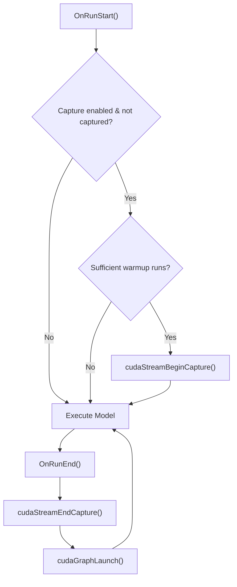
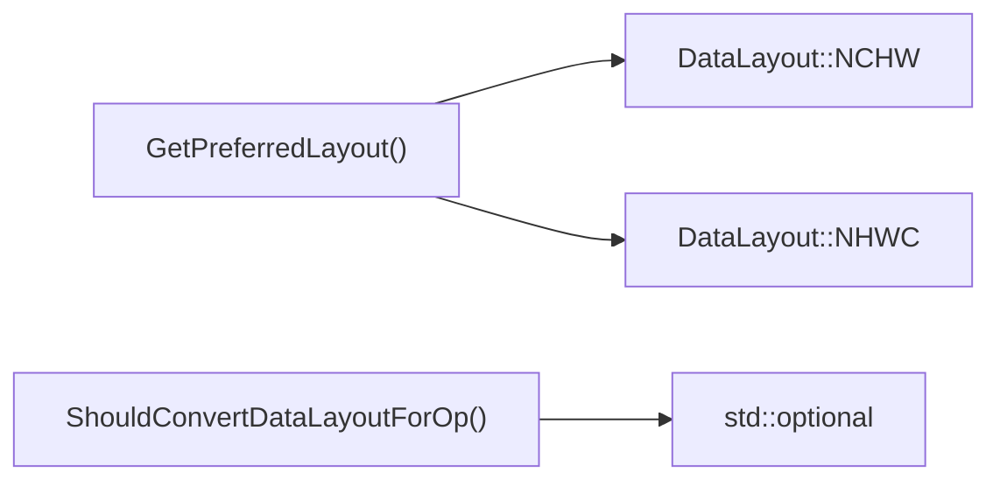
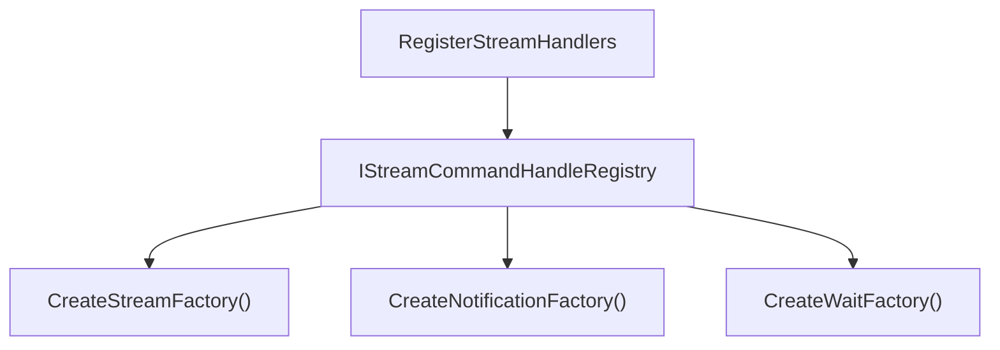

<!-- source: DeepWiki mcp.deepwiki.com · repo microsoft/onnxruntime · page 6.1 Execution Provider Interface · fetched 2026-10-21 -->

# Execution Provider Interface

<details>
<summary>Relevant source files</summary>

The following files were used as context for generating this wiki page:

- [include/onnxruntime/core/framework/execution_provider.h](include/onnxruntime/core/framework/execution_provider.h)
- [include/onnxruntime/core/framework/kernel_def_builder.h](include/onnxruntime/core/framework/kernel_def_builder.h)
- [include/onnxruntime/core/framework/kernel_registry.h](include/onnxruntime/core/framework/kernel_registry.h)
- [include/onnxruntime/core/session/onnxruntime_session_options_config_keys.h](include/onnxruntime/core/session/onnxruntime_session_options_config_keys.h)
- [onnxruntime/core/framework/execution_provider.cc](onnxruntime/core/framework/execution_provider.cc)
- [onnxruntime/core/framework/graph_partitioner.cc](onnxruntime/core/framework/graph_partitioner.cc)
- [onnxruntime/core/framework/graph_partitioner.h](onnxruntime/core/framework/graph_partitioner.h)
- [onnxruntime/core/framework/kernel_def_builder.cc](onnxruntime/core/framework/kernel_def_builder.cc)
- [onnxruntime/core/framework/kernel_registry.cc](onnxruntime/core/framework/kernel_registry.cc)
- [onnxruntime/core/framework/kernel_registry_manager.cc](onnxruntime/core/framework/kernel_registry_manager.cc)
- [onnxruntime/core/framework/kernel_registry_manager.h](onnxruntime/core/framework/kernel_registry_manager.h)
- [onnxruntime/core/providers/qnn/builder/onnx_ctx_model_helper.cc](onnxruntime/core/providers/qnn/builder/onnx_ctx_model_helper.cc)
- [onnxruntime/core/providers/qnn/builder/onnx_ctx_model_helper.h](onnxruntime/core/providers/qnn/builder/onnx_ctx_model_helper.h)
- [onnxruntime/core/providers/qnn/builder/qnn_backend_manager.cc](onnxruntime/core/providers/qnn/builder/qnn_backend_manager.cc)
- [onnxruntime/core/providers/qnn/builder/qnn_backend_manager.h](onnxruntime/core/providers/qnn/builder/qnn_backend_manager.h)
- [onnxruntime/core/providers/qnn/builder/qnn_def.cc](onnxruntime/core/providers/qnn/builder/qnn_def.cc)
- [onnxruntime/core/providers/qnn/builder/qnn_def.h](onnxruntime/core/providers/qnn/builder/qnn_def.h)
- [onnxruntime/core/providers/qnn/builder/qnn_model.cc](onnxruntime/core/providers/qnn/builder/qnn_model.cc)
- [onnxruntime/core/providers/qnn/builder/qnn_model.h](onnxruntime/core/providers/qnn/builder/qnn_model.h)
- [onnxruntime/core/providers/qnn/qnn_execution_provider.cc](onnxruntime/core/providers/qnn/qnn_execution_provider.cc)
- [onnxruntime/core/providers/qnn/qnn_execution_provider.h](onnxruntime/core/providers/qnn/qnn_execution_provider.h)
- [onnxruntime/core/providers/qnn/qnn_provider_factory.cc](onnxruntime/core/providers/qnn/qnn_provider_factory.cc)
- [onnxruntime/test/framework/kernel_registry_test.cc](onnxruntime/test/framework/kernel_registry_test.cc)
- [onnxruntime/test/providers/qnn/qnn_basic_test.cc](onnxruntime/test/providers/qnn/qnn_basic_test.cc)
- [onnxruntime/test/providers/qnn/qnn_ep_context_test.cc](onnxruntime/test/providers/qnn/qnn_ep_context_test.cc)

</details>


## Purpose and Scope

The Execution Provider (EP) Interface defines the contract between ONNX Runtime's core framework and hardware-specific execution backends. This interface, embodied by the `IExecutionProvider` class, enables ONNX Runtime to delegate computation to diverse hardware accelerators (e.g., CPUs, GPUs, NPUs, and custom accelerators) while maintaining a consistent and extensible framework API.

This page documents the design and implementation of the `IExecutionProvider` interface, explains graph partitioning using EP capabilities, kernel registration, and compilation mechanisms. For detailed implementation examples, see other EP-specific pages like the CPU Execution Provider or CUDA Execution Provider. Additionally, the provider bridge pattern for shared or plugin providers is referenced.

---

## IExecutionProvider Interface Architecture

The core abstraction is the `IExecutionProvider` C++ abstract class ([include/onnxruntime/core/framework/execution_provider.h:74-433]()). Each EP instance manages a logical device and implements methods that allow the framework to query capabilities, compile subgraphs, and manage memory and execution lifecycle hooks.

### `IExecutionProvider` Class Overview

```mermaid
classDiagram
    class IExecutionProvider {
        <<abstract>>
        #OrtDevice default_device_
        #std::string type_
        #const logging::Logger* logger_

        +std::vector<std::unique_ptr<ComputeCapability>> GetCapability(const GraphViewer& graph_view,
                                                                      const IKernelLookup& kernel_lookup,
                                                                      const GraphOptimizerRegistry&,
                                                                      IResourceAccountant*) const
        +std::shared_ptr<KernelRegistry> GetKernelRegistry() const
        +std::unique_ptr<IDataTransfer> GetDataTransfer() const
        +Status Compile(const std::vector<FusedNodeAndGraph>& fused_nodes_and_graphs,
                       std::vector<NodeComputeInfo>& node_compute_funcs)
        +Status OnRunStart(const RunOptions& run_options)
        +Status OnRunEnd(bool sync_stream, const RunOptions& run_options)
        +Status Sync()
        +std::string Type() const
        +OrtDevice GetDevice() const
        +int GetDeviceId() const
        +DataLayout GetPreferredLayout() const
        +std::vector<AllocatorPtr> CreatePreferredAllocators()
        +std::optional<bool> ShouldConvertDataLayoutForOp(std::string_view node_domain,
                                                         std::string_view node_op_type,
                                                         DataLayout target_data_layout) const
        +ITuningContext* GetTuningContext()
        +bool IsGraphCaptureEnabled() const
        +void RegisterStreamHandlers()
    }
```

The key methods and members include:

- `GetCapability()`: EP reports which subgraphs or nodes it can execute.
- `Compile()`: EP compiles fused subgraphs into executable kernels.
- `GetKernelRegistry()`: Returns EP's kernel implementations.
- Memory management via allocators and data transfer.
- Lifecycle hooks: `OnRunStart`, `OnRunEnd`, and `Sync`.
- Layout preferences and data layout conversion hints.
- Optional tuning and stream handling support.

Sources: [include/onnxruntime/core/framework/execution_provider.h:74-433]()

---

## Graph Partitioning and Capability Reporting

The framework partitions the input ONNX graph into subgraphs based on EP capabilities. This facilitates heterogeneous execution where different hardware executes assigned subgraphs.

### Capability Reporting Flow

Execution providers advertise their capability to execute nodes or subgraphs by implementing `GetCapability()`:

```mermaid
graph TB
    A[InferenceSession::Initialize] --> B[GraphPartitioner]
    B --> C[IExecutionProvider::GetCapability()]
    C --> D[IKernelLookup::LookUpKernel(Node)]
    D -->|Kernel found| E[Create ComputeCapability]
    E --> F[IndexedSubGraph(node indices)]
    F -.->|Capability returned| C
```

- The framework's graph partitioner calls `GetCapability()` of each EP.
- EP queries the kernel registry to see if kernels exist for nodes.
- Computes and returns `ComputeCapability` objects describing supported subgraphs.
- The set of subgraphs across EPs partitions the original graph for execution.

Sources: [include/onnxruntime/core/framework/execution_provider.h:152-170](), [onnxruntime/core/framework/graph_partitioner.cc:60-165]()

### Default `GetCapability()` Implementation

The standard EP implementation scans nodes one by one, consulting the kernel registry via `IKernelLookup` to verify kernel availability. Each supported node produces a `ComputeCapability` for that single node. This is the simplest form of partitioning.



EP implementations may override this to form larger fused subgraphs.

Sources: [include/onnxruntime/core/framework/execution_provider.h:122-162](), [onnxruntime/core/framework/execution_provider.cc:14-30]()

### The `ComputeCapability` Object

Each capability encapsulates:

- An `IndexedSubGraph` representing node indices supported by the EP.
- Optional optimization callback functions for graph fusion or Kernel selection.

The framework uses these to partition the graph and assign node execution to specific EPs.

Sources: [include/onnxruntime/core/framework/execution_provider.h:171-213]()

---

## Kernel Registration

Execution Providers provide kernel implementations via `KernelRegistry` objects, mapping operator type/domain/version/type-constraints to kernel factory functions.

### Kernel Registry Access

- EPs override `GetKernelRegistry()` to return a shared kernel registry.
- The kernel registry is **shared across sessions** for a given EP type, improving memory efficiency.

| Method                 | Description                              |
|------------------------|----------------------------------------|
| `GetKernelRegistry()`  | Return the EP's registered kernel map. |

For instance, the CUDA EP registers thousands of kernels in [`cuda_execution_provider.cc:566-2008`](onnxruntime/core/providers/cuda/cuda_execution_provider.cc) with macros like `ONNX_OPERATOR_TYPED_KERNEL_EX`.

### Kernel Registration Macros

Typical pattern:

```cpp
ONNX_OPERATOR_TYPED_KERNEL_EX(
    Abs,
    kOnnxDomain,
    13,
    float,
    kCudaExecutionProvider,
    KernelDefBuilder(),
    AbsKernelClass);
```

This macro registers an operator named `Abs` for ONNX opset 13 on CUDA with `float` data type.

Sources: [onnxruntime/core/providers/cuda/cuda_execution_provider.cc:566-2008](), [include/onnxruntime/core/framework/execution_provider.h:177-178]()

---

## Node Fusion and Compilation

After partitioning, multiple nodes assigned to the EP may be merged (fused) into a single node representation called a fused node.

### Fusion Styles

ONNX Runtime supports two fusion styles:

```mermaid
graph LR
    A[FusionStyle]
    A --> B[Function (deprecated)]
    A --> C[FilteredGraphViewer (recommended)]

    B -.-> D[Creates new Graph in Node::Body()]
    C -.-> E[Uses GraphViewer filtering main graph]

    style C fill:#e1f7e1
```

| Style              | Characteristics                                  | Status        |
|--------------------|-------------------------------------------------|---------------|
| Function           | New Graph instance deep copy of fused nodes     | Deprecated    |
| FilteredGraphViewer| Subgraph filtered on main graph using GraphViewer | Recommended |

FilteredGraphViewer avoids duplication and is lighter, suitable for minimal builds.

Sources: [include/onnxruntime/core/framework/execution_provider.h:290-311]()

### Compile Interface

`IExecutionProvider::Compile()` receives fused nodes and filtered graphs representing subgraphs to compile or prepare for execution.



### `NodeComputeInfo` Structure

| Field                | Type                            | Purpose                          |
|----------------------|--------------------------------|---------------------------------|
| `create_state_func`   | `CreateFunctionStateFunc`       | Create per-node execution state |
| `compute_func`        | `ComputeFunc`                   | Execute compute for node         |
| `release_state_func`  | `DestroyFunctionStateFunc`      | Cleanup execution state          |

This design uses a stateful execution model, allowing EPs to maintain cached states like JIT kernels or allocations.

Sources: [include/onnxruntime/core/framework/execution_provider.h:54-62](), [include/onnxruntime/core/framework/execution_provider.h:313-324](), [onnxruntime/core/framework/execution_provider.cc:32-38]()

---

## Memory Management and Data Transfer

Execution Providers handle device-specific memory allocation and data movement.

### Preferred Allocators Creation

The EP creates allocators via:

- `CreatePreferredAllocators()` returns a vector of allocators the EP prefers (e.g., GPU arena allocators).
- `GetOrtDeviceByMemType()` returns the physical device associated to a memory type.

### Data Transfer Interface

`GetDataTransfer()` returns an `IDataTransfer` implementation. It provides async copy operations for memory transfers between host and device.



For example, the CUDA EP implements this with async cudaMemcpy calls.

Sources: [include/onnxruntime/core/framework/execution_provider.h:114-133](), [onnxruntime/core/providers/cuda/cuda_execution_provider.cc:140-223]()

---

## Session and Inference Lifecycle Hooks

Execution Providers can hook into lifecycle events to perform initialization, synchronization, and cleanup:

| Method                       | Called When                   | Purpose                                       |
|------------------------------|------------------------------|-----------------------------------------------|
| `OnSessionInitializationEnd()` | After graph partitioning and initialization | Optional cleanup or further preparation        |
| `OnRunStart(RunOptions)`     | Before each inference run     | Setup (e.g., start CUDA graph capture)         |
| `OnRunEnd(bool, RunOptions)` | After each inference run      | Cleanup, synchronize, end graph capture        |
| `Sync()`                    | When framework needs sync      | Block until device operations complete         |

### CUDA EP Graph Capture Example



CUDA EP requires warmup runs before capturing for stable memory allocation.

Sources: [include/onnxruntime/core/framework/execution_provider.h:232-282](), [onnxruntime/core/providers/cuda/cuda_execution_provider.cc:510-552]()

---

## Advanced Features

### Preferred Data Layout

EPs can expose preferred tensor data layouts for better performance.



This informs the framework's layout transformer when and if layout changes (like adding transposes) should happen.

Sources: [include/onnxruntime/core/framework/execution_provider.h:363-379]()

### Tuning Context for Auto-tuning Kernels

EPs can provide `ITuningContext` via `GetTuningContext()`, allowing runtime benchmarking to select optimal kernel implementations.


This supports emergent EP optimization during execution.

Sources: [include/onnxruntime/core/framework/execution_provider.h:389-392]()

### Stream Handling and Synchronization

EPs may register stream factories and synchronization primitives to enable multi-stream execution and event signaling through `RegisterStreamHandlers()`.



This supports sophisticated parallelism and interoperability.

Sources: [include/onnxruntime/core/framework/execution_provider.h:381]()

---

## Example: QNN Execution Provider Integration

While this page focuses on the interface, the Qualcomm Neural Network (QNN) EP offers insight into a complex EP implementation ([onnxruntime/core/providers/qnn/qnn_execution_provider.cc](), [onnxruntime/core/providers/qnn/qnn_execution_provider.h]()):

- Implements `IExecutionProvider` interface.
- Manages multiple backend library paths (CPU, GPU, HTP devices).
- Uses a `QnnBackendManager` to handle backend library loading and context.
- Reports capabilities by filtering graph nodes it supports and querying kernel availability.
- Compiles fused nodes into QNN model graphs to be executed.
- Supports context caching and provides detailed telemetry and profiling.
- Maintains memory configurability and optional fallback controls.

This architecture exemplifies integrating custom backends with the ONNX Runtime EP framework.

Sources: [onnxruntime/core/providers/qnn/qnn_execution_provider.cc:1-154](), [onnxruntime/core/providers/qnn/qnn_execution_provider.h:20-135](), [onnxruntime/core/providers/qnn/builder/qnn_backend_manager.cc:1-181]()

---

# Summary

- The `IExecutionProvider` abstract class defines the interface for hardware backends in ONNX Runtime.
- Capability reporting (`GetCapability()`) enables graph partitioning by identifying subgraphs the EP can execute.
- Kernel registration encapsulates operator implementations via shared `KernelRegistry` instances.
- Node fusion allows combining multiple nodes into efficient subgraphs, compiled via `Compile()`.
- EPs manage device-specific memory through allocators and implement data movement via `IDataTransfer`.
- Hooks into session lifecycle enable setup, synchronization, and cleanup tailored to EP requirements.
- Advanced features include preferred layouts, runtime tuning, and custom stream handling.

This interface design abstracts and scales to diverse hardware acceleration backends, allowing ONNX Runtime to optimize model execution dynamically without compromising extensibility or performance.

---

**Sources:**  
[include/onnxruntime/core/framework/execution_provider.h:1-480](),  
[onnxruntime/core/framework/execution_provider.cc:1-40](),  
[onnxruntime/core/framework/graph_partitioner.cc:1-169](),  
[onnxruntime/core/providers/cuda/cuda_execution_provider.cc:1-2999](),  
[onnxruntime/core/providers/cuda/cuda_execution_provider.h:1-285](),  
[onnxruntime/core/providers/qnn/qnn_execution_provider.cc:1-154](),  
[onnxruntime/core/providers/qnn/qnn_execution_provider.h:20-135](),  
[onnxruntime/core/providers/qnn/builder/qnn_backend_manager.cc:1-181]()

---

