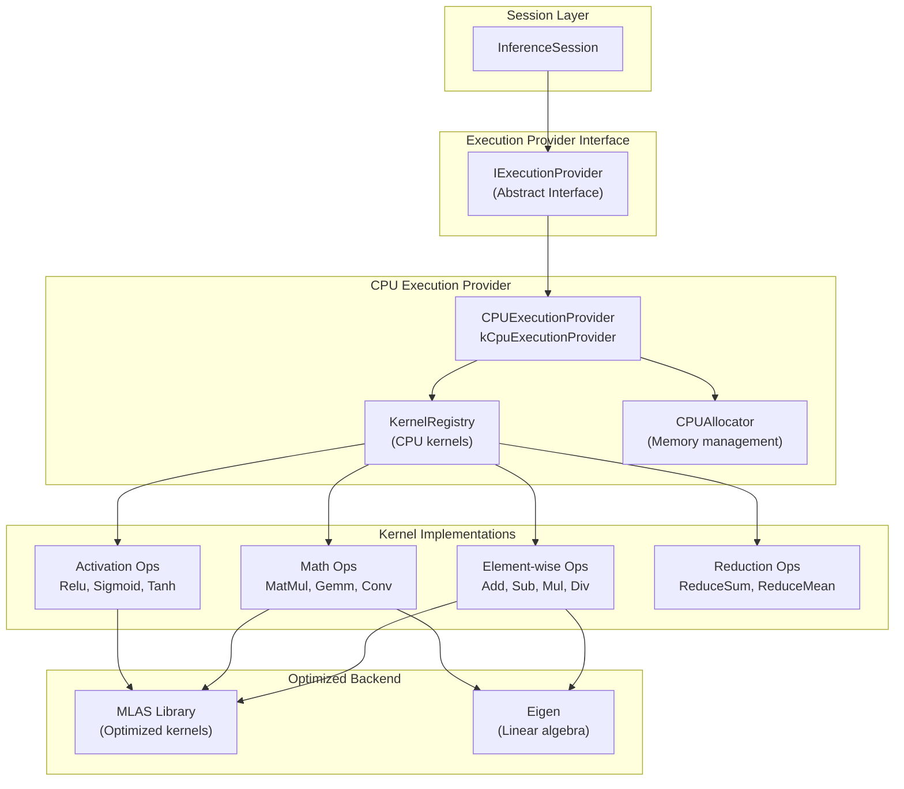
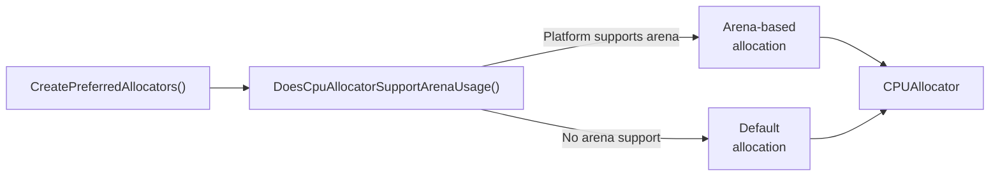
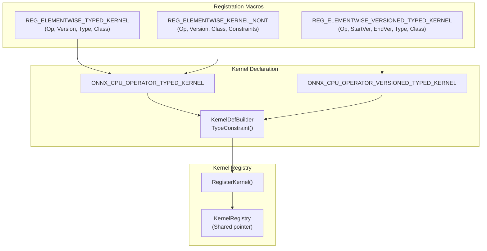
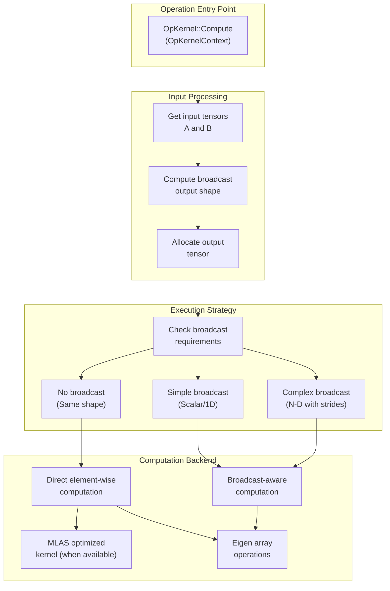
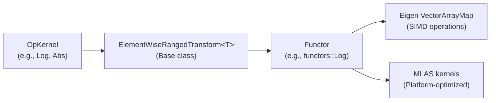
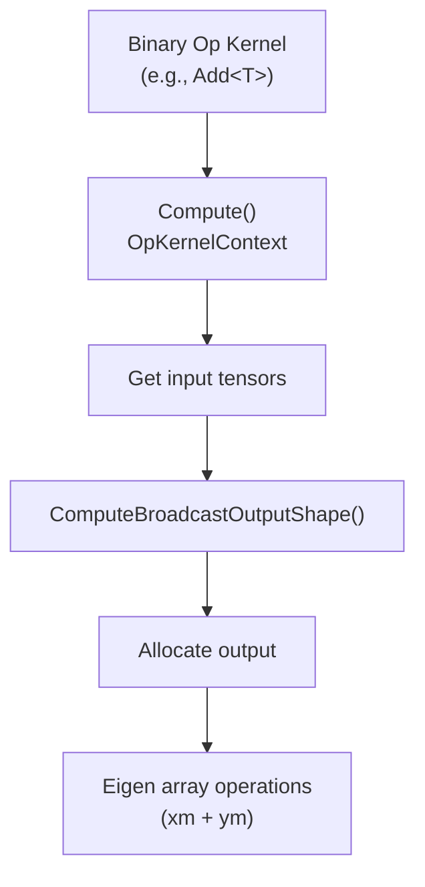
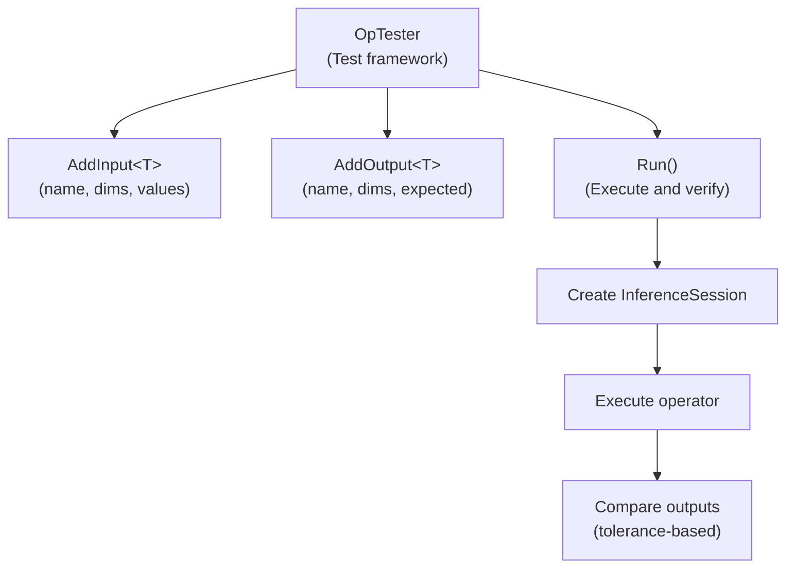
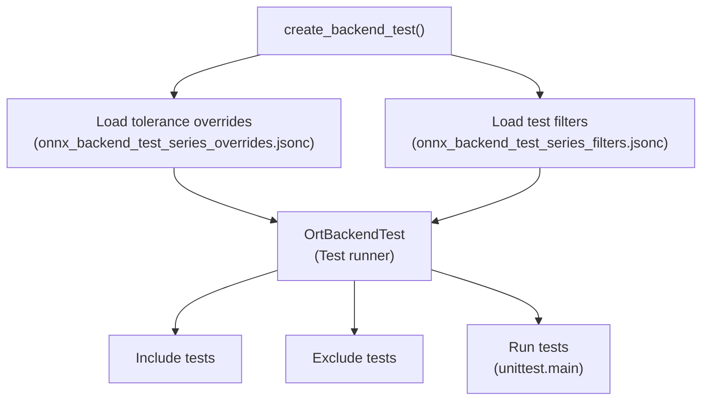

<!-- source: DeepWiki mcp.deepwiki.com · repo microsoft/onnxruntime · page 6.2 CPU Execution Provider · fetched 2026-10-21 -->

# CPU Execution Provider

<details>
<summary>Relevant source files</summary>

The following files were used as context for generating this wiki page:

- [include/onnxruntime/core/providers/cuda/cuda_provider_options.h](include/onnxruntime/core/providers/cuda/cuda_provider_options.h)
- [onnxruntime/core/providers/cpu/cpu_execution_provider.cc](onnxruntime/core/providers/cpu/cpu_execution_provider.cc)
- [onnxruntime/core/providers/cpu/math/element_wise_ops.cc](onnxruntime/core/providers/cpu/math/element_wise_ops.cc)
- [onnxruntime/core/providers/cpu/math/element_wise_ops.h](onnxruntime/core/providers/cpu/math/element_wise_ops.h)
- [onnxruntime/core/providers/cuda/cu_inc/binary_elementwise_impl.cuh](onnxruntime/core/providers/cuda/cu_inc/binary_elementwise_impl.cuh)
- [onnxruntime/core/providers/cuda/cu_inc/common.cuh](onnxruntime/core/providers/cuda/cu_inc/common.cuh)
- [onnxruntime/core/providers/cuda/cuda_execution_provider.cc](onnxruntime/core/providers/cuda/cuda_execution_provider.cc)
- [onnxruntime/core/providers/cuda/cuda_execution_provider.h](onnxruntime/core/providers/cuda/cuda_execution_provider.h)
- [onnxruntime/core/providers/cuda/cuda_execution_provider_info.cc](onnxruntime/core/providers/cuda/cuda_execution_provider_info.cc)
- [onnxruntime/core/providers/cuda/cuda_execution_provider_info.h](onnxruntime/core/providers/cuda/cuda_execution_provider_info.h)
- [onnxruntime/core/providers/cuda/cuda_provider_factory.cc](onnxruntime/core/providers/cuda/cuda_provider_factory.cc)
- [onnxruntime/core/providers/cuda/math/binary_elementwise_ops.cc](onnxruntime/core/providers/cuda/math/binary_elementwise_ops.cc)
- [onnxruntime/core/providers/cuda/math/binary_elementwise_ops.h](onnxruntime/core/providers/cuda/math/binary_elementwise_ops.h)
- [onnxruntime/core/providers/cuda/math/binary_elementwise_ops_impl.cu](onnxruntime/core/providers/cuda/math/binary_elementwise_ops_impl.cu)
- [onnxruntime/core/providers/cuda/math/binary_elementwise_ops_impl.h](onnxruntime/core/providers/cuda/math/binary_elementwise_ops_impl.h)
- [onnxruntime/core/providers/cuda/math/unary_elementwise_ops.cc](onnxruntime/core/providers/cuda/math/unary_elementwise_ops.cc)
- [onnxruntime/core/providers/cuda/math/unary_elementwise_ops.h](onnxruntime/core/providers/cuda/math/unary_elementwise_ops.h)
- [onnxruntime/core/providers/cuda/math/unary_elementwise_ops_impl.cu](onnxruntime/core/providers/cuda/math/unary_elementwise_ops_impl.cu)
- [onnxruntime/core/providers/cuda/math/unary_elementwise_ops_impl.h](onnxruntime/core/providers/cuda/math/unary_elementwise_ops_impl.h)
- [onnxruntime/test/providers/cpu/math/element_wise_ops_test.cc](onnxruntime/test/providers/cpu/math/element_wise_ops_test.cc)

</details>


## Purpose and Scope

The CPU Execution Provider is the default execution provider in ONNX Runtime that implements operator kernels for CPU execution. It provides optimized implementations for the standard ONNX operator set using platform-specific CPU instructions and the Microsoft Linear Algebra Subprograms (MLAS) library.

This document covers the CPU execution provider's architecture, kernel registration system, operator implementations, and memory management. For information about the general execution provider interface, see [Execution Provider Interface](#6.1). For details on MLAS optimizations, see [Low-Level Compute Library](#4).

## Architecture Overview

The CPU Execution Provider is implemented in the `CPUExecutionProvider` class and serves as the foundational execution backend for ONNX Runtime. It registers kernels for standard ONNX operators, contrib operators, and training operators when enabled.



**Sources:** [onnxruntime/core/providers/cpu/cpu_execution_provider.cc:1-67]()

### CPUExecutionProvider Class

The `CPUExecutionProvider` class inherits from `IExecutionProvider` and is constructed with `CPUExecutionProviderInfo` configuration. It uses the execution provider name constant `kCpuExecutionProvider`.

| Component | Type | Purpose |
|-----------|------|---------|
| `CPUExecutionProvider` | Class | Main execution provider implementation |
| `kCpuExecutionProvider` | Constant | Execution provider identifier string |
| `CPUExecutionProviderInfo` | Struct | Configuration parameters including arena settings |
| `CreatePreferredAllocators()` | Method | Creates CPU memory allocators |

The constructor accepts a `CPUExecutionProviderInfo` parameter that controls memory arena behavior:

```cpp
CPUExecutionProvider::CPUExecutionProvider(const CPUExecutionProviderInfo& info)
    : IExecutionProvider{onnxruntime::kCpuExecutionProvider}, info_{info} {}
```

**Sources:** [onnxruntime/core/providers/cpu/cpu_execution_provider.cc:62-63]()

## Memory Management

The CPU Execution Provider manages memory allocation through the `CreatePreferredAllocators()` method, which returns a vector of allocators suitable for CPU operations.



The allocator configuration respects:
- Platform capability for arena allocation via `DoesCpuAllocatorSupportArenaUsage()`
- User configuration via `info_.create_arena`
- Default device ID `DEFAULT_CPU_ALLOCATOR_DEVICE_ID`

```cpp
std::vector<AllocatorPtr> CPUExecutionProvider::CreatePreferredAllocators() {
  const bool create_arena = DoesCpuAllocatorSupportArenaUsage() ? info_.create_arena : false;
  AllocatorCreationInfo device_info_cpu{[](int) { return std::make_unique<CPUAllocator>(); },
                                        DEFAULT_CPU_ALLOCATOR_DEVICE_ID, create_arena};

  return std::vector<AllocatorPtr>{CreateAllocator(device_info_cpu)};
}
```

**Sources:** [onnxruntime/core/providers/cpu/cpu_execution_provider.cc:65-71]()

## Kernel Registration System

The CPU Execution Provider registers kernels using a sophisticated macro-based system that handles operator versioning, type constraints, and multiple opset versions.



**Sources:** [onnxruntime/core/providers/cpu/math/element_wise_ops.cc:80-117]()

### Kernel Registration Patterns

The registration system uses three main patterns:

1. **Typed Kernel Registration**: Registers a specific version with a concrete type
2. **Versioned Typed Kernel Registration**: Registers a version range with a concrete type  
3. **Type-Constrained Registration**: Registers with dynamically determined type constraints

Example registrations for the `Add` operator across different opset versions:

```cpp
REG_ELEMENTWISE_VERSIONED_TYPED_KERNEL(Add, 7, 12, float, Add);
REG_ELEMENTWISE_VERSIONED_TYPED_KERNEL(Add, 13, 13, float, Add);
REG_ELEMENTWISE_TYPED_KERNEL(Add, 14, float, Add);
```

**Sources:** [onnxruntime/core/providers/cpu/math/element_wise_ops.cc:117-118]() (This is a partial example, the full list of Add registrations is much longer, e.g., [onnxruntime/core/providers/cpu/math/element_wise_ops.cc:117-118]())

### Type Reduction System

The kernel registration system supports selective type enablement through the `op_kernel_type_control` namespace, allowing build-time configuration of supported types:

| Configuration | Purpose |
|---------------|---------|
| `ORT_SPECIFY_OP_KERNEL_ARG_DEFAULT_TYPES` | Specifies default supported types for an operator |
| `ORT_SPECIFY_OP_KERNEL_ARG_REQUIRED_TYPES` | Marks types as required (always enabled) |
| `ORT_OP_KERNEL_ARG_ENABLED_TYPE_LIST` | Retrieves the enabled type list after reduction |

```cpp
namespace op_kernel_type_control {
// Max
ORT_SPECIFY_OP_KERNEL_ARG_DEFAULT_TYPES(kCpuExecutionProvider, kOnnxDomain, Max, 8, Input, 0, float, double);
// ...
}  // namespace op_kernel_type_control
```

**Sources:** [onnxruntime/core/providers/cpu/math/element_wise_ops.cc:17-51]()

## Element-wise Operations

Element-wise operations form a core component of the CPU Execution Provider, implementing operators like Add, Sub, Mul, Div with broadcasting support and MLAS optimization.



**Sources:** [onnxruntime/core/providers/cpu/math/element_wise_ops.h:215-249](), [onnxruntime/test/providers/cpu/math/element_wise_ops_test.cc:256-278]()

### Broadcasting Implementation

The CPU implementation supports ONNX broadcasting rules, handling various scenarios. The `BinaryElementwisePreparation` struct and its `BinaryElementwiseBroadcastPrepareHelper` method are central to this.

| Broadcast Type | Example | Implementation |
|----------------|---------|----------------|
| No broadcast | `[3,3] + [3,3]` | Direct element-wise operation |
| Scalar broadcast | `[3,3] + []` | Scalar replicated to all elements |
| Axis broadcast | `[3,3] + [3,1]` | Per-row/column broadcasting |
| Multidirectional | `[3,1] + [3]` | N-dimensional broadcasting with stride calculation |

The broadcasting logic validates that dimensions are compatible (equal or one is 1) and computes the output shape. The `output_rank_or_simple_broadcast` member of `BinaryElementwisePreparation` indicates the broadcast type.

```cpp
Status BinaryElementwisePreparation::BinaryElementwiseBroadcastPrepareHelper(const TensorShape& lhs_shape,
                                                                             const TensorShape& rhs_shape,
                                                                             const TensorShape& output_shape) {
  // ...
  // early return when shapes match
  if (lhs_shape == rhs_shape) {
    output_rank_or_simple_broadcast = static_cast<int32_t>(SimpleBroadcast::NoBroadcast);
    return Status::OK();
  }

  // early return if one operand is scalar
  if (lhs_shape.Size() == 1 || rhs_shape.Size() == 1) {
    output_rank_or_simple_broadcast = static_cast<int32_t>(lhs_shape.Size() == 1
                                                               ? SimpleBroadcast::LeftScalar
                                                               : SimpleBroadcast::RightScalar);
    return Status::OK();
  }
  // ...
}
```

**Sources:** [onnxruntime/core/providers/cuda/math/binary_elementwise_ops.h:31-75](), [onnxruntime/test/providers/cpu/math/element_wise_ops_test.cc:298-569]()

### MLAS Integration for Element-wise Ops

For floating-point operations, the CPU provider leverages MLAS for optimized implementations. The `Exp` functor demonstrates this pattern:

```cpp
namespace functors {
template <>
void Exp<float>::operator()(std::ptrdiff_t first, std::ptrdiff_t last) const {
  ptrdiff_t len = last - first;
  float* output_ptr = output + first;
  MlasComputeExp(input + first, output_ptr, static_cast<size_t>(len));
}
}  // namespace functors
```

MLAS provides platform-specific SIMD implementations that are automatically selected at runtime based on CPU capabilities.

**Sources:** [onnxruntime/core/providers/cpu/math/element_wise_ops.cc:72-78]()

## Operator Implementation Patterns

### Functor-Based Unary Operations

Unary operations (Log, Abs, Neg, Floor, Ceil, Reciprocal, Sqrt, Exp) use the `ElementWiseRangedTransform` pattern with functors:



Each functor implements:
- `Init()`: Initialization from node attributes
- `Copy()`: Creates a copy of the functor
- `Cost()`: Estimates computational cost for parallelization
- `operator()`: Performs the actual computation on a range

**Sources:** [onnxruntime/core/providers/cpu/math/element_wise_ops.h:22-203]()

### Binary Operations with Type Support

Binary operations (Add, Sub, Mul, Div, Pow) are implemented as `OpKernel` subclasses with templated types:



The implementation handles:
- Multiple data types through templates (float, double, int32_t, int64_t, uint32_t, uint64_t, MLFloat16, etc.)
- Broadcasting logic for compatible shapes
- Output allocation via `OpKernelContext`

**Sources:** [onnxruntime/core/providers/cuda/math/binary_elementwise_ops.h:140-180]()

## Testing Infrastructure

The CPU Execution Provider includes comprehensive testing through the `OpTester` framework and ONNX backend tests.

### OpTester Framework

The `OpTester` class provides utilities for testing operator implementations:



Test execution can target specific execution providers and apply tolerance settings:

```cpp
test.Run(OpTester::ExpectResult::kExpectSuccess, "", 
         {kTensorrtExecutionProvider});  // Exclude TensorRT
```

**Sources:** [onnxruntime/test/providers/cpu/math/element_wise_ops_test.cc:141-146]() (This is an example from a CUDA test, but the `OpTester` framework is generic and used for CPU tests as well, e.g., [onnxruntime/test/providers/cpu/math/element_wise_ops_test.cc:150-154]())

### ONNX Backend Test Suite

The ONNX backend test suite validates compliance with ONNX specifications using the `OrtBackendTest` class:



The test system supports:
- Per-test tolerance overrides for numerical precision
- Platform-specific test filtering (32-bit, specific EPs)
- Automatic test case generation from ONNX model zoo

**Sources:** [onnxruntime/test/python/onnx_backend_test_series.py:107-183]()

## Special Operator Implementations

### MemcpyFromHost and MemcpyToHost

The CPU Execution Provider registers generic memcpy kernels that serve as fallbacks when specialized execution providers don't provide their own:

```cpp
ONNX_OPERATOR_KERNEL_EX(
    MemcpyFromHost,
    kOnnxDomain,
    1,
    kCpuExecutionProvider,
    (*KernelDefBuilder::Create())
        .InputMemoryType(OrtMemTypeCPUInput, 0)
        .TypeConstraint("T", DataTypeImpl::AllFixedSizeTensorAndSequenceTensorTypesIRv9()),
    Memcpy);
```

These kernels handle data movement between host (CPU) memory and execution provider device memory when no specialized implementation exists.

**Sources:** [onnxruntime/core/providers/cpu/cpu_execution_provider.cc:42-50]()

### Contrib Operators

When `DISABLE_CONTRIB_OPS` is not defined, the CPU provider registers additional operators from the `contrib_ops` namespace:

```cpp
#ifndef DISABLE_CONTRIB_OPS
#include "contrib_ops/cpu/cpu_contrib_kernels.h"
#endif
```

These include specialized operations like attention mechanisms, custom activations, and domain-specific operators.

**Sources:** [onnxruntime/core/providers/cpu/cpu_execution_provider.cc:13-15]()

### Training Operators

When `ENABLE_TRAINING_OPS` is defined, the CPU provider includes gradient computation and training-specific operators:

```cpp
#if defined(ENABLE_TRAINING_OPS)
#include "orttraining/training_ops/cpu/cpu_training_kernels.h"
#endif
```

**Sources:** [onnxruntime/core/providers/cpu/cpu_execution_provider.cc:17-19]()

## Configuration and Usage

### Command-Line Options

The ONNX test runner demonstrates CPU EP configuration options:

| Option | Purpose | Default |
|--------|---------|---------|
| `-A` | Disable memory arena | Enabled |
| `-M` | Disable memory pattern | Enabled |
| `-c [runs]` | Concurrent session runs | Number of CPU cores |
| `-j [models]` | Parallel model execution | Number of CPU cores |
| `-o [level]` | Graph optimization level | `ORT_ENABLE_ALL` (99) |

Arena allocation improves performance by reusing memory allocations across operator executions, reducing allocation overhead.

**Sources:** [onnxruntime/test/onnx/main.cc:45-111]()

### Session Creation

Creating a session with CPU execution provider (implicitly, as default):

```cpp
Ort::SessionOptions session_options;
session_options.EnableCpuMemArena();  // Enable arena allocator
session_options.EnableMemPattern();   // Enable memory pattern optimization
Ort::Session session(env, model_path, session_options);
```

The CPU provider is automatically used when no other execution providers are explicitly registered.

**Sources:** [onnxruntime/test/onnx/main.cc:458-470]()

## Performance Characteristics

### MLAS Optimization Impact

The integration with MLAS provides significant performance improvements through:

1. **Platform-specific SIMD**: AVX2, AVX512, NEON, WASM SIMD
2. **Optimized kernels**: GEMM, quantized operations, convolutions
3. **Runtime dispatch**: Automatic selection based on CPU capabilities

For the `Exp` operation, MLAS provides `MlasComputeExp()` which uses vectorized exponential computation instead of scalar loops.

**Sources:** [onnxruntime/core/providers/cpu/math/element_wise_ops.cc:72-78]()

### Memory Access Patterns

Element-wise operations optimize memory access through:
- Contiguous memory access when possible
- Eigen array operations for SIMD-friendly patterns
- Stride-aware broadcasting to minimize cache misses

**Sources:** [onnxruntime/core/providers/cpu/math/element_wise_ops.h:22-203]()

## Error Handling

The CPU provider implements runtime validation with detailed error messages:

```cpp
if (!(p->lhs_tensor->Shape() == p->rhs_tensor->Shape()))
  return ORT_MAKE_STATUS(ONNXRUNTIME, FAIL, Node().Name(), 
                        ": mismatching input shapes: ",
                        p->lhs_tensor->Shape().ToString(), " != ", 
                        p->rhs_tensor->Shape().ToString());
```

Broadcasting validation ensures dimension compatibility and provides actionable error messages when operations fail.

**Sources:** [onnxruntime/core/providers/cuda/math/binary_elementwise_ops.h:18-21]() (This is an example from a CUDA file, but the same logic applies to CPU element-wise ops, e.g., [onnxruntime/test/providers/cpu/math/element_wise_ops_test.cc:571-606]())

---

