<!-- source: DeepWiki mcp.deepwiki.com · repo microsoft/onnxruntime · page 6.3 CUDA Execution Provider · fetched 2026-10-21 -->

# CUDA Execution Provider

<details>
<summary>Relevant source files</summary>

The following files were used as context for generating this wiki page:

- [cmake/onnxruntime_cuda_source_filters.cmake](cmake/onnxruntime_cuda_source_filters.cmake)
- [cmake/onnxruntime_providers_cuda.cmake](cmake/onnxruntime_providers_cuda.cmake)
- [cmake/onnxruntime_providers_cuda_plugin.cmake](cmake/onnxruntime_providers_cuda_plugin.cmake)
- [docs/contrib_ops/cuda/moe_qmoe.md](docs/contrib_ops/cuda/moe_qmoe.md)
- [docs/contrib_ops/cuda/qmoe_gemv_experiments.md](docs/contrib_ops/cuda/qmoe_gemv_experiments.md)
- [include/onnxruntime/core/providers/cuda/cuda_provider_options.h](include/onnxruntime/core/providers/cuda/cuda_provider_options.h)
- [onnxruntime/contrib_ops/cuda/llm/cutlass_type_conversion.h](onnxruntime/contrib_ops/cuda/llm/cutlass_type_conversion.h)
- [onnxruntime/contrib_ops/cuda/llm/fpA_intB_gemv/details.h](onnxruntime/contrib_ops/cuda/llm/fpA_intB_gemv/details.h)
- [onnxruntime/contrib_ops/cuda/llm/moe_gemm/moe_gemm_profiler.cc](onnxruntime/contrib_ops/cuda/llm/moe_gemm/moe_gemm_profiler.cc)
- [onnxruntime/contrib_ops/cuda/llm/moe_gemm/moe_gemm_profiler.h](onnxruntime/contrib_ops/cuda/llm/moe_gemm/moe_gemm_profiler.h)
- [onnxruntime/contrib_ops/cuda/llm/moe_gemm/moe_gemv.cu](onnxruntime/contrib_ops/cuda/llm/moe_gemm/moe_gemv.cu)
- [onnxruntime/contrib_ops/cuda/llm/moe_gemm/moe_gemv.h](onnxruntime/contrib_ops/cuda/llm/moe_gemm/moe_gemv.h)
- [onnxruntime/contrib_ops/cuda/llm/moe_gemm/moe_gemv_device.cuh](onnxruntime/contrib_ops/cuda/llm/moe_gemm/moe_gemv_device.cuh)
- [onnxruntime/contrib_ops/cuda/llm/moe_gemm/moe_gemv_fp4.cu](onnxruntime/contrib_ops/cuda/llm/moe_gemm/moe_gemv_fp4.cu)
- [onnxruntime/contrib_ops/cuda/llm/moe_gemm/moe_gemv_fp4.h](onnxruntime/contrib_ops/cuda/llm/moe_gemm/moe_gemv_fp4.h)
- [onnxruntime/contrib_ops/cuda/llm/moe_gemm/moe_kernels.cu](onnxruntime/contrib_ops/cuda/llm/moe_gemm/moe_kernels.cu)
- [onnxruntime/contrib_ops/cuda/llm/moe_gemm/moe_kernels.h](onnxruntime/contrib_ops/cuda/llm/moe_gemm/moe_kernels.h)
- [onnxruntime/contrib_ops/cuda/llm/moe_gemm/moe_util_kernels.h](onnxruntime/contrib_ops/cuda/llm/moe_gemm/moe_util_kernels.h)
- [onnxruntime/contrib_ops/cuda/moe/moe_quantization.cc](onnxruntime/contrib_ops/cuda/moe/moe_quantization.cc)
- [onnxruntime/contrib_ops/cuda/moe/moe_quantization.h](onnxruntime/contrib_ops/cuda/moe/moe_quantization.h)
- [onnxruntime/contrib_ops/cuda/moe/qmoe_kernels.cu](onnxruntime/contrib_ops/cuda/moe/qmoe_kernels.cu)
- [onnxruntime/contrib_ops/cuda/moe/qmoe_kernels.h](onnxruntime/contrib_ops/cuda/moe/qmoe_kernels.h)
- [onnxruntime/core/providers/cpu/cpu_execution_provider.cc](onnxruntime/core/providers/cpu/cpu_execution_provider.cc)
- [onnxruntime/core/providers/cpu/math/element_wise_ops.cc](onnxruntime/core/providers/cpu/math/element_wise_ops.cc)
- [onnxruntime/core/providers/cpu/math/element_wise_ops.h](onnxruntime/core/providers/cpu/math/element_wise_ops.h)
- [onnxruntime/core/providers/cuda/cu_inc/binary_elementwise_impl.cuh](onnxruntime/core/providers/cuda/cu_inc/binary_elementwise_impl.cuh)
- [onnxruntime/core/providers/cuda/cu_inc/common.cuh](onnxruntime/core/providers/cuda/cu_inc/common.cuh)
- [onnxruntime/core/providers/cuda/cuda_call.cc](onnxruntime/core/providers/cuda/cuda_call.cc)
- [onnxruntime/core/providers/cuda/cuda_common.h](onnxruntime/core/providers/cuda/cuda_common.h)
- [onnxruntime/core/providers/cuda/cuda_common_type_helpers.h](onnxruntime/core/providers/cuda/cuda_common_type_helpers.h)
- [onnxruntime/core/providers/cuda/cuda_execution_provider.cc](onnxruntime/core/providers/cuda/cuda_execution_provider.cc)
- [onnxruntime/core/providers/cuda/cuda_execution_provider.h](onnxruntime/core/providers/cuda/cuda_execution_provider.h)
- [onnxruntime/core/providers/cuda/cuda_execution_provider_info.cc](onnxruntime/core/providers/cuda/cuda_execution_provider_info.cc)
- [onnxruntime/core/providers/cuda/cuda_execution_provider_info.h](onnxruntime/core/providers/cuda/cuda_execution_provider_info.h)
- [onnxruntime/core/providers/cuda/cuda_pch.h](onnxruntime/core/providers/cuda/cuda_pch.h)
- [onnxruntime/core/providers/cuda/cuda_provider_factory.cc](onnxruntime/core/providers/cuda/cuda_provider_factory.cc)
- [onnxruntime/core/providers/cuda/cuda_type_conversion.h](onnxruntime/core/providers/cuda/cuda_type_conversion.h)
- [onnxruntime/core/providers/cuda/cudnn_common.cc](onnxruntime/core/providers/cuda/cudnn_common.cc)
- [onnxruntime/core/providers/cuda/cudnn_common.h](onnxruntime/core/providers/cuda/cudnn_common.h)
- [onnxruntime/core/providers/cuda/math/binary_elementwise_ops.cc](onnxruntime/core/providers/cuda/math/binary_elementwise_ops.cc)
- [onnxruntime/core/providers/cuda/math/binary_elementwise_ops.h](onnxruntime/core/providers/cuda/math/binary_elementwise_ops.h)
- [onnxruntime/core/providers/cuda/math/binary_elementwise_ops_impl.cu](onnxruntime/core/providers/cuda/math/binary_elementwise_ops_impl.cu)
- [onnxruntime/core/providers/cuda/math/binary_elementwise_ops_impl.h](onnxruntime/core/providers/cuda/math/binary_elementwise_ops_impl.h)
- [onnxruntime/core/providers/cuda/math/unary_elementwise_ops.cc](onnxruntime/core/providers/cuda/math/unary_elementwise_ops.cc)
- [onnxruntime/core/providers/cuda/math/unary_elementwise_ops.h](onnxruntime/core/providers/cuda/math/unary_elementwise_ops.h)
- [onnxruntime/core/providers/cuda/math/unary_elementwise_ops_impl.cu](onnxruntime/core/providers/cuda/math/unary_elementwise_ops_impl.cu)
- [onnxruntime/core/providers/cuda/math/unary_elementwise_ops_impl.h](onnxruntime/core/providers/cuda/math/unary_elementwise_ops_impl.h)
- [onnxruntime/core/providers/cuda/nn/avg_pool_impl.cu](onnxruntime/core/providers/cuda/nn/avg_pool_impl.cu)
- [onnxruntime/core/providers/cuda/nn/avg_pool_impl.h](onnxruntime/core/providers/cuda/nn/avg_pool_impl.h)
- [onnxruntime/core/providers/cuda/nn/pool.cc](onnxruntime/core/providers/cuda/nn/pool.cc)
- [onnxruntime/core/providers/cuda/rnn/cudnn_rnn_base.cc](onnxruntime/core/providers/cuda/rnn/cudnn_rnn_base.cc)
- [onnxruntime/core/providers/cuda/rnn/cudnn_rnn_base.h](onnxruntime/core/providers/cuda/rnn/cudnn_rnn_base.h)
- [onnxruntime/core/providers/cuda/rnn/gru.cc](onnxruntime/core/providers/cuda/rnn/gru.cc)
- [onnxruntime/core/providers/cuda/rnn/gru.h](onnxruntime/core/providers/cuda/rnn/gru.h)
- [onnxruntime/core/providers/cuda/rnn/lstm.cc](onnxruntime/core/providers/cuda/rnn/lstm.cc)
- [onnxruntime/core/providers/cuda/rnn/lstm.h](onnxruntime/core/providers/cuda/rnn/lstm.h)
- [onnxruntime/core/providers/cuda/rnn/rnn.cc](onnxruntime/core/providers/cuda/rnn/rnn.cc)
- [onnxruntime/core/providers/cuda/rnn/rnn.h](onnxruntime/core/providers/cuda/rnn/rnn.h)
- [onnxruntime/core/providers/cuda/rnn/rnn_impl.cu](onnxruntime/core/providers/cuda/rnn/rnn_impl.cu)
- [onnxruntime/core/providers/cuda/rnn/rnn_impl.h](onnxruntime/core/providers/cuda/rnn/rnn_impl.h)
- [onnxruntime/core/providers/cuda/shared_inc/cuda_call.h](onnxruntime/core/providers/cuda/shared_inc/cuda_call.h)
- [onnxruntime/core/providers/nv_tensorrt_rtx/nv_cuda_call.cc](onnxruntime/core/providers/nv_tensorrt_rtx/nv_cuda_call.cc)
- [onnxruntime/python/onnxruntime_pybind_cuda_quant.cc](onnxruntime/python/onnxruntime_pybind_cuda_quant.cc)
- [onnxruntime/python/tools/quantization/__init__.py](onnxruntime/python/tools/quantization/__init__.py)
- [onnxruntime/python/tools/quantization/cuda_quantizer.py](onnxruntime/python/tools/quantization/cuda_quantizer.py)
- [onnxruntime/test/providers/cpu/math/element_wise_ops_test.cc](onnxruntime/test/providers/cpu/math/element_wise_ops_test.cc)
- [onnxruntime/test/python/transformers/profile_qmoe_gemv.py](onnxruntime/test/python/transformers/profile_qmoe_gemv.py)
- [onnxruntime/test/python/transformers/profile_qmoe_gemv.sh](onnxruntime/test/python/transformers/profile_qmoe_gemv.sh)
- [onnxruntime/test/python/transformers/test_moe_cuda.py](onnxruntime/test/python/transformers/test_moe_cuda.py)
- [onnxruntime/test/python/transformers/test_qmoe_cuda.py](onnxruntime/test/python/transformers/test_qmoe_cuda.py)
- [onnxruntime/test/python/transformers/test_qmoe_fp4_cuda.py](onnxruntime/test/python/transformers/test_qmoe_fp4_cuda.py)
- [onnxruntime/test/python/transformers/test_qmoe_nvfp4_cuda.py](onnxruntime/test/python/transformers/test_qmoe_nvfp4_cuda.py)

</details>


## Purpose and Scope

The CUDA Execution Provider (EP) enables hardware-accelerated inference on NVIDIA GPUs using CUDA, cuDNN, and cuBLAS libraries. It is responsible for executing operations on CUDA devices, managing GPU memory, handling CUDA streams, and providing optimized implementations of ONNX operators tailored for NVIDIA hardware.

This page presents the detailed architecture, memory management strategies, integration with NVIDIA libraries, CUDA stream handling including CUDA graph support, and key operational workflows of the CUDA EP. For general concepts about execution providers, refer to section 6. For GPU execution alternatives like TensorRT, see section 6.4. For CPU-based execution, see section 6.2.

Sources: [onnxruntime/core/providers/cuda/cuda_execution_provider.h:1-233](), [onnxruntime/core/providers/cuda/cuda_execution_provider.cc:1-353]().

---

## Core Architecture

### Main Components and Their Relationships

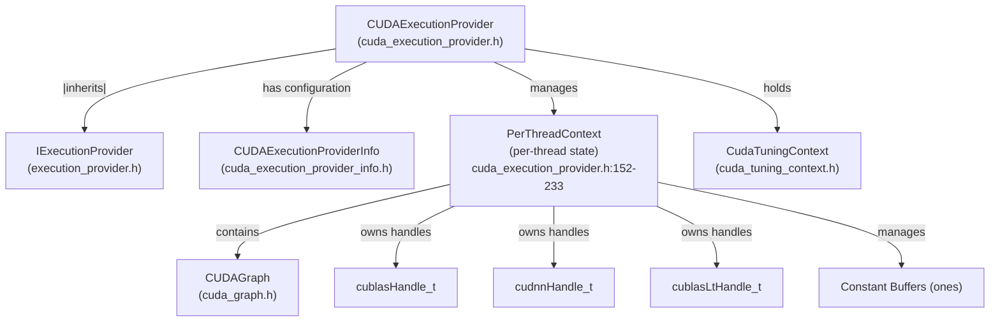

- **CUDAExecutionProvider** is the central class interfacing with the ONNX Runtime to provide CUDA-based kernel execution. It inherits from the abstract `IExecutionProvider`.
- **CUDAExecutionProviderInfo** encapsulates configuration parameters like device ID, memory limits, convolution algorithm choices, and stream preferences.
- **PerThreadContext** holds CUDA library handles (cuBLAS, cuDNN, cuBLASLt) and CUDA graph-related state on a per-thread basis for thread safety and performance.
- **CudaTuningContext** manages tunable kernel selection to achieve optimal runtime performance.
- **CUDAGraph** abstracts CUDA Graph capture and replay functionality for improved execution efficiency.

Sources: [onnxruntime/core/providers/cuda/cuda_execution_provider.h:20-233](), [onnxruntime/core/providers/cuda/cuda_execution_provider.cc:295-353]().

---

### Per-Thread Context Management

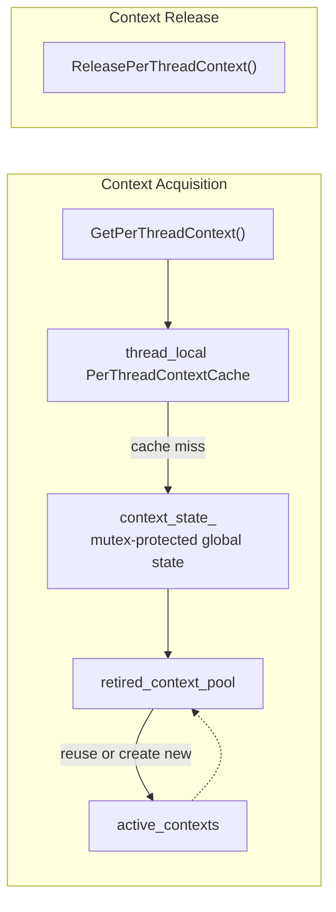

- To avoid repeated cuBLAS/cuDNN handle creation overhead, contexts are cached per-thread and per-EP.
- A thread-local cache stores active per-thread contexts for fast retrieval.
- Contexts no longer needed are moved to a global retired pool, guarded by a mutex, for reuse.
- Active contexts are tracked globally to manage lifetime.
- The context lifecycle management provides thread safety and efficient handle reuse.

Sources: [onnxruntime/core/providers/cuda/cuda_execution_provider.cc:427-484](), [onnxruntime/core/providers/cuda/cuda_execution_provider.h:152-233]().

---

## Configuration and Initialization

### Key Configuration Parameters

| Parameter                        | Type                                   | Default                              | Description                                      |
|---------------------------------|--------------------------------------|------------------------------------|--------------------------------------------------|
| `device_id`                     | `OrtDevice::DeviceId`                 | 0                                  | CUDA device index to use                          |
| `gpu_mem_limit`                 | `size_t`                             | `std::numeric_limits<size_t>::max()` | Max GPU memory arena limit                        |
| `arena_extend_strategy`         | `ArenaExtendStrategy`                 | `kNextPowerOfTwo`                   | Strategy to grow memory arena                     |
| `cudnn_conv_algo_search`        | `OrtCudnnConvAlgoSearch`              | `Exhaustive`                       | cuDNN convolution algorithm selection strategy   |
| `do_copy_in_default_stream`     | `bool`                              | `true`                             | Use default stream for memory copies              |
| `has_user_compute_stream`       | `bool`                              | `false`                            | Whether user provides a custom compute stream    |
| `enable_cuda_graph`             | `bool`                              | `false`                            | Enable CUDA graph capture                          |
| `tunable_op`                   | `TunableOpInfo`                      | default disabled                   | Tunable kernel execution configuration           |
| `prefer_nhwc`                  | `bool`                              | `false`                           | Prefer NHWC data layout over NCHW                  |
| `use_tf32`                    | `bool`                              | `true`                            | Use TF32 math mode for compatible GPUs            |

Sources: [onnxruntime/core/providers/cuda/cuda_execution_provider_info.h:48-82](), [onnxruntime/core/providers/cuda/cuda_execution_provider_info.cc:54-165]().

---

### Initialization Sequence

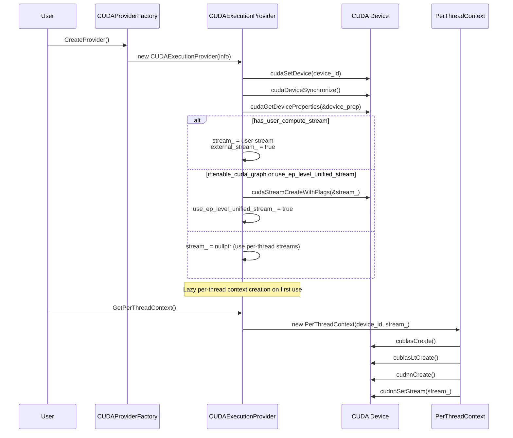

- The CUDAExecutionProvider is created via factory with configuration.
- The CUDA device is set and synchronized to ensure proper initialization.
- Device properties are queried.
- If CUDA graph capturing or EP-level unified streams are enabled, a dedicated stream is created.
- Per-thread contexts with cuBLAS, cuBLASLt, and cuDNN handles are lazily created associated with the stream.

Sources: [onnxruntime/core/providers/cuda/cuda_execution_provider.cc:307-353](), [onnxruntime/core/providers/cuda/cuda_provider_factory.cc:50-54]().

---

## Memory Management

### Allocator Design

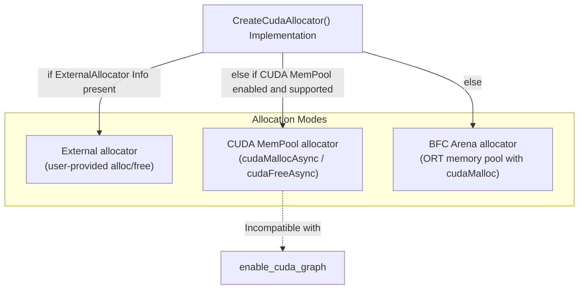

- **External allocator** usage occurs if user provides external allocation functions via `external_alloc_info`.
- **CUDA MemPool** uses CUDA 11.2+ asynchronous allocators (`cudaMallocAsync`), offering efficient native pooling.
- **BFC Arena** is the default ORT allocator that manages memory using a best-fit coalescing arena backed by `cudaMalloc`.
- CUDA MemPool allocator is not compatible with CUDA Graphs due to stream locality and asynchronous semantics.

Sources: [onnxruntime/core/providers/cuda/cuda_execution_provider.cc:138-204]().

---

### Arena Configuration

The arena allocator can be fine-tuned using the `OrtArenaCfg` structure with parameters such as:

- `max_mem`: Maximum allowed memory (bytes)
- `arena_extend_strategy`: Growth strategy (`kNextPowerOfTwo`, `kSameAsRequested`)
- `initial_chunk_size_bytes`: Initial chunk size allocated
- `max_dead_bytes_per_chunk`: Fragmentation control threshold
- `initial_growth_chunk_size_bytes`: Size for initial growth when extending arena
- `max_power_of_two_extend_bytes`: Max size for power-of-two extension chunks

This configuration ensures flexible memory usage suited to GPU workloads.

Sources: [onnxruntime/core/providers/cuda/cuda_execution_provider.cc:153-204](), [onnxruntime/core/providers/cuda/cuda_execution_provider_info.h:60-82]().

---

### CUDA Stream Management

| Mode                       | Description                                                                                      | Stream Source              |
|----------------------------|------------------------------------------------------------------------------------------------|----------------------------|
| Per-thread streams (default) | Each thread uses its own stream tied to `OpKernelContext`, allowing concurrency                  | Provided by OpKernelContext |
| EP-level unified stream     | Single CUDA stream for all operations in the EP, used when CUDA Graphs or explicit unified stream flag is set | `CUDAExecutionProvider::stream_` |
| User-provided stream        | An external stream supplied by the user overrides internal stream management                    | User-provided handle        |

The unified stream configuration is obligatory for CUDA graph capture and optionally available for other use cases.

Sources: [onnxruntime/core/providers/cuda/cuda_execution_provider.cc:324-342](), [onnxruntime/core/providers/cuda/cuda_execution_provider.h:60-67]().

---

## CUDA Graph Capture and Replay

### Graph Capture Lifecycle

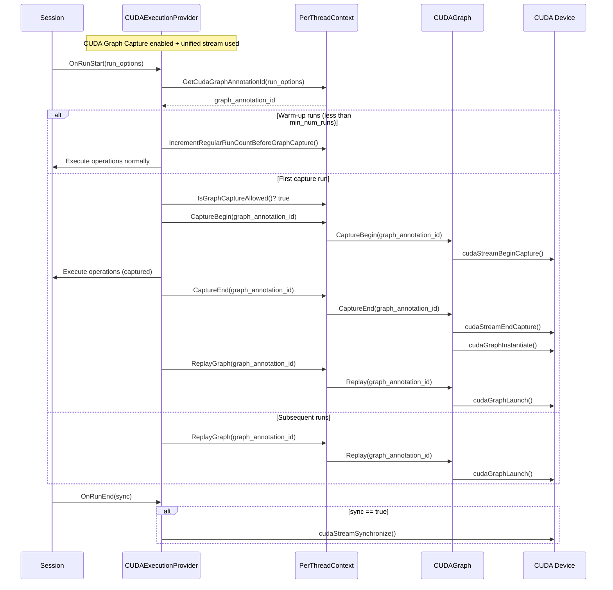

- The CUDA EP uses a warm-up phase (default min runs = 1) prior to capturing CUDA calls.
- After warm-up, the EP captures the CUDA kernel launches on a unified stream by calling `cudaStreamBeginCapture`.
- Once capture completes, the graph is instantiated by `cudaGraphInstantiate`.
- Subsequent calls replay the graph with `cudaGraphLaunch`.
- Run options can specify a graph annotation ID to support multiple graphs.

Sources: [onnxruntime/core/providers/cuda/cuda_execution_provider.cc:491-533](), [onnxruntime/core/providers/cuda/cuda_execution_provider.cc:230-284](), [onnxruntime/core/providers/cuda/cuda_graph.h]().

---

### CUDA Graph Constraints and Considerations

- Requires EP-level unified stream for proper semantics.
- Incompatible with CUDA MemPool allocator because of asynchronous allocations and stream dependencies.
- When graph capture is enabled, `PerThreadContext` instances are not released during runtime to maintain handle stability.
- Only CUDA operations can be performed during graph capture; CPU fallbacks break the capture semantics.
- Captured host buffers used during copy operations must be retained to avoid premature reuse or release.

Sources: [onnxruntime/core/providers/cuda/cuda_execution_provider.cc:156-175](), [onnxruntime/core/providers/cuda/cuda_execution_provider.cc:519-530]().

---

## Library Integration

### cuDNN Integration

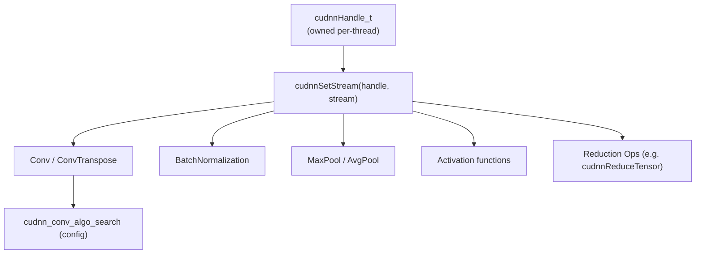

- Each per-thread context owns a `cudnnHandle_t`.
- The cudnn handle is associated with the CUDA compute stream.
- cuDNN is leveraged for convolution and convolution transpose operations with algorithm search modes (`Exhaustive`, `Heuristic`, `Default`).
- Additional ops accelerated by cuDNN include batch normalization, pooling, activation functions, and reduction operations with `cudnnReduceTensor`.

Sources: [onnxruntime/core/providers/cuda/cuda_execution_provider.cc:211-217](), [onnxruntime/core/providers/cuda/cuda_execution_provider_info.h:52]().

---

### cuBLAS and cuBLASLt Integration

- The EP uses both the classic cuBLAS (`cublasHandle_t`) and the newer cuBLASLt (`cublasLtHandle_t`), both created and stored in the per-thread context.
- cuBLAS is primarily used for foundational GEMM and MatMul operations.
- cuBLASLt is employed for advanced GEMM use-cases including epilogue fusion and layout optimizations.

Both handles:

- Are created lazily per-thread.
- Are bound to the CUDA compute stream.
- Provide thread-local cuBLAS resources for concurrency.

```cpp
CUBLAS_CALL_THROW(cublasCreate(&cublas_handle_));
CUBLAS_CALL_THROW(cublasLtCreate(&cublas_lt_handle_));
CUBLAS_CALL_THROW(cublasSetStream(cublas_handle_, compute_stream));
```

Sources: [onnxruntime/core/providers/cuda/cuda_execution_provider.cc:211-213](), [onnxruntime/core/providers/cuda/cuda_execution_provider.h:153-163]().

---

### Constant Buffer Management

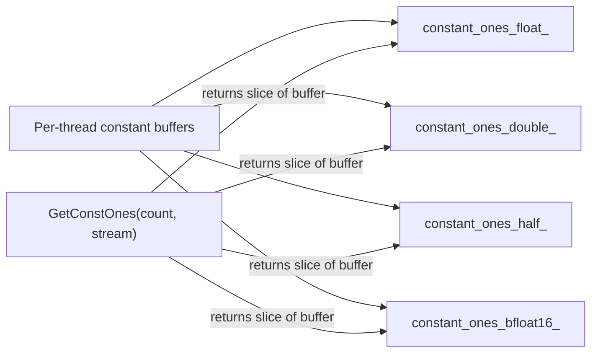

- The EP maintains per-thread constant buffers holding arrays of the value 1.0 for float, double, half (fp16), and bfloat16.
- These are used as helper buffers for cuBLAS operations requiring vector inputs of ones.
- Buffers are allocated on-demand and preserved for the lifetime of the per-thread context.

Sources: [onnxruntime/core/providers/cuda/cuda_execution_provider.h:165-202]().

---

## Operator Execution

### Binary Elementwise Operations

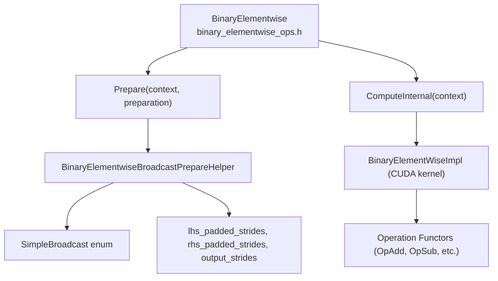

- Supports operations like Add, Sub, Mul, Div with broadcasting.
- The `Prepare` step computes broadcasting strategy and output shapes.
- Several broadcast types like no-broadcast, scalar broadcast, per-channel broadcast are optimized.
- Binary fusion kernels implement elementwise arithmetic.
- Kernel dispatch depends on input shapes and broadcasting mode.

Sources: [onnxruntime/core/providers/cuda/math/binary_elementwise_ops.h:1-168](), [onnxruntime/core/providers/cuda/math/binary_elementwise_ops.cc:15-60](), [onnxruntime/core/providers/cuda/math/binary_elementwise_ops_impl.cu:13-27]().

---

### Unary Elementwise Operations

- Unary ops such as `Abs`, `Neg`, `Sqrt`, `Exp`, `Log` use a straightforward ComputeInternal method.
- The operator prepares input and output buffers.
- The corresponding CUDA kernel is invoked with a functor implementing the unary operation.

Example snippet:

```cpp
template <typename T>
Status UnaryElementwise::ComputeInternal(OpKernelContext* context) const {
  UnaryElementwisePreparation p;
  ORT_RETURN_IF_ERROR(Prepare(context, &p));
  Impl_[OP_TYPE]<T>(
      Stream(context),
      reinterpret_cast<const typename ToCudaType<T>::MappedType*>(p.input_tensor->Data<T>()),
      reinterpret_cast<typename ToCudaType<T>::MappedType*>(p.output_tensor->MutableData<T>()),
      p.output_tensor->Shape().Size());
  return Status::OK();
}
```

Sources: [onnxruntime/core/providers/cuda/math/unary_elementwise_ops.cc:10-14](), [onnxruntime/core/providers/cuda/math/unary_elementwise_ops_impl.cu:17-113]().

---

### Reduction Operations

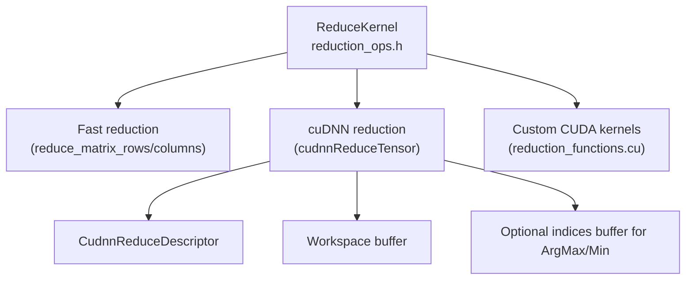

- Reduction ops (sum, mean, max, argmax, argmin, logsumexp) select the best strategy:
  - Fast matrix reduction for simple cases.
  - cuDNN tensor reduction for general cases, managing its own workspace.
  - Custom CUDA kernels for specialized ops (logsumexp uses multi-step kernel sequence).
- ArgMax/ArgMin optionally output indices with workspace.

Sources: [onnxruntime/core/providers/cuda/reduction/reduction_ops.cc:49-224](), [onnxruntime/core/providers/cuda/reduction/reduction_functions.cu:20-645]().

---

## Tunable Operations

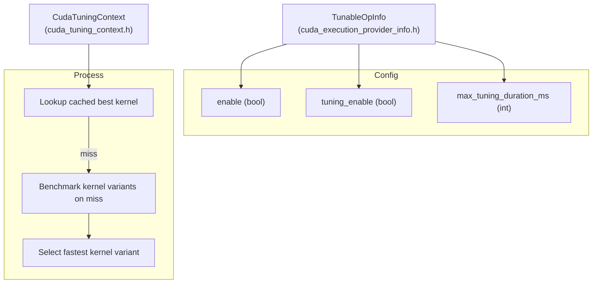

- Tunable kernel support allows dynamic selection of the most efficient kernel at runtime.
- Controlled by provider options like `tunable_op_enable` and environment variables.
- On first execution, various kernel variants are benchmarked; the fastest is cached.
- Useful for operations with many implementation variants (e.g. GEMM with different blocking).
- Provides performance adaptability across hardware and input shapes.

Sources: [onnxruntime/core/providers/cuda/cuda_execution_provider_info.h:40-46](), [onnxruntime/core/providers/cuda/cuda_execution_provider.cc:286-305](), [onnxruntime/core/providers/cuda/cuda_execution_provider.cc:409-411]().

---

## Data Transfer

### GPUDataTransfer

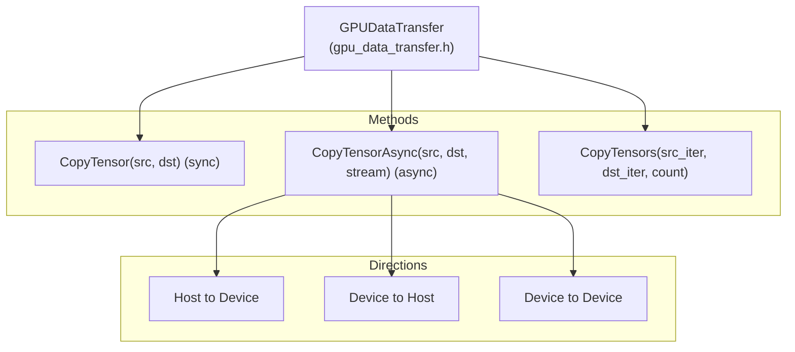

- Facilitates data movement between host and CUDA device memory.
- Supports synchronous copy (`cudaMemcpy`) and asynchronous copy (`cudaMemcpyAsync` with CUDA stream).
- Automatically detects copy direction from source and destination memory info.
- Supports multi-device environments, handling device setting switches appropriately.

Sources: [onnxruntime/core/providers/cuda/gpu_data_transfer.h](), [onnxruntime/core/providers/cuda/cuda_provider_factory.cc:110-150]().

---

### Memcpy Operators

The `MemcpyFromHost` and `MemcpyToHost` operators support copying tensor and tensor sequence data between CPU and GPU memory:

- Special kernels registered under the CUDA EP
- Handle tensor, sparse tensor, and tensor sequence types asynchronously where possible
- Use `GPUDataTransfer::CopyTensorAsync` to schedule copies on CUDA streams
- Select appropriate allocators for destination buffers depending on copy direction

Example registration snippet for MemcpyFromHost:

```cpp
ONNX_OPERATOR_KERNEL_EX(
    MemcpyFromHost,
    kOnnxDomain,
    1,
    kCudaExecutionProvider,
    (*KernelDefBuilder::Create())
        .InputMemoryType(OrtMemTypeCPUInput, 0)
        .TypeConstraint("T", DataTypeImpl::AllFixedSizeTensorAndSequenceTensorTypesIRv9()),
    Memcpy);
```

Sources: [onnxruntime/core/providers/cuda/cuda_execution_provider.cc:44-136]().

---

## Preferred Data Layout

- The CUDA EP can prefer the NHWC (channels-last) data layout over NCHW (channels-first) for certain operators to optimize performance on modern GPUs supporting Tensor Cores.
- Preference is controlled by the `prefer_nhwc` configuration flag.
- The set of operators preferring NHWC includes `BatchNormalization`, `Conv`, `ConvTranspose`, `MaxPool`, `AveragePool`, `LRN`, among others.
- When enabled, the EP suggests data layout conversion during graph partitioning and optimization.

Example implementation:

```cpp
std::optional<bool> CUDAExecutionProvider::ShouldConvertDataLayoutForOp(
    std::string_view node_domain,
    std::string_view node_op_type,
    DataLayout target_data_layout) const {
  #if defined(ENABLE_CUDA_NHWC_OPS)
  if (target_data_layout != DataLayout::NHWC) {
    return std::nullopt;
  }
  
  static const std::unordered_set<std::string_view> cuda_nhwc_onnx_ops{
      "BatchNormalization", "Conv", "ConvTranspose", "GlobalMaxPool",
      "MaxPool", "GlobalAveragePool", "AveragePool", "GridSample",
      "DepthToSpace", "SpaceToDepth", "LRN",
  };
  
  return (node_domain == kOnnxDomain && 
          cuda_nhwc_onnx_ops.find(node_op_type) != cuda_nhwc_onnx_ops.end());
  #endif
}
```

Sources: [onnxruntime/core/providers/cuda/cuda_execution_provider.cc:355-391]().

---

## Provider Registration and Factory Pattern

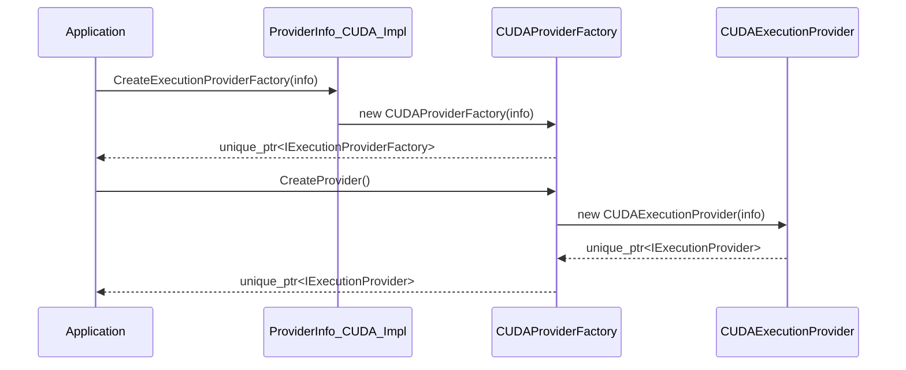

- The EP uses a factory design pattern for construction.
- `ProviderInfo_CUDA_Impl` implements provider-specific APIs and configuration parsing.
- `CUDAProviderFactory` creates instances of `CUDAExecutionProvider`.
- The CUDA EP instance is then managed by the ONNX Runtime session infrastructure.
- Registration is handled at shared library/module initialization.

Sources: [onnxruntime/core/providers/cuda/cuda_provider_factory.cc:41-54]().

---

# Summary

The CUDA Execution Provider implements NVIDIA GPU acceleration for ONNX Runtime via direct CUDA API, integrated cuBLAS/cuDNN/cuBLASLt usage, advanced per-thread context and memory management, and sophisticated stream and CUDA Graph control. It supports tunable kernels for adaptive performance and seamless memory transfers between host and device. Its design facilitates efficient large-scale model inference and training on CUDA-compatible hardware.

Sources: [onnxruntime/core/providers/cuda/cuda_execution_provider.h:1-233](), [onnxruntime/core/providers/cuda/cuda_execution_provider.cc:1-533](), [onnxruntime/core/providers/cuda/cuda_provider_factory.cc:1-164]().

---

