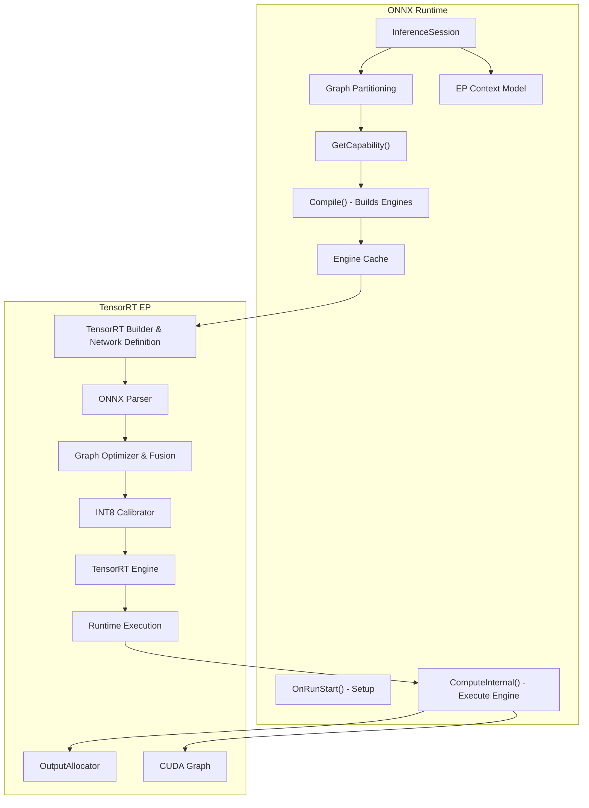
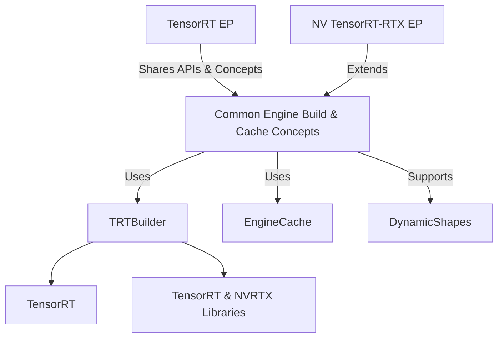
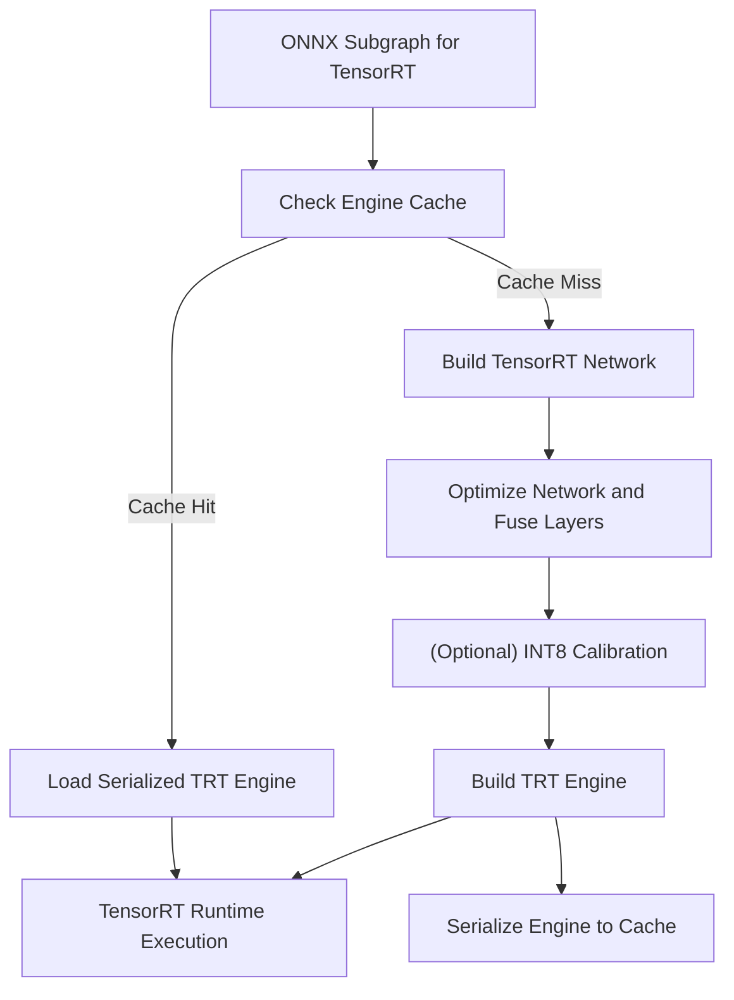
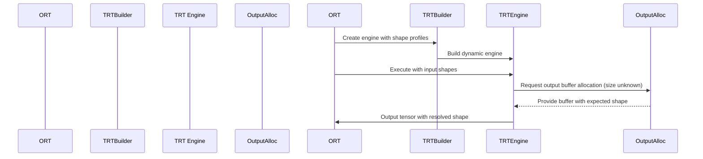
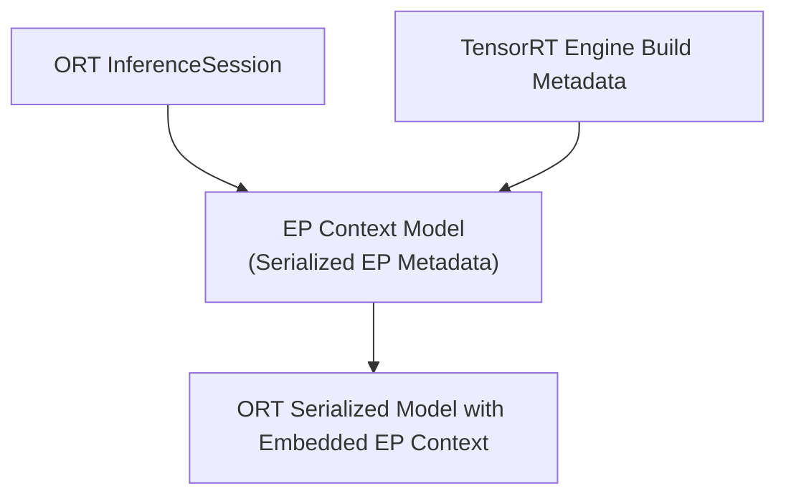
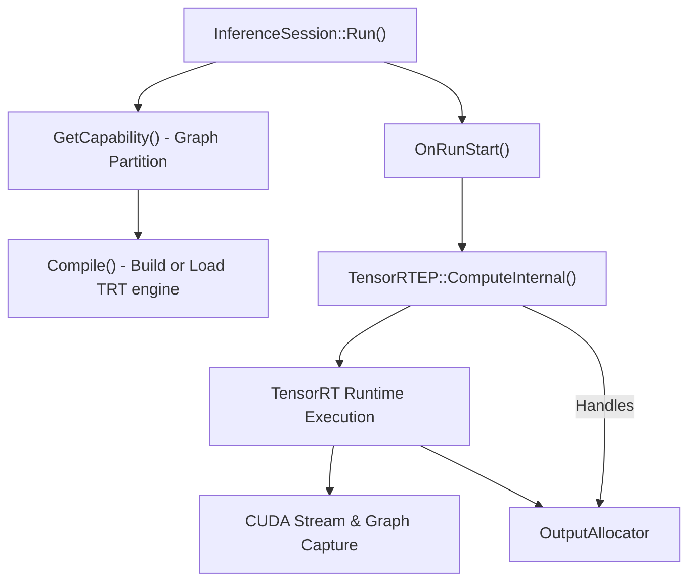

<!-- source: DeepWiki mcp.deepwiki.com · repo microsoft/onnxruntime · page 6.4 TensorRT Execution Provider · fetched 2026-10-21 -->

# TensorRT Execution Provider

<details>
<summary>Relevant source files</summary>

The following files were used as context for generating this wiki page:

- [cmake/onnxruntime_providers_nv.cmake](cmake/onnxruntime_providers_nv.cmake)
- [cmake/onnxruntime_providers_tensorrt.cmake](cmake/onnxruntime_providers_tensorrt.cmake)
- [include/onnxruntime/core/providers/nv_tensorrt_rtx/nv_provider_options.h](include/onnxruntime/core/providers/nv_tensorrt_rtx/nv_provider_options.h)
- [include/onnxruntime/core/providers/tensorrt/tensorrt_provider_options.h](include/onnxruntime/core/providers/tensorrt/tensorrt_provider_options.h)
- [onnxruntime/core/common/path_utils.h](onnxruntime/core/common/path_utils.h)
- [onnxruntime/core/providers/cpu/cpu_provider_shared.cc](onnxruntime/core/providers/cpu/cpu_provider_shared.cc)
- [onnxruntime/core/providers/cpu/cpu_provider_shared.h](onnxruntime/core/providers/cpu/cpu_provider_shared.h)
- [onnxruntime/core/providers/nv_tensorrt_rtx/nv_execution_provider.cc](onnxruntime/core/providers/nv_tensorrt_rtx/nv_execution_provider.cc)
- [onnxruntime/core/providers/nv_tensorrt_rtx/nv_execution_provider.h](onnxruntime/core/providers/nv_tensorrt_rtx/nv_execution_provider.h)
- [onnxruntime/core/providers/nv_tensorrt_rtx/nv_execution_provider_custom_ops.cc](onnxruntime/core/providers/nv_tensorrt_rtx/nv_execution_provider_custom_ops.cc)
- [onnxruntime/core/providers/nv_tensorrt_rtx/nv_execution_provider_helper.cc](onnxruntime/core/providers/nv_tensorrt_rtx/nv_execution_provider_helper.cc)
- [onnxruntime/core/providers/nv_tensorrt_rtx/nv_execution_provider_info.cc](onnxruntime/core/providers/nv_tensorrt_rtx/nv_execution_provider_info.cc)
- [onnxruntime/core/providers/nv_tensorrt_rtx/nv_execution_provider_info.h](onnxruntime/core/providers/nv_tensorrt_rtx/nv_execution_provider_info.h)
- [onnxruntime/core/providers/nv_tensorrt_rtx/nv_execution_provider_utils.h](onnxruntime/core/providers/nv_tensorrt_rtx/nv_execution_provider_utils.h)
- [onnxruntime/core/providers/nv_tensorrt_rtx/nv_platform_utils.h](onnxruntime/core/providers/nv_tensorrt_rtx/nv_platform_utils.h)
- [onnxruntime/core/providers/nv_tensorrt_rtx/nv_provider_factory.cc](onnxruntime/core/providers/nv_tensorrt_rtx/nv_provider_factory.cc)
- [onnxruntime/core/providers/nv_tensorrt_rtx/nv_provider_factory_creator.h](onnxruntime/core/providers/nv_tensorrt_rtx/nv_provider_factory_creator.h)
- [onnxruntime/core/providers/nv_tensorrt_rtx/nv_scoped_context.h](onnxruntime/core/providers/nv_tensorrt_rtx/nv_scoped_context.h)
- [onnxruntime/core/providers/nv_tensorrt_rtx/onnx_ctx_model_helper.cc](onnxruntime/core/providers/nv_tensorrt_rtx/onnx_ctx_model_helper.cc)
- [onnxruntime/core/providers/nv_tensorrt_rtx/onnx_ctx_model_helper.h](onnxruntime/core/providers/nv_tensorrt_rtx/onnx_ctx_model_helper.h)
- [onnxruntime/core/providers/nv_tensorrt_rtx/version_script.lds](onnxruntime/core/providers/nv_tensorrt_rtx/version_script.lds)
- [onnxruntime/core/providers/shared_library/provider_api.h](onnxruntime/core/providers/shared_library/provider_api.h)
- [onnxruntime/core/providers/shared_library/provider_bridge_provider.cc](onnxruntime/core/providers/shared_library/provider_bridge_provider.cc)
- [onnxruntime/core/providers/shared_library/provider_interfaces.h](onnxruntime/core/providers/shared_library/provider_interfaces.h)
- [onnxruntime/core/providers/shared_library/provider_wrappedtypes.h](onnxruntime/core/providers/shared_library/provider_wrappedtypes.h)
- [onnxruntime/core/providers/tensorrt/onnx_ctx_model_helper.cc](onnxruntime/core/providers/tensorrt/onnx_ctx_model_helper.cc)
- [onnxruntime/core/providers/tensorrt/onnx_ctx_model_helper.h](onnxruntime/core/providers/tensorrt/onnx_ctx_model_helper.h)
- [onnxruntime/core/providers/tensorrt/tensorrt_execution_provider.cc](onnxruntime/core/providers/tensorrt/tensorrt_execution_provider.cc)
- [onnxruntime/core/providers/tensorrt/tensorrt_execution_provider.h](onnxruntime/core/providers/tensorrt/tensorrt_execution_provider.h)
- [onnxruntime/core/providers/tensorrt/tensorrt_execution_provider_custom_ops.cc](onnxruntime/core/providers/tensorrt/tensorrt_execution_provider_custom_ops.cc)
- [onnxruntime/core/providers/tensorrt/tensorrt_execution_provider_custom_ops.h](onnxruntime/core/providers/tensorrt/tensorrt_execution_provider_custom_ops.h)
- [onnxruntime/core/providers/tensorrt/tensorrt_execution_provider_info.cc](onnxruntime/core/providers/tensorrt/tensorrt_execution_provider_info.cc)
- [onnxruntime/core/providers/tensorrt/tensorrt_execution_provider_info.h](onnxruntime/core/providers/tensorrt/tensorrt_execution_provider_info.h)
- [onnxruntime/core/providers/tensorrt/tensorrt_execution_provider_utils.h](onnxruntime/core/providers/tensorrt/tensorrt_execution_provider_utils.h)
- [onnxruntime/core/providers/tensorrt/tensorrt_provider_factory.cc](onnxruntime/core/providers/tensorrt/tensorrt_provider_factory.cc)
- [onnxruntime/core/session/provider_bridge_ort.cc](onnxruntime/core/session/provider_bridge_ort.cc)
- [onnxruntime/test/common/path_utils_test.cc](onnxruntime/test/common/path_utils_test.cc)
- [onnxruntime/test/providers/cpu/model_tests.cc](onnxruntime/test/providers/cpu/model_tests.cc)
- [onnxruntime/test/providers/nv_tensorrt_rtx/nv_basic_test.cc](onnxruntime/test/providers/nv_tensorrt_rtx/nv_basic_test.cc)
- [onnxruntime/test/providers/nv_tensorrt_rtx/nv_ep_context_test.cc](onnxruntime/test/providers/nv_tensorrt_rtx/nv_ep_context_test.cc)
- [onnxruntime/test/providers/nv_tensorrt_rtx/nv_external_resource_importer_test.cc](onnxruntime/test/providers/nv_tensorrt_rtx/nv_external_resource_importer_test.cc)
- [onnxruntime/test/providers/nv_tensorrt_rtx/test_nv_trt_rtx_ep_util.cc](onnxruntime/test/providers/nv_tensorrt_rtx/test_nv_trt_rtx_ep_util.cc)
- [onnxruntime/test/providers/nv_tensorrt_rtx/test_nv_trt_rtx_ep_util.h](onnxruntime/test/providers/nv_tensorrt_rtx/test_nv_trt_rtx_ep_util.h)
- [onnxruntime/test/providers/tensorrt/tensorrt_basic_test.cc](onnxruntime/test/providers/tensorrt/tensorrt_basic_test.cc)

</details>


## Purpose and Scope

This page documents the TensorRT Execution Provider (EP) in ONNX Runtime, detailing its integration with NVIDIA's TensorRT and NV TensorRT-RTX runtimes. It covers the design and implementation of TensorRT EP, dynamic engine building and caching mechanisms, handling of models with dynamic shapes, and ONNX Runtime’s EP context model integration for TensorRT and NV TensorRT-RTX providers. This page targets readers seeking deep technical understanding of the provider's inner workings and its data flow within ONNX Runtime.

---

## 1. TensorRT Execution Provider Overview

The TensorRT Execution Provider interfaces with NVIDIA’s TensorRT inference library to accelerate ONNX model execution on CUDA GPUs. It performs subgraph selection (partitioning), engine construction, precision calibration (FP16/INT8), and runtime optimization, supporting advanced features such as dynamic shape handling and CUDA graph capture.

Similarly, the NV TensorRT-RTX EP extends capabilities with support for newer NVIDIA hardware and datatype extensions (e.g., FP8).

### Key Responsibilities

- Identify subgraphs of nodes that can be offloaded to TensorRT.
- Build optimized TensorRT engines for each subgraph.
- Cache TensorRT engine binaries on disk for reuse.
- Manage input/output buffers including dynamic shaped tensors.
- Perform runtime execution leveraging TensorRT’s high-throughput runtime.
- Support environment variables, session options, and provider options for detailed configuration.
- Optionally integrate with the ONNX Runtime EP context model framework for embedding execution metadata.

This execution provider is commonly used alongside the CUDA EP, which handles node fallbacks for unsupported operations.

### High-Level Architecture Diagram



Sources:  
- `onnxruntime/core/providers/tensorrt/tensorrt_execution_provider.cc:7-180`()  
- `onnxruntime/core/providers/tensorrt/tensorrt_execution_provider.h:27-160`()  
- `onnxruntime/core/providers/nv_tensorrt_rtx/nv_execution_provider.cc:1-176`()

---

## 2. Integration Between TensorRT and NV TensorRT-RTX EPs

ONNX Runtime supports two distinct but related NVIDIA providers:

- **TensorRT EP**: The original provider binding with NVIDIA TensorRT libraries, supporting common features and precision modes such as FP32, FP16, INT8, and DLA cores.

- **NV TensorRT-RTX EP**: A newer provider designed for RTX and Hopper architectures, enabling more data types (e.g., FP8, INT4), extended operators, and optimized runtimes with additional features.

They share architectural patterns including graph partitioning, engine building, engine caching, and dynamic shape support. Both providers expose similar provider options and support ONNX Runtime's EP context model embedding.

### Relationship Workflow Diagram



Sources:  
- `onnxruntime/core/providers/tensorrt/tensorrt_execution_provider.cc:7-180`()  
- `onnxruntime/core/providers/nv_tensorrt_rtx/nv_execution_provider.cc:1-176`()  
- `onnxruntime/core/providers/tensorrt/tensorrt_execution_provider.h:27-160`()

---

## 3. Engine Building and Caching Mechanisms

TensorRT EP builds CUDA-accelerated engines for partitions of the ONNX model graph. This involves:

- Converting ONNX subgraphs into TensorRT `INetworkDefinition`.
- Applying built-in network optimizations and layer fusion.
- Optionally performing INT8 calibration with custom calibrators.
- Serializing optimized TensorRT engines to disk caches for reuse.
- Using environment variables or provider options to configure caching, path, and engine build behavior.

### Engine Cache Management

The engine cache stores serialized TensorRT engine binaries identified by hash-based keys related to:

- Graph topology and nodes
- Provider options (like precision flags, workspace size)
- Hardware details (device id, compute capability)

When loading a model, the EP attempts to load the cached engine to avoid redundant build overhead. Cache options include enabling/disabling cache, specifying cache directory, cache prefix, and engine stripping (removing weights to reduce size).

### Key Functions and Classes

- `TensorrtExecutionProvider::Compile()` - invoked during session initialization to build or load engines for identified subgraphs.  
- `TensorrtExecutionProviderInfo` - stores configuration parameters including cache options.  
- Engine cache files located in paths defined by `kORT_TENSORRT_CACHE_PATH` and related environment variables.

### Engine Build Flowchart



Sources:  
- `onnxruntime/core/providers/tensorrt/tensorrt_execution_provider.cc:95-180`()  
- `onnxruntime/core/providers/tensorrt/tensorrt_execution_provider_info.cc:69-150`()  
- `onnxruntime/core/providers/tensorrt/tensorrt_provider_factory.cc:50-129`()

---

## 4. Dynamic Shape Support

TensorRT EP supports models with dynamic input shapes using the TensorRT dynamic shapes API. This enables:

- Building engines with optimization profiles specifying minimum, optimum, and maximum shapes.
- At runtime, selection and use of correct optimization profile based on input tensor shapes.
- Support for engines that handle multiple shape variants efficiently.

### Handling Unknown Output Sizes

For outputs with data-dependent sizes (non-static shapes), TensorRT EP implements `OutputAllocator`, which manages memory reallocation during runtime execution since output sizes can only be known after computation.

Key methods of `OutputAllocator`:

- `reallocateOutputAsync` / `reallocateOutput`: Called by TensorRT runtime to allocate or resize output buffers asynchronously or synchronously.
- `notifyShape`: Used by TensorRT to inform ONNX Runtime about the shape of output tensors.
- Maintains allocated buffer pointer and output shape metadata.

This pattern prevents pre-allocation failures and avoids constant memory reallocations for dynamic execution.

### Dynamic Shape Engine Build

- Provider options allow specifying multiple shape profiles (min/max/opt) via environment variables or options.  
- During compilation, the EP sets these profiles on the TensorRT builder before building the engine.  
- Profiling data is embedded to optimize kernel selection for each shape variant.

### Diagram: Dynamic Shape Engine LifeCycle



Sources:  
- `onnxruntime/core/providers/tensorrt/tensorrt_execution_provider.h:130-160`()  
- `onnxruntime/core/providers/tensorrt/tensorrt_execution_provider.cc:68-156`()

---

## 5. EP Context Model Integration

ONNX Runtime provides an EP context model interface to embed provider-specific metadata into ORT session files. TensorRT EP incorporates this for advanced features like:

- Embedding engine build metadata and optimization profiles into the ORT serialized session model.
- Supporting model debugging and inspection by exposing EP context metadata.
- Optional dumping and embedding of this context model controlled via provider options/environment variables.

Key concepts:

- Provider option `dump_ep_context_model` enables dumping the serialized context metadata.
- Embedding modes (`ep_context_embed_mode`) define how context data is incorporated.
- Compute capability-based conditional loading to ensure correct hardware compatibility.

This integration facilitates transparent operator partitioning and TensorRT graph model inspection beyond runtime.

### EP Context Model Flow



Sources:  
- `onnxruntime/core/providers/tensorrt/tensorrt_execution_provider.cc:3300-3400` (context model related code not fully shown but inferred)  
- `onnxruntime/core/providers/tensorrt/tensorrt_execution_provider_info.cc:350-399`()

---

## 6. Configuration and Environment Variables

TensorRT EP supports a wide array of configuration parameters.

### Major Environment Variables

- `ORT_TENSORRT_MAX_PARTITION_ITERATIONS`: Max iterations for subgraph partitioning.
- `ORT_TENSORRT_MIN_SUBGRAPH_SIZE`: Minimum subgraph node count to consider for TRT.
- `ORT_TENSORRT_MAX_WORKSPACE_SIZE`: Maximum GPU memory for TensorRT workspace.
- `ORT_TENSORRT_FP16_ENABLE`, `ORT_TENSORRT_BF16_ENABLE`, `ORT_TENSORRT_INT8_ENABLE`: Precision modes.
- `ORT_TENSORRT_ENGINE_CACHE_ENABLE`: Enables engine caching.
- `ORT_TENSORRT_CACHE_PATH`: Cache directory path.
- `ORT_TENSORRT_DLA_ENABLE`: Enable DLA core usage.
- `ORT_TENSORRT_CUDA_GRAPH_ENABLE`: Enable CUDA graph capture.
- `ORT_DUMP_EP_CONTEXT_MODEL`: Dump EP context metadata.
- `ORT_EP_CONTEXT_EMBED_MODE`: Set embedding mode for context.
- `ORT_TENSORRT_OP_TYPES_TO_EXCLUDE`: Comma-separated list of op types to exclude from TRT.

### Provider Options Example (C++ API)

The `TensorrtExecutionProviderInfo` struct encapsulates all such options, passed to `TensorrtExecutionProvider` upon creation.

```cpp
TensorrtExecutionProviderInfo info{};
info.device_id = 0;
info.fp16_enable = true;
info.engine_cache_enable = true;
info.engine_cache_path = "/tmp/trt_cache";
// further options...
std::unique_ptr<IExecutionProvider> trt_ep = std::make_unique<TensorrtExecutionProvider>(info);
```

### Logging and Detailed Build Options

- `ORT_TENSORRT_DETAILED_BUILD_LOG_ENABLE`: Enables detailed logs from TensorRT builder.
- `ORT_TENSORRT_BUILD_HEURISTICS_ENABLE`: Enables heuristic engine build strategy.
- `ORT_TENSORRT_TIMING_CACHE_ENABLE`: Enables timing cache for engine builds.

Sources:  
- `onnxruntime/core/providers/tensorrt/tensorrt_execution_provider_info.cc:10-110`()  
- `onnxruntime/core/providers/tensorrt/tensorrt_execution_provider.h:29-72`()  
- `onnxruntime/core/providers/tensorrt/tensorrt_execution_provider.cc:50-180`()

---

## 7. Data Flow Summary in Execution Lifecycle

1. **Graph Partitioning:** TensorRT EP's `GetCapability()` inspects the ONNX graph to identify supported subgraphs using kernel and capability checks, runtime data type validations, and environment conditions.

2. **Compilation:** `Compile()` builds or loads cached TensorRT engines for each subgraph, integrating calibration as needed.

3. **Execution:** At runtime (`ComputeInternal()`), the engine is executed with input tensors, output buffers allocated via `OutputAllocator` if dynamic sizes are present.

4. **Graph Capture:** Optionally supports CUDA graph capture to optimize repeated execution patterns.

5. **Synchronization:** Ensures stream synchronization and resource management.

### Execution Flow Diagram (Entity Mapping)



Sources:  
- `onnxruntime/core/providers/tensorrt/tensorrt_execution_provider.cc:3200-3400` ()  
- `onnxruntime/core/providers/tensorrt/tensorrt_execution_provider.h:120-160` ()  

---

## 8. Summary

The TensorRT Execution Provider is a critical ONNX Runtime module that integrates NVIDIA’s TensorRT and NV TensorRT-RTX runtimes to achieve high-performance GPU inference acceleration. It:

- Converts ONNX subgraphs into highly optimized TensorRT engines.
- Supports precision modes FP32/FP16/BF16/INT8 and device-specific features like DLA.
- Supports dynamic input shapes efficiently using TensorRT profiles.
- Manages persistent engine caches to reduce build times.
- Optionally integrates EP context models for embedding runtime metadata.
- Allows fine-grained configuration through environment variables and programmatic options.

This provider exemplifies advanced hardware acceleration integration within a modular and extensible inference framework.

---

Sources:  
- `onnxruntime/core/providers/tensorrt/tensorrt_execution_provider.cc:1-181`(), `onnxruntime/core/providers/tensorrt/tensorrt_execution_provider.h:1-159`(),  
- `onnxruntime/core/providers/tensorrt/tensorrt_execution_provider_info.cc:1-110`(),  
- `onnxruntime/core/providers/tensorrt/tensorrt_provider_factory.cc:1-131`(),  
- `onnxruntime/core/providers/nv_tensorrt_rtx/nv_execution_provider.cc:1-176`()

---

