<!-- source: DeepWiki mcp.deepwiki.com · repo microsoft/onnxruntime · page 6.5 Other Execution Providers · fetched 2026-10-21 -->

# Other Execution Providers

Relevant source files

The following files were used as context for generating this wiki page:

- [cmake/external/dnnl.cmake](cmake/external/dnnl.cmake)
- [cmake/onnxruntime_providers_openvino.cmake](cmake/onnxruntime_providers_openvino.cmake)
- [cmake/onnxruntime_providers_vitisai.cmake](cmake/onnxruntime_providers_vitisai.cmake)
- [include/onnxruntime/core/providers/coreml/coreml_provider_factory.h](include/onnxruntime/core/providers/coreml/coreml_provider_factory.h)
- [include/onnxruntime/core/providers/dml/dml_provider_factory.h](include/onnxruntime/core/providers/dml/dml_provider_factory.h)
- [include/onnxruntime/core/session/onnxruntime_session_options_config_keys.h](include/onnxruntime/core/session/onnxruntime_session_options_config_keys.h)
- [js/web/docs/webnn-operators.md](js/web/docs/webnn-operators.md)
- [onnxruntime/core/framework/graph_partitioner.cc](onnxruntime/core/framework/graph_partitioner.cc)
- [onnxruntime/core/framework/graph_partitioner.h](onnxruntime/core/framework/graph_partitioner.h)
- [onnxruntime/core/providers/coreml/builders/helper.cc](onnxruntime/core/providers/coreml/builders/helper.cc)
- [onnxruntime/core/providers/coreml/builders/helper.h](onnxruntime/core/providers/coreml/builders/helper.h)
- [onnxruntime/core/providers/coreml/builders/impl/activation_op_builder.cc](onnxruntime/core/providers/coreml/builders/impl/activation_op_builder.cc)
- [onnxruntime/core/providers/coreml/builders/impl/argmax_op_builder.cc](onnxruntime/core/providers/coreml/builders/impl/argmax_op_builder.cc)
- [onnxruntime/core/providers/coreml/builders/impl/base_op_builder.cc](onnxruntime/core/providers/coreml/builders/impl/base_op_builder.cc)
- [onnxruntime/core/providers/coreml/builders/impl/base_op_builder.h](onnxruntime/core/providers/coreml/builders/impl/base_op_builder.h)
- [onnxruntime/core/providers/coreml/builders/impl/batch_norm_op_builder.cc](onnxruntime/core/providers/coreml/builders/impl/batch_norm_op_builder.cc)
- [onnxruntime/core/providers/coreml/builders/impl/binary_op_builder.cc](onnxruntime/core/providers/coreml/builders/impl/binary_op_builder.cc)
- [onnxruntime/core/providers/coreml/builders/impl/builder_utils.cc](onnxruntime/core/providers/coreml/builders/impl/builder_utils.cc)
- [onnxruntime/core/providers/coreml/builders/impl/builder_utils.h](onnxruntime/core/providers/coreml/builders/impl/builder_utils.h)
- [onnxruntime/core/providers/coreml/builders/impl/cast_op_builder.cc](onnxruntime/core/providers/coreml/builders/impl/cast_op_builder.cc)
- [onnxruntime/core/providers/coreml/builders/impl/clip_op_builder.cc](onnxruntime/core/providers/coreml/builders/impl/clip_op_builder.cc)
- [onnxruntime/core/providers/coreml/builders/impl/concat_op_builder.cc](onnxruntime/core/providers/coreml/builders/impl/concat_op_builder.cc)
- [onnxruntime/core/providers/coreml/builders/impl/conv_op_builder.cc](onnxruntime/core/providers/coreml/builders/impl/conv_op_builder.cc)
- [onnxruntime/core/providers/coreml/builders/impl/gather_op_builder.cc](onnxruntime/core/providers/coreml/builders/impl/gather_op_builder.cc)
- [onnxruntime/core/providers/coreml/builders/impl/gemm_op_builder.cc](onnxruntime/core/providers/coreml/builders/impl/gemm_op_builder.cc)
- [onnxruntime/core/providers/coreml/builders/impl/pool_op_builder.cc](onnxruntime/core/providers/coreml/builders/impl/pool_op_builder.cc)
- [onnxruntime/core/providers/coreml/builders/impl/reduction_op_builder.cc](onnxruntime/core/providers/coreml/builders/impl/reduction_op_builder.cc)
- [onnxruntime/core/providers/coreml/builders/impl/reshape_op_builder.cc](onnxruntime/core/providers/coreml/builders/impl/reshape_op_builder.cc)
- [onnxruntime/core/providers/coreml/builders/impl/resize_op_builder.cc](onnxruntime/core/providers/coreml/builders/impl/resize_op_builder.cc)
- [onnxruntime/core/providers/coreml/builders/impl/shape_op_builder.cc](onnxruntime/core/providers/coreml/builders/impl/shape_op_builder.cc)
- [onnxruntime/core/providers/coreml/builders/impl/slice_op_builder.cc](onnxruntime/core/providers/coreml/builders/impl/slice_op_builder.cc)
- [onnxruntime/core/providers/coreml/builders/impl/softmax_op_builder.cc](onnxruntime/core/providers/coreml/builders/impl/softmax_op_builder.cc)
- [onnxruntime/core/providers/coreml/builders/impl/split_op_builder.cc](onnxruntime/core/providers/coreml/builders/impl/split_op_builder.cc)
- [onnxruntime/core/providers/coreml/builders/impl/squeeze_op_builder.cc](onnxruntime/core/providers/coreml/builders/impl/squeeze_op_builder.cc)
- [onnxruntime/core/providers/coreml/builders/impl/transpose_op_builder.cc](onnxruntime/core/providers/coreml/builders/impl/transpose_op_builder.cc)
- [onnxruntime/core/providers/coreml/builders/impl/unary_op_builder.cc](onnxruntime/core/providers/coreml/builders/impl/unary_op_builder.cc)
- [onnxruntime/core/providers/coreml/builders/model_builder.cc](onnxruntime/core/providers/coreml/builders/model_builder.cc)
- [onnxruntime/core/providers/coreml/builders/model_builder.h](onnxruntime/core/providers/coreml/builders/model_builder.h)
- [onnxruntime/core/providers/coreml/builders/op_builder_factory.cc](onnxruntime/core/providers/coreml/builders/op_builder_factory.cc)
- [onnxruntime/core/providers/coreml/builders/op_builder_factory.h](onnxruntime/core/providers/coreml/builders/op_builder_factory.h)
- [onnxruntime/core/providers/coreml/coreml_execution_provider.cc](onnxruntime/core/providers/coreml/coreml_execution_provider.cc)
- [onnxruntime/core/providers/coreml/coreml_execution_provider.h](onnxruntime/core/providers/coreml/coreml_execution_provider.h)
- [onnxruntime/core/providers/coreml/model/model.h](onnxruntime/core/providers/coreml/model/model.h)
- [onnxruntime/core/providers/coreml/model/model.mm](onnxruntime/core/providers/coreml/model/model.mm)
- [onnxruntime/core/providers/cuda/gpu_data_transfer.cc](onnxruntime/core/providers/cuda/gpu_data_transfer.cc)
- [onnxruntime/core/providers/cuda/gpu_data_transfer.h](onnxruntime/core/providers/cuda/gpu_data_transfer.h)
- [onnxruntime/core/providers/dml/DmlExecutionProvider/inc/DmlExecutionProvider.h](onnxruntime/core/providers/dml/DmlExecutionProvider/inc/DmlExecutionProvider.h)
- [onnxruntime/core/providers/dml/DmlExecutionProvider/inc/MLOperatorAuthor.h](onnxruntime/core/providers/dml/DmlExecutionProvider/inc/MLOperatorAuthor.h)
- [onnxruntime/core/providers/dml/DmlExecutionProvider/src/AllocationInfo.h](onnxruntime/core/providers/dml/DmlExecutionProvider/src/AllocationInfo.h)
- [onnxruntime/core/providers/dml/DmlExecutionProvider/src/BucketizedBufferAllocator.cpp](onnxruntime/core/providers/dml/DmlExecutionProvider/src/BucketizedBufferAllocator.cpp)
- [onnxruntime/core/providers/dml/DmlExecutionProvider/src/BucketizedBufferAllocator.h](onnxruntime/core/providers/dml/DmlExecutionProvider/src/BucketizedBufferAllocator.h)
- [onnxruntime/core/providers/dml/DmlExecutionProvider/src/CommandAllocatorRing.h](onnxruntime/core/providers/dml/DmlExecutionProvider/src/CommandAllocatorRing.h)
- [onnxruntime/core/providers/dml/DmlExecutionProvider/src/CommandQueue.cpp](onnxruntime/core/providers/dml/DmlExecutionProvider/src/CommandQueue.cpp)
- [onnxruntime/core/providers/dml/DmlExecutionProvider/src/CommandQueue.h](onnxruntime/core/providers/dml/DmlExecutionProvider/src/CommandQueue.h)
- [onnxruntime/core/providers/dml/DmlExecutionProvider/src/DmlCommandRecorder.cpp](onnxruntime/core/providers/dml/DmlExecutionProvider/src/DmlCommandRecorder.cpp)
- [onnxruntime/core/providers/dml/DmlExecutionProvider/src/DmlCommandRecorder.h](onnxruntime/core/providers/dml/DmlExecutionProvider/src/DmlCommandRecorder.h)
- [onnxruntime/core/providers/dml/DmlExecutionProvider/src/DmlCommittedResourceAllocator.cpp](onnxruntime/core/providers/dml/DmlExecutionProvider/src/DmlCommittedResourceAllocator.cpp)
- [onnxruntime/core/providers/dml/DmlExecutionProvider/src/DmlCommittedResourceAllocator.h](onnxruntime/core/providers/dml/DmlExecutionProvider/src/DmlCommittedResourceAllocator.h)
- [onnxruntime/core/providers/dml/DmlExecutionProvider/src/DmlExternalBufferAllocator.h](onnxruntime/core/providers/dml/DmlExecutionProvider/src/DmlExternalBufferAllocator.h)
- [onnxruntime/core/providers/dml/DmlExecutionProvider/src/DmlResourceWrapper.h](onnxruntime/core/providers/dml/DmlExecutionProvider/src/DmlResourceWrapper.h)
- [onnxruntime/core/providers/dml/DmlExecutionProvider/src/DmlSubAllocator.h](onnxruntime/core/providers/dml/DmlExecutionProvider/src/DmlSubAllocator.h)
- [onnxruntime/core/providers/dml/DmlExecutionProvider/src/ExecutionContext.cpp](onnxruntime/core/providers/dml/DmlExecutionProvider/src/ExecutionContext.cpp)
- [onnxruntime/core/providers/dml/DmlExecutionProvider/src/ExecutionContext.h](onnxruntime/core/providers/dml/DmlExecutionProvider/src/ExecutionContext.h)
- [onnxruntime/core/providers/dml/DmlExecutionProvider/src/ExecutionProvider.cpp](onnxruntime/core/providers/dml/DmlExecutionProvider/src/ExecutionProvider.cpp)
- [onnxruntime/core/providers/dml/DmlExecutionProvider/src/ExecutionProvider.h](onnxruntime/core/providers/dml/DmlExecutionProvider/src/ExecutionProvider.h)
- [onnxruntime/core/providers/dml/DmlExecutionProvider/src/ICommandRecorder.h](onnxruntime/core/providers/dml/DmlExecutionProvider/src/ICommandRecorder.h)
- [onnxruntime/core/providers/dml/dml_provider_factory.cc](onnxruntime/core/providers/dml/dml_provider_factory.cc)
- [onnxruntime/core/providers/dml/dml_provider_factory_creator.h](onnxruntime/core/providers/dml/dml_provider_factory_creator.h)
- [onnxruntime/core/providers/dnnl/dnnl_execution_provider.cc](onnxruntime/core/providers/dnnl/dnnl_execution_provider.cc)
- [onnxruntime/core/providers/dnnl/dnnl_execution_provider.h](onnxruntime/core/providers/dnnl/dnnl_execution_provider.h)
- [onnxruntime/core/providers/dnnl/dnnl_node_capability.cc](onnxruntime/core/providers/dnnl/dnnl_node_capability.cc)
- [onnxruntime/core/providers/dnnl/dnnl_node_capability.h](onnxruntime/core/providers/dnnl/dnnl_node_capability.h)
- [onnxruntime/core/providers/dnnl/dnnl_op_manager.cc](onnxruntime/core/providers/dnnl/dnnl_op_manager.cc)
- [onnxruntime/core/providers/dnnl/subgraph/dnnl_binary.cc](onnxruntime/core/providers/dnnl/subgraph/dnnl_binary.cc)
- [onnxruntime/core/providers/dnnl/subgraph/dnnl_conv.h](onnxruntime/core/providers/dnnl/subgraph/dnnl_conv.h)
- [onnxruntime/core/providers/dnnl/subgraph/dnnl_convgrad.h](onnxruntime/core/providers/dnnl/subgraph/dnnl_convgrad.h)
- [onnxruntime/core/providers/dnnl/subgraph/dnnl_dynamicquantizelinear.cc](onnxruntime/core/providers/dnnl/subgraph/dnnl_dynamicquantizelinear.cc)
- [onnxruntime/core/providers/dnnl/subgraph/dnnl_elementwise.cc](onnxruntime/core/providers/dnnl/subgraph/dnnl_elementwise.cc)
- [onnxruntime/core/providers/dnnl/subgraph/dnnl_gelu.cc](onnxruntime/core/providers/dnnl/subgraph/dnnl_gelu.cc)
- [onnxruntime/core/providers/dnnl/subgraph/dnnl_gemm.cc](onnxruntime/core/providers/dnnl/subgraph/dnnl_gemm.cc)
- [onnxruntime/core/providers/dnnl/subgraph/dnnl_layernorm.cc](onnxruntime/core/providers/dnnl/subgraph/dnnl_layernorm.cc)
- [onnxruntime/core/providers/dnnl/subgraph/dnnl_matmul.cc](onnxruntime/core/providers/dnnl/subgraph/dnnl_matmul.cc)
- [onnxruntime/core/providers/dnnl/subgraph/dnnl_matmul.h](onnxruntime/core/providers/dnnl/subgraph/dnnl_matmul.h)
- [onnxruntime/core/providers/dnnl/subgraph/dnnl_pool.cc](onnxruntime/core/providers/dnnl/subgraph/dnnl_pool.cc)
- [onnxruntime/core/providers/dnnl/subgraph/dnnl_pool.h](onnxruntime/core/providers/dnnl/subgraph/dnnl_pool.h)
- [onnxruntime/core/providers/dnnl/subgraph/dnnl_poolgrad.cc](onnxruntime/core/providers/dnnl/subgraph/dnnl_poolgrad.cc)
- [onnxruntime/core/providers/dnnl/subgraph/dnnl_qattention.cc](onnxruntime/core/providers/dnnl/subgraph/dnnl_qattention.cc)
- [onnxruntime/core/providers/dnnl/subgraph/dnnl_qattention.h](onnxruntime/core/providers/dnnl/subgraph/dnnl_qattention.h)
- [onnxruntime/core/providers/dnnl/subgraph/dnnl_reduce.cc](onnxruntime/core/providers/dnnl/subgraph/dnnl_reduce.cc)
- [onnxruntime/core/providers/dnnl/subgraph/dnnl_reduce.h](onnxruntime/core/providers/dnnl/subgraph/dnnl_reduce.h)
- [onnxruntime/core/providers/dnnl/subgraph/dnnl_relugrad.h](onnxruntime/core/providers/dnnl/subgraph/dnnl_relugrad.h)
- [onnxruntime/core/providers/dnnl/subgraph/dnnl_softmax.cc](onnxruntime/core/providers/dnnl/subgraph/dnnl_softmax.cc)
- [onnxruntime/core/providers/dnnl/subgraph/dnnl_softmaxgrad.cc](onnxruntime/core/providers/dnnl/subgraph/dnnl_softmaxgrad.cc)
- [onnxruntime/core/providers/dnnl/subgraph/dnnl_softmaxgrad.h](onnxruntime/core/providers/dnnl/subgraph/dnnl_softmaxgrad.h)
- [onnxruntime/core/providers/dnnl/subgraph/dnnl_subgraph.cc](onnxruntime/core/providers/dnnl/subgraph/dnnl_subgraph.cc)
- [onnxruntime/core/providers/dnnl/subgraph/dnnl_subgraph.h](onnxruntime/core/providers/dnnl/subgraph/dnnl_subgraph.h)
- [onnxruntime/core/providers/dnnl/subgraph/dnnl_subgraph_primitive.cc](onnxruntime/core/providers/dnnl/subgraph/dnnl_subgraph_primitive.cc)
- [onnxruntime/core/providers/dnnl/subgraph/dnnl_subgraph_primitive.h](onnxruntime/core/providers/dnnl/subgraph/dnnl_subgraph_primitive.h)
- [onnxruntime/core/providers/dnnl/subgraph/dnnl_subgraph_transformer.cc](onnxruntime/core/providers/dnnl/subgraph/dnnl_subgraph_transformer.cc)
- [onnxruntime/core/providers/dnnl/subgraph/dnnl_subgraph_transformer.h](onnxruntime/core/providers/dnnl/subgraph/dnnl_subgraph_transformer.h)
- [onnxruntime/core/providers/dnnl/subgraph/dnnl_util.cc](onnxruntime/core/providers/dnnl/subgraph/dnnl_util.cc)
- [onnxruntime/core/providers/dnnl/subgraph/dnnl_util.h](onnxruntime/core/providers/dnnl/subgraph/dnnl_util.h)
- [onnxruntime/core/providers/migraphx/gpu_data_transfer.cc](onnxruntime/core/providers/migraphx/gpu_data_transfer.cc)
- [onnxruntime/core/providers/migraphx/migraphx_allocator.cc](onnxruntime/core/providers/migraphx/migraphx_allocator.cc)
- [onnxruntime/core/providers/migraphx/migraphx_allocator.h](onnxruntime/core/providers/migraphx/migraphx_allocator.h)
- [onnxruntime/core/providers/migraphx/migraphx_call.cc](onnxruntime/core/providers/migraphx/migraphx_call.cc)
- [onnxruntime/core/providers/migraphx/migraphx_call.h](onnxruntime/core/providers/migraphx/migraphx_call.h)
- [onnxruntime/core/providers/migraphx/migraphx_execution_provider.cc](onnxruntime/core/providers/migraphx/migraphx_execution_provider.cc)
- [onnxruntime/core/providers/migraphx/migraphx_execution_provider.h](onnxruntime/core/providers/migraphx/migraphx_execution_provider.h)
- [onnxruntime/core/providers/migraphx/migraphx_execution_provider_info.cc](onnxruntime/core/providers/migraphx/migraphx_execution_provider_info.cc)
- [onnxruntime/core/providers/migraphx/migraphx_execution_provider_info.h](onnxruntime/core/providers/migraphx/migraphx_execution_provider_info.h)
- [onnxruntime/core/providers/migraphx/migraphx_execution_provider_utils.h](onnxruntime/core/providers/migraphx/migraphx_execution_provider_utils.h)
- [onnxruntime/core/providers/migraphx/migraphx_provider_factory.cc](onnxruntime/core/providers/migraphx/migraphx_provider_factory.cc)
- [onnxruntime/core/providers/migraphx/migraphx_provider_factory.h](onnxruntime/core/providers/migraphx/migraphx_provider_factory.h)
- [onnxruntime/core/providers/migraphx/migraphx_stream_handle.cc](onnxruntime/core/providers/migraphx/migraphx_stream_handle.cc)
- [onnxruntime/core/providers/migraphx/migraphx_stream_handle.h](onnxruntime/core/providers/migraphx/migraphx_stream_handle.h)
- [onnxruntime/core/providers/migraphx/symbols.def](onnxruntime/core/providers/migraphx/symbols.def)
- [onnxruntime/core/providers/nnapi/nnapi_builtin/builders/helper.cc](onnxruntime/core/providers/nnapi/nnapi_builtin/builders/helper.cc)
- [onnxruntime/core/providers/nnapi/nnapi_builtin/builders/helper.h](onnxruntime/core/providers/nnapi/nnapi_builtin/builders/helper.h)
- [onnxruntime/core/providers/nnapi/nnapi_builtin/builders/model_builder.cc](onnxruntime/core/providers/nnapi/nnapi_builtin/builders/model_builder.cc)
- [onnxruntime/core/providers/nnapi/nnapi_builtin/builders/model_builder.h](onnxruntime/core/providers/nnapi/nnapi_builtin/builders/model_builder.h)
- [onnxruntime/core/providers/nnapi/nnapi_builtin/builders/op_builder.h](onnxruntime/core/providers/nnapi/nnapi_builtin/builders/op_builder.h)
- [onnxruntime/core/providers/nnapi/nnapi_builtin/builders/shaper.h](onnxruntime/core/providers/nnapi/nnapi_builtin/builders/shaper.h)
- [onnxruntime/core/providers/nnapi/nnapi_builtin/model.cc](onnxruntime/core/providers/nnapi/nnapi_builtin/model.cc)
- [onnxruntime/core/providers/nnapi/nnapi_builtin/model.h](onnxruntime/core/providers/nnapi/nnapi_builtin/model.h)
- [onnxruntime/core/providers/nnapi/nnapi_builtin/nnapi_api_helper.cc](onnxruntime/core/providers/nnapi/nnapi_builtin/nnapi_api_helper.cc)
- [onnxruntime/core/providers/nnapi/nnapi_builtin/nnapi_api_helper.h](onnxruntime/core/providers/nnapi/nnapi_builtin/nnapi_api_helper.h)
- [onnxruntime/core/providers/nnapi/nnapi_builtin/nnapi_execution_provider.cc](onnxruntime/core/providers/nnapi/nnapi_builtin/nnapi_execution_provider.cc)
- [onnxruntime/core/providers/nnapi/nnapi_builtin/nnapi_execution_provider.h](onnxruntime/core/providers/nnapi/nnapi_builtin/nnapi_execution_provider.h)
- [onnxruntime/core/providers/nnapi/nnapi_provider_factory.cc](onnxruntime/core/providers/nnapi/nnapi_provider_factory.cc)
- [onnxruntime/core/providers/openvino/backend_manager.cc](onnxruntime/core/providers/openvino/backend_manager.cc)
- [onnxruntime/core/providers/openvino/backend_utils.cc](onnxruntime/core/providers/openvino/backend_utils.cc)
- [onnxruntime/core/providers/openvino/backend_utils.h](onnxruntime/core/providers/openvino/backend_utils.h)
- [onnxruntime/core/providers/openvino/backends/basic_backend.cc](onnxruntime/core/providers/openvino/backends/basic_backend.cc)
- [onnxruntime/core/providers/openvino/backends/basic_backend.h](onnxruntime/core/providers/openvino/backends/basic_backend.h)
- [onnxruntime/core/providers/openvino/contexts.h](onnxruntime/core/providers/openvino/contexts.h)
- [onnxruntime/core/providers/openvino/onnx_ctx_model_helper.cc](onnxruntime/core/providers/openvino/onnx_ctx_model_helper.cc)
- [onnxruntime/core/providers/openvino/onnx_ctx_model_helper.h](onnxruntime/core/providers/openvino/onnx_ctx_model_helper.h)
- [onnxruntime/core/providers/openvino/openvino_execution_provider.cc](onnxruntime/core/providers/openvino/openvino_execution_provider.cc)
- [onnxruntime/core/providers/openvino/openvino_execution_provider.h](onnxruntime/core/providers/openvino/openvino_execution_provider.h)
- [onnxruntime/core/providers/openvino/openvino_parser_utils.cc](onnxruntime/core/providers/openvino/openvino_parser_utils.cc)
- [onnxruntime/core/providers/openvino/openvino_provider_factory.cc](onnxruntime/core/providers/openvino/openvino_provider_factory.cc)
- [onnxruntime/core/providers/openvino/ov_interface.cc](onnxruntime/core/providers/openvino/ov_interface.cc)
- [onnxruntime/core/providers/openvino/ov_interface.h](onnxruntime/core/providers/openvino/ov_interface.h)
- [onnxruntime/core/providers/openvino/ov_stateful_patch_utils.cc](onnxruntime/core/providers/openvino/ov_stateful_patch_utils.cc)
- [onnxruntime/core/providers/openvino/ov_versions/capability.cc](onnxruntime/core/providers/openvino/ov_versions/capability.cc)
- [onnxruntime/core/providers/openvino/ov_versions/data_ops.cc](onnxruntime/core/providers/openvino/ov_versions/data_ops.cc)
- [onnxruntime/core/providers/openvino/ov_versions/data_ops.h](onnxruntime/core/providers/openvino/ov_versions/data_ops.h)
- [onnxruntime/core/providers/openvino/qdq_transformations/qdq_stripping.cc](onnxruntime/core/providers/openvino/qdq_transformations/qdq_stripping.cc)
- [onnxruntime/core/providers/openvino/qdq_transformations/qdq_stripping.h](onnxruntime/core/providers/openvino/qdq_transformations/qdq_stripping.h)
- [onnxruntime/core/providers/qnn/builder/onnx_ctx_model_helper.cc](onnxruntime/core/providers/qnn/builder/onnx_ctx_model_helper.cc)
- [onnxruntime/core/providers/qnn/builder/onnx_ctx_model_helper.h](onnxruntime/core/providers/qnn/builder/onnx_ctx_model_helper.h)
- [onnxruntime/core/providers/qnn/builder/qnn_backend_manager.cc](onnxruntime/core/providers/qnn/builder/qnn_backend_manager.cc)
- [onnxruntime/core/providers/qnn/builder/qnn_backend_manager.h](onnxruntime/core/providers/qnn/builder/qnn_backend_manager.h)
- [onnxruntime/core/providers/qnn/builder/qnn_def.cc](onnxruntime/core/providers/qnn/builder/qnn_def.cc)
- [onnxruntime/core/providers/qnn/builder/qnn_def.h](onnxruntime/core/providers/qnn/builder/qnn_def.h)
- [onnxruntime/core/providers/qnn/builder/qnn_model.cc](onnxruntime/core/providers/qnn/builder/qnn_model.cc)
- [onnxruntime/core/providers/qnn/builder/qnn_model.h](onnxruntime/core/providers/qnn/builder/qnn_model.h)
- [onnxruntime/core/providers/qnn/qnn_execution_provider.cc](onnxruntime/core/providers/qnn/qnn_execution_provider.cc)
- [onnxruntime/core/providers/qnn/qnn_execution_provider.h](onnxruntime/core/providers/qnn/qnn_execution_provider.h)
- [onnxruntime/core/providers/qnn/qnn_provider_factory.cc](onnxruntime/core/providers/qnn/qnn_provider_factory.cc)
- [onnxruntime/core/providers/vitisai/README.md](onnxruntime/core/providers/vitisai/README.md)
- [onnxruntime/core/providers/vitisai/imp/capability.cc](onnxruntime/core/providers/vitisai/imp/capability.cc)
- [onnxruntime/core/providers/vitisai/imp/global_api.cc](onnxruntime/core/providers/vitisai/imp/global_api.cc)
- [onnxruntime/core/providers/vitisai/imp/graph.cc](onnxruntime/core/providers/vitisai/imp/graph.cc)
- [onnxruntime/core/providers/vitisai/imp/node_arg.cc](onnxruntime/core/providers/vitisai/imp/node_arg.cc)
- [onnxruntime/core/providers/vitisai/imp/register_xir_ops.cc](onnxruntime/core/providers/vitisai/imp/register_xir_ops.cc)
- [onnxruntime/core/providers/vitisai/imp/tensor_proto.cc](onnxruntime/core/providers/vitisai/imp/tensor_proto.cc)
- [onnxruntime/core/providers/vitisai/imp/tensor_proto.h](onnxruntime/core/providers/vitisai/imp/tensor_proto.h)
- [onnxruntime/core/providers/vitisai/include/vaip/capability.h](onnxruntime/core/providers/vitisai/include/vaip/capability.h)
- [onnxruntime/core/providers/vitisai/include/vaip/global_api.h](onnxruntime/core/providers/vitisai/include/vaip/global_api.h)
- [onnxruntime/core/providers/vitisai/include/vaip/graph.h](onnxruntime/core/providers/vitisai/include/vaip/graph.h)
- [onnxruntime/core/providers/vitisai/include/vaip/my_ort.h](onnxruntime/core/providers/vitisai/include/vaip/my_ort.h)
- [onnxruntime/core/providers/vitisai/include/vaip/node_arg.h](onnxruntime/core/providers/vitisai/include/vaip/node_arg.h)
- [onnxruntime/core/providers/vitisai/include/vaip/vaip_ort_api.h](onnxruntime/core/providers/vitisai/include/vaip/vaip_ort_api.h)
- [onnxruntime/core/providers/vitisai/onnxruntime_providers_vitisai.rc](onnxruntime/core/providers/vitisai/onnxruntime_providers_vitisai.rc)
- [onnxruntime/core/providers/vitisai/symbols.def](onnxruntime/core/providers/vitisai/symbols.def)
- [onnxruntime/core/providers/vitisai/vitisai_execution_provider.cc](onnxruntime/core/providers/vitisai/vitisai_execution_provider.cc)
- [onnxruntime/core/providers/vitisai/vitisai_execution_provider.h](onnxruntime/core/providers/vitisai/vitisai_execution_provider.h)
- [onnxruntime/core/providers/vitisai/vitisai_profiler.cc](onnxruntime/core/providers/vitisai/vitisai_profiler.cc)
- [onnxruntime/core/providers/vitisai/vitisai_profiler.h](onnxruntime/core/providers/vitisai/vitisai_profiler.h)
- [onnxruntime/core/providers/vitisai/vitisai_provider_factory.cc](onnxruntime/core/providers/vitisai/vitisai_provider_factory.cc)
- [onnxruntime/core/providers/webgpu/webgpu_profiler.cc](onnxruntime/core/providers/webgpu/webgpu_profiler.cc)
- [onnxruntime/core/providers/webgpu/webgpu_profiler.h](onnxruntime/core/providers/webgpu/webgpu_profiler.h)
- [onnxruntime/core/providers/webnn/builders/helper.cc](onnxruntime/core/providers/webnn/builders/helper.cc)
- [onnxruntime/core/providers/webnn/builders/helper.h](onnxruntime/core/providers/webnn/builders/helper.h)
- [onnxruntime/core/providers/webnn/builders/impl/activation_op_builder.cc](onnxruntime/core/providers/webnn/builders/impl/activation_op_builder.cc)
- [onnxruntime/core/providers/webnn/builders/impl/attention_helper.h](onnxruntime/core/providers/webnn/builders/impl/attention_helper.h)
- [onnxruntime/core/providers/webnn/builders/impl/base_op_builder.cc](onnxruntime/core/providers/webnn/builders/impl/base_op_builder.cc)
- [onnxruntime/core/providers/webnn/builders/impl/base_op_builder.h](onnxruntime/core/providers/webnn/builders/impl/base_op_builder.h)
- [onnxruntime/core/providers/webnn/builders/impl/binary_op_builder.cc](onnxruntime/core/providers/webnn/builders/impl/binary_op_builder.cc)
- [onnxruntime/core/providers/webnn/builders/impl/builder_utils.cc](onnxruntime/core/providers/webnn/builders/impl/builder_utils.cc)
- [onnxruntime/core/providers/webnn/builders/impl/builder_utils.h](onnxruntime/core/providers/webnn/builders/impl/builder_utils.h)
- [onnxruntime/core/providers/webnn/builders/impl/clip_op_builder.cc](onnxruntime/core/providers/webnn/builders/impl/clip_op_builder.cc)
- [onnxruntime/core/providers/webnn/builders/impl/concat_op_builder.cc](onnxruntime/core/providers/webnn/builders/impl/concat_op_builder.cc)
- [onnxruntime/core/providers/webnn/builders/impl/conv_op_builder.cc](onnxruntime/core/providers/webnn/builders/impl/conv_op_builder.cc)
- [onnxruntime/core/providers/webnn/builders/impl/einsum_op_builder.cc](onnxruntime/core/providers/webnn/builders/impl/einsum_op_builder.cc)
- [onnxruntime/core/providers/webnn/builders/impl/gather_op_builder.cc](onnxruntime/core/providers/webnn/builders/impl/gather_op_builder.cc)
- [onnxruntime/core/providers/webnn/builders/impl/gemm_op_builder.cc](onnxruntime/core/providers/webnn/builders/impl/gemm_op_builder.cc)
- [onnxruntime/core/providers/webnn/builders/impl/gqa_op_builder.cc](onnxruntime/core/providers/webnn/builders/impl/gqa_op_builder.cc)
- [onnxruntime/core/providers/webnn/builders/impl/gru_op_builder.cc](onnxruntime/core/providers/webnn/builders/impl/gru_op_builder.cc)
- [onnxruntime/core/providers/webnn/builders/impl/logical_op_builder.cc](onnxruntime/core/providers/webnn/builders/impl/logical_op_builder.cc)
- [onnxruntime/core/providers/webnn/builders/impl/lstm_op_builder.cc](onnxruntime/core/providers/webnn/builders/impl/lstm_op_builder.cc)
- [onnxruntime/core/providers/webnn/builders/impl/max_min_op_builder.cc](onnxruntime/core/providers/webnn/builders/impl/max_min_op_builder.cc)
- [onnxruntime/core/providers/webnn/builders/impl/mha_op_builder.cc](onnxruntime/core/providers/webnn/builders/impl/mha_op_builder.cc)
- [onnxruntime/core/providers/webnn/builders/impl/normalization_op_builder.cc](onnxruntime/core/providers/webnn/builders/impl/normalization_op_builder.cc)
- [onnxruntime/core/providers/webnn/builders/impl/pool_op_builder.cc](onnxruntime/core/providers/webnn/builders/impl/pool_op_builder.cc)
- [onnxruntime/core/providers/webnn/builders/impl/qdq_op_builder.cc](onnxruntime/core/providers/webnn/builders/impl/qdq_op_builder.cc)
- [onnxruntime/core/providers/webnn/builders/impl/resize_op_builder.cc](onnxruntime/core/providers/webnn/builders/impl/resize_op_builder.cc)
- [onnxruntime/core/providers/webnn/builders/impl/rotaryEmbedding_op_builder.cc](onnxruntime/core/providers/webnn/builders/impl/rotaryEmbedding_op_builder.cc)
- [onnxruntime/core/providers/webnn/builders/impl/slice_op_builder.cc](onnxruntime/core/providers/webnn/builders/impl/slice_op_builder.cc)
- [onnxruntime/core/providers/webnn/builders/impl/ternary_op_builder.cc](onnxruntime/core/providers/webnn/builders/impl/ternary_op_builder.cc)
- [onnxruntime/core/providers/webnn/builders/impl/unary_op_builder.cc](onnxruntime/core/providers/webnn/builders/impl/unary_op_builder.cc)
- [onnxruntime/core/providers/webnn/builders/map_info.h](onnxruntime/core/providers/webnn/builders/map_info.h)
- [onnxruntime/core/providers/webnn/builders/model_builder.cc](onnxruntime/core/providers/webnn/builders/model_builder.cc)
- [onnxruntime/core/providers/webnn/builders/model_builder.h](onnxruntime/core/providers/webnn/builders/model_builder.h)
- [onnxruntime/core/providers/webnn/builders/op_builder_factory.cc](onnxruntime/core/providers/webnn/builders/op_builder_factory.cc)
- [onnxruntime/core/providers/webnn/builders/op_builder_factory.h](onnxruntime/core/providers/webnn/builders/op_builder_factory.h)
- [onnxruntime/core/providers/webnn/webnn_execution_provider.cc](onnxruntime/core/providers/webnn/webnn_execution_provider.cc)
- [onnxruntime/core/providers/webnn/webnn_execution_provider.h](onnxruntime/core/providers/webnn/webnn_execution_provider.h)
- [onnxruntime/core/session/plugin_ep/ep_event_profiling.cc](onnxruntime/core/session/plugin_ep/ep_event_profiling.cc)
- [onnxruntime/core/session/plugin_ep/ep_event_profiling.h](onnxruntime/core/session/plugin_ep/ep_event_profiling.h)
- [onnxruntime/python/onnxruntime_pybind_schema.cc](onnxruntime/python/onnxruntime_pybind_schema.cc)
- [onnxruntime/test/providers/coreml/coreml_basic_test.cc](onnxruntime/test/providers/coreml/coreml_basic_test.cc)
- [onnxruntime/test/providers/migraphx/migraphx_basic_test.cc](onnxruntime/test/providers/migraphx/migraphx_basic_test.cc)
- [onnxruntime/test/providers/nnapi/nnapi_basic_test.cc](onnxruntime/test/providers/nnapi/nnapi_basic_test.cc)
- [onnxruntime/test/providers/openvino/openvino_ep_context_test.cc](onnxruntime/test/providers/openvino/openvino_ep_context_test.cc)
- [onnxruntime/test/providers/qnn/qnn_basic_test.cc](onnxruntime/test/providers/qnn/qnn_basic_test.cc)
- [onnxruntime/test/providers/qnn/qnn_ep_context_test.cc](onnxruntime/test/providers/qnn/qnn_ep_context_test.cc)
- [tools/ci_build/github/apple/coreml_supported_mlprogram_ops.md](tools/ci_build/github/apple/coreml_supported_mlprogram_ops.md)

## Purpose and Scope

This page documents the execution providers in ONNX Runtime beyond the primary CPU, CUDA, and TensorRT providers. These other providers enable hardware-accelerated inference on diverse platforms and specialized hardware, including Windows DirectML, Qualcomm's QNN backends, Intel's OpenVINO, Apple's CoreML, Android's NNAPI, browser WebNN, AMD's MIGraphX, Intel's DNNL, and Xilinx/AMD FPGA VitisAI.

For the general execution provider mechanism, see [Execution Provider Interface](#6.1). For CPU, CUDA, and TensorRT, refer to their respective sections.

---

## Execution Provider Overview

ONNX Runtime supports multiple execution providers (EPs), each targeting different hardware and platforms:

| Provider        | Platforms / Hardware                    | Purpose                              | Provider Identifier                         |
|-----------------|---------------------------------------|------------------------------------|--------------------------------------------|
| DirectML        | Windows GPU                           | GPU hardware acceleration on Windows using DirectML | `kDmlExecutionProvider`                   |
| QNN             | Qualcomm Snapdragon                   | Mobile and edge inference on Qualcomm NPU/DSP/GPU/CPU | `kQnnExecutionProvider`                   |
| OpenVINO        | Intel CPUs/GPUs/VPUs                  | CPU/GPU/VPU inference acceleration using OpenVINO toolkit | `kOpenVINOExecutionProvider`            |
| CoreML          | Apple devices (iOS/macOS)             | Hardware acceleration using Apple Neural Engine or GPU | `kCoreMLExecutionProvider`                |
| NNAPI           | Android devices                      | Android Neural Networks API acceleration | `kNnapiExecutionProvider`                |
| WebNN           | Browser platforms                    | Executes using Web Neural Network API | `kWebnnExecutionProvider`                 |
| MIGraphX        | AMD GPUs via ROCm platform            | GPU acceleration for AMD GPUs      | `kMIGraphXExecutionProvider`               |
| DNNL            | Intel CPUs                          | OneDNN/MKL-DNN based CPU optimization | `kDnnlExecutionProvider`                  |
| VitisAI         | Xilinx/AMD FPGAs                     | FPGA acceleration with VitisAI     | `kVitisAIExecutionProvider`                |

Users can select providers during session creation by registering the corresponding EP factory in `SessionOptions`.

---

## Provider Registration

Multiple EPs can be registered to a session via the C++ API `Ort::SessionOptions::AppendExecutionProvider`. This can be done using the short provider name or the canonical EP class name.

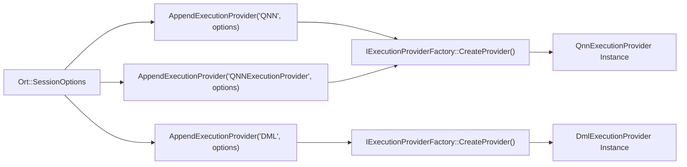

**Sources:** [onnxruntime/test/providers/qnn/qnn_basic_test.cc:61-104]()

---

## DirectML Execution Provider

DirectML EP enables GPU-accelerated inference on Windows via the Microsoft DirectML API.

### Architecture and Components

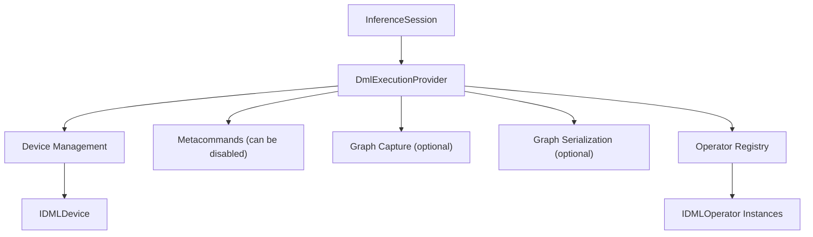

The provider manages DirectML device instances, supports optional metacommand optimizations, and can capture and serialize the execution graph for diagnostics or replay.

### Configuration Options

| Option                  | Values                                   | Description                        |
|-------------------------|------------------------------------------|----------------------------------|
| `device_filter`         | `gpu` (default), `npu`                   | Select device type                |
| `performance_preference`| `default`, `high_performance`, `minimum_power` | Performance mode              |
| `disable_metacommands`  | `true`, `false` (default)                 | Disable DirectML metacommand optimizations |
| `enable_graph_capture`  | `true`, `false` (default)                 | Enable capture of execution graph |
| `enable_graph_serialization` | `true`, `false` (default)            | Serialize captured graph          |

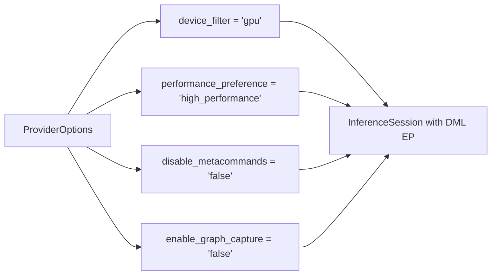

**Sources:** [onnxruntime/test/perftest/ort_test_session.cc:468-539]()

---

## QNN Execution Provider

Qualcomm Neural Network (QNN) EP supports Snapdragon platform hardware including the Hexagon Tensor Processor (HTP), DSP, GPU, and CPU backends.

### Architecture

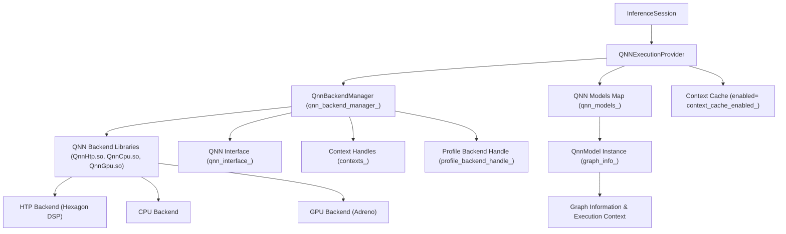

The `QnnBackendManager` encapsulates communication with the backend dynamic libraries managing hardware-specific runtime. QnnModel wraps compilation results and execution context. Context caching reduces overhead.

### Backend Library Selection

QNN supports multiple backend libraries selectable via provider options:

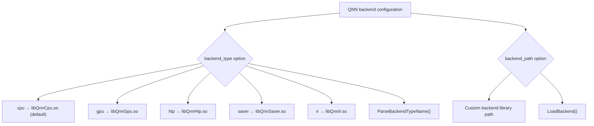

### Configuration Options

| Option Key                        | Example Values                                         | Description                                          |
|----------------------------------|--------------------------------------------------------|------------------------------------------------------|
| `backend_path`                   | `./QnnHtp.dll`, `./libQnnCpu.so`                       | Custom backend shared library path                    |
| `backend_type`                   | `cpu`, `htp`, `gpu`, `saver`, `ir`                     | Backend type (mutually exclusive with backend_path)  |
| `profiling_level`                | `off`, `basic`, `detailed`, `optrace`                  | Enable profiling information verbosity                |
| `profiling_file_path`            | `/path/to/profile.json`                                 | Profile data output file                              |
| `rpc_control_latency`            | `10`                                                   | RPC control latency in microseconds                   |
| `vtcm_mb`                       | `8`                                                    | Size of vector tightly coupled memory (VTCM) in MB   |
| `htp_performance_mode`           | `burst`, `balanced`, `default`, `high_performance`, `sustained_high_performance` | Performance mode for HTP backend           |
| `htp_graph_finalization_optimization_mode` | `0`, `1`, `2`, `3`                                 | Graph finalization optimization level                 |
| `qnn_context_priority`           | `low`, `normal`, `normal_high`, `high`                 | Priority level for context execution                   |
| `htp_arch`                      | `0`, `68`, `69`, `73`, `75`, `81`                       | Minimum HTP architecture version required              |
| `device_id`                     | `0`                                                    | Device ID if multiple devices are present              |
| `enable_htp_fp16_precision`      | `0`, `1`                                               | Enable FP16 precision on HTP (default: 1)             |
| `offload_graph_io_quantization`  | `0`, `1`                                               | Offload graph I/O quantization to QNN CPU EP          |
| `enable_htp_spill_fill_buffer`   | `0`, `1`                                               | Enable spill/fill buffer                               |
| `enable_htp_shared_memory_allocator` | `0`, `1`                                           | Use shared memory allocator on HTP                    |
| `enable_vtcm_backup_buffer_sharing` | `0`, `1`                                            | Enable sharing of backup buffers for VTCM              |
| `extended_udma`                 | `0`, `1`                                               | Enable extended UDMA mode                              |
| `soc_model`                    | `0`                                                    | SoC model number for device-specific configurations     |
| `qnn_saver_path`               | `/path/to/libQnnSaver.so`                              | Path to QNN Saver backend                              |
| `dump_qnn_ir_dlc`              | `0`, `1`                                               | Dump QNN IR to DLC format for debugging                |

### Context Caching

QNN supports caching of compiled contexts for improved performance on repeated runs. Configuration options enable saving/loading cache as embedded data or in external files:

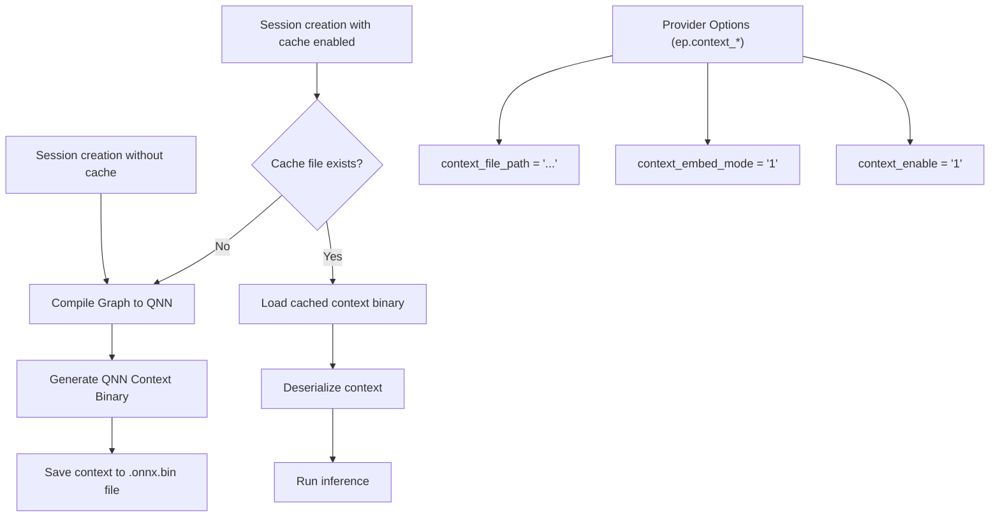

### Shared Memory Allocator Support

When enabled, the `enable_htp_shared_memory_allocator` option directs the QNN EP to use a custom allocator backed by `rpcmem` (shared memory library on Hexagon DSP) for input and output OrtValues, enabling zero-copy data access and reducing overhead.

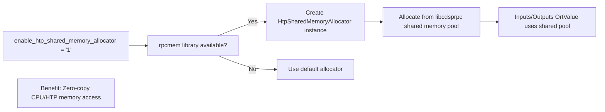

**Sources:**  
- [onnxruntime/core/providers/qnn/qnn_execution_provider.cc:1-154](),  
- [onnxruntime/core/providers/qnn/builder/qnn_backend_manager.cc:1-181](),  
- [onnxruntime/test/providers/qnn/qnn_basic_test.cc:61-104]()  

---

## OpenVINO Execution Provider

OpenVINO EP targets Intel hardware with optimized CPU, GPU, and VPU execution via Intel’s OpenVINO toolkit.

### Configuration Options

| Option Key                | Example Value                       | Description                             |
|---------------------------|-----------------------------------|---------------------------------------|
| `device_type`             | `CPU`, `GPU`, `NPU`, `AUTO`       | Target hardware device                 |
| `device_id`               | `0`, `1`                          | Device index                          |
| `num_of_threads`          | `4`, `8`                         | Number of inference threads            |
| `cache_dir`               | `/path/to/cache`                   | Directory for compiled model cache    |
| `enable_opencl_throttling`| `true`, `false`                   | OpenCL queue throttling (GPU only)    |
| `reshape_input`           | e.g., `input_name[1..10,3,224,224]`| Set model inputs with dynamic dims    |
| `layout`                  | e.g., `input_name[NCHW]`           | Specify tensor layout for inputs/outputs |

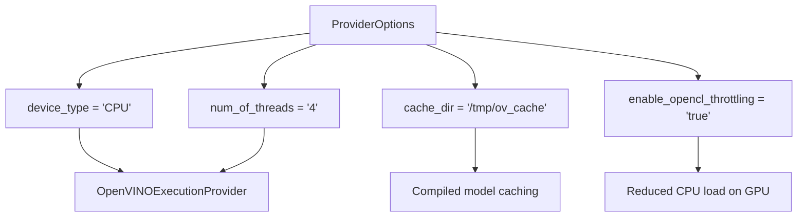

**Sources:** [onnxruntime/test/perftest/command_args_parser.cc:85-92](), [onnxruntime/test/util/include/default_providers.cc:101-120]()

---

## CoreML Execution Provider

CoreML EP enables inference on Apple devices utilizing Apple Neural Engine (ANE), GPUs, or CPUs.

### Configuration Options

| Option Key              | Example Values                           | Description                         |
|-------------------------|-----------------------------------------|-----------------------------------|
| `ModelFormat`           | `MLProgram`, `NeuralNetwork`            | CoreML model format (default: NeuralNetwork) |
| `MLComputeUnits`        | `ALL`, `CPUOnly`, `CPUAndGPU`, `CPUAndNeuralEngine` | Compute units to target          |
| `RequireStaticInputShapes` | `0`, `1`                            | Require inputs to have static shapes |
| `EnableOnSubgraphs`     | `0`, `1`                               | Enable EP on subgraphs             |
| `SpecializationStrategy`| `Default`, `FastPrediction`             | Model specialization strategy     |
| `ProfileComputePlan`    | `0`, `1`                               | Enable compute plan profiling      |
| `AllowLowPrecisionAccumulationOnGPU` | `0`, `1`                    | Allow reduced precision on GPU    |
| `ModelCacheDirectory`   | `/path/to/cache`                        | Cache directory for compiled models|

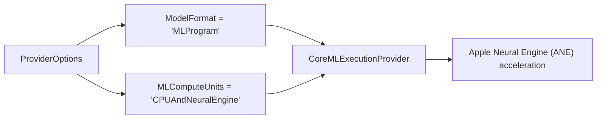

**Sources:** [onnxruntime/test/perftest/command_args_parser.cc:150-158](), [onnxruntime/test/perftest/ort_test_session.cc:420-461]()

---

## NNAPI Execution Provider

The Android Neural Networks API (NNAPI) EP facilitates hardware acceleration on Android devices.

### NNAPI Flags

NNAPI uses bitwise flags to configure behavior during EP creation:

| Flag                       | Description                                   |
|----------------------------|-----------------------------------------------|
| `NNAPI_FLAG_USE_FP16`      | Use FP16 relaxation in computations            |
| `NNAPI_FLAG_USE_NCHW`      | Use NCHW layout instead of NHWC                |
| `NNAPI_FLAG_CPU_DISABLED`  | Disable CPU device usage in NNAPI              |
| `NNAPI_FLAG_CPU_ONLY`      | Use CPU device only                             |

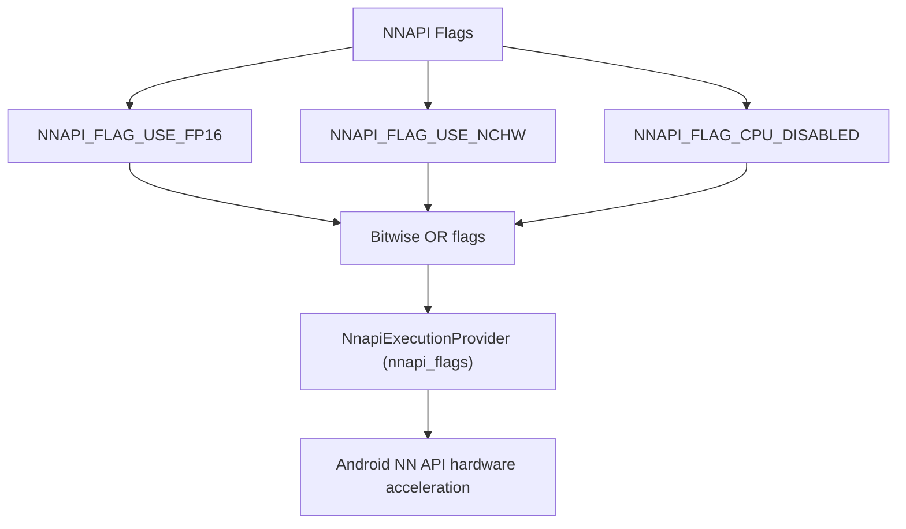

### Partitioning and Computation

NNAPI uses custom graph partitioning logic considering NNAPI's supported ops and backend capabilities. It uses node units and skips problematic nodes, with option to exclude specific stop OPS.

**Sources:** [onnxruntime/core/providers/nnapi/nnapi_builtin/nnapi_execution_provider.cc:40-150](), [onnxruntime/test/perftest/ort_test_session.cc:383-413]()

---

## WebNN Execution Provider

WebNN EP runs ONNX models in web environments supporting Web Neural Network API with JavaScript and WebAssembly.

### Operator Coverage and Builder Factory

WebNN EP supports a variety of operators mapped to WebNN API calls, implemented via op builders registered in a factory:

- Unary ops: Abs, Ceil, Cos, Erf, Exp, Floor, etc.
- Binary ops: Add, Sub, Mul, Div, Pow, PRelu
- Other ops: ArgMax, Conv, MaxPool, Softmax, etc.

These are implemented in files like `webnn_execution_provider.cc` and builder factories in `webnn/builders/op_builder_factory.cc`.

---

## MIGraphX Execution Provider

MIGraphX EP enables AMD GPU acceleration on ROCm-supported platforms.

### Key Points

- Uses HIP runtime APIs.
- Supports device selection and model caching.
- Provides memcpy kernels for host to MIGraphX GPU memory transfer and vice versa.
- Supports fp16, bf16, fp8, int8 configurations controlled via provider options and environment variables.

Example options:

| Option            | Values                    | Description             |
|-------------------|---------------------------|-------------------------|
| `device_id`       | integer (e.g., `0`)       | GPU device ID           |
| `exhaustive_tune` | `true` / `false` (default) | Kernel tuning setting   |

**Sources:** [onnxruntime/core/providers/migraphx/migraphx_execution_provider.cc:1-177]()

---

## DNNL Execution Provider

DNNL EP leverages Intel’s OneDNN (MKL-DNN) for CPU acceleration and optimization.

### Configuration Options

| Option Key     | Example Value | Description                       |
|----------------|---------------|---------------------------------|
| `use_arena`    | `0` / `1`     | Enable memory arena allocator    |
| `num_of_threads`| integer (e.g., `4`) | Number of threads (if no ORT threadpool used) |
| `threadpool_args`| pointer to threadpool | Custom threadpool arguments    |

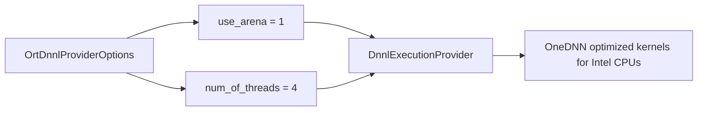

**Sources:** [onnxruntime/test/perftest/ort_test_session.cc:99-133]()

---

## VitisAI Execution Provider

VitisAI EP targets Xilinx and AMD FPGA hardware, leveraging programmable logic for acceleration.

### Dynamic Loading and API Interaction

- The EP dynamically loads VitisAI shared libraries per platform.
- Handles multiple compiled models and devices.
- Supports profiling and dynamic option setting at run time.
- Provides compatibility checking between compiled models and the actual runtime environment.

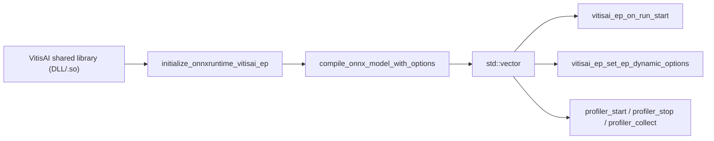

### Configuration Options (via ProviderOptions)

| Key            | Example Value               | Description                                 |
|----------------|-----------------------------|---------------------------------------------|
| `config_file`  | `'vaip_config.json'`        | VitisAI configuration file                  |
| `cache_dir`    | `'/tmp/vaip_cache'`         | Directory to cache compiled models          |

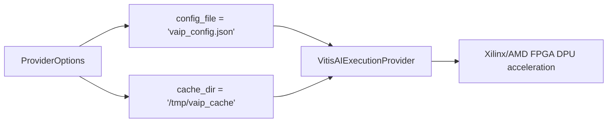

**Sources:** [onnxruntime/core/providers/vitisai/imp/global_api.cc:1-143](), [onnxruntime/core/providers/vitisai/vitisai_execution_provider.cc:1-150]()

---

## Summary Mermaid Diagram: Execution Providers and Code Entities

```mermaid
graph TD
    subgraph "Execution Providers (Natural Language Terms)"
        DML["DirectML EP"]
        QNN["QNN EP"]
        OV["OpenVINO EP"]
        CoreML["CoreML EP"]
        NNAPI["NNAPI EP"]
        WebNN["WebNN EP"]
        MIGraphX["MIGraphX EP"]
        DNNL["DNNL EP"]
        VitisAI["VitisAI EP"]
    end

    subgraph "Core Code Entities"
        DmlEP["DmlExecutionProvider<br/>(source: DmlExecutionProvider.cpp)"]
        QnnEP["QnnExecutionProvider<br/>(source: qnn_execution_provider.cc)"]
        OvEP["OpenVINOExecutionProvider<br/>(openvino_execution_provider.cc)"]
        CoreMLEP["CoreMLExecutionProvider<br/>(coreml_execution_provider.cc)"]
        NnapiEP["NnapiExecutionProvider<br/>(nnapi_execution_provider.cc)"]
        WebnnEP["WebnnExecutionProvider<br/>(webnn_execution_provider.cc)"]
        MigraphXEP["MIGraphXExecutionProvider<br/>(migraphx_execution_provider.cc)"]
        DnnlEP["DnnlExecutionProvider<br/>(dnnl_execution_provider.cc)"]
        VitisAIEP["VitisAIExecutionProvider<br/>(vitisai_execution_provider.cc)"]
    end

    DML --> DmlEP
    QNN --> QnnEP
    OV --> OvEP
    CoreML --> CoreMLEP
    NNAPI --> NnapiEP
    WebNN --> WebnnEP
    MIGraphX --> MigraphXEP
    DNNL --> DnnlEP
    VitisAI --> VitisAIEP
```

---

# References

This page has drawn technical details primarily from key source files implementing the various execution providers:

- `core/providers/dml/DmlExecutionProvider/src/ExecutionProvider.cpp`  
- `core/providers/qnn/qnn_execution_provider.cc` and related builder files  
- `core/providers/openvino/openvino_execution_provider.cc`  
- `core/providers/coreml/coreml_execution_provider.cc`  
- `core/providers/nnapi/nnapi_builtin/nnapi_execution_provider.cc`  
- `core/providers/webnn/webnn_execution_provider.cc` and `builders/`  
- `core/providers/migraphx/migraphx_execution_provider.cc`  
- `core/providers/dnnl/dnnl_execution_provider.cc`  
- `core/providers/vitisai/vitisai_execution_provider.cc` and `imp/global_api.cc`  

Consult these files for detailed implementation and further options.

---

# Summary

This page provides a detailed view of ONNX Runtime's "Other Execution Providers" beyond CPU, CUDA, and TensorRT EPs. Each provider is designed for a specific platform or hardware and exposes specific configuration options. Providers depend on platform-specific libraries or APIs and support graph partitioning, kernel registration, and performance tuning.

By utilizing these providers, ONNX Runtime supports broad hardware acceleration across popular GPUs, DSPs, NPUs, CPUs, FPGAs, and web environments.

**Sources:**  
- All cited source files and lines as noted above for individual sections

---

