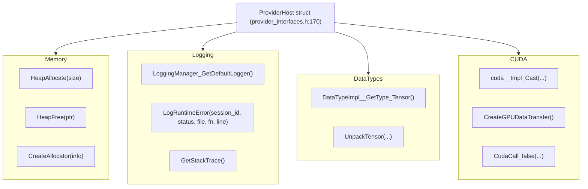
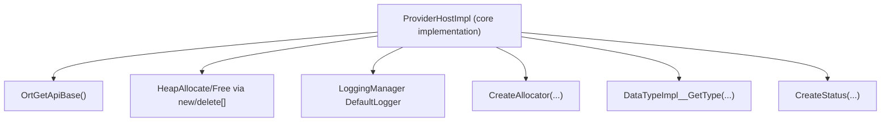
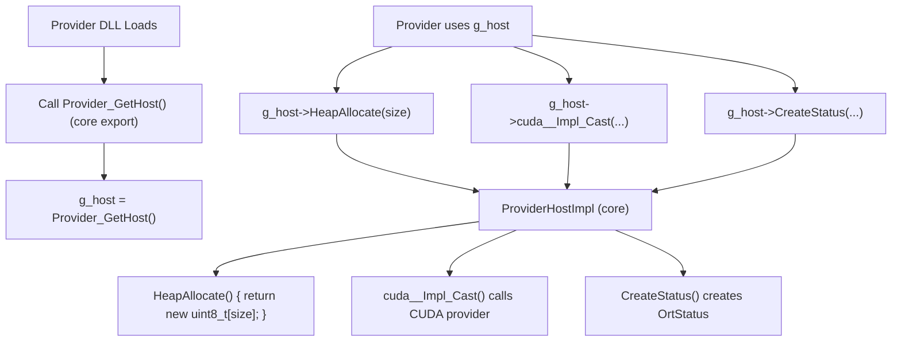
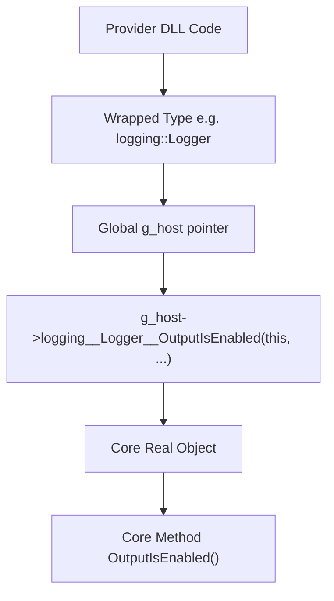
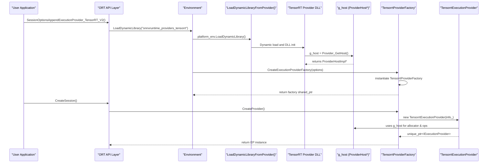
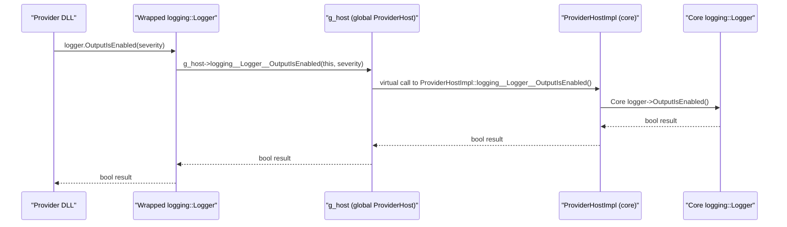
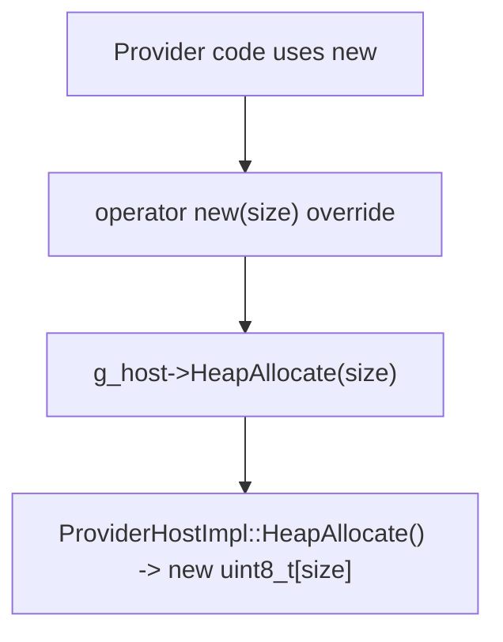
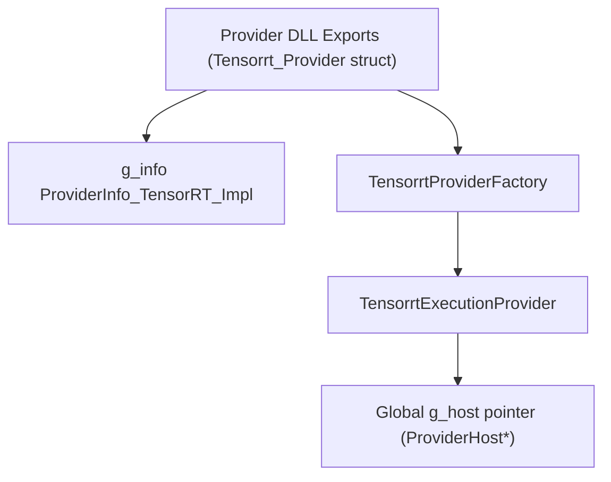

<!-- source: DeepWiki mcp.deepwiki.com · repo microsoft/onnxruntime · page 6.6 Provider Bridge · fetched 2026-10-21 -->

# Provider Bridge

<details>
<summary>Relevant source files</summary>

The following files were used as context for generating this wiki page:

- [include/onnxruntime/core/providers/tensorrt/tensorrt_provider_options.h](include/onnxruntime/core/providers/tensorrt/tensorrt_provider_options.h)
- [onnxruntime/core/providers/cpu/cpu_provider_shared.cc](onnxruntime/core/providers/cpu/cpu_provider_shared.cc)
- [onnxruntime/core/providers/cpu/cpu_provider_shared.h](onnxruntime/core/providers/cpu/cpu_provider_shared.h)
- [onnxruntime/core/providers/shared_library/provider_api.h](onnxruntime/core/providers/shared_library/provider_api.h)
- [onnxruntime/core/providers/shared_library/provider_bridge_provider.cc](onnxruntime/core/providers/shared_library/provider_bridge_provider.cc)
- [onnxruntime/core/providers/shared_library/provider_interfaces.h](onnxruntime/core/providers/shared_library/provider_interfaces.h)
- [onnxruntime/core/providers/shared_library/provider_wrappedtypes.h](onnxruntime/core/providers/shared_library/provider_wrappedtypes.h)
- [onnxruntime/core/providers/tensorrt/tensorrt_execution_provider.cc](onnxruntime/core/providers/tensorrt/tensorrt_execution_provider.cc)
- [onnxruntime/core/providers/tensorrt/tensorrt_execution_provider.h](onnxruntime/core/providers/tensorrt/tensorrt_execution_provider.h)
- [onnxruntime/core/providers/tensorrt/tensorrt_execution_provider_info.cc](onnxruntime/core/providers/tensorrt/tensorrt_execution_provider_info.cc)
- [onnxruntime/core/providers/tensorrt/tensorrt_execution_provider_info.h](onnxruntime/core/providers/tensorrt/tensorrt_execution_provider_info.h)
- [onnxruntime/core/providers/tensorrt/tensorrt_execution_provider_utils.h](onnxruntime/core/providers/tensorrt/tensorrt_execution_provider_utils.h)
- [onnxruntime/core/providers/tensorrt/tensorrt_provider_factory.cc](onnxruntime/core/providers/tensorrt/tensorrt_provider_factory.cc)
- [onnxruntime/core/session/provider_bridge_ort.cc](onnxruntime/core/session/provider_bridge_ort.cc)
- [onnxruntime/test/providers/cpu/model_tests.cc](onnxruntime/test/providers/cpu/model_tests.cc)
- [onnxruntime/test/providers/tensorrt/tensorrt_basic_test.cc](onnxruntime/test/providers/tensorrt/tensorrt_basic_test.cc)

</details>


## Purpose and Scope

The Provider Bridge is a cross-DLL/shared-library communication pattern that enables execution providers (EPs)—such as TensorRT, DNNL, CUDA, and others—to be built and distributed as separate shared libraries independent of the ONNX Runtime core binary. It establishes a stable ABI (Application Binary Interface) between the ONNX Runtime core and provider libraries, allowing:

- Independent versioning and distribution of providers
- Safe and efficient calls across DLL/shared library boundaries
- Memory management consistency across modules
- Reduced core binary footprint by optionally loading providers
- Licensing and proprietary isolation for third-party providers

This page documents the detailed design and implementation of the Provider Bridge, focusing on the `ProviderHost` interface implemented by the core runtime, the global `g_host` bridge symbol accessible in provider DLLs, and the symbol export mechanism.

For execution provider interface details, see [6.1 Execution Provider Interface]. For TensorRT-specific provider details, see [6.4 TensorRT Execution Provider].

**Sources:**  
[onnxruntime/core/session/provider_bridge_ort.cc:1-10](), [onnxruntime/core/providers/shared_library/provider_bridge_provider.cc:1-20]()

---

## Architecture Overview

The Provider Bridge follows a host-guest architecture:

- **Host:** ONNX Runtime core implements the `ProviderHost` interface and exports it to providers.
- **Guest:** Execution providers compiled as shared libraries consume the `ProviderHost` interface via a global symbol `g_host`.

This allows the provider DLL to call into core runtime functions safely through a virtual interface pointer, while the core runtime dynamically loads the provider DLL and interacts with it via a factory interface.

```mermaid
graph TB
    subgraph ORT_Core["ONNX Runtime Core (Host)"]
        ProviderHostImpl["ProviderHostImpl<br/>provider_bridge_ort.cc:264"]
        Environment["Environment<br/>loads provider DLL"]
        LoadLib["LoadDynamicLibraryFromProvider()<br/>provider_bridge_ort.cc:247"]
    end
    
    subgraph BridgeHeaders["Provider Bridge Headers"]
        API["provider_api.h<br/>Defines SHARED_PROVIDER macro"]
        Interfaces["provider_interfaces.h<br/>Defines ProviderHost interface"]
        WrappedTypes["provider_wrappedtypes.h<br/>Wrapped types forwarding to g_host"]
    end
    
    subgraph ProviderDLL["Provider Shared Library (e.g., TensorRT EP DLL)"]
        g_host_global["`g_host` global pointer<br/>provider_bridge_provider.cc:89"]
        Provider_GetHost["Provider_GetHost() exported by core"]
        EPFactory["TensorrtProviderFactory<br/>tensorrt_provider_factory.cc"]
        ExecutionProvider["TensorrtExecutionProvider<br/>uses g_host"]
    end
    
    Environment --> LoadLib
    LoadLib --> Provider_GetHost
    Provider_GetHost --> g_host_global
    
    ProviderHostImpl -.implements.-> Interfaces
    g_host_global -.points to.-> ProviderHostImpl
    
    ExecutionProvider --> g_host_global
    EPFactory --> ExecutionProvider
    
    API --> Interfaces
    Interfaces --> WrappedTypes
```

### Key Design Principles

| Principle            | Implementation                        | Code Location                            |
|----------------------|------------------------------------|----------------------------------------|
| **Stable ABI**       | `ProviderHost` virtual interface with >200 method pointers | [provider_interfaces.h:170-600]()       |
| **Memory Safety**    | Provider DLL overrides `operator new/delete` to call `g_host->HeapAllocate` and `HeapFree` | [provider_bridge_provider.cc:78-83]()   |
| **Type Safety**      | Wrapped types proxy all calls through `g_host` methods with `PROVIDER_DISALLOW_ALL` to prevent misuse | [provider_wrappedtypes.h:10-70]()       |
| **Opaque Pointer Use**| Providers use opaque `this` pointers and call `g_host->Method(this, ...)` for safe dispatch | [provider_bridge_ort.cc:268-450]()      |

**Sources:**  
[onnxruntime/core/session/provider_bridge_ort.cc:247-268](), [onnxruntime/core/providers/shared_library/provider_api.h:1-50](), [onnxruntime/core/providers/shared_library/provider_interfaces.h:170-350](), [onnxruntime/core/providers/shared_library/provider_bridge_provider.cc:78-116]()

---

## Core Components

### ProviderHost Interface

The `ProviderHost` struct is the central interface implemented by the ONNX Runtime core to provide services to provider DLLs. It is a large pure virtual class exposing memory management, logging, allocator creation, type introspection, CUDA operations, status creation and more.

Key categories of methods in `ProviderHost`:

| Category            | Representative Methods                                     | Location                  |
|---------------------|-----------------------------------------------------------|---------------------------|
| Memory Management   | `HeapAllocate(size_t)`, `HeapFree(void*)`, `CreateAllocator(...)` | [provider_bridge_ort.cc:282-313]() |
| Logging            | `LoggingManager_GetDefaultLogger()`, `LogRuntimeError(...)`, `GetStackTrace()` | [provider_bridge_ort.cc:294-300]() |
| Data Types         | `DataTypeImpl__GetType_Tensor()`, `UnpackTensor(...)`     | [provider_bridge_ort.cc:344-362]() |
| CUDA Operations    | `cuda__Impl_Cast(...)`, `CudaCall_false(...)`, `CreateGPUDataTransfer()`   | [provider_bridge_ort.cc:315-327]() |
| Status Handling    | `CreateStatus(...)`, `Status__ToString(...)`              | [provider_bridge_ort.cc:304-413]() |
| Environment Info   | `GetEnvironmentVar(...)`, `Env__Default()`, `GetThreadId()` | [provider_bridge_ort.cc:329-332]() |
| Execution          | `IExecutionProvider__GetCapability(...)`, `IExecutionProvider__Compile(...)` | [provider_bridge_ort.cc:400-410]() |



Providers invoke these methods through a global `ProviderHost* g_host` pointer to interact safely with the core.

**Sources:**  
[onnxruntime/core/providers/shared_library/provider_interfaces.h:170-600](), [onnxruntime/core/session/provider_bridge_ort.cc:264-450]()

---

### ProviderHostImpl Implementation

On the ONNX Runtime core side, the `ProviderHostImpl` class implements all `ProviderHost` virtual interface methods. It performs:

- Memory allocation via `new` and `delete[]`
- Logging management using the core runtime logging framework
- Type lookups returning MLDataType handles
- Status creation forwarding to the internal Ort APIs
- CUDA and GPU-related function dispatch



**Sources:**  
[onnxruntime/core/session/provider_bridge_ort.cc:264-400]()

---

### Global Host Pointer (`g_host`)

Every provider DLL maintains a global pointer `g_host` to the `ProviderHost` instance implemented by the core runtime. This pointer is initialized when the provider DLL loads and calls the core's exported function `Provider_GetHost()`:

```cpp
ProviderHost* g_host = Provider_GetHost();  // [provider_bridge_provider.cc:89-93]
ProviderHostCPU& g_host_cpu = g_host->GetProviderHostCPU();
```

This pointer mediates cross-DLL calls from the provider into the core.



**Usage Examples:**

- Overridden `operator new` in provider DLL calls `g_host->HeapAllocate()`
- Provider calls CUDA operations via `g_host->cuda__Impl_Cast(...)`
- Statuses constructed via `g_host->CreateStatus(...)`
- Data type descriptions accessed via `g_host->DataTypeImpl__GetType_Tensor()`

**Sources:**  
[onnxruntime/core/providers/shared_library/provider_bridge_provider.cc:78-100](), [onnxruntime/core/providers/tensorrt/tensorrt_execution_provider.cc:268-310](), [onnxruntime/core/providers/shared_library/provider_wrappedtypes.h:1-70]()

---

## Wrapped Types

To provide type-safe and ABI-stable access to internal ONNX Runtime types across the DLL boundary, the Provider Bridge provides *wrapped types* that forward method calls to the `g_host` interface:

### Pattern Overview



The wrapped types prevent construction and destruction within the provider DLL and only forward calls to the core host via `g_host`.

### Examples of Wrapped Types:

| Wrapped Type             | Core Type (Internal)    | Key Methods                              |
|--------------------------|------------------------|-----------------------------------------|
| `logging::Logger`         | Core logging::Logger   | `OutputIsEnabled()`, `GetSeverity()`    |
| `CPUIDInfo`              | CPU feature detection  | `HasAVX2()`, `HasAVX512f()`             |
| `ONNX_NAMESPACE::int64s` | RepeatedField<int64_t> | `size()`, `Get()`                        |
| `AttributeProto`         | ONNX protobuf AttributeProto | `name()`, `type()`, `ints()`         |

```cpp
struct Logger final {
  bool OutputIsEnabled(Severity severity, DataType data_type) const noexcept {
    return g_host->logging__Logger__OutputIsEnabled(this, severity, data_type);
  }
  PROVIDER_DISALLOW_ALL(Logger)
};
```

**Sources:**  
[onnxruntime/core/providers/shared_library/provider_wrappedtypes.h:10-70](), [onnxruntime/core/providers/shared_library/provider_interfaces.h:170-400]()

---

## Communication Flow

### Provider Loading and Initialization

When an execution provider is enabled by the user (e.g., via `SessionOptionsAppendExecutionProvider_TensorRT_V2`), the runtime performs:

1. Compose provider DLL path (`libonnxruntime_providers_tensorrt.so` / `.dll`)
2. Call `LoadDynamicLibraryFromProvider()` to load the DLL dynamically [provider_bridge_ort.cc:247-258]
3. The DLL initializes, obtaining the global `g_host` pointer via `Provider_GetHost()`
4. The provider exposes a factory struct (e.g., `Tensorrt_Provider`)
5. The runtime calls `CreateExecutionProviderFactory()` on the provider struct
6. The factory instance creates the execution provider object, injecting `g_host` for calls



**Key functions:**

| Function/Method                          | Location                        | Purpose                            |
|----------------------------------------|--------------------------------|----------------------------------|
| `LoadDynamicLibraryFromProvider()`     | [provider_bridge_ort.cc:247-258]() | Loads provider DLL shared library |
| `Provider_GetHost()`                    | Exported by core               | Provides pointer to `ProviderHost` impl |
| `g_host` initialization                 | [provider_bridge_provider.cc:89]() | Sets global pointer in provider DLL |
| `CreateExecutionProviderFactory()`     | [tensorrt_provider_factory.cc:64-75]() | Instantiate concrete EP factory  |
| `TensorrtExecutionProvider` constructor | [tensorrt_execution_provider.cc:263]() | Initialize EP with `g_host`       |

**Sources:**  
[onnxruntime/core/session/provider_bridge_ort.cc:247-258](), [onnxruntime/core/providers/shared_library/provider_bridge_provider.cc:83-93](), [onnxruntime/core/providers/tensorrt/tensorrt_provider_factory.cc:50-75](), [onnxruntime/core/providers/tensorrt/tensorrt_execution_provider.cc:263]()

---

### Cross-DLL Function Call Flow

Cross-DLL calls use wrapped types and `g_host` methods as intermediaries.

Example: A provider calls `logger.OutputIsEnabled()` for its internal logging. This call routes to the core as:



All wrapped types and methods use this forwarding approach to ensure ABI stability and consistent execution context.

**Sources:**  
[onnxruntime/core/providers/shared_library/provider_wrappedtypes.h:20-30](), [onnxruntime/core/session/provider_bridge_ort.cc:425-432]()

---

## Memory Management

### Cross-DLL Heap Allocation

Cross-DLL heap allocation is a critical concern on Windows: memory allocated in one DLL's heap must not be freed in another to avoid heap corruption. To address this, the provider DLL overrides global `operator new` and `operator delete` operators to route to the `HeapAllocate` and `HeapFree` virtual calls on `g_host`.

```cpp
#ifdef _WIN32
// Override new/delete to call host allocator
_Ret_notnull_ _Post_writable_byte_size_(n) void* operator new(size_t n) {
  return Provider_GetHost()->HeapAllocate(n);
}
void operator delete(void* p) noexcept {
  Provider_GetHost()->HeapFree(p);
}
void operator delete(void* p, size_t /*size*/) noexcept {
  Provider_GetHost()->HeapFree(p);
}
#endif
```

This ensures all dynamic allocations inside the provider use the core runtime heap, preventing cross-DLL heap mismatch.



### Cleanup on DLL Unload

Providers can register cleanup functions via `RunOnUnload()`. All registered callbacks run on DLL unload to ensure resource release:

```cpp
static std::unique_ptr<std::vector<std::function<void()>>> s_run_on_unload_;

void RunOnUnload(std::function<void()> function) {
  static std::mutex mutex;
  std::lock_guard<std::mutex> guard{mutex};
  if (!s_run_on_unload_)
    s_run_on_unload_ = std::make_unique<std::vector<std::function<void()>>>();
  s_run_on_unload_->push_back(std::move(function));
}

struct OnUnload {
  ~OnUnload() {
    if (!s_run_on_unload_) return;
    for (auto& function : *s_run_on_unload_)
      function();
    s_run_on_unload_.reset();
  }
} g_on_unload;
```

Providers invoke `RunOnUnload()` during initialization to add teardown steps, preserving runtime stability during dynamic unloading.

**Sources:**  
[onnxruntime/core/providers/shared_library/provider_bridge_provider.cc:70-116](), [onnxruntime/core/session/provider_bridge_ort.cc:282-291]()

---

## Provider Factory Pattern

Each execution provider exposes an `IExecutionProviderFactory` interface to the runtime, enabling deferred creation of EP objects with appropriate options.

### Interface and TensorRT Example

```mermaid
graph TB
    IExecutionProviderFactory["IExecutionProviderFactory<br/>(Interface)"]
    
    subgraph TensorRTProvider
        TensorrtProviderFactory["TensorrtProviderFactory<br/>tensorrt_provider_factory.cc:50"]
        TensorrtExecutionProvider["TensorrtExecutionProvider"]
        TensorrtInfo["TensorrtExecutionProviderInfo"]
    end
    
    IExecutionProviderFactory --> TensorrtProviderFactory
    TensorrtProviderFactory -->|CreateProvider()| TensorrtExecutionProvider
    TensorrtProviderFactory -->|stores| TensorrtInfo
```

Concrete factory example:

```cpp
struct TensorrtProviderFactory : IExecutionProviderFactory {
  TensorrtProviderFactory(const TensorrtExecutionProviderInfo& info) : info_{info} {}
  ~TensorrtProviderFactory() override {}

  std::unique_ptr<IExecutionProvider> CreateProvider() override {
    return std::make_unique<TensorrtExecutionProvider>(info_);
  }

 private:
  TensorrtExecutionProviderInfo info_;
};
```

**Sources:**  
[onnxruntime/core/providers/tensorrt/tensorrt_provider_factory.cc:50-75]()

---

## Example: TensorRT Provider Bridge Usage

The TensorRT provider DLL exports a standard `Provider` struct called `Tensorrt_Provider` with methods:

- `GetInfo()` returns provider info struct
- `CreateExecutionProviderFactory(...)` creates the EP factory with options
- `UpdateProviderOptions(...)` updates factory options



The `TensorrtExecutionProvider` implementation extensively uses `g_host` calls for memory allocation, logging, CUDA API integration, and error handling, e.g.:

```cpp
// Memory allocation via g_host
auto ptr = g_host->HeapAllocate(size);

// CUDA call forwarding
auto status = g_host->cuda__Impl_Cast(stream, input_ptr, output_ptr, count);

// Error status creation
return g_host->CudaCall_false(cuda_result, "cudaCall", "cuda", 0, "cuda error", __FILE__, __LINE__);
```

**Sources:**  
[onnxruntime/core/providers/tensorrt/tensorrt_provider_factory.cc:64-130](), [onnxruntime/core/providers/tensorrt/tensorrt_execution_provider.cc:263-443]()

---

## Provider-Specific Interfaces (`ProviderInfo`)

Each EP implements a `ProviderInfo_*` struct encapsulating provider specific operations exposed to the core or bridge system, including option parsing, device queries, and custom operators.

Example for TensorRT provider:

```cpp
struct ProviderInfo_TensorRT_Impl final : ProviderInfo_TensorRT {
  OrtStatus* GetCurrentGpuDeviceId(int* device_id) override {
    auto cuda_err = cudaGetDevice(device_id);
    if (cuda_err != cudaSuccess) {
      return CreateStatus(ORT_FAIL, "Failed to get device id.");
    }
    return nullptr;
  }

  OrtStatus* UpdateProviderOptions(void* provider_options, const ProviderOptions& options, bool string_copy) override {
    TensorrtExecutionProviderInfo::UpdateProviderOptions(provider_options, options, string_copy);
    return nullptr;
  }

  OrtStatus* GetTensorRTCustomOpDomainList(std::vector<OrtCustomOpDomain*>& domain_list, const std::string extra_plugin_lib_paths) override {
    common::Status status = CreateTensorRTCustomOpDomainList(domain_list, extra_plugin_lib_paths);
    if (!status.IsOK()) {
      return CreateStatus(ORT_FAIL, "[TensorRT EP] Can't create custom ops for TRT plugins.");
    }
    return nullptr;
  }

  OrtStatus* ReleaseCustomOpDomainList(std::vector<OrtCustomOpDomain*>& domain_list) override {
    ReleaseTensorRTCustomOpDomainList(domain_list);
    return nullptr;
  }
} g_info;
```

This pattern is repeated for other providers like DNNL, CUDA, OpenVINO, etc.

**Sources:**  
[onnxruntime/core/providers/tensorrt/tensorrt_provider_factory.cc:21-48](), [onnxruntime/core/providers/dnnl/dnnl_provider_factory.cc:18-43]()

---

## Summary

The Provider Bridge enables a modular, ABI-safe architecture for ONNX Runtime execution providers via:

| Component           | Responsibility                             | Key Files                                      |
|---------------------|--------------------------------------------|------------------------------------------------|
| `ProviderHost`       | Core RPC-like interface to provider DLL     | `provider_bridge_ort.cc`                        |
| `g_host`             | Global pointer in provider DLL forwarding to core | `provider_bridge_provider.cc`               |
| Wrapped Types        | Lightweight proxies forwarding calls       | `provider_wrappedtypes.h`                        |
| Provider Interfaces  | Provider-specific RPC/option/config         | `provider_interfaces.h`, `*_provider_factory.cc`|
| Cross-DLL Memory     | Ensures allocator consistency               | `provider_bridge_provider.cc`, new/delete overrides |
| Factory Pattern      | Provider instantiation via factory objects  | `*_provider_factory.cc`                          |

**Benefits:**

- **Independent Deployment:** Providers updated without rebuilding core
- **Stable ABI:** Pointer-to-virtual-table based interface protects binary compatibility
- **Memory Safety:** Cross module allocation/deallocation safe
- **Reduced Core Size:** Optional provider loading avoids bloating core binary
- **Licensing Flexibility:** Proprietary/third-party EPs distributed independently

---

# References to Code

- ProviderHost interface & implementation:  
  `onnxruntime/core/session/provider_bridge_ort.cc:170-450`  
  `onnxruntime/core/providers/shared_library/provider_interfaces.h:170-600`

- Global host pointer and heap alloc:  
  `onnxruntime/core/providers/shared_library/provider_bridge_provider.cc:78-116`

- Wrapped types forwarding implementation:  
  `onnxruntime/core/providers/shared_library/provider_wrappedtypes.h:10-70`

- Provider DLL initialization and `g_host` usage:  
  `onnxruntime/core/providers/tensorrt/tensorrt_execution_provider.cc:260-450`

- Factory pattern for provider creation:  
  `onnxruntime/core/providers/tensorrt/tensorrt_provider_factory.cc:50-130`

- Provider info example:  
  `onnxruntime/core/providers/tensorrt/tensorrt_provider_factory.cc:20-50`

---

# Appendix: Mermaid Diagrams Recap

## Provider Bridge Architecture

```mermaid
graph TB
    subgraph ORT_Core["ONNX Runtime Core (Host)"]
        ProviderHostImpl["ProviderHostImpl<br/>provider_bridge_ort.cc:264"]
        Environment["Environment<br/>loads provider DLL"]
        LoadLib["LoadDynamicLibraryFromProvider()<br/>provider_bridge_ort.cc:247"]
    end
    
    subgraph BridgeHeaders["Provider Bridge Headers"]
        API["provider_api.h<br/>Defines SHARED_PROVIDER macro"]
        Interfaces["provider_interfaces.h<br/>Defines ProviderHost interface"]
        WrappedTypes["provider_wrappedtypes.h<br/>Wrapped types forwarding to g_host"]
    end
    
    subgraph ProviderDLL["Provider Shared Library (e.g., TensorRT EP DLL)"]
        g_host_global["`g_host` global pointer<br/>provider_bridge_provider.cc:89"]
        Provider_GetHost["Provider_GetHost() exported by core"]
        EPFactory["TensorrtProviderFactory<br/>tensorrt_provider_factory.cc"]
        ExecutionProvider["TensorrtExecutionProvider<br/>uses g_host"]
    end
    
    Environment --> LoadLib
    LoadLib --> Provider_GetHost
    Provider_GetHost --> g_host_global
    
    ProviderHostImpl -.implements.-> Interfaces
    g_host_global -.points to.-> ProviderHostImpl
    
    ExecutionProvider --> g_host_global
    EPFactory --> ExecutionProvider
    
    API --> Interfaces
    Interfaces --> WrappedTypes
```

## ProviderHost Interface Overview


## `g_host` Call Flow from Provider DLL


# End of Page

---

