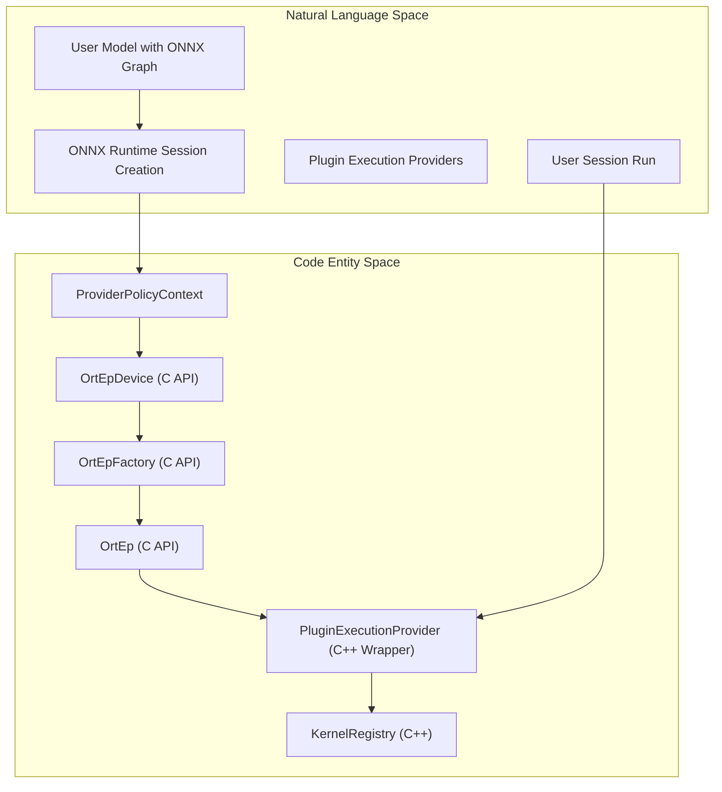
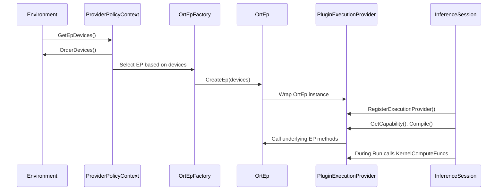

<!-- source: DeepWiki mcp.deepwiki.com · repo microsoft/onnxruntime · page 6.7 Plugin EP C API · fetched 2026-10-21 -->

# Plugin EP C API

Relevant source files

The following files were used as context for generating this wiki page:

- [include/onnxruntime/core/session/onnxruntime_ep_c_api.h](include/onnxruntime/core/session/onnxruntime_ep_c_api.h)
- [onnxruntime/core/session/plugin_ep/ep_plugin_provider_interfaces.cc](onnxruntime/core/session/plugin_ep/ep_plugin_provider_interfaces.cc)
- [onnxruntime/core/session/plugin_ep/ep_plugin_provider_interfaces.h](onnxruntime/core/session/plugin_ep/ep_plugin_provider_interfaces.h)
- [onnxruntime/core/session/provider_policy_context.cc](onnxruntime/core/session/provider_policy_context.cc)
- [onnxruntime/core/session/utils.cc](onnxruntime/core/session/utils.cc)
- [onnxruntime/test/autoep/library/example_plugin_ep/ep.cc](onnxruntime/test/autoep/library/example_plugin_ep/ep.cc)
- [onnxruntime/test/autoep/library/example_plugin_ep/ep.h](onnxruntime/test/autoep/library/example_plugin_ep/ep.h)
- [onnxruntime/test/autoep/library/example_plugin_ep/ep_test_hooks.cc](onnxruntime/test/autoep/library/example_plugin_ep/ep_test_hooks.cc)
- [onnxruntime/test/autoep/library/example_plugin_ep/ep_test_hooks.h](onnxruntime/test/autoep/library/example_plugin_ep/ep_test_hooks.h)
- [onnxruntime/test/autoep/library/example_plugin_ep/example_plugin_ep_library.lds](onnxruntime/test/autoep/library/example_plugin_ep/example_plugin_ep_library.lds)
- [onnxruntime/test/autoep/test_autoep_utils.cc](onnxruntime/test/autoep/test_autoep_utils.cc)
- [onnxruntime/test/autoep/test_autoep_utils.h](onnxruntime/test/autoep/test_autoep_utils.h)
- [onnxruntime/test/autoep/test_execution.cc](onnxruntime/test/autoep/test_execution.cc)
- [onnxruntime/test/framework/ep_plugin_provider_test.cc](onnxruntime/test/framework/ep_plugin_provider_test.cc)

This section documents the *Plugin Execution Provider (EP) C API* of ONNX Runtime, which introduces a modern and extensible interface for integrating custom execution providers as plugins or "autoEP" components. These allow ONNX Runtime to dynamically load and invoke EPs implemented outside the core runtime, supporting modular hardware acceleration and experimental provider development.

---

## Purpose and Scope

The Plugin EP C API provides a stable ABI boundary for defining execution providers as shared libraries that ONNX Runtime can load at runtime. Unlike traditional EP integration which is compile-time and monolithic, the plugin system enables:

- Dynamic registration and management of EP factories and devices.
- Isolation of EP implementation behind a C API (defined in `onnxruntime_ep_c_api.h`).
- Support for capabilities querying, graph compilation, kernel execution, and data transfer.
- Provider policies to select EP devices and govern multi-EP scenarios.
- Example plugins illustrating how to implement a plugin EP in real code.
- Specialized packages for popular hardware via plugin-ep-cuda and plugin-ep-webgpu.

The API consists of opaque C structures (e.g., `OrtEp`, `OrtEpFactory`, `OrtEpDevice`), callback function pointers for EP operations, and helper C++ classes like `PluginExecutionProvider` that wrap these C APIs for integration with the core runtime.

This page explains the architecture, key data flows, and concepts around the plugin EP system, and highlights the example plugin EP and the plugin-ep-cuda / plugin-ep-webgpu packages.

---

## Architecture Overview

### Key Concepts and Entities

| Concept                      | Code Entity                                                            | Description                                                      |
|------------------------------|------------------------------------------------------------------------|------------------------------------------------------------------|
| Execution Provider (EP)       | `OrtEp` (struct)                                                      | Represents a loaded plugin execution provider instance.          |
| EP Factory                   | `OrtEpFactory` (struct)                                               | Factory interface to create `OrtEp` instances for devices.       |
| EP Device                   | `OrtEpDevice` (struct)                                               | Descriptor of a hardware device supported by the EP.             |
| Kernel Registry             | `KernelRegistry` class                                               | Holds kernels supported by the EP.                               |
| PluginExecutionProvider      | `PluginExecutionProvider` class (C++ wrapper)                        | Wraps `OrtEp` and interfaces with core runtime `IExecutionProvider`. |
| Provider Policy             | `ProviderPolicyContext`                                              | Determines selection and prioritization of EP devices.           |
| Data Transfer Interface      | `OrtDataTransferImpl`                                                 | Abstracts device-to-device or device-to-CPU tensor copies.       |
| Synchronization & Streams    | `OrtSyncNotificationImpl`, `OrtSyncStreamImpl`                       | Stream and notification abstractions for synchronization.        |

---

### Main Data Flow

1. **Registration:**  
   ONNX Runtime loads shared libraries containing EP plugins, registering their factories (`OrtEpFactory`). Each factory knows how to create `OrtEp` instances for one or more hardware devices (`OrtEpDevice`).

2. **Device Enumeration:**  
   The environment exposes available EP devices via `GetEpDevices`. The `ProviderPolicyContext` evaluates and orders devices based on type (NPU, GPU, CPU), vendor, and discrete/integrated status.

3. **EP Creation:**  
   For each selected device, the corresponding `OrtEpFactory` creates an `OrtEp` instance that exposes functions for GetName, GetCapability, Compile, DataTransfer, Sync, and optional EPContext support.

4. **Graph Partitioning:**  
   ONNX Runtime queries the EP's capabilities to identify supported subgraphs. The EP compiles fused nodes (`Compile`) and returns an array of `OrtNodeComputeInfo` describing how to execute these nodes.

5. **Kernel Execution:**  
   EP provides compute kernels (e.g., in the example plugin, a `MulKernel`), which are invoked during session execution via the function pointers in `OrtNodeComputeInfo`.

6. **Preallocated Output Support:**  
   The EP can write results directly into preallocated output tensors provided by the runtime, enhancing performance and memory reuse.

7. **Data Transfer:**  
   EP implements device-specific data transfer via `OrtDataTransferImpl`. Copies between CPU and device occur via these abstractions, optionally async with streams.

8. **Synchronization:**  
   `OrtSyncNotificationImpl` and `OrtSyncStreamImpl` support synchronization and event signaling for async execution where applicable.

---

## Plugin EP C API Details

The C API is defined principally in [`include/onnxruntime/core/session/onnxruntime_ep_c_api.h:20-152`](https://github.com/microsoft/onnxruntime/blob/main/include/onnxruntime/core/session/onnxruntime_ep_c_api.h#L20-L152).

- `struct OrtEp`: Opaque struct representing a loaded execution provider instance.
- `struct OrtEpFactory`: Creates EP instances for given devices.
- `struct OrtEpDevice`: Provides device metadata and platform-specific information.
- `struct OrtDataTransferImpl`: Interface for copying tensors across devices.
- `struct OrtSyncNotificationImpl`: Interface for sync notifications.
- External memory and semaphore handle types for interoperable device resource sharing.

These structs expose function pointer callbacks that EP plugins implement, which ONNX Runtime calls during inference setup and execution.

---

## Provider Policy and Device Selection

The `ProviderPolicyContext` encapsulates logic for selecting and ordering available EP devices to optimize runtime execution. It sorts devices by type (NPU > discrete GPU > integrated GPU > CPU), vendor match, and ensures the Microsoft CPU EP is a last resort. This ordering influences which EP to use for subgraph partitioning.

A policy delegate can also be supplied to customize EP device selection via a callback.

Detailed implementation is in [`core/session/provider_policy_context.cc:4-176`](https://github.com/microsoft/onnxruntime/blob/main/core/session/provider_policy_context.cc#L4-L176).

---

## PluginExecutionProvider Factory and Wrapper

The `PluginExecutionProviderFactory` is a C++ wrapper around an `OrtEpFactory` that instantiates EPs for given devices and metadata. It handles:

- Creating `OrtEp` instances by calling the factory's `CreateEp`.
- Validating the created EP's API version and function pointers (`SanityCheckOrtEp`).
- Constructing the `PluginExecutionProvider` which integrates with the ONNX Runtime execution framework.

The code for this is in [`core/session/plugin_ep/ep_plugin_provider_interfaces.cc:36-162`](https://github.com/microsoft/onnxruntime/blob/main/core/session/plugin_ep/ep_plugin_provider_interfaces.cc#L36-L162).

`PluginExecutionProvider` inherits from ONNX Runtime's `IExecutionProvider` and delegates calls to the underlying `OrtEp` instance. It implements kernel registration, capability querying, compilation, execution synchronization, and optional dynamic options.

---

## Example Plugin EP

There is a fully functional example plugin EP included as a reference and testbed inside the test tree. It demonstrates:

- How to implement the `OrtEp` interface in C++ and define kernel compute functions.
- How to compile a simple Mul operator kernel, including handling of constant initializers.
- How to respond to EP lifecycle calls like GetName, Compile, Sync.
- EP context node creation and handling (a mechanism for EP to embed metadata or compiled state).

### Example EP Kernel: MulKernel

- Implements a basic elementwise multiply kernel for `float32` tensors.
- Supports preallocated output buffers.
- Accesses input tensors from `OrtKernelContext`.
- Reports errors for unsupported shapes or types.

### Example EP Context Kernel: EpContextKernel

- Stub kernel for nodes tagged as EPContext.
- Currently returns NOT_IMPLEMENTED for computation (placeholder for advanced EP state handling).

### EP Implementation

The `ExampleEp` struct derives from `OrtEp` and implements required API functions. It manages kernel instances and saved constant initializers.

You can find full implementation in [`onnxruntime/test/autoep/library/example_plugin_ep/ep.h`](https://github.com/microsoft/onnxruntime/blob/main/onnxruntime/test/autoep/library/example_plugin_ep/ep.h) and [`ep.cc`](https://github.com/microsoft/onnxruntime/blob/main/onnxruntime/test/autoep/library/example_plugin_ep/ep.cc).

---

## Plugin EP Packages: CUDA and WebGPU

Two specialized plugin EP packages extend this plugin framework for popular hardware backends:

- **plugin-ep-cuda:** CUDA-based plugin EP to accelerate GPU workloads using NVIDIA hardware.
- **plugin-ep-webgpu:** WebGPU-based plugin EP to enable cross-platform GPU acceleration on WebGPU-compatible devices.

These packages implement the `OrtEpFactory` and `OrtEp` interfaces using the plugin EP C API, exposing capabilities and kernels natively suited to their backend. They integrate seamlessly into ONNX Runtime sessions as dynamically loaded providers with full runtime device resource and synchronization support.

---

## Illustrative Diagrams

*Figure 1: Mapping Natural Language Concepts to Code Entities in Plugin EP System*

Sources: [`onnxruntime/core/session/onnxruntime_ep_c_api.h:20-152`](https://github.com/microsoft/onnxruntime/blob/main/include/onnxruntime/core/session/onnxruntime_ep_c_api.h#L20-L152), [`core/session/plugin_ep/ep_plugin_provider_interfaces.h:30-161`](https://github.com/microsoft/onnxruntime/blob/main/core/session/plugin_ep/ep_plugin_provider_interfaces.h#L30-L161), [`core/session/provider_policy_context.cc:4-176`](https://github.com/microsoft/onnxruntime/blob/main/core/session/provider_policy_context.cc#L4-L176)

---

*Figure 2: Runtime Flow of Plugin EP Creation and Execution*

Sources: [`core/session/utils.cc:32-163`](https://github.com/microsoft/onnxruntime/blob/main/core/session/utils.cc#L32-L163), [`core/session/plugin_ep/ep_plugin_provider_interfaces.cc:36-162`](https://github.com/microsoft/onnxruntime/blob/main/core/session/plugin_ep/ep_plugin_provider_interfaces.cc#L36-L162)

---

## Summary Table of Key Structs and Classes

| Type                         | Purpose                                                   | Location                                |
|------------------------------|-----------------------------------------------------------|---------------------------------------|
| `OrtEp`                      | Plugin execution provider instance C API struct           | `include/onnxruntime/core/session/onnxruntime_ep_c_api.h` |
| `OrtEpFactory`               | Factory to create `OrtEp` instances                        | Same as above                         |
| `OrtEpDevice`                | Hardware device metadata for EP                            | Same as above                         |
| `OrtDataTransferImpl`        | Interface to implement tensor copies between devices      | Same as above                         |
| `PluginExecutionProviderFactory` | Wraps `OrtEpFactory` to create providers in C++           | `core/session/plugin_ep/ep_plugin_provider_interfaces.h` |
| `PluginExecutionProvider`    | Implements `IExecutionProvider`, wraps `OrtEp`            | Same as above                         |
| `ProviderPolicyContext`      | Device selection and ordering policy                       | `core/session/provider_policy_context.cc` |
| `ExampleEp`                  | Example EP implementation with Mul kernel                  | `onnxruntime/test/autoep/library/example_plugin_ep/ep.h` |

Sources: As per detailed file citations above.

---

## Example Usage and Testing

- The test suite under `onnxruntime/test/autoep/` includes code that registers example plugin EPs, retrieves devices, and runs models using plugin EPs to validate functionality. For example, `test_execution.cc` runs various ONNX models against the example plugin ([test/autoep/test_execution.cc:34-163](https://github.com/microsoft/onnxruntime/blob/main/onnxruntime/test/autoep/test_execution.cc#L34-L163)).

- Test utilities facilitate loading EP libraries dynamically, unregistering them, and accessing EP hooks for inspecting sync counts and allocations ([test/autoep/test_autoep_utils.cc](https://github.com/microsoft/onnxruntime/blob/main/onnxruntime/test/autoep/test_autoep_utils.cc)).

- The example plugin EP itself implements logging, kernel computation, and EPContext integration, providing a minimal but comprehensive template for writing custom EP plugins.

---

# Summary

The Plugin EP C API modernizes the execution provider integration of ONNX Runtime, providing:

- ABI stability with a clearly defined C interface (`OrtEp`).
- Dynamic plugin loading with factory/device architecture.
- Fine-grained device selection policy.
- Sample plugin implementation for developers.
- Support for advanced features like EP contexts and async execution.
- Extension packages for CUDA and WebGPU backends.

This infrastructure enables hardware vendors and third-parties to rapidly implement custom EPs, enabling ONNX Runtime to scale across a diverse hardware ecosystem with plugin modularity.

---

# References

- [include/onnxruntime/core/session/onnxruntime_ep_c_api.h:20-152]()
- [core/session/plugin_ep/ep_plugin_provider_interfaces.h:30-161]()
- [core/session/plugin_ep/ep_plugin_provider_interfaces.cc:36-162]()
- [core/session/provider_policy_context.cc:4-176]()
- [onnxruntime/test/autoep/library/example_plugin_ep/ep.h:1-137]()
- [onnxruntime/test/autoep/library/example_plugin_ep/ep.cc:1-156]()
- [onnxruntime/test/autoep/test_execution.cc:34-163]()
- [core/session/utils.cc:32-163]()
- [onnxruntime/test/autoep/test_autoep_utils.cc:19-126]()

---

