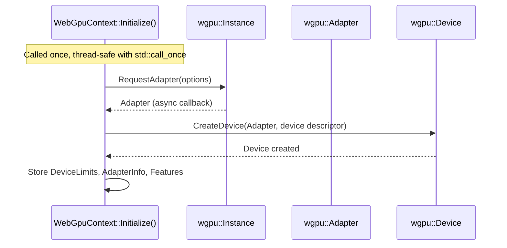
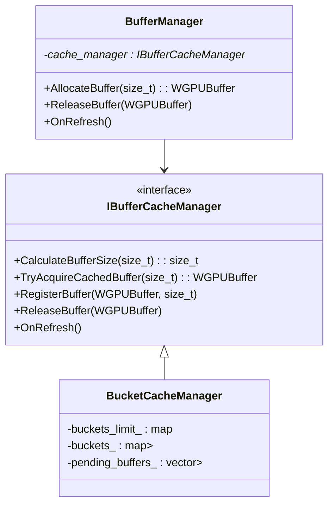
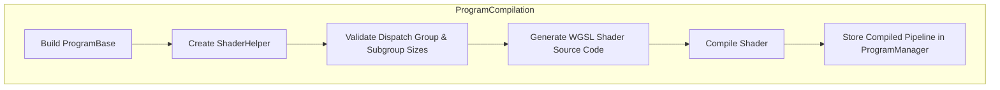
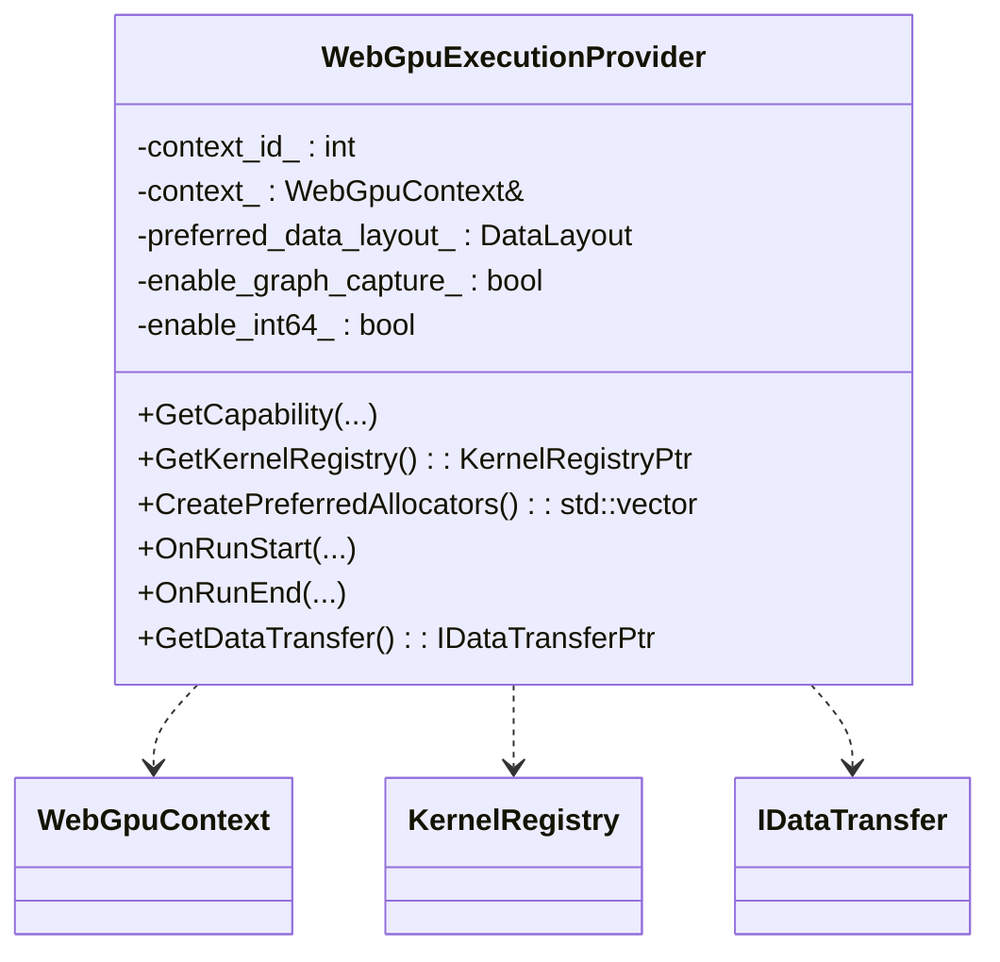

<!-- source: DeepWiki mcp.deepwiki.com · repo microsoft/onnxruntime · page 6.8 WebGPU Execution Provider · fetched 2026-10-21 -->

# 6.8 WebGPU Execution Provider

<details>
<summary>Relevant source files</summary>

The following files were used as context for generating this wiki page:

- [.github/workflows/nightly_webgpu.yml](.github/workflows/nightly_webgpu.yml)
- [onnxruntime/contrib_ops/webgpu/bert/rotary_embedding.cc](onnxruntime/contrib_ops/webgpu/bert/rotary_embedding.cc)
- [onnxruntime/contrib_ops/webgpu/bert/rotary_embedding.h](onnxruntime/contrib_ops/webgpu/bert/rotary_embedding.h)
- [onnxruntime/contrib_ops/webgpu/bert/skip_layer_norm.cc](onnxruntime/contrib_ops/webgpu/bert/skip_layer_norm.cc)
- [onnxruntime/contrib_ops/webgpu/bert/skip_layer_norm.h](onnxruntime/contrib_ops/webgpu/bert/skip_layer_norm.h)
- [onnxruntime/contrib_ops/webgpu/quantization/matmul_nbits_mlp.h](onnxruntime/contrib_ops/webgpu/quantization/matmul_nbits_mlp.h)
- [onnxruntime/core/providers/cuda/cuda_provider_factory.h](onnxruntime/core/providers/cuda/cuda_provider_factory.h)
- [onnxruntime/core/providers/cuda/tensor/cast_op.cc](onnxruntime/core/providers/cuda/tensor/cast_op.cc)
- [onnxruntime/core/providers/webgpu/allocator.cc](onnxruntime/core/providers/webgpu/allocator.cc)
- [onnxruntime/core/providers/webgpu/allocator.h](onnxruntime/core/providers/webgpu/allocator.h)
- [onnxruntime/core/providers/webgpu/buffer_manager.cc](onnxruntime/core/providers/webgpu/buffer_manager.cc)
- [onnxruntime/core/providers/webgpu/buffer_manager.h](onnxruntime/core/providers/webgpu/buffer_manager.h)
- [onnxruntime/core/providers/webgpu/compute_context.cc](onnxruntime/core/providers/webgpu/compute_context.cc)
- [onnxruntime/core/providers/webgpu/compute_context.h](onnxruntime/core/providers/webgpu/compute_context.h)
- [onnxruntime/core/providers/webgpu/ep/api.cc](onnxruntime/core/providers/webgpu/ep/api.cc)
- [onnxruntime/core/providers/webgpu/ep/factory.cc](onnxruntime/core/providers/webgpu/ep/factory.cc)
- [onnxruntime/core/providers/webgpu/ep/factory.h](onnxruntime/core/providers/webgpu/ep/factory.h)
- [onnxruntime/core/providers/webgpu/generator/range.cc](onnxruntime/core/providers/webgpu/generator/range.cc)
- [onnxruntime/core/providers/webgpu/generator/range.h](onnxruntime/core/providers/webgpu/generator/range.h)
- [onnxruntime/core/providers/webgpu/math/binary_elementwise_ops.cc](onnxruntime/core/providers/webgpu/math/binary_elementwise_ops.cc)
- [onnxruntime/core/providers/webgpu/math/binary_elementwise_ops.h](onnxruntime/core/providers/webgpu/math/binary_elementwise_ops.h)
- [onnxruntime/core/providers/webgpu/math/gemm_packed.cc](onnxruntime/core/providers/webgpu/math/gemm_packed.cc)
- [onnxruntime/core/providers/webgpu/math/gemm_packed.h](onnxruntime/core/providers/webgpu/math/gemm_packed.h)
- [onnxruntime/core/providers/webgpu/math/gemm_utils.cc](onnxruntime/core/providers/webgpu/math/gemm_utils.cc)
- [onnxruntime/core/providers/webgpu/math/gemm_utils.h](onnxruntime/core/providers/webgpu/math/gemm_utils.h)
- [onnxruntime/core/providers/webgpu/math/matmul.cc](onnxruntime/core/providers/webgpu/math/matmul.cc)
- [onnxruntime/core/providers/webgpu/math/matmul.h](onnxruntime/core/providers/webgpu/math/matmul.h)
- [onnxruntime/core/providers/webgpu/math/matmul_packed.cc](onnxruntime/core/providers/webgpu/math/matmul_packed.cc)
- [onnxruntime/core/providers/webgpu/math/matmul_packed.h](onnxruntime/core/providers/webgpu/math/matmul_packed.h)
- [onnxruntime/core/providers/webgpu/math/subgroup_matrix_gemm.cc](onnxruntime/core/providers/webgpu/math/subgroup_matrix_gemm.cc)
- [onnxruntime/core/providers/webgpu/math/subgroup_matrix_gemm_8x16x16.wgsl.template](onnxruntime/core/providers/webgpu/math/subgroup_matrix_gemm_8x16x16.wgsl.template)
- [onnxruntime/core/providers/webgpu/math/subgroup_matrix_matmul.cc](onnxruntime/core/providers/webgpu/math/subgroup_matrix_matmul.cc)
- [onnxruntime/core/providers/webgpu/math/subgroup_matrix_matmul_8x16x16.wgsl.template](onnxruntime/core/providers/webgpu/math/subgroup_matrix_matmul_8x16x16.wgsl.template)
- [onnxruntime/core/providers/webgpu/nn/conv.cc](onnxruntime/core/providers/webgpu/nn/conv.cc)
- [onnxruntime/core/providers/webgpu/nn/conv.h](onnxruntime/core/providers/webgpu/nn/conv.h)
- [onnxruntime/core/providers/webgpu/nn/conv2d_mm.cc](onnxruntime/core/providers/webgpu/nn/conv2d_mm.cc)
- [onnxruntime/core/providers/webgpu/nn/conv2d_mm.h](onnxruntime/core/providers/webgpu/nn/conv2d_mm.h)
- [onnxruntime/core/providers/webgpu/nn/conv3d_naive.h](onnxruntime/core/providers/webgpu/nn/conv3d_naive.h)
- [onnxruntime/core/providers/webgpu/nn/fuse_utils.cc](onnxruntime/core/providers/webgpu/nn/fuse_utils.cc)
- [onnxruntime/core/providers/webgpu/nn/fuse_utils.h](onnxruntime/core/providers/webgpu/nn/fuse_utils.h)
- [onnxruntime/core/providers/webgpu/nn/grouped_conv.h](onnxruntime/core/providers/webgpu/nn/grouped_conv.h)
- [onnxruntime/core/providers/webgpu/nn/im2col_matmul.cc](onnxruntime/core/providers/webgpu/nn/im2col_matmul.cc)
- [onnxruntime/core/providers/webgpu/nn/im2col_matmul.h](onnxruntime/core/providers/webgpu/nn/im2col_matmul.h)
- [onnxruntime/core/providers/webgpu/nn/im2col_matmul.wgsl.template](onnxruntime/core/providers/webgpu/nn/im2col_matmul.wgsl.template)
- [onnxruntime/core/providers/webgpu/nn/layer_norm.cc](onnxruntime/core/providers/webgpu/nn/layer_norm.cc)
- [onnxruntime/core/providers/webgpu/nn/layer_norm.h](onnxruntime/core/providers/webgpu/nn/layer_norm.h)
- [onnxruntime/core/providers/webgpu/program.cc](onnxruntime/core/providers/webgpu/program.cc)
- [onnxruntime/core/providers/webgpu/program.h](onnxruntime/core/providers/webgpu/program.h)
- [onnxruntime/core/providers/webgpu/program_cache_key.cc](onnxruntime/core/providers/webgpu/program_cache_key.cc)
- [onnxruntime/core/providers/webgpu/program_cache_key.h](onnxruntime/core/providers/webgpu/program_cache_key.h)
- [onnxruntime/core/providers/webgpu/program_manager.cc](onnxruntime/core/providers/webgpu/program_manager.cc)
- [onnxruntime/core/providers/webgpu/program_manager.h](onnxruntime/core/providers/webgpu/program_manager.h)
- [onnxruntime/core/providers/webgpu/reduction/reduction_ops.cc](onnxruntime/core/providers/webgpu/reduction/reduction_ops.cc)
- [onnxruntime/core/providers/webgpu/reduction/reduction_ops.h](onnxruntime/core/providers/webgpu/reduction/reduction_ops.h)
- [onnxruntime/core/providers/webgpu/shader_helper.cc](onnxruntime/core/providers/webgpu/shader_helper.cc)
- [onnxruntime/core/providers/webgpu/shader_helper.h](onnxruntime/core/providers/webgpu/shader_helper.h)
- [onnxruntime/core/providers/webgpu/shader_variable.cc](onnxruntime/core/providers/webgpu/shader_variable.cc)
- [onnxruntime/core/providers/webgpu/shader_variable.h](onnxruntime/core/providers/webgpu/shader_variable.h)
- [onnxruntime/core/providers/webgpu/string_utils.h](onnxruntime/core/providers/webgpu/string_utils.h)
- [onnxruntime/core/providers/webgpu/tensor/cast.cc](onnxruntime/core/providers/webgpu/tensor/cast.cc)
- [onnxruntime/core/providers/webgpu/tensor/cast.h](onnxruntime/core/providers/webgpu/tensor/cast.h)
- [onnxruntime/core/providers/webgpu/tensor/shape_op.cc](onnxruntime/core/providers/webgpu/tensor/shape_op.cc)
- [onnxruntime/core/providers/webgpu/tensor/where.cc](onnxruntime/core/providers/webgpu/tensor/where.cc)
- [onnxruntime/core/providers/webgpu/tensor/where.h](onnxruntime/core/providers/webgpu/tensor/where.h)
- [onnxruntime/core/providers/webgpu/vendor/intel/math/gemm.cc](onnxruntime/core/providers/webgpu/vendor/intel/math/gemm.cc)
- [onnxruntime/core/providers/webgpu/vendor/intel/math/gemm.h](onnxruntime/core/providers/webgpu/vendor/intel/math/gemm.h)
- [onnxruntime/core/providers/webgpu/vendor/intel/math/gemm_subgroup.cc](onnxruntime/core/providers/webgpu/vendor/intel/math/gemm_subgroup.cc)
- [onnxruntime/core/providers/webgpu/vendor/intel/math/gemm_subgroup.h](onnxruntime/core/providers/webgpu/vendor/intel/math/gemm_subgroup.h)
- [onnxruntime/core/providers/webgpu/vendor/intel/math/matmul.cc](onnxruntime/core/providers/webgpu/vendor/intel/math/matmul.cc)
- [onnxruntime/core/providers/webgpu/vendor/intel/math/matmul.h](onnxruntime/core/providers/webgpu/vendor/intel/math/matmul.h)
- [onnxruntime/core/providers/webgpu/webgpu_context.cc](onnxruntime/core/providers/webgpu/webgpu_context.cc)
- [onnxruntime/core/providers/webgpu/webgpu_context.h](onnxruntime/core/providers/webgpu/webgpu_context.h)
- [onnxruntime/core/providers/webgpu/webgpu_execution_provider.cc](onnxruntime/core/providers/webgpu/webgpu_execution_provider.cc)
- [onnxruntime/core/providers/webgpu/webgpu_execution_provider.h](onnxruntime/core/providers/webgpu/webgpu_execution_provider.h)
- [onnxruntime/core/providers/webgpu/webgpu_kernel.cc](onnxruntime/core/providers/webgpu/webgpu_kernel.cc)
- [onnxruntime/core/providers/webgpu/webgpu_kernel.h](onnxruntime/core/providers/webgpu/webgpu_kernel.h)
- [onnxruntime/core/providers/webgpu/webgpu_provider_factory.cc](onnxruntime/core/providers/webgpu/webgpu_provider_factory.cc)
- [onnxruntime/core/providers/webgpu/webgpu_provider_options.h](onnxruntime/core/providers/webgpu/webgpu_provider_options.h)
- [onnxruntime/core/providers/webgpu/webgpu_utils.cc](onnxruntime/core/providers/webgpu/webgpu_utils.cc)
- [onnxruntime/core/providers/webgpu/webgpu_utils.h](onnxruntime/core/providers/webgpu/webgpu_utils.h)
- [onnxruntime/test/providers/cpu/nn/conv_op_test.cc](onnxruntime/test/providers/cpu/nn/conv_op_test.cc)
- [onnxruntime/test/providers/cpu/tensor/cast_op_test.cc](onnxruntime/test/providers/cpu/tensor/cast_op_test.cc)
- [onnxruntime/test/providers/graph_capture_test.cc](onnxruntime/test/providers/graph_capture_test.cc)
- [onnxruntime/test/providers/webgpu/activation_cache_key_test.cc](onnxruntime/test/providers/webgpu/activation_cache_key_test.cc)
- [onnxruntime/test/providers/webgpu/matmul_large_test.cc](onnxruntime/test/providers/webgpu/matmul_large_test.cc)
- [onnxruntime/test/providers/webgpu/webgpu_context_test.cc](onnxruntime/test/providers/webgpu/webgpu_context_test.cc)
- [onnxruntime/test/testdata/webgpu_pow_cast_test.onnx](onnxruntime/test/testdata/webgpu_pow_cast_test.onnx)
- [onnxruntime/test/testdata/webgpu_pow_cast_test.py](onnxruntime/test/testdata/webgpu_pow_cast_test.py)
- [onnxruntime/test/unittest_main/test_main.cc](onnxruntime/test/unittest_main/test_main.cc)
- [onnxruntime/test/unittest_util/test_dynamic_plugin_ep.cc](onnxruntime/test/unittest_util/test_dynamic_plugin_ep.cc)
- [onnxruntime/test/unittest_util/test_dynamic_plugin_ep.h](onnxruntime/test/unittest_util/test_dynamic_plugin_ep.h)
- [onnxruntime/test/util/include/skipping_test_listener.h](onnxruntime/test/util/include/skipping_test_listener.h)
- [tools/python/wgsl_template/test/in_tree_golden/static-cpp-literal/generated/nn/im2col_matmul.h](tools/python/wgsl_template/test/in_tree_golden/static-cpp-literal/generated/nn/im2col_matmul.h)

</details>


The **WebGPU Execution Provider (EP)** in ONNX Runtime enables high-performance inference on GPUs through the native WebGPU API, targeting modern web and native environments that support this emerging GPU abstraction. This page details the internal implementation of the WebGPU EP including its context and device management, the buffer manager for GPU memory, program and shader helper infrastructure, and the use of WGSL (WebGPU Shading Language) templates for shader generation.

---

## 6.8.1 Overview and Purpose

The WebGPU EP provides GPU acceleration by bridging ONNX Runtime's compute framework with the WebGPU API. It manages WebGPU device creation and configuration, facilitates kernel execution scheduling, and provides utilities to build and run compute shaders tailored to ONNX operators. It emphasizes efficient reuse of GPU resources and supports features like graph capture, custom buffer pooling, and shader compilation caching.

Key components include:

- **WebGpuContext**: Manages device, adapter, and pipeline lifecycle.
- **BufferManager**: Handles GPU buffer allocation and caching strategies.
- **ProgramManager & ShaderHelper**: Build and cache WGSL shader programs and manage dispatch parameters.
- **WebGpuExecutionProvider**: The main interface to ONNX Runtime for integrating the WebGPU EP, handling node capabilities, kernel registration, and execution orchestration.

Sources:  
[core/providers/webgpu/webgpu_execution_provider.cc:1-159]()  
[core/providers/webgpu/webgpu_context.cc:1-147]()  
[core/providers/webgpu/webgpu_context.h:1-177]()  
[core/providers/webgpu/buffer_manager.cc:1-237]()  
[core/providers/webgpu/shader_helper.cc:1-125]()  
[core/providers/webgpu/webgpu_execution_provider.h:1-159]()

---

## 6.8.2 WebGpuContext: Device and Execution Context Management

`WebGpuContext` is the core class encapsulating WebGPU API objects like instances, adapters, devices, and command queues:

- **Initialization**: The context initializes the WebGPU `wgpu::Instance` and requests an adapter and device asynchronously with specified backend type and power preference. For robustness and validation, optional flags configure device features.

- **Device and Adapter**:  
  - The adapter selection is performed via `wgpu::Instance::RequestAdapter` considering platform-specific toggles and backend requests.  
  - Once the adapter is returned, the context creates a `wgpu::Device` to issue commands and manage resources.

- **Validation and Robustness Modes**:  
  The context supports multiple validation modes (basic, full) and robustness levels (enabled in debug builds by default) to ensure safe and debuggable execution.

- **Thread Pool for Compilation**:  
  A Dawn-specific worker thread pool scales with system CPU cores to parallelize shader pipeline compilation work.

- **Compile-Only Mode**:  
  Allows the context to be device-free (no adapter/device created) for graph transformations and compilation only without execution.

- **Graph Capture Support**:  
  Enables recording sequences of GPU commands to replay later, improving performance for repeated invocations.

**Key functions and flow** (partial):  
- `Initialize(const WebGpuContextConfig& config)` handles setup including adapter and device creation, supported features loading, and deferred work creation.  
- Device limits and adapter info are queried post initialization for feature checking and shader restrictions.

### Lifecycle Diagram of WebGpuContext Initialization



Sources:  
[core/providers/webgpu/webgpu_context.cc:20-147]()  
[core/providers/webgpu/webgpu_context.h:25-177]()

---

## 6.8.3 BufferManager: GPU Buffer Allocation and Caching

The `BufferManager` handles memory management for GPU buffers (`WGPUBuffer` objects), which are critical to efficient WebGPU execution. WebGPU requires buffer sizes and copy sizes to be aligned to specific byte boundaries (e.g., multiples of 4 or 16 bytes).

### Buffer Cache Managers

`BufferManager` supports different buffer caching strategies, implemented via the interface `IBufferCacheManager`:

- **DisabledCacheManager**: No caching; buffers are created and released immediately.
- **LazyReleaseCacheManager**: Buffers are lazily released, accumulating to be freed later.
- **SimpleCacheManager**: Buffers are pooled by exact sizes; reuses buffers if available.
- **BucketCacheManager**: Uses bucketized sizes with limits on cached buffers per bucket to balance memory use and reuse.

### Notable Implementation Details

- Buffers are normalized to sizes aligned as multiples of 16 bytes.
- Copy size operations are normalized to multiples of 4 bytes for WebGPU API compliance.
- Buffers to be released are either cached or immediately freed based on cache policy.
- On buffer manager refresh cycles (e.g., post graph capture or session boundaries), buffers pending release are processed accordingly.



Sources:  
[core/providers/webgpu/buffer_manager.cc:1-237]()  
[core/providers/webgpu/webgpu_context.h:17-121]()

---

## 6.8.4 Program and Shader Infrastructure

WebGPU EP compiles ONNX operator logic into compute shaders using WGSL. Two key classes support this pipeline:

### 6.8.4.1 ProgramBase and ProgramManager

- **ProgramBase**: Abstractly models a compute shader program with metadata, inputs, outputs, uniform variables, and dispatch parameters.

- **ProgramManager**: Caches programs and compiled pipelines keyed by program signatures for reuse, avoiding recompilation of identical shader programs.

Programs specify:

- Inputs (tensors with optional override shapes)
- Outputs
- Uniform variables (parameters passed to shaders)
- Dispatch group sizes (workgroup counts)
- Workgroup sizes (thread group dimensions inside the GPU)

### 6.8.4.2 ShaderHelper

`ShaderHelper` is responsible for generating WGSL shader source code using an API that blends template substitution, index calculations, type aliases, and shader variable tracking.

- It validates requested dispatch group sizes and subgroup sizes against device limits.
- Generates shader input/output declarations and helper functions.
- Manages uniform buffer layout and main compute function body.
- Supports indirect dispatch to dynamically read dispatch sizes from buffers.
- Supports subgroup size control, a WebGPU feature that improves parallelism.



Shader text generation involves:

- Adding inputs/outputs as `ShaderVariableHelper` objects.
- Emitting WGSL code for indices mapping and bounds checks.
- Embedding activation and other operator-specific code snippets.
- Building the main compute entry function with proper annotations (`@compute`, `@workgroup_size`, etc.).

Sources:  
[core/providers/webgpu/program.h (not shown, general reference)]  
[core/providers/webgpu/program_manager.cc (not shown, general reference)]  
[core/providers/webgpu/shader_helper.cc:20-125]()  
[core/providers/webgpu/webgpu_context.h:28-111]()

---

## 6.8.5 WebGpuExecutionProvider: Entry Point and Integration

The `WebGpuExecutionProvider` class inherits from `IExecutionProvider` and acts as the interface between ORT and the WebGPU backend.

### Key Responsibilities

- Maintains the `WebGpuContext` instance.
- Registers kernels and manages operator capabilities.
- Manages device allocation and buffer lifecycle.
- Supports features like graph capture for replay optimization.
- Provides data transfer methods between CPU and GPU buffers.
- Implements session lifecycle hooks (`OnRunStart`, `OnRunEnd`).
- Supports forced CPU execution for specified nodes for fallbacks.

### Features and Configuration

- **Preferred Data Layout**: Supports `NHWC` and `NCHW` layouts; configurable via provider options.
- **Graph Capture**: Enabled optionally to capture command sequences for later replay.
- **PIX Capture Support**: Integration with graphics profiling tools when enabled.
- **Int64 Support**: Optional enabling of int64 operator implementations.
- **Multi-Rotary Cache and KV Cache Quantization**: Specialized optimizations for transformer models.

### Kernel Registration

The kernels are registered via `GetKernelRegistry` with a set of built-in operators implemented as WebGPU compute shaders.



Provider Factory (`WebGpuProviderFactory`) creates `WebGpuExecutionProvider` instances from configuration options parsed from session options or environment variables.

Sources:  
[core/providers/webgpu/webgpu_execution_provider.cc:1-159]()  
[core/providers/webgpu/webgpu_execution_provider.h:63-159]()  
[core/providers/webgpu/webgpu_provider_factory.cc:20-160]()  

---

## 6.8.6 Data Flow and Execution Flow

The high-level overview of operation inside the WebGPU EP during an inference session is as follows:

1. **Initialization**:
   - `WebGpuContext` is initialized with a WebGPU `Device` and adapter.
   - Buffer managers and program caches are set up.

2. **Model Partitioning**:
   - WebGPU EP inspects graph nodes to determine which ops it supports.
   - Capabilities are reported for graph partitioning.

3. **Kernel Registration**:
   - Relevant kernels are registered with compiled WGSL programs.

4. **Session Run**:
   - At run start, necessary resource preparation and buffer pooling are done.
   - For each node execution:
     - Buffers are allocated via `BufferManager`.
     - `ComputeContext` wraps current node's inputs/outputs.
     - WebGPU programs (`ProgramBase`) are fetched/created and compiled.
     - Compute shaders are dispatched on the device queue.
   - Data transfers between CPU and GPU are managed with `IDataTransfer` implementations.
   
5. **Graph Capture (Optional)**:
   - Command sequences and pipelines are recorded to improve repeated inference performance.
   - Graph replay and capture releasing APIs are supported.

```mermaid
flowchart TD
    subgraph Runtime Execution
        A[Allocate GPU buffers] --> B[Prepare ComputeContext]
        B --> C[Get/compile ProgramBase & Shader (WGSL)]
        C --> D[Bind groups & Dispatch compute shader]
        D --> E[GPU computes node output]
        E --> F[DataTransfer CPU<->GPU if needed]
        F --> A
    end
```

Sources:  
[core/providers/webgpu/webgpu_execution_provider.cc:1-159]()  
[core/providers/webgpu/compute_context.h:33-197]()  
[core/providers/webgpu/data_transfer.h (implied)]  
[core/providers/webgpu/webgpu_context.h:25-177]()

---

## 6.8.7 WGSL Shader Templates

WebGPU EP uses WGSL templates to generate operator-specific shaders dynamically, with most operators implemented as specialized shader programs. The shader generation adapts to tensor shapes, activation functions, and data layouts.

- Templates are parameterized to allow reuse and efficient specialization.
- ShaderHelper provides string streams for main body and additional implementations.
- Shader entry function annotations (`@compute`, `@workgroup_size`, `@subgroup_size`) are generated based on device features and program requirements.
- Support for indirect dispatch buffers is included, allowing dynamic dispatch group sizes at runtime.

---

## Summary

The WebGPU Execution Provider in ONNX Runtime integrates the new WebGPU API to leverage GPU acceleration for machine learning in both web and native environments. It consists of:

- A **WebGpuContext** that manages the WebGPU device, adapter, and execution state.
- A **BufferManager** that controls GPU buffer caching and lifecycle, using multiple caching strategies.
- A robust **program and shader system** using WGSL, enabling dynamic shader code generation and caching.
- The **WebGpuExecutionProvider** itself as the connection point into ONNX Runtime for execution, kernel registration, and data transfers.

This provider supports advanced features such as graph capture for performance optimization and configuration options for specialized computation strategies.

---

# References and Sources

- onnxruntime/core/providers/webgpu/webgpu_execution_provider.cc [1-159]()
- onnxruntime/core/providers/webgpu/webgpu_context.cc [1-147]()
- onnxruntime/core/providers/webgpu/webgpu_context.h [1-177]()
- onnxruntime/core/providers/webgpu/buffer_manager.cc [1-237]()
- onnxruntime/core/providers/webgpu/shader_helper.cc [20-125]()
- onnxruntime/core/providers/webgpu/webgpu_execution_provider.h [63-159]()
- onnxruntime/core/providers/webgpu/webgpu_provider_factory.cc [20-160]()
- onnxruntime/core/providers/webgpu/compute_context.h [33-197]()

---

