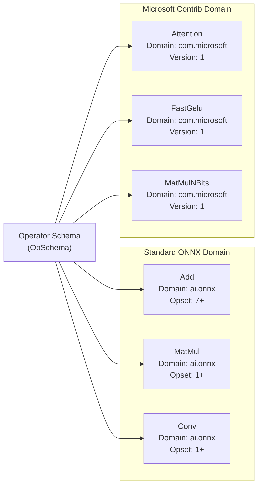
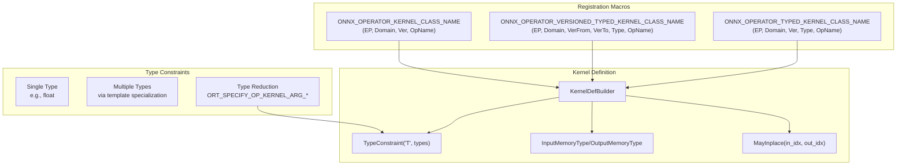
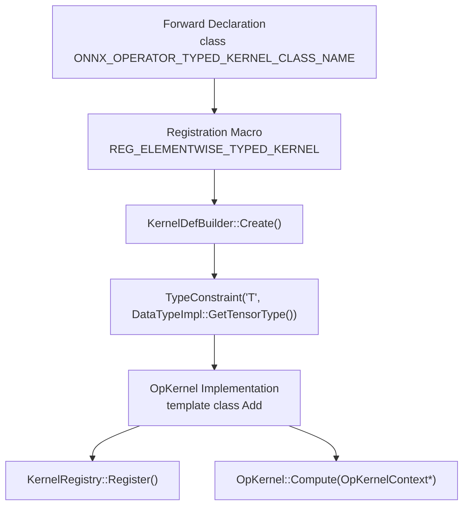
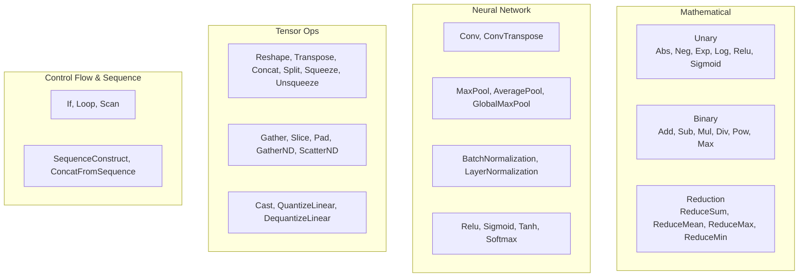
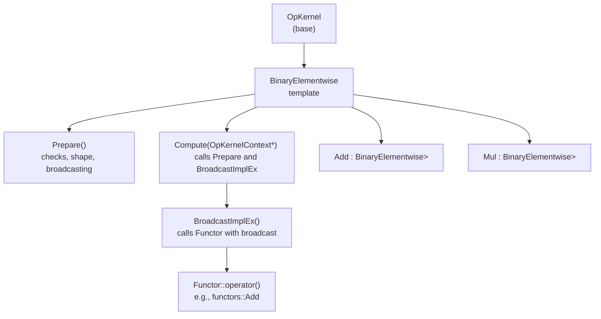
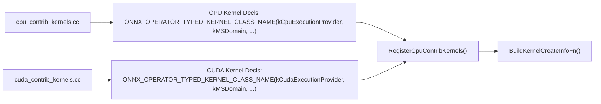
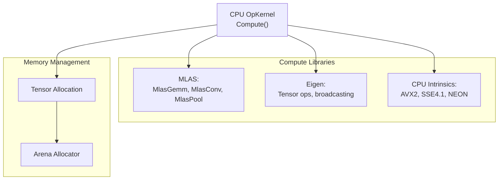
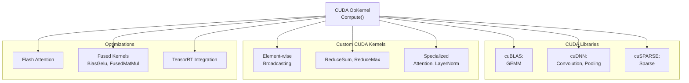
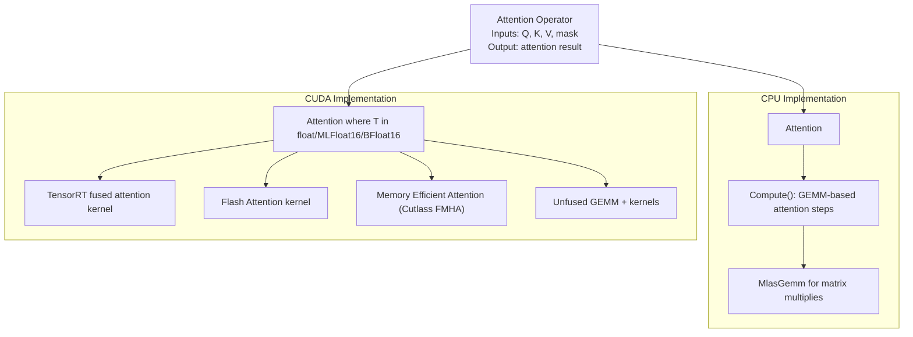
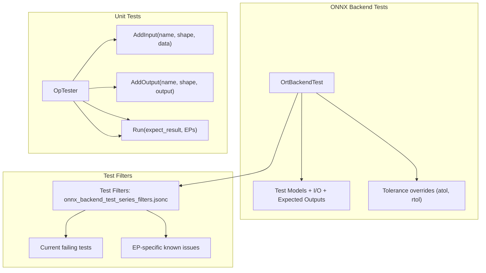

<!-- source: DeepWiki mcp.deepwiki.com · repo microsoft/onnxruntime · page 7 Operators and Kernels · fetched 2026-10-21 -->

# Operators and Kernels

<details>
<summary>Relevant source files</summary>

The following files were used as context for generating this wiki page:

- [docs/ContribOperators.md](docs/ContribOperators.md)
- [docs/OperatorKernels.md](docs/OperatorKernels.md)
- [onnxruntime/contrib_ops/cpu/bert/attention.cc](onnxruntime/contrib_ops/cpu/bert/attention.cc)
- [onnxruntime/contrib_ops/cpu/bert/attention_base.h](onnxruntime/contrib_ops/cpu/bert/attention_base.h)
- [onnxruntime/contrib_ops/cpu/bert/attention_common.h](onnxruntime/contrib_ops/cpu/bert/attention_common.h)
- [onnxruntime/contrib_ops/cpu/bert/attention_cpu_base.h](onnxruntime/contrib_ops/cpu/bert/attention_cpu_base.h)
- [onnxruntime/contrib_ops/cpu/bert/attention_helper.h](onnxruntime/contrib_ops/cpu/bert/attention_helper.h)
- [onnxruntime/contrib_ops/cpu/bert/decoder_masked_multihead_attention.cc](onnxruntime/contrib_ops/cpu/bert/decoder_masked_multihead_attention.cc)
- [onnxruntime/contrib_ops/cpu/bert/decoder_masked_multihead_attention.h](onnxruntime/contrib_ops/cpu/bert/decoder_masked_multihead_attention.h)
- [onnxruntime/contrib_ops/cpu/bert/multihead_attention_helper.h](onnxruntime/contrib_ops/cpu/bert/multihead_attention_helper.h)
- [onnxruntime/contrib_ops/cpu/cpu_contrib_kernels.cc](onnxruntime/contrib_ops/cpu/cpu_contrib_kernels.cc)
- [onnxruntime/contrib_ops/cpu/quantization/attention_quant.cc](onnxruntime/contrib_ops/cpu/quantization/attention_quant.cc)
- [onnxruntime/contrib_ops/cuda/bert/attention.cc](onnxruntime/contrib_ops/cuda/bert/attention.cc)
- [onnxruntime/contrib_ops/cuda/bert/attention.h](onnxruntime/contrib_ops/cuda/bert/attention.h)
- [onnxruntime/contrib_ops/cuda/bert/attention_impl.cu](onnxruntime/contrib_ops/cuda/bert/attention_impl.cu)
- [onnxruntime/contrib_ops/cuda/bert/attention_impl.h](onnxruntime/contrib_ops/cuda/bert/attention_impl.h)
- [onnxruntime/contrib_ops/cuda/bert/multihead_attention.cc](onnxruntime/contrib_ops/cuda/bert/multihead_attention.cc)
- [onnxruntime/contrib_ops/cuda/bert/multihead_attention.h](onnxruntime/contrib_ops/cuda/bert/multihead_attention.h)
- [onnxruntime/contrib_ops/cuda/cuda_contrib_kernels.cc](onnxruntime/contrib_ops/cuda/cuda_contrib_kernels.cc)
- [onnxruntime/contrib_ops/cuda/quantization/attention_quantization.cc](onnxruntime/contrib_ops/cuda/quantization/attention_quantization.cc)
- [onnxruntime/core/graph/contrib_ops/bert_defs.cc](onnxruntime/core/graph/contrib_ops/bert_defs.cc)
- [onnxruntime/core/graph/contrib_ops/contrib_defs.cc](onnxruntime/core/graph/contrib_ops/contrib_defs.cc)
- [onnxruntime/core/graph/contrib_ops/ms_opset.h](onnxruntime/core/graph/contrib_ops/ms_opset.h)
- [onnxruntime/test/contrib_ops/attention_op_test.cc](onnxruntime/test/contrib_ops/attention_op_test.cc)
- [onnxruntime/test/contrib_ops/attention_op_test_helper.cc](onnxruntime/test/contrib_ops/attention_op_test_helper.cc)
- [onnxruntime/test/contrib_ops/attention_op_test_helper.h](onnxruntime/test/contrib_ops/attention_op_test_helper.h)
- [onnxruntime/test/contrib_ops/decoder_masked_multihead_attention_op_test.cc](onnxruntime/test/contrib_ops/decoder_masked_multihead_attention_op_test.cc)
- [onnxruntime/test/contrib_ops/multihead_attention_op_test.cc](onnxruntime/test/contrib_ops/multihead_attention_op_test.cc)
- [onnxruntime/test/contrib_ops/multihead_attention_op_test_data_gen.py](onnxruntime/test/contrib_ops/multihead_attention_op_test_data_gen.py)

</details>


## Purpose and Scope

This page provides a high-level overview of the operator and kernel system in ONNX Runtime. This system is central to executing models as ONNX Runtime maps abstract operator definitions to concrete, performant implementations across diverse hardware. Key foci include:

- The operator schema and versioning system that defines operator contracts.
- The kernel registration system that maps operators to implementations.
- Standard ONNX operators and Microsoft contrib operators.
- Execution provider-specific kernel implementations (CPU, CUDA, etc.).

Deep-dive technical details and extensive listings reside in the child pages. See:

- [Operator Registration System](#7.1)  
- [Standard ONNX Operators](#7.2)  
- [Element-wise Operations](#7.3)  
- [Contrib Operators](#7.4)  
- [Attention Mechanisms](#7.5)  
- [Quantization Operators](#7.6)  
- [Generation and Beam Search Operators](#7.7)  

For details on execution providers and dispatch, see [Execution Providers](#6). For graph-level operator transformations, see [Graph Optimizations](#3.5).

---

## Operator Schemas and Kernel Implementations

### Conceptual Overview

Operators in ONNX Runtime are specified by **schemas** and implemented by **kernels**.

- **Operator Schema (`OpSchema`)**: Defines the operator’s interface — input/output specs, attributes, type constraints, shape inference logic, and supported opset versions.
- **Kernel (`OpKernel`)**: Concrete implementation targeting a specific execution provider (hardware backend) and data types; includes the `Compute()` routine.

The runtime dispatch maps each graph node to an operator schema, then selects a compatible kernel implementation based on execution provider, input types, and opset version.

```mermaid
graph TB
  subgraph "Operator Schema Layer"
    Schema["Operator Schema<br/>(OpSchema)"]
    OpName["Op Name: 'Add'"]
    Inputs["Input/Output Specs"]
    Attrs["Attributes"]
    TypeCon["Type Constraints"]
    OpsetVer["Opset Version"]
    Schema --> OpName
    Schema --> Inputs
    Schema --> Attrs
    Schema --> TypeCon
    Schema --> OpsetVer
  end
  
  subgraph "Kernel Implementation Layer"
    KernelDef["Kernel Definition<br/>(KernelDefBuilder)"]
    EP["Execution Provider"]
    ImplTypes["Supported Types"]
    MemType["Memory Types"]
    KernelImpl["Kernel Implementation<br/>(OpKernel::Compute)"]
    KernelDef --> EP
    KernelDef --> ImplTypes
    KernelDef --> MemType
    KernelDef --> KernelImpl
  end
  
  Schema -.."implements".-> KernelDef

  subgraph "Runtime Dispatch"
    Node["Graph Node<br/>(Node)"]
    KernelReg["Kernel Registry<br/>(KernelRegistry)"]
    Lookup["Lookup by:<br/>- Op name<br/>- EP type<br/>- Input types<br/>- Opset version"]
    Node --> Lookup
    Lookup --> KernelReg
    KernelReg --> KernelImpl
  end
```

**Sources:** [onnxruntime/core/graph/contrib_ops/contrib_defs.cc:1-35](), [docs/OperatorKernels.md:1-30]()

---

## Operator Schema Examples

Standard ONNX operators live in the `ai.onnx` domain and evolve with ONNX opsets. Microsoft’s `com.microsoft` domain introduces contrib/custom operators.



**Sources:** [docs/OperatorKernels.md:1-30](), [docs/ContribOperators.md:1-20](), [onnxruntime/core/graph/contrib_ops/contrib_defs.cc:545-562]()

---

## Kernel Registration System

### Registration Macros and Type Constraints

Kernels are registered with macros that specify the operator name, domain, versions, execution provider (EP), and supported data types. Type constraints allow restricting supported data types to reduce binary size.



**Sources:** [onnxruntime/core/providers/cpu/cpu_execution_provider.cc:69-86](), [onnxruntime/core/providers/cpu/math/element_wise_ops.cc:17-70]()

---

### CPU Kernel Registration Flow Example



Example registrations allow version ranges and template-type specialization.

**Sources:** [onnxruntime/core/providers/cpu/cpu_execution_provider.cc:95-118](), [onnxruntime/core/providers/cpu/math/element_wise_ops.cc:256-278]()

---

### Type Constraint and Reduction Macros

Selective type support, controlled by macros, reduces binary size:

| Macro | Description |
| --- | --- |
| `ORT_SPECIFY_OP_KERNEL_ARG_DEFAULT_TYPES` | Declares default supported types for an operator input |
| `ORT_SPECIFY_OP_KERNEL_ARG_REQUIRED_TYPES` | Declares mandatory supported types |
| `ORT_OP_KERNEL_ARG_ENABLED_TYPE_LIST` | Expands to final enabled type list |

Example from CPU elementwise ops:

```cpp
ORT_SPECIFY_OP_KERNEL_ARG_DEFAULT_TYPES(kCpuExecutionProvider, kOnnxDomain, Max, 12, Input, 0,
                                        float, double, MLFloat16, int8_t, int32_t, uint32_t,
                                        int64_t, uint8_t, uint64_t);
ORT_SPECIFY_OP_KERNEL_ARG_REQUIRED_TYPES(kCpuExecutionProvider, kOnnxDomain, Max, 12, Input, 0,
                                         int32_t, int64_t);

using EnabledMax12Types = ORT_OP_KERNEL_ARG_ENABLED_TYPE_LIST(kCpuExecutionProvider, kOnnxDomain, Max, 12, Input, 0);
```

**Sources:** [onnxruntime/core/providers/cpu/math/element_wise_ops.cc:17-70]()

---

## Standard ONNX Operators

### Operator Categories

Operators cover broad domains:



**Sources:** [docs/OperatorKernels.md:15-500](), [onnxruntime/core/providers/cpu/cpu_execution_provider.cc:70-650]()

---

### CPU Operator Implementation Example: Elementwise

ONNX Runtime uses a templated `BinaryElementwise` base class templated on a functor (e.g., Add, Mul) to implement binary elementwise operators. It handles shape validation, broadcasting, output allocation, and dispatch.



**Sources:** [onnxruntime/core/providers/cpu/math/element_wise_ops.cc:1-150]()

---

### Opset Versioning Support

Operators evolve across ONNX opset versions. The kernel registration allows single ver, version range, and superseding registrations as shown:

| Pattern | Code Example | Semantics |
| --- | --- | --- |
| Versioned Range | `ONNX_OPERATOR_VERSIONED_TYPED_KERNEL(Add, 7, 12, float, Add<float>);` | Support opsets 7-12 |
| Single Version | `ONNX_OPERATOR_TYPED_KERNEL(Add, 13, float, Add<float>);` | Support opset 13+ |
| Latest Version | Multiple registrations | Latest registration takes precedence |

**Sources:** [onnxruntime/core/providers/cpu/cpu_execution_provider.cc:95-320]()

---

## Contrib Operators

### Overview

Microsoft contrib operators extend ONNX with domain-specific ops, mostly in `com.microsoft` domain. These include:

- **Attention and transformer ops:** Attention, MultiHeadAttention, GroupQueryAttention, PackedAttention
- **Activation functions:** Gelu, FastGelu, BiasGelu, QuickGelu
- **Quantization:** MatMulNBits, QLinearConv, QAttention, DynamicQuantizeMatMul
- **Generation ops:** BeamSearch, GreedySearch, Sampling
- **Normalization and embedding:** EmbedLayerNormalization, SkipLayerNormalization, RotaryEmbedding

```mermaid
graph TB
  subgraph "Attention"
    Attention["Attention"]
    MultiHeadAttention["MultiHeadAttention"]
    GroupQueryAttention["GroupQueryAttention"]
    SparseAttention["SparseAttention"]
    PackedAttention["PackedAttention"]
  end

  subgraph "Activations"
    Gelu["Gelu"]
    FastGelu["FastGelu"]
    BiasGelu["BiasGelu"]
    QuickGelu["QuickGelu"]
  end

  subgraph "Quantization"
    MatMulNBits["MatMulNBits"]
    QAttention["QAttention"]
    QLinearConv["QLinearConv"]
    DynamicQuantizeMatMul["DynamicQuantizeMatMul"]
  end

  subgraph "Generation"
    BeamSearch["BeamSearch"]
    GreedySearch["GreedySearch"]
    Sampling["Sampling"]
  end

  subgraph "Embedding & Norm"
    EmbedLayerNormalization["EmbedLayerNormalization"]
    SkipLayerNormalization["SkipLayerNormalization"]
    RotaryEmbedding["RotaryEmbedding"]
  end
```

**Sources:** [docs/ContribOperators.md:1-90](), [onnxruntime/core/graph/contrib_ops/contrib_defs.cc:545-600](), [onnxruntime/core/graph/contrib_ops/bert_defs.cc:1-100]()

---

### Contrib Operator Schema Definition

Contrib operator schemas use the `ONNX_MS_OPERATOR_SET_SCHEMA` macro in the `com.microsoft` domain. Example:

```cpp
ONNX_MS_OPERATOR_SET_SCHEMA(Gelu, 1,
                            OpSchema()
                                .SetDoc(Gelu_ver1_doc)
                                .Input(0, "X", "Input tensor", "T")
                                .Output(0, "Y", "Output tensor", "T")
                                .TypeConstraint(
                                    "T",
                                    {"tensor(float16)", "tensor(float)", "tensor(double)", "tensor(bfloat16)"},
                                    "Float tensor types")
                                .TypeAndShapeInferenceFunction(ONNX_NAMESPACE::propagateShapeAndTypeFromFirstInput));
```

**Sources:** [onnxruntime/core/graph/contrib_ops/contrib_defs.cc:552-562]()

---

### Contrib Kernel Registration 

Contrib kernels are registered similarly but under the `kMSDomain`. Separate registration files exist for CPU and CUDA:



Example kernel class declarations from CPU contrib register:

```cpp
class ONNX_OPERATOR_TYPED_KERNEL_CLASS_NAME(kCpuExecutionProvider, kMSDomain, 1, float, Attention);
class ONNX_OPERATOR_TYPED_KERNEL_CLASS_NAME(kCpuExecutionProvider, kMSDomain, 1, float, MultiHeadAttention);
class ONNX_OPERATOR_KERNEL_CLASS_NAME(kCpuExecutionProvider, kMSDomain, 1, Gelu);
class ONNX_OPERATOR_KERNEL_CLASS_NAME(kCpuExecutionProvider, kMSDomain, 1, FastGelu);
```

**Sources:** [onnxruntime/contrib_ops/cpu/cpu_contrib_kernels.cc:12-56](), [onnxruntime/contrib_ops/cuda/cuda_contrib_kernels.cc:10-120]()

---

## Execution Provider-Specific Implementations

### CPU Execution Provider Kernels

CPU kernels use a mixture of:

- **MLAS (Microsoft Linear Algebra Subprograms):** Highly optimized GEMM, convolutions, pooling.
- **Eigen library:** Tensor operations, broadcasting.
- **Platform intrinsics:** AVX2, AVX512, SSE4.1, ARM NEON, etc.

Memory management uses arena allocators to reduce allocations overhead.



Example: `Exp<float>` kernel calls MLAS to compute exponentials efficiently.

**Sources:** [onnxruntime/core/providers/cpu/cpu_execution_provider.cc:58-67](), [onnxruntime/core/providers/cpu/math/element_wise_ops.cc:72-77]()

---

### CUDA Execution Provider Kernels

CUDA kernels leverage:

- **cuBLAS:** GEMM and matrix operations.
- **cuDNN:** Convolution, pooling, normalization.
- **cuSPARSE:** Sparse matrix support.
- **Custom kernels:** Element-wise ops, reductions, attention, fused kernels.

Fused attention implementations exploit GPU capabilities like flash attention and TensorRT fused kernels.



CUDA kernel registrations use macros and templates similar to CPU, targeting `kCudaExecutionProvider` and often supporting multiple data types like float, MLFloat16, BFloat16.

**Sources:** [onnxruntime/contrib_ops/cuda/cuda_contrib_kernels.cc:1-123](), [onnxruntime/core/providers/cuda/math/binary_elementwise_ops.cc:10-50]()

---

### Attention Operator Implementations

Attention is a complex operator implemented with sophisticated optimizations across EPs.



Implementation details include:

- CPU uses MLAS GEMM for attention computation.
- CUDA offers varied algorithms: fused attention for speed, flash attention for memory efficiency, standard GEMM fallback.

The kernel constructor toggles available optimizations per device capabilities and FP16/BF16 support.

**Sources:** [onnxruntime/contrib_ops/cpu/bert/attention.cc:20-70](), [onnxruntime/contrib_ops/cuda/bert/attention.cc:40-140](), [onnxruntime/contrib_ops/cuda/bert/attention_impl.cu:1-180]()

---

## Operator Testing and Validation

### Testing Infrastructure Overview

ONNX Runtime validates operators via:

- **ONNX backend tests:** Comprehensive model-based tests for ONNX compliance.
- **Unit tests (OpTester):** Isolated operator tests with input/output tensors, attributes, on multiple EPs.
- **Test filters:** Exclude known failing tests or EP-specific failures.



Example unit test for `Add` operator:

```cpp
TEST(MathOpTest, Add_float) {
  OpTester test("Add");
  std::vector<int64_t> dims{3, 3};
  std::initializer_list<float> lhs_values{1.0f, 2.0f, -1.0f, 0.0f, 1.5f, -100.0f, -5.4f, 9.3f, -10000.0f};
  std::initializer_list<float> rhs_values{-1.0f, 4.4f, 432.3f, 0.0f, 3.5f, 64.0f, -5.4f, 9.3f, 10000.0f};
  std::initializer_list<float> out_values{0.0f, 6.4f, 431.3f, 0.0f, 5.0f, -36.0f, -10.8f, 18.6f, 0.0f};
  test.AddInput<float>("A", dims, lhs_values);
  test.AddInput<float>("B", dims, rhs_values);
  test.AddOutput<float>("C", dims, out_values);
  test.Run();
}
```

**Sources:** [onnxruntime/test/providers/cpu/math/element_wise_ops_test.cc:256-278](), [onnxruntime/test/python/onnx_backend_test_series.py:1-50]()

---

## Operator Documentation and Auto-Generated Docs

Operator kernel documentation is generated automatically from registered kernels and schemas by scripts:

| File | Description | Generator Script |
|-------|-------------|------------------|
| `docs/OperatorKernels.md` | Standard ONNX operators with parameters, types, versions, EPs | `tools/python/gen_opkernel_doc.py` |
| `docs/ContribOperators.md`  | Contrib operator schemas, domains, and details | `tools/python/gen_contrib_doc.py` |

The generated docs list supported operators by execution provider, input/output signatures, type coverage, and opset version ranges.

Example table snippet from CPUExecutionProvider:

| Op Name | Parameters | Opset Version | Supported Types                    |
|---------|------------|---------------|----------------------------------|
| Add     | A: T, B: T<br/> C: T | 14+          | float, double, int32, int64, ... |

**Sources:** [docs/OperatorKernels.md:1-30](), [docs/ContribOperators.md:1-50]()

---

## Summary

- Operators are specified by schemas defining inputs, outputs, attributes, type constraints, and versions.
- Kernels are registered implementations bound to specific execution providers and types.
- Standard ONNX operators cover mathematical, neural net, tensor manipulation, control flow, and more.
- Microsoft contrib operators extend capabilities with advanced attention variants, quantization, and generation operators.
- Kernel registration leverages macros and can specialize by type and version.
- Execution providers specialize kernel implementations for CPUs (MLAS, Eigen) and GPUs (CUDA libraries, fused kernels).
- Testing includes isolated operator unit tests and ONNX model integration backend tests.
- Documentation for operators is auto-generated from registration metadata.

For in-depth operator kernel registration details, see [Operator Registration System](#7.1). For detailed operator implementations, see the respective child pages.

---

# REFERENCES

- Operator kernels listing and types: `docs/OperatorKernels.md` (lines 1-71)  
- Contrib operators catalog: `docs/ContribOperators.md` (lines 1-97)  
- Contrib operator schema definitions: `onnxruntime/core/graph/contrib_ops/contrib_defs.cc` (lines 1-197)  
- CPU contrib kernels declarations: `onnxruntime/contrib_ops/cpu/cpu_contrib_kernels.cc` (lines 1-90)  
- CUDA contrib kernels declarations: `onnxruntime/contrib_ops/cuda/cuda_contrib_kernels.cc` (lines 1-123)  
- CUDA Attention implementation: `onnxruntime/contrib_ops/cuda/bert/attention.cc` (lines 1-140)  
- CPU Attention implementation: `onnxruntime/contrib_ops/cpu/bert/attention.cc` (lines 1-164)  
- Testing and unit tests: `onnxruntime/test/contrib_ops/attention_op_test.cc` (lines 1-149), `onnxruntime/test/providers/cpu/math/element_wise_ops_test.cc` (lines 256-278)  

---

# Operators and Kernels - Page "7" is a parent page; see the child pages below for details:

- [Operator Registration System](#7.1)  
- [Standard ONNX Operators](#7.2)  
- [Element-wise Operations](#7.3)  
- [Contrib Operators](#7.4)  
- [Attention Mechanisms](#7.5)  
- [Quantization Operators](#7.6)  
- [Generation and Beam Search Operators](#7.7)

---

