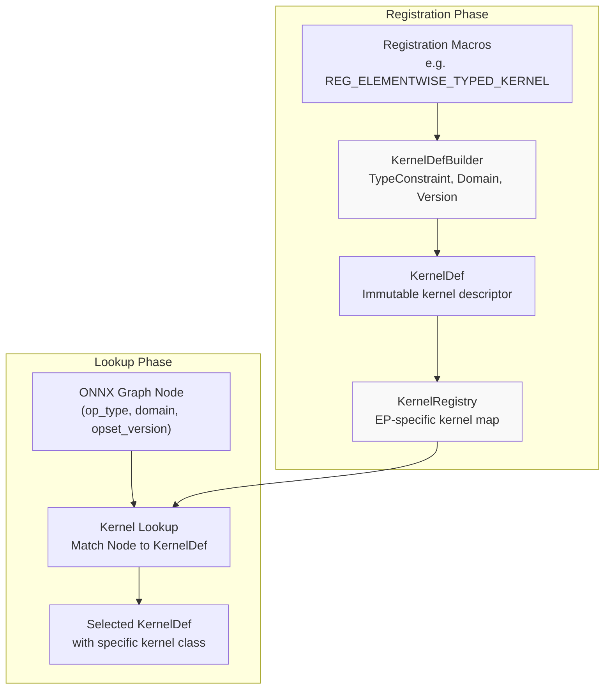
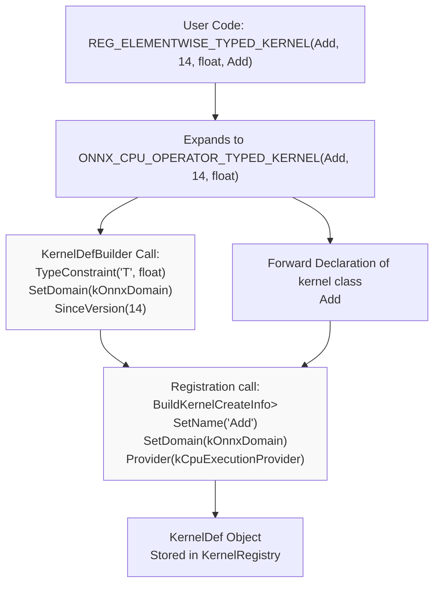
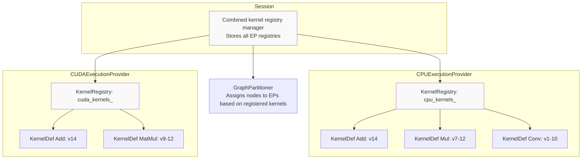
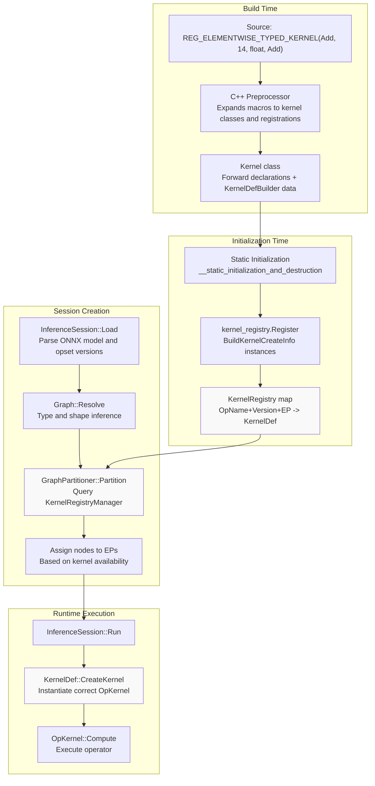

<!-- source: DeepWiki mcp.deepwiki.com · repo microsoft/onnxruntime · page 7.1 Operator Registration System · fetched 2026-10-21 -->

# Operator Registration System

<details>
<summary>Relevant source files</summary>

The following files were used as context for generating this wiki page:

- [docs/annotated_partitioning/future_directions_constrained_env.md](docs/annotated_partitioning/future_directions_constrained_env.md)
- [docs/contrib_ops/cuda/matmul_nbits.md](docs/contrib_ops/cuda/matmul_nbits.md)
- [include/onnxruntime/core/framework/execution_provider.h](include/onnxruntime/core/framework/execution_provider.h)
- [include/onnxruntime/core/framework/kernel_def_builder.h](include/onnxruntime/core/framework/kernel_def_builder.h)
- [include/onnxruntime/core/framework/kernel_registry.h](include/onnxruntime/core/framework/kernel_registry.h)
- [include/onnxruntime/core/framework/op_kernel.h](include/onnxruntime/core/framework/op_kernel.h)
- [include/onnxruntime/core/framework/workspace_input_shape.h](include/onnxruntime/core/framework/workspace_input_shape.h)
- [include/onnxruntime/core/framework/workspace_requirement.h](include/onnxruntime/core/framework/workspace_requirement.h)
- [include/onnxruntime/ep/adapter/op_kernel.h](include/onnxruntime/ep/adapter/op_kernel.h)
- [onnxruntime/contrib_ops/cuda/llm/fpA_intB_gemm/fpA_intB_gemm.h](onnxruntime/contrib_ops/cuda/llm/fpA_intB_gemm/fpA_intB_gemm.h)
- [onnxruntime/contrib_ops/cuda/llm/fpA_intB_gemm/fpA_intB_gemm_template.h](onnxruntime/contrib_ops/cuda/llm/fpA_intB_gemm/fpA_intB_gemm_template.h)
- [onnxruntime/contrib_ops/cuda/llm/fpA_intB_gemv/dispatcher.h](onnxruntime/contrib_ops/cuda/llm/fpA_intB_gemv/dispatcher.h)
- [onnxruntime/contrib_ops/cuda/llm/fpA_intB_gemv/fpA_intB_gemv.cu](onnxruntime/contrib_ops/cuda/llm/fpA_intB_gemv/fpA_intB_gemv.cu)
- [onnxruntime/contrib_ops/cuda/llm/fpA_intB_gemv/fpA_intB_gemv.h](onnxruntime/contrib_ops/cuda/llm/fpA_intB_gemv/fpA_intB_gemv.h)
- [onnxruntime/contrib_ops/cuda/quantization/matmul_nbits.cc](onnxruntime/contrib_ops/cuda/quantization/matmul_nbits.cc)
- [onnxruntime/contrib_ops/cuda/quantization/matmul_nbits.h](onnxruntime/contrib_ops/cuda/quantization/matmul_nbits.h)
- [onnxruntime/contrib_ops/cuda/quantization/matmul_nbits_workspace_estimate.h](onnxruntime/contrib_ops/cuda/quantization/matmul_nbits_workspace_estimate.h)
- [onnxruntime/core/framework/execution_provider.cc](onnxruntime/core/framework/execution_provider.cc)
- [onnxruntime/core/framework/kernel_def_builder.cc](onnxruntime/core/framework/kernel_def_builder.cc)
- [onnxruntime/core/framework/kernel_registry.cc](onnxruntime/core/framework/kernel_registry.cc)
- [onnxruntime/core/framework/kernel_registry_manager.cc](onnxruntime/core/framework/kernel_registry_manager.cc)
- [onnxruntime/core/framework/kernel_registry_manager.h](onnxruntime/core/framework/kernel_registry_manager.h)
- [onnxruntime/core/framework/node_shape_resolver.h](onnxruntime/core/framework/node_shape_resolver.h)
- [onnxruntime/test/contrib_ops/cuda_kernels/fpA_intB_gemm_kernel_test.cc](onnxruntime/test/contrib_ops/cuda_kernels/fpA_intB_gemm_kernel_test.cc)
- [onnxruntime/test/contrib_ops/matmul_4bits_test.cc](onnxruntime/test/contrib_ops/matmul_4bits_test.cc)
- [onnxruntime/test/framework/kernel_registry_test.cc](onnxruntime/test/framework/kernel_registry_test.cc)
- [onnxruntime/test/framework/max_shape_override_test.cc](onnxruntime/test/framework/max_shape_override_test.cc)
- [onnxruntime/test/providers/cuda/test_cases/matmul_nbits_e2e_workspace_test.cc](onnxruntime/test/providers/cuda/test_cases/matmul_nbits_e2e_workspace_test.cc)
- [onnxruntime/test/providers/cuda/test_cases/matmul_nbits_workspace_test.cc](onnxruntime/test/providers/cuda/test_cases/matmul_nbits_workspace_test.cc)
- [onnxruntime/test/python/quantization/test_op_matmulnbits_prepacked_cuda.py](onnxruntime/test/python/quantization/test_op_matmulnbits_prepacked_cuda.py)

</details>


## Purpose and Scope

The Operator Registration System in ONNX Runtime is responsible for managing the discovery, declaration, and organization of operator kernel implementations across various execution providers. It enables the runtime to identify which kernel to execute for each node in an ONNX computation graph, considering domains, opset versions, supported data types, and device capabilities.

This page provides a comprehensive technical explanation of the kernel registration macros, type constraints, opset versioning, and the kernel registry mechanism in ONNX Runtime. It covers both macro-level usage patterns and the underlying data structures and flow of control that enable kernel dispatch. For related details on execution providers, see [Execution Provider Interface](#6.1); for actual kernel implementations, see [Standard ONNX Operators](#7.2).

---

## Registration System Overview

Registration in ONNX Runtime is declarative and macro-driven. Each execution provider declares its supported operator kernels by registering kernel classes with metadata describing:

- **Operator identity**: ONNX domain, operator name, and opset version or version range
- **Type constraints**: Supported data types for each input and output argument
- **Execution provider**: Which hardware/back-end supports the kernel (e.g., CPU, CUDA)
- **Kernel class**: The C++ class implementing the operator kernel

This system enables flexible and extensible operator dispatching across providers while performing opset version resolution and precise type matching at graph partitioning and runtime.



**Sources:** [onnxruntime/core/providers/cpu/cpu_execution_provider.cc:1-67]()

---

## Registration Macros

Kernel registration is simplified via macros that expand to declare kernel template classes and register kernel definitions with detailed type constraints and opset versions.

### Basic Registration Macros

- `REG_ELEMENTWISE_TYPED_KERNEL(op_type, version, type, kernel_class)`  
  Registers a kernel for a given operator `op_type`, fixed single version `version`, templated on a single type `type`.  
  Example:

```cpp
REG_ELEMENTWISE_TYPED_KERNEL(Add, 14, float, Add)
```

Expands to:

- Forward declaration of kernel class `Add<float>`
- Registration of kernel with type constraint `"T" = float`
- Association with `kCpuExecutionProvider` and `kOnnxDomain`

- `REG_ELEMENTWISE_VERSIONED_TYPED_KERNEL(op_type, ver_from, ver_to, type, kernel_class)`  
  Registers a kernel covering an opset version range [ver_from, ver_to]. Example:

```cpp
REG_ELEMENTWISE_VERSIONED_TYPED_KERNEL(Add, 7, 12, float, Add)
```

**Sources:** [onnxruntime/core/providers/cpu/math/element_wise_ops.cc:80-104]()

### Advanced Multi-Constraint Macros

Certain operators require multiple distinct type constraints across inputs. For example, `Pow` may have a base and exponent with different types.

- `REG_ELEMENTWISE_VERSIONED_KERNEL_NONT(op_type, version, kernel_class, constraints)`  
  Uses explicit type constraint maps for complex scenarios.

- `REG_ELEMENTWISE_VERSIONED_KERNEL_NONT_2(op_type, version, kernel_class, t1_constraints, t2_constraints)`  
  Supports two separate type constraint lists for different input args.

Example for powerful variant:

```cpp
REG_ELEMENTWISE_VERSIONED_KERNEL_NONT_2(
  Pow, 12, 12, Pow,
  BuildKernelDefConstraintsFromTypeList<EnabledPow12BaseTypes>(),
  BuildKernelDefConstraintsFromTypeList<EnabledPow12ExpTypes>())
```

**Sources:** [onnxruntime/core/providers/cpu/math/element_wise_ops.cc:116-155](), [onnxruntime/core/providers/cpu/math/element_wise_ops.cc:308-321]()

---

## Type Constraints and Enabled Types

### Type Constraint Definition

Kernel definitions use type constraints to specify which input/output argument types are supported. This is crucial for precise kernel matching.

The codebase defines large sets of possible types for arguments using macro annotations:

```cpp
namespace op_kernel_type_control {
  ORT_SPECIFY_OP_KERNEL_ARG_DEFAULT_TYPES(
      kCpuExecutionProvider, kOnnxDomain, Max, 12, Input, 0,
      float, double, MLFloat16, int8_t, int32_t, uint32_t,
      int64_t, uint8_t, uint64_t);

  ORT_SPECIFY_OP_KERNEL_ARG_REQUIRED_TYPES(
      kCpuExecutionProvider, kOnnxDomain, Max, 12, Input, 0,
      int32_t, int64_t);
}
```

- `ORT_SPECIFY_OP_KERNEL_ARG_DEFAULT_TYPES` defines the full superset of types an operator implementation could support.
- `ORT_SPECIFY_OP_KERNEL_ARG_REQUIRED_TYPES` declares a minimum subset of types always enabled, even in binary size-optimized builds.

### Type Reduction and Enabled Type Lists

Based on build-time configuration, a resolved "Enabled Type List" is generated for each operator input argument:

```cpp
using EnabledMax12Types = ORT_OP_KERNEL_ARG_ENABLED_TYPE_LIST(
    kCpuExecutionProvider, kOnnxDomain, Max, 12, Input, 0);
```

This list is then used within type constraints during kernel registration. For example:

```cpp
REG_ELEMENTWISE_VERSIONED_KERNEL_NONT(Max, 8, 11, Max_8,
    BuildKernelDefConstraintsFromTypeList<EnabledMax8Types>())
```

Thus, the registration system can efficiently reduce the number of compiled kernel templates for a given build.

**Sources:** [onnxruntime/core/providers/cpu/math/element_wise_ops.cc:18-69]()

---

## Registration Macro Expansion Walkthrough

Understanding how registration macros expand reveals the relationship between user-facing registration and kernel registry contents.



- The user macro expands into a forward declaration of templated kernel classes and a `KernelDefBuilder` chain that describes the kernel's types, domain, and opset.
- The registration call creates `KernelCreateInfo` objects linking kernel classes to their metadata.
- These kernel definitions are stored within the provider's `KernelRegistry` at static initialization time.

**Sources:** [onnxruntime/core/providers/cpu/math/element_wise_ops.cc:80-86](), [onnxruntime/core/providers/cpu/cpu_execution_provider.cc:70-71]()

---

## Opset Versioning

ONNX operators evolve over opset versions introducing semantic changes, new types, or attributes. The registration system supports flexible versioning mechanisms:

### Versioned Kernel Registration

- Use range-based registrations for kernel implementations valid over a version range:

```cpp
REG_ELEMENTWISE_VERSIONED_TYPED_KERNEL(Add, 7, 12, float, Add)
```

- Use open-ended registrations (no `VERSIONED` suffix) for newest versions and beyond:

```cpp
REG_ELEMENTWISE_TYPED_KERNEL(Add, 14, float, Add)
```

- Support for overlapping or adjacent ranges enables smooth transitions between operator versions.

### Runtime Matching Behavior

When loading a model, the runtime determines the opset version of each node via the model's `opset_import`. During graph partitioning, kernels are matched by:

1. Operator name, domain, and opset version range
2. Compatibility of input/output types via type constraints
3. Execution provider kernel availability

The kernel matching confirms the best kernel for the node considering type and version fits.

**Sources:** [onnxruntime/core/providers/cpu/math/element_wise_ops.cc:157-178]()

---

## KernelRegistry Architecture

Each execution provider maintains its own `KernelRegistry` instance, a mapping from operator signatures and types to registered kernel implementations.



### KernelRegistry Population

Kernel registries are populated during static initialization, typically when an execution provider is constructed:

- Kernel classes are forward declared.
- Registration macros generate calls to add `KernelCreateInfo` objects to the `KernelRegistry`.

Example partial snippet of the CPU provider registration pattern:

```cpp
// Forward declaration block (hundreds of kernels)
class ONNX_OPERATOR_KERNEL_CLASS_NAME(kCpuExecutionProvider, kOnnxDomain, 1, MemcpyFromHost);
class ONNX_OPERATOR_VERSIONED_TYPED_KERNEL_CLASS_NAME(kCpuExecutionProvider, kOnnxDomain, 6, 12, float, Relu);
// ...

// Registration function calls for each known kernel
Status RegisterCPUKernels(KernelRegistry& kernel_registry) {
  // Calls to REG_ELEMENTWISE_TYPED_KERNEL etc.
  return Status::OK();
}
```

**Sources:** [onnxruntime/core/providers/cpu/cpu_execution_provider.cc:23-28](), [onnxruntime/core/providers/cpu/cpu_execution_provider.cc:58-67]()

---

## Execution Provider-Specific Registration

Different providers tailor the registration macros and patterns to fit particular artifact and type requirements.

### CPU Execution Provider Registration

The CPU execution provider extensively registers multiple typed versions of kernels, systematically covering all supported types:

```cpp
// Add operator registrations for various types
REG_ELEMENTWISE_TYPED_KERNEL(Add, 14, float, Add)
REG_ELEMENTWISE_TYPED_KERNEL(Add, 14, double, Add)
REG_ELEMENTWISE_TYPED_KERNEL(Add, 14, int8_t, Add)
REG_ELEMENTWISE_TYPED_KERNEL(Add, 14, int16_t, Add)
REG_ELEMENTWISE_TYPED_KERNEL(Add, 14, int32_t, Add)
REG_ELEMENTWISE_TYPED_KERNEL(Add, 14, int64_t, Add)
REG_ELEMENTWISE_TYPED_KERNEL(Add, 14, uint8_t, Add)
REG_ELEMENTWISE_TYPED_KERNEL(Add, 14, uint16_t, Add)
REG_ELEMENTWISE_TYPED_KERNEL(Add, 14, uint32_t, Add)
REG_ELEMENTWISE_TYPED_KERNEL(Add, 14, uint64_t, Add)
REG_ELEMENTWISE_TYPED_KERNEL(Add, 14, MLFloat16, Add)
```

### CUDA Execution Provider Registration

CUDA registration macros similarly enumerate types, sometimes with aggregates for concise declaration:

```cpp
#define BINARY_OP_BWUZCSILHFD(name, ver) \
  BINARY_OP_TYPED(name, ver, uint8_t)    \
  BINARY_OP_TYPED(name, ver, uint16_t)   \
  BINARY_OP_TYPED(name, ver, uint32_t)   \
  BINARY_OP_TYPED(name, ver, uint64_t)   \
  BINARY_OP_TYPED(name, ver, int8_t)     \
  BINARY_OP_TYPED(name, ver, int16_t)    \
  BINARY_OP_TYPED(name, ver, int32_t)    \
  BINARY_OP_TYPED(name, ver, int64_t)    \
  BINARY_OP_HFD(name, ver)

BINARY_OP_BWUZCSILHFD(Add, 14)
```

This pattern encodes types as key letters in the macro's name and automates the registrations.

**Sources:** [onnxruntime/core/providers/cuda/math/binary_elementwise_ops.cc:203-212]()

---

## Registration Flow and Kernel Lookup

The entire operator registration and lookup flow spans build-time macro expansion, initialization-time registry population, session creation graph partitioning, and runtime execution.



- **Build time:** Macros expand registration code with kernel templates and kernel definitions.
- **Initialization:** Static initialization code registers kernels into the per-provider `KernelRegistry`.
- **Session creation:** The runtime loads models, infers types/shapes, and partitions the graph nodes to appropriate execution providers by querying runtime combined registry.
- **Runtime execution:** The kernel implementation instantiates and executes for each node using the selected kernel class.

**Sources:** [onnxruntime/core/providers/cpu/cpu_execution_provider.cc:58-67](), [onnxruntime/core/providers/cpu/math/element_wise_ops.cc:157-179]()

---

## KernelDefBuilder and Multiple Type Constraints

The `KernelDefBuilder` is the fluent builder used in kernel registration to specify operator traits.

Example for single type constraint:

```cpp
KernelDefBuilder::Create()
    .SetName("Add")
    .SetDomain(kOnnxDomain)
    .SinceVersion(14)
    .Provider(kCpuExecutionProvider)
    .TypeConstraint("T", DataTypeImpl::GetTensorType<float>())
```

Example of multiple distinct type constraints for inputs:

```cpp
(*KernelDefBuilder::Create())
    .TypeConstraint("T", BuildKernelDefConstraintsFromTypeList<EnabledPow12BaseTypes>())
    .TypeConstraint("T1", BuildKernelDefConstraintsFromTypeList<EnabledPow12ExpTypes>())
```

This flexibility supports operators having different allowed types for different inputs, such as the base and exponent inputs for `Pow`.

**Sources:** [onnxruntime/core/providers/cpu/math/element_wise_ops.cc:311-313]()

---

## Backend Test Coverage for Registration

The kernel registration system integrates with tests to verify kernel availability and correctness across providers.

- Tests in Python and C++ load models with specific opset versions and operators.
- The test framework selects EPs and runs inference to validate output correctness.
- Known failures or unsupported cases are filtered using JSON based filters keyed by EP and type combination.

Example test filtering:

```python
filters = load_jsonc("onnx_backend_test_series_filters.jsonc")
current_failing_tests = apply_filters(filters, "current_failing_tests")

if backend.supports_device("DNNL"):
    current_failing_tests += apply_filters(filters, "current_failing_tests_DNNL")
```

The kernel registration system must ensure the correct matching kernels exist so tests trigger expected code paths.

**Sources:** [onnxruntime/test/python/onnx_backend_test_series.py:126-174](), [onnxruntime/test/onnx/main.cc:114-143]()

---

## Registration Best Practices

### Minimize Template Instantiations

Each combination of kernel template type and data type causes separate instantiations increasing binary size. Use type list controls and required types macros to reduce unnecessary builds:

```cpp
// Declare required minimal types to reduce compilation output
ORT_SPECIFY_OP_KERNEL_ARG_REQUIRED_TYPES(
    kCpuExecutionProvider, kOnnxDomain, Max, 12, Input, 0,
    int32_t, int64_t);
```

### Consistent and Clear Versioning

Maintain backward-compatible opset version ranges with clear kernel naming conventions:

```cpp
// Version range kernels:
REG_ELEMENTWISE_VERSIONED_TYPED_KERNEL(Add, 7, 12, float, Add)

// Single-version kernels:
REG_ELEMENTWISE_VERSIONED_TYPED_KERNEL(Add, 13, 13, float, Add)
REG_ELEMENTWISE_TYPED_KERNEL(Add, 14, float, Add)
```

When kernel semantics or signatures change significantly across opsets, implement kernel classes with postfix versions:

```cpp
class Max_6 final : public OpKernel {/* opset 6-7 */}
class Max_8 final : public OpKernel {/* opset 8-11 with broadcasting */}
```

---

# Summary

The Operator Registration System in ONNX Runtime provides a scalable, flexible framework to register and select operator kernels across execution providers, supported data types, and opset versions. It uses macro-driven registration, type constraints, and kernel registries keyed by operator identity, version, and provider type. This system enables efficient graph partitioning, kernel dispatch, and runtime inference across diverse hardware backends.

---

**Sources:**

- [onnxruntime/core/providers/cpu/cpu_execution_provider.cc:1-67]()

- [onnxruntime/core/providers/cpu/math/element_wise_ops.cc:18-178]()

- [onnxruntime/core/framework/kernel_registry.cc:1-176]()

- [onnxruntime/core/framework/kernel_registry_manager.cc:1-118]()

- [onnxruntime/core/framework/execution_provider.h:1-175]()

- [onnxruntime/core/framework/op_kernel.h:1-142]()

- [onnxruntime/core/framework/kernel_def_builder.cc:1-183]()

---

